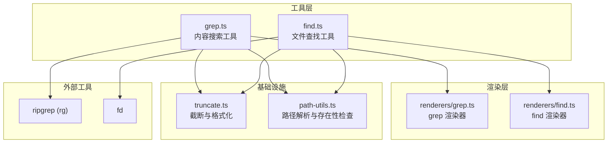
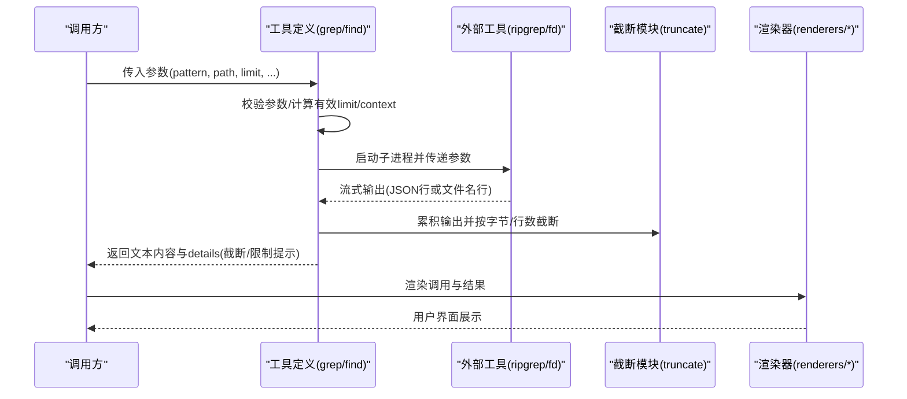
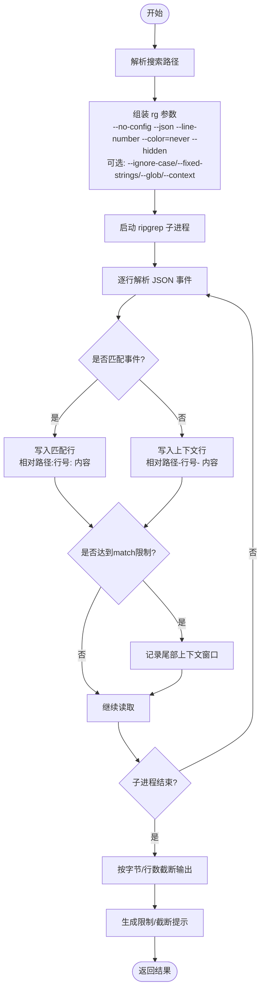
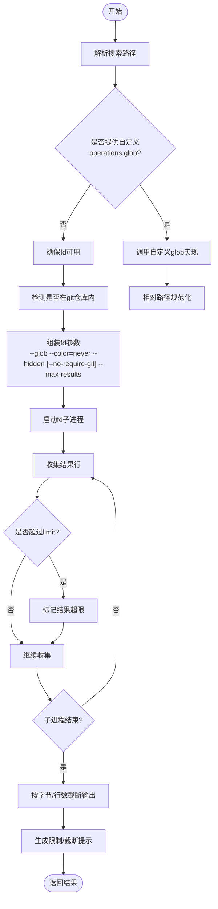
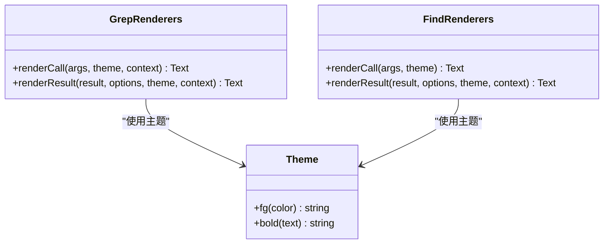
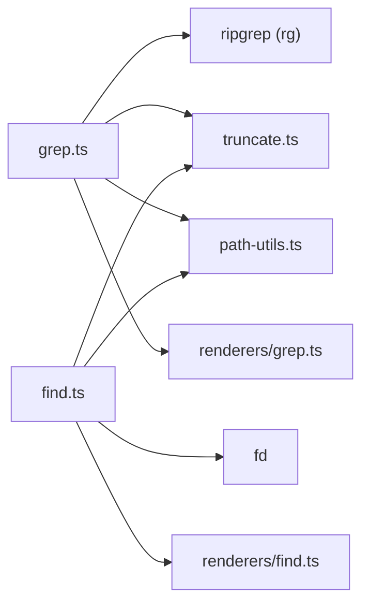

# 代码搜索工具

<cite>
**本文引用的文件**   
- [grep.ts](file://packages/coding-agent/src/core/tools/grep.ts)
- [find.ts](file://packages/coding-agent/src/core/tools/find.ts)
- [renderers/grep.ts](file://packages/coding-agent/src/core/tools/renderers/grep.ts)
- [renderers/find.ts](file://packages/coding-agent/src/core/tools/renderers/find.ts)
- [truncate.ts](file://packages/coding-agent/src/core/tools/truncate.ts)
- [path-utils.ts](file://packages/coding-agent/src/core/tools/path-utils.ts)
- [tools.test.ts](file://packages/coding-agent/test/tools.test.ts)
</cite>

## 目录
1. [简介](#简介)
2. [项目结构](#项目结构)
3. [核心组件](#核心组件)
4. [架构总览](#架构总览)
5. [详细组件分析](#详细组件分析)
6. [依赖关系分析](#依赖关系分析)
7. [性能与优化](#性能与优化)
8. [故障排查指南](#故障排查指南)
9. [结论](#结论)
10. [附录：使用示例与最佳实践](#附录使用示例与最佳实践)

## 简介
本仓库实现了两个面向代码库的搜索工具：
- find：基于 glob 模式查找文件路径，支持忽略规则、结果限制和输出截断。
- grep：基于正则或字面量匹配文件内容，支持上下文行、大小写不敏感、glob 过滤、结果限制和输出截断。

两者均通过外部高性能命令行工具实现实际扫描：
- find 默认调用 fd（若未提供自定义 glob 操作）。
- grep 默认调用 ripgrep（rg）。

工具输出统一经过字节/行数限制与头部截断，保证大仓库场景下的稳定与可控。

## 项目结构
围绕代码搜索能力的核心文件组织如下：
- 工具定义与执行逻辑：grep.ts、find.ts
- 渲染器（仅用于展示）：renderers/grep.ts、renderers/find.ts
- 通用截断与格式化：truncate.ts
- 路径解析与存在性检查：path-utils.ts
- 行为测试：tools.test.ts

**图表来源**
- [grep.ts:73-316](file://packages/coding-agent/src/core/tools/grep.ts#L73-L316)
- [find.ts:69-326](file://packages/coding-agent/src/core/tools/find.ts#L69-L326)
- [renderers/grep.ts:17-82](file://packages/coding-agent/src/core/tools/renderers/grep.ts#L17-L82)
- [renderers/find.ts:17-77](file://packages/coding-agent/src/core/tools/renderers/find.ts#L17-L77)
- [truncate.ts:11-13](file://packages/coding-agent/src/core/tools/truncate.ts#L11-L13)
- [path-utils.ts:31-50](file://packages/coding-agent/src/core/tools/path-utils.ts#L31-L50)

**章节来源**
- [grep.ts:73-316](file://packages/coding-agent/src/core/tools/grep.ts#L73-L316)
- [find.ts:69-326](file://packages/coding-agent/src/core/tools/find.ts#L69-L326)
- [renderers/grep.ts:17-82](file://packages/coding-agent/src/core/tools/renderers/grep.ts#L17-L82)
- [renderers/find.ts:17-77](file://packages/coding-agent/src/core/tools/renderers/find.ts#L17-L77)
- [truncate.ts:11-13](file://packages/coding-agent/src/core/tools/truncate.ts#L11-L13)
- [path-utils.ts:31-50](file://packages/coding-agent/src/core/tools/path-utils.ts#L31-L50)

## 核心组件
- grep 工具
  - 参数：pattern、path、glob、ignoreCase、literal、context、limit
  - 行为：调用 ripgrep，按 JSON 流解析 match/context 事件，构建带行号与相对路径的输出；支持上下文行、大小写不敏感、字面量匹配、glob 过滤；对输出进行字节/行数截断与长行截断。
- find 工具
  - 参数：pattern、path、limit
  - 行为：优先使用 fd 执行 glob 匹配；当提供自定义 operations.glob 时走自定义实现；对结果进行相对路径规范化与输出截断；在 git 仓库内保持 .gitignore 作用域隔离。

**章节来源**
- [grep.ts:20-46](file://packages/coding-agent/src/core/tools/grep.ts#L20-L46)
- [grep.ts:73-316](file://packages/coding-agent/src/core/tools/grep.ts#L73-L316)
- [find.ts:25-45](file://packages/coding-agent/src/core/tools/find.ts#L25-L45)
- [find.ts:69-326](file://packages/coding-agent/src/core/tools/find.ts#L69-L326)

## 架构总览
下图展示了从调用到外部工具、再到输出处理的完整流程。

**图表来源**
- [grep.ts:120-316](file://packages/coding-agent/src/core/tools/grep.ts#L120-L316)
- [find.ts:108-326](file://packages/coding-agent/src/core/tools/find.ts#L108-L326)
- [truncate.ts:78-159](file://packages/coding-agent/src/core/tools/truncate.ts#L78-L159)
- [renderers/grep.ts:71-82](file://packages/coding-agent/src/core/tools/renderers/grep.ts#L71-L82)
- [renderers/find.ts:66-77](file://packages/coding-agent/src/core/tools/renderers/find.ts#L66-L77)

## 详细组件分析

### grep 工具
- 功能要点
  - 使用 ripgrep 的 --json 模式，逐行解析 match 与 context 事件。
  - 支持：
    - 正则或字面量匹配（literal）
    - 大小写不敏感（ignoreCase）
    - 文件过滤（glob）
    - 上下文行（context）
    - 结果数量限制（limit）
  - 输出格式：
    - 匹配行：`相对路径:行号: 内容`
    - 上下文行：`相对路径-行号- 内容`
  - 截断策略：
    - 单行最大长度截断（GREP_MAX_LINE_LENGTH），避免超长行影响可读性。
    - 整体输出按 DEFAULT_MAX_BYTES 字节上限截断，同时记录 totalLines/totalBytes。
  - 限制提示：
    - 达到 match 限制时，提示可扩大 limit 或收紧 pattern。
    - 达到字节限制时，提示已触发大小上限。
    - 出现长行截断时，提示可使用 read 工具查看完整行。

**图表来源**
- [grep.ts:120-316](file://packages/coding-agent/src/core/tools/grep.ts#L120-L316)
- [truncate.ts:78-159](file://packages/coding-agent/src/core/tools/truncate.ts#L78-L159)

**章节来源**
- [grep.ts:20-46](file://packages/coding-agent/src/core/tools/grep.ts#L20-L46)
- [grep.ts:73-316](file://packages/coding-agent/src/core/tools/grep.ts#L73-L316)
- [truncate.ts:11-13](file://packages/coding-agent/src/core/tools/truncate.ts#L11-L13)
- [truncate.ts:78-159](file://packages/coding-agent/src/core/tools/truncate.ts#L78-L159)

### find 工具
- 功能要点
  - 默认使用 fd 执行 glob 匹配，支持：
    - 相对路径规范化（POSIX 分隔符）
    - 结果数量限制（limit）
    - 输出字节/行数截断
  - 忽略规则：
    - 非 git 仓库：添加 --no-require-git，使 .gitignore 生效。
    - git 仓库内：保持 fd 默认的 git-aware 行为，确保父级 .gitignore 不会泄漏到嵌套仓库边界之外。
  - 自定义扩展：
    - 可通过 FindOperations.glob 替换为远程或其他实现，此时忽略规则由调用方控制。
  - 路径处理：
    - 将绝对路径相对化到搜索根目录，并统一为正斜杠。

**图表来源**
- [find.ts:108-326](file://packages/coding-agent/src/core/tools/find.ts#L108-L326)
- [truncate.ts:78-159](file://packages/coding-agent/src/core/tools/truncate.ts#L78-L159)

**章节来源**
- [find.ts:25-45](file://packages/coding-agent/src/core/tools/find.ts#L25-L45)
- [find.ts:69-326](file://packages/coding-agent/src/core/tools/find.ts#L69-L326)
- [truncate.ts:78-159](file://packages/coding-agent/src/core/tools/truncate.ts#L78-L159)

### 渲染器
- grep 渲染器
  - 渲染调用信息：显示 pattern、path、glob、limit。
  - 渲染结果：默认最多显示 15 行，展开后显示全部；若存在匹配限制、字节限制或行截断，会显示警告提示。
- find 渲染器
  - 渲染调用信息：显示 pattern、path、limit。
  - 渲染结果：默认最多显示 20 行，展开后显示全部；若存在结果限制或字节限制，会显示警告提示。

**图表来源**
- [renderers/grep.ts:17-82](file://packages/coding-agent/src/core/tools/renderers/grep.ts#L17-L82)
- [renderers/find.ts:17-77](file://packages/coding-agent/src/core/tools/renderers/find.ts#L17-L77)

**章节来源**
- [renderers/grep.ts:17-82](file://packages/coding-agent/src/core/tools/renderers/grep.ts#L17-L82)
- [renderers/find.ts:17-77](file://packages/coding-agent/src/core/tools/renderers/find.ts#L17-L77)

## 依赖关系分析
- 工具对外部命令的依赖
  - grep 依赖 ripgrep（rg），不存在时会报错。
  - find 依赖 fd，不存在时会报错。
- 内部依赖
  - 两者都依赖 truncate.ts 进行输出截断与格式化。
  - 两者都依赖 path-utils.ts 进行路径解析与存在性检查。
  - 渲染器依赖主题与交互提示组件以美化输出。

**图表来源**
- [grep.ts:120-126](file://packages/coding-agent/src/core/tools/grep.ts#L120-L126)
- [find.ts:174-183](file://packages/coding-agent/src/core/tools/find.ts#L174-L183)
- [truncate.ts:11-13](file://packages/coding-agent/src/core/tools/truncate.ts#L11-L13)
- [path-utils.ts:31-50](file://packages/coding-agent/src/core/tools/path-utils.ts#L31-L50)
- [renderers/grep.ts:17-82](file://packages/coding-agent/src/core/tools/renderers/grep.ts#L17-L82)
- [renderers/find.ts:17-77](file://packages/coding-agent/src/core/tools/renderers/find.ts#L17-L77)

**章节来源**
- [grep.ts:120-126](file://packages/coding-agent/src/core/tools/grep.ts#L120-L126)
- [find.ts:174-183](file://packages/coding-agent/src/core/tools/find.ts#L174-L183)
- [truncate.ts:11-13](file://packages/coding-agent/src/core/tools/truncate.ts#L11-L13)
- [path-utils.ts:31-50](file://packages/coding-agent/src/core/tools/path-utils.ts#L31-L50)

## 性能与优化
- 使用外部高性能工具
  - ripgrep 与 fd 均为 C 实现的高性能工具，适合大规模代码库。
- 流式处理与早停
  - grep 通过 ripgrep 的 JSON 流解析，边读边处理，并在达到 match 限制后尽快终止子进程。
  - find 通过 fd 的 --max-results 提前停止扫描，减少不必要 I/O。
- 输出体积控制
  - 统一的 DEFAULT_MAX_BYTES（50KB）与 DEFAULT_MAX_LINES（2000行）限制，防止 UI 卡顿。
  - grep 额外对单行内容进行长度截断，避免超长行拖慢渲染。
- 忽略规则与范围控制
  - find 在非 git 仓库中使用 --no-require-git 启用 .gitignore；在 git 仓库中保持 fd 的 git-aware 行为，避免跨仓库污染。
  - grep 通过 ripgrep 的 --hidden 与 .gitignore 语义，配合 glob 精确缩小搜索范围。
- 建议
  - 尽量使用更具体的 glob 与 pattern，减少扫描范围。
  - 合理设置 limit，避免一次返回过多结果。
  - 对超大仓库，优先限定 path 到子目录，并结合 glob 过滤后缀。
  - 遇到大量匹配时，先收紧 pattern 再逐步放宽。

[本节为通用指导，不直接分析具体文件]

## 故障排查指南
- ripgrep 不可用
  - 现象：grep 工具报错提示 rg 不可用且无法下载。
  - 排查：确认系统 PATH 中存在 rg，或允许工具自动下载。
- fd 不可用
  - 现象：find 工具报错提示 fd 不可用且无法下载。
  - 排查：确认系统 PATH 中存在 fd，或允许工具自动下载。
- 路径不存在
  - 现象：报“Path not found”错误。
  - 排查：确认传入的 path 是否存在且可访问。
- 无匹配结果
  - 现象：返回“No matches found”或“No files found matching pattern”。
  - 排查：检查 pattern/glob 是否正确，必要时关闭 ignoreCase 或 literal 切换模式。
- 结果被截断
  - 现象：输出末尾出现“limit reached”或“some lines truncated”提示。
  - 排查：增大 limit 或收紧 pattern；对于长行，使用 read 工具查看完整行。
- 忽略规则异常
  - 现象：find 在不同目录下忽略了不应忽略的文件。
  - 排查：确认是否在 git 仓库内；检查各层级 .gitignore 的作用域。

**章节来源**
- [grep.ts:120-126](file://packages/coding-agent/src/core/tools/grep.ts#L120-L126)
- [find.ts:174-183](file://packages/coding-agent/src/core/tools/find.ts#L174-L183)
- [find.ts:185-203](file://packages/coding-agent/src/core/tools/find.ts#L185-L203)
- [truncate.ts:11-13](file://packages/coding-agent/src/core/tools/truncate.ts#L11-L13)

## 结论
- find 与 grep 通过封装 fd 与 ripgrep，提供了高效、可控的代码搜索能力。
- 两者均具备完善的忽略规则支持、结果限制与输出截断机制，适合大型代码库。
- 渲染器将复杂细节抽象为用户友好的提示与展示。
- 在实际使用中，应结合具体场景选择合适的 pattern/glob、limit 与 path，以获得最佳性能与体验。

[本节为总结性内容，不直接分析具体文件]

## 附录：使用示例与最佳实践

- 基础用法
  - 在指定目录中查找符合 glob 的文件：
    - find: pattern="*.ts", path="./src", limit=200
  - 在指定文件中搜索字面量匹配：
    - grep: pattern="TODO", path="./README.md", literal=true

- 高级用法
  - 递归查找测试文件并限制结果：
    - find: pattern="**/*.spec.ts", path="./packages", limit=500
  - 搜索 TypeScript 函数声明并显示上下文：
    - grep: pattern="function\\s+\\w+", glob="*.ts", context=2, ignoreCase=false
  - 大小写不敏感搜索并限制匹配数：
    - grep: pattern="error", ignoreCase=true, limit=50

- 结果解读
  - grep 输出包含匹配行与上下文行，并附带相对路径与行号。
  - find 输出为相对路径列表，便于后续批量处理。

- 性能调优
  - 优先缩小 path 与 glob 范围。
  - 合理设置 limit，避免一次性返回过多结果。
  - 对超大仓库，分目录多次搜索，合并结果。
  - 使用 literal=true 进行简单字符串匹配，减少正则开销。

- 行为验证参考
  - 单文件搜索包含文件名与行号的输出格式。
  - 全局 limit 与 context 组合时的输出与提示信息。

**章节来源**
- [tools.test.ts:877-910](file://packages/coding-agent/test/tools.test.ts#L877-L910)