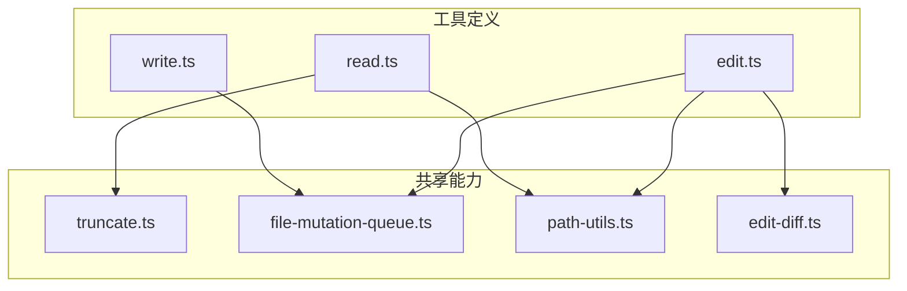
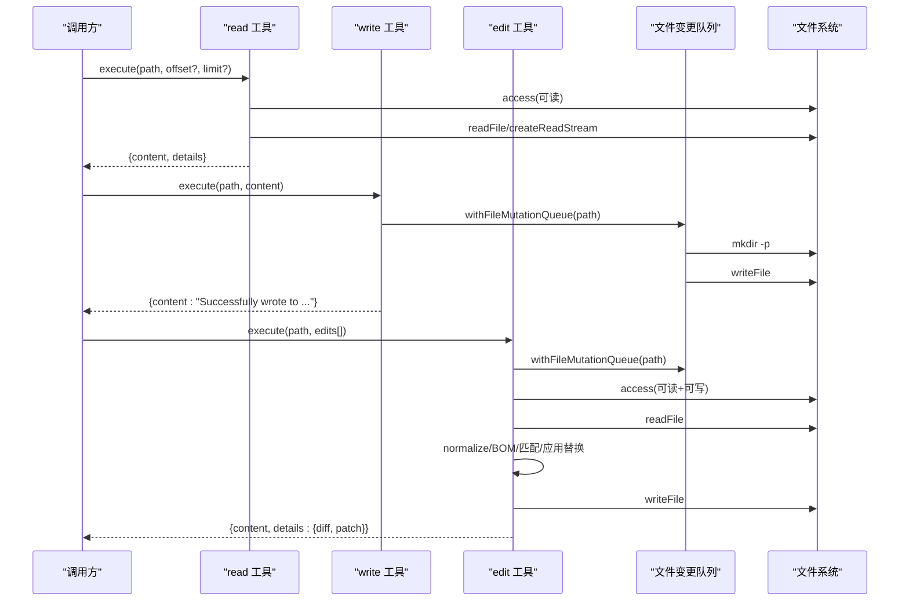
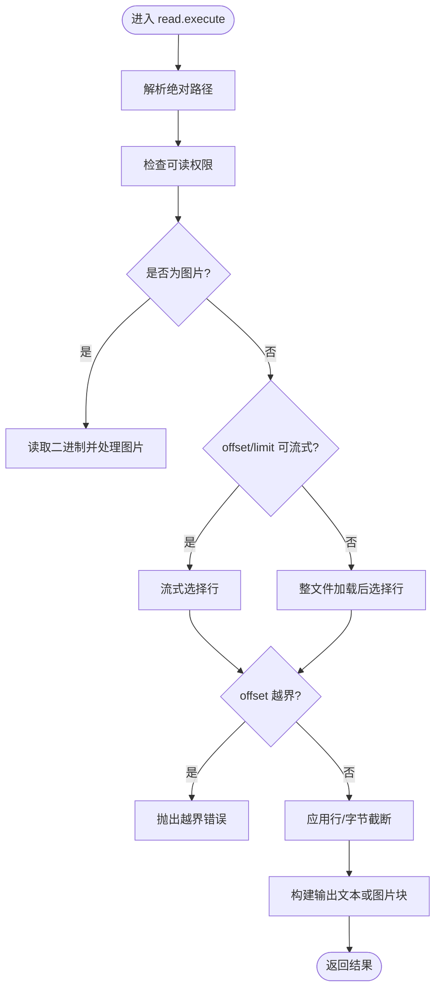
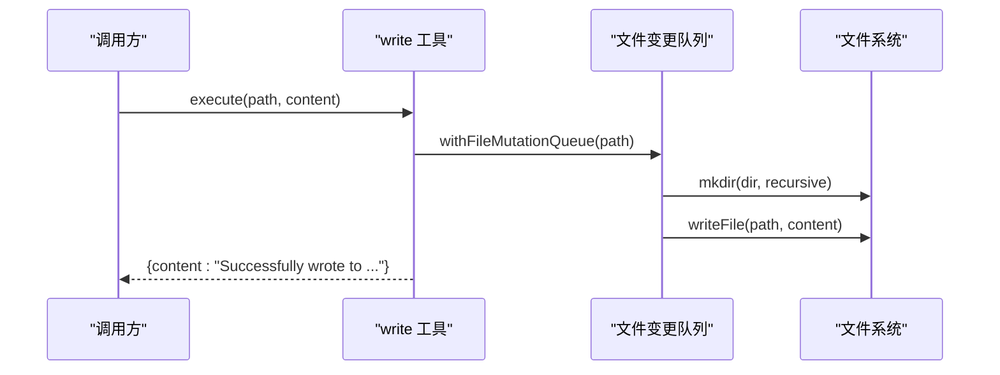
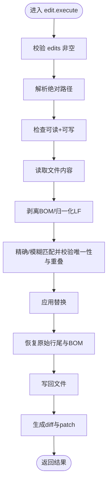
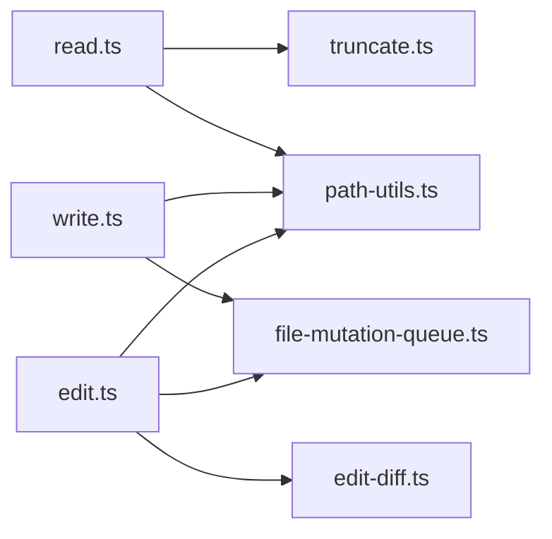

# 文件操作工具

<cite>
**本文引用的文件**
- [read.ts](file://packages/coding-agent/src/core/tools/read.ts)
- [write.ts](file://packages/coding-agent/src/core/tools/write.ts)
- [edit.ts](file://packages/coding-agent/src/core/tools/edit.ts)
- [truncate.ts](file://packages/coding-agent/src/core/tools/truncate.ts)
- [file-mutation-queue.ts](file://packages/coding-agent/src/core/tools/file-mutation-queue.ts)
- [path-utils.ts](file://packages/coding-agent/src/core/tools/path-utils.ts)
- [edit-diff.ts](file://packages/coding-agent/src/core/tools/edit-diff.ts)
- [tools.test.ts](file://packages/coding-agent/test/tools.test.ts)
- [file-mutation-queue.test.ts](file://packages/coding-agent/test/file-mutation-queue.test.ts)
</cite>

## 目录
1. [简介](#简介)
2. [项目结构](#项目结构)
3. [核心组件](#核心组件)
4. [架构总览](#架构总览)
5. [详细组件分析](#详细组件分析)
6. [依赖关系分析](#依赖关系分析)
7. [性能与截断策略](#性能与截断策略)
8. [安全与权限控制](#安全与权限控制)
9. [编码处理与行尾保留](#编码处理与行尾保留)
10. [使用示例与最佳实践](#使用示例与最佳实践)
11. [故障排查](#故障排查)
12. [结论](#结论)

## 简介
本文件操作工具集提供三个核心能力：读取文件、写入文件和精确编辑文件。它们面向代码智能体与自动化工作流，强调可插拔的底层 I/O、稳定的并发序列化、安全的权限检查、可控的输出截断以及良好的错误提示。

- read：支持文本与图片；对大文本采用流式读取并按行/字节限制截断；返回结构化内容（文本或图片块）。
- write：创建或覆盖文件，自动创建父目录；通过队列串行化同一文件的写操作。
- edit：基于“旧文本→新文本”的精确替换，支持批量、去重、重叠检测、模糊匹配与差异输出；保持原始行尾风格与 BOM。

## 项目结构
文件操作工具位于 `packages/coding-agent/src/core/tools` 下，围绕三个工具定义文件组织：

**图表来源**
- [read.ts:1-12](file://packages/coding-agent/src/core/tools/read.ts#L1-L12)
- [write.ts:1-8](file://packages/coding-agent/src/core/tools/write.ts#L1-L8)
- [edit.ts:1-18](file://packages/coding-agent/src/core/tools/edit.ts#L1-L18)
- [truncate.ts:1-13](file://packages/coding-agent/src/core/tools/truncate.ts#L1-L13)
- [file-mutation-queue.ts:1-6](file://packages/coding-agent/src/core/tools/file-mutation-queue.ts#L1-L6)
- [path-utils.ts:1-4](file://packages/coding-agent/src/core/tools/path-utils.ts#L1-L4)
- [edit-diff.ts:1-9](file://packages/coding-agent/src/core/tools/edit-diff.ts#L1-L9)

**章节来源**
- [read.ts:1-12](file://packages/coding-agent/src/core/tools/read.ts#L1-L12)
- [write.ts:1-8](file://packages/coding-agent/src/core/tools/write.ts#L1-L8)
- [edit.ts:1-18](file://packages/coding-agent/src/core/tools/edit.ts#L1-L18)

## 核心组件
- read 工具：负责读取文本或图片，按 offset/limit 分页，按默认行/字节上限截断，并返回结构化输出。
- write 工具：负责创建/覆盖文件，自动创建父目录，并通过文件变更队列保证同文件写操作的串行化。
- edit 工具：负责在原始文件中执行一组不重叠的精确替换，生成 diff 与 patch，并保留原始行尾和 BOM。

**章节来源**
- [read.ts:14-38](file://packages/coding-agent/src/core/tools/read.ts#L14-L38)
- [write.ts:10-20](file://packages/coding-agent/src/core/tools/write.ts#L10-L20)
- [edit.ts:20-50](file://packages/coding-agent/src/core/tools/edit.ts#L20-L50)

## 架构总览
三个工具共享以下横切关注点：
- 路径解析与平台兼容：统一将相对路径解析为绝对路径，并处理 macOS 文件名变体。
- 权限校验：读前检查可读，编辑前检查可读可写。
- 并发控制：写与编辑通过队列串行化，避免竞态。
- 截断与输出：读工具根据行/字节限制截断，并提供继续读取提示。
- 编码与格式：编辑工具识别并恢复原始行尾，剥离 BOM 后匹配，再写回时恢复 BOM。

**图表来源**
- [read.ts:228-357](file://packages/coding-agent/src/core/tools/read.ts#L228-L357)
- [write.ts:43-91](file://packages/coding-agent/src/core/tools/write.ts#L43-L91)
- [edit.ts:140-212](file://packages/coding-agent/src/core/tools/edit.ts#L140-L212)
- [file-mutation-queue.ts:28-61](file://packages/coding-agent/src/core/tools/file-mutation-queue.ts#L28-L61)

## 详细组件分析

### read 工具
- 输入参数
  - path：字符串，文件或图片路径（相对或绝对）。
  - offset：可选数字，从第几行开始（1 起始）。
  - limit：可选数字，最多读取的行数。
- 输出格式
  - 文本文件：字符串。
  - 图片文件：对象 `{ type: "image", data, mimeType, note }`。
  - details：包含截断信息（如是否被行/字节限制截断）。
- 行为要点
  - 先进行可读性检查。
  - 若为图片，则解码并可能自动缩放，返回图片块与说明文本。
  - 若为文本，优先尝试流式读取；否则整文件加载。
  - 支持 offset/limit 分页；当超过默认行/字节限制时，会给出继续读取的提示。
  - 单行超长时会提示使用 bash 命令截取。
- 可插拔接口
  - operations.readFile / access / detectImageMimeType / createReadStream。
- 关键实现位置
  - 参数与输出 Schema：[read.ts:14-38](file://packages/coding-agent/src/core/tools/read.ts#L14-L38)
  - 默认操作与流式读取：[read.ts:63-84](file://packages/coding-agent/src/core/tools/read.ts#L63-L84)
  - 执行流程与截断提示：[read.ts:228-357](file://packages/coding-agent/src/core/tools/read.ts#L228-L357)

**图表来源**
- [read.ts:244-357](file://packages/coding-agent/src/core/tools/read.ts#L244-L357)

**章节来源**
- [read.ts:14-38](file://packages/coding-agent/src/core/tools/read.ts#L14-L38)
- [read.ts:63-84](file://packages/coding-agent/src/core/tools/read.ts#L63-L84)
- [read.ts:228-357](file://packages/coding-agent/src/core/tools/read.ts#L228-L357)

### write 工具
- 输入参数
  - path：字符串，目标文件路径。
  - content：字符串，要写入的内容。
- 输出格式
  - 成功：文本消息“已成功写入到某路径”。
- 行为要点
  - 自动创建父目录。
  - 通过文件变更队列串行化同一文件的写操作。
  - 支持 AbortSignal 中断，并在每个 await 后检查中断状态。
- 可插拔接口
  - operations.writeFile / mkdir。
- 关键实现位置
  - 参数与默认操作：[write.ts:10-36](file://packages/coding-agent/src/core/tools/write.ts#L10-L36)
  - 执行流程与队列：[write.ts:43-91](file://packages/coding-agent/src/core/tools/write.ts#L43-L91)

**图表来源**
- [write.ts:43-91](file://packages/coding-agent/src/core/tools/write.ts#L43-L91)
- [file-mutation-queue.ts:28-61](file://packages/coding-agent/src/core/tools/file-mutation-queue.ts#L28-L61)

**章节来源**
- [write.ts:10-36](file://packages/coding-agent/src/core/tools/write.ts#L10-L36)
- [write.ts:43-91](file://packages/coding-agent/src/core/tools/write.ts#L43-L91)

### edit 工具
- 输入参数
  - path：字符串，目标文件路径。
  - edits：数组，每项包含 oldText/newText，要求唯一且不重叠。
- 输出格式
  - content：成功消息。
  - details：包含 diff 文本、标准 unified patch 与首次变更行号。
- 行为要点
  - 校验 edits 非空且 oldText 非空。
  - 检查文件可读可写。
  - 读取文件，剥离 BOM，归一化为 LF，执行精确/模糊匹配与替换。
  - 写回时恢复原始行尾与 BOM。
  - 生成 diff 与 patch 供展示与编辑器导航。
- 可插拔接口
  - operations.readFile / writeFile / access。
- 关键实现位置
  - 参数与默认操作：[edit.ts:20-98](file://packages/coding-agent/src/core/tools/edit.ts#L20-L98)
  - 执行流程与差异生成：[edit.ts:140-212](file://packages/coding-agent/src/core/tools/edit.ts#L140-L212)
  - 匹配与替换逻辑：[edit-diff.ts:300-362](file://packages/coding-agent/src/core/tools/edit-diff.ts#L300-L362)

**图表来源**
- [edit.ts:140-212](file://packages/coding-agent/src/core/tools/edit.ts#L140-L212)
- [edit-diff.ts:300-362](file://packages/coding-agent/src/core/tools/edit-diff.ts#L300-L362)

**章节来源**
- [edit.ts:20-98](file://packages/coding-agent/src/core/tools/edit.ts#L20-L98)
- [edit.ts:140-212](file://packages/coding-agent/src/core/tools/edit.ts#L140-L212)
- [edit-diff.ts:300-362](file://packages/coding-agent/src/core/tools/edit-diff.ts#L300-L362)

## 依赖关系分析
- read 依赖
  - truncate：行/字节截断与格式化。
  - path-utils：路径解析与平台兼容。
  - image/mime 工具：图片类型检测与处理（外部模块）。
- write 依赖
  - file-mutation-queue：同文件写操作串行化。
  - path-utils：路径解析。
- edit 依赖
  - edit-diff：行尾检测、规范化、模糊匹配、差异生成。
  - file-mutation-queue：同文件编辑串行化。
  - path-utils：路径解析。

**图表来源**
- [read.ts:1-12](file://packages/coding-agent/src/core/tools/read.ts#L1-L12)
- [write.ts:1-8](file://packages/coding-agent/src/core/tools/write.ts#L1-L8)
- [edit.ts:1-18](file://packages/coding-agent/src/core/tools/edit.ts#L1-L18)

**章节来源**
- [read.ts:1-12](file://packages/coding-agent/src/core/tools/read.ts#L1-L12)
- [write.ts:1-8](file://packages/coding-agent/src/core/tools/write.ts#L1-L8)
- [edit.ts:1-18](file://packages/coding-agent/src/core/tools/edit.ts#L1-L18)

## 性能与截断策略
- 默认截断阈值
  - 最大行数：2000 行。
  - 最大字节数：50KB。
- 截断规则
  - 头截断（read）：优先保留开头完整行；若首行即超字节限制，返回空内容并标记 firstLineExceedsLimit。
  - 尾截断（其他工具）：保留末尾完整行；极端情况下允许最后一行部分截断。
- 流式读取
  - read 工具在满足条件时使用流式读取，仅缓存需要显示的行，降低内存占用。
- 用户限定的 limit
  - 用户指定的 limit 优先于内部截断；若仍有剩余内容，会提示继续使用 offset 翻页。

**章节来源**
- [truncate.ts:11-12](file://packages/coding-agent/src/core/tools/truncate.ts#L11-L12)
- [truncate.ts:78-159](file://packages/coding-agent/src/core/tools/truncate.ts#L78-L159)
- [truncate.ts:168-241](file://packages/coding-agent/src/core/tools/truncate.ts#L168-L241)
- [read.ts:128-135](file://packages/coding-agent/src/core/tools/read.ts#L128-L135)
- [read.ts:141-226](file://packages/coding-agent/src/core/tools/read.ts#L141-L226)
- [read.ts:313-341](file://packages/coding-agent/src/core/tools/read.ts#L313-L341)

## 安全与权限控制
- 读权限检查
  - read 在执行前调用 access(R_OK)。
- 编辑权限检查
  - edit 在执行前调用 access(R_OK | W_OK)，失败时包装错误信息并包含错误码。
- 路径安全
  - 所有工具均通过路径解析函数将相对路径解析为绝对路径，避免路径混淆。
- 并发安全
  - write 与 edit 通过文件变更队列串行化同一文件的写操作，避免竞态。

**章节来源**
- [read.ts:264-270](file://packages/coding-agent/src/core/tools/read.ts#L264-L270)
- [edit.ts:171-179](file://packages/coding-agent/src/core/tools/edit.ts#L171-L179)
- [path-utils.ts:44-50](file://packages/coding-agent/src/core/tools/path-utils.ts#L44-L50)
- [file-mutation-queue.ts:28-61](file://packages/coding-agent/src/core/tools/file-mutation-queue.ts#L28-L61)

## 编码处理与行尾保留
- 编码
  - 读/写默认使用 UTF-8。
  - 流式读取使用 TextDecoder(utf-8, ignoreBOM: true) 以忽略 BOM。
- BOM 处理
  - edit 在匹配前剥离 BOM，写回时恢复 BOM。
- 行尾风格
  - edit 检测原始行尾（CRLF/LF），在匹配与替换过程中统一为 LF，写回时恢复原始行尾。

**章节来源**
- [read.ts:141-150](file://packages/coding-agent/src/core/tools/read.ts#L141-L150)
- [edit.ts:183-195](file://packages/coding-agent/src/core/tools/edit.ts#L183-L195)
- [edit-diff.ts:11-25](file://packages/coding-agent/src/core/tools/edit-diff.ts#L11-L25)

## 使用示例与最佳实践

### 读取文件内容
- 基本用法
  - 指定 path，必要时使用 offset/limit 分页。
- 大文件建议
  - 优先使用 offset/limit 逐步读取；注意默认行/字节限制。
- 图片文件
  - 自动识别并返回图片块；若模型不支持图像，会附带说明文本。

参考实现位置
- [read.ts:228-357](file://packages/coding-agent/src/core/tools/read.ts#L228-L357)

### 写入新文件或覆盖现有文件
- 基本用法
  - 指定 path 与 content；会自动创建父目录。
- 并发建议
  - 同一文件的多次写操作会被串行化，无需手动加锁。

参考实现位置
- [write.ts:43-91](file://packages/coding-agent/src/core/tools/write.ts#L43-L91)

### 编辑现有文件
- 基本用法
  - 指定 path 与 edits[]；确保 oldText 唯一且不重叠。
- 批量编辑
  - 将多个不重叠的改动合并为一个 edits[]，减少调用次数。
- 差异预览
  - 可使用差异生成能力查看变更与补丁。

参考实现位置
- [edit.ts:140-212](file://packages/coding-agent/src/core/tools/edit.ts#L140-L212)
- [edit-diff.ts:364-499](file://packages/coding-agent/src/core/tools/edit-diff.ts#L364-L499)

### 最佳实践
- 读取
  - 始终考虑 offset/limit；遇到超大行时按提示使用 shell 命令截取。
- 写入
  - 尽量原子化写入；如需增量更新，优先使用 edit。
- 编辑
  - oldText 应尽可能短且唯一；相邻改动合并以减少重叠风险。
  - 注意空白字符与换行符；必要时使用差异输出辅助定位。

## 故障排查

### 常见问题
- 读取时报 offset 越界
  - 现象：提示 offset 超出文件行数。
  - 原因：offset 大于等于文件总行数。
  - 解决：调整 offset 或使用更小的 limit。
- 编辑时报找不到旧文本
  - 现象：提示无法找到 exact text。
  - 原因：oldText 与原文不完全一致（含空白/换行/Unicode 差异）。
  - 解决：缩小 oldText 范围，增加上下文使其唯一；或确认 Unicode 与行尾差异。
- 编辑时报重复匹配
  - 现象：提示存在多处匹配。
  - 原因：oldText 在文件中出现多次。
  - 解决：扩大上下文使匹配唯一。
- 编辑时报重叠
  - 现象：提示 edits 重叠。
  - 原因：两个或多个 edits 的目标区域重叠。
  - 解决：合并为一个 edit 或改为不相邻区域。
- 编辑只读文件
  - 现象：提示 EACCES。
  - 原因：文件无写权限。
  - 解决：修改文件权限或改用只读场景。

参考测试用例
- [tools.test.ts:282-303](file://packages/coding-agent/test/tools.test.ts#L282-L303)
- [tools.test.ts:431-474](file://packages/coding-agent/test/tools.test.ts#L431-L474)

### 并发与一致性
- 现象：同时调用 edit 与 write 修改同一文件。
- 行为：通过文件变更队列串行化，最终结果为最后一次写入。
- 验证
  - 测试覆盖了 edit 与 write 共享队列的场景。

参考测试用例
- [file-mutation-queue.test.ts:131-174](file://packages/coding-agent/test/file-mutation-queue.test.ts#L131-L174)

**章节来源**
- [tools.test.ts:282-303](file://packages/coding-agent/test/tools.test.ts#L282-L303)
- [tools.test.ts:431-474](file://packages/coding-agent/test/tools.test.ts#L431-L474)
- [file-mutation-queue.test.ts:131-174](file://packages/coding-agent/test/file-mutation-queue.test.ts#L131-L174)

## 结论
read、write、edit 三个工具提供了稳定、安全、可扩展的文件操作能力。通过可插拔的 I/O 抽象、严格的权限检查、统一的截断策略与并发队列，它们在复杂自动化场景中具备高可靠性。遵循本文的最佳实践，可以显著降低误用风险并提升整体效率。