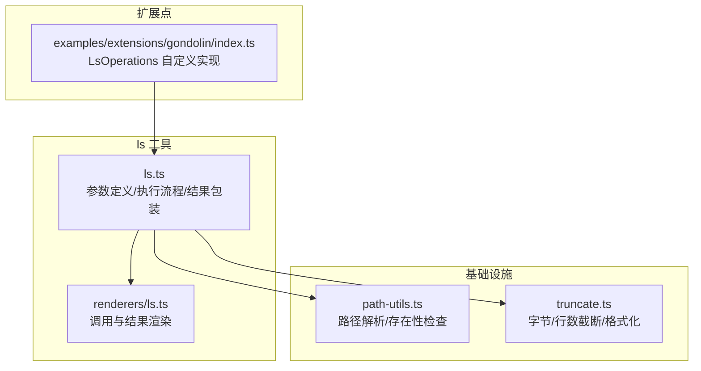
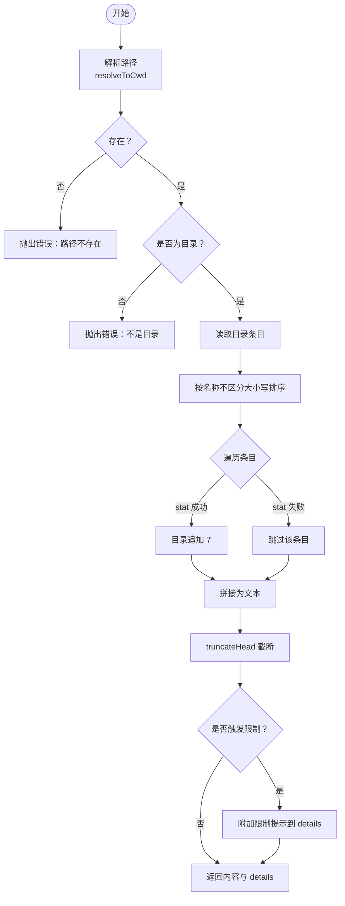
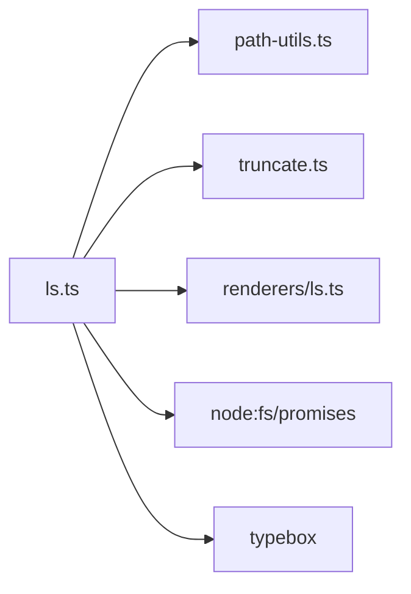

# 目录浏览工具

<cite>
**本文引用的文件**   
- [packages/coding-agent/src/core/tools/ls.ts](file://packages/coding-agent/src/core/tools/ls.ts)
- [packages/coding-agent/src/core/tools/renderers/ls.ts](file://packages/coding-agent/src/core/tools/renderers/ls.ts)
- [packages/coding-agent/src/core/tools/path-utils.ts](file://packages/coding-agent/src/core/tools/path-utils.ts)
- [packages/coding-agent/src/core/tools/truncate.ts](file://packages/coding-agent/src/core/tools/truncate.ts)
- [packages/coding-agent/examples/extensions/gondolin/index.ts](file://packages/coding-agent/examples/extensions/gondolin/index.ts)
</cite>

## 目录
1. [简介](#简介)
2. [项目结构](#项目结构)
3. [核心组件](#核心组件)
4. [架构总览](#架构总览)
5. [详细组件分析](#详细组件分析)
6. [依赖关系分析](#依赖关系分析)
7. [性能与容量控制](#性能与容量控制)
8. [使用示例与最佳实践](#使用示例与最佳实践)
9. [故障排查](#故障排查)
10. [结论](#结论)

## 简介
本文件面向“目录浏览工具”（ls）的实现与使用，覆盖以下方面：
- 文件列表功能、排序规则与显示格式
- 路径解析、权限检查与安全过滤机制
- 递归遍历、符号链接处理与特殊文件类型支持现状
- 输出截断策略与大目录优化建议
- 典型使用场景与最佳实践

该工具以 Node.js 的 fs/promises 为默认后端，同时通过可插拔操作接口允许替换为远程或沙箱环境中的文件系统实现。

## 项目结构
围绕 ls 工具的相关代码主要位于 coding-agent 包的 core/tools 子系统中，渲染逻辑独立在 renderers 中，路径解析与截断能力由通用工具模块提供。

图表来源
- [packages/coding-agent/src/core/tools/ls.ts:1-176](file://packages/coding-agent/src/core/tools/ls.ts#L1-L176)
- [packages/coding-agent/src/core/tools/renderers/ls.ts:1-71](file://packages/coding-agent/src/core/tools/renderers/ls.ts#L1-L71)
- [packages/coding-agent/src/core/tools/path-utils.ts:1-119](file://packages/coding-agent/src/core/tools/path-utils.ts#L1-L119)
- [packages/coding-agent/src/core/tools/truncate.ts:1-303](file://packages/coding-agent/src/core/tools/truncate.ts#L1-L303)
- [packages/coding-agent/examples/extensions/gondolin/index.ts:122-135](file://packages/coding-agent/examples/extensions/gondolin/index.ts#L122-L135)

章节来源
- [packages/coding-agent/src/core/tools/ls.ts:1-176](file://packages/coding-agent/src/core/tools/ls.ts#L1-L176)
- [packages/coding-agent/src/core/tools/renderers/ls.ts:1-71](file://packages/coding-agent/src/core/tools/renderers/ls.ts#L1-L71)
- [packages/coding-agent/src/core/tools/path-utils.ts:1-119](file://packages/coding-agent/src/core/tools/path-utils.ts#L1-L119)
- [packages/coding-agent/src/core/tools/truncate.ts:1-303](file://packages/coding-agent/src/core/tools/truncate.ts#L1-L303)

## 核心组件
- 工具定义与执行器：负责参数校验、路径解析、存在性与目录判断、读取条目、排序、后缀标记、截断与返回。
- 渲染器：将调用参数与结果文本进行 UI 友好展示，并提示截断与限制信息。
- 路径工具：统一处理相对路径、~展开、Unicode 空格与引号变体兼容等。
- 截断工具：基于行数和字节数双重上限对输出进行安全截断，并提供人类可读的大小格式化。
- 扩展点：通过 LsOperations 接口替换底层 exists/stat/readdir 实现，适配远程或沙箱环境。

章节来源
- [packages/coding-agent/src/core/tools/ls.ts:10-51](file://packages/coding-agent/src/core/tools/ls.ts#L10-L51)
- [packages/coding-agent/src/core/tools/renderers/ls.ts:17-70](file://packages/coding-agent/src/core/tools/renderers/ls.ts#L17-L70)
- [packages/coding-agent/src/core/tools/path-utils.ts:31-50](file://packages/coding-agent/src/core/tools/path-utils.ts#L31-L50)
- [packages/coding-agent/src/core/tools/truncate.ts:11-45](file://packages/coding-agent/src/core/tools/truncate.ts#L11-L45)

## 架构总览
ls 工具的执行流程如下：

图表来源
- [packages/coding-agent/src/core/tools/ls.ts:64-170](file://packages/coding-agent/src/core/tools/ls.ts#L64-L170)
- [packages/coding-agent/src/core/tools/path-utils.ts:48-50](file://packages/coding-agent/src/core/tools/path-utils.ts#L48-L50)
- [packages/coding-agent/src/core/tools/truncate.ts:78-159](file://packages/coding-agent/src/core/tools/truncate.ts#L78-L159)
- [packages/coding-agent/src/core/tools/renderers/ls.ts:59-70](file://packages/coding-agent/src/core/tools/renderers/ls.ts#L59-L70)

## 详细组件分析

### 工具定义与执行器（ls.ts）
- 参数定义
  - path：可选，待列出目录；默认为当前工作目录。
  - limit：可选，最大条目数；默认 500。
- 执行流程要点
  - 路径解析：使用 resolveToCwd 将相对路径或 ~ 路径解析为绝对路径。
  - 存在性与类型检查：先 exists，再 stat.isDirectory，确保目标为目录。
  - 读取与排序：readdir 后按名称不区分大小写排序。
  - 目录标记：对每个条目再次 stat，若为目录则在名称后追加 “/”。
  - 截断与提示：将结果拼接为文本，使用 truncateHead 做头部截断；当达到 entry 数量上限或字节上限时，附加提示信息到 details。
  - 取消支持：监听 AbortSignal，支持中断操作。
- 可插拔后端
  - 通过 LsOperations 暴露 exists/stat/readdir，默认使用 Node fs/promises；可通过 options.operations 替换为远程或沙箱实现。

图表来源
- [packages/coding-agent/src/core/tools/ls.ts:64-170](file://packages/coding-agent/src/core/tools/ls.ts#L64-L170)

章节来源
- [packages/coding-agent/src/core/tools/ls.ts:10-51](file://packages/coding-agent/src/core/tools/ls.ts#L10-L51)
- [packages/coding-agent/src/core/tools/ls.ts:64-170](file://packages/coding-agent/src/core/tools/ls.ts#L64-L170)

### 渲染器（renderers/ls.ts）
- 调用渲染：显示工具名、路径与 limit 参数。
- 结果渲染：
  - 默认最多显示 20 行，超过则提示展开。
  - 若 details 中包含 entryLimitReached 或 truncation.truncated，则以警告形式提示“已截断”及具体限制。
- 主题与交互：结合 TUI 主题与快捷键提示，提升可读性。

章节来源
- [packages/coding-agent/src/core/tools/renderers/ls.ts:17-70](file://packages/coding-agent/src/core/tools/renderers/ls.ts#L17-L70)

### 路径解析与兼容性（path-utils.ts）
- 基础能力
  - pathExists：异步检测路径是否存在。
  - expandPath：规范化路径，支持 Unicode 空格与 @ 前缀剥离。
  - resolveToCwd：基于 cwd 解析路径，支持 ~ 展开与绝对路径。
- macOS 兼容
  - 针对截图命名中的 AM/PM 窄不换行空格、NFD 分解形式、右单引号 U+2019 等变体，提供多轮回退匹配，提高路径命中成功率。

章节来源
- [packages/coding-agent/src/core/tools/path-utils.ts:1-119](file://packages/coding-agent/src/core/tools/path-utils.ts#L1-L119)

### 截断与大小格式化（truncate.ts）
- 双上限策略
  - 行数上限：默认 2000 行。
  - 字节上限：默认 50KB。
  - 取先触达者生效，避免输出过大。
- 头部截断（truncateHead）
  - 优先保留开头内容，保证用户看到最重要的部分。
  - 若首行即超出字节上限，返回空内容并标记 firstLineExceedsLimit。
- 尾部截断（truncateTail）
  - 适合需要查看末尾错误信息的场景，可能产生不完整的首行。
- 辅助函数
  - formatSize：将字节转换为 B/KB/MB 的人类可读字符串。
  - sliceHead/sliceTail：按 UTF-16 code units 安全截取，避免代理对断裂。

章节来源
- [packages/coding-agent/src/core/tools/truncate.ts:11-45](file://packages/coding-agent/src/core/tools/truncate.ts#L11-L45)
- [packages/coding-agent/src/core/tools/truncate.ts:78-159](file://packages/coding-agent/src/core/tools/truncate.ts#L78-L159)
- [packages/coding-agent/src/core/tools/truncate.ts:168-240](file://packages/coding-agent/src/core/tools/truncate.ts#L168-L240)
- [packages/coding-agent/src/core/tools/truncate.ts:247-302](file://packages/coding-agent/src/core/tools/truncate.ts#L247-L302)

### 扩展点与远程/沙箱适配（gondolin 示例）
- 通过实现 LsOperations 接口，将 exists/stat/readdir 委托给虚拟机或远程文件系统。
- 示例展示了如何将本地路径映射到访客路径，并在 walkGuestFiles 中进行递归遍历与信号中断支持。

章节来源
- [packages/coding-agent/examples/extensions/gondolin/index.ts:122-135](file://packages/coding-agent/examples/extensions/gondolin/index.ts#L122-L135)

## 依赖关系分析
- 内部依赖
  - ls.ts 依赖 path-utils.ts 进行路径解析与存在性检查。
  - ls.ts 依赖 truncate.ts 进行输出截断与大小格式化。
  - ls.ts 通过 spread 注入 renderers/ls.ts 的渲染方法。
- 外部依赖
  - Node.js fs/promises：默认 I/O 后端。
  - typebox：参数 schema 校验。
- 耦合与内聚
  - ls.ts 作为编排层，职责清晰；渲染与截断解耦，便于复用与测试。
  - LsOperations 抽象屏蔽了底层差异，提升扩展性。

图表来源
- [packages/coding-agent/src/core/tools/ls.ts:1-8](file://packages/coding-agent/src/core/tools/ls.ts#L1-L8)
- [packages/coding-agent/src/core/tools/renderers/ls.ts:1-15](file://packages/coding-agent/src/core/tools/renderers/ls.ts#L1-L15)

## 性能与容量控制
- 条目数量限制
  - 默认 limit=500，可在调用时调整；达到限制时会返回 details.entryLimitReached 并附带提示。
- 字节上限截断
  - 默认 50KB；当输出超过该值时，使用 truncateHead 进行头部截断，并通过 details.truncation 反馈截断详情。
- 大目录优化建议
  - 合理设置 limit，避免一次性列出过多条目。
  - 对于超大目录，建议在业务层分批处理，例如分页或增量扫描。
  - 使用 AbortSignal 支持长时间任务的中断，避免资源浪费。
  - 在远程/沙箱场景中，尽量在 LsOperations 层实现服务端裁剪与过滤，减少网络往返与序列化开销。

章节来源
- [packages/coding-agent/src/core/tools/ls.ts:22-27](file://packages/coding-agent/src/core/tools/ls.ts#L22-L27)
- [packages/coding-agent/src/core/tools/ls.ts:80-170](file://packages/coding-agent/src/core/tools/ls.ts#L80-L170)
- [packages/coding-agent/src/core/tools/truncate.ts:11-13](file://packages/coding-agent/src/core/tools/truncate.ts#L11-L13)

## 使用示例与最佳实践

### 基本用法
- 列出当前目录：
  - 不传 path 时，默认列出当前工作目录。
- 指定目录：
  - 传入 path 参数，支持相对路径与 ~ 展开。
- 限制条目数：
  - 传入 limit 参数，控制返回的最大条目数量。

章节来源
- [packages/coding-agent/src/core/tools/ls.ts:10-13](file://packages/coding-agent/src/core/tools/ls.ts#L10-L13)
- [packages/coding-agent/src/core/tools/ls.ts:64-84](file://packages/coding-agent/src/core/tools/ls.ts#L64-L84)

### 获取目录结构与元数据
- 目录标记：
  - 目录项会在名称后追加 “/”，便于识别。
- 元数据说明：
  - 当前实现仅通过 stat.isDirectory 判断目录，未直接返回其他元数据（如大小、时间戳）。如需更丰富的元数据，可在 LsOperations 层扩展 stat 返回值，并在上层聚合展示。

章节来源
- [packages/coding-agent/src/core/tools/ls.ts:112-130](file://packages/coding-agent/src/core/tools/ls.ts#L112-L130)

### 递归遍历与符号链接
- 递归遍历：
  - ls 工具本身不进行递归遍历；如需递归，请在业务层调用多次 ls 或使用专门的递归遍历工具。
- 符号链接：
  - ls 工具不对符号链接做特殊处理；stat.isDirectory 会遵循系统语义。若需显式识别符号链接，可在 LsOperations 层扩展 stat 返回值，并在渲染层增加标识。

章节来源
- [packages/coding-agent/src/core/tools/ls.ts:92-130](file://packages/coding-agent/src/core/tools/ls.ts#L92-L130)

### 特殊文件类型
- 当前实现仅区分目录与非目录；其他特殊类型（设备、管道、套接字等）不会单独标注。
- 如需支持，可在 LsOperations.stat 中扩展类型字段，并在渲染层根据类型添加图标或后缀。

章节来源
- [packages/coding-agent/src/core/tools/ls.ts:33-40](file://packages/coding-agent/src/core/tools/ls.ts#L33-L40)

### 远程与沙箱环境
- 通过 LsOperations 替换默认后端，将 exists/stat/readdir 委托给远程或沙箱文件系统。
- 示例参考 gondolin 扩展，演示了路径映射与递归遍历模式。

章节来源
- [packages/coding-agent/examples/extensions/gondolin/index.ts:122-135](file://packages/coding-agent/examples/extensions/gondolin/index.ts#L122-L135)

## 故障排查
- 常见错误
  - 路径不存在：exists 返回 false，抛出“路径不存在”错误。
  - 不是目录：stat.isDirectory 返回 false，抛出“不是目录”错误。
  - 无法读取目录：readdir 抛错，捕获后包装为“无法读取目录”错误。
- 输出被截断
  - 当达到条目数量上限或字节上限时，details 中会包含 entryLimitReached 或 truncation.truncated，并在渲染层以警告形式提示。
- 取消操作
  - 监听 AbortSignal，若被中止，立即拒绝 Promise 并清理事件监听。

章节来源
- [packages/coding-agent/src/core/tools/ls.ts:80-170](file://packages/coding-agent/src/core/tools/ls.ts#L80-L170)
- [packages/coding-agent/src/core/tools/renderers/ls.ts:48-55](file://packages/coding-agent/src/core/tools/renderers/ls.ts#L48-L55)

## 结论
ls 工具提供了简洁可靠的目录浏览能力：
- 清晰的参数与执行流程，支持路径解析、存在性与类型检查、排序与目录标记。
- 通过 LsOperations 实现可扩展的后端适配，便于集成远程或沙箱环境。
- 内置双重截断策略保障输出可控，配合渲染器提供友好的限制提示。
- 当前版本聚焦于单层目录列举；递归遍历与丰富元数据可在业务层或扩展点中增强。

在实际使用中，建议：
- 为大目录设置合理的 limit，并结合分页或增量策略。
- 在远程/沙箱环境中，尽量在服务端完成裁剪与过滤，降低传输与序列化成本。
- 如需更丰富的元数据与类型标识，扩展 LsOperations 与渲染器即可平滑升级。