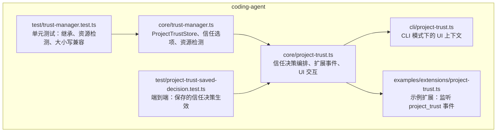
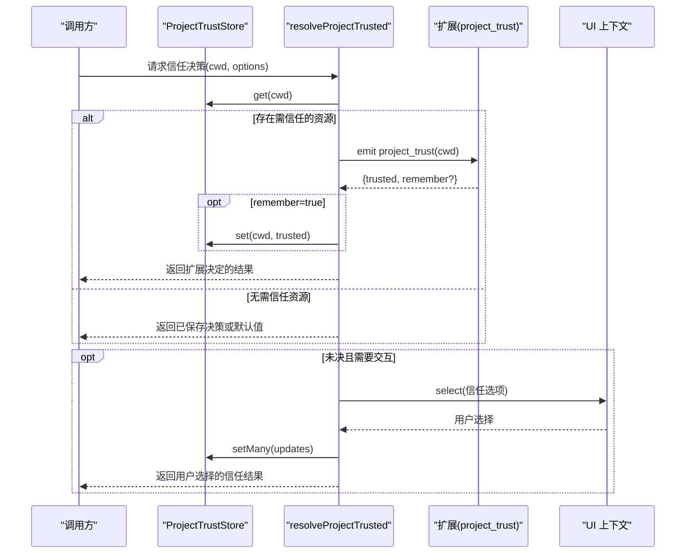
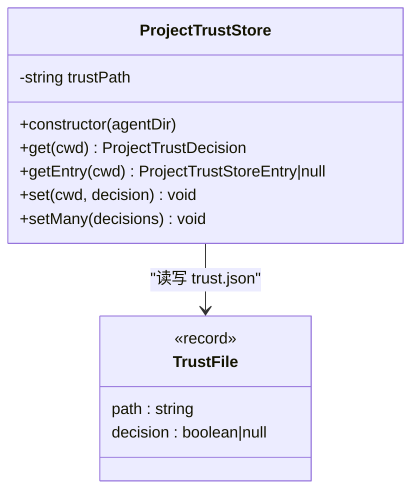
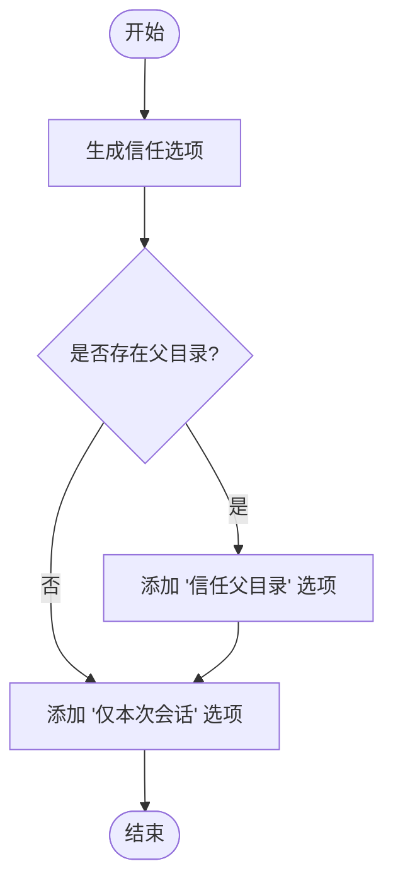
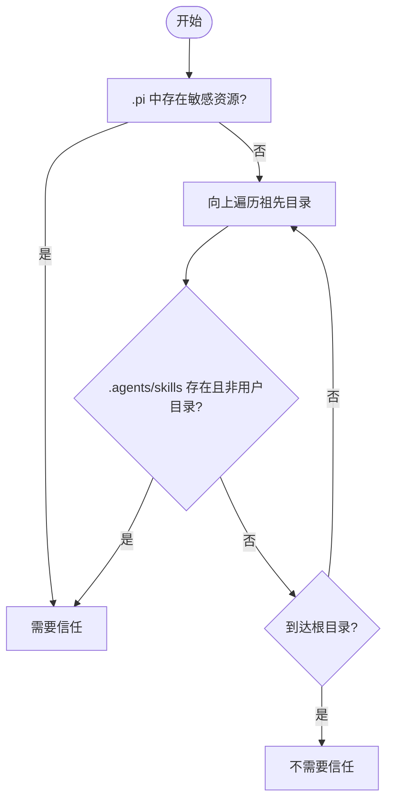
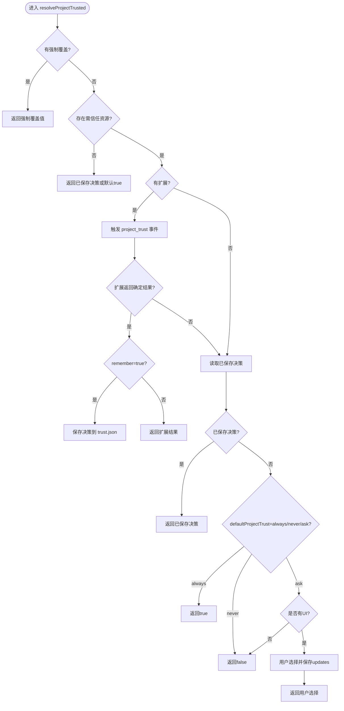
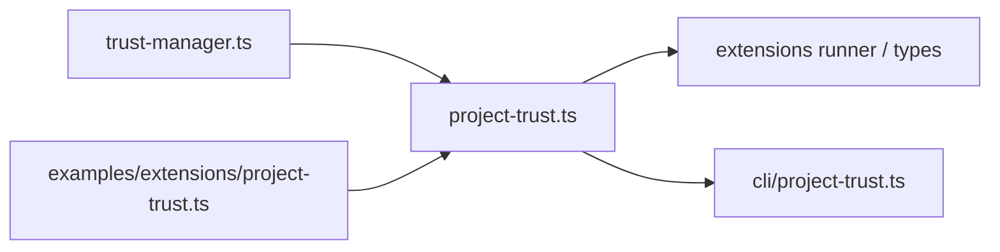

# 信任管理机制

<cite>
**本文引用的文件**   
- [trust-manager.ts](file://packages/coding-agent/src/core/trust-manager.ts)
- [project-trust.ts](file://packages/coding-agent/src/core/project-trust.ts)
- [project-trust.ts（示例扩展）](file://packages/coding-agent/examples/extensions/project-trust.ts)
- [project-trust.ts（CLI 上下文）](file://packages/coding-agent/src/cli/project-trust.ts)
- [trust-manager.test.ts](file://packages/coding-agent/test/trust-manager.test.ts)
- [project-trust-saved-decision.test.ts](file://packages/coding-agent/test/project-trust-saved-decision.test.ts)
</cite>

## 目录
1. [引言](#引言)
2. [项目结构](#项目结构)
3. [核心组件](#核心组件)
4. [架构总览](#架构总览)
5. [详细组件分析](#详细组件分析)
6. [依赖关系分析](#依赖关系分析)
7. [性能与并发特性](#性能与并发特性)
8. [配置最佳实践与安全考虑](#配置最佳实践与安全考虑)
9. [故障排除指南](#故障排除指南)
10. [结论](#结论)
11. [附录：使用示例与调用流程](#附录使用示例与调用流程)

## 引言
本文件面向“项目信任管理系统”，系统性解释信任决策机制、信任存储结构与信任状态管理。重点说明 ProjectTrustStore 的工作原理，包括信任文件的读写、并发锁机制、路径规范化处理；解释信任选项的生成逻辑、父目录信任继承和项目资源信任检查；并提供信任配置的最佳实践、安全注意事项和故障排除方法。文末附带具体代码示例的使用方式与调用流程图，帮助读者快速上手并安全地集成该能力。

## 项目结构
信任管理相关代码集中在 coding-agent 包中，核心实现位于 core 层，并通过 CLI 上下文与扩展事件进行交互。测试用例覆盖关键行为，如父子目录继承、大小写敏感路径兼容、无资源项目的默认策略等。

**图表来源**
- [trust-manager.ts:1-255](file://packages/coding-agent/src/core/trust-manager.ts#L1-L255)
- [project-trust.ts:1-98](file://packages/coding-agent/src/core/project-trust.ts#L1-L98)
- [project-trust.ts（CLI 上下文）:1-63](file://packages/coding-agent/src/cli/project-trust.ts#L1-L63)
- [project-trust.ts（示例扩展）:1-65](file://packages/coding-agent/examples/extensions/project-trust.ts#L1-L65)
- [trust-manager.test.ts:1-109](file://packages/coding-agent/test/trust-manager.test.ts#L1-L109)
- [project-trust-saved-decision.test.ts:72-124](file://packages/coding-agent/test/project-trust-saved-decision.test.ts#L72-L124)

**章节来源**
- [trust-manager.ts:1-255](file://packages/coding-agent/src/core/trust-manager.ts#L1-L255)
- [project-trust.ts:1-98](file://packages/coding-agent/src/core/project-trust.ts#L1-L98)

## 核心组件
- ProjectTrustStore：负责信任文件的读取、写入、并发锁保护与路径规范化，提供 get/getEntry/set/setMany 接口。
- hasTrustRequiringProjectResources：判断当前工作目录是否存在需要信任才能加载的项目资源。
- getProjectTrustOptions：根据当前目录生成用户可选的信任选项，支持“信任”“信任父目录”“仅本次会话”“不信任”等。
- resolveProjectTrusted：信任决策编排器，综合扩展事件、已保存决策、默认策略与 UI 交互得出最终结果。
- CLI 上下文与示例扩展：为命令行与交互式环境提供 UI 抽象，并演示如何通过扩展自定义信任流程。

**章节来源**
- [trust-manager.ts:11-255](file://packages/coding-agent/src/core/trust-manager.ts#L11-L255)
- [project-trust.ts:15-98](file://packages/coding-agent/src/core/project-trust.ts#L15-L98)
- [project-trust.ts（CLI 上下文）:7-63](file://packages/coding-agent/src/cli/project-trust.ts#L7-L63)
- [project-trust.ts（示例扩展）:18-64](file://packages/coding-agent/examples/extensions/project-trust.ts#L18-L64)

## 架构总览
信任系统由“存储层”“决策编排层”“交互层”组成：
- 存储层：ProjectTrustStore 以 trust.json 持久化信任决策，支持父子目录继承与路径规范化。
- 决策编排层：resolveProjectTrusted 决定是否需要询问用户、是否触发扩展、是否回退到默认策略。
- 交互层：通过 ProjectTrustContext 暴露 select/confirm/input/notify，适配 TUI、CLI 与非交互模式。

**图表来源**
- [project-trust.ts:47-97](file://packages/coding-agent/src/core/project-trust.ts#L47-L97)
- [trust-manager.ts:217-253](file://packages/coding-agent/src/core/trust-manager.ts#L217-L253)
- [project-trust.ts（CLI 上下文）:7-63](file://packages/coding-agent/src/cli/project-trust.ts#L7-L63)

## 详细组件分析

### ProjectTrustStore：信任存储与并发控制
- 信任文件位置：agentDir/trust.json。
- 数据结构：键为规范化后的绝对路径，值为 true/false/null。null 表示“继承父级”。
- 路径规范化：统一使用 canonicalizePath + resolvePath，确保跨平台一致性与大小写兼容。
- 并发锁：基于 proper-lockfile 对 trust.json 所在目录加锁，避免多进程/多线程竞争写入。
- 读写流程：
  - readTrustFile：解析 JSON，校验值类型，抛出明确错误信息。
  - writeTrustFile：排序键后序列化，自动创建目录。
  - withTrustFileLock：封装加锁/释放，保证原子性更新。
- 查询逻辑：findNearestTrustEntry 从 cwd 向上查找最近的非 null 决策，若均为 null 则返回 null（表示继承）。
- 批量更新：setMany 会删除旧键（考虑 Windows 大小写差异），再写入新值；null 表示“撤销显式决策，恢复继承”。

**图表来源**
- [trust-manager.ts:217-253](file://packages/coding-agent/src/core/trust-manager.ts#L217-L253)

**章节来源**
- [trust-manager.ts:41-48](file://packages/coding-agent/src/core/trust-manager.ts#L41-L48)
- [trust-manager.ts:106-143](file://packages/coding-agent/src/core/trust-manager.ts#L106-L143)
- [trust-manager.ts:145-184](file://packages/coding-agent/src/core/trust-manager.ts#L145-L184)
- [trust-manager.ts:217-253](file://packages/coding-agent/src/core/trust-manager.ts#L217-L253)

### 信任选项生成与父目录继承
- getProjectTrustOptions 生成以下选项：
  - “信任”：在当前目录写入 true。
  - “信任父目录”：在父目录写入 true，并在当前目录写入 null（表示继承）。
  - “仅本次会话信任/不信任”：不写入文件，仅在会话内有效。
  - “不信任”：在当前目录写入 false。
- 父目录继承：findNearestTrustEntry 自下而上遍历，找到第一个非 null 的值即为最终决策。

**图表来源**
- [trust-manager.ts:74-104](file://packages/coding-agent/src/core/trust-manager.ts#L74-L104)
- [trust-manager.ts:50-66](file://packages/coding-agent/src/core/trust-manager.ts#L50-L66)

**章节来源**
- [trust-manager.ts:74-104](file://packages/coding-agent/src/core/trust-manager.ts#L74-L104)
- [trust-manager.ts:50-66](file://packages/coding-agent/src/core/trust-manager.ts#L50-L66)

### 项目资源信任检查
- hasTrustRequiringProjectResources 检测两类资源：
  - .pi 目录下的敏感配置项（如 settings.json、mcp.json、extensions、skills、prompts、themes、SYSTEM.md、APPEND_SYSTEM.md）。
  - 祖先目录中的 .agents/skills（排除用户全局目录 ~/.agents/skills）。
- 只要任一存在，即认为该项目需要信任才能加载这些资源。

**图表来源**
- [trust-manager.ts:193-215](file://packages/coding-agent/src/core/trust-manager.ts#L193-L215)

**章节来源**
- [trust-manager.ts:30-39](file://packages/coding-agent/src/core/trust-manager.ts#L30-L39)
- [trust-manager.ts:193-215](file://packages/coding-agent/src/core/trust-manager.ts#L193-L215)

### 信任决策编排（resolveProjectTrusted）
- 优先级顺序：
  1. 强制覆盖（trustOverride）。
  2. 若无需信任资源：直接返回已保存决策或默认 true。
  3. 若有扩展：触发 project_trust 事件，首个返回确定结果的扩展胜出；可选择记住决策。
  4. 若已有保存决策：直接返回。
  5. 根据 defaultProjectTrust 策略（always/never/ask）决定是否询问。
  6. 若无 UI：默认拒绝。
  7. 弹出 UI 让用户选择，并将 updates 写入 trust.json。

**图表来源**
- [project-trust.ts:47-97](file://packages/coding-agent/src/core/project-trust.ts#L47-L97)

**章节来源**
- [project-trust.ts:47-97](file://packages/coding-agent/src/core/project-trust.ts#L47-L97)

### CLI 上下文与示例扩展
- CLI 上下文 createProjectTrustContext 将不同运行模式映射到统一的 UI 接口：select/confirm/input/notify。
- 示例扩展 project-trust.ts 演示如何监听 project_trust 事件，并根据用户选择返回 yes/no/undecided，以及是否记住决策。

**章节来源**
- [project-trust.ts（CLI 上下文）:7-63](file://packages/coding-agent/src/cli/project-trust.ts#L7-L63)
- [project-trust.ts（示例扩展）:18-64](file://packages/coding-agent/examples/extensions/project-trust.ts#L18-L64)

## 依赖关系分析
- trust-manager.ts 被 project-trust.ts 引入，作为底层存储与工具函数提供者。
- project-trust.ts 通过 extensions runner 触发扩展事件，并与 SettingsManager 默认策略协作。
- CLI 上下文为上层交互提供 UI 抽象，使信任流程在非 TUI 模式下也能优雅降级。

**图表来源**
- [trust-manager.ts:1-8](file://packages/coding-agent/src/core/trust-manager.ts#L1-L8)
- [project-trust.ts:1-11](file://packages/coding-agent/src/core/project-trust.ts#L1-L11)
- [project-trust.ts（CLI 上下文）:1-5](file://packages/coding-agent/src/cli/project-trust.ts#L1-L5)
- [project-trust.ts（示例扩展）:16-16](file://packages/coding-agent/examples/extensions/project-trust.ts#L16-L16)

**章节来源**
- [trust-manager.ts:1-8](file://packages/coding-agent/src/core/trust-manager.ts#L1-L8)
- [project-trust.ts:1-11](file://packages/coding-agent/src/core/project-trust.ts#L1-L11)

## 性能与并发特性
- 并发安全：所有读写均通过 withTrustFileLock 加锁，避免多进程/线程同时修改 trust.json。
- I/O 优化：writeTrustFile 先排序键再一次性写入，减少碎片化；readTrustFile 严格校验类型，失败时尽早抛错。
- 路径计算：normalizeCwd 与 pathsEqual 用于跨平台一致性，避免重复解析；findNearestTrustEntry 采用自下而上的线性扫描，通常深度有限，开销可控。
- 锁重试：当遇到 ELOCKED 时短暂等待并重试，提升鲁棒性。

[本节为通用性能讨论，不直接分析具体文件]

## 配置最佳实践与安全考虑
- 最小权限原则：仅在确实需要时才信任项目目录；优先使用“仅本次会话”进行临时授权。
- 父目录信任：对大型仓库可信任父目录，子项目继承，减少重复确认；但需谨慎评估父目录包含的可执行脚本与敏感配置。
- 默认策略：在无 UI 环境中，建议将 defaultProjectTrust 设置为 never，避免静默信任。
- 扩展信任：谨慎启用自定义扩展的 project_trust 处理器，确保其不会绕过安全检查。
- 路径规范：避免使用相对路径或不规范路径，尽量使用绝对路径，防止大小写不一致导致误判。
- 审计与日志：记录信任决策的来源（扩展/UI/默认），便于问题回溯。

[本节为通用指导，不直接分析具体文件]

## 故障排除指南
- 无法读取 trust.json：
  - 现象：抛出“Failed to read trust store ...”或“Invalid trust store ... expected an object”。
  - 排查：检查文件格式是否为对象，键值是否为 true/false/null；确认文件可读权限。
  - 参考：[trust-manager.ts:106-131](file://packages/coding-agent/src/core/trust-manager.ts#L106-L131)
- 并发写入冲突：
  - 现象：ELOCKED 错误或写入失败。
  - 排查：确认没有其他进程持有锁；检查磁盘空间与权限；必要时清理异常锁文件。
  - 参考：[trust-manager.ts:145-175](file://packages/coding-agent/src/core/trust-manager.ts#L145-L175)
- 继承不符合预期：
  - 现象：子目录未继承父目录信任。
  - 排查：确认父目录决策是否为 true；子目录是否显式设为 false 或 null；路径规范化是否正确。
  - 参考：[trust-manager.ts:50-66](file://packages/coding-agent/src/core/trust-manager.ts#L50-L66)
- 无资源项目默认行为：
  - 现象：没有敏感资源时仍提示信任。
  - 排查：确认 hasTrustRequiringProjectResources 返回值；检查 defaultProjectTrust 设置。
  - 参考：[project-trust.ts:51-53](file://packages/coding-agent/src/core/project-trust.ts#L51-L53)
- 扩展未生效：
  - 现象：自定义 project_trust 处理器未触发或未返回确定结果。
  - 排查：确认扩展已正确安装并加载；检查处理器返回是否包含 trusted 字段；注意多个处理器时首个确定结果胜出。
  - 参考：[project-trust.ts（示例扩展）:22-58](file://packages/coding-agent/examples/extensions/project-trust.ts#L22-L58)

**章节来源**
- [trust-manager.ts:106-175](file://packages/coding-agent/src/core/trust-manager.ts#L106-L175)
- [project-trust.ts:51-53](file://packages/coding-agent/src/core/project-trust.ts#L51-L53)
- [project-trust.ts（示例扩展）:22-58](file://packages/coding-agent/examples/extensions/project-trust.ts#L22-L58)

## 结论
本项目信任管理系统通过清晰的职责分层与严格的并发控制，实现了安全、可扩展的信任决策流程。ProjectTrustStore 提供了可靠的持久化与继承语义；resolveProjectTrusted 将扩展、用户交互与默认策略有机结合；hasTrustRequiringProjectResources 确保敏感资源仅在可信上下文中加载。遵循本文的最佳实践与安全建议，可在保障安全的前提下提升开发体验。

[本节为总结性内容，不直接分析具体文件]

## 附录：使用示例与调用流程

### 使用 ProjectTrustStore 的典型流程
- 初始化：传入 agentDir，构造 ProjectTrustStore。
- 查询：get(cwd) 获取当前目录的最终信任决策（含继承）。
- 设置：set(cwd, decision) 或 setMany([...]) 批量更新。
- 继承：对父目录设置 true，子目录可通过 null 继承。

**章节来源**
- [trust-manager.ts:217-253](file://packages/coding-agent/src/core/trust-manager.ts#L217-L253)

### 示例扩展：监听 project_trust 事件
- 安装：将示例扩展复制到 ~/.pi/agent/extensions 或通过 -e 参数加载。
- 行为：在 TUI 模式下弹出选择框，支持“记住决策”“仅本次会话”等。
- 返回值：{ trusted: "yes"|"no"|"undecided", remember?: boolean }。

**章节来源**
- [project-trust.ts（示例扩展）:1-65](file://packages/coding-agent/examples/extensions/project-trust.ts#L1-L65)

### 单元测试要点
- 父子目录继承：验证 set(parent,true) 后 child 继承 true；set(child,false) 覆盖；set(child,null) 恢复继承。
- 资源检测：.pi/settings.json 与 .agents/skills 的存在与否影响是否需要信任。
- 大小写兼容：Windows 下路径大小写不影响匹配与写入。

**章节来源**
- [trust-manager.test.ts:24-37](file://packages/coding-agent/test/trust-manager.test.ts#L24-L37)
- [trust-manager.test.ts:39-66](file://packages/coding-agent/test/trust-manager.test.ts#L39-L66)
- [trust-manager.test.ts:68-107](file://packages/coding-agent/test/trust-manager.test.ts#L68-L107)

### 端到端：保存的信任决策生效
- 场景：在无敏感资源项目中，预先写入 false，后续进程应报告未信任。
- 验证：通过外部进程启动 CLI，读取探针文件输出 trusted 字段。

**章节来源**
- [project-trust-saved-decision.test.ts:72-124](file://packages/coding-agent/test/project-trust-saved-decision.test.ts#L72-L124)