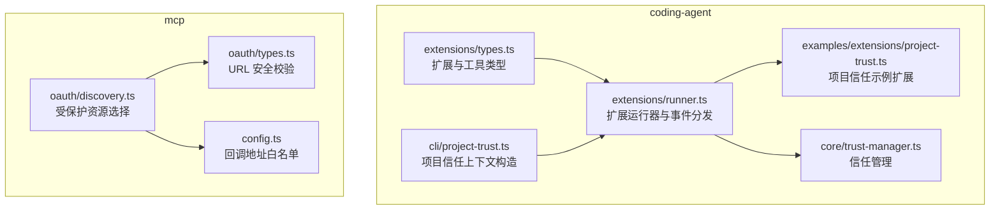
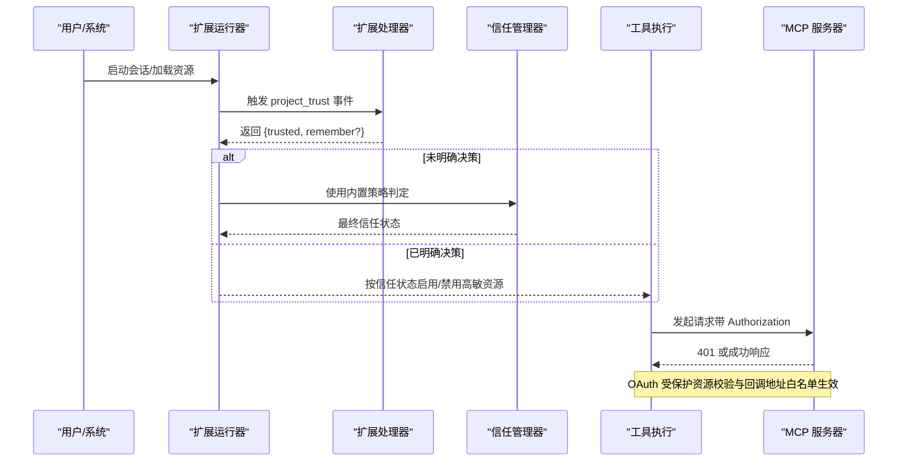
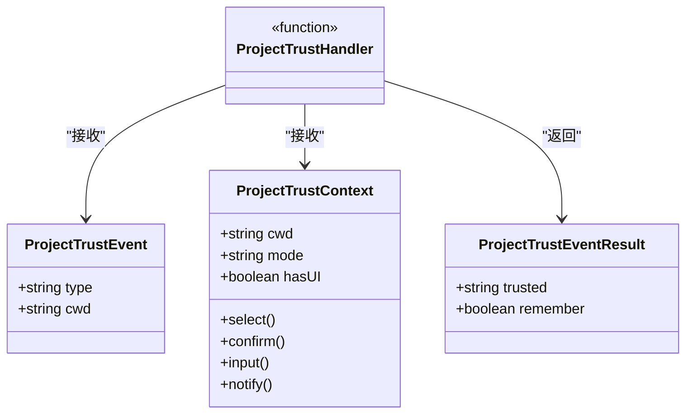
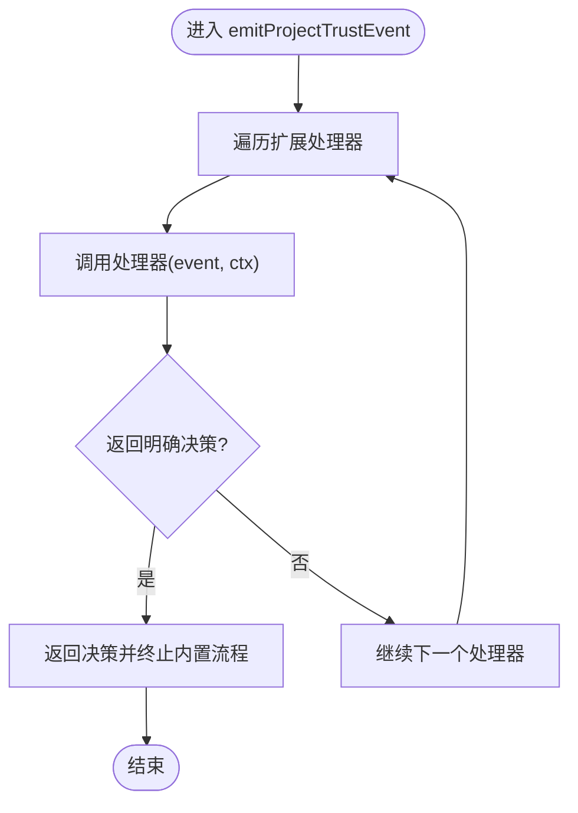
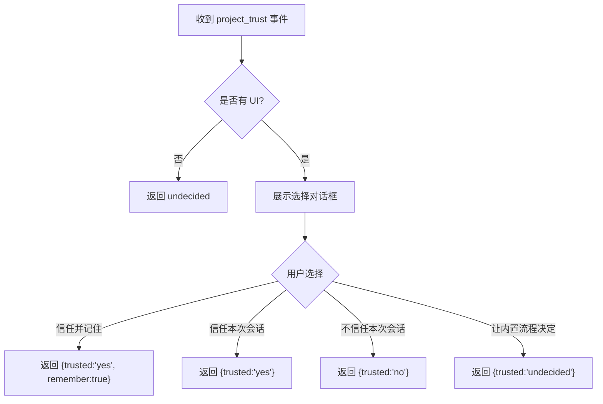
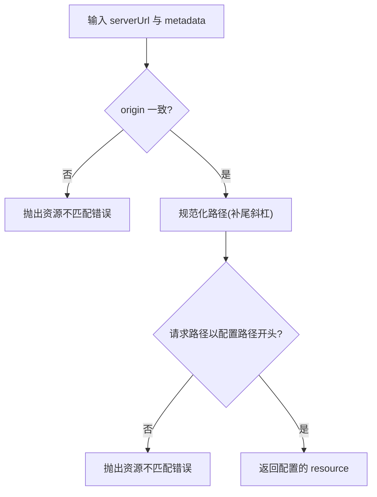
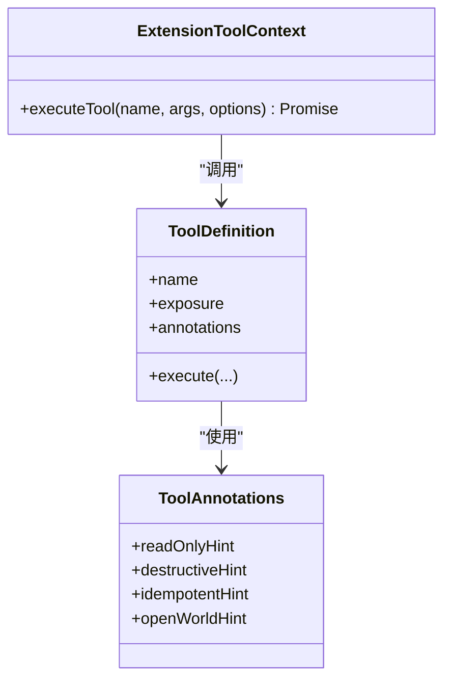
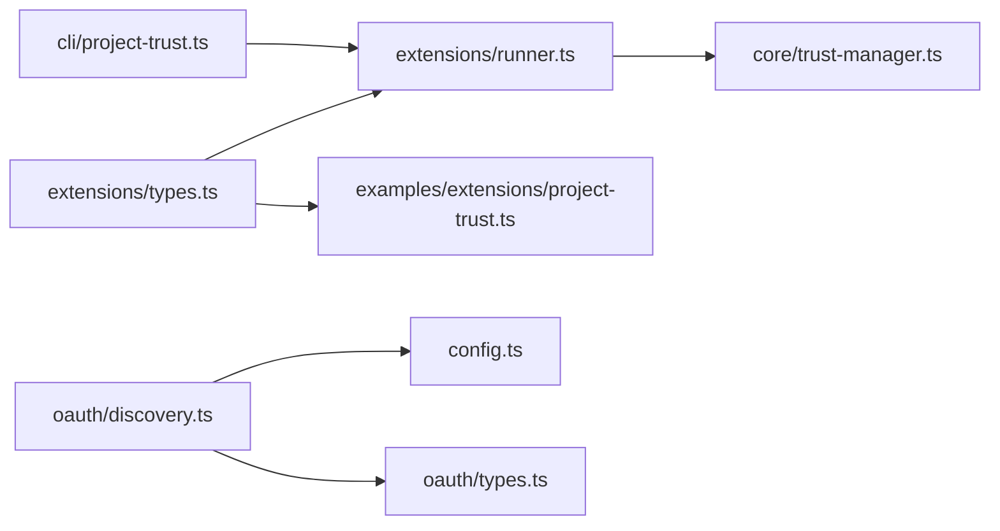

# 权限控制系统

<cite>
**本文引用的文件**   
- [packages/coding-agent/src/core/extensions/types.ts](file://packages/coding-agent/src/core/extensions/types.ts)
- [packages/coding-agent/examples/extensions/project-trust.ts](file://packages/coding-agent/examples/extensions/project-trust.ts)
- [packages/coding-agent/src/core/extensions/runner.ts](file://packages/coding-agent/src/core/extensions/runner.ts)
- [packages/coding-agent/src/cli/project-trust.ts](file://packages/coding-agent/src/cli/project-trust.ts)
- [packages/coding-agent/src/core/trust-manager.ts](file://packages/coding-agent/src/core/trust-manager.ts)
- [packages/coding-agent/test/trust-manager.test.ts](file://packages/coding-agent/test/trust-manager.test.ts)
- [packages/coding-agent/test/project-trust-saved-decision.test.ts](file://packages/coding-agent/test/project-trust-saved-decision.test.ts)
- [packages/mcp/src/oauth/discovery.ts](file://packages/mcp/src/oauth/discovery.ts)
- [packages/mcp/src/oauth/types.ts](file://packages/mcp/src/oauth/types.ts)
- [packages/mcp/src/config.ts](file://packages/mcp/src/config.ts)
- [packages/coding-agent/test/suite/mcp-oauth-server.ts](file://packages/coding-agent/test/suite/mcp-oauth-server.ts)
</cite>

## 目录
1. [简介](#简介)
2. [项目结构](#项目结构)
3. [核心组件](#核心组件)
4. [架构总览](#架构总览)
5. [详细组件分析](#详细组件分析)
6. [依赖关系分析](#依赖关系分析)
7. [性能与可扩展性](#性能与可扩展性)
8. [故障排查指南](#故障排查指南)
9. [结论](#结论)
10. [附录：配置与示例](#附录配置与示例)

## 简介
本文件系统化梳理仓库中的“权限控制系统”，围绕以下目标展开：
- 权限模型设计：以“项目信任”为核心，结合扩展事件、工具执行上下文和 MCP OAuth 资源保护，形成从资源到调用链的访问控制。
- 访问控制策略：通过“项目信任”判定是否允许加载高敏感资源（如配置文件、技能脚本），并通过工具注解与执行模式限制危险操作。
- 资源保护机制：对 MCP 受保护资源进行来源校验与路径匹配；对回调地址进行严格白名单校验。
- 权限继承与作用域：项目级信任状态在会话中传播，影响扩展、工具和子代理的行为范围。
- 动态权限评估：基于运行时上下文（工作目录、UI 能力、会话状态）进行决策，支持扩展自定义策略。
- 权限配置语法与审计：提供项目信任事件处理、保存决策与测试用例，便于审计与回归验证。
- 自定义权限检查：给出扩展实现示例与关键类型定义，指导开发者扩展权限逻辑。

## 项目结构
权限相关代码主要分布在 coding-agent 与 mcp 两个包中：
- coding-agent：负责项目信任判定、扩展事件分发、工具执行上下文与权限钩子。
- mcp：负责 OAuth 受保护资源的发现、选择与回调地址安全校验。

**图表来源**
- [packages/coding-agent/src/core/extensions/types.ts:720-742](file://packages/coding-agent/src/core/extensions/types.ts#L720-L742)
- [packages/coding-agent/src/core/extensions/runner.ts:302-313](file://packages/coding-agent/src/core/extensions/runner.ts#L302-L313)
- [packages/coding-agent/src/cli/project-trust.ts:7-12](file://packages/coding-agent/src/cli/project-trust.ts#L7-L12)
- [packages/coding-agent/examples/extensions/project-trust.ts:18-59](file://packages/coding-agent/examples/extensions/project-trust.ts#L18-L59)
- [packages/mcp/src/oauth/discovery.ts:196-215](file://packages/mcp/src/oauth/discovery.ts#L196-L215)
- [packages/mcp/src/oauth/types.ts:126-155](file://packages/mcp/src/oauth/types.ts#L126-L155)
- [packages/mcp/src/config.ts:229-243](file://packages/mcp/src/config.ts#L229-L243)

**章节来源**
- [packages/coding-agent/src/core/extensions/types.ts:720-742](file://packages/coding-agent/src/core/extensions/types.ts#L720-L742)
- [packages/coding-agent/src/core/extensions/runner.ts:302-313](file://packages/coding-agent/src/core/extensions/runner.ts#L302-L313)
- [packages/mcp/src/oauth/discovery.ts:196-215](file://packages/mcp/src/oauth/discovery.ts#L196-L215)
- [packages/mcp/src/oauth/types.ts:126-155](file://packages/mcp/src/oauth/types.ts#L126-L155)
- [packages/mcp/src/config.ts:229-243](file://packages/mcp/src/config.ts#L229-L243)

## 核心组件
- 项目信任事件与上下文
  - 事件：project_trust，携带当前工作目录 cwd。
  - 上下文：ProjectTrustContext，包含 cwd、mode、hasUI 与受限 UI 方法。
  - 结果：ProjectTrustEventResult，包含 trusted（yes/no/undecided）与可选 remember。
- 扩展运行器与事件分发
  - 统一分发扩展事件，收集处理器返回结果，决定内置流程是否介入。
- 项目信任上下文构造
  - 为 CLI 等场景创建 ProjectTrustContext，注入 UI 能力。
- MCP OAuth 资源保护
  - 受保护资源选择：校验 origin 与路径前缀一致性。
  - URL 安全校验：仅接受 http/https，拒绝本地协议。
  - 回调地址白名单：仅允许回环地址且无查询参数与哈希。

**章节来源**
- [packages/coding-agent/src/core/extensions/types.ts:720-742](file://packages/coding-agent/src/core/extensions/types.ts#L720-L742)
- [packages/coding-agent/src/core/extensions/runner.ts:302-313](file://packages/coding-agent/src/core/extensions/runner.ts#L302-L313)
- [packages/coding-agent/src/cli/project-trust.ts:7-12](file://packages/coding-agent/src/cli/project-trust.ts#L7-L12)
- [packages/mcp/src/oauth/discovery.ts:196-215](file://packages/mcp/src/oauth/discovery.ts#L196-L215)
- [packages/mcp/src/oauth/types.ts:126-155](file://packages/mcp/src/oauth/types.ts#L126-L155)
- [packages/mcp/src/config.ts:229-243](file://packages/mcp/src/config.ts#L229-L243)

## 架构总览
权限控制贯穿“资源发现—信任判定—扩展执行—工具调用—外部服务认证”全链路。

**图表来源**
- [packages/coding-agent/src/core/extensions/runner.ts:302-313](file://packages/coding-agent/src/core/extensions/runner.ts#L302-L313)
- [packages/coding-agent/examples/extensions/project-trust.ts:18-59](file://packages/coding-agent/examples/extensions/project-trust.ts#L18-L59)
- [packages/coding-agent/test/suite/mcp-oauth-server.ts:47-84](file://packages/coding-agent/test/suite/mcp-oauth-server.ts#L47-L84)

## 详细组件分析

### 项目信任事件与上下文
- 事件与上下文
  - ProjectTrustEvent：type 固定为 project_trust，附带 cwd。
  - ProjectTrustContext：cwd、mode、hasUI、受限 UI 方法（select/confirm/input/notify）。
  - ProjectTrustHandler：接收事件与上下文，返回 ProjectTrustEventResult。
- 结果语义
  - trusted: yes/no/undecided。
  - remember: 可选，表示是否持久化该决策。

**图表来源**
- [packages/coding-agent/src/core/extensions/types.ts:720-742](file://packages/coding-agent/src/core/extensions/types.ts#L720-L742)

**章节来源**
- [packages/coding-agent/src/core/extensions/types.ts:720-742](file://packages/coding-agent/src/core/extensions/types.ts#L720-L742)

### 扩展运行器与事件分发
- 事件分发流程
  - emitProjectTrustEvent：遍历扩展处理器，聚合错误，首个返回明确决策的处理器将抑制内置流程。
- 作用域与集成
  - 扩展运行器持有 isProjectTrustedFn，用于判断当前项目是否可信。
  - 与 CLI 层协作，传入 ProjectTrustContext。

**图表来源**
- [packages/coding-agent/src/core/extensions/runner.ts:302-313](file://packages/coding-agent/src/core/extensions/runner.ts#L302-L313)

**章节来源**
- [packages/coding-agent/src/core/extensions/runner.ts:302-313](file://packages/coding-agent/src/core/extensions/runner.ts#L302-L313)

### 项目信任示例扩展
- 行为说明
  - 监听 project_trust 事件，根据 UI 能力展示交互选项。
  - 返回 yes/no/undecided，并可设置 remember 以持久化。
  - 若无 UI，直接返回 undecided，交由内置流程处理。

**图表来源**
- [packages/coding-agent/examples/extensions/project-trust.ts:18-59](file://packages/coding-agent/examples/extensions/project-trust.ts#L18-L59)

**章节来源**
- [packages/coding-agent/examples/extensions/project-trust.ts:18-59](file://packages/coding-agent/examples/extensions/project-trust.ts#L18-L59)

### MCP OAuth 资源保护与回调安全
- 受保护资源选择
  - selectResource：比较 serverUrl 与 metadata.resource 的 origin 与路径前缀，不一致则抛错。
- URL 安全校验
  - safeUrl：仅接受 http/https，拒绝 file 或自定义协议，避免本地程序被意外触发。
- 回调地址白名单
  - isLoopbackRedirectUri：仅允许 http 协议、回环主机名、无查询参数与哈希。

**图表来源**
- [packages/mcp/src/oauth/discovery.ts:196-215](file://packages/mcp/src/oauth/discovery.ts#L196-L215)

**章节来源**
- [packages/mcp/src/oauth/discovery.ts:196-215](file://packages/mcp/src/oauth/discovery.ts#L196-L215)
- [packages/mcp/src/oauth/types.ts:126-155](file://packages/mcp/src/oauth/types.ts#L126-L155)
- [packages/mcp/src/config.ts:229-243](file://packages/mcp/src/config.ts#L229-L243)

### 工具执行与权限钩子
- 工具执行上下文
  - ExtensionToolContext：封装 executeTool，确保嵌套工具调用同样经过校验、钩子与权限检查。
- 工具暴露与注解
  - ToolExposure：direct/model-only/codemode/deferred/hidden，控制模型可见性与可调用性。
  - ToolAnnotations：readOnlyHint/destructiveHint/idempotentHint/openWorldHint，供权限扩展辅助决策。

**图表来源**
- [packages/coding-agent/src/core/extensions/types.ts:387-415](file://packages/coding-agent/src/core/extensions/types.ts#L387-L415)
- [packages/coding-agent/src/core/extensions/types.ts:521-551](file://packages/coding-agent/src/core/extensions/types.ts#L521-L551)
- [packages/coding-agent/src/core/extensions/types.ts:599-688](file://packages/coding-agent/src/core/extensions/types.ts#L599-L688)

**章节来源**
- [packages/coding-agent/src/core/extensions/types.ts:387-415](file://packages/coding-agent/src/core/extensions/types.ts#L387-L415)
- [packages/coding-agent/src/core/extensions/types.ts:521-551](file://packages/coding-agent/src/core/extensions/types.ts#L521-L551)
- [packages/coding-agent/src/core/extensions/types.ts:599-688](file://packages/coding-agent/src/core/extensions/types.ts#L599-L688)

## 依赖关系分析
- 模块内耦合
  - extensions/types.ts 定义扩展与工具类型，被 runner.ts、CLI 与示例扩展引用。
  - runner.ts 作为事件中枢，连接扩展处理器与信任管理。
  - CLI 层提供 ProjectTrustContext 给运行器。
- 跨模块耦合
  - mcp 包的 OAuth 资源选择与 URL 安全校验独立于 coding-agent，但共同构成对外部服务的访问控制。

**图表来源**
- [packages/coding-agent/src/core/extensions/types.ts:720-742](file://packages/coding-agent/src/core/extensions/types.ts#L720-L742)
- [packages/coding-agent/src/core/extensions/runner.ts:302-313](file://packages/coding-agent/src/core/extensions/runner.ts#L302-L313)
- [packages/coding-agent/src/cli/project-trust.ts:7-12](file://packages/coding-agent/src/cli/project-trust.ts#L7-L12)
- [packages/mcp/src/oauth/discovery.ts:196-215](file://packages/mcp/src/oauth/discovery.ts#L196-L215)
- [packages/mcp/src/config.ts:229-243](file://packages/mcp/src/config.ts#L229-L243)
- [packages/mcp/src/oauth/types.ts:126-155](file://packages/mcp/src/oauth/types.ts#L126-L155)

**章节来源**
- [packages/coding-agent/src/core/extensions/types.ts:720-742](file://packages/coding-agent/src/core/extensions/types.ts#L720-L742)
- [packages/coding-agent/src/core/extensions/runner.ts:302-313](file://packages/coding-agent/src/core/extensions/runner.ts#L302-L313)
- [packages/mcp/src/oauth/discovery.ts:196-215](file://packages/mcp/src/oauth/discovery.ts#L196-L215)
- [packages/mcp/src/oauth/types.ts:126-155](file://packages/mcp/src/oauth/types.ts#L126-L155)
- [packages/mcp/src/config.ts:229-243](file://packages/mcp/src/config.ts#L229-L243)

## 性能与可扩展性
- 事件分发开销
  - 扩展处理器数量较多时，建议优先返回明确决策以减少后续处理。
- 资源校验成本
  - URL 解析与路径前缀比较为轻量操作，适合高频调用。
- 可扩展点
  - 通过扩展处理器实现复杂信任策略（例如基于仓库签名、CI 状态）。
  - 通过工具注解细化权限策略（只读、幂等、开放世界等）。

[本节为通用指导，不涉及具体文件分析]

## 故障排查指南
- 项目信任未生效
  - 检查扩展是否正确注册并返回明确决策。
  - 确认 ProjectTrustContext 的 hasUI 与 UI 方法可用。
- MCP 回调失败
  - 校验回调地址是否为回环地址且不含查询参数与哈希。
  - 检查受保护资源 origin 与路径前缀是否与服务器一致。
- 401 未授权
  - 确认 Authorization 头是否携带有效令牌。
  - 检查 OAuth 流程是否完成，令牌是否过期。

**章节来源**
- [packages/coding-agent/test/trust-manager.test.ts:39-66](file://packages/coding-agent/test/trust-manager.test.ts#L39-L66)
- [packages/coding-agent/test/project-trust-saved-decision.test.ts:72-124](file://packages/coding-agent/test/project-trust-saved-decision.test.ts#L72-L124)
- [packages/coding-agent/test/suite/mcp-oauth-server.ts:47-84](file://packages/coding-agent/test/suite/mcp-oauth-server.ts#L47-L84)

## 结论
本权限控制系统以“项目信任”为中心，结合扩展事件、工具执行上下文与 MCP OAuth 资源保护，构建了从资源到调用的端到端访问控制。通过明确的类型定义、事件分发与严格的 URL/回调校验，系统在保障灵活性的同时维持了安全性。扩展者可基于现有接口实现自定义权限策略，并在工具层面进一步细化访问控制。

[本节为总结性内容，不涉及具体文件分析]

## 附录：配置与示例
- 项目信任配置与示例
  - 示例扩展展示了如何监听 project_trust 事件、与用户交互并返回决策。
  - 参考路径：[packages/coding-agent/examples/extensions/project-trust.ts](file://packages/coding-agent/examples/extensions/project-trust.ts)
- 类型与上下文
  - 项目信任事件、上下文与结果类型定义位于：[packages/coding-agent/src/core/extensions/types.ts](file://packages/coding-agent/src/core/extensions/types.ts)
- MCP OAuth 安全
  - 受保护资源选择与 URL 安全校验：[packages/mcp/src/oauth/discovery.ts](file://packages/mcp/src/oauth/discovery.ts)、[packages/mcp/src/oauth/types.ts](file://packages/mcp/src/oauth/types.ts)
  - 回调地址白名单：[packages/mcp/src/config.ts](file://packages/mcp/src/config.ts)

**章节来源**
- [packages/coding-agent/examples/extensions/project-trust.ts:18-59](file://packages/coding-agent/examples/extensions/project-trust.ts#L18-L59)
- [packages/coding-agent/src/core/extensions/types.ts:720-742](file://packages/coding-agent/src/core/extensions/types.ts#L720-L742)
- [packages/mcp/src/oauth/discovery.ts:196-215](file://packages/mcp/src/oauth/discovery.ts#L196-L215)
- [packages/mcp/src/oauth/types.ts:126-155](file://packages/mcp/src/oauth/types.ts#L126-L155)
- [packages/mcp/src/config.ts:229-243](file://packages/mcp/src/config.ts#L229-L243)