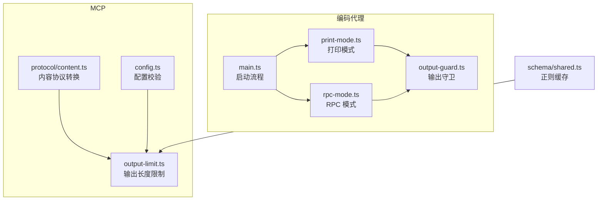
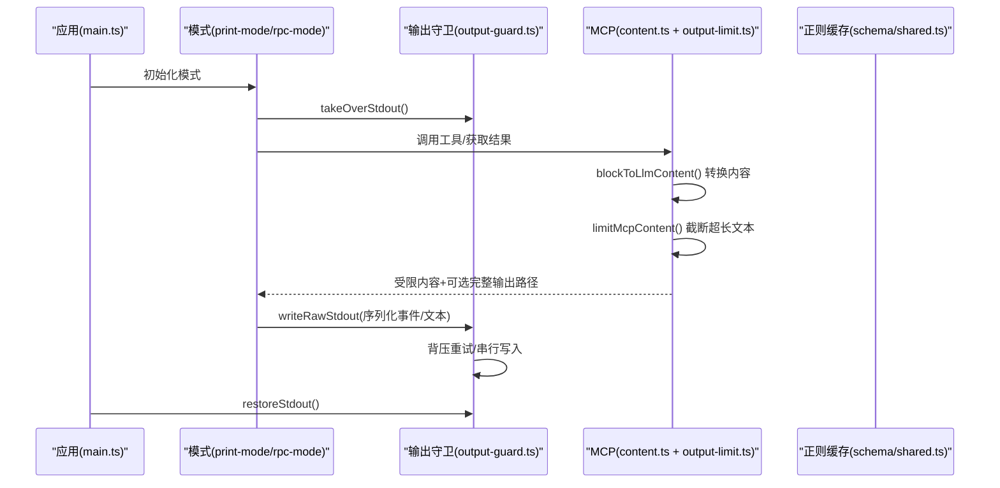
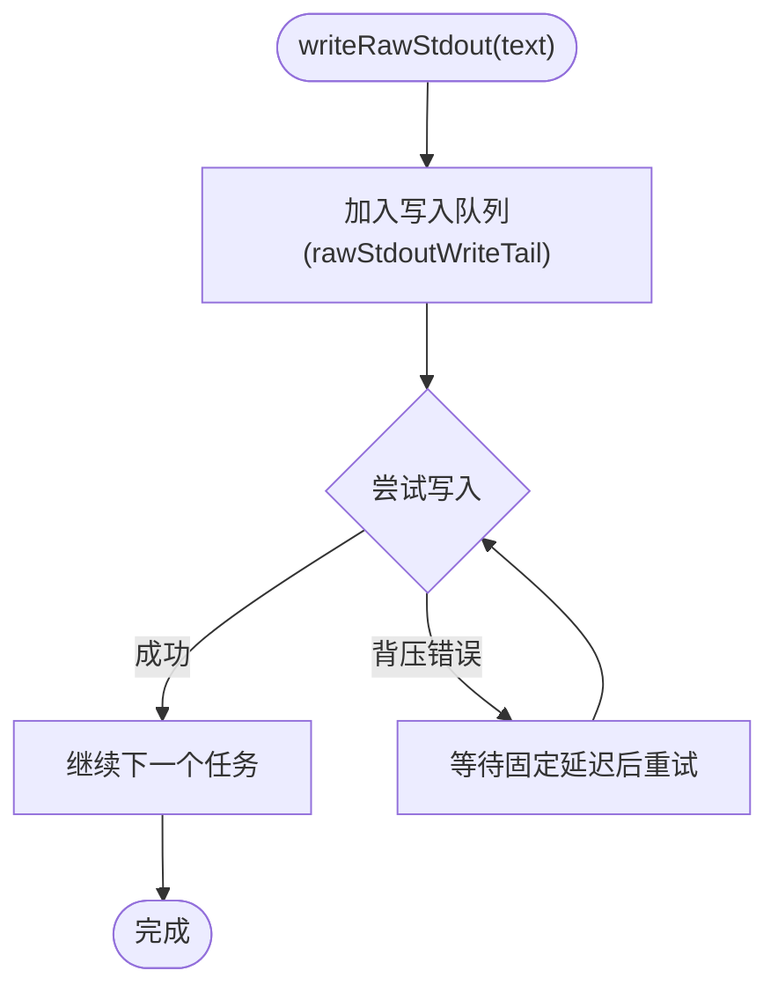
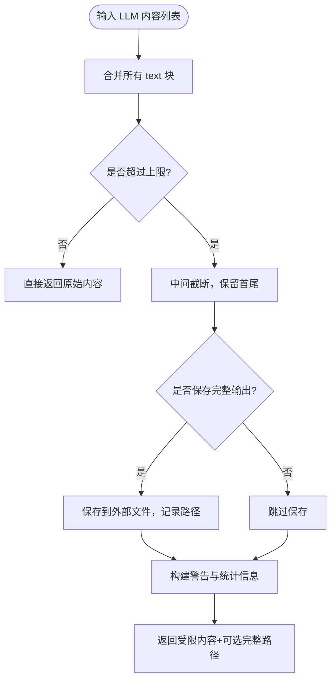
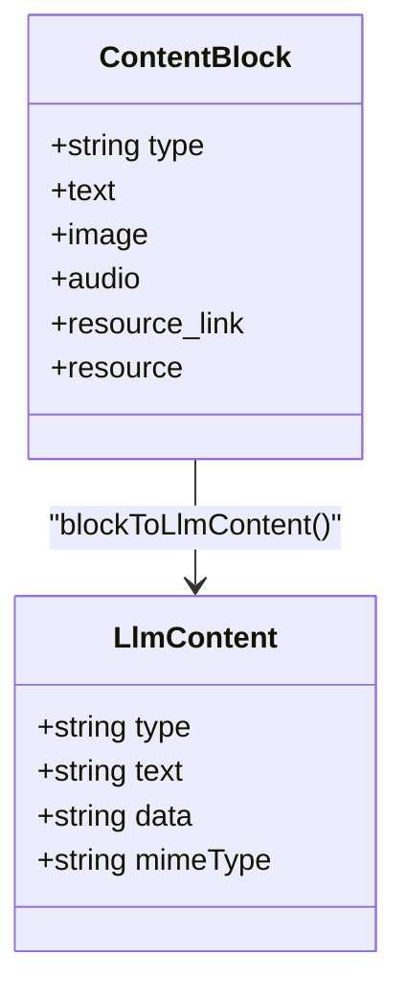
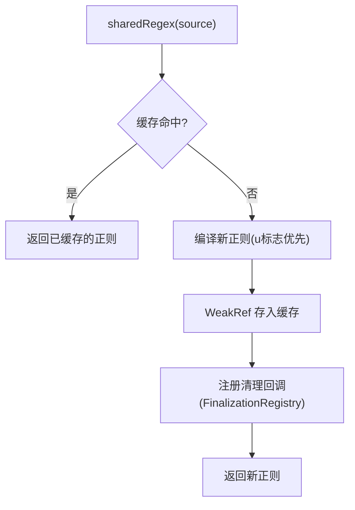
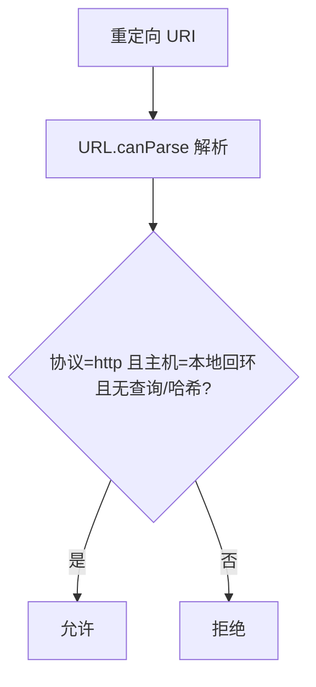
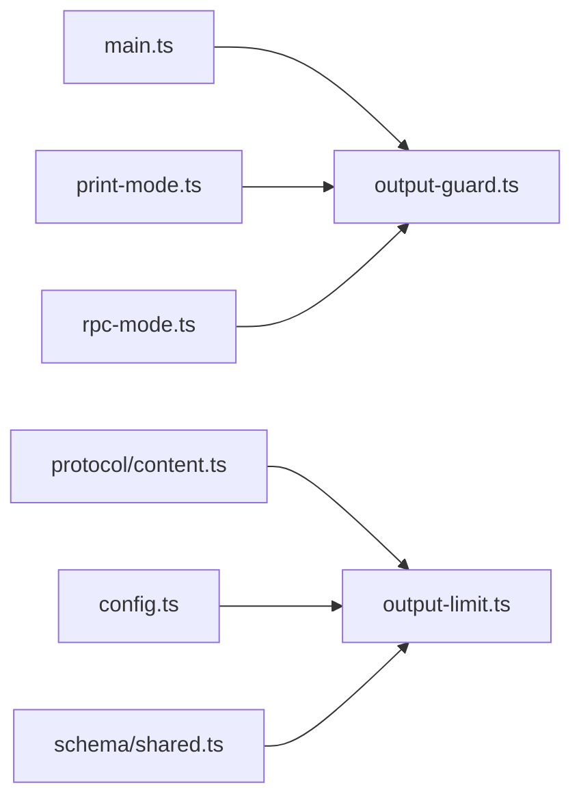

# 输出安全防护

<cite>
**本文引用的文件**
- [packages/coding-agent/src/core/output-guard.ts](file://packages/coding-agent/src/core/output-guard.ts)
- [packages/mcp/src/output-limit.ts](file://packages/mcp/src/output-limit.ts)
- [packages/mcp/src/protocol/content.ts](file://packages/mcp/src/protocol/content.ts)
- [packages/schema/src/shared.ts](file://packages/schema/src/shared.ts)
- [packages/mcp/src/config.ts](file://packages/mcp/src/config.ts)
- [packages/coding-agent/src/main.ts](file://packages/coding-agent/src/main.ts)
- [packages/coding-agent/src/modes/print-mode.ts](file://packages/coding-agent/src/modes/print-mode.ts)
- [packages/coding-agent/src/modes/rpc/rpc-mode.ts](file://packages/coding-agent/src/modes/rpc/rpc-mode.ts)
- [SECURITY.md](file://SECURITY.md)
</cite>

## 目录
1. [简介](#简介)
2. [项目结构](#项目结构)
3. [核心组件](#核心组件)
4. [架构总览](#架构总览)
5. [详细组件分析](#详细组件分析)
6. [依赖关系分析](#依赖关系分析)
7. [性能考量](#性能考量)
8. [故障排查指南](#故障排查指南)
9. [结论](#结论)
10. [附录](#附录)

## 简介
本文件系统性梳理“输出安全防护”机制，聚焦以下目标：
- 输出过滤系统的工作原理：敏感信息检测、恶意内容过滤与安全边界控制。
- 输出守卫实现细节：标准输出接管、背压处理、正则表达式缓存与复用、上下文感知过滤与内容验证规则。
- 安全策略配置选项、自定义过滤器与性能优化方法。
- 常见安全威胁防护方案、误报处理与调试技巧。
- 集成与使用示例（以源码路径引用代替具体代码片段）。

## 项目结构
围绕输出安全的核心代码分布在如下模块：
- 输出守卫：负责接管标准输出、串行化写入、背压等待与刷新。
- MCP 输出限制：对模型可见文本进行中间截断，保留首尾并提示完整输出位置。
- 内容协议转换：将 MCP 内容块转换为模型侧可消费的结构（文本/图片），屏蔽不支持类型。
- 正则表达式共享缓存：跨编译 schema 的 RegExp 缓存与清理，降低内存占用。
- 配置校验：对重定向 URI、覆盖项等做严格校验，防止不安全配置注入。
- 模式入口：在打印模式与 RPC 模式中启用输出守卫，确保输出流受控。

**图表来源**
- [packages/coding-agent/src/main.ts:715-715](file://packages/coding-agent/src/main.ts#L715-L715)
- [packages/coding-agent/src/main.ts:1052-1052](file://packages/coding-agent/src/main.ts#L1052-L1052)
- [packages/coding-agent/src/modes/print-mode.ts:117-158](file://packages/coding-agent/src/modes/print-mode.ts#L117-L158)
- [packages/coding-agent/src/modes/rpc/rpc-mode.ts:55-61](file://packages/coding-agent/src/modes/rpc/rpc-mode.ts#L55-L61)
- [packages/coding-agent/src/core/output-guard.ts:45-79](file://packages/coding-agent/src/core/output-guard.ts#L45-L79)
- [packages/mcp/src/protocol/content.ts:79-103](file://packages/mcp/src/protocol/content.ts#L79-L103)
- [packages/mcp/src/output-limit.ts:28-48](file://packages/mcp/src/output-limit.ts#L28-L48)
- [packages/mcp/src/config.ts:229-243](file://packages/mcp/src/config.ts#L229-L243)
- [packages/schema/src/shared.ts:10-22](file://packages/schema/src/shared.ts#L10-L22)

**章节来源**
- [packages/coding-agent/src/main.ts:715-715](file://packages/coding-agent/src/main.ts#L715-L715)
- [packages/coding-agent/src/main.ts:1052-1052](file://packages/coding-agent/src/main.ts#L1052-L1052)
- [packages/coding-agent/src/modes/print-mode.ts:117-158](file://packages/coding-agent/src/modes/print-mode.ts#L117-L158)
- [packages/coding-agent/src/modes/rpc/rpc-mode.ts:55-61](file://packages/coding-agent/src/modes/rpc/rpc-mode.ts#L55-L61)
- [packages/coding-agent/src/core/output-guard.ts:45-79](file://packages/coding-agent/src/core/output-guard.ts#L45-L79)
- [packages/mcp/src/protocol/content.ts:79-103](file://packages/mcp/src/protocol/content.ts#L79-L103)
- [packages/mcp/src/output-limit.ts:28-48](file://packages/mcp/src/output-limit.ts#L28-L48)
- [packages/mcp/src/config.ts:229-243](file://packages/mcp/src/config.ts#L229-L243)
- [packages/schema/src/shared.ts:10-22](file://packages/schema/src/shared.ts#L10-L22)

## 核心组件
- 输出守卫（stdout 接管与背压）
  - 接管 process.stdout.write，统一通过内部队列串行写入，避免并发写导致的数据交错。
  - 处理 ENOBUFS/EAGAIN/EWOULDBLOCK 等背压错误，指数退避重试，保障稳定性。
  - 提供 waitForRawStdoutBackpressure 与 flushRawStdout，便于上层同步等待输出完成。
- MCP 输出限制（长度截断）
  - 对模型可见文本合并后按字节上限截断，保留首尾，插入省略标记，并可选保存完整输出到外部文件。
  - 返回结构化结果，包含受限内容与完整输出路径（若保存成功）。
- 内容协议转换（类型安全）
  - 将 MCP 内容块转换为 LLM 可消费的 text/image，屏蔽 audio/resource_link/binary resource 等类型，避免不可预期数据进入下游。
- 正则表达式共享缓存（性能与内存）
  - 跨编译 schema 共享 RegExp，使用 WeakRef 与 FinalizationRegistry 自动清理，减少重复创建开销。
- 配置校验（安全边界）
  - 校验重定向 URI 是否允许本地回环回调；校验 server 覆盖项字段，防止不信任配置覆盖关键参数。

**章节来源**
- [packages/coding-agent/src/core/output-guard.ts:20-43](file://packages/coding-agent/src/core/output-guard.ts#L20-L43)
- [packages/coding-agent/src/core/output-guard.ts:45-79](file://packages/coding-agent/src/core/output-guard.ts#L45-L79)
- [packages/coding-agent/src/core/output-guard.ts:85-108](file://packages/coding-agent/src/core/output-guard.ts#L85-L108)
- [packages/mcp/src/output-limit.ts:28-48](file://packages/mcp/src/output-limit.ts#L28-L48)
- [packages/mcp/src/protocol/content.ts:79-103](file://packages/mcp/src/protocol/content.ts#L79-L103)
- [packages/schema/src/shared.ts:10-22](file://packages/schema/src/shared.ts#L10-L22)
- [packages/mcp/src/config.ts:229-243](file://packages/mcp/src/config.ts#L229-L243)

## 架构总览
下图展示从应用启动到输出被守卫与限制的端到端流程：

**图表来源**
- [packages/coding-agent/src/main.ts:715-715](file://packages/coding-agent/src/main.ts#L715-L715)
- [packages/coding-agent/src/main.ts:1052-1052](file://packages/coding-agent/src/main.ts#L1052-L1052)
- [packages/coding-agent/src/modes/print-mode.ts:117-158](file://packages/coding-agent/src/modes/print-mode.ts#L117-L158)
- [packages/coding-agent/src/modes/rpc/rpc-mode.ts:55-61](file://packages/coding-agent/src/modes/rpc/rpc-mode.ts#L55-L61)
- [packages/mcp/src/protocol/content.ts:79-103](file://packages/mcp/src/protocol/content.ts#L79-L103)
- [packages/mcp/src/output-limit.ts:28-48](file://packages/mcp/src/output-limit.ts#L28-L48)

## 详细组件分析

### 输出守卫（stdout 接管与背压）
- 功能要点
  - 接管 stdout.write，将所有写入转为 stderr 或内部队列，避免与业务输出混用。
  - 使用 Promise 链维护写入顺序，避免并发写导致的乱序。
  - 捕获 ENOBUFS/EAGAIN/EWOULDBLOCK 等背压错误，延迟重试，直至写入成功。
  - 暴露 waitForRawStdoutBackpressure 与 flushRawStdout，供上层同步等待输出完成。
- 安全意义
  - 统一输出通道，便于后续接入审计、脱敏、过滤等逻辑。
  - 避免子进程/扩展直接绕过守卫写入，保证输出边界可控。

**图表来源**
- [packages/coding-agent/src/core/output-guard.ts:20-43](file://packages/coding-agent/src/core/output-guard.ts#L20-L43)
- [packages/coding-agent/src/core/output-guard.ts:85-108](file://packages/coding-agent/src/core/output-guard.ts#L85-L108)

**章节来源**
- [packages/coding-agent/src/core/output-guard.ts:20-43](file://packages/coding-agent/src/core/output-guard.ts#L20-L43)
- [packages/coding-agent/src/core/output-guard.ts:45-79](file://packages/coding-agent/src/core/output-guard.ts#L45-L79)
- [packages/coding-agent/src/core/output-guard.ts:85-108](file://packages/coding-agent/src/core/output-guard.ts#L85-L108)

### MCP 输出限制（长度截断）
- 功能要点
  - 合并所有 text 块为单一字符串，按字节上限截断，保留首尾，插入省略标记。
  - 可选保存完整输出到外部文件，并在提示中附带读取方式。
  - 返回受限内容与完整输出路径（若保存成功），同时保留 image 块原样传递。
- 安全意义
  - 防止超大输出导致模型上下文溢出或资源耗尽。
  - 通过“仅保留首尾+提示完整路径”的方式平衡可读性与安全性。

**图表来源**
- [packages/mcp/src/output-limit.ts:28-48](file://packages/mcp/src/output-limit.ts#L28-L48)
- [packages/mcp/src/output-limit.ts:62-77](file://packages/mcp/src/output-limit.ts#L62-L77)

**章节来源**
- [packages/mcp/src/output-limit.ts:28-48](file://packages/mcp/src/output-limit.ts#L28-L48)
- [packages/mcp/src/output-limit.ts:62-77](file://packages/mcp/src/output-limit.ts#L62-L77)

### 内容协议转换（类型安全）
- 功能要点
  - 将 MCP 内容块转换为 LLM 可消费的 text/image。
  - 对 audio/resource_link/binary resource 等类型进行屏蔽或降级为文本占位，避免不可预期数据进入下游。
- 安全意义
  - 通过白名单式转换，阻断潜在恶意二进制或不受支持类型的传播。

**图表来源**
- [packages/mcp/src/protocol/content.ts:79-103](file://packages/mcp/src/protocol/content.ts#L79-L103)

**章节来源**
- [packages/mcp/src/protocol/content.ts:79-103](file://packages/mcp/src/protocol/content.ts#L79-L103)

### 正则表达式共享缓存（性能与内存）
- 功能要点
  - 提供 sharedRegex(source) 复用 RegExp，使用 Map 与 WeakRef 缓存。
  - 使用 FinalizationRegistry 在对象回收时清理缓存条目，避免内存泄漏。
- 安全意义
  - 减少重复编译正则的性能开销，提升整体吞吐。
  - 弱引用确保不再使用的正则被 GC 回收，降低内存压力。

**图表来源**
- [packages/schema/src/shared.ts:10-22](file://packages/schema/src/shared.ts#L10-L22)
- [packages/schema/src/shared.ts:24-28](file://packages/schema/src/shared.ts#L24-L28)

**章节来源**
- [packages/schema/src/shared.ts:10-22](file://packages/schema/src/shared.ts#L10-L22)
- [packages/schema/src/shared.ts:24-28](file://packages/schema/src/shared.ts#L24-L28)

### 配置校验（安全边界）
- 功能要点
  - isLoopbackRedirectUri：校验重定向 URI 是否为 http 且主机为本地回环，禁止任意 host。
  - isMcpServerOverride：判断 entry 是否为覆盖项，限制不信任配置覆盖关键参数。
- 安全意义
  - 防止 OAuth 回调被劫持至恶意主机。
  - 防止项目级 mcp.json 覆盖全局可信配置中的敏感字段。

**图表来源**
- [packages/mcp/src/config.ts:229-234](file://packages/mcp/src/config.ts#L229-L234)

**章节来源**
- [packages/mcp/src/config.ts:229-243](file://packages/mcp/src/config.ts#L229-L243)

## 依赖关系分析
- 耦合关系
  - main.ts 在启动阶段调用 takeOverStdout，在退出阶段调用 restoreStdout，形成生命周期闭环。
  - print-mode.ts 与 rpc-mode.ts 均依赖 output-guard.ts 提供的 writeRawStdout 与 flushRawStdout。
  - MCP 层 content.ts 与 output-limit.ts 协作，先转换再限制，最终返回给上层。
  - schema/shared.ts 为其他模块提供正则缓存能力，间接提升输出相关处理的性能。
- 外部依赖
  - Node.js 标准库（process.stdout/stderr、Buffer、FinalizationRegistry）。
  - URL API（URL.canParse）用于 URI 校验。

**图表来源**
- [packages/coding-agent/src/main.ts:715-715](file://packages/coding-agent/src/main.ts#L715-L715)
- [packages/coding-agent/src/main.ts:1052-1052](file://packages/coding-agent/src/main.ts#L1052-L1052)
- [packages/coding-agent/src/modes/print-mode.ts:117-158](file://packages/coding-agent/src/modes/print-mode.ts#L117-L158)
- [packages/coding-agent/src/modes/rpc/rpc-mode.ts:55-61](file://packages/coding-agent/src/modes/rpc/rpc-mode.ts#L55-L61)
- [packages/mcp/src/protocol/content.ts:79-103](file://packages/mcp/src/protocol/content.ts#L79-L103)
- [packages/mcp/src/output-limit.ts:28-48](file://packages/mcp/src/output-limit.ts#L28-L48)
- [packages/mcp/src/config.ts:229-243](file://packages/mcp/src/config.ts#L229-L243)
- [packages/schema/src/shared.ts:10-22](file://packages/schema/src/shared.ts#L10-L22)

**章节来源**
- [packages/coding-agent/src/main.ts:715-715](file://packages/coding-agent/src/main.ts#L715-L715)
- [packages/coding-agent/src/main.ts:1052-1052](file://packages/coding-agent/src/main.ts#L1052-L1052)
- [packages/coding-agent/src/modes/print-mode.ts:117-158](file://packages/coding-agent/src/modes/print-mode.ts#L117-L158)
- [packages/coding-agent/src/modes/rpc/rpc-mode.ts:55-61](file://packages/coding-agent/src/modes/rpc/rpc-mode.ts#L55-L61)
- [packages/mcp/src/protocol/content.ts:79-103](file://packages/mcp/src/protocol/content.ts#L79-L103)
- [packages/mcp/src/output-limit.ts:28-48](file://packages/mcp/src/output-limit.ts#L28-L48)
- [packages/mcp/src/config.ts:229-243](file://packages/mcp/src/config.ts#L229-L243)
- [packages/schema/src/shared.ts:10-22](file://packages/schema/src/shared.ts#L10-L22)

## 性能考量
- 输出守卫
  - 使用 Promise 链串行写入，避免锁竞争；背压重试采用固定延迟，简单可靠。
  - 建议在高吞吐场景下评估是否需要自适应退避策略。
- MCP 输出限制
  - 截断基于 Buffer 字节计算，避免 Unicode 分割问题；仅在必要时保存完整输出，减少 I/O。
- 正则缓存
  - 共享 RegExp 显著降低重复编译成本；WeakRef 与 FinalizationRegistry 确保内存释放。
- 配置校验
  - URL.canParse 与主机白名单校验开销极低，但能阻止高危配置。

[本节为通用指导，无需特定文件引用]

## 故障排查指南
- 输出乱序或丢失
  - 检查是否正确调用 takeOverStdout 与 restoreStdout，确保生命周期配对。
  - 确认上层未绕过 writeRawStdout 直接写入 stdout。
- 背压导致卡顿
  - 观察是否频繁出现 ENOBUFS/EAGAIN/EWOULDBLOCK；必要时调整写入批次大小。
- 超长输出未截断
  - 确认 limitMcpContent 已被调用，且 saveOutput 回调正确实现。
- 正则性能问题
  - 检查是否大量重复创建 RegExp；改用 sharedRegex 复用。
- 配置异常
  - 校验重定向 URI 是否符合本地回环要求；检查 projectTrusted 与覆盖项字段。

**章节来源**
- [packages/coding-agent/src/core/output-guard.ts:20-43](file://packages/coding-agent/src/core/output-guard.ts#L20-L43)
- [packages/coding-agent/src/core/output-guard.ts:45-79](file://packages/coding-agent/src/core/output-guard.ts#L45-L79)
- [packages/mcp/src/output-limit.ts:28-48](file://packages/mcp/src/output-limit.ts#L28-L48)
- [packages/schema/src/shared.ts:10-22](file://packages/schema/src/shared.ts#L10-L22)
- [packages/mcp/src/config.ts:229-243](file://packages/mcp/src/config.ts#L229-L243)

## 结论
本项目通过“输出守卫 + MCP 输出限制 + 内容协议转换 + 正则缓存 + 配置校验”的组合，构建了完整的输出安全防护体系：
- 输出守卫确保输出通道统一、有序、可控。
- MCP 输出限制防止超大输出影响模型上下文与资源。
- 内容协议转换屏蔽不受支持类型，降低安全风险。
- 正则缓存提升性能并控制内存。
- 配置校验加固安全边界，防止恶意配置注入。

[本节为总结性内容，无需特定文件引用]

## 附录
- 集成与使用示例（以源码路径引用代替具体代码片段）
  - 在应用启动时接管 stdout：参考 [packages/coding-agent/src/main.ts:715-715](file://packages/coding-agent/src/main.ts#L715-L715)。
  - 在退出时恢复 stdout：参考 [packages/coding-agent/src/main.ts:1052-1052](file://packages/coding-agent/src/main.ts#L1052-L1052)。
  - 在打印模式中使用输出守卫：参考 [packages/coding-agent/src/modes/print-mode.ts:117-158](file://packages/coding-agent/src/modes/print-mode.ts#L117-L158)。
  - 在 RPC 模式中使用输出守卫：参考 [packages/coding-agent/src/modes/rpc/rpc-mode.ts:55-61](file://packages/coding-agent/src/modes/rpc/rpc-mode.ts#L55-L61)。
  - 对 MCP 内容进行类型转换与长度限制：参考 [packages/mcp/src/protocol/content.ts:79-103](file://packages/mcp/src/protocol/content.ts#L79-L103) 与 [packages/mcp/src/output-limit.ts:28-48](file://packages/mcp/src/output-limit.ts#L28-L48)。
  - 使用正则缓存提升性能：参考 [packages/schema/src/shared.ts:10-22](file://packages/schema/src/shared.ts#L10-L22)。
  - 校验重定向 URI 与覆盖项：参考 [packages/mcp/src/config.ts:229-243](file://packages/mcp/src/config.ts#L229-L243)。

**章节来源**
- [packages/coding-agent/src/main.ts:715-715](file://packages/coding-agent/src/main.ts#L715-L715)
- [packages/coding-agent/src/main.ts:1052-1052](file://packages/coding-agent/src/main.ts#L1052-L1052)
- [packages/coding-agent/src/modes/print-mode.ts:117-158](file://packages/coding-agent/src/modes/print-mode.ts#L117-L158)
- [packages/coding-agent/src/modes/rpc/rpc-mode.ts:55-61](file://packages/coding-agent/src/modes/rpc/rpc-mode.ts#L55-L61)
- [packages/mcp/src/protocol/content.ts:79-103](file://packages/mcp/src/protocol/content.ts#L79-L103)
- [packages/mcp/src/output-limit.ts:28-48](file://packages/mcp/src/output-limit.ts#L28-L48)
- [packages/schema/src/shared.ts:10-22](file://packages/schema/src/shared.ts#L10-L22)
- [packages/mcp/src/config.ts:229-243](file://packages/mcp/src/config.ts#L229-L243)