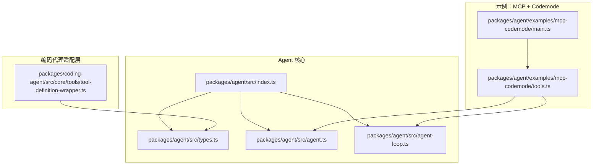
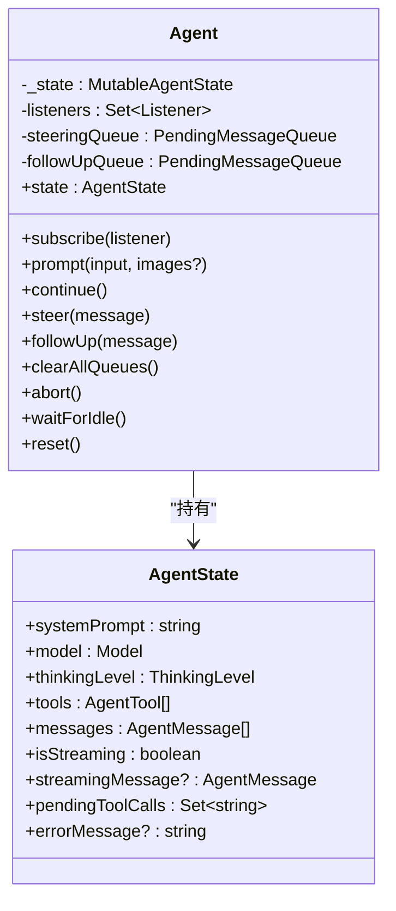
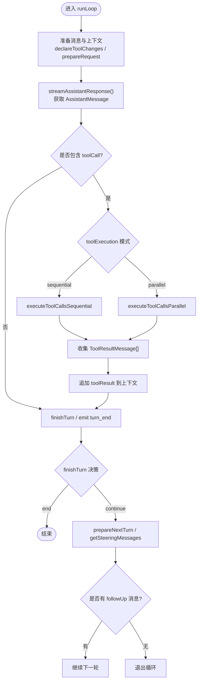
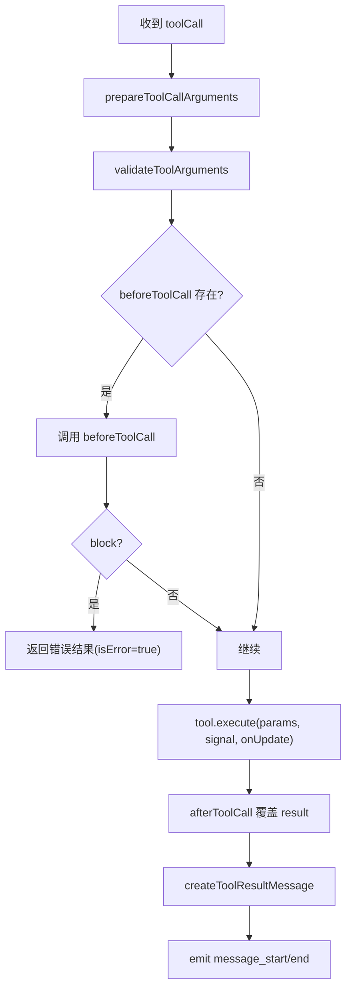
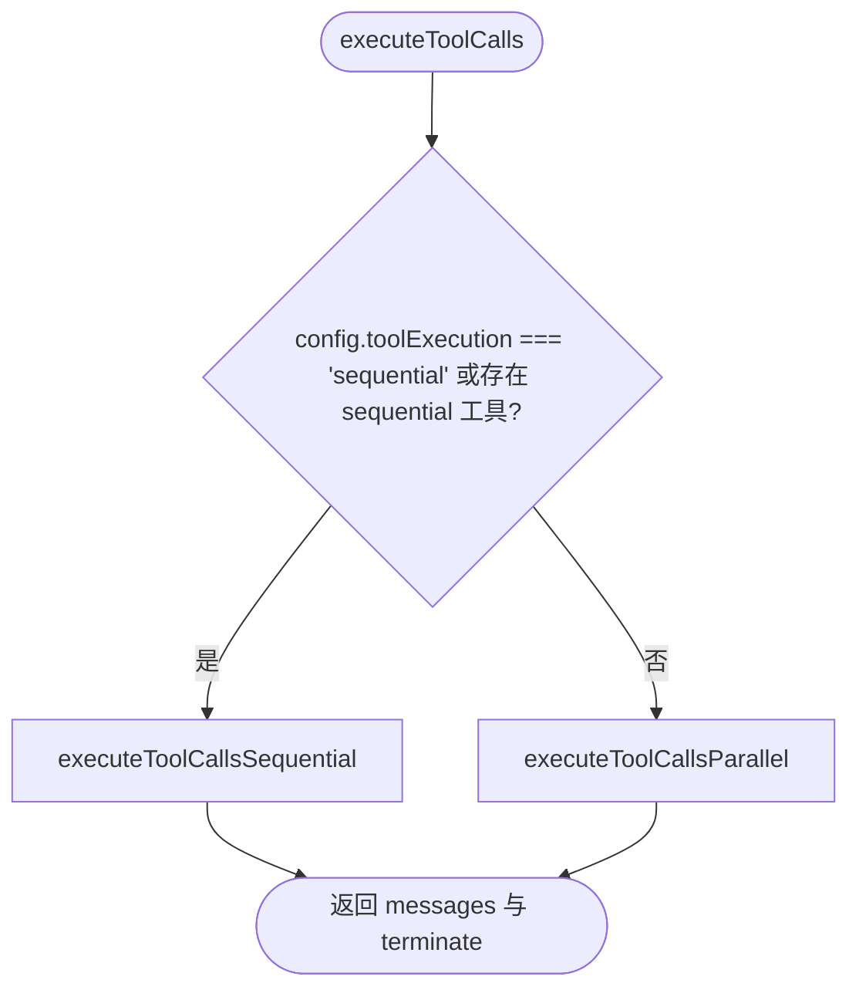
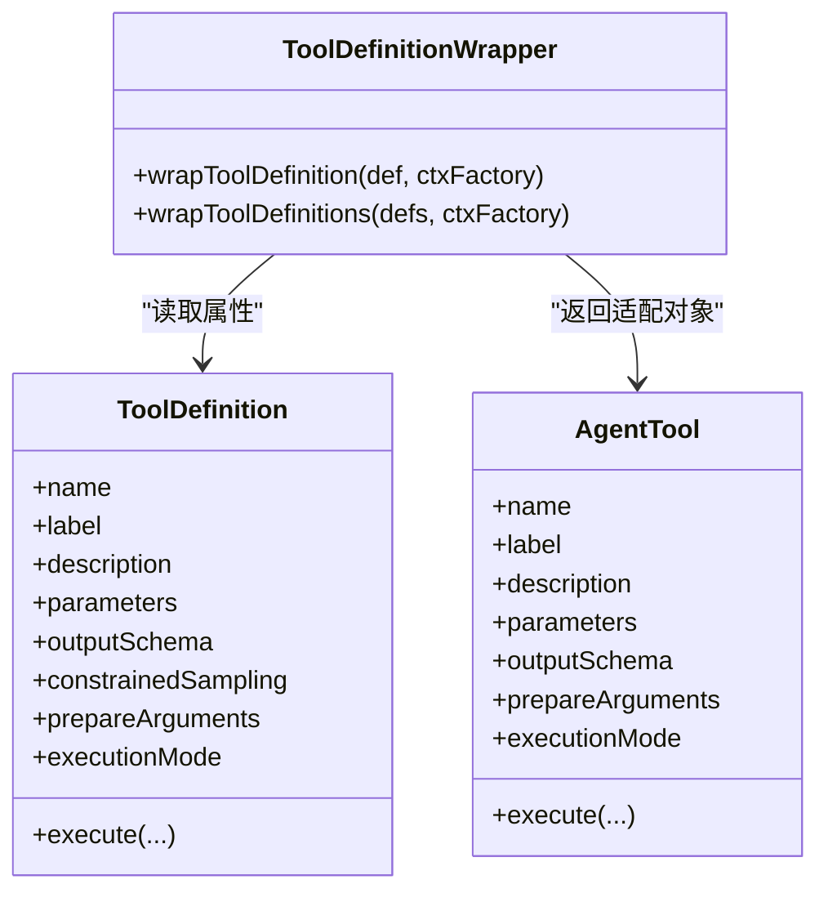
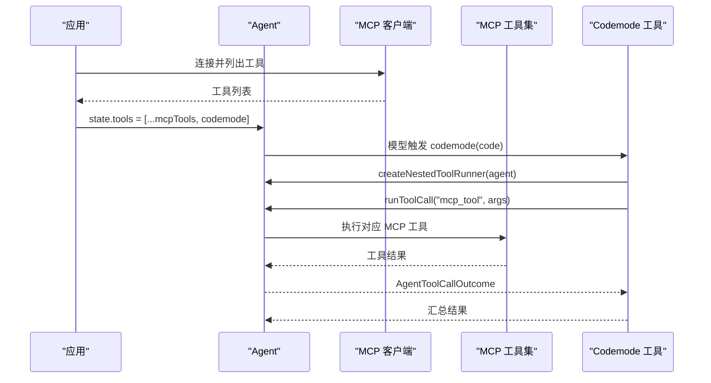
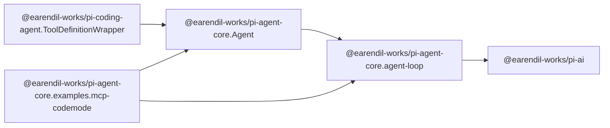

# 工具实现详解

<cite>
**本文引用的文件**   
- [README.md](file://README.md)
- [packages/agent/src/index.ts](file://packages/agent/src/index.ts)
- [packages/agent/src/types.ts](file://packages/agent/src/types.ts)
- [packages/agent/src/agent.ts](file://packages/agent/src/agent.ts)
- [packages/agent/src/agent-loop.ts](file://packages/agent/src/agent-loop.ts)
- [packages/coding-agent/src/core/tools/tool-definition-wrapper.ts](file://packages/coding-agent/src/core/tools/tool-definition-wrapper.ts)
- [packages/agent/examples/mcp-codemode/main.ts](file://packages/agent/examples/mcp-codemode/main.ts)
- [packages/agent/examples/mcp-codemode/tools.ts](file://packages/agent/examples/mcp-codemode/tools.ts)
</cite>

## 目录
1. [引言](#引言)
2. [项目结构](#项目结构)
3. [核心组件](#核心组件)
4. [架构总览](#架构总览)
5. [详细组件分析](#详细组件分析)
6. [依赖关系分析](#依赖关系分析)
7. [性能与执行模型](#性能与执行模型)
8. [故障排查指南](#故障排查指南)
9. [结论](#结论)

## 引言
本文聚焦 Pi 项目中“工具”的实现与运行机制，围绕 agent 核心包中的工具定义、参数校验、执行流程、并行/串行调度、钩子扩展点以及上层编码代理如何包装和复用这些能力展开。目标是帮助读者理解：
- 工具在 Agent 生命周期中如何被声明、发现、调用与结果回传；
- 工具执行的两种模式（顺序与并行）及其适用场景；
- beforeToolCall / afterToolCall 钩子的作用域与覆盖语义；
- 如何在扩展或 MCP 集成中安全地嵌套调用工具；
- 错误处理、中断信号、结构化输出与使用量统计等工程细节。

## 项目结构
Pi 是一个多包仓库，其中与工具实现直接相关的主要代码位于 packages/agent 与 packages/coding-agent 两个包中：
- packages/agent：Agent 运行时核心，包含工具类型、Agent 状态、事件流、低层循环与工具执行逻辑。
- packages/coding-agent：将扩展侧的 ToolDefinition 适配为 Agent 可执行的 AgentTool，并提供上下文工厂。
- examples/mcp-codemode：演示如何将 MCP 工具暴露给模型，并通过 codemode 工具批量调用。



图表来源
- [packages/agent/src/index.ts:1-6](file://packages/agent/src/index.ts#L1-L6)
- [packages/agent/src/types.ts:1-552](file://packages/agent/src/types.ts#L1-L552)
- [packages/agent/src/agent.ts:1-624](file://packages/agent/src/agent.ts#L1-L624)
- [packages/agent/src/agent-loop.ts:1-960](file://packages/agent/src/agent-loop.ts#L1-L960)
- [packages/coding-agent/src/core/tools/tool-definition-wrapper.ts:26-57](file://packages/coding-agent/src/core/tools/tool-definition-wrapper.ts#L26-L57)
- [packages/agent/examples/mcp-codemode/main.ts:1-46](file://packages/agent/examples/mcp-codemode/main.ts#L1-L46)
- [packages/agent/examples/mcp-codemode/tools.ts:78-111](file://packages/agent/examples/mcp-codemode/tools.ts#L78-L111)

章节来源
- [README.md:72-84](file://README.md#L72-L84)

## 核心组件
本节从“工具是什么、如何被运行、如何被扩展”三个维度梳理关键概念。

- 工具定义与执行契约
  - AgentTool：扩展自 pi-ai 的 Tool，增加 label、prepareArguments、outputSchema、execute、replay、executionMode 等字段。
  - AgentToolResult：工具返回的结果，包含面向模型的 content、供程序使用的 structuredContent、details、usage、isError、terminate 等。
  - AgentToolCallOutcome：一次工具调用的最终结果，包含原始 toolCall、result、isError、durationMs。

- 工具执行上下文与钩子
  - BeforeToolCallContext / AfterToolCallContext：分别传入工具执行前后的上下文，包括 assistantMessage、toolCall、args、context、result 等。
  - BeforeToolCallResult：支持 block、reason、terminate，用于权限控制与批内早停。
  - AfterToolCallResult：支持对 result 的部分字段进行合并覆盖，如 content、details、structuredContent、isError、usage、terminate。

- 执行模式与队列
  - ToolExecutionMode：sequential | parallel，默认 parallel。
  - QueueMode：all | one-at-a-time，控制 steering/follow-up 消息注入策略。
  - AgentState：对外暴露 systemPrompt、model、thinkingLevel、tools、messages、pendingToolCalls、errorMessage 等状态。

- 事件流
  - AgentEvent：涵盖 agent_start/end、turn_start/end、message_*、tool_execution_start/update/end 等事件，便于 UI 与日志记录。

章节来源
- [packages/agent/src/types.ts:478-511](file://packages/agent/src/types.ts#L478-L511)
- [packages/agent/src/types.ts:423-455](file://packages/agent/src/types.ts#L423-L455)
- [packages/agent/src/types.ts:66-104](file://packages/agent/src/types.ts#L66-L104)
- [packages/agent/src/types.ts:106-132](file://packages/agent/src/types.ts#L106-L132)
- [packages/agent/src/types.ts:382-421](file://packages/agent/src/types.ts#L382-L421)
- [packages/agent/src/types.ts:528-551](file://packages/agent/src/types.ts#L528-L551)

## 架构总览
下图展示从用户输入到工具执行、再到结果回传的完整链路。

```mermaid
sequenceDiagram
participant User as "用户"
participant Agent as "Agent(状态与事件)"
participant Loop as "AgentLoop(低层循环)"
participant Model as "模型流式接口"
participant Tools as "工具集合(AgentTool[])"
User->>Agent : prompt()/continue()
Agent->>Loop : runAgentLoop()/runAgentLoopContinue()
Loop->>Model : streamAssistantResponse()
Model-->>Loop : AssistantMessage(可能含 toolCall)
Loop->>Tools : executeToolCalls()
Tools-->>Loop : ToolResultMessage[]
Loop-->>Agent : turn_end + toolResults
Agent-->>User : 事件订阅更新
```

图表来源
- [packages/agent/src/agent.ts:379-467](file://packages/agent/src/agent.ts#L379-L467)
- [packages/agent/src/agent-loop.ts:111-160](file://packages/agent/src/agent-loop.ts#L111-L160)
- [packages/agent/src/agent-loop.ts:390-479](file://packages/agent/src/agent-loop.ts#L390-L479)
- [packages/agent/src/agent-loop.ts:518-533](file://packages/agent/src/agent-loop.ts#L518-L533)

## 详细组件分析

### Agent 类：工具状态、事件与生命周期
Agent 是面向应用的高层封装，负责：
- 维护当前会话消息与可用工具；
- 将工具变更以系统消息形式同步给模型；
- 管理 steering/follow-up 消息队列；
- 统一处理事件分发、中止信号、失败消息构造；
- 将高层配置转换为低层 AgentLoopConfig。

关键点：
- tools/messages 赋值会拷贝顶层数组，避免外部引用污染内部状态。
- pendingToolCalls 跟踪当前正在执行的工具调用 id 集合。
- errorMessage 保存最近一次失败的 assistant 消息的错误信息。
- processEvents 根据事件类型更新 streamingMessage、pendingToolCalls、errorMessage 等状态，并通知所有监听器。



图表来源
- [packages/agent/src/agent.ts:194-263](file://packages/agent/src/agent.ts#L194-L263)
- [packages/agent/src/agent.ts:275-377](file://packages/agent/src/agent.ts#L275-L377)
- [packages/agent/src/agent.ts:575-622](file://packages/agent/src/agent.ts#L575-L622)
- [packages/agent/src/types.ts:382-421](file://packages/agent/src/types.ts#L382-L421)

章节来源
- [packages/agent/src/agent.ts:78-112](file://packages/agent/src/agent.ts#L78-L112)
- [packages/agent/src/agent.ts:194-263](file://packages/agent/src/agent.ts#L194-L263)
- [packages/agent/src/agent.ts:379-467](file://packages/agent/src/agent.ts#L379-L467)
- [packages/agent/src/agent.ts:517-566](file://packages/agent/src/agent.ts#L517-L566)
- [packages/agent/src/agent.ts:575-622](file://packages/agent/src/agent.ts#L575-L622)

### AgentLoop：工具执行主循环
AgentLoop 是低层循环，负责：
- 将 AgentMessage 转换为 LLM 可用的 Message；
- 流式获取 assistant 响应；
- 解析 toolCall 并执行；
- 生成 toolResult 消息并追加到上下文；
- 协调 finishTurn、prepareRequest、prepareNextTurn、getSteeringMessages、getFollowUpMessages 等回调；
- 支持顺序与并行两种工具执行模式。



图表来源
- [packages/agent/src/agent-loop.ts:172-330](file://packages/agent/src/agent-loop.ts#L172-L330)
- [packages/agent/src/agent-loop.ts:390-479](file://packages/agent/src/agent-loop.ts#L390-L479)
- [packages/agent/src/agent-loop.ts:518-533](file://packages/agent/src/agent-loop.ts#L518-L533)

章节来源
- [packages/agent/src/agent-loop.ts:111-160](file://packages/agent/src/agent-loop.ts#L111-L160)
- [packages/agent/src/agent-loop.ts:172-330](file://packages/agent/src/agent-loop.ts#L172-L330)
- [packages/agent/src/agent-loop.ts:342-384](file://packages/agent/src/agent-loop.ts#L342-L384)
- [packages/agent/src/agent-loop.ts:390-479](file://packages/agent/src/agent-loop.ts#L390-L479)

### 工具执行路径：参数准备、校验、钩子与结果
工具执行的关键步骤如下：
1. 查找工具：根据 toolCall.name 在 context.tools 中匹配。
2. 参数预处理：可选 prepareArguments 转换原始参数。
3. 参数校验：validateToolArguments 基于 JSON Schema 校验。
4. beforeToolCall 钩子：可阻断执行、设置 terminate 提示。
5. 执行工具：调用 tool.execute(toolCallId, params, signal, onUpdate)。
6. afterToolCall 钩子：部分覆盖 result 字段，决定 isError、usage、terminate 等。
7. 产出 ToolResultMessage：写入 toolName、content、details、usage、isError、timestamp 等。



图表来源
- [packages/agent/src/agent-loop.ts:704-787](file://packages/agent/src/agent-loop.ts#L704-L787)
- [packages/agent/src/agent-loop.ts:831-867](file://packages/agent/src/agent-loop.ts#L831-L867)
- [packages/agent/src/agent-loop.ts:869-920](file://packages/agent/src/agent-loop.ts#L869-L920)
- [packages/agent/src/agent-loop.ts:940-959](file://packages/agent/src/agent-loop.ts#L940-L959)

章节来源
- [packages/agent/src/agent-loop.ts:704-787](file://packages/agent/src/agent-loop.ts#L704-L787)
- [packages/agent/src/agent-loop.ts:831-867](file://packages/agent/src/agent-loop.ts#L831-L867)
- [packages/agent/src/agent-loop.ts:869-920](file://packages/agent/src/agent-loop.ts#L869-L920)
- [packages/agent/src/agent-loop.ts:922-959](file://packages/agent/src/agent-loop.ts#L922-L959)

### 顺序与并行执行模式
- 顺序模式：逐个准备、执行、收尾工具调用，适合需要严格串行化的工具。
- 并行模式：先顺序准备所有工具调用，再并发执行允许并行的工具；tool_execution_end 按完成顺序发出，tool-result 消息按 assistant 源顺序发出。
- 单工具级 executionMode：若某个工具的 executionMode 为 sequential，则即使全局为 parallel，该工具也会串行执行。



图表来源
- [packages/agent/src/agent-loop.ts:518-533](file://packages/agent/src/agent-loop.ts#L518-L533)
- [packages/agent/src/agent-loop.ts:540-594](file://packages/agent/src/agent-loop.ts#L540-L594)
- [packages/agent/src/agent-loop.ts:596-670](file://packages/agent/src/agent-loop.ts#L596-L670)

章节来源
- [packages/agent/src/agent-loop.ts:518-533](file://packages/agent/src/agent-loop.ts#L518-L533)
- [packages/agent/src/agent-loop.ts:540-594](file://packages/agent/src/agent-loop.ts#L540-L594)
- [packages/agent/src/agent-loop.ts:596-670](file://packages/agent/src/agent-loop.ts#L596-L670)

### 工具定义包装：从 ToolDefinition 到 AgentTool
coding-agent 包提供 wrapToolDefinition/wrapToolDefinitions，将扩展侧的 ToolDefinition 适配为 AgentTool，以便 AgentLoop 直接执行。包装过程保留 name、label、description、parameters、outputSchema、constrainedSampling、prepareArguments、executionMode，并将 execute 转发到 definition.execute，同时注入 ExtensionToolContext。



图表来源
- [packages/coding-agent/src/core/tools/tool-definition-wrapper.ts:26-57](file://packages/coding-agent/src/core/tools/tool-definition-wrapper.ts#L26-L57)

章节来源
- [packages/coding-agent/src/core/tools/tool-definition-wrapper.ts:26-57](file://packages/coding-agent/src/core/tools/tool-definition-wrapper.ts#L26-L57)

### 示例：MCP 工具与 Codemode 嵌套调用
示例展示了：
- 通过 createMcpTools 将 MCP server 的工具暴露为 AgentTool；
- 通过 createNestedToolRunner 让 codemode 工具在 JavaScript 脚本中调用其他工具；
- 将 mcpTools 与 codemode 工具一起注入 agent.state.tools，使模型既能直接调用 MCP 工具，也能通过 codemode 批量调用。



图表来源
- [packages/agent/examples/mcp-codemode/main.ts:35-46](file://packages/agent/examples/mcp-codemode/main.ts#L35-L46)
- [packages/agent/examples/mcp-codemode/tools.ts:78-111](file://packages/agent/examples/mcp-codemode/tools.ts#L78-L111)

章节来源
- [packages/agent/examples/mcp-codemode/main.ts:1-46](file://packages/agent/examples/mcp-codemode/main.ts#L1-L46)
- [packages/agent/examples/mcp-codemode/tools.ts:78-111](file://packages/agent/examples/mcp-codemode/tools.ts#L78-L111)

## 依赖关系分析
- Agent 依赖 AgentLoop 提供的 runAgentLoop/runAgentLoopContinue 来驱动对话与工具执行。
- AgentLoop 依赖 pi-ai 的流式 API、工具声明与校验能力。
- coding-agent 通过包装 ToolDefinition 为 AgentTool，接入 AgentLoop 的执行管线。
- 示例通过 Agent.state.tools 动态注入工具，体现工具集的运行时装配能力。



图表来源
- [packages/agent/src/agent.ts:15-16](file://packages/agent/src/agent.ts#L15-L16)
- [packages/agent/src/agent-loop.ts:6-20](file://packages/agent/src/agent-loop.ts#L6-L20)
- [packages/coding-agent/src/core/tools/tool-definition-wrapper.ts:26-57](file://packages/coding-agent/src/core/tools/tool-definition-wrapper.ts#L26-L57)
- [packages/agent/examples/mcp-codemode/main.ts:35-46](file://packages/agent/examples/mcp-codemode/main.ts#L35-L46)

章节来源
- [packages/agent/src/index.ts:1-6](file://packages/agent/src/index.ts#L1-L6)
- [packages/agent/src/agent.ts:15-16](file://packages/agent/src/agent.ts#L15-L16)
- [packages/agent/src/agent-loop.ts:6-20](file://packages/agent/src/agent-loop.ts#L6-L20)

## 性能与执行模型
- 默认并行执行：parallel 模式能提升吞吐，但需注意工具本身的副作用与幂等性。
- 顺序执行：sequential 模式保证严格串行，适合强依赖顺序的工具。
- 单工具级别 executionMode：可在不改变全局策略的前提下，强制特定工具串行。
- 批内早停：当所有 finalized 结果的 terminate 均为 true 时，loop 会在本轮结束后停止。
- 中断信号：beforeToolCall、execute、afterToolCall 均接收 AbortSignal，应主动检查并退出。
- 流式更新：onUpdate 回调可用于实时推送 partialResult，UI 可据此渲染进度。

[本节为通用指导，不直接分析具体文件]

## 故障排查指南
常见问题与定位建议：
- 工具未找到：prepareToolCall 找不到同名工具时会立即返回 isError=true 的错误结果。
- 参数校验失败：validateToolArguments 抛出异常会被捕获并转为错误结果。
- 被 beforeToolCall 阻断：返回 block=true 会生成错误结果并可携带 reason 与 terminate。
- 输出截断：当 assistant 消息因 token 限制被截断时，loop 会拒绝执行其中的 toolCall，并返回错误结果提示重新发起。
- 运行期异常：tool.execute 抛错会被捕获，转化为 isError=true 的结果，不影响整体事件序列。
- 无法继续：continue() 要求最后一条消息不是 assistant，否则会抛出错误。
- 重复启动：prompt()/continue() 在已有 activeRun 时会抛出错误，需等待 waitForIdle 或 abort。

章节来源
- [packages/agent/src/agent-loop.ts:488-513](file://packages/agent/src/agent-loop.ts#L488-L513)
- [packages/agent/src/agent-loop.ts:718-787](file://packages/agent/src/agent-loop.ts#L718-L787)
- [packages/agent/src/agent.ts:392-420](file://packages/agent/src/agent.ts#L392-L420)
- [packages/agent/src/agent.ts:382-390](file://packages/agent/src/agent.ts#L382-L390)

## 结论
Pi 的工具体系以 AgentTool 为核心契约，通过 Agent 与 AgentLoop 的组合实现了可扩展、可观测、可中断的工具执行框架。其设计亮点包括：
- 清晰的职责分层：Agent 负责状态与事件，AgentLoop 负责执行与调度；
- 灵活的执行模式：全局与单工具级别的顺序/并行控制；
- 强大的钩子系统：beforeToolCall/afterToolCall 贯穿参数校验、执行与结果组装；
- 安全的扩展机制：ToolDefinition 包装与 MCP/Codemode 示例展示了如何安全地嵌入第三方工具；
- 完善的错误与中断处理：从参数校验到工具执行，再到结果归一化，均有健壮的错误路径。

对于使用者而言，推荐实践包括：
- 明确工具参数的 JSON Schema，必要时提供 prepareArguments 做兼容转换；
- 在 beforeToolCall 中实现权限与审计，在 afterToolCall 中规范化结果与用量；
- 对副作用敏感的工具显式设置 executionMode="sequential"；
- 在长耗时工具中响应 AbortSignal，并及时上报 onUpdate 进度；
- 通过 Agent.state.tools 动态装配工具集，结合 steering/follow-up 实现可控的工作流编排。