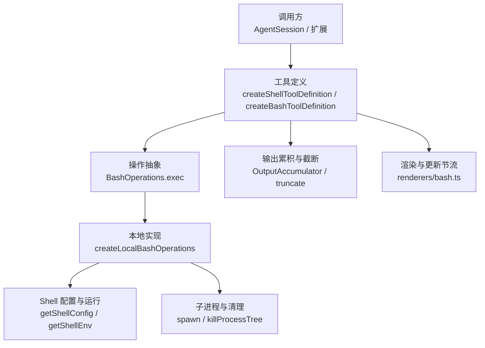
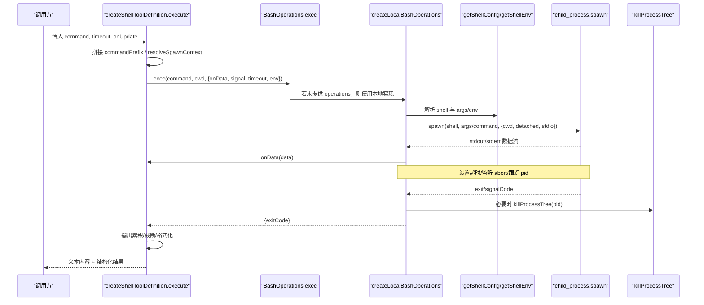
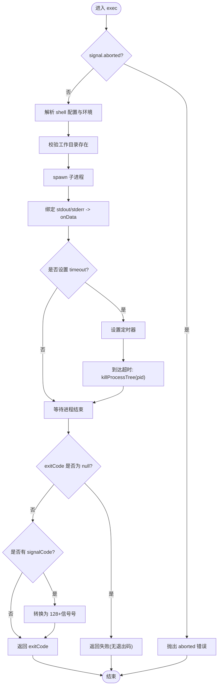
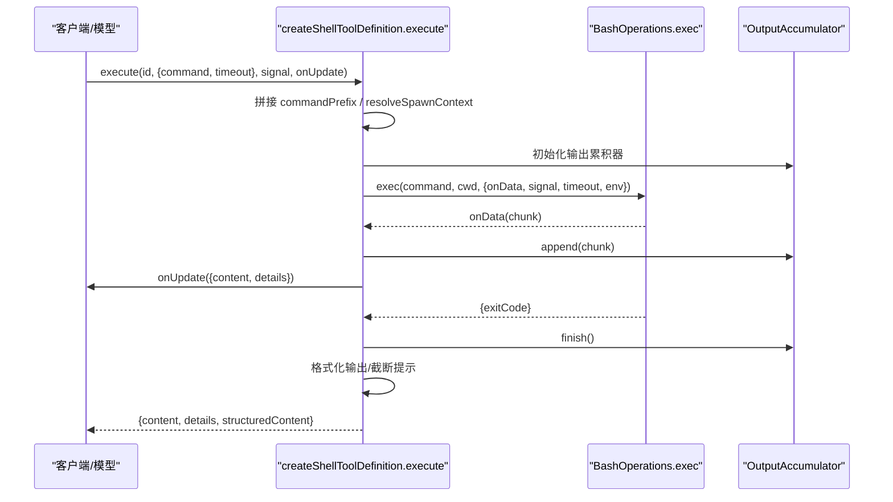
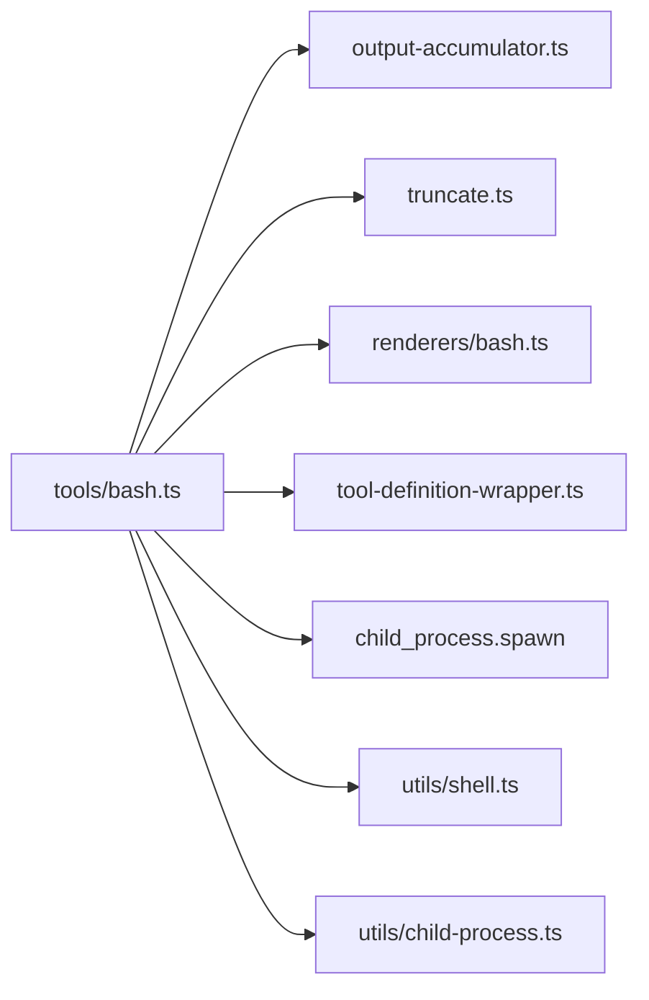

# Shell命令执行模式

<cite>
**本文引用的文件**
- [bash.ts](file://packages/coding-agent/src/core/tools/bash.ts)
- [bash-executor.ts](file://packages/coding-agent/src/core/bash-executor.ts)
- [shell.ts](file://packages/coding-agent/src/utils/shell.ts)
- [bash-spawn-hook.ts](file://packages/coding-agent/examples/extensions/bash-spawn-hook.ts)
- [ssh.ts](file://packages/coding-agent/examples/extensions/ssh.ts)
- [gondolin/index.ts](file://packages/coding-agent/examples/extensions/gondolin/index.ts)
- [tools.test.ts](file://packages/coding-agent/test/tools.test.ts)
</cite>

## 目录
1. [简介](#简介)
2. [项目结构](#项目结构)
3. [核心组件](#核心组件)
4. [架构总览](#架构总览)
5. [详细组件分析](#详细组件分析)
6. [依赖关系分析](#依赖关系分析)
7. [性能与资源特性](#性能与资源特性)
8. [安全考虑](#安全考虑)
9. [故障排查指南](#故障排查指南)
10. [结论](#结论)

## 简介
本文件系统化说明仓库中的 Shell 命令执行模式，重点覆盖以下内容：
- 如何使用 `createLocalBashOperations` 和 `createShellToolDefinition` 创建本地 Bash 操作与工具定义。
- 进程管理、输出流处理、超时控制与信号（取消）处理机制。
- 通过 `BashOperations` 接口扩展远程命令执行与环境隔离能力。
- 安全策略：工作目录校验、环境变量注入与过滤、路径解析、进程树终止等。
- 完整的命令执行流程示例：从参数解析到结果返回。
- 错误处理策略：超时异常、进程终止、权限拒绝、无退出码等。
- 自定义命令前缀、工作目录与环境变量注入方式。

## 项目结构
Shell 命令执行相关代码主要位于 coding-agent 包中，围绕“工具定义 + 操作抽象 + 底层 shell 工具”三层组织：
- 工具定义层：`createShellToolDefinition` / `createBashToolDefinition` / `createBashTool`
- 操作抽象层：`BashOperations` 接口与默认实现 `createLocalBashOperations`
- 底层 shell 工具：`getShellConfig`、`getShellEnv`、`killProcessTree` 等



图表来源
- [bash.ts:271-449](file://packages/coding-agent/src/core/tools/bash.ts#L271-L449)
- [bash.ts:110-204](file://packages/coding-agent/src/core/tools/bash.ts#L110-L204)
- [shell.ts:84-137](file://packages/coding-agent/src/utils/shell.ts#L84-L137)
- [shell.ts:169-181](file://packages/coding-agent/src/utils/shell.ts#L169-L181)
- [shell.ts:218-262](file://packages/coding-agent/src/utils/shell.ts#L218-L262)

章节来源
- [bash.ts:271-477](file://packages/coding-agent/src/core/tools/bash.ts#L271-L477)
- [shell.ts:84-181](file://packages/coding-agent/src/utils/shell.ts#L84-L181)

## 核心组件
- `BashOperations`：可插拔的命令执行接口，支持本地、SSH、容器或 VM 等后端。
- `createLocalBashOperations`：基于 Node.js `child_process.spawn` 的本地 Bash 实现，封装了 shell 解析、工作目录校验、输出流、超时与信号处理。
- `createShellToolDefinition`：将 `BashOperations` 包装为统一的工具定义，负责参数校验、命令前缀、环境注入、输出累积与截断、结构化结果返回。
- `executeBashWithOperations`：面向交互/RPC 的统一执行器，提供流式输出、二进制清洗、临时文件持久化与取消语义。

章节来源
- [bash.ts:74-93](file://packages/coding-agent/src/core/tools/bash.ts#L74-L93)
- [bash.ts:202-204](file://packages/coding-agent/src/core/tools/bash.ts#L202-L204)
- [bash.ts:271-449](file://packages/coding-agent/src/core/tools/bash.ts#L271-L449)
- [bash-executor.ts:48-148](file://packages/coding-agent/src/core/bash-executor.ts#L48-L148)

## 架构总览
下图展示一次 Bash 工具调用的端到端流程：



图表来源
- [bash.ts:271-449](file://packages/coding-agent/src/core/tools/bash.ts#L271-L449)
- [bash.ts:110-204](file://packages/coding-agent/src/core/tools/bash.ts#L110-L204)
- [shell.ts:84-137](file://packages/coding-agent/src/utils/shell.ts#L84-L137)
- [shell.ts:218-262](file://packages/coding-agent/src/utils/shell.ts#L218-L262)

## 详细组件分析

### BashOperations 接口与扩展机制
`BashOperations` 是命令执行的抽象接口，仅暴露一个 `exec` 方法，由上层统一调度：
- 输入：命令字符串、工作目录、回调与选项（`onData`、`signal`、`timeout`、`env`）。
- 输出：Promise 解析为 `{ exitCode }`；当进程被信号杀死时，约定返回 `128 + 信号编号`；null 表示失败。

扩展点：
- 本地实现：`createLocalBashOperations` 直接复用系统 bash。
- 远程实现：示例 SSH 扩展通过 `createRemoteBashOps` 将命令转发到远端主机。
- 隔离实现：示例 Gondolin 扩展在微 VM 内执行命令，实现文件系统与进程隔离。

```mermaid
classDiagram
class BashOperations {
+exec(command, cwd, options) Promise~{exitCode}
}
class CreateLocalBashOperations {
+createLocalBashOperations(options) BashOperations
}
class CreateRemoteBashOps {
+createRemoteBashOps(remote, remoteCwd, localCwd) BashOperations
}
class CreateGondolinBashOps {
+createGondolinBashOps(vm, localCwd, shellPath) BashOperations
}
BashOperations <|.. CreateLocalBashOperations
BashOperations <|.. CreateRemoteBashOps
BashOperations <|.. CreateGondolinBashOps
```

图表来源
- [bash.ts:74-93](file://packages/coding-agent/src/core/tools/bash.ts#L74-L93)
- [bash.ts:202-204](file://packages/coding-agent/src/core/tools/bash.ts#L202-L204)
- [ssh.ts:81-112](file://packages/coding-agent/examples/extensions/ssh.ts#L81-L112)
- [gondolin/index.ts:324-363](file://packages/coding-agent/examples/extensions/gondolin/index.ts#L324-L363)

章节来源
- [bash.ts:74-93](file://packages/coding-agent/src/core/tools/bash.ts#L74-L93)
- [ssh.ts:81-112](file://packages/coding-agent/examples/extensions/ssh.ts#L81-L112)
- [gondolin/index.ts:324-363](file://packages/coding-agent/examples/extensions/gondolin/index.ts#L324-L363)

### createLocalBashOperations：本地进程管理与流处理
职责：
- 校验工作目录存在性。
- 根据平台与 shell 类型选择参数传递方式（命令行参数或 stdin）。
- 启动子进程并绑定 stdout/stderr 到 `onData`。
- 支持 `AbortSignal` 取消：触发后对进程树执行强制终止。
- 支持 `timeout`：到达截止时间后终止进程树并抛出带超时信息的错误。
- 规范化退出码：信号杀死的进程按 `128 + 信号号` 返回；无退出码视为失败。

关键行为：
- 非 Windows 平台以 detached 模式启动，便于组级信号终止。
- 跟踪 detached 子进程 pid，确保父进程退出时能清理后台进程。
- 兼容 WSL 旧版 bash.exe 通过 stdin 传参。



图表来源
- [bash.ts:110-194](file://packages/coding-agent/src/core/tools/bash.ts#L110-L194)
- [shell.ts:218-262](file://packages/coding-agent/src/utils/shell.ts#L218-L262)

章节来源
- [bash.ts:110-204](file://packages/coding-agent/src/core/tools/bash.ts#L110-L204)
- [shell.ts:218-262](file://packages/coding-agent/src/utils/shell.ts#L218-L262)

### createShellToolDefinition：工具定义、参数与输出处理
职责：
- 定义工具元信息、参数 schema、输出 schema。
- 组装命令前缀（例如初始化脚本）、工作目录与环境变量。
- 聚合输出流，支持节流更新、行/字节数截断、完整输出落盘。
- 将 `BashOperations.exec` 的结果映射为工具返回体（文本 + 结构化内容）。

关键点：
- 参数校验：command 必填，timeout 可选且需为正数。
- 输出限制：模型可见输出默认按最后 N 行或固定 KB 截断；超出部分写入临时文件。
- 结构化结果：包含 output、truncated、full_output_path、exit_code、wall_time_seconds。
- 渲染与提示：根据是否暴露会话环境变量决定是否附加系统提示指导。



图表来源
- [bash.ts:271-449](file://packages/coding-agent/src/core/tools/bash.ts#L271-L449)

章节来源
- [bash.ts:271-449](file://packages/coding-agent/src/core/tools/bash.ts#L271-L449)

### executeBashWithOperations：统一执行器与流式输出
职责：
- 接收任意 `BashOperations` 实现，提供统一的流式输出、取消与截断语义。
- 对输出进行 ANSI 剥离与二进制清洗，避免显示崩溃。
- 超过阈值时自动写临时文件，并在结束时返回完整输出路径。
- 区分“已取消”与“正常结束”，返回 `cancelled` 标志。

适用场景：
- AgentSession 的交互式/RPC Bash 执行。
- 需要稳定流式输出的上层模块。

章节来源
- [bash-executor.ts:48-148](file://packages/coding-agent/src/core/bash-executor.ts#L48-L148)

### 自定义命令前缀、工作目录与环境变量注入
- 命令前缀：通过 `BashToolOptions.commandPrefix` 在每个命令前追加一段命令（如 source 配置文件、导出变量）。
- 工作目录：优先使用上下文提供的 `ctx.cwd`，否则回退到工具创建时的 `cwd`。
- 环境变量：
  - 默认继承 `getShellEnv()`，并注入 bin 目录到 PATH。
  - 默认隐藏敏感会话变量（PI_SESSION_ID、PI_PROVIDER 等），可通过 `exposeSessionEnvironment` 打开。
  - 通过 `spawnHook` 可在执行前改写 command、cwd、env。

示例参考：
- 钩子示例：在命令前注入 profile 并添加标记环境变量。
- SSH/Gondolin 示例：在 exec 中显式构造 env 并传递给底层实现。

章节来源
- [bash.ts:242-253](file://packages/coding-agent/src/core/tools/bash.ts#L242-L253)
- [bash.ts:214-240](file://packages/coding-agent/src/core/tools/bash.ts#L214-L240)
- [bash-spawn-hook.ts:16-22](file://packages/coding-agent/examples/extensions/bash-spawn-hook.ts#L16-L22)
- [ssh.ts:81-112](file://packages/coding-agent/examples/extensions/ssh.ts#L81-L112)
- [gondolin/index.ts:324-363](file://packages/coding-agent/examples/extensions/gondolin/index.ts#L324-L363)

## 依赖关系分析
- 工具定义依赖：
  - `OutputAccumulator`：输出累积与截断。
  - `truncate.ts`：行/字节截断与大小格式化。
  - `renderers/bash.ts`：渲染器与更新节流常量。
  - `tool-definition-wrapper.ts`：工具定义包装。
- 底层依赖：
  - `child_process.spawn`：进程启动。
  - `utils/shell.ts`：shell 解析、环境变量、进程树终止。
  - `utils/child-process.ts`：等待子进程结束且不挂起。



图表来源
- [bash.ts:1-20](file://packages/coding-agent/src/core/tools/bash.ts#L1-L20)

章节来源
- [bash.ts:1-20](file://packages/coding-agent/src/core/tools/bash.ts#L1-L20)

## 性能与资源特性
- 输出节流：对高频输出进行节流合并，减少 UI 更新压力。
- 输出截断：按行数与字节数双重限制，避免大输出阻塞内存与渲染。
- 临时文件：当输出超限时，自动落盘完整输出，并提供路径供后续读取。
- 进程清理：跨平台进程树终止，避免僵尸进程与管道泄漏。
- UTF-8 分片解码：正确处理跨 chunk 的字符边界。

章节来源
- [bash.ts:304-364](file://packages/coding-agent/src/core/tools/bash.ts#L304-L364)
- [bash-executor.ts:73-113](file://packages/coding-agent/src/core/bash-executor.ts#L73-L113)
- [shell.ts:218-262](file://packages/coding-agent/src/utils/shell.ts#L218-L262)

## 安全考虑
当前实现的安全要点与建议：
- 工作目录校验：在执行前检查 cwd 是否存在，防止无效路径导致意外行为。
- 环境变量过滤：默认移除敏感会话变量，仅在开启 `exposeSessionEnvironment` 时注入必要字段。
- 路径解析：通过 `getShellConfig` 严格解析 shell 路径，支持用户指定 shell 并校验存在性。
- 进程树终止：在超时或取消时，跨平台终止整个进程树，避免后台进程残留。
- 输出清洗：剥离 ANSI 与控制字符，避免终端崩溃与显示异常。
- 建议补充：
  - 命令白名单：在上层对 `command` 做正则或关键字白名单校验，仅允许受控命令。
  - 路径限制：对涉及文件操作的命令进行路径白名单或沙箱校验。
  - 资源限制：结合操作系统 cgroup/ulimit 限制 CPU、内存、文件句柄等。
  - 网络限制：在受限环境中禁用危险的网络访问命令。

章节来源
- [bash.ts:118-122](file://packages/coding-agent/src/core/tools/bash.ts#L118-L122)
- [bash.ts:214-240](file://packages/coding-agent/src/core/tools/bash.ts#L214-L240)
- [shell.ts:84-137](file://packages/coding-agent/src/utils/shell.ts#L84-L137)
- [shell.ts:183-192](file://packages/coding-agent/src/utils/shell.ts#L183-L192)
- [shell.ts:218-262](file://packages/coding-agent/src/utils/shell.ts#L218-L262)

## 故障排查指南
常见问题与处理方式：
- 工作目录不存在：抛出明确错误，提示无法执行命令。
- Shell 路径无效：当用户指定 shellPath 不存在时抛出错误；Windows 下找不到 bash 会给出安装指引。
- 进程启动失败：捕获 ENOENT 等错误，向上抛出。
- 超时：抛出带超时秒数的错误，若 shell 先于截止退出但后台进程仍在写输出，会附带 shell 退出时间与退出码。
- 取消：收到 AbortSignal 时立即终止进程树，并返回“已取消”语义。
- 无退出码：当进程没有正常退出码时，视为失败。
- 输出过大：自动截断并保存完整输出至临时文件，返回路径以便后续读取。

测试用例参考：
- 自定义 shellPath 校验与错误信息。
- 通过 stdin 传输命令（WSL 兼容）。
- 命令前缀输出合并。
- 高频输出节流与 UTF-8 分片解码。
- 使用 `createLocalBashOperations` 的环境变量注入与输出清洗。

章节来源
- [tools.test.ts:640-700](file://packages/coding-agent/test/tools.test.ts#L640-L700)
- [tools.test.ts:728-839](file://packages/coding-agent/test/tools.test.ts#L728-L839)
- [bash.ts:100-107](file://packages/coding-agent/src/core/tools/bash.ts#L100-L107)
- [bash.ts:399-416](file://packages/coding-agent/src/core/tools/bash.ts#L399-L416)

## 结论
该 Shell 命令执行模式通过清晰的抽象与分层设计，提供了可扩展、可观测、可控制的命令执行能力：
- 以 `BashOperations` 为扩展点，轻松适配本地、SSH、VM 等多种后端。
- 以 `createShellToolDefinition` 为中心，统一参数、输出、截断与结构化结果。
- 内置完善的进程管理、超时与信号处理，保障资源回收与稳定性。
- 提供丰富的自定义能力：命令前缀、工作目录、环境变量注入与执行钩子。
- 在当前实现基础上，可进一步叠加命令白名单、路径限制与系统级资源限制，以满足更严格的安全需求。