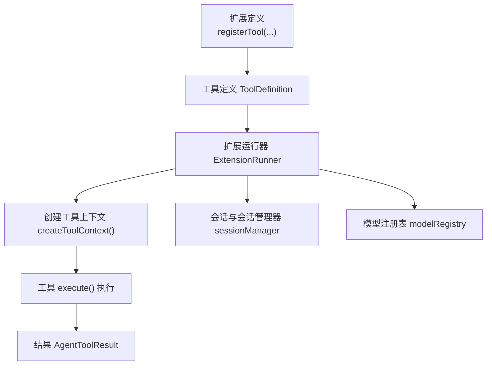
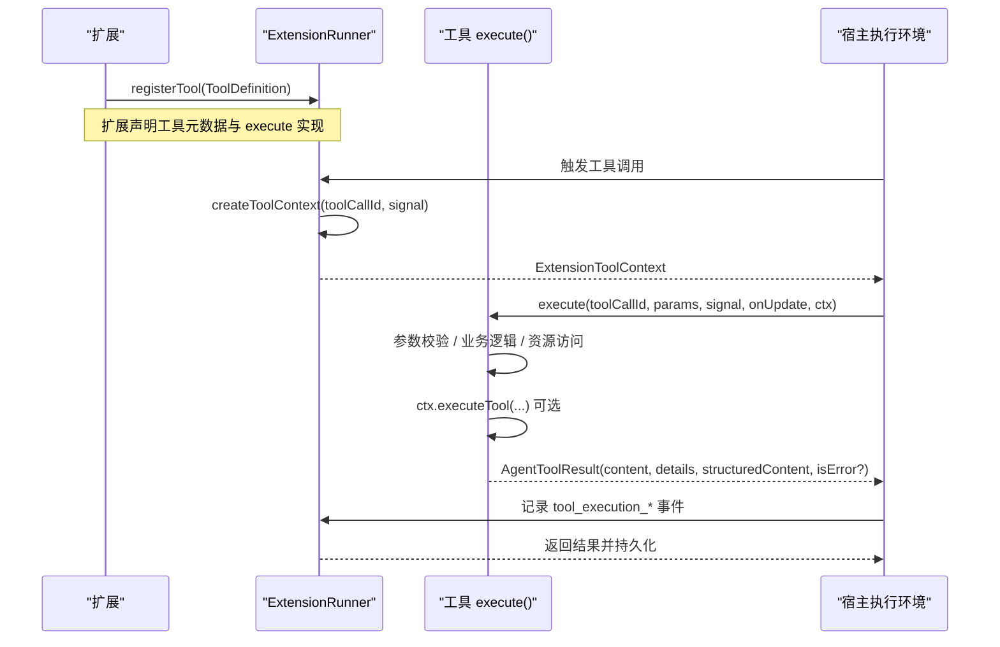
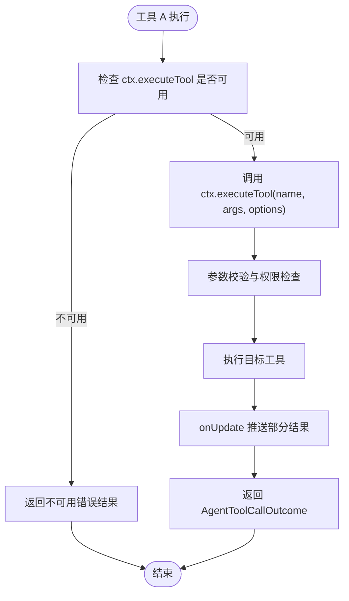
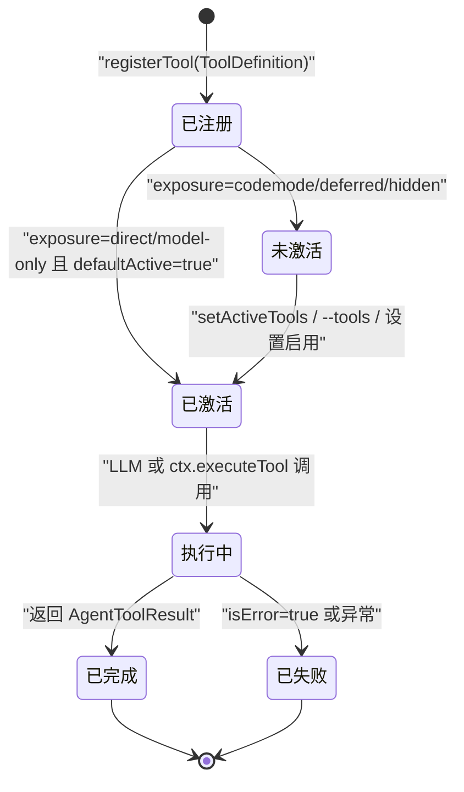
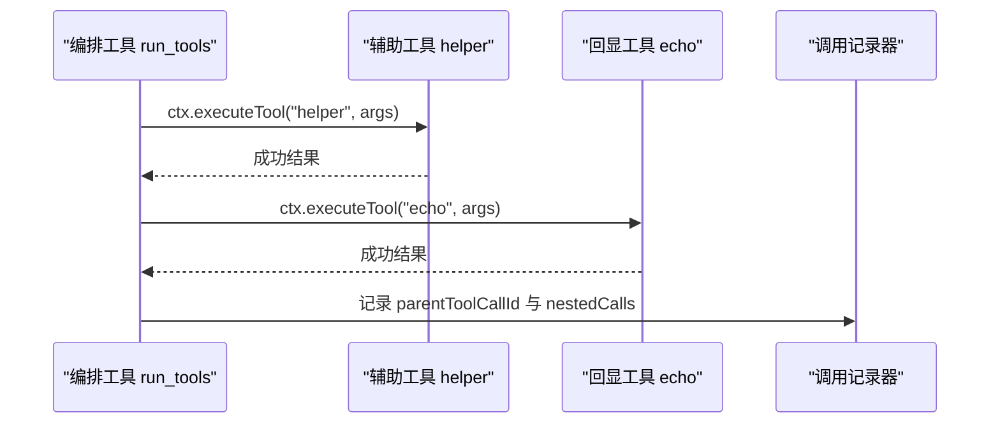
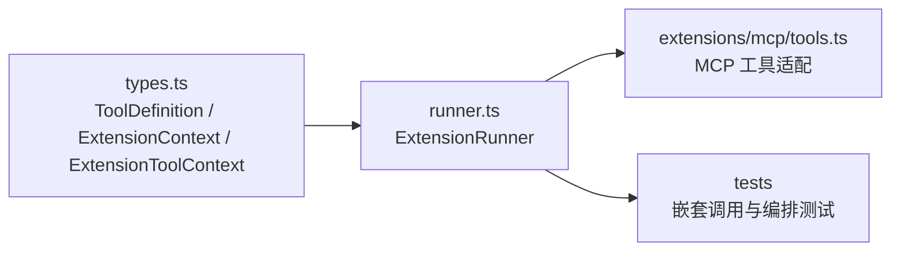

# 工具实现模式

<cite>
**本文引用的文件**   
- [types.ts](file://packages/coding-agent/src/core/extensions/types.ts)
- [runner.ts](file://packages/coding-agent/src/core/extensions/runner.ts)
- [tools.ts（MCP 适配）](file://packages/coding-agent/src/extensions/mcp/tools.ts)
- [tools.ts（示例扩展）](file://packages/coding-agent/examples/extensions/tools.ts)
- [agent-session-tool-orchestration.test.ts](file://packages/coding-agent/test/suite/agent-session-tool-orchestration.test.ts)
- [nested-tool-calls.test.ts](file://packages/coding-agent/test/nested-tool-calls.test.ts)
</cite>

## 目录
1. [引言](#引言)
2. [项目结构](#项目结构)
3. [核心组件](#核心组件)
4. [架构总览](#架构总览)
5. [详细组件分析](#详细组件分析)
6. [依赖关系分析](#依赖关系分析)
7. [性能与内存优化](#性能与内存优化)
8. [故障排查指南](#故障排查指南)
9. [结论](#结论)

## 引言
本文面向扩展开发者，系统化说明“工具实现模式”。重点包括：
- `execute` 函数的参数、异步处理、错误处理和结果返回规范。
- `ExtensionToolContext` 的使用方法，尤其是 `ctx.executeTool`、`ctx.sessionManager`、`ctx.modelRegistry`。
- 工具从注册到执行的完整生命周期。
- 只读工具、文件操作工具、命令执行工具、网络请求工具的典型实现模式。
- 最佳实践、性能优化和内存管理建议。

## 项目结构
本仓库中与工具实现直接相关的代码主要位于 `packages/coding-agent` 下：
- 类型与上下文定义：`src/core/extensions/types.ts`
- 扩展运行器与上下文创建：`src/core/extensions/runner.ts`
- MCP 工具适配示例：`src/extensions/mcp/tools.ts`
- 示例扩展：`examples/extensions/tools.ts`
- 工具编排与嵌套调用测试：`test/suite/agent-session-tool-orchestration.test.ts`、`test/nested-tool-calls.test.ts`

**图表来源**
- [types.ts:599-688](file://packages/coding-agent/src/core/extensions/types.ts#L599-L688)
- [runner.ts:975-1002](file://packages/coding-agent/src/core/extensions/runner.ts#L975-L1002)

**章节来源**
- [types.ts:599-688](file://packages/coding-agent/src/core/extensions/types.ts#L599-L688)
- [runner.ts:975-1002](file://packages/coding-agent/src/core/extensions/runner.ts#L975-L1002)

## 核心组件
- `ToolDefinition`：描述一个工具的名称、标签、描述、参数 Schema、输出 Schema、暴露方式、执行函数等。
- `ExtensionContext`：扩展事件处理器使用的上下文，包含 UI、工作目录、会话管理器、模型注册表、当前模型、思考级别、中止信号等。
- `ExtensionToolContext`：在工具 `execute()` 中使用的上下文，继承自 `ExtensionContext`，并增加 `tools` 与 `executeTool()`。
- `ExtensionRunner`：负责绑定扩展、创建上下文、分发事件、管理工具注册与查询。

关键要点：
- 工具通过 `pi.registerTool({ ... })` 注册，最终形成 `ToolDefinition`。
- 工具执行时，系统会调用 `createToolContext(toolCallId, signal)` 生成 `ExtensionToolContext`。
- 工具可通过 `ctx.executeTool(name, args, options)` 调用其他工具，该调用走统一的校验、钩子和权限检查流程。

**章节来源**
- [types.ts:345-415](file://packages/coding-agent/src/core/extensions/types.ts#L345-L415)
- [types.ts:599-688](file://packages/coding-agent/src/core/extensions/types.ts#L599-L688)
- [runner.ts:975-1002](file://packages/coding-agent/src/core/extensions/runner.ts#L975-L1002)

## 架构总览
下图展示工具从注册到执行的端到端路径，以及嵌套调用的数据流。

**图表来源**
- [runner.ts:975-1002](file://packages/coding-agent/src/core/extensions/runner.ts#L975-L1002)
- [types.ts:670-676](file://packages/coding-agent/src/core/extensions/types.ts#L670-L676)

## 详细组件分析

### 1. `execute` 函数的实现模式
`execute` 是工具的核心实现入口，其签名由 `ToolDefinition.execute` 定义。

#### 1.1 参数与返回值
- 输入参数：
  - `toolCallId`：本次工具调用的唯一标识。
  - `params`：已通过 Schema 校验的参数对象。
  - `signal`：可传播的中止信号，用于取消长时间运行的任务。
  - `onUpdate`：部分结果回调，可用于流式更新。
  - `ctx`：`ExtensionToolContext`，提供工具间调用、会话、模型、UI 等能力。
- 返回值：
  - `AgentToolResult<TDetails>`，包含 `content`、`details`、可选的 `structuredContent`，以及可选的 `isError`。

#### 1.2 参数处理
- 使用 TypeBox 或 JSON Schema 声明 `parameters`，由框架在执行前完成校验。
- 如需兼容旧格式，可使用 `prepareArguments` 预处理原始参数。
- 推荐对敏感参数进行最小化暴露，避免将大文本直接放入 LLM 上下文。

#### 1.3 异步操作
- 所有 I/O 都应使用异步 API，并在必要时监听 `signal` 以支持中断。
- 对于长耗时任务，应通过 `onUpdate` 推送中间状态，提升交互体验。
- 若需要并发控制，可在工具内部实现限流、队列或基于 `executionMode` 的策略。

#### 1.4 错误处理
- 正常失败应返回 `{ content, details, isError: true }`，而不是抛出异常。
- 严重异常可抛出，但应在工具外层捕获并转换为结构化错误结果。
- 嵌套调用 `ctx.executeTool` 不会拒绝，未知工具、校验失败、被阻止或抛错都会以 `isError: true` 的结果返回。

#### 1.5 结果返回
- `content`：面向模型的文本或图像内容。
- `details`：调试信息、文件路径、服务端信息等。
- `structuredContent`：供脚本或下游消费的结构化数据。
- 大文本应截断并保存为临时文件，同时在 `details` 中保留完整路径。

**章节来源**
- [types.ts:670-676](file://packages/coding-agent/src/core/extensions/types.ts#L670-L676)
- [types.ts:387-415](file://packages/coding-agent/src/core/extensions/types.ts#L387-L415)

### 2. `ExtensionToolContext` 的使用方法
`ExtensionToolContext` 在工具执行期间可用，它扩展了基础扩展上下文，并提供工具间调用能力。

#### 2.1 调用其他工具：`ctx.executeTool`
- 方法签名：`executeTool(name, args, options?)`。
- `options.signal`：默认继承调用方的中止信号；可传入新的信号覆盖。
- `options.onUpdate`：接收嵌套工具的部分结果。
- 行为：
  - 统一走校验、钩子、权限检查。
  - 不抛出工具失败异常，而是返回 `isError: true` 的结果。
  - 嵌套调用 ID 形如 `<calling id>/<n>`，并通过事件携带 `parentToolCallId`。
  - 不在转录中显示，但在调用方结果消息中保留 `nestedCalls` 记录。

**图表来源**
- [runner.ts:975-1002](file://packages/coding-agent/src/core/extensions/runner.ts#L975-L1002)
- [types.ts:387-415](file://packages/coding-agent/src/core/extensions/types.ts#L387-L415)

#### 2.2 访问会话数据：`ctx.sessionManager`
- `sessionManager` 是只读的会话管理器接口。
- 常用用途：
  - 读取当前会话分支、条目、会话元信息。
  - 根据分支定位历史配置或状态。
  - 配合自定义条目持久化工具选择状态。

#### 2.3 获取模型信息：`ctx.modelRegistry`
- `modelRegistry` 用于解析模型提供者、虚拟模型、API Key 等。
- 常见用途：
  - 动态注册或注销模型提供者。
  - 根据当前会话或设置选择合适模型。
  - 在工具中读取模型路由或提供者能力。

#### 2.4 其他重要属性
- `cwd`：当前工作目录。
- `model`：当前模型实例。
- `scopedModels`：会话范围内的模型快照。
- `thinkingLevel`：当前思考级别。
- `signal`：当前中止信号。
- `abort()`：中止当前代理操作。
- `getContextUsage()`：获取上下文使用情况。
- `compact()`：触发上下文压缩。
- `getSystemPrompt()`：获取当前系统提示。

**章节来源**
- [types.ts:345-415](file://packages/coding-agent/src/core/extensions/types.ts#L345-L415)
- [runner.ts:975-1002](file://packages/coding-agent/src/core/extensions/runner.ts#L975-L1002)

### 3. 工具生命周期管理
工具的生命周期分为注册、激活、暴露、执行、结果持久化几个阶段。

**图表来源**
- [types.ts:521-536](file://packages/coding-agent/src/core/extensions/types.ts#L521-L536)
- [types.ts:599-688](file://packages/coding-agent/src/core/extensions/types.ts#L599-L688)

关键点：
- `exposure` 控制模型如何到达工具：
  - `direct`：活跃时声明给模型并可调用。
  - `model-only`：活跃时声明给模型，但不允许 `ctx.executeTool` 调用。
  - `codemode`：始终可调，但未显式激活时不声明给模型。
  - `deferred`：类似 `codemode`，但 codemode 工具不列出它；工具搜索可找到。
  - `hidden`：注册但不可达。
- `defaultActive` 控制注册时是否自动激活。
- `prepareLoadout` 允许工具在活跃时调整模型可见的工具列表。

**章节来源**
- [types.ts:521-536](file://packages/coding-agent/src/core/extensions/types.ts#L521-L536)
- [types.ts:599-688](file://packages/coding-agent/src/core/extensions/types.ts#L599-L688)

### 4. 不同类型工具的典型实现模式

#### 4.1 只读工具
适用场景：查询配置、读取静态资源、计算派生值。
- 特点：
  - 无副作用，适合标记 `annotations.readOnlyHint = true`。
  - 可重复调用，适合标记 `annotations.idempotentHint = true`。
- 实现建议：
  - 优先使用缓存减少重复计算。
  - 返回结构化数据 `structuredContent`，便于脚本消费。
  - 使用 `outputSchema` 声明输出结构。

#### 4.2 文件操作工具
适用场景：读取、写入、编辑、查找文件。
- 特点：
  - 可能修改文件系统，需明确权限与确认机制。
  - 大文件应分块读取、流式处理，避免一次性加载。
- 实现建议：
  - 使用 `ctx.sessionManager` 结合分支定位历史配置。
  - 对删除或覆盖操作标记 `annotations.destructiveHint = true`。
  - 返回文件路径、变更摘要、差异摘要等 `details`。

#### 4.3 命令执行工具
适用场景：执行 shell、PowerShell、Python 等命令。
- 特点：
  - 高权限，风险较高。
  - 需要超时、输出截断、安全白名单。
- 实现建议：
  - 使用 `signal` 支持中断。
  - 输出超过阈值时保存到临时文件，并在 `details.fullOutputPath` 中返回。
  - 对危险命令进行拦截或二次确认。

#### 4.4 网络请求工具
适用场景：调用外部 API、MCP 服务、Web 资源。
- 特点：
  - 受网络延迟、限流、认证影响。
  - 可能需要重试、退避、缓存。
- 实现建议：
  - 使用 `ctx.modelRegistry` 解析模型或提供者配置。
  - 使用 `onUpdate` 推送进度，提升用户体验。
  - 对二进制资源进行类型判断，文本类型直接展示，非图片二进制保存到临时文件。

参考 MCP 工具适配的实现模式：
- 将 MCP 工具输入 Schema 规范化为 pi 的 Schema。
- 将 MCP 输出转换为 `AgentToolResult`，处理文本、图片、资源链接、二进制资源。
- 支持进度回调，通过 `onUpdate` 推送进展。
- 为大输出创建临时文件，并在结果中保留路径。

**章节来源**
- [tools.ts（MCP 适配）:249-289](file://packages/coding-agent/src/extensions/mcp/tools.ts#L249-L289)
- [tools.ts（MCP 适配）:214-235](file://packages/coding-agent/src/extensions/mcp/tools.ts#L214-L235)

### 5. 嵌套工具调用与编排
嵌套调用是工具编排的重要能力。测试用例展示了：
- 工具可以通过 `ctx.executeTool` 调用其他工具。
- 嵌套调用会记录 `parentToolCallId`，并在结果消息中保留 `nestedCalls`。
- 工具可以动态调整活跃工具集，影响下一轮模型可用的工具列表。

**图表来源**
- [agent-session-tool-orchestration.test.ts:62-113](file://packages/coding-agent/test/suite/agent-session-tool-orchestration.test.ts#L62-L113)

**章节来源**
- [agent-session-tool-orchestration.test.ts:62-113](file://packages/coding-agent/test/suite/agent-session-tool-orchestration.test.ts#L62-L113)

## 依赖关系分析
- `ToolDefinition` 依赖 `TSchema` 参数与输出 Schema。
- `ExtensionToolContext` 依赖 `ExtensionContext`，并扩展工具调用能力。
- `ExtensionRunner` 依赖会话管理器、模型注册表、事件总线、UI 上下文等。
- MCP 工具适配依赖 MCP 协议类型、输出限制、渲染工具等。

**图表来源**
- [types.ts:345-415](file://packages/coding-agent/src/core/extensions/types.ts#L345-L415)
- [runner.ts:975-1002](file://packages/coding-agent/src/core/extensions/runner.ts#L975-L1002)
- [tools.ts（MCP 适配）:249-289](file://packages/coding-agent/src/extensions/mcp/tools.ts#L249-L289)

**章节来源**
- [types.ts:345-415](file://packages/coding-agent/src/core/extensions/types.ts#L345-L415)
- [runner.ts:975-1002](file://packages/coding-agent/src/core/extensions/runner.ts#L975-L1002)
- [tools.ts（MCP 适配）:249-289](file://packages/coding-agent/src/extensions/mcp/tools.ts#L249-L289)

## 性能与内存优化
- 避免在 `content` 中返回超大文本；使用截断策略并保存完整输出到临时文件。
- 使用 `onUpdate` 推送部分结果，减少前端等待时间。
- 对只读、幂等操作启用缓存，降低重复计算和网络请求。
- 合理使用 `executionMode`：
  - `sequential`：保证串行执行，适用于有状态或互斥资源。
  - `parallel`：允许并发执行，提升吞吐。
- 及时释放临时文件、关闭连接、清理定时器。
- 避免在工具中持有全局可变状态；如需状态，使用会话条目或外部存储。
- 使用 `signal` 支持中断，防止长时间阻塞。

[本节为通用指导，不直接分析具体文件]

## 故障排查指南
常见问题与定位思路：
- 嵌套调用不可用：
  - 检查是否在工具上下文中调用 `ctx.executeTool`。
  - 如果上下文未注入，会返回“嵌套工具调用不可用”的错误结果。
- 工具未被模型看到：
  - 检查 `exposure` 是否为 `direct` 或 `model-only`。
  - 检查 `defaultActive` 与 `setActiveTools` 配置。
- 工具执行失败：
  - 检查返回结果中的 `isError`。
  - 查看 `details` 中的错误信息或文件路径。
- 会话状态不一致：
  - 使用 `ctx.sessionManager.getBranch()` 定位当前分支与历史条目。
  - 注意会话替换或重载后上下文失效，应避免复用旧上下文。

**章节来源**
- [runner.ts:975-1002](file://packages/coding-agent/src/core/extensions/runner.ts#L975-L1002)
- [types.ts:345-415](file://packages/coding-agent/src/core/extensions/types.ts#L345-L415)

## 结论
工具实现模式围绕 `ToolDefinition` 与 `ExtensionToolContext` 展开。开发者应：
- 明确工具的职责与副作用，合理设置 `exposure`、`annotations`、`executionMode`。
- 在 `execute` 中正确处理参数、异步、错误与结果。
- 使用 `ctx.executeTool` 实现工具编排，利用 `ctx.sessionManager` 与 `ctx.modelRegistry` 访问会话与模型信息。
- 遵循大输出截断、临时文件、进度推送、中断支持等最佳实践。
- 通过测试验证嵌套调用、工具激活与编排行为。

[本节为总结性内容，不直接分析具体文件]