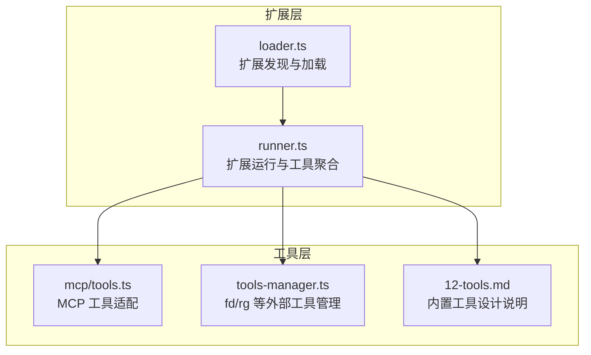
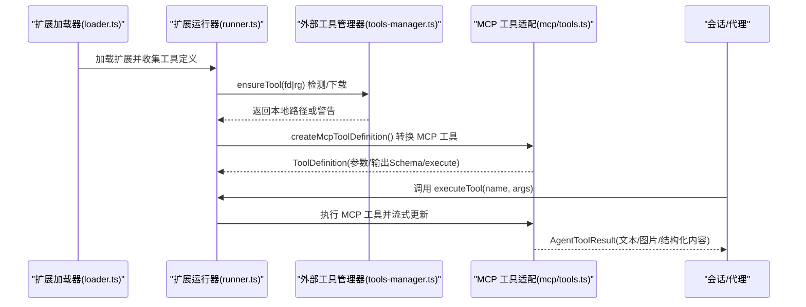
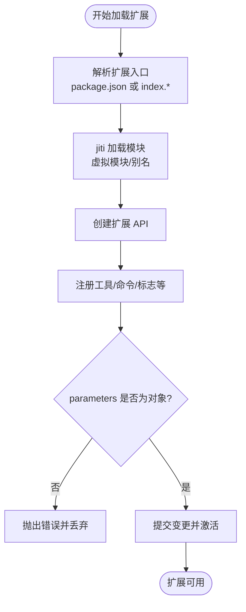
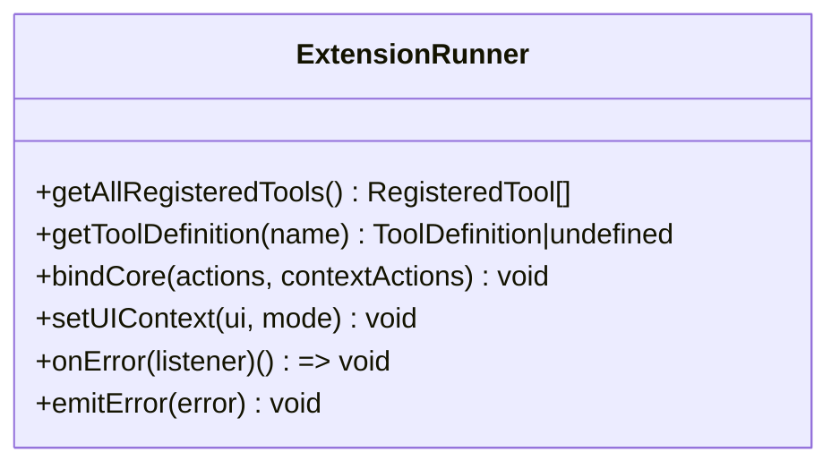
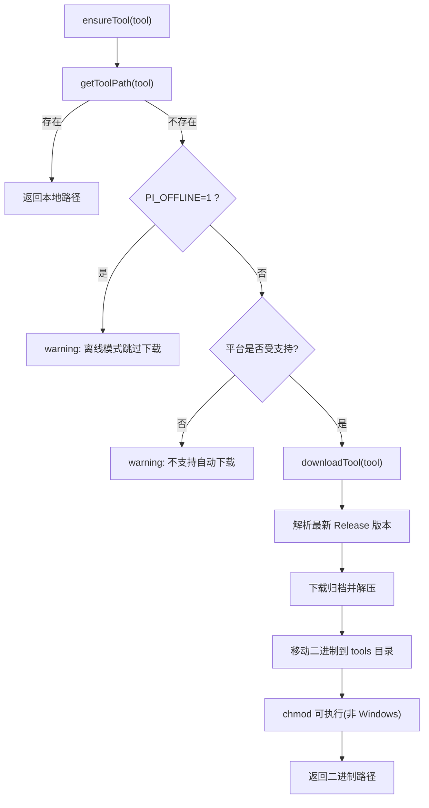
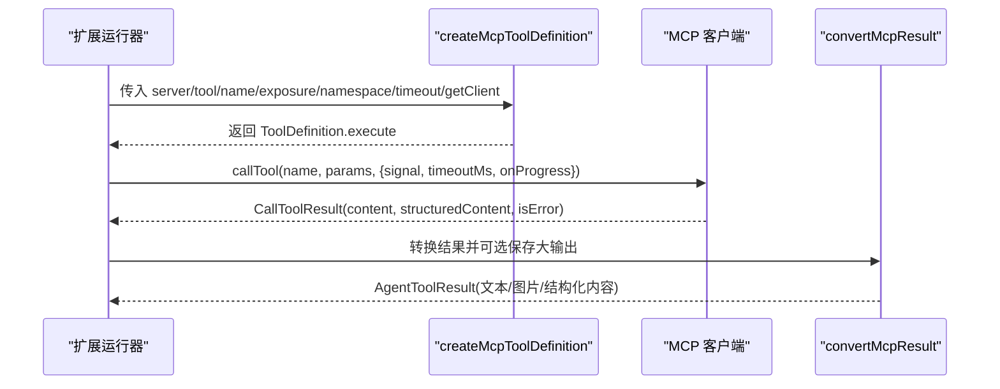
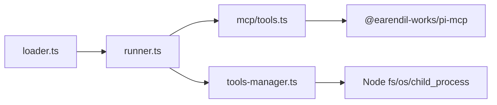
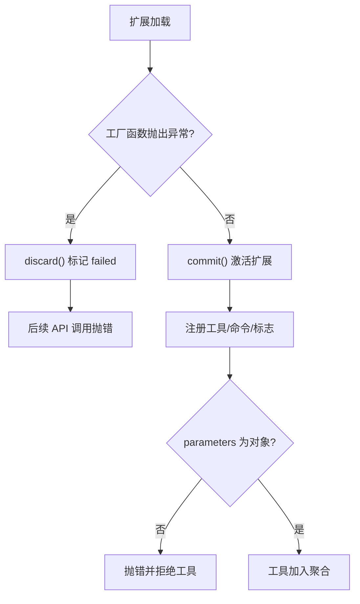

# 工具生命周期管理

<cite>
**本文引用的文件**
- [packages/coding-agent/src/core/extensions/loader.ts](file://packages/coding-agent/src/core/extensions/loader.ts)
- [packages/coding-agent/src/core/extensions/runner.ts](file://packages/coding-agent/src/core/extensions/runner.ts)
- [packages/coding-agent/src/utils/tools-manager.ts](file://packages/coding-agent/src/utils/tools-manager.ts)
- [packages/coding-agent/src/extensions/mcp/tools.ts](file://packages/coding-agent/src/extensions/mcp/tools.ts)
- [docs/explains/12-tools.md](file://docs/explains/12-tools.md)
- [packages/coding-agent/test/extensions-runner.test.ts](file://packages/coding-agent/test/extensions-runner.test.ts)
- [packages/coding-agent/test/agent-session-dynamic-tools.test.ts](file://packages/coding-agent/test/agent-session-dynamic-tools.test.ts)
- [packages/coding-agent/test/suite/regressions/5109-exclude-tools.test.ts](file://packages/coding-agent/test/suite/regressions/5109-exclude-tools.test.ts)
- [packages/coding-agent/test/default-tools-setting.test.ts](file://packages/coding-agent/test/default-tools-setting.test.ts)
- [packages/coding-agent/test/builtin-tool-strict-mode.test.ts](file://packages/coding-agent/test/builtin-tool-strict-mode.test.ts)
- [packages/coding-agent/test/suite/regressions/6162-extension-active-tools-next-turn.test.ts](file://packages/coding-agent/test/suite/regressions/6162-extension-active-tools-next-turn.test.ts)
</cite>

## 目录
1. [简介](#简介)
2. [项目结构](#项目结构)
3. [核心组件](#核心组件)
4. [架构总览](#架构总览)
5. [详细组件分析](#详细组件分析)
6. [依赖关系分析](#依赖关系分析)
7. [性能与资源特性](#性能与资源特性)
8. [故障恢复与降级](#故障恢复与降级)
9. [监控与可观测性](#监控与可观测性)
10. [最佳实践](#最佳实践)
11. [结论](#结论)

## 简介
本文面向“工具生命周期管理”，覆盖从工具发现、注册、依赖解析、初始化配置到执行调度的完整流程，并说明活跃工具列表、依赖图构建、版本兼容性检查、动态加载（热重载与插件卸载）、错误恢复、降级策略以及性能监控。文档以仓库中扩展加载器、运行器、外部工具管理器与 MCP 工具适配为核心依据，辅以测试用例验证行为边界。

## 项目结构
围绕工具生命周期的关键代码分布在以下位置：
- 扩展发现与加载：`packages/coding-agent/src/core/extensions/loader.ts`
- 扩展运行与工具聚合：`packages/coding-agent/src/core/extensions/runner.ts`
- 外部二进制工具下载与安装：`packages/coding-agent/src/utils/tools-manager.ts`
- MCP 工具到系统工具的适配：`packages/coding-agent/src/extensions/mcp/tools.ts`
- 内置工具实现与设计说明：`docs/explains/12-tools.md`
- 行为验证测试：多个 `test/*.ts` 文件

**图表来源**
- [packages/coding-agent/src/core/extensions/loader.ts:1-150](file://packages/coding-agent/src/core/extensions/loader.ts#L1-L150)
- [packages/coding-agent/src/core/extensions/runner.ts:364-447](file://packages/coding-agent/src/core/extensions/runner.ts#L364-L447)
- [packages/coding-agent/src/utils/tools-manager.ts:1-120](file://packages/coding-agent/src/utils/tools-manager.ts#L1-L120)
- [packages/coding-agent/src/extensions/mcp/tools.ts:1-60](file://packages/coding-agent/src/extensions/mcp/tools.ts#L1-L60)
- [docs/explains/12-tools.md:1-35](file://docs/explains/12-tools.md#L1-L35)

**章节来源**
- [packages/coding-agent/src/core/extensions/loader.ts:1-150](file://packages/coding-agent/src/core/extensions/loader.ts#L1-L150)
- [packages/coding-agent/src/core/extensions/runner.ts:364-447](file://packages/coding-agent/src/core/extensions/runner.ts#L364-L447)
- [packages/coding-agent/src/utils/tools-manager.ts:1-120](file://packages/coding-agent/src/utils/tools-manager.ts#L1-L120)
- [packages/coding-agent/src/extensions/mcp/tools.ts:1-60](file://packages/coding-agent/src/extensions/mcp/tools.ts#L1-L60)
- [docs/explains/12-tools.md:1-35](file://docs/explains/12-tools.md#L1-L35)

## 核心组件
- 扩展加载器（loader）
  - 负责通过 jiti 加载 TypeScript/JS 扩展模块，创建扩展 API，校验并收集扩展注册的 tool/command/flag 等元数据，支持缓存与热重载。
- 扩展运行器（runner）
  - 聚合所有扩展的工具定义，提供按名称去重后的工具集合；绑定会话上下文、事件总线、模型注册表；暴露获取活跃工具、刷新工具、执行工具等能力。
- 外部工具管理器（tools-manager）
  - 负责 fd、ripgrep 等外部命令的自动发现、下载、解压与权限设置；支持离线模式、平台目标映射、错误链上报。
- MCP 工具适配（mcp/tools）
  - 将 MCP 服务器的工具声明转换为系统 ToolDefinition，处理输入输出 Schema、内容截断、结构化结果、渲染器与进度回调。

**章节来源**
- [packages/coding-agent/src/core/extensions/loader.ts:246-310](file://packages/coding-agent/src/core/extensions/loader.ts#L246-L310)
- [packages/coding-agent/src/core/extensions/runner.ts:636-658](file://packages/coding-agent/src/core/extensions/runner.ts#L636-L658)
- [packages/coding-agent/src/utils/tools-manager.ts:71-127](file://packages/coding-agent/src/utils/tools-manager.ts#L71-L127)
- [packages/coding-agent/src/extensions/mcp/tools.ts:249-289](file://packages/coding-agent/src/extensions/mcp/tools.ts#L249-L289)

## 架构总览
下图展示工具从“扩展发现”到“执行调度”的关键路径，包括外部工具依赖与 MCP 工具桥接。

**图表来源**
- [packages/coding-agent/src/core/extensions/loader.ts:646-683](file://packages/coding-agent/src/core/extensions/loader.ts#L646-L683)
- [packages/coding-agent/src/core/extensions/runner.ts:417-461](file://packages/coding-agent/src/core/extensions/runner.ts#L417-L461)
- [packages/coding-agent/src/utils/tools-manager.ts:337-397](file://packages/coding-agent/src/utils/tools-manager.ts#L337-L397)
- [packages/coding-agent/src/extensions/mcp/tools.ts:249-289](file://packages/coding-agent/src/extensions/mcp/tools.ts#L249-L289)

## 详细组件分析

### 扩展加载器：发现、注册与热重载
- 扩展入口解析
  - 优先读取包清单中的扩展声明，其次回退到 index.ts/index.js。
- 模块加载与缓存
  - 使用 jiti 动态导入，支持虚拟模块与别名；按工作目录与代数进行缓存失效。
- 扩展 API 与注册校验
  - registerTool 要求 parameters 为对象 Schema，否则抛出错误；注册后触发 refreshTools。
  - 其他注册项包括 command、shortcut、flag、messageRenderer、markdownTransformer、entryRenderer、toolRenderer 等。
- 生命周期状态
  - 扩展在 loading/active/failed 三种状态间切换；失败时后续 API 调用会抛错，避免使用过期上下文。

**图表来源**
- [packages/coding-agent/src/core/extensions/loader.ts:748-800](file://packages/coding-agent/src/core/extensions/loader.ts#L748-L800)
- [packages/coding-agent/src/core/extensions/loader.ts:298-310](file://packages/coding-agent/src/core/extensions/loader.ts#L298-L310)
- [packages/coding-agent/src/core/extensions/loader.ts:571-602](file://packages/coding-agent/src/core/extensions/loader.ts#L571-L602)

**章节来源**
- [packages/coding-agent/src/core/extensions/loader.ts:748-800](file://packages/coding-agent/src/core/extensions/loader.ts#L748-L800)
- [packages/coding-agent/src/core/extensions/loader.ts:298-310](file://packages/coding-agent/src/core/extensions/loader.ts#L298-L310)
- [packages/coding-agent/src/core/extensions/loader.ts:571-602](file://packages/coding-agent/src/core/extensions/loader.ts#L571-L602)

### 扩展运行器：工具聚合、活跃列表与执行调度
- 工具聚合
  - getAllRegisteredTools 遍历所有扩展，按 name 去重，保留首次注册的工具。
- 活跃工具列表
  - 通过 runtime.getActiveTools/setActiveTools 维护当前会话可用的工具集；支持在单次运行内刷新并在下一次请求生效。
- 执行调度
  - bindCore 注入 executeTool/getCallableTools 等上下文动作；运行时根据活跃工具过滤并调用对应 execute。
- 事件与诊断
  - 统一 emitError 分发扩展错误；对未处理的 MCP 服务器变更进行告警。

**图表来源**
- [packages/coding-agent/src/core/extensions/runner.ts:636-658](file://packages/coding-agent/src/core/extensions/runner.ts#L636-L658)
- [packages/coding-agent/src/core/extensions/runner.ts:417-461](file://packages/coding-agent/src/core/extensions/runner.ts#L417-L461)
- [packages/coding-agent/src/core/extensions/runner.ts:744-753](file://packages/coding-agent/src/core/extensions/runner.ts#L744-L753)

**章节来源**
- [packages/coding-agent/src/core/extensions/runner.ts:636-658](file://packages/coding-agent/src/core/extensions/runner.ts#L636-L658)
- [packages/coding-agent/src/core/extensions/runner.ts:417-461](file://packages/coding-agent/src/core/extensions/runner.ts#L417-L461)
- [packages/coding-agent/src/core/extensions/runner.ts:744-753](file://packages/coding-agent/src/core/extensions/runner.ts#L744-L753)

### 外部工具管理器：依赖解析、下载与平台兼容
- 工具发现
  - getToolPath 优先查找本地 tools 目录，再尝试系统 PATH 中的同名命令。
- 版本解析与下载
  - getLatestVersion 通过 GitHub Releases 页面重定向解析最新版本；downloadTool 下载并解压到临时目录，最终移动到 tools 目录。
- 平台与架构
  - getReleaseTarget 仅映射 x64/arm64 的目标后缀，避免 ARM32/ia32 误用 x86-64 二进制。
- 离线与降级
  - PI_OFFLINE=1 时跳过下载并返回 warning；Android/Termux 提示通过 pkg 安装；不支持的平台给出安装建议。
- 错误上报
  - 捕获 fetch 失败 cause 链，拼接可读消息并通过 onStatus 回调报告。

**图表来源**
- [packages/coding-agent/src/utils/tools-manager.ts:71-127](file://packages/coding-agent/src/utils/tools-manager.ts#L71-L127)
- [packages/coding-agent/src/utils/tools-manager.ts:247-319](file://packages/coding-agent/src/utils/tools-manager.ts#L247-L319)
- [packages/coding-agent/src/utils/tools-manager.ts:337-397](file://packages/coding-agent/src/utils/tools-manager.ts#L337-L397)

**章节来源**
- [packages/coding-agent/src/utils/tools-manager.ts:71-127](file://packages/coding-agent/src/utils/tools-manager.ts#L71-L127)
- [packages/coding-agent/src/utils/tools-manager.ts:247-319](file://packages/coding-agent/src/utils/tools-manager.ts#L247-L319)
- [packages/coding-agent/src/utils/tools-manager.ts:337-397](file://packages/coding-agent/src/utils/tools-manager.ts#L337-L397)

### MCP 工具适配：Schema 转换、执行与结果处理
- 工具定义转换
  - createMcpToolDefinition 将 MCP 工具的 inputSchema/outputSchema 转换为系统 ToolDefinition，包含 exposure、namespace、annotations、renderers 与 execute。
- 执行流程
  - execute 通过 getClient 获取 MCP 客户端，调用 callTool，支持 signal 超时与进度回调 onUpdate。
- 结果处理
  - convertMcpResult 将 MCP 的 content blocks 转为模型可见的文本/图片，必要时保存到临时文件；isError 标记错误结果；structuredContent 供脚本编程访问。
- 渲染器
  - createMcpToolRenderers 提供调用与结果的 TUI 渲染逻辑，支持折叠预览与完整输出路径提示。

**图表来源**
- [packages/coding-agent/src/extensions/mcp/tools.ts:249-289](file://packages/coding-agent/src/extensions/mcp/tools.ts#L249-L289)
- [packages/coding-agent/src/extensions/mcp/tools.ts:214-235](file://packages/coding-agent/src/extensions/mcp/tools.ts#L214-L235)
- [packages/coding-agent/src/extensions/mcp/tools.ts:291-329](file://packages/coding-agent/src/extensions/mcp/tools.ts#L291-L329)

**章节来源**
- [packages/coding-agent/src/extensions/mcp/tools.ts:249-289](file://packages/coding-agent/src/extensions/mcp/tools.ts#L249-L289)
- [packages/coding-agent/src/extensions/mcp/tools.ts:214-235](file://packages/coding-agent/src/extensions/mcp/tools.ts#L214-L235)
- [packages/coding-agent/src/extensions/mcp/tools.ts:291-329](file://packages/coding-agent/src/extensions/mcp/tools.ts#L291-L329)

### 内置工具设计与行为约束
- 两种工具类型
  - ToolDefinition（扩展面向：name、description、parameters、promptSnippet、promptGuidelines、renderers）
  - AgentTool（运行时面向：execute、executionMode、outputSchema）
- 默认内置工具
  - read、bash、powershell、edit、write、grep、find、ls；默认激活 read/bash/edit/write。
- 路径解析与沙箱
  - resolveToCwd 不限制 cwd 范围，属于权限层缺失的直接体现。
- 文件写入串行化
  - withFileMutationQueue 保证同一文件写操作串行，不同文件并行。
- 输出截断
  - maxLines=2000、maxBytes=50KB；truncateHead/truncateTail/truncateLine 分别用于不同场景。
- bash/grep/find/ls 的行为细节
  - bash 支持 detached 进程树、环境变量暴露、OutputAccumulator 滚动输出；grep 调用 ripgrep JSON 模式；find 调用 fd；ls 排序与 dotfiles 处理。

**章节来源**
- [docs/explains/12-tools.md:1-35](file://docs/explains/12-tools.md#L1-L35)
- [docs/explains/12-tools.md:34-55](file://docs/explains/12-tools.md#L34-L55)
- [docs/explains/12-tools.md:56-67](file://docs/explains/12-tools.md#L56-L67)
- [docs/explains/12-tools.md:68-90](file://docs/explains/12-tools.md#L68-L90)
- [docs/explains/12-tools.md:165-213](file://docs/explains/12-tools.md#L165-L213)
- [docs/explains/12-tools.md:214-263](file://docs/explains/12-tools.md#L214-L263)
- [docs/explains/12-tools.md:264-297](file://docs/explains/12-tools.md#L264-L297)

## 依赖关系分析
- 组件耦合
  - loader 产出 Extension 对象，runner 消费这些对象聚合工具；tools-manager 被 runner 在需要时调用以确保外部依赖可用；mcp/tools 作为扩展的一部分被 runner 聚合。
- 直接依赖
  - runner 依赖 modelRegistry、sessionManager、eventBus 等运行时能力；loader 依赖 jiti、virtual-modules、pi-manifest 等。
- 间接依赖
  - MCP 工具依赖 pi-mcp 的 CallToolResult、limitMcpContent、toLlmContent 等；外部工具依赖 Node fs/os/child_process。
- 潜在循环
  - loader 与 runner 职责分离，未见直接循环引用；mcp/tools 与 runner 通过 ToolDefinition 接口解耦。

**图表来源**
- [packages/coding-agent/src/core/extensions/loader.ts:1-41](file://packages/coding-agent/src/core/extensions/loader.ts#L1-L41)
- [packages/coding-agent/src/core/extensions/runner.ts:1-95](file://packages/coding-agent/src/core/extensions/runner.ts#L1-L95)
- [packages/coding-agent/src/extensions/mcp/tools.ts:13-24](file://packages/coding-agent/src/extensions/mcp/tools.ts#L13-L24)
- [packages/coding-agent/src/utils/tools-manager.ts:1-10](file://packages/coding-agent/src/utils/tools-manager.ts#L1-L10)

**章节来源**
- [packages/coding-agent/src/core/extensions/loader.ts:1-41](file://packages/coding-agent/src/core/extensions/loader.ts#L1-L41)
- [packages/coding-agent/src/core/extensions/runner.ts:1-95](file://packages/coding-agent/src/core/extensions/runner.ts#L1-L95)
- [packages/coding-agent/src/extensions/mcp/tools.ts:13-24](file://packages/coding-agent/src/extensions/mcp/tools.ts#L13-L24)
- [packages/coding-agent/src/utils/tools-manager.ts:1-10](file://packages/coding-agent/src/utils/tools-manager.ts#L1-L10)

## 性能与资源特性
- 输出截断与内存控制
  - 内置工具对输出进行行/字节双重限制，避免大输出占用过多内存；bash 使用 OutputAccumulator 滚动保留尾部，超过阈值转存临时文件。
- 并发与串行
  - 文件写入按路径串行，不同文件并行；grep/find 等外部命令通过子进程执行，abort 时终止进程树。
- 网络与 I/O
  - 外部工具下载使用 pipeline 流式传输，带重试与超时；GitHub Releases 通过重定向避免配额耗尽。
- 渲染优化
  - MCP 工具渲染器支持折叠预览，减少 UI 压力；长输出提供“展开”提示。

[本节为通用性能讨论，不直接分析具体文件]

## 故障恢复与降级
- 扩展加载失败
  - loader 在 initializeExtension 捕获异常并 discard，使扩展进入 failed 状态；后续 API 调用抛错，防止使用过期上下文。
- 工具注册校验失败
  - registerTool 若 parameters 不是对象，立即抛错；测试用例验证拒绝缺少参数 Schema 的工具。
- 外部工具缺失
  - ensureTool 在离线模式、Android/Termux、不支持平台时返回 warning 并跳过下载；下载失败时拼接 cause 链并上报。
- 活跃工具刷新
  - 测试验证在同一运行中 setActiveTools 可在下一次 provider 请求前生效；排除/允许列表组合行为符合预期。
- 动态工具
  - 测试验证 session_start 事件中注册的工具在 bindExtensions 后出现，初始会话不包含。

**图表来源**
- [packages/coding-agent/src/core/extensions/loader.ts:625-644](file://packages/coding-agent/src/core/extensions/loader.ts#L625-L644)
- [packages/coding-agent/src/core/extensions/loader.ts:298-310](file://packages/coding-agent/src/core/extensions/loader.ts#L298-L310)

**章节来源**
- [packages/coding-agent/src/core/extensions/loader.ts:625-644](file://packages/coding-agent/src/core/extensions/loader.ts#L625-L644)
- [packages/coding-agent/src/core/extensions/loader.ts:298-310](file://packages/coding-agent/src/core/extensions/loader.ts#L298-L310)
- [packages/coding-agent/test/extensions-runner.test.ts:403-427](file://packages/coding-agent/test/extensions-runner.test.ts#L403-L427)
- [packages/coding-agent/test/agent-session-dynamic-tools.test.ts:103-143](file://packages/coding-agent/test/agent-session-dynamic-tools.test.ts#L103-L143)
- [packages/coding-agent/test/suite/regressions/6162-extension-active-tools-next-turn.test.ts:42-71](file://packages/coding-agent/test/suite/regressions/6162-extension-active-tools-next-turn.test.ts#L42-L71)
- [packages/coding-agent/test/suite/regressions/5109-exclude-tools.test.ts:48-80](file://packages/coding-agent/test/suite/regressions/5109-exclude-tools.test.ts#L48-L80)

## 监控与可观测性
- 扩展错误监听
  - runner.onError 订阅扩展错误；emitError 统一分发。
- MCP 服务器未连接告警
  - reportUnhandledMcpServers 在无处理器时报告已注册但未连接的 MCP 服务器。
- 外部工具状态回调
  - ensureTool 通过 onStatus 回调报告 info/warning，便于上层 UI 展示。
- 工具执行进度
  - MCP 工具 execute 支持 onUpdate 推送进度消息，便于实时反馈。

**章节来源**
- [packages/coding-agent/src/core/extensions/runner.ts:744-753](file://packages/coding-agent/src/core/extensions/runner.ts#L744-L753)
- [packages/coding-agent/src/core/extensions/runner.ts:755-770](file://packages/coding-agent/src/core/extensions/runner.ts#L755-L770)
- [packages/coding-agent/src/utils/tools-manager.ts:337-397](file://packages/coding-agent/src/utils/tools-manager.ts#L337-L397)
- [packages/coding-agent/src/extensions/mcp/tools.ts:275-287](file://packages/coding-agent/src/extensions/mcp/tools.ts#L275-L287)

## 最佳实践
- 命名规范
  - 工具名应全局唯一；重复注册时以首次为准。
- 元数据定义
  - 必须提供对象类型的 parameters Schema；description、label、annotations 有助于模型理解与 UI 展示。
- API 版本管理
  - 对外暴露的 ToolDefinition 应保持向后兼容；新增字段使用 additionalProperties 容忍旧客户端。
- 动态加载
  - 在 session_start 等事件中注册工具，确保在 bindExtensions 后生效；避免在已废弃上下文中调用 API。
- 热重载与卸载
  - 使用 clearExtensionCache 与 reload 机制重新加载扩展；通过 unregisterProvider/unregisterVirtualModel 清理资源。
- 活跃工具管理
  - 使用 setActiveToolsByName 精确控制工具集；结合 allowlist/excludelist 实现白名单/黑名单策略。
- 依赖与兼容性
  - 外部工具优先使用系统 PATH；仅在必要时自动下载；注意平台/架构限制与离线模式。

**章节来源**
- [packages/coding-agent/test/extensions-runner.test.ts:378-401](file://packages/coding-agent/test/extensions-runner.test.ts#L378-L401)
- [packages/coding-agent/test/default-tools-setting.test.ts:240-247](file://packages/coding-agent/test/default-tools-setting.test.ts#L240-L247)
- [packages/coding-agent/test/builtin-tool-strict-mode.test.ts:49-88](file://packages/coding-agent/test/builtin-tool-strict-mode.test.ts#L49-L88)
- [packages/coding-agent/src/core/extensions/loader.ts:145-158](file://packages/coding-agent/src/core/extensions/loader.ts#L145-L158)

## 结论
本仓库的工具生命周期管理以扩展加载器与运行器为核心，结合外部工具管理器与 MCP 工具适配，形成从发现、注册、依赖解析、初始化到执行的闭环。系统在活跃工具管理、动态加载、错误恢复与降级方面具备完善机制，并通过测试用例保障行为一致性。遵循命名与元数据规范、合理使用动态注册与活跃工具控制，可获得稳定且可观测的工具生态。