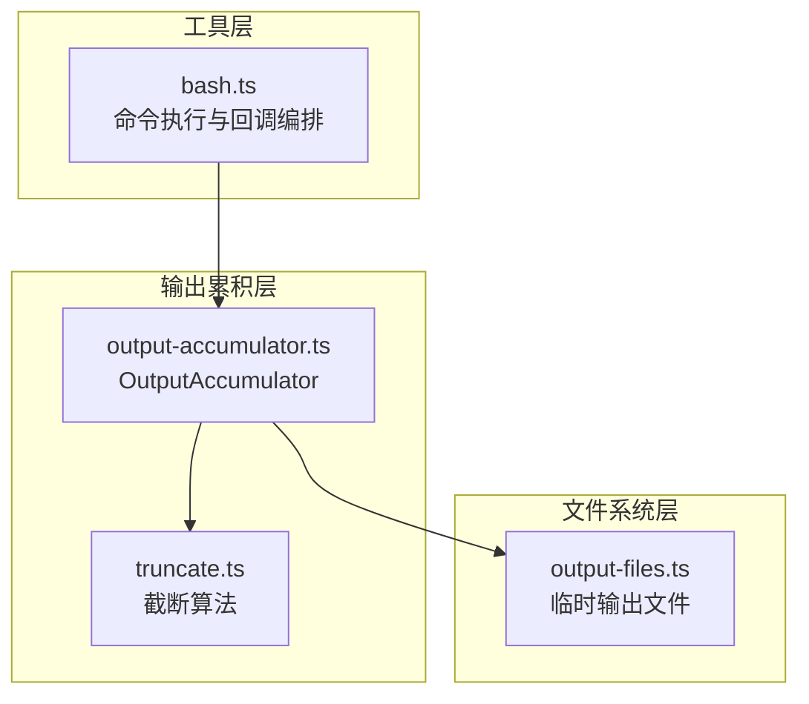
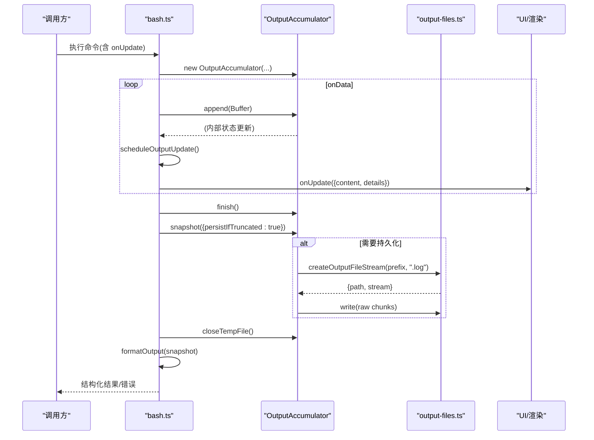
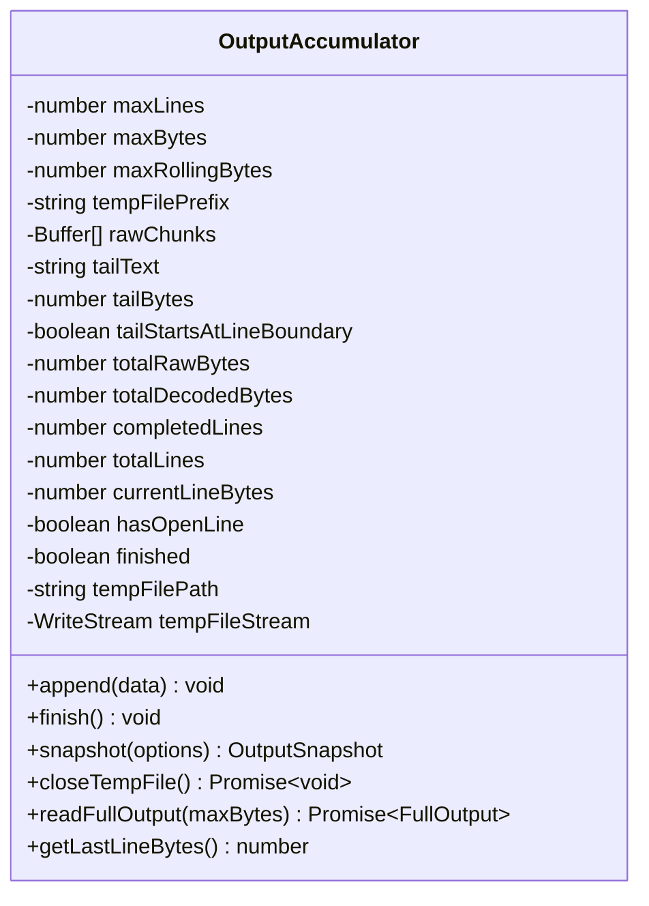
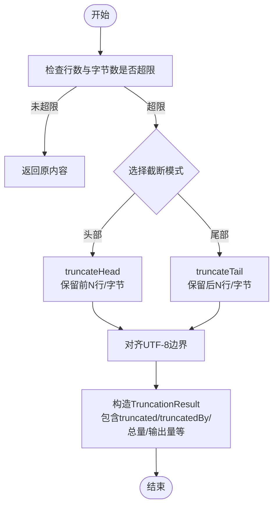
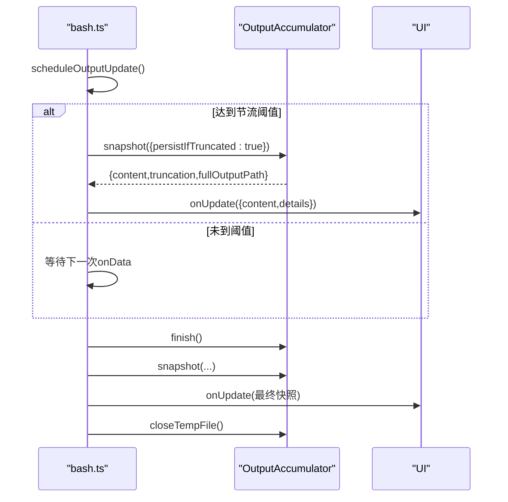
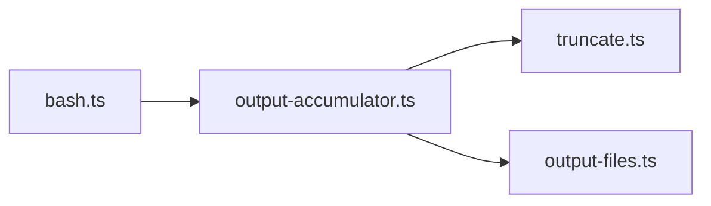

# 流式输出处理模式

<cite>
**本文引用的文件**
- [output-accumulator.ts](file://packages/coding-agent/src/core/tools/output-accumulator.ts)
- [truncate.ts](file://packages/coding-agent/src/core/tools/truncate.ts)
- [output-files.ts](file://packages/coding-agent/src/utils/output-files.ts)
- [bash.ts](file://packages/coding-agent/src/core/tools/bash.ts)
</cite>

## 目录
1. [简介](#简介)
2. [项目结构](#项目结构)
3. [核心组件](#核心组件)
4. [架构总览](#架构总览)
5. [详细组件分析](#详细组件分析)
6. [依赖关系分析](#依赖关系分析)
7. [性能考量](#性能考量)
8. [故障排查指南](#故障排查指南)
9. [结论](#结论)
10. [附录](#附录)

## 简介
本指南聚焦于“流式输出处理模式”，围绕 OutputAccumulator 类展开，系统说明数据累积、临时文件管理、截断策略与内存优化；解释 onUpdate 回调机制如何实现实时进度更新与用户反馈；梳理输出格式化与渲染流程，包括文本格式化、状态显示与错误信息处理；提供长时任务的流式处理示例，展示如何在用户体验与性能之间取得平衡；并给出输出限制策略（最大行数、字节数限制、自动截断）以及二进制数据与特殊字符编码的处理方法。

## 项目结构
该能力由四个关键文件协作实现：
- OutputAccumulator：负责增量解码、滚动尾部缓存、触发临时文件、快照与完整读取。
- truncate：提供行/字节双限的截断算法与工具函数。
- output-files：统一创建受保护的临时输出文件路径与写入流。
- bash：将 OutputAccumulator 集成到命令执行管线，驱动 onUpdate 回调与最终结果格式化。

图表来源
- [bash.ts:290-477](file://packages/coding-agent/src/core/tools/bash.ts#L290-L477)
- [output-accumulator.ts:1-258](file://packages/coding-agent/src/core/tools/output-accumulator.ts#L1-L258)
- [truncate.ts:1-303](file://packages/coding-agent/src/core/tools/truncate.ts#L1-L303)
- [output-files.ts:1-35](file://packages/coding-agent/src/utils/output-files.ts#L1-L35)

章节来源
- [bash.ts:290-477](file://packages/coding-agent/src/core/tools/bash.ts#L290-L477)
- [output-accumulator.ts:1-258](file://packages/coding-agent/src/core/tools/output-accumulator.ts#L1-L258)
- [truncate.ts:1-303](file://packages/coding-agent/src/core/tools/truncate.ts#L1-L303)
- [output-files.ts:1-35](file://packages/coding-agent/src/utils/output-files.ts#L1-L35)

## 核心组件
- OutputAccumulator
  - 职责：以流式方式接收 Buffer，使用 TextDecoder 进行 UTF-8 增量解码；维护滚动尾部用于快速快照；在超过阈值时切换到临时文件持久化；提供快照与完整输出读取接口。
  - 关键能力：
    - append(data)：追加原始字节，增量解码，必要时写临时文件。
    - finish()：结束流，flush 解码器，确保必要时打开临时文件。
    - snapshot(options)：生成面向 UI 的截断内容、截断元信息与可选的全量输出路径。
    - readFullOutput(maxBytes)：在 finish/closeTempFile 后读取完整输出，超长时保留首尾片段与省略标记。
    - closeTempFile()：安全关闭临时文件流。
    - getLastLineBytes()：返回当前未闭合行的字节长度，便于状态提示。
- truncate
  - 职责：基于“行数”和“字节数”双重上限的截断工具，支持头部截断与尾部截断，保证不拆分多字节字符，并提供人类可读大小格式化。
- output-files
  - 职责：创建仅用户可访问的临时输出文件路径与 WriteStream，集中管理输出文件的存储位置与权限。
- bash
  - 职责：将 OutputAccumulator 接入命令执行管道，实现 onUpdate 节流更新、最终结果格式化、错误与超时处理、结构化输出构建。

章节来源
- [output-accumulator.ts:1-258](file://packages/coding-agent/src/core/tools/output-accumulator.ts#L1-L258)
- [truncate.ts:1-303](file://packages/coding-agent/src/core/tools/truncate.ts#L1-L303)
- [output-files.ts:1-35](file://packages/coding-agent/src/utils/output-files.ts#L1-L35)
- [bash.ts:290-477](file://packages/coding-agent/src/core/tools/bash.ts#L290-L477)

## 架构总览
下图展示了从命令执行到 UI 更新的端到端流程，突出 OutputAccumulator 在其中的作用点。

图表来源
- [bash.ts:290-477](file://packages/coding-agent/src/core/tools/bash.ts#L290-L477)
- [output-accumulator.ts:1-258](file://packages/coding-agent/src/core/tools/output-accumulator.ts#L1-L258)
- [output-files.ts:1-35](file://packages/coding-agent/src/utils/output-files.ts#L1-L35)

## 详细组件分析

### OutputAccumulator 类详解
- 设计要点
  - 增量解码：使用 TextDecoder(stream:true) 避免重复拷贝与乱码。
  - 滚动尾部：tailText/tailBytes 维持最近一段文本，按 maxRollingBytes 裁剪，保证 UI 快照快速且内存可控。
  - 行边界保护：记录是否位于行边界、当前行字节数，避免截断导致半行或半字符。
  - 临时文件切换：当原始字节、解码字节或行数超过阈值，自动创建临时文件，并将已缓冲 rawChunks 回写。
  - 完整输出读取：readFullOutput 支持超大文件的首尾片段拼接，插入省略标记，保持 UTF-8 完整性。
- 关键方法与复杂度
  - append(data): O(n) 解码与追加，必要时 O(k) 写临时文件。
  - snapshot(): O(m) 对尾部文本进行截断计算，m 为尾部长度。
  - trimTail(): O(p) 按字节裁剪尾部，p 为超出部分。
  - readFullOutput(maxBytes): I/O 为主，CPU 开销小，注意 UTF-8 边界对齐。
- 内存优化
  - 仅在必要时保留 rawChunks；一旦切换到临时文件即清空 rawChunks。
  - tailText 有滚动上限，避免无限增长。
  - totalDecodedBytes/totalRawBytes/totalLines 等计数器避免重复统计。

图表来源
- [output-accumulator.ts:1-258](file://packages/coding-agent/src/core/tools/output-accumulator.ts#L1-L258)

章节来源
- [output-accumulator.ts:1-258](file://packages/coding-agent/src/core/tools/output-accumulator.ts#L1-L258)

### 截断策略与输出限制
- 双限策略
  - 行数上限：默认 2000 行。
  - 字节上限：默认 50KB。
  - 任一超限即触发截断，并以 truncatedBy 指明原因。
- 头部 vs 尾部
  - truncateHead：适合“看开头”的场景（如文件读取），若首行超字节则返回空内容并标记 firstLineExceedsLimit。
  - truncateTail：适合“看结尾”的场景（如命令输出），可能返回不完整首行（lastLinePartial）。
- 多字节安全
  - 所有裁剪均按 UTF-8 边界对齐，避免产生非法字符。
- 人类可读大小
  - formatSize 提供 B/KB/MB 格式化。

图表来源
- [truncate.ts:1-303](file://packages/coding-agent/src/core/tools/truncate.ts#L1-L303)

章节来源
- [truncate.ts:1-303](file://packages/coding-agent/src/core/tools/truncate.ts#L1-L303)

### 临时文件管理与二进制数据
- 临时文件
  - 路径生成：在 OS 临时目录下生成唯一路径，后缀 .log。
  - 权限控制：文件权限设置为仅用户可读写，防止泄露。
  - 流式写入：createOutputFileStream 返回 path 与 WriteStream，支持边写边用。
- 二进制数据
  - OutputAccumulator.append 直接转发原始 Buffer 到临时文件，避免二次编解码。
  - readFullOutput 在需要时以字节为单位读取首尾片段，再解码为字符串，确保二进制数据的完整性与正确性。

章节来源
- [output-files.ts:1-35](file://packages/coding-agent/src/utils/output-files.ts#L1-L35)
- [output-accumulator.ts:1-258](file://packages/coding-agent/src/core/tools/output-accumulator.ts#L1-L258)

### onUpdate 回调机制与实时进度
- 节流更新
  - 通过 scheduleOutputUpdate 与 lastUpdateAt 控制最小间隔，避免频繁 UI 刷新。
  - updateDirty 标志合并多次 onData 事件，减少冗余快照。
- 快照与详情
  - 每次 onUpdate 携带 content 与 details.truncation/fullOutputPath，供 UI 显示截断状态与全量输出链接。
- 完成阶段
  - finish 后再次 emit 一次最终快照，随后 closeTempFile 释放资源。

图表来源
- [bash.ts:290-477](file://packages/coding-agent/src/core/tools/bash.ts#L290-L477)
- [output-accumulator.ts:1-258](file://packages/coding-agent/src/core/tools/output-accumulator.ts#L1-L258)

章节来源
- [bash.ts:290-477](file://packages/coding-agent/src/core/tools/bash.ts#L290-L477)

### 输出格式化与渲染
- 文本格式化
  - 根据 truncation 类型追加友好提示：
    - 最后一行被截断：显示当前行字节长度与全量输出路径。
    - 按行截断：显示行号范围与总行数。
    - 按字节截断：显示字节限制与全量输出路径。
- 状态显示
  - 结合 truncated/truncatedBy 与 fullOutputPath，向用户呈现“部分内容已省略，点击可查看完整输出”。
- 错误信息处理
  - 命令异常、超时、无退出码等情况，将已有输出与状态消息拼接后抛出，保证用户可见上下文。

章节来源
- [bash.ts:290-477](file://packages/coding-agent/src/core/tools/bash.ts#L290-L477)

### 长时任务流式处理示例
- 目标
  - 在长时间运行的命令中，逐步向 UI 推送输出，同时控制内存占用，并在必要时将完整输出落盘。
- 步骤
  - 初始化 OutputAccumulator，传入 tempFilePrefix。
  - 在 onData 回调中调用 append，并触发 scheduleOutputUpdate。
  - 在 finish 后获取 snapshot，必要时 closeTempFile。
  - 使用 readFullOutput 获取结构化输出，并根据 truncated 决定是否附加 full_output_path。
- 体验与性能平衡
  - 节流 onUpdate，避免 UI 抖动。
  - 仅在超限时才创建临时文件，减少磁盘 I/O。
  - 使用滚动尾部与计数器，避免内存膨胀。

章节来源
- [bash.ts:290-477](file://packages/coding-agent/src/core/tools/bash.ts#L290-L477)
- [output-accumulator.ts:1-258](file://packages/coding-agent/src/core/tools/output-accumulator.ts#L1-L258)

## 依赖关系分析
- 组件耦合
  - bash 强依赖 OutputAccumulator 的生命周期与快照语义。
  - OutputAccumulator 依赖 truncate 进行 UI 快照截断，依赖 output-files 进行临时文件管理。
- 外部依赖
  - Node.js fs/promises、fs.WriteStream、os.tmpdir、crypto.randomBytes。
  - TextDecoder 用于 UTF-8 增量解码。
- 潜在循环依赖
  - 当前模块间单向依赖，未见循环引用。

图表来源
- [bash.ts:290-477](file://packages/coding-agent/src/core/tools/bash.ts#L290-L477)
- [output-accumulator.ts:1-258](file://packages/coding-agent/src/core/tools/output-accumulator.ts#L1-L258)
- [truncate.ts:1-303](file://packages/coding-agent/src/core/tools/truncate.ts#L1-L303)
- [output-files.ts:1-35](file://packages/coding-agent/src/utils/output-files.ts#L1-L35)

章节来源
- [bash.ts:290-477](file://packages/coding-agent/src/core/tools/bash.ts#L290-L477)
- [output-accumulator.ts:1-258](file://packages/coding-agent/src/core/tools/output-accumulator.ts#L1-L258)
- [truncate.ts:1-303](file://packages/coding-agent/src/core/tools/truncate.ts#L1-L303)
- [output-files.ts:1-35](file://packages/coding-agent/src/utils/output-files.ts#L1-L35)

## 性能考量
- 内存控制
  - 滚动尾部限制：tailText 不超过 maxRollingBytes，避免大对象驻留。
  - rawChunks 仅在未达阈值时暂存，达到阈值后立即转储至临时文件并清空。
- I/O 优化
  - 仅在必要时创建临时文件；write 操作使用原生 WriteStream，减少拷贝。
  - readFullOutput 采用分块读取首尾，避免一次性加载大文件。
- CPU 开销
  - 增量解码避免重复解析；截断算法尽量线性扫描。
- UI 刷新
  - onUpdate 节流，降低渲染频率；details 携带截断信息，避免重复计算。

[本节为通用指导，无需特定文件引用]

## 故障排查指南
- 常见问题
  - 输出乱码：确认输入为 Buffer，避免手动拼接字符串；OutputAccumulator 使用 TextDecoder(stream:true) 保证 UTF-8 完整性。
  - 内存暴涨：检查是否误将大量数据直接存入内存而非走临时文件；确认 shouldUseTempFile 条件与 append 逻辑。
  - UI 卡顿：检查 onUpdate 节流参数，避免过于频繁的快照与渲染。
  - 临时文件未清理：确保在 finally 或完成路径中调用 closeTempFile。
  - 截断提示不准确：核对 truncateTail/truncateHead 的使用场景与 truncatedBy 字段。
- 定位建议
  - 打印 totalRawBytes/totalDecodedBytes/totalLines 与 maxBytes/maxLines 对比，判断是否应切换临时文件。
  - 观察 snapshot.content 与 truncation.lastLinePartial/firstLineExceedsLimit，验证边界情况。
  - 校验 fullOutputPath 是否存在并可读，权限是否正确。

章节来源
- [output-accumulator.ts:1-258](file://packages/coding-agent/src/core/tools/output-accumulator.ts#L1-L258)
- [truncate.ts:1-303](file://packages/coding-agent/src/core/tools/truncate.ts#L1-L303)
- [output-files.ts:1-35](file://packages/coding-agent/src/utils/output-files.ts#L1-L35)
- [bash.ts:290-477](file://packages/coding-agent/src/core/tools/bash.ts#L290-L477)

## 结论
OutputAccumulator 提供了稳健的流式输出处理能力：在低内存占用下维护滚动尾部，按需落盘，配合双限截断策略与安全的 UTF-8 处理，既能满足实时 UI 反馈，又能保障大数据量的稳定性。结合 bash 中的 onUpdate 节流与格式化逻辑，可在长时任务中兼顾用户体验与系统性能。通过统一的临时文件管理，输出既可用于即时展示，也可作为后续模型消费的二进制/文本资源。

[本节为总结性内容，无需特定文件引用]

## 附录
- 最佳实践清单
  - 始终通过 append(Buffer) 输入原始字节，不要自行解码。
  - 在 finish 之后调用 snapshot 与 closeTempFile。
  - 对超大输出使用 readFullOutput 获取结构化内容，并结合 truncated 与 fullOutputPath 提示用户。
  - 合理设置 maxLines 与 maxBytes，依据业务场景选择 truncateHead 或 truncateTail。
  - 在 UI 层节流渲染，避免高频更新造成卡顿。
  - 确保临时文件权限与生命周期管理，避免泄露与泄漏句柄。

[本节为补充性内容，无需特定文件引用]