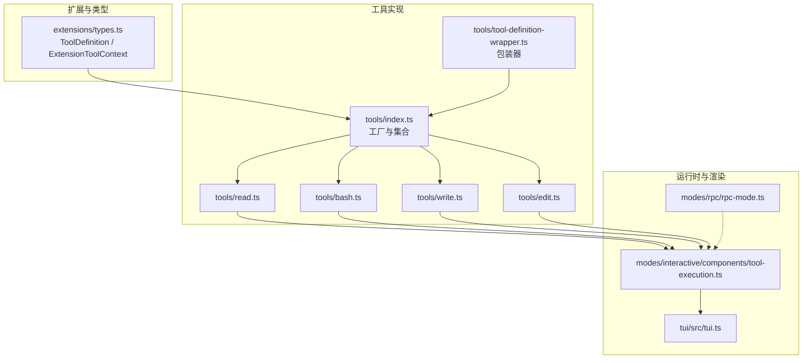
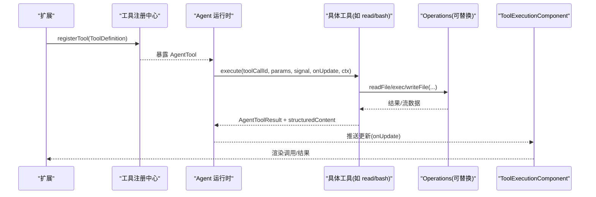
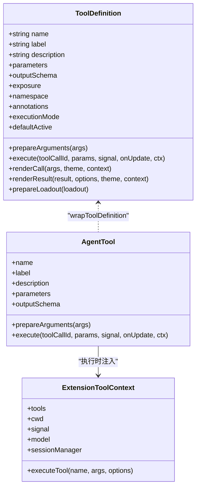
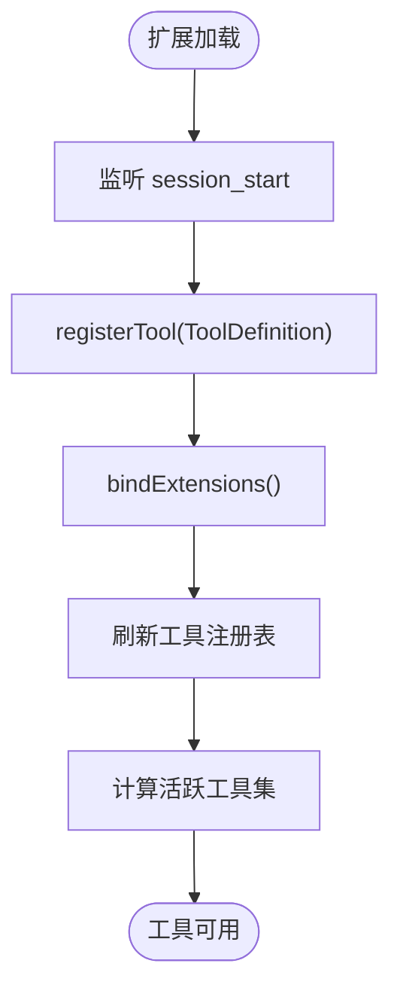
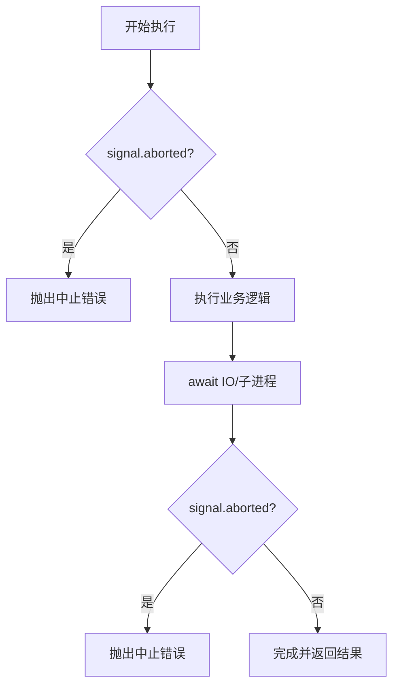
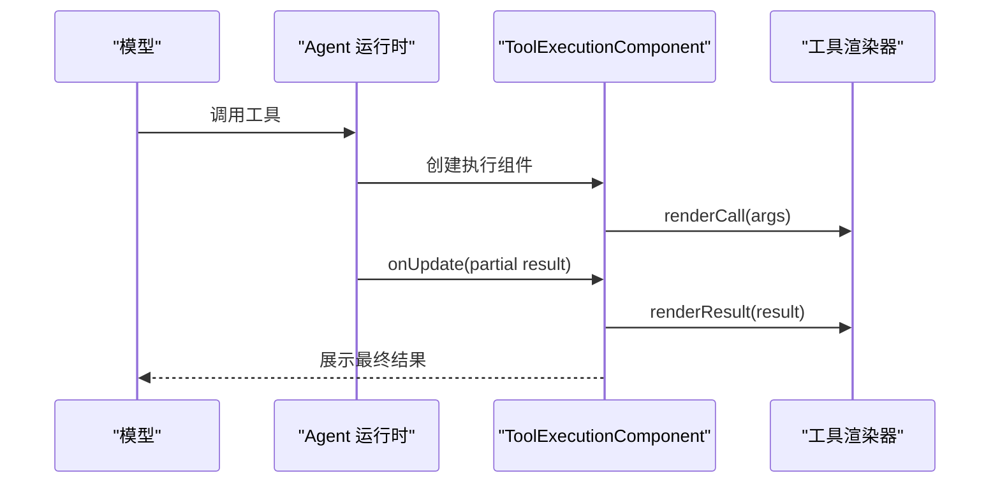
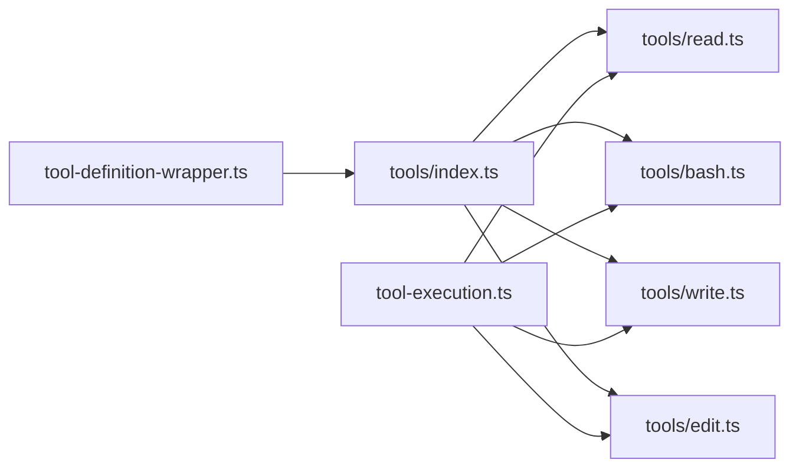

# 工具开发指南

<cite>
**本文引用的文件**   
- [12-tools.md](file://docs/explains/12-tools.md)
- [types.ts](file://packages/coding-agent/src/core/extensions/types.ts)
- [index.ts](file://packages/coding-agent/src/core/tools/index.ts)
- [tool-definition-wrapper.ts](file://packages/coding-agent/src/core/tools/tool-definition-wrapper.ts)
- [read.ts](file://packages/coding-agent/src/core/tools/read.ts)
- [bash.ts](file://packages/coding-agent/src/core/tools/bash.ts)
- [write.ts](file://packages/coding-agent/src/core/tools/write.ts)
- [edit.ts](file://packages/coding-agent/src/core/tools/edit.ts)
- [tool-execution.ts](file://packages/coding-agent/src/modes/interactive/components/tool-execution.ts)
- [rpc-mode.ts](file://packages/coding-agent/src/modes/rpc/rpc-mode.ts)
- [tui.ts](file://packages/tui/src/tui.ts)
- [agent-session-dynamic-tools.test.ts](file://packages/coding-agent/test/agent-session-dynamic-tools.test.ts)
- [builtin-tool-strict-mode.test.ts](file://packages/coding-agent/test/builtin-tool-strict-mode.test.ts)
</cite>

## 目录
1. [引言](#引言)
2. [项目结构](#项目结构)
3. [核心组件](#核心组件)
4. [架构总览](#架构总览)
5. [详细组件分析](#详细组件分析)
6. [依赖关系分析](#依赖关系分析)
7. [性能与资源管理](#性能与资源管理)
8. [测试策略与调试技巧](#测试策略与调试技巧)
9. [结论](#结论)

## 引言
本指南面向希望为系统扩展自定义工具的开发者，覆盖工具接口定义、实现模式、注册机制、生命周期管理、参数校验、错误处理、权限控制、输出截断、渲染集成以及测试与调试实践。文档以仓库中内置工具（如 read、bash、write、edit）的实现为依据，逐步从“只读工具”演进到“复杂文件系统操作工具”，并说明如何与扩展系统集成。

## 项目结构
工具相关代码主要位于 coding-agent 包的 core/tools 目录，并通过 extensions/types.ts 暴露统一的工具类型与扩展上下文；TUI 层通过 ToolExecutionComponent 渲染工具调用与结果；RPC 模式对工具展开能力做了限制。

图表来源
- [types.ts:599-688](file://packages/coding-agent/src/core/extensions/types.ts#L599-L688)
- [index.ts:118-224](file://packages/coding-agent/src/core/tools/index.ts#L118-L224)
- [tool-definition-wrapper.ts:27-57](file://packages/coding-agent/src/core/tools/tool-definition-wrapper.ts#L27-L57)
- [read.ts:228-362](file://packages/coding-agent/src/core/tools/read.ts#L228-L362)
- [bash.ts:271-476](file://packages/coding-agent/src/core/tools/bash.ts#L271-L476)
- [write.ts:43-96](file://packages/coding-agent/src/core/tools/write.ts#L43-L96)
- [edit.ts:140-217](file://packages/coding-agent/src/core/tools/edit.ts#L140-L217)
- [tool-execution.ts:31-108](file://packages/coding-agent/src/modes/interactive/components/tool-execution.ts#L31-L108)
- [rpc-mode.ts:307-314](file://packages/coding-agent/src/modes/rpc/rpc-mode.ts#L307-L314)
- [tui.ts:503-516](file://packages/tui/src/tui.ts#L503-L516)

章节来源
- [12-tools.md:1-33](file://docs/explains/12-tools.md#L1-L33)
- [index.ts:118-224](file://packages/coding-agent/src/core/tools/index.ts#L118-L224)

## 核心组件
- 工具定义与执行模型
  - ToolDefinition：声明式定义，包含 name、label、description、parameters、outputSchema、prepareArguments、execute、renderCall/renderResult、exposure、namespace、annotations、executionMode 等。
  - AgentTool：运行时可执行对象，由 wrapToolDefinition 将 ToolDefinition 适配为 AgentTool。
  - ExtensionToolContext：工具执行时注入的上下文，提供 executeTool 调用其他工具的能力，以及 session、model、cwd、signal 等。

- 内置工具族
  - read：读取文本或图片，支持流式分段读取、偏移与行数限制、结构化输出。
  - bash/powershell：命令执行，支持超时、进程树清理、环境变量注入、输出节流与临时文件持久化。
  - write：整文件写入，自动创建父目录，按文件串行化写操作。
  - edit：精确替换，兼容多种畸形输入，模糊匹配、保留原始换行与 BOM，生成 diff/patch。

- 工具注册与装配
  - createToolDefinition/createTool：按名称返回定义或实例。
  - createCodingTools/createReadOnlyTools/createAllTools：预置工具集。
  - wrapToolDefinition/wrapToolDefinitions：定义到运行时的桥接。

章节来源
- [types.ts:599-688](file://packages/coding-agent/src/core/extensions/types.ts#L599-L688)
- [tool-definition-wrapper.ts:27-57](file://packages/coding-agent/src/core/tools/tool-definition-wrapper.ts#L27-L57)
- [index.ts:118-224](file://packages/coding-agent/src/core/tools/index.ts#L118-L224)

## 架构总览
下图展示从扩展注册到工具执行的端到端流程。

图表来源
- [types.ts:599-688](file://packages/coding-agent/src/core/extensions/types.ts#L599-L688)
- [tool-definition-wrapper.ts:27-57](file://packages/coding-agent/src/core/tools/tool-definition-wrapper.ts#L27-L57)
- [read.ts:228-362](file://packages/coding-agent/src/core/tools/read.ts#L228-L362)
- [bash.ts:271-476](file://packages/coding-agent/src/core/tools/bash.ts#L271-L476)
- [tool-execution.ts:31-108](file://packages/coding-agent/src/modes/interactive/components/tool-execution.ts#L31-L108)

## 详细组件分析

### 工具接口与类型体系
- ToolDefinition
  - 关键属性：name、label、description、parameters(TypeBox)、outputSchema、prepareArguments、execute、renderCall/renderResult、exposure、namespace、annotations、executionMode、defaultActive、prepareLoadout。
  - 作用：描述模型可见的工具元数据、参数校验、执行逻辑与 UI 渲染。
- AgentTool
  - 运行时可执行对象，由 wrapToolDefinition 从 ToolDefinition 转换而来。
- ExtensionToolContext
  - 提供 executeTool(name, args, options)，用于工具内嵌套调用其他工具，统一走验证、钩子与权限检查。

图表来源
- [types.ts:599-688](file://packages/coding-agent/src/core/extensions/types.ts#L599-L688)
- [tool-definition-wrapper.ts:27-57](file://packages/coding-agent/src/core/tools/tool-definition-wrapper.ts#L27-L57)

章节来源
- [types.ts:599-688](file://packages/coding-agent/src/core/extensions/types.ts#L599-L688)
- [tool-definition-wrapper.ts:27-57](file://packages/coding-agent/src/core/tools/tool-definition-wrapper.ts#L27-L57)

### 工具注册与生命周期
- 注册入口
  - 扩展通过 pi.registerTool 注册 ToolDefinition。
  - 可在 session_start 等生命周期事件中动态注册。
- 激活与暴露
  - exposure 控制工具是否对模型可见、是否可由 codemode 调用。
  - defaultActive 控制注册时是否默认激活。
- 动态刷新
  - 会话绑定扩展后，工具注册表会刷新，新增工具立即可用。

图表来源
- [agent-session-dynamic-tools.test.ts:103-143](file://packages/coding-agent/test/agent-session-dynamic-tools.test.ts#L103-L143)
- [types.ts:627-651](file://packages/coding-agent/src/core/extensions/types.ts#L627-L651)

章节来源
- [agent-session-dynamic-tools.test.ts:103-143](file://packages/coding-agent/test/agent-session-dynamic-tools.test.ts#L103-L143)
- [types.ts:627-651](file://packages/coding-agent/src/core/extensions/types.ts#L627-L651)

### 参数校验与兼容性
- TypeBox 参数 schema
  - 所有内置工具使用 Type.Object 定义参数，配合 constrainedSampling 提升模型输出稳定性。
- prepareArguments
  - 在 schema 校验前对畸形输入做兼容处理，例如 edit 工具接受 JSON 字符串、单条编辑对象或顶层 oldText/newText。

章节来源
- [read.ts:14-18](file://packages/coding-agent/src/core/tools/read.ts#L14-L18)
- [bash.ts:39-42](file://packages/coding-agent/src/core/tools/bash.ts#L39-L42)
- [edit.ts:100-131](file://packages/coding-agent/src/core/tools/edit.ts#L100-L131)

### 错误处理与中止
- AbortSignal
  - 工具在执行前后检查 signal.aborted，避免释放队列或泄露资源。
- 进程与超时
  - bash 工具支持超时与信号终止，Unix 上 detached 模式下会清理整个进程树；非零退出码标记 isError。
- 文件写入串行化
  - withFileMutationQueue 保证同一文件的写操作串行，不同文件并行；abort 检查放在 await 之后，防止提前释放队列。

图表来源
- [write.ts:66-88](file://packages/coding-agent/src/core/tools/write.ts#L66-L88)
- [edit.ts:160-196](file://packages/coding-agent/src/core/tools/edit.ts#L160-L196)
- [bash.ts:145-191](file://packages/coding-agent/src/core/tools/bash.ts#L145-L191)

章节来源
- [write.ts:66-88](file://packages/coding-agent/src/core/tools/write.ts#L66-L88)
- [edit.ts:160-196](file://packages/coding-agent/src/core/tools/edit.ts#L160-L196)
- [bash.ts:145-191](file://packages/coding-agent/src/core/tools/bash.ts#L145-L191)

### 权限控制与安全边界
- 路径解析
  - resolveToCwd 仅做路径规范化，不强制限制在 cwd 内；这是当前权限层缺失的直接体现。
  - resolveReadPath 额外处理 macOS 文件名差异，仅用于读。
- 沙箱建议
  - 如需限制访问范围，应在 Operations 层或外部权限扩展中实现白名单/根目录校验。

章节来源
- [12-tools.md:34-55](file://docs/explains/12-tools.md#L34-L55)

### 输出截断与结构化内容
- 截断策略
  - 两条独立限制：最大行数与最大字节数，先到先停。
  - truncateHead/truncateTail/truncateLine 分别用于不同场景。
- 结构化输出
  - read 返回 image/text 的结构化内容；bash 返回 output/truncated/full_output_path/exit_code/wall_time_seconds。

章节来源
- [12-tools.md:68-90](file://docs/explains/12-tools.md#L68-L90)
- [read.ts:33-38](file://packages/coding-agent/src/core/tools/read.ts#L33-L38)
- [bash.ts:55-63](file://packages/coding-agent/src/core/tools/bash.ts#L55-L63)

### 渲染与 TUI 集成
- ToolExecutionComponent
  - 负责渲染工具调用与结果，支持自定义 renderCall/renderResult。
  - 支持 images 显示、输出 pad、部分结果增量更新。
- RPC 模式
  - 不支持工具展开与主题切换，getToolsExpanded 固定返回 false。

图表来源
- [tool-execution.ts:31-108](file://packages/coding-agent/src/modes/interactive/components/tool-execution.ts#L31-L108)
- [rpc-mode.ts:307-314](file://packages/coding-agent/src/modes/rpc/rpc-mode.ts#L307-L314)

章节来源
- [tool-execution.ts:31-108](file://packages/coding-agent/src/modes/interactive/components/tool-execution.ts#L31-L108)
- [rpc-mode.ts:307-314](file://packages/coding-agent/src/modes/rpc/rpc-mode.ts#L307-L314)

### 内置工具详解

#### read 工具
- 功能要点
  - 检测 MIME 类型，图片走图像处理并按模型限制缩放；非视觉模型附加提示。
  - 文本优先流式读取，仅保留需要显示的行；用户 limit 优先于截断。
  - 截断时给出下一步建议（offset=N）。
  - structuredContent 供程序化调用。
- 可替换点
  - ReadOperations：readFile/access/detectImageMimeType/createReadStream。

章节来源
- [read.ts:228-362](file://packages/coding-agent/src/core/tools/read.ts#L228-L362)
- [12-tools.md:91-106](file://docs/explains/12-tools.md#L91-L106)

#### bash 工具
- 功能要点
  - 支持超时、进程树清理、环境变量注入（PI_*）、spawnHook 改写 command/cwd/env。
  - OutputAccumulator 边流式接收边维护滚动窗口，超过限制时写入临时文件。
  - 非零退出码返回 isError，structuredContent 包含完整输出信息。
- 可替换点
  - BashOperations：exec(command, cwd, options)。

章节来源
- [bash.ts:271-476](file://packages/coding-agent/src/core/tools/bash.ts#L271-L476)
- [12-tools.md:165-213](file://docs/explains/12-tools.md#L165-L213)

#### write 工具
- 功能要点
  - 自动创建父目录，整文件覆盖，同一文件串行写。
  - 通过 withFileMutationQueue 保证并发安全。
- 可替换点
  - WriteOperations：writeFile/mkdir。

章节来源
- [write.ts:43-96](file://packages/coding-agent/src/core/tools/write.ts#L43-L96)
- [12-tools.md:107-115](file://docs/explains/12-tools.md#L107-L115)

#### edit 工具
- 功能要点
  - 兼容多种畸形输入；模糊匹配、去空白、Unicode 规范化。
  - 多编辑重叠检测，从后往前应用保持偏移稳定。
  - 保留原始换行与 BOM，输出 diff 与 unified patch。
- 可替换点
  - EditOperations：readFile/writeFile/access。

章节来源
- [edit.ts:140-217](file://packages/coding-agent/src/core/tools/edit.ts#L140-L217)
- [12-tools.md:116-164](file://docs/explains/12-tools.md#L116-L164)

## 依赖关系分析
- 模块耦合
  - tools/index.ts 聚合各工具工厂，对外暴露统一 API。
  - tool-definition-wrapper.ts 解耦 ToolDefinition 与 AgentTool。
  - TUI 层通过 ToolExecutionComponent 消费工具结果，RPC 模式限制交互能力。
- 外部依赖
  - fs/promises、child_process、TypeBox、pi-tui 等。

图表来源
- [index.ts:118-224](file://packages/coding-agent/src/core/tools/index.ts#L118-L224)
- [tool-definition-wrapper.ts:27-57](file://packages/coding-agent/src/core/tools/tool-definition-wrapper.ts#L27-L57)
- [tool-execution.ts:31-108](file://packages/coding-agent/src/modes/interactive/components/tool-execution.ts#L31-L108)

章节来源
- [index.ts:118-224](file://packages/coding-agent/src/core/tools/index.ts#L118-L224)

## 性能与资源管理
- 流式读取与内存控制
  - read 工具优先使用 createReadStream，仅缓存需要显示的文本行。
- 输出节流与临时文件
  - bash 工具使用 OutputAccumulator 节流 onUpdate，并在超限时持久化完整输出。
- 并发与串行化
  - 写操作按文件串行，避免竞争；不同文件可并行。
- 截断策略
  - 行数和字节数双重限制，避免大输出阻塞模型与 UI。

章节来源
- [12-tools.md:56-90](file://docs/explains/12-tools.md#L56-L90)
- [read.ts:141-226](file://packages/coding-agent/src/core/tools/read.ts#L141-L226)
- [bash.ts:304-364](file://packages/coding-agent/src/core/tools/bash.ts#L304-L364)

## 测试策略与调试技巧
- 动态工具注册测试
  - 在 session_start 中 registerTool，bindExtensions 后验证工具可用性。
- 严格采样与覆盖
  - 可通过 constrainedSampling: false 关闭严格采样，便于扩展覆盖内置工具行为。
- TUI 渲染测试
  - 使用虚拟终端与 stripAnsi 校验渲染输出，确保自定义 renderCall/renderResult 生效。
- 调试建议
  - 利用 onUpdate 观察流式输出；在 spawnHook 中打印 command/cwd/env 辅助定位环境问题。
  - 使用 structuredContent 进行程序化断言，而非仅断言文本内容。

章节来源
- [agent-session-dynamic-tools.test.ts:103-143](file://packages/coding-agent/test/agent-session-dynamic-tools.test.ts#L103-L143)
- [builtin-tool-strict-mode.test.ts:49-88](file://packages/coding-agent/test/builtin-tool-strict-mode.test.ts#L49-L88)

## 结论
本指南基于仓库现有实现，总结了工具的定义、实现、注册、生命周期、参数校验、错误处理、权限边界、输出截断与 TUI 集成等关键点。对于自定义工具开发，建议遵循以下原则：
- 使用 ToolDefinition 声明式定义，结合 TypeBox 与 constrainedSampling 提升稳定性。
- 通过 Operations 抽象替换底层实现，便于远程化与测试。
- 正确处理 AbortSignal 与资源清理，避免泄漏与死锁。
- 谨慎处理路径与权限，必要时在扩展层增加白名单或根目录限制。
- 充分利用 structuredContent 与 onUpdate，提供可程序化消费的结果与实时反馈。
- 编写覆盖动态注册、渲染与严格采样的测试用例，确保行为稳定。