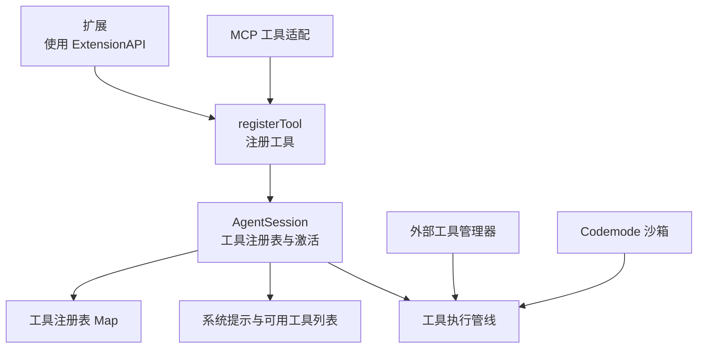
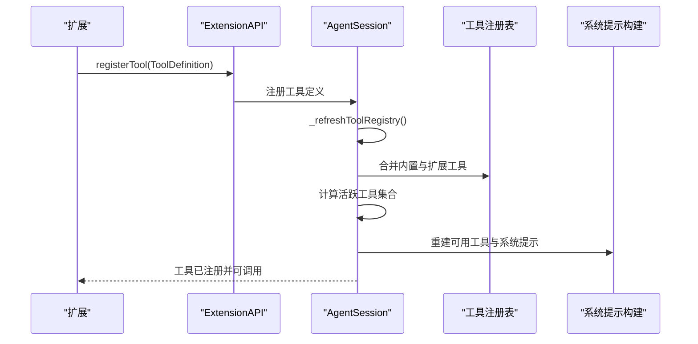
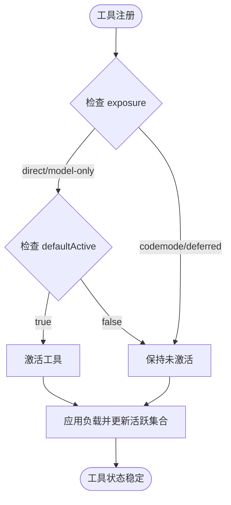
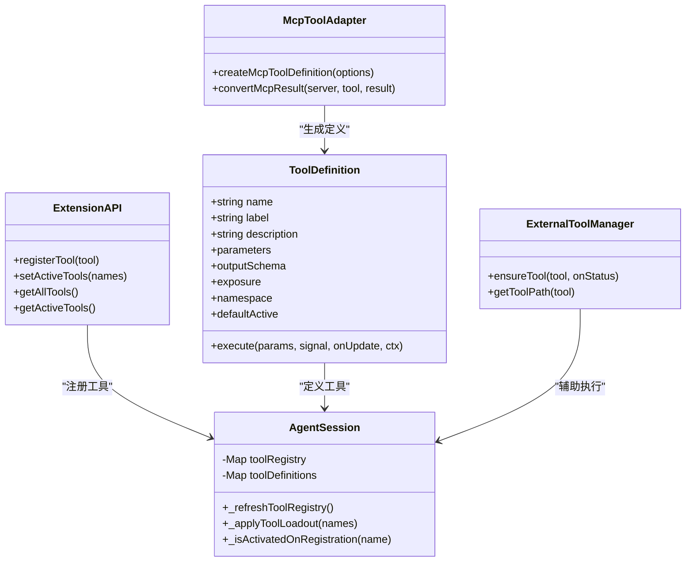

# 工具注册与生命周期

<cite>
**本文引用的文件**
- [agent-session.ts](file://packages/coding-agent/src/core/agent-session.ts)
- [types.ts](file://packages/coding-agent/src/core/extensions/types.ts)
- [tools.ts（MCP 工具适配）](file://packages/coding-agent/src/extensions/mcp/tools.ts)
- [tools-manager.ts（外部工具管理）](file://packages/coding-agent/src/utils/tools-manager.ts)
- [execution.ts（Codemode 沙箱工具）](file://packages/codemode/src/runtime/execution.ts)
- [tools.ts（示例扩展）](file://packages/coding-agent/examples/extensions/tools.ts)
</cite>

## 目录
1. [引言](#引言)
2. [项目结构与定位](#项目结构与定位)
3. [核心概念：工具定义、命名空间与暴露方式](#核心概念工具定义命名空间与暴露方式)
4. [工具注册 API 与调用流程](#工具注册-api-与调用流程)
5. [工具生命周期阶段](#工具生命周期阶段)
6. [工具状态管理与并发控制](#工具状态管理与并发控制)
7. [工具组与命名空间](#工具组与命名空间)
8. [依赖注入与上下文](#依赖注入与上下文)
9. [错误处理、日志与监控指标](#错误处理日志与监控指标)
10. [最佳实践](#最佳实践)
11. [架构总览图](#架构总览图)
12. [常见问题排查](#常见问题排查)
13. [结论](#结论)

## 引言
本文面向需要理解并扩展“工具注册与生命周期”的开发者。文档围绕以下目标展开：
- 说明 `registerTool` 的 API、参数含义和内部处理流程。
- 解释工具从定义到销毁的生命周期，包括定义、注册、激活、执行、销毁等阶段。
- 说明工具的状态管理：active/inactive 切换、并发控制、资源清理。
- 说明工具组、命名空间以及 MCP 工具如何接入系统。
- 给出错误处理、日志记录、监控指标收集的最佳实践。

本仓库中，工具是模型可调用能力的抽象，由扩展通过 `ExtensionAPI.registerTool` 注册，并由会话运行时统一管理其声明、激活和执行。

## 项目结构与定位
与工具注册与生命周期直接相关的代码主要分布在以下位置：
- 工具类型与注册入口：`packages/coding-agent/src/core/extensions/types.ts`
- 会话级工具注册表、激活逻辑与系统提示构建：`packages/coding-agent/src/core/agent-session.ts`
- MCP 工具适配与定义生成：`packages/coding-agent/src/extensions/mcp/tools.ts`
- 外部二进制工具安装与管理：`packages/coding-agent/src/utils/tools-manager.ts`
- Codemode 沙箱中的工具注册与执行：`packages/codemode/src/runtime/execution.ts`
- 示例扩展展示工具选择与活跃工具设置：`packages/coding-agent/examples/extensions/tools.ts`

**图表来源**
- [types.ts:599-688](file://packages/coding-agent/src/core/extensions/types.ts#L599-L688)
- [agent-session.ts:3625-3723](file://packages/coding-agent/src/core/agent-session.ts#L3625-L3723)
- [tools.ts（MCP 工具适配）:249-289](file://packages/coding-agent/src/extensions/mcp/tools.ts#L249-L289)
- [execution.ts:460-573](file://packages/codemode/src/runtime/execution.ts#L460-L573)

**章节来源**
- [types.ts:599-688](file://packages/coding-agent/src/core/extensions/types.ts#L599-L688)
- [agent-session.ts:3625-3723](file://packages/coding-agent/src/core/agent-session.ts#L3625-L3723)

## 核心概念：工具定义、命名空间与暴露方式
### 工具定义结构
工具通过 `ToolDefinition` 描述，关键字段包括：
- `name`：工具名称，用于 LLM 的工具调用。
- `label`：人类可读标签，用于 UI。
- `description`：对模型的描述。
- `parameters`：参数 JSON Schema（TypeBox）。
- `outputSchema`：结构化输出 Schema。
- `exposure`：暴露方式，决定模型如何访问工具。
- `namespace`：工具所属分组，例如 MCP 服务器。
- `defaultActive`：是否在注册时自动激活。
- `prepareLoadout`：在活跃工具变化时调整向模型展示的负载。
- `execute`：工具执行函数。
- `renderCall` / `renderResult`：自定义渲染。

这些字段共同构成工具的“定义”，并在注册后进入会话的工具注册表。

**章节来源**
- [types.ts:599-688](file://packages/coding-agent/src/core/extensions/types.ts#L599-L688)

### 命名空间与工具分组
`namespace` 表示工具所属的逻辑分组，例如 MCP 服务器的工具会共享同一个命名空间。会话在构建工具负载时会提供 `getNamespace`，以便工具或编排型工具动态调整描述与可见性。

**章节来源**
- [types.ts:631-632](file://packages/coding-agent/src/core/extensions/types.ts#L631-L632)
- [agent-session.ts:1652-1658](file://packages/coding-agent/src/core/agent-session.ts#L1652-L1658)

### 暴露方式
`exposure` 控制模型如何访问工具：
- `direct`：默认暴露，模型可直接调用。
- `model-only`：仅对模型可见，不直接暴露给其他工具。
- `codemode`：供 Codemode 脚本调用。
- `deferred`：延迟加载，通常由 `tool_search` 或 MCP 扩展激活。
- `hidden`：隐藏工具，不参与模型声明但仍可被内部机制使用。

**章节来源**
- [types.ts:626-629](file://packages/coding-agent/src/core/extensions/types.ts#L626-L629)
- [agent-session.ts:1614-1616](file://packages/coding-agent/src/core/agent-session.ts#L1614-L1616)

## 工具注册 API 与调用流程
### registerTool 方法
`ExtensionAPI.registerTool` 是扩展注册工具的统一入口。它接收一个 `ToolDefinition`，并将其纳入会话的工具定义与注册表。

典型流程如下：
1. 扩展调用 `pi.registerTool({ name, label, description, parameters, execute, ... })`。
2. 会话将工具定义加入 `_toolDefinitions`。
3. 会话刷新工具注册表 `_refreshToolRegistry`，合并内置工具与扩展工具。
4. 根据 `exposure` 与 `defaultActive` 决定是否激活工具。
5. 更新活跃工具集合，并重建系统提示中的可用工具列表。

**图表来源**
- [types.ts:1715-1718](file://packages/coding-agent/src/core/extensions/types.ts#L1715-L1718)
- [agent-session.ts:3625-3723](file://packages/coding-agent/src/core/agent-session.ts#L3625-L3723)

**章节来源**
- [types.ts:1715-1718](file://packages/coding-agent/src/core/extensions/types.ts#L1715-L1718)
- [agent-session.ts:3625-3723](file://packages/coding-agent/src/core/agent-session.ts#L3625-L3723)

## 工具生命周期阶段
工具生命周期包含以下阶段：

| 阶段 | 说明 | 关键逻辑 |
|---|---|---|
| 定义 | 扩展构造 `ToolDefinition`，声明名称、参数、描述、执行函数等 | `ToolDefinition` 接口定义 |
| 注册 | 调用 `registerTool`，会话合并内置与扩展工具 | `_refreshToolRegistry` |
| 激活 | 根据 `exposure` 与 `defaultActive` 决定是否激活 | `_isActivatedOnRegistration`、`_applyToolLoadout` |
| 执行 | 模型或内部调用触发 `execute` | 执行管线与结果转换 |
| 销毁 | 会话关闭或扩展卸载时清理资源 | 沙箱关闭、事件注销、临时文件清理 |

### 定义阶段
工具定义由扩展创建，可以是：
- 内联工具：直接在扩展中定义。
- MCP 工具：通过 `createMcpToolDefinition` 将 MCP 工具转换为 `ToolDefinition`。
- Codemode 工具：通过沙箱注册为脚本可调用的工具。

**章节来源**
- [types.ts:599-688](file://packages/coding-agent/src/core/extensions/types.ts#L599-L688)
- [tools.ts（MCP 工具适配）:249-289](file://packages/coding-agent/src/extensions/mcp/tools.ts#L249-L289)
- [execution.ts:460-573](file://packages/codemode/src/runtime/execution.ts#L460-L573)

### 注册阶段
会话在 `_buildRuntime` 中初始化基础工具定义，并通过 `_refreshToolRegistry` 合并扩展工具。注册过程还会：
- 过滤允许的工具。
- 构建工具提示片段与指南。
- 包装扩展工具以统一执行上下文。

**章节来源**
- [agent-session.ts:3736-3788](file://packages/coding-agent/src/core/agent-session.ts#L3736-L3788)
- [agent-session.ts:3625-3723](file://packages/coding-agent/src/core/agent-session.ts#L3625-L3723)

### 激活阶段
工具是否激活取决于：
- `exposure` 是否为 `direct` 或 `model-only`。
- `defaultActive` 是否为 `true` 或未显式设为 `false`。
- 是否通过 `setActiveTools` 或配置显式激活。

激活后，工具会被加入活跃集合，并参与系统提示的构建。

**章节来源**
- [agent-session.ts:3725-3734](file://packages/coding-agent/src/core/agent-session.ts#L3725-L3734)
- [agent-session.ts:1638-1685](file://packages/coding-agent/src/core/agent-session.ts#L1638-L1685)

### 执行阶段
工具执行由 `execute` 函数完成。对于 MCP 工具，执行流程包括：
1. 获取 MCP 客户端。
2. 调用远端工具。
3. 转换结果为模型友好的内容。
4. 可选地保存完整输出到临时文件。

**章节来源**
- [tools.ts（MCP 工具适配）:275-289](file://packages/coding-agent/src/extensions/mcp/tools.ts#L275-L289)
- [tools.ts（MCP 工具适配）:214-235](file://packages/coding-agent/src/extensions/mcp/tools.ts#L214-L235)

### 销毁阶段
销毁阶段涉及：
- 会话关闭时停止运行中的工具执行。
- Codemode 沙箱关闭时中止所有执行。
- 清理临时文件与资源。

**章节来源**
- [execution.ts:568-573](file://packages/codemode/src/runtime/execution.ts#L568-L573)
- [tools-manager.ts:312-316](file://packages/coding-agent/src/utils/tools-manager.ts#L312-L316)

## 工具状态管理与并发控制
### active/inactive 状态
活跃工具集合由 `_applyToolLoadout` 维护。活跃工具是向模型声明的工具，而非全部注册工具。隐藏工具不会出现在模型侧，但可能仍可用于内部调用。

**图表来源**
- [agent-session.ts:3725-3734](file://packages/coding-agent/src/core/agent-session.ts#L3725-L3734)
- [agent-session.ts:1638-1685](file://packages/coding-agent/src/core/agent-session.ts#L1638-L1685)

**章节来源**
- [agent-session.ts:1638-1685](file://packages/coding-agent/src/core/agent-session.ts#L1638-L1685)
- [agent-session.ts:3725-3734](file://packages/coding-agent/src/core/agent-session.ts#L3725-L3734)

### 并发控制
工具执行支持两种模式：
- `sequential`：串行执行，避免与其他工具调用并发。
- `parallel`：允许与其他工具调用并发。

此外，Codemode 沙箱维护运行中的执行集合，确保在沙箱关闭时中止所有执行。

**章节来源**
- [types.ts:660-667](file://packages/coding-agent/src/core/extensions/types.ts#L660-L667)
- [execution.ts:460-573](file://packages/codemode/src/runtime/execution.ts#L460-L573)

### 资源清理
工具执行过程中可能产生临时文件或外部进程。清理策略包括：
- 临时文件写入后保留路径供模型读取。
- 下载工具后删除压缩包与解压临时目录。
- 沙箱关闭时中止所有执行。

**章节来源**
- [tools.ts（MCP 工具适配）:62-65](file://packages/coding-agent/src/extensions/mcp/tools.ts#L62-L65)
- [tools-manager.ts:312-316](file://packages/coding-agent/src/utils/tools-manager.ts#L312-L316)
- [execution.ts:568-573](file://packages/codemode/src/runtime/execution.ts#L568-L573)

## 工具组与命名空间
### 命名空间的作用
`namespace` 用于将工具分组，例如 MCP 服务器的所有工具共享同一命名空间。会话在构建工具负载时提供 `getNamespace`，以便编排型工具（如 `codemode`、`tool_search`）动态调整描述与可见性。

### 工具组的注册与管理
- MCP 工具通过 `createMcpToolDefinition` 生成定义，并传入 `namespace`。
- 会话在 `_refreshToolRegistry` 中合并所有工具，并按命名空间组织。
- 扩展可通过 `getAllTools` 与 `getActiveTools` 查询工具组与活跃工具。

**章节来源**
- [tools.ts（MCP 工具适配）:249-289](file://packages/coding-agent/src/extensions/mcp/tools.ts#L249-L289)
- [agent-session.ts:3625-3723](file://packages/coding-agent/src/core/agent-session.ts#L3625-L3723)
- [types.ts:1813-1826](file://packages/coding-agent/src/core/extensions/types.ts#L1813-L1826)

## 依赖注入与上下文
### 依赖注入
工具执行函数接收以下参数：
- `toolCallId`：工具调用唯一标识。
- `params`：已校验的参数对象。
- `signal`：取消信号，用于中断长时间运行的工具。
- `onUpdate`：进度回调，用于流式更新。
- `ctx`：扩展工具上下文，包含会话、模型、设置等信息。

### 上下文能力
`ExtensionToolContext` 提供：
- 会话信息：`sessionId`、`sessionFile`、`cwd`。
- 模型信息：当前模型与思维级别。
- 设置信息：全局与项目设置。
- 事件总线：订阅会话与模型相关事件。

**章节来源**
- [types.ts:669-676](file://packages/coding-agent/src/core/extensions/types.ts#L669-L676)

## 错误处理、日志与监控指标
### 错误处理
- 工具执行失败应返回结构化错误结果，而不是抛出异常。
- MCP 工具的错误结果会被转换为模型可理解的文本。
- 外部工具下载失败会记录详细错误链，包括 DNS、TLS、超时等。

**章节来源**
- [tools.ts（MCP 工具适配）:214-235](file://packages/coding-agent/src/extensions/mcp/tools.ts#L214-L235)
- [tools-manager.ts:378-396](file://packages/coding-agent/src/utils/tools-manager.ts#L378-L396)

### 日志记录
- 工具执行开始、更新、结束可通过事件监听。
- 扩展可通过 `appendEntry` 记录自定义日志。
- 工具渲染器可输出用户友好的提示信息。

**章节来源**
- [types.ts:1701-1703](file://packages/coding-agent/src/core/extensions/types.ts#L1701-L1703)
- [types.ts:1794-1795](file://packages/coding-agent/src/core/extensions/types.ts#L1794-L1795)

### 监控指标收集
- 工具执行时间、成功率、错误率可通过事件钩子收集。
- MCP 工具进度回调可用于统计中间状态。
- 外部工具下载状态可通过 `onStatus` 回调上报。

**章节来源**
- [tools.ts（MCP 工具适配）:275-289](file://packages/coding-agent/src/extensions/mcp/tools.ts#L275-L289)
- [tools-manager.ts:337-397](file://packages/coding-agent/src/utils/tools-manager.ts#L337-L397)

## 最佳实践
### 工具注册最佳实践
- 明确声明 `parameters` 与 `outputSchema`，便于模型理解输入输出。
- 使用 `promptSnippet` 与 `promptGuidelines` 提升模型调用质量。
- 合理设置 `exposure` 与 `defaultActive`，避免不必要的工具暴露。
- 使用 `namespace` 对工具分组，便于管理与展示。

### 错误处理最佳实践
- 在 `execute` 中捕获异常并返回结构化错误。
- 对外部工具调用添加超时与重试逻辑。
- 记录详细错误信息，便于排查问题。

### 日志与监控最佳实践
- 使用事件钩子记录工具执行生命周期。
- 通过 `onUpdate` 提供进度反馈。
- 使用 `appendEntry` 记录自定义日志。

### 资源清理最佳实践
- 及时释放临时文件与网络连接。
- 在工具执行中使用 `AbortSignal` 响应取消。
- 在扩展卸载时清理订阅与定时器。

**章节来源**
- [types.ts:599-688](file://packages/coding-agent/src/core/extensions/types.ts#L599-L688)
- [tools.ts（MCP 工具适配）:275-289](file://packages/coding-agent/src/extensions/mcp/tools.ts#L275-L289)
- [tools-manager.ts:337-397](file://packages/coding-agent/src/utils/tools-manager.ts#L337-L397)

## 架构总览图

**图表来源**
- [types.ts:599-688](file://packages/coding-agent/src/core/extensions/types.ts#L599-L688)
- [types.ts:1715-1718](file://packages/coding-agent/src/core/extensions/types.ts#L1715-L1718)
- [agent-session.ts:3625-3723](file://packages/coding-agent/src/core/agent-session.ts#L3625-L3723)
- [tools.ts（MCP 工具适配）:249-289](file://packages/coding-agent/src/extensions/mcp/tools.ts#L249-L289)
- [tools-manager.ts:337-397](file://packages/coding-agent/src/utils/tools-manager.ts#L337-L397)

## 常见问题排查
### 工具重复注册
- 现象：注册同名工具时报错。
- 原因：工具名称必须唯一。
- 解决：检查 `name` 字段，或使用不同命名空间。

**章节来源**
- [execution.ts:478-482](file://packages/codemode/src/runtime/execution.ts#L478-L482)

### 工具未激活
- 现象：工具已注册但模型无法调用。
- 原因：`exposure` 不是 `direct` 或 `model-only`，或 `defaultActive` 为 `false`。
- 解决：调整 `exposure` 或显式调用 `setActiveTools`。

**章节来源**
- [agent-session.ts:3725-3734](file://packages/coding-agent/src/core/agent-session.ts#L3725-L3734)
- [types.ts:646-651](file://packages/coding-agent/src/core/extensions/types.ts#L646-L651)

### 工具执行超时
- 现象：工具执行长时间无响应。
- 原因：外部网络请求或进程阻塞。
- 解决：使用 `AbortSignal` 取消，或设置超时。

**章节来源**
- [tools.ts（MCP 工具适配）:275-289](file://packages/coding-agent/src/extensions/mcp/tools.ts#L275-L289)

### 外部工具不可用
- 现象：fd 或 rg 命令找不到。
- 原因：平台不支持自动下载或未安装。
- 解决：手动安装或通过包管理器安装。

**章节来源**
- [tools-manager.ts:354-369](file://packages/coding-agent/src/utils/tools-manager.ts#L354-L369)

## 结论
工具注册与生命周期是 Pi 系统的核心能力之一。通过 `registerTool`，扩展可以灵活地定义、注册和管理工具。会话层负责工具的定义合并、激活判断、负载构建与系统提示更新。MCP 工具与外部工具通过适配器集成到统一框架中。开发者应关注工具定义的质量、状态管理的正确性以及资源清理的完整性，以确保系统稳定与可扩展。