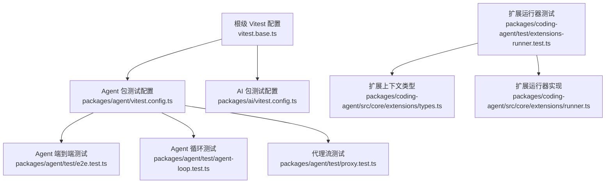
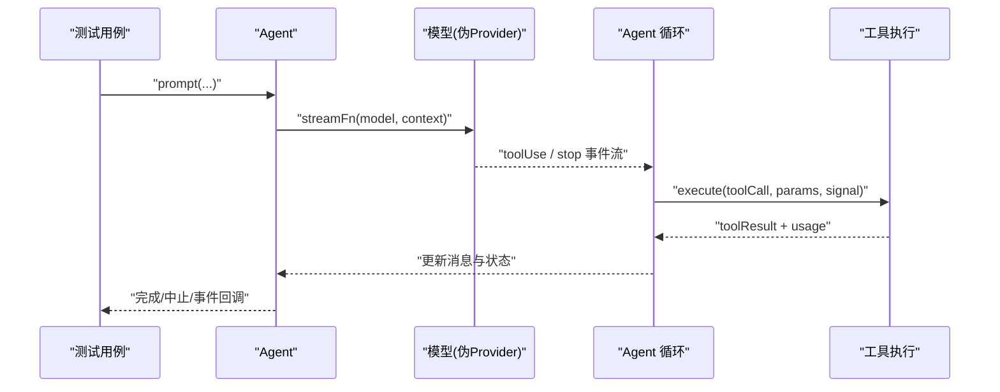
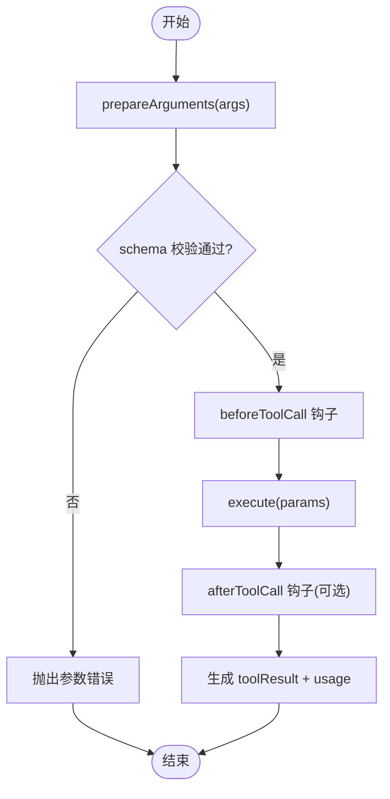
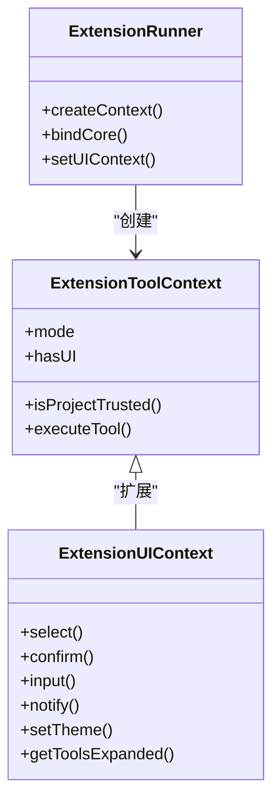
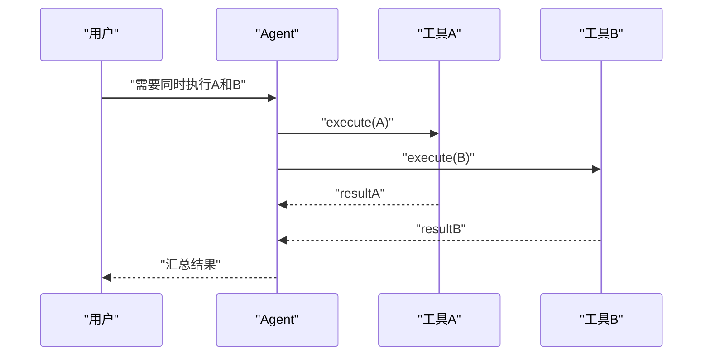
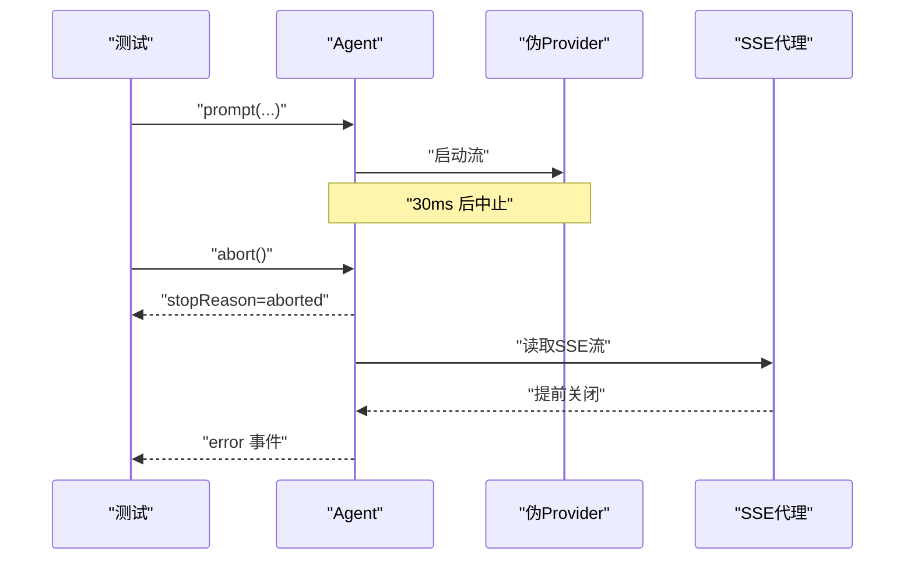
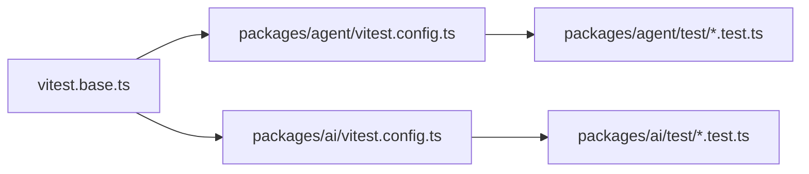

# 工具测试与调试

<cite>
**本文引用的文件**   
- [vitest.base.ts](file://vitest.base.ts)
- [packages/agent/vitest.config.ts](file://packages/agent/vitest.config.ts)
- [packages/ai/vitest.config.ts](file://packages/ai/vitest.config.ts)
- [packages/agent/test/e2e.test.ts](file://packages/agent/test/e2e.test.ts)
- [packages/agent/test/agent-loop.test.ts](file://packages/agent/test/agent-loop.test.ts)
- [packages/agent/test/proxy.test.ts](file://packages/agent/test/proxy.test.ts)
- [packages/coding-agent/test/suite/harness.ts](file://packages/coding-agent/test/suite/harness.ts)
- [packages/coding-agent/test/extensions-runner.test.ts](file://packages/coding-agent/test/extensions-runner.test.ts)
- [packages/coding-agent/src/core/extensions/types.ts](file://packages/coding-agent/src/core/extensions/types.ts)
- [packages/coding-agent/src/core/extensions/runner.ts](file://packages/coding-agent/src/core/extensions/runner.ts)
- [packages/coding-agent/src/modes/interactive/interactive-mode.ts](file://packages/coding-agent/src/modes/interactive/interactive-mode.ts)
</cite>

## 目录
1. [简介](#简介)
2. [项目结构](#项目结构)
3. [核心组件](#核心组件)
4. [架构总览](#架构总览)
5. [详细组件分析](#详细组件分析)
6. [依赖分析](#依赖分析)
7. [性能考虑](#性能考虑)
8. [故障排查指南](#故障排查指南)
9. [结论](#结论)
10. [附录](#附录)

## 简介
本指南面向在 Pi 代码库中编写“工具”的单元测试、集成测试与调试实践，覆盖以下主题：
- 如何模拟 ExtensionToolContext 并验证参数、错误处理路径
- 如何进行工具间交互、权限与并发等集成测试
- 日志输出、断点调试、性能分析等调试技巧
- 异步工具与流式输出的测试方法（超时、取消、边界情况）
- 常见测试陷阱与解决方案，以及覆盖率建议

## 项目结构
仓库采用多包工作区组织，测试框架统一使用 Vitest。根级 vitest.base.ts 提供跨包的别名映射；各子包通过各自的 vitest.config.ts 配置测试环境、超时、报告器等。

**图表来源**
- [vitest.base.ts:44-96](file://vitest.base.ts#L44-L96)
- [packages/agent/vitest.config.ts:9-27](file://packages/agent/vitest.config.ts#L9-L27)
- [packages/ai/vitest.config.ts:6-20](file://packages/ai/vitest.config.ts#L6-L20)

**章节来源**
- [vitest.base.ts:44-96](file://vitest.base.ts#L44-L96)
- [packages/agent/vitest.config.ts:9-27](file://packages/agent/vitest.config.ts#L9-L27)
- [packages/ai/vitest.config.ts:6-20](file://packages/ai/vitest.config.ts#L6-L20)

## 核心组件
- Agent 端到端测试：基于伪 Provider 验证消息流、工具调用、中止、事件生命周期与多轮对话。
- Agent 循环测试：围绕 agentLoop 的参数校验、before/after 钩子、并行/顺序执行、长度截断保护、prepareArguments 等。
- 代理流测试：验证 SSE 代理流的元数据保留、终端元数据处理、异常结束与长参数增量解析的性能。
- 扩展上下文与 UI 测试：构造最小化 ExtensionUIContext 与 ExtensionToolContext，验证模式、权限与 RPC 行为。

**章节来源**
- [packages/agent/test/e2e.test.ts:186-266](file://packages/agent/test/e2e.test.ts#L186-L266)
- [packages/agent/test/agent-loop.test.ts:305-454](file://packages/agent/test/agent-loop.test.ts#L305-L454)
- [packages/agent/test/proxy.test.ts:32-170](file://packages/agent/test/proxy.test.ts#L32-L170)
- [packages/coding-agent/test/suite/harness.ts:74-109](file://packages/coding-agent/test/suite/harness.ts#L74-L109)
- [packages/coding-agent/test/extensions-runner.test.ts:554-589](file://packages/coding-agent/test/extensions-runner.test.ts#L554-L589)

## 架构总览
下图展示 Agent 在测试中的关键流程：从 prompt 到模型流式响应，再到工具执行与结果回写，最后完成一轮对话。

**图表来源**
- [packages/agent/test/e2e.test.ts:39-101](file://packages/agent/test/e2e.test.ts#L39-L101)
- [packages/agent/test/agent-loop.test.ts:305-399](file://packages/agent/test/agent-loop.test.ts#L305-L399)

## 详细组件分析

### 单元测试：参数验证、错误处理与钩子
- 参数准备与校验
  - 使用 prepareArguments 将非标准输入转换为 schema 期望的结构，再进入 execute。
  - 通过 beforeToolCall 可修改或拦截参数，但不会重新校验 schema。
- 错误处理路径
  - 当模型输出被长度截断时，不应执行工具，应返回错误结果并允许模型重试。
  - afterToolCall 可用于修正/聚合 usage 统计。
- 并发与顺序执行
  - toolExecution 支持 "parallel" 与 "sequential"，需验证 end 事件顺序与持久化顺序的差异。

**图表来源**
- [packages/agent/test/agent-loop.test.ts:589-666](file://packages/agent/test/agent-loop.test.ts#L589-L666)
- [packages/agent/test/agent-loop.test.ts:401-454](file://packages/agent/test/agent-loop.test.ts#L401-L454)
- [packages/agent/test/agent-loop.test.ts:305-399](file://packages/agent/test/agent-loop.test.ts#L305-L399)

**章节来源**
- [packages/agent/test/agent-loop.test.ts:589-666](file://packages/agent/test/agent-loop.test.ts#L589-L666)
- [packages/agent/test/agent-loop.test.ts:401-454](file://packages/agent/test/agent-loop.test.ts#L401-L454)
- [packages/agent/test/agent-loop.test.ts:305-399](file://packages/agent/test/agent-loop.test.ts#L305-L399)

### 单元测试：模拟 ExtensionToolContext 与 UI 上下文
- 最小化 UI 上下文
  - 使用 createTestUiContext 构造无副作用的 ExtensionUIContext，便于隔离 UI 相关逻辑。
- 扩展上下文模式与权限
  - 通过 ExtensionRunner.createContext 暴露 mode、hasUI、isProjectTrusted 等属性，用于测试 print/rpc 模式与信任状态。
- 类型契约
  - ExtensionToolContext 继承自 ExtensionContext，并提供 executeTool 等能力，测试中可通过类型断言注入必要字段。

**图表来源**
- [packages/coding-agent/test/suite/harness.ts:74-109](file://packages/coding-agent/test/suite/harness.ts#L74-L109)
- [packages/coding-agent/test/extensions-runner.test.ts:554-589](file://packages/coding-agent/test/extensions-runner.test.ts#L554-L589)
- [packages/coding-agent/src/core/extensions/types.ts:403-403](file://packages/coding-agent/src/core/extensions/types.ts#L403-L403)
- [packages/coding-agent/src/core/extensions/runner.ts:975-978](file://packages/coding-agent/src/core/extensions/runner.ts#L975-L978)

**章节来源**
- [packages/coding-agent/test/suite/harness.ts:74-109](file://packages/coding-agent/test/suite/harness.ts#L74-L109)
- [packages/coding-agent/test/extensions-runner.test.ts:554-589](file://packages/coding-agent/test/extensions-runner.test.ts#L554-L589)
- [packages/coding-agent/src/core/extensions/types.ts:403-403](file://packages/coding-agent/src/core/extensions/types.ts#L403-L403)
- [packages/coding-agent/src/core/extensions/runner.ts:975-978](file://packages/coding-agent/src/core/extensions/runner.ts#L975-L978)

### 集成测试：工具间交互、权限与并发
- 工具间交互
  - 通过 Agent 的 tools 列表注册多个工具，验证一次请求触发多次工具调用与最终回复。
- 权限测试
  - 结合 isProjectTrusted 与 UI 确认对话框，验证敏感操作是否被拒绝。
- 并发测试
  - 使用 toolExecution="parallel" 验证并行执行时的结束事件顺序与结果持久化顺序。

**图表来源**
- [packages/agent/test/agent-loop.test.ts:668-760](file://packages/agent/test/agent-loop.test.ts#L668-L760)
- [packages/coding-agent/test/extensions-runner.test.ts:568-589](file://packages/coding-agent/test/extensions-runner.test.ts#L568-L589)

**章节来源**
- [packages/agent/test/agent-loop.test.ts:668-760](file://packages/agent/test/agent-loop.test.ts#L668-L760)
- [packages/coding-agent/test/extensions-runner.test.ts:568-589](file://packages/coding-agent/test/extensions-runner.test.ts#L568-L589)

### 调试技巧与工具
- 日志输出
  - 在 beforeToolCall/afterToolCall 钩子中记录参数、耗时与 usage，便于定位问题。
- 断点调试
  - 在 agentLoop 与工具 execute 处设置断点，观察事件流与消息变更。
- 性能分析
  - 对长参数增量解析场景使用 performance.now 测量，确保线性时间复杂度。

**章节来源**
- [packages/agent/test/agent-loop.test.ts:401-454](file://packages/agent/test/agent-loop.test.ts#L401-L454)
- [packages/agent/test/proxy.test.ts:119-170](file://packages/agent/test/proxy.test.ts#L119-L170)

### 异步工具与流式输出：超时、取消与边界
- 中止与超时
  - 通过 agent.abort() 触发中止，验证 stopReason 与 errorMessage。
  - 在 UI 选择器中监听 AbortSignal，确保取消后及时释放资源。
- 流式事件
  - 订阅 message_start/message_update/message_end 等事件，验证流式进度。
- 代理流异常
  - 当流在没有 done 事件的情况下关闭，应上报 error 而非挂起。

**图表来源**
- [packages/agent/test/e2e.test.ts:103-129](file://packages/agent/test/e2e.test.ts#L103-L129)
- [packages/agent/test/e2e.test.ts:221-225](file://packages/agent/test/e2e.test.ts#L221-L225)
- [packages/agent/test/proxy.test.ts:99-117](file://packages/agent/test/proxy.test.ts#L99-L117)
- [packages/coding-agent/src/modes/interactive/interactive-mode.ts:2841-2889](file://packages/coding-agent/src/modes/interactive/interactive-mode.ts#L2841-L2889)

**章节来源**
- [packages/agent/test/e2e.test.ts:103-129](file://packages/agent/test/e2e.test.ts#L103-L129)
- [packages/agent/test/e2e.test.ts:221-225](file://packages/agent/test/e2e.test.ts#L221-L225)
- [packages/agent/test/proxy.test.ts:99-117](file://packages/agent/test/proxy.test.ts#L99-L117)
- [packages/coding-agent/src/modes/interactive/interactive-mode.ts:2841-2889](file://packages/coding-agent/src/modes/interactive/interactive-mode.ts#L2841-L2889)

## 依赖分析
- 测试框架与别名
  - vitest.base.ts 为所有包提供统一的模块别名，避免测试加载构建产物。
- 包级测试配置
  - packages/agent/vitest.config.ts 与 packages/ai/vitest.config.ts 分别配置测试环境、超时与 reporter。
- 运行时依赖
  - Agent 测试依赖 pi-ai 的伪 Provider 与流式 API；扩展测试依赖 extension runner 与 types。

**图表来源**
- [vitest.base.ts:44-96](file://vitest.base.ts#L44-L96)
- [packages/agent/vitest.config.ts:9-27](file://packages/agent/vitest.config.ts#L9-L27)
- [packages/ai/vitest.config.ts:6-20](file://packages/ai/vitest.config.ts#L6-L20)

**章节来源**
- [vitest.base.ts:44-96](file://vitest.base.ts#L44-L96)
- [packages/agent/vitest.config.ts:9-27](file://packages/agent/vitest.config.ts#L9-L27)
- [packages/ai/vitest.config.ts:6-20](file://packages/ai/vitest.config.ts#L6-L20)

## 性能考虑
- 流式参数增量解析
  - 对大量 JSON delta 的拼接应保持线性时间复杂度，避免每次全量重解析。
- 工具执行计时
  - 仅统计 execute 的实际耗时，排除钩子开销，便于准确评估工具性能。
- 并发控制
  - 并行执行时需保证事件顺序与结果持久化顺序符合预期，避免竞态导致的时序问题。

**章节来源**
- [packages/agent/test/proxy.test.ts:119-170](file://packages/agent/test/proxy.test.ts#L119-L170)
- [packages/agent/test/agent-loop.test.ts:401-454](file://packages/agent/test/agent-loop.test.ts#L401-L454)
- [packages/agent/test/agent-loop.test.ts:668-760](file://packages/agent/test/agent-loop.test.ts#L668-L760)

## 故障排查指南
- 常见问题
  - 流提前结束未触发 done：应上报 error 并包含连接关闭信息。
  - 长度截断导致工具参数不完整：禁止执行工具，返回错误并让模型重试。
  - 中止后仍继续渲染：需在 UI 选择器中监听 AbortSignal 并及时清理。
- 定位手段
  - 在代理流与 agentLoop 的关键分支添加日志，记录事件类型与元数据。
  - 使用 performance.now 对比不同实现的耗时差异。

**章节来源**
- [packages/agent/test/proxy.test.ts:99-117](file://packages/agent/test/proxy.test.ts#L99-L117)
- [packages/agent/test/agent-loop.test.ts:456-526](file://packages/agent/test/agent-loop.test.ts#L456-L526)
- [packages/coding-agent/src/modes/interactive/interactive-mode.ts:2841-2889](file://packages/coding-agent/src/modes/interactive/interactive-mode.ts#L2841-L2889)

## 结论
通过伪 Provider、最小化上下文与严格的流式事件断言，可以在本地高效验证工具的正确性、健壮性与性能。建议在新增工具时同步补充参数校验、错误路径、并发与取消场景的测试，并结合日志与性能测量持续优化。

## 附录
- 测试运行命令
  - 参考根 README 的 Development 部分，使用 ./test.sh 运行测试（跳过依赖 LLM 的测试）。
- 覆盖率建议
  - 对工具 execute、prepareArguments、before/after 钩子与错误分支保持高覆盖率。
  - 对流式代理与中断路径进行专项覆盖，确保无挂起与内存泄漏。