# 工具执行引擎

<cite>
**本文引用的文件**   
- [packages/coding-agent/src/core/tools/index.ts](file://packages/coding-agent/src/core/tools/index.ts)
- [packages/coding-agent/src/core/tools/file-mutation-queue.ts](file://packages/coding-agent/src/core/tools/file-mutation-queue.ts)
- [packages/coding-agent/src/core/tools/output-accumulator.ts](file://packages/coding-agent/src/core/tools/output-accumulator.ts)
- [packages/coding-agent/src/core/tools/path-utils.ts](file://packages/coding-agent/src/core/tools/path-utils.ts)
- [packages/coding-agent/src/core/tools/bash.ts](file://packages/coding-agent/src/core/tools/bash.ts)
- [packages/coding-agent/src/core/tools/edit.ts](file://packages/coding-agent/src/core/tools/edit.ts)
- [packages/coding-agent/src/core/tools/write.ts](file://packages/coding-agent/src/core/tools/write.ts)
- [packages/coding-agent/src/core/tools/read.ts](file://packages/coding-agent/src/core/tools/read.ts)
- [packages/coding-agent/src/core/tools/renderers/index.ts](file://packages/coding-agent/src/core/tools/renderers/index.ts)
- [packages/coding-agent/src/modes/interactive/components/tool-execution.ts](file://packages/coding-agent/src/modes/interactive/components/tool-execution.ts)
- [packages/coding-agent/src/core/export-html/tool-renderer.ts](file://packages/coding-agent/src/core/export-html/tool-renderer.ts)
</cite>

## 目录
1. [引言](#引言)
2. [项目结构](#项目结构)
3. [核心组件](#核心组件)
4. [架构总览](#架构总览)
5. [详细组件分析](#详细组件分析)
6. [依赖关系分析](#依赖关系分析)
7. [性能与并发控制](#性能与并发控制)
8. [调试与故障排除](#调试与故障排除)
9. [结论](#结论)

## 引言
本技术文档聚焦“工具执行引擎”，系统性解析工具调用的核心机制，包括：
- 执行队列管理与并发控制
- 输出累积器与流式处理
- 路径工具函数与平台兼容性
- 渲染工具与展示管道
- 文件变更队列的串行化策略
- 错误恢复、超时与资源清理
- 性能监控与可观测性要点
- 调试与故障排除指南

目标是帮助读者从高层架构到代码级实现全面理解该子系统的设计与行为。

## 项目结构
工具执行引擎位于 coding-agent 包的 core/tools 目录下，围绕“工具定义 + 执行 + 渲染”三层组织：
- 工具定义与工厂：统一创建工具定义与实例，提供只读/可写工具集合
- 具体工具实现：read、write、edit、bash/powershell、grep、find、ls
- 通用基础设施：输出累积器、文件变更队列、路径工具函数、截断工具
- 渲染层：内置渲染器、HTML 导出渲染器、交互式 UI 组件

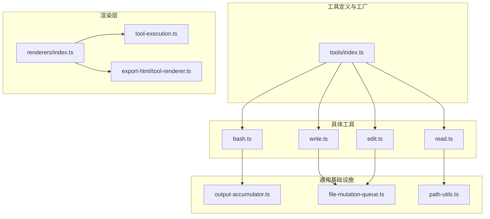

图表来源
- [packages/coding-agent/src/core/tools/index.ts:118-193](file://packages/coding-agent/src/core/tools/index.ts#L118-L193)
- [packages/coding-agent/src/core/tools/read.ts:228-357](file://packages/coding-agent/src/core/tools/read.ts#L228-L357)
- [packages/coding-agent/src/core/tools/write.ts:43-91](file://packages/coding-agent/src/core/tools/write.ts#L43-L91)
- [packages/coding-agent/src/core/tools/edit.ts:140-212](file://packages/coding-agent/src/core/tools/edit.ts#L140-L212)
- [packages/coding-agent/src/core/tools/bash.ts:271-448](file://packages/coding-agent/src/core/tools/bash.ts#L271-L448)
- [packages/coding-agent/src/core/tools/output-accumulator.ts:35-119](file://packages/coding-agent/src/core/tools/output-accumulator.ts#L35-L119)
- [packages/coding-agent/src/core/tools/file-mutation-queue.ts:32-61](file://packages/coding-agent/src/core/tools/file-mutation-queue.ts#L32-L61)
- [packages/coding-agent/src/core/tools/path-utils.ts:40-84](file://packages/coding-agent/src/core/tools/path-utils.ts#L40-L84)
- [packages/coding-agent/src/core/tools/renderers/index.ts:31-63](file://packages/coding-agent/src/core/tools/renderers/index.ts#L31-L63)
- [packages/coding-agent/src/modes/interactive/components/tool-execution.ts:31-104](file://packages/coding-agent/src/modes/interactive/components/tool-execution.ts#L31-L104)
- [packages/coding-agent/src/core/export-html/tool-renderer.ts:59-110](file://packages/coding-agent/src/core/export-html/tool-renderer.ts#L59-L110)

章节来源
- [packages/coding-agent/src/core/tools/index.ts:1-225](file://packages/coding-agent/src/core/tools/index.ts#L1-L225)

## 核心组件
- 工具工厂与注册中心：集中暴露 createToolDefinition/createTool 等工厂方法，按名称分发到具体工具实现；同时提供只读/可写/全部工具集合。
- 文件变更队列：基于 Promise 链对同一文件的写入/编辑操作进行串行化，不同文件仍可并行。
- 输出累积器：流式累积命令输出，支持行/字节上限、临时文件落盘、快照与完整输出读取。
- 路径工具函数：跨平台路径规范化、存在性检测、macOS 文件名变体兼容（NFD、直引号替换、AM/PM 窄空格）。
- 渲染工具：为每个工具提供 renderCall/renderResult 渲染钩子；提供 HTML 导出渲染器与交互式 UI 组件。

章节来源
- [packages/coding-agent/src/core/tools/index.ts:118-225](file://packages/coding-agent/src/core/tools/index.ts#L118-L225)
- [packages/coding-agent/src/core/tools/file-mutation-queue.ts:1-62](file://packages/coding-agent/src/core/tools/file-mutation-queue.ts#L1-L62)
- [packages/coding-agent/src/core/tools/output-accumulator.ts:1-258](file://packages/coding-agent/src/core/tools/output-accumulator.ts#L1-L258)
- [packages/coding-agent/src/core/tools/path-utils.ts:1-119](file://packages/coding-agent/src/core/tools/path-utils.ts#L1-L119)
- [packages/coding-agent/src/core/tools/renderers/index.ts:1-63](file://packages/coding-agent/src/core/tools/renderers/index.ts#L1-L63)

## 架构总览
工具调用从“模型侧请求”进入“工具定义执行”，经过“参数预处理 → I/O 操作 → 输出累积 → 结果封装 → 渲染展示”。

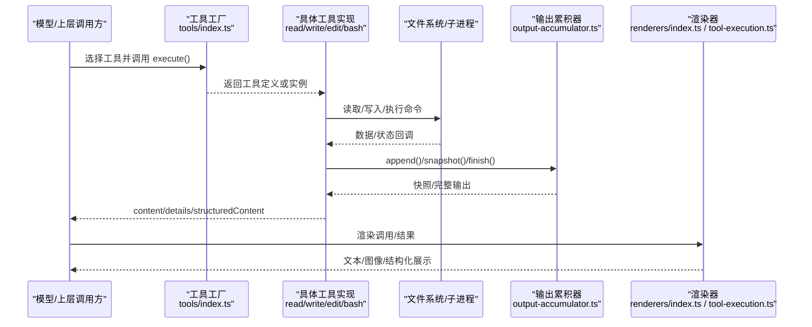

图表来源
- [packages/coding-agent/src/core/tools/index.ts:118-193](file://packages/coding-agent/src/core/tools/index.ts#L118-L193)
- [packages/coding-agent/src/core/tools/read.ts:228-357](file://packages/coding-agent/src/core/tools/read.ts#L228-L357)
- [packages/coding-agent/src/core/tools/write.ts:43-91](file://packages/coding-agent/src/core/tools/write.ts#L43-L91)
- [packages/coding-agent/src/core/tools/edit.ts:140-212](file://packages/coding-agent/src/core/tools/edit.ts#L140-L212)
- [packages/coding-agent/src/core/tools/bash.ts:271-448](file://packages/coding-agent/src/core/tools/bash.ts#L271-L448)
- [packages/coding-agent/src/core/tools/output-accumulator.ts:35-119](file://packages/coding-agent/src/core/tools/output-accumulator.ts#L35-L119)
- [packages/coding-agent/src/core/tools/renderers/index.ts:31-63](file://packages/coding-agent/src/core/tools/renderers/index.ts#L31-L63)
- [packages/coding-agent/src/modes/interactive/components/tool-execution.ts:31-104](file://packages/coding-agent/src/modes/interactive/components/tool-execution.ts#L31-L104)

## 详细组件分析

### 工具工厂与命名空间
- 提供 createToolDefinition/createTool 按名称分发到 read/write/edit/bash/powershell/grep/find/ls。
- 提供 createCodingTools/createReadOnlyTools/createAllTools 等组合工具集，便于在不同模式（编码/只读）下启用不同工具。
- 所有工具共享统一的 ToolDefinition 类型与扩展上下文能力。

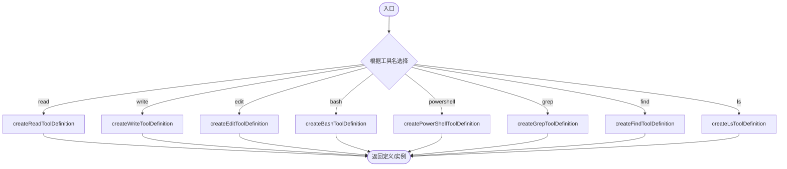

图表来源
- [packages/coding-agent/src/core/tools/index.ts:118-193](file://packages/coding-agent/src/core/tools/index.ts#L118-L193)

章节来源
- [packages/coding-agent/src/core/tools/index.ts:1-225](file://packages/coding-agent/src/core/tools/index.ts#L1-L225)

### 文件变更队列（并发控制与串行化）
- 目标：对同一文件的写入/编辑操作串行化，避免并发写冲突；不同文件仍并行。
- 机制：以真实路径为键维护 Promise 链；通过 registrationQueue 保证注册顺序稳定；finally 中释放下一个任务并清理映射。
- 异常安全：忽略 ENOENT/ENOTDIR 作为“缺失路径”情况，使用规范化后的绝对路径作为键。

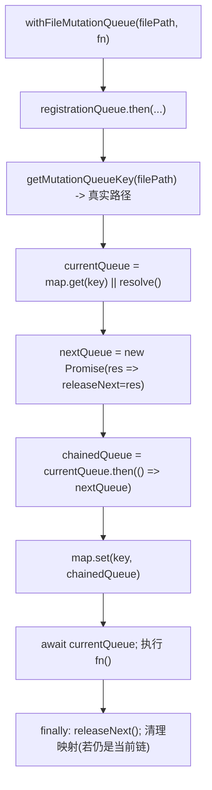

图表来源
- [packages/coding-agent/src/core/tools/file-mutation-queue.ts:16-61](file://packages/coding-agent/src/core/tools/file-mutation-queue.ts#L16-L61)

章节来源
- [packages/coding-agent/src/core/tools/file-mutation-queue.ts:1-62](file://packages/coding-agent/src/core/tools/file-mutation-queue.ts#L1-L62)

### 输出累积器（流式输出与内存限制）
- 功能：增量追加 Buffer，内部用 TextDecoder 流式解码；维护尾部文本用于显示快照；超过阈值时自动打开临时文件保存全量。
- 关键接口：append/finish/snapshot/closeTempFile/readFullOutput。
- 截断策略：按行/字节双阈值；当需要保留完整输出时，将原始 Buffer 写入临时文件；readFullOutput 在超大输出时返回首尾片段加省略标记。

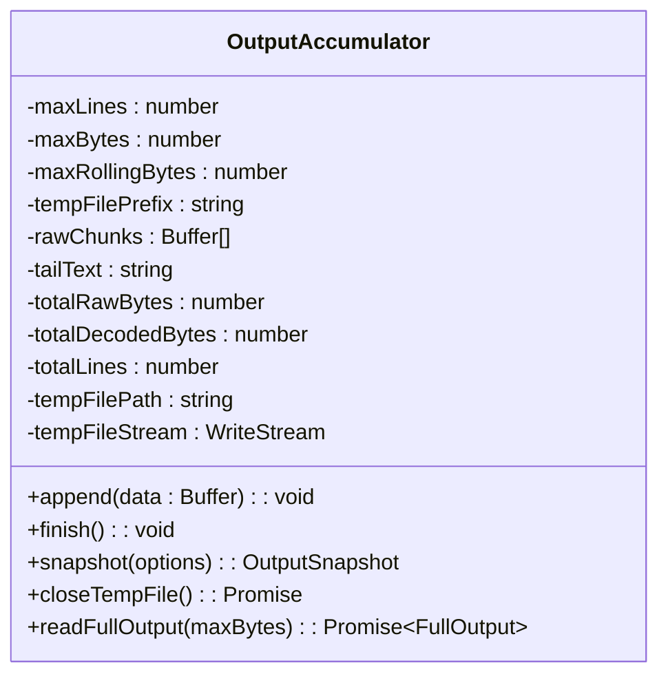

图表来源
- [packages/coding-agent/src/core/tools/output-accumulator.ts:35-119](file://packages/coding-agent/src/core/tools/output-accumulator.ts#L35-L119)
- [packages/coding-agent/src/core/tools/output-accumulator.ts:149-176](file://packages/coding-agent/src/core/tools/output-accumulator.ts#L149-L176)
- [packages/coding-agent/src/core/tools/output-accumulator.ts:239-256](file://packages/coding-agent/src/core/tools/output-accumulator.ts#L239-L256)

章节来源
- [packages/coding-agent/src/core/tools/output-accumulator.ts:1-258](file://packages/coding-agent/src/core/tools/output-accumulator.ts#L1-L258)

### 路径工具函数（跨平台与 macOS 兼容）
- 提供 expandPath/resolveToCwd/resolveReadPath/resolveReadPathAsync。
- macOS 兼容：尝试 NFD 归一化、直引号替换、AM/PM 窄空格变体，提高截图类文件名匹配成功率。
- 存在性检测：同步与异步两种 API，均捕获异常返回布尔值。

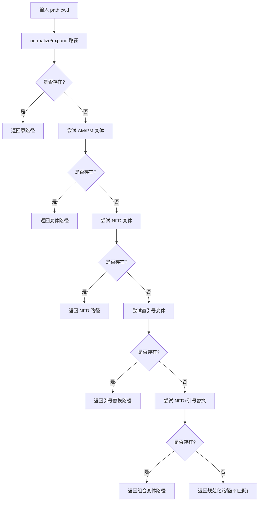

图表来源
- [packages/coding-agent/src/core/tools/path-utils.ts:40-84](file://packages/coding-agent/src/core/tools/path-utils.ts#L40-L84)
- [packages/coding-agent/src/core/tools/path-utils.ts:86-118](file://packages/coding-agent/src/core/tools/path-utils.ts#L86-L118)

章节来源
- [packages/coding-agent/src/core/tools/path-utils.ts:1-119](file://packages/coding-agent/src/core/tools/path-utils.ts#L1-L119)

### Bash/Powershell 工具（命令执行、超时与输出节流）
- 执行流程：构造 ShellConfig → spawn 子进程 → 流式收集 stdout/stderr → 输出节流更新 → 完成时关闭临时文件 → 返回结构化内容。
- 超时与中断：支持秒级超时；AbortSignal 触发后终止进程树；区分“shell 已退出但后台进程仍在写”的情况。
- 输出限制：结构化输出有最大字节限制；超长输出会保存到临时文件并在 details 中提示。

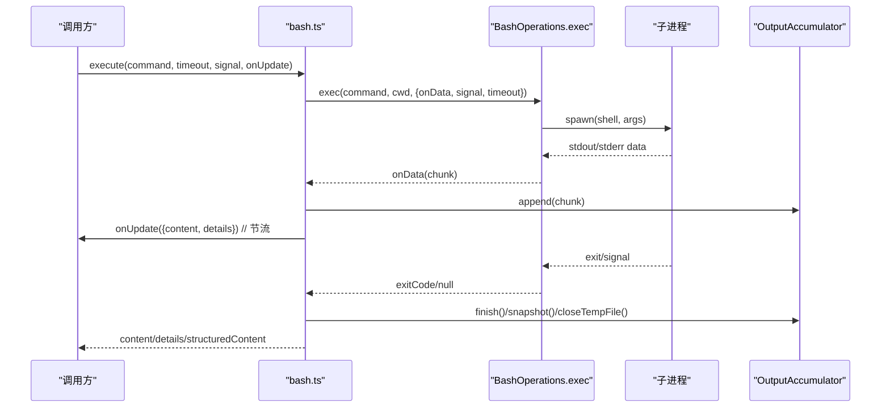

图表来源
- [packages/coding-agent/src/core/tools/bash.ts:110-194](file://packages/coding-agent/src/core/tools/bash.ts#L110-L194)
- [packages/coding-agent/src/core/tools/bash.ts:271-448](file://packages/coding-agent/src/core/tools/bash.ts#L271-L448)
- [packages/coding-agent/src/core/tools/output-accumulator.ts:35-119](file://packages/coding-agent/src/core/tools/output-accumulator.ts#L35-L119)

章节来源
- [packages/coding-agent/src/core/tools/bash.ts:1-477](file://packages/coding-agent/src/core/tools/bash.ts#L1-L477)

### Read 工具（文本/图片读取与流式分片）
- 文本读取：优先使用 createReadStream 流式选择指定行范围，避免大文件整段加载；否则回退到整块读取再切片。
- 图片读取：识别 MIME 类型，必要时进行缩放与格式转换；不支持图像的模型会附加提示信息。
- 截断与续读：当超出行/字节限制时，返回提示并建议 offset 继续读取；单行超长时给出替代方案。

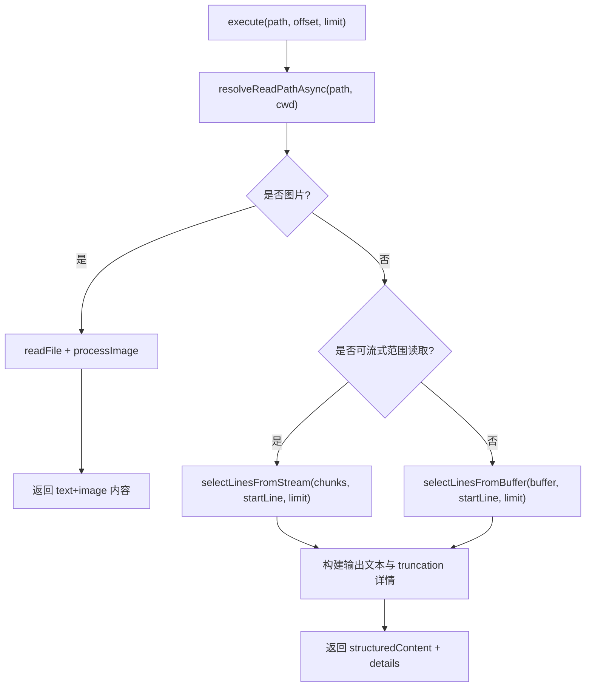

图表来源
- [packages/coding-agent/src/core/tools/read.ts:228-357](file://packages/coding-agent/src/core/tools/read.ts#L228-L357)
- [packages/coding-agent/src/core/tools/path-utils.ts:86-118](file://packages/coding-agent/src/core/tools/path-utils.ts#L86-L118)

章节来源
- [packages/coding-agent/src/core/tools/read.ts:1-363](file://packages/coding-agent/src/core/tools/read.ts#L1-L363)

### Write/Edit 工具（文件写入与精确编辑）
- Write：确保父目录存在，原子写入；通过 withFileMutationQueue 串行化同文件写入。
- Edit：先校验权限→读取→去 BOM→标准化换行→应用 edits→还原换行→写回→生成 diff/patch；同样受文件变更队列保护。
- 取消语义：在每个 await 后检查 AbortSignal，避免队列提前释放导致的不一致。

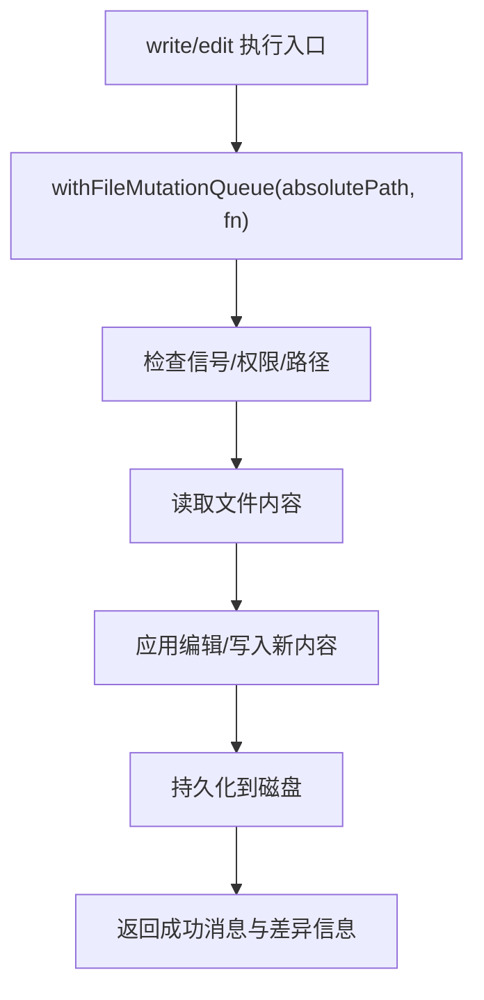

图表来源
- [packages/coding-agent/src/core/tools/write.ts:43-91](file://packages/coding-agent/src/core/tools/write.ts#L43-L91)
- [packages/coding-agent/src/core/tools/edit.ts:140-212](file://packages/coding-agent/src/core/tools/edit.ts#L140-L212)
- [packages/coding-agent/src/core/tools/file-mutation-queue.ts:32-61](file://packages/coding-agent/src/core/tools/file-mutation-queue.ts#L32-L61)

章节来源
- [packages/coding-agent/src/core/tools/write.ts:1-97](file://packages/coding-agent/src/core/tools/write.ts#L1-L97)
- [packages/coding-agent/src/core/tools/edit.ts:1-218](file://packages/coding-agent/src/core/tools/edit.ts#L1-L218)

### 渲染工具与展示管道
- 内置渲染器：为 read/bash/powershell/edit/write/grep/find/ls 提供 renderCall/renderResult；可通过 withBuiltInRenderers 合并自定义渲染器。
- 交互组件：ToolExecutionComponent 管理调用/结果渲染、图片展示、部分更新与展开/折叠状态。
- HTML 导出：createToolHtmlRenderer 复用 getToolRenderers 渲染调用与结果，适配静态导出场景。

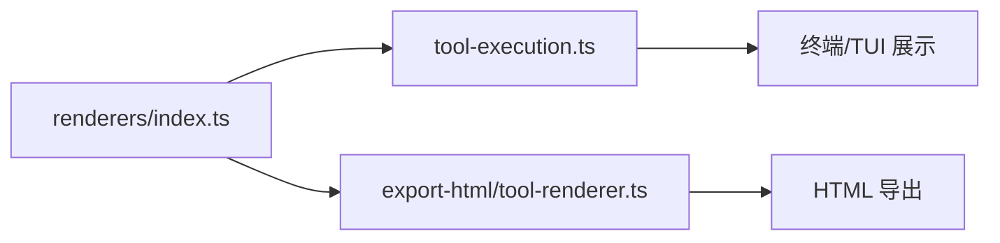

图表来源
- [packages/coding-agent/src/core/tools/renderers/index.ts:31-63](file://packages/coding-agent/src/core/tools/renderers/index.ts#L31-L63)
- [packages/coding-agent/src/modes/interactive/components/tool-execution.ts:31-104](file://packages/coding-agent/src/modes/interactive/components/tool-execution.ts#L31-L104)
- [packages/coding-agent/src/core/export-html/tool-renderer.ts:59-110](file://packages/coding-agent/src/core/export-html/tool-renderer.ts#L59-L110)

章节来源
- [packages/coding-agent/src/core/tools/renderers/index.ts:1-63](file://packages/coding-agent/src/core/tools/renderers/index.ts#L1-L63)
- [packages/coding-agent/src/modes/interactive/components/tool-execution.ts:25-108](file://packages/coding-agent/src/modes/interactive/components/tool-execution.ts#L25-L108)
- [packages/coding-agent/src/core/export-html/tool-renderer.ts:59-110](file://packages/coding-agent/src/core/export-html/tool-renderer.ts#L59-L110)

## 依赖关系分析
- 工具定义与实现解耦：index.ts 仅负责分发，具体逻辑在各自文件中。
- 基础设施被多工具复用：output-accumulator 被 bash 使用；file-mutation-queue 被 write/edit 使用；path-utils 被 read 使用。
- 渲染层独立于执行层：renderers/index.ts 仅提供渲染能力，避免引入重型工具实现。

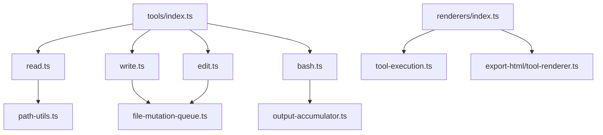

图表来源
- [packages/coding-agent/src/core/tools/index.ts:118-193](file://packages/coding-agent/src/core/tools/index.ts#L118-L193)
- [packages/coding-agent/src/core/tools/read.ts:228-357](file://packages/coding-agent/src/core/tools/read.ts#L228-L357)
- [packages/coding-agent/src/core/tools/write.ts:43-91](file://packages/coding-agent/src/core/tools/write.ts#L43-L91)
- [packages/coding-agent/src/core/tools/edit.ts:140-212](file://packages/coding-agent/src/core/tools/edit.ts#L140-L212)
- [packages/coding-agent/src/core/tools/bash.ts:271-448](file://packages/coding-agent/src/core/tools/bash.ts#L271-L448)
- [packages/coding-agent/src/core/tools/output-accumulator.ts:35-119](file://packages/coding-agent/src/core/tools/output-accumulator.ts#L35-L119)
- [packages/coding-agent/src/core/tools/file-mutation-queue.ts:32-61](file://packages/coding-agent/src/core/tools/file-mutation-queue.ts#L32-L61)
- [packages/coding-agent/src/core/tools/path-utils.ts:40-84](file://packages/coding-agent/src/core/tools/path-utils.ts#L40-L84)
- [packages/coding-agent/src/core/tools/renderers/index.ts:31-63](file://packages/coding-agent/src/core/tools/renderers/index.ts#L31-L63)
- [packages/coding-agent/src/modes/interactive/components/tool-execution.ts:31-104](file://packages/coding-agent/src/modes/interactive/components/tool-execution.ts#L31-L104)
- [packages/coding-agent/src/core/export-html/tool-renderer.ts:59-110](file://packages/coding-agent/src/core/export-html/tool-renderer.ts#L59-L110)

章节来源
- [packages/coding-agent/src/core/tools/index.ts:1-225](file://packages/coding-agent/src/core/tools/index.ts#L1-L225)

## 性能与并发控制
- 输出节流：bash 工具对 onUpdate 进行节流，避免频繁 UI 重绘。
- 流式处理：read 工具优先使用流式读取并按行选择，减少大文件内存占用；bash 工具通过 OutputAccumulator 流式累积输出。
- 并发控制：文件写入/编辑通过 file-mutation-queue 串行化，避免竞争；不同文件并行执行。
- 资源清理：bash 工具在 finally 中清理定时器与信号监听；OutputAccumulator 提供 closeTempFile 确保临时文件句柄释放。
- 超时与中断：bash 工具支持秒级超时与 AbortSignal 终止；区分 shell 退出与后台进程持续写出的情形。

[本节为通用指导，无需特定文件引用]

## 调试与故障排除
- 常见错误与定位
  - 工作目录不存在：bash 工具在执行前校验 cwd，抛出明确错误。
  - 文件不可编辑：edit 工具在访问阶段捕获权限错误并附带错误码。
  - 偏移越界：read 工具在 offset 超出文件行数时报错。
  - 输出截断：read/bash 工具在超限时返回 truncation 详情与续读提示。
  - 超时：bash 工具抛出带超时信息的错误，并可能附带 shell 实际退出时间与后台进程说明。
  - 中止：所有工具在关键 await 后检查 AbortSignal，抛出“Operation aborted”。
- 调试建议
  - 查看 truncated/full_output_path：判断是否需要查看临时文件中的完整输出。
  - 观察 truncation.truncatedBy：区分按行还是按字节截断，辅助优化参数。
  - 使用 renderers 自定义渲染：针对复杂工具输出定制展示，提升可读性。
  - 利用 HTML 导出：在离线环境复现渲染问题。

章节来源
- [packages/coding-agent/src/core/tools/bash.ts:110-194](file://packages/coding-agent/src/core/tools/bash.ts#L110-L194)
- [packages/coding-agent/src/core/tools/bash.ts:389-448](file://packages/coding-agent/src/core/tools/bash.ts#L389-L448)
- [packages/coding-agent/src/core/tools/edit.ts:171-196](file://packages/coding-agent/src/core/tools/edit.ts#L171-L196)
- [packages/coding-agent/src/core/tools/read.ts:309-342](file://packages/coding-agent/src/core/tools/read.ts#L309-L342)
- [packages/coding-agent/src/core/tools/output-accumulator.ts:91-119](file://packages/coding-agent/src/core/tools/output-accumulator.ts#L91-L119)

## 结论
工具执行引擎通过清晰的职责分层与可扩展的基础设施，实现了高内聚、低耦合的工具体系：
- 工具工厂统一管理工具生命周期与组合
- 文件变更队列保障写操作的强一致性
- 输出累积器兼顾流式性能与内存控制
- 路径工具函数增强跨平台兼容性
- 渲染层与执行层解耦，支持多种展示后端

这些设计共同保证了工具执行的稳定性、可观测性与可维护性，并为后续扩展（远程执行、更多工具类型、更丰富的渲染能力）提供了坚实基础。