# 工具生命周期

<cite>
**本文引用的文件**   
- [12-tools.md](file://docs/explains/12-tools.md)
- [tool-definition-wrapper.ts](file://packages/coding-agent/src/core/tools/tool-definition-wrapper.ts)
- [read.ts](file://packages/coding-agent/src/core/tools/read.ts)
- [bash.ts](file://packages/coding-agent/src/core/tools/bash.ts)
- [edit.ts](file://packages/coding-agent/src/core/tools/edit.ts)
- [file-mutation-queue.ts](file://packages/coding-agent/src/core/tools/file-mutation-queue.ts)
- [output-accumulator.ts](file://packages/coding-agent/src/core/tools/output-accumulator.ts)
- [agent-session-dynamic-tools.test.ts](file://packages/coding-agent/test/agent-session-dynamic-tools.test.ts)
- [9124-runtime-dispose-tool-settlement.test.ts](file://packages/coding-agent/test/suite/regressions/9124-runtime-dispose-tool-settlement.test.ts)
- [8935-parallel-preflight-abort.test.ts](file://packages/coding-agent/test/suite/regressions/8935-parallel-preflight-abort.test.ts)
- [nested-tool-calls.test.ts](file://packages/coding-agent/test/nested-tool-calls.test.ts)
</cite>

## 目录
1. [引言](#引言)
2. [项目结构](#项目结构)
3. [核心组件](#核心组件)
4. [架构总览](#架构总览)
5. [详细组件分析](#详细组件分析)
6. [依赖关系分析](#依赖关系分析)
7. [性能与并发](#性能与并发)
8. [故障排查指南](#故障排查指南)
9. [结论](#结论)

## 引言
本文围绕“工具生命周期”展开，覆盖工具的创建、初始化、注册、上下文注入、执行、错误处理、超时控制、资源清理以及销毁等阶段。重点解释：
- 工具定义与运行时接口的桥接机制
- 工具注册与动态扩展点
- 上下文管理与依赖注入
- 执行流程、并发模型与串行化策略
- 输出截断、临时文件与内存控制
- 错误传播、中止信号与超时语义
- 可插拔操作接口与远程实现能力

## 项目结构
本仓库采用多包架构，工具相关代码集中在 `packages/coding-agent/src/core/tools` 下，并通过包装器将“面向扩展的工具定义”适配为“面向核心运行时的 AgentTool”。文档说明位于 `docs/explains/12-tools.md`，测试用例覆盖动态注册、并行预检中止、嵌套调用与运行时销毁等场景。

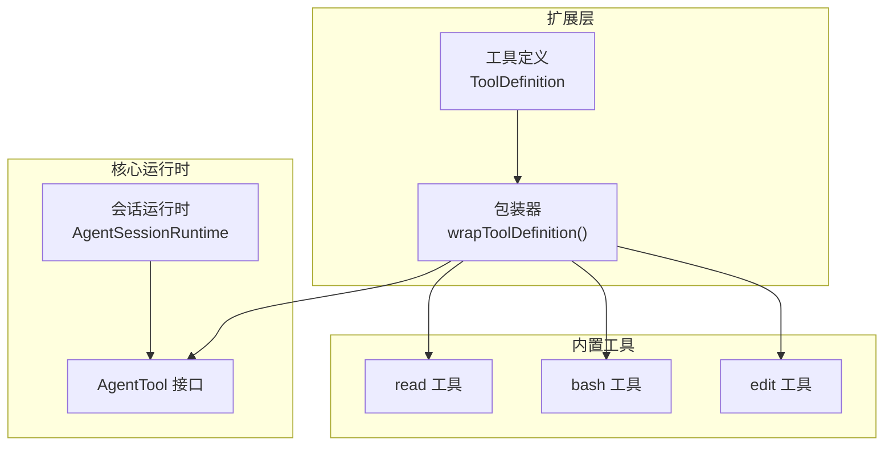

**图示来源**
- [tool-definition-wrapper.ts:27-49](file://packages/coding-agent/src/core/tools/tool-definition-wrapper.ts#L27-L49)
- [read.ts:228-362](file://packages/coding-agent/src/core/tools/read.ts#L228-L362)
- [bash.ts:271-476](file://packages/coding-agent/src/core/tools/bash.ts#L271-L476)
- [edit.ts:140-217](file://packages/coding-agent/src/core/tools/edit.ts#L140-L217)

**章节来源**
- [12-tools.md:1-32](file://docs/explains/12-tools.md#L1-L32)

## 核心组件
- 工具定义与运行时桥接
  - `wrapToolDefinition()` 将扩展层的 `ToolDefinition` 转换为核心层 `AgentTool`，并支持可选的上下文工厂 `ToolContextFactory`。
  - `createToolDefinitionFromAgentTool()` 反向合成最小 `ToolDefinition`，用于内部注册表保持“定义优先”的一致性。
- 内置工具
  - read：文件读取与图片处理，支持流式分段读取与行级偏移。
  - bash：命令执行，支持超时、进程树清理、环境变量注入与输出节流。
  - edit：精确文本替换，含模糊匹配、BOM/换行保留、diff/patch 输出。
- 基础设施
  - `withFileMutationQueue()`：同文件写操作串行化，不同文件并行。
  - `OutputAccumulator`：有界内存的流式输出累积器，支持临时文件持久化与完整输出读取。

**章节来源**
- [tool-definition-wrapper.ts:23-77](file://packages/coding-agent/src/core/tools/tool-definition-wrapper.ts#L23-L77)
- [read.ts:44-93](file://packages/coding-agent/src/core/tools/read.ts#L44-L93)
- [bash.ts:70-93](file://packages/coding-agent/src/core/tools/bash.ts#L70-L93)
- [edit.ts:76-98](file://packages/coding-agent/src/core/tools/edit.ts#L76-L98)
- [file-mutation-queue.ts:28-61](file://packages/coding-agent/src/core/tools/file-mutation-queue.ts#L28-L61)
- [output-accumulator.ts:28-62](file://packages/coding-agent/src/core/tools/output-accumulator.ts#L28-L62)

## 架构总览
工具从“定义”到“执行”的关键路径如下：
1. 构建工具定义（如 `createReadToolDefinition` / `createBashToolDefinition` / `createEditToolDefinition`）。
2. 通过 `wrapToolDefinition()` 包装为 `AgentTool`。
3. 在会话或扩展中注册工具（静态或动态）。
4. 运行时根据工具名查找并调用 `execute`，传入 `toolCallId`、参数、`AbortSignal`、`onUpdate` 和扩展上下文。
5. 工具内部使用可插拔的 Operations 完成具体 IO 或系统调用。
6. 返回结构化结果，必要时携带 `structuredContent` 供程序化消费。

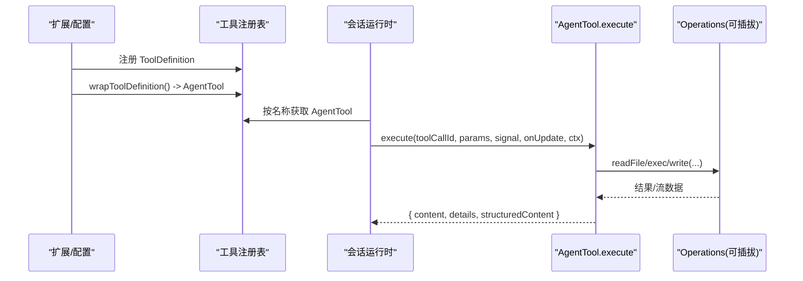

**图示来源**
- [tool-definition-wrapper.ts:27-49](file://packages/coding-agent/src/core/tools/tool-definition-wrapper.ts#L27-L49)
- [read.ts:228-362](file://packages/coding-agent/src/core/tools/read.ts#L228-L362)
- [bash.ts:271-476](file://packages/coding-agent/src/core/tools/bash.ts#L271-L476)
- [edit.ts:140-217](file://packages/coding-agent/src/core/tools/edit.ts#L140-L217)

## 详细组件分析

### 工具定义与运行时桥接
- `wrapToolDefinition()`
  - 负责把扩展侧的 `ToolDefinition` 映射为核心侧 `AgentTool`。
  - 支持可选的 `ctxFactory`，为每次调用生成 `ExtensionToolContext`。
  - 透传 `prepareArguments`、`executionMode`、`constrainedSampling` 等元信息。
- `createToolDefinitionFromAgentTool()`
  - 当外部直接提供 `AgentTool` 时，反推最小 `ToolDefinition`，保证注册表一致性。

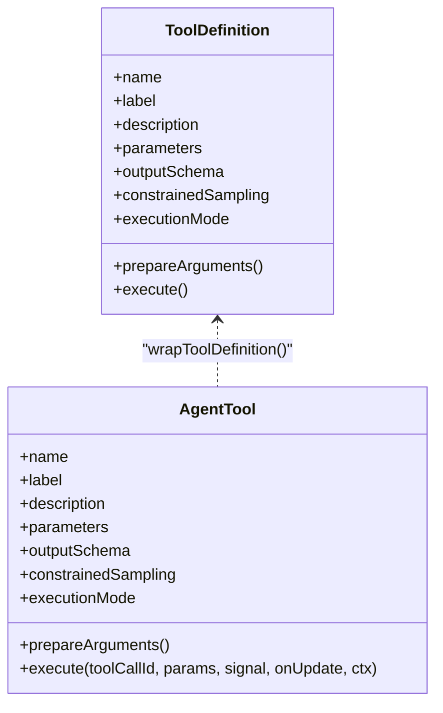

**图示来源**
- [tool-definition-wrapper.ts:27-49](file://packages/coding-agent/src/core/tools/tool-definition-wrapper.ts#L27-L49)
- [tool-definition-wrapper.ts:65-77](file://packages/coding-agent/src/core/tools/tool-definition-wrapper.ts#L65-L77)

**章节来源**
- [tool-definition-wrapper.ts:23-77](file://packages/coding-agent/src/core/tools/tool-definition-wrapper.ts#L23-L77)

### 工具注册与动态扩展
- 静态注册：通过 SDK 暴露的 `createCodingTools()` / `createReadOnlyTools()` 组装一组默认工具。
- 动态注册：扩展可在 `session_start` 等生命周期钩子中调用 `registerTool()` 注册新工具；绑定扩展后，会话会将其纳入可用工具集合。

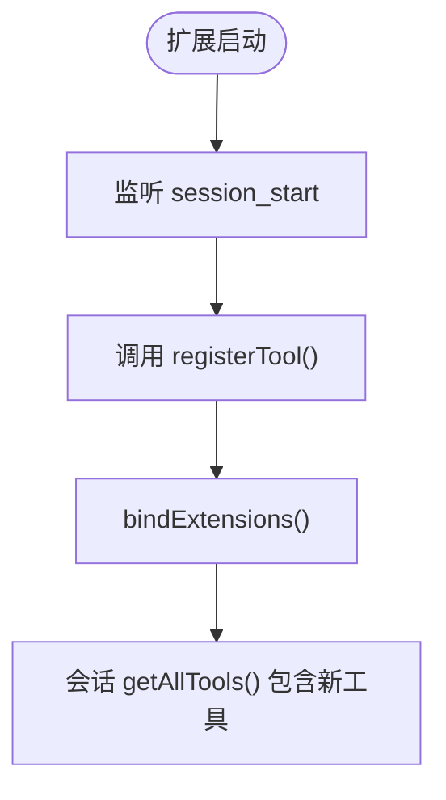

**图示来源**
- [agent-session-dynamic-tools.test.ts:103-143](file://packages/coding-agent/test/agent-session-dynamic-tools.test.ts#L103-L143)

**章节来源**
- [agent-session-dynamic-tools.test.ts:103-143](file://packages/coding-agent/test/agent-session-dynamic-tools.test.ts#L103-L143)

### 上下文管理与依赖注入
- 上下文对象 `ExtensionToolContext` 由 `ToolContextFactory` 生成，包含当前工作目录、模型信息、会话信息等。
- 各工具通过 `ctx` 访问上下文，例如：
  - read：根据 `ctx.cwd` 解析路径，根据 `ctx.model` 决定是否提示图像不可用。
  - bash：根据 `exposeSessionEnvironment` 注入 `PI_*` 环境变量，或通过 `spawnHook` 改写 command/cwd/env。

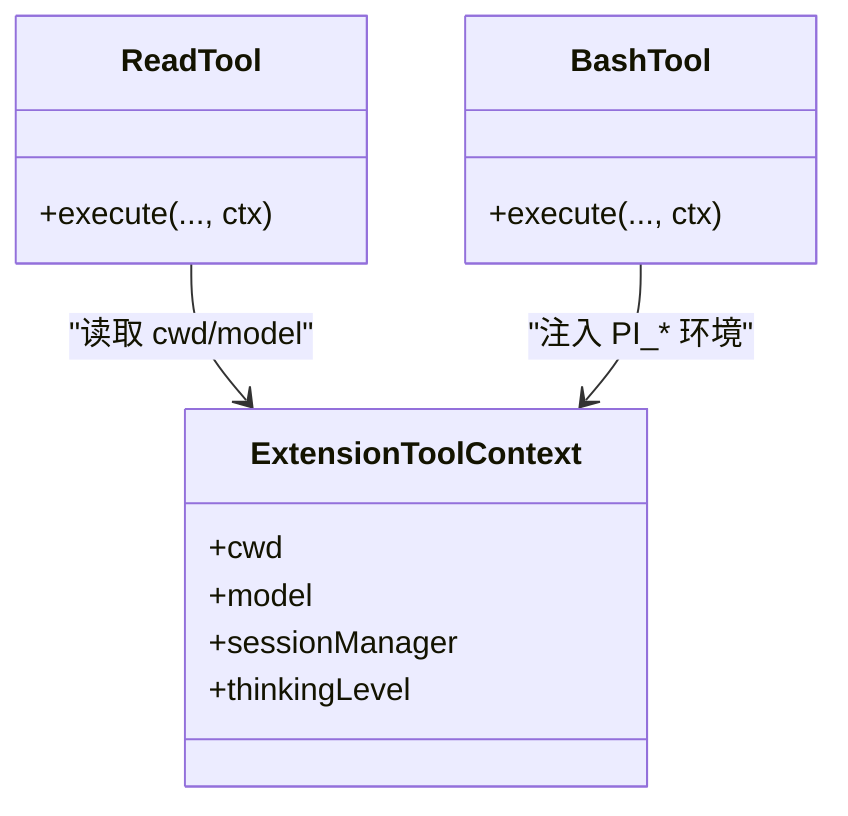

**图示来源**
- [read.ts:244-357](file://packages/coding-agent/src/core/tools/read.ts#L244-L357)
- [bash.ts:214-239](file://packages/coding-agent/src/core/tools/bash.ts#L214-L239)

**章节来源**
- [read.ts:244-357](file://packages/coding-agent/src/core/tools/read.ts#L244-L357)
- [bash.ts:214-239](file://packages/coding-agent/src/core/tools/bash.ts#L214-L239)

### 执行流程与状态维护

#### read 工具
- 输入：`path`、`offset`（1-indexed）、`limit`。
- 行为要点：
  - 检测 MIME，图片走图像处理管线；非视觉模型附加提示。
  - 文本优先流式读取，仅保留显示所需行，降低内存占用。
  - 用户指定 `limit` 先于截断生效；截断时给出下一步建议（如 `offset=N`）。
  - 结构化输出 `structuredContent` 供 codemode 使用。

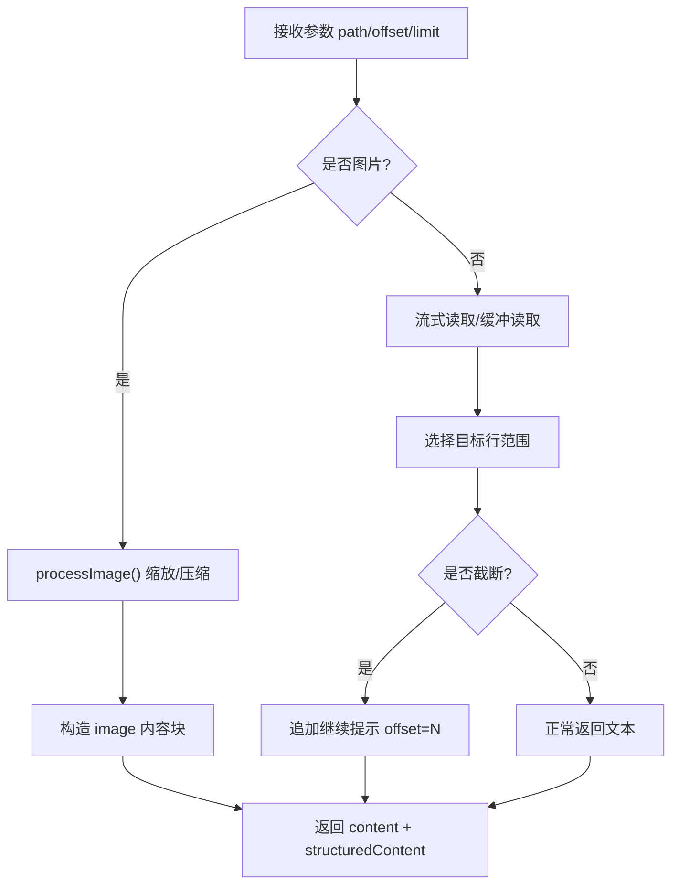

**图示来源**
- [read.ts:228-362](file://packages/coding-agent/src/core/tools/read.ts#L228-L362)

**章节来源**
- [read.ts:228-362](file://packages/coding-agent/src/core/tools/read.ts#L228-L362)

#### bash 工具
- 输入：`command`、可选 `timeout`（秒）。
- 行为要点：
  - shell 配置来自设置；Unix 上 detached 以支持进程树清理。
  - 超时控制：超过阈值触发 `ShellTimeoutError`，区分“shell 已退出但后台进程仍在写输出”的情况。
  - 输出节流：`OutputAccumulator` 滚动保留尾部，超限时写入临时文件，定时推送快照。
  - 结构化输出：`structuredContent` 包含 `output`、`truncated`、`full_output_path`、`exit_code`、`wall_time_seconds`。

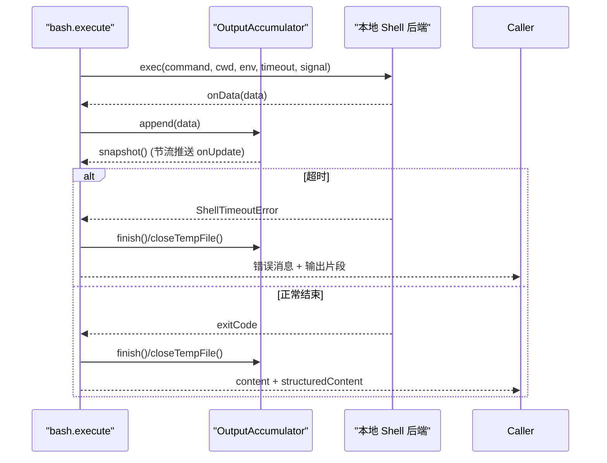

**图示来源**
- [bash.ts:110-193](file://packages/coding-agent/src/core/tools/bash.ts#L110-L193)
- [bash.ts:271-476](file://packages/coding-agent/src/core/tools/bash.ts#L271-L476)
- [output-accumulator.ts:64-119](file://packages/coding-agent/src/core/tools/output-accumulator.ts#L64-L119)

**章节来源**
- [bash.ts:110-193](file://packages/coding-agent/src/core/tools/bash.ts#L110-L193)
- [bash.ts:271-476](file://packages/coding-agent/src/core/tools/bash.ts#L271-L476)
- [output-accumulator.ts:64-119](file://packages/coding-agent/src/core/tools/output-accumulator.ts#L64-L119)

#### edit 工具
- 输入：`path`、`edits[]`（每个 `{ oldText, newText }`）。
- 行为要点：
  - 兼容畸形参数（JSON 字符串、单对象、顶层 oldText/newText）。
  - 所有编辑基于原始内容匹配，非增量应用；失败进入模糊匹配（NFKC、去尾空白、智能引号转 ASCII、特殊空格归一等）。
  - 重叠检测与从后往前应用，保持偏移稳定。
  - 保留原始字节：只重写变更行，其余行原样复制。
  - 换行与 BOM：读取后检测换行风格，匹配前统一 LF，写回恢复；BOM 剥离再匹配，写回加回。
  - 输出 diff 与 unified patch，并提供 `firstChangedLine` 供编辑器跳转。
  - 通过 `withFileMutationQueue()` 对同一文件串行化写操作。

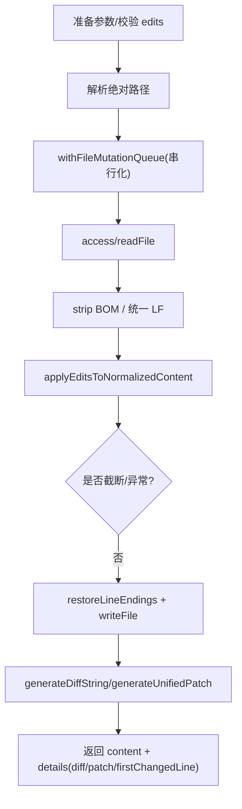

**图示来源**
- [edit.ts:100-138](file://packages/coding-agent/src/core/tools/edit.ts#L100-L138)
- [edit.ts:140-217](file://packages/coding-agent/src/core/tools/edit.ts#L140-L217)
- [file-mutation-queue.ts:28-61](file://packages/coding-agent/src/core/tools/file-mutation-queue.ts#L28-L61)

**章节来源**
- [edit.ts:100-138](file://packages/coding-agent/src/core/tools/edit.ts#L100-L138)
- [edit.ts:140-217](file://packages/coding-agent/src/core/tools/edit.ts#L140-L217)
- [file-mutation-queue.ts:28-61](file://packages/coding-agent/src/core/tools/file-mutation-queue.ts#L28-L61)

### 输出截断与内存控制
- 两个独立限制：最大行数与最大字节数，先到先得。
- `truncateHead`：用于 read/ls/grep/find，保留开头；永不返回半个行。
- `truncateTail`：用于 bash，保留结尾；若最后一行超长，取尾部并标记部分行。
- `OutputAccumulator`：
  - 流式解码，维护 tailText 与滚动窗口。
  - 超过限制时打开临时文件保存完整输出。
  - `snapshot()` 返回展示内容、截断信息与完整输出路径。
  - `readFullOutput()` 返回头部+省略标记+尾部，避免超大内容阻塞。

**章节来源**
- [12-tools.md:68-90](file://docs/explains/12-tools.md#L68-L90)
- [output-accumulator.ts:91-176](file://packages/coding-agent/src/core/tools/output-accumulator.ts#L91-L176)

### 错误处理、中止与超时
- 中止信号：
  - read：监听 `signal.aborted`，在关键 await 后检查，避免提前释放队列。
  - bash：abort 时杀掉整个进程树；区分“命令被中止”和“超时”。
  - edit：不在 abort 监听中 reject，而是在每个 await 后检查，确保队列锁不被提前释放。
- 超时控制：
  - bash：`resolveTimeoutMs()` 校验并转换超时；超时抛出 `ShellTimeoutError`，附带 shell 退出时间与码。
- 测试结果验证：
  - 并行预检中止不会启动后续工具执行，且所有 tool_result 均标记为错误。
  - 运行时销毁期间工具执行能正确结算，不泄露资源。

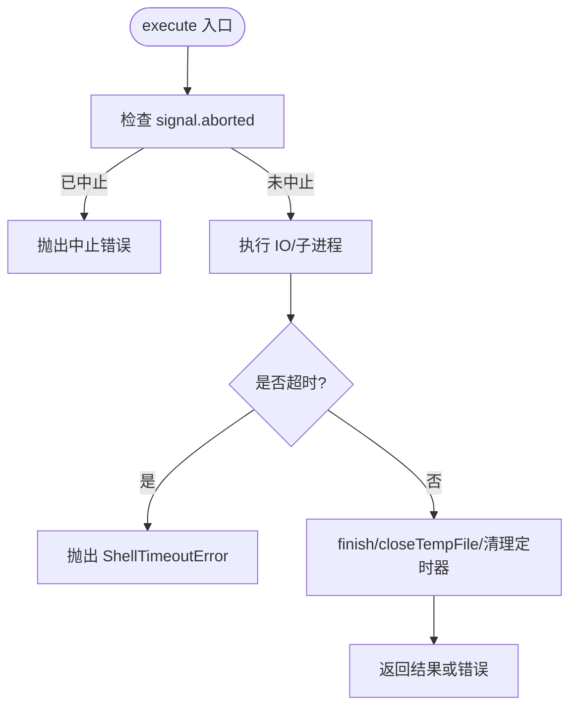

**图示来源**
- [read.ts:251-357](file://packages/coding-agent/src/core/tools/read.ts#L251-L357)
- [bash.ts:149-191](file://packages/coding-agent/src/core/tools/bash.ts#L149-L191)
- [edit.ts:156-196](file://packages/coding-agent/src/core/tools/edit.ts#L156-L196)
- [8935-parallel-preflight-abort.test.ts:16-71](file://packages/coding-agent/test/suite/regressions/8935-parallel-preflight-abort.test.ts#L16-L71)
- [9124-runtime-dispose-tool-settlement.test.ts:12-39](file://packages/coding-agent/test/suite/regressions/9124-runtime-dispose-tool-settlement.test.ts#L12-L39)

**章节来源**
- [read.ts:251-357](file://packages/coding-agent/src/core/tools/read.ts#L251-L357)
- [bash.ts:149-191](file://packages/coding-agent/src/core/tools/bash.ts#L149-L191)
- [edit.ts:156-196](file://packages/coding-agent/src/core/tools/edit.ts#L156-L196)
- [8935-parallel-preflight-abort.test.ts:16-71](file://packages/coding-agent/test/suite/regressions/8935-parallel-preflight-abort.test.ts#L16-L71)
- [9124-runtime-dispose-tool-settlement.test.ts:12-39](file://packages/coding-agent/test/suite/regressions/9124-runtime-dispose-tool-settlement.test.ts#L12-L39)

### 并发模型与嵌套调用
- 嵌套工具调用：
  - 外层工具可通过宿主提供的 `NestedToolCallRunner` 发起内层工具调用，自动分配子 ID、记录事件与耗时。
  - 支持顺序/并行两种模式：`executionMode=sequential` 的工具会被串行调度。
- 并发表现：
  - 顺序工具最大并发为 1，并行工具可并发执行。
  - 嵌套调用会在父调用记录中追加子调用链。

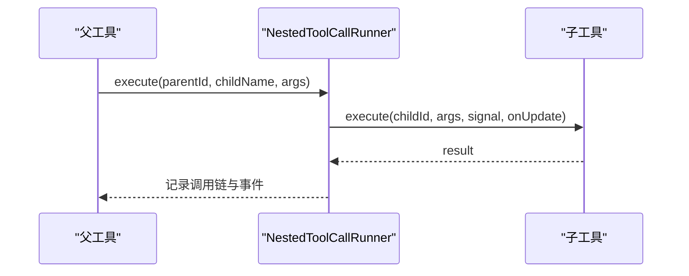

**图示来源**
- [nested-tool-calls.test.ts:24-50](file://packages/coding-agent/test/nested-tool-calls.test.ts#L24-L50)
- [nested-tool-calls.test.ts:164-187](file://packages/coding-agent/test/nested-tool-calls.test.ts#L164-L187)

**章节来源**
- [nested-tool-calls.test.ts:24-50](file://packages/coding-agent/test/nested-tool-calls.test.ts#L24-L50)
- [nested-tool-calls.test.ts:164-187](file://packages/coding-agent/test/nested-tool-calls.test.ts#L164-L187)

## 依赖关系分析
- 包装器依赖
  - `wrapToolDefinition()` 依赖扩展类型 `ToolDefinition` 与运行时类型 `AgentTool`。
- 内置工具依赖
  - read：文件系统、MIME 检测、图像处理、路径解析、截断工具。
  - bash：子进程、shell 配置、进程树管理、输出累积器、截断工具。
  - edit：文件系统、文本规范化、diff/patch 生成、文件修改队列、路径解析。
- 基础设施
  - `withFileMutationQueue()` 使用 `realpath` 与 `resolve` 进行键计算与原子注册。
  - `OutputAccumulator` 使用临时文件流与 UTF-8 解码器。

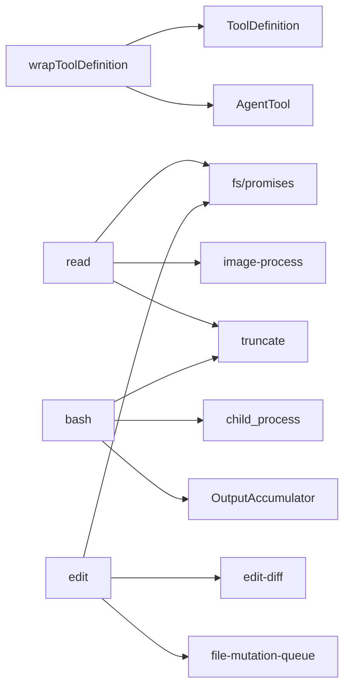

**图示来源**
- [tool-definition-wrapper.ts:27-49](file://packages/coding-agent/src/core/tools/tool-definition-wrapper.ts#L27-L49)
- [read.ts:1-12](file://packages/coding-agent/src/core/tools/read.ts#L1-L12)
- [bash.ts:1-19](file://packages/coding-agent/src/core/tools/bash.ts#L1-L19)
- [edit.ts:1-18](file://packages/coding-agent/src/core/tools/edit.ts#L1-L18)
- [file-mutation-queue.ts:1-4](file://packages/coding-agent/src/core/tools/file-mutation-queue.ts#L1-L4)
- [output-accumulator.ts:1-4](file://packages/coding-agent/src/core/tools/output-accumulator.ts#L1-L4)

**章节来源**
- [tool-definition-wrapper.ts:27-49](file://packages/coding-agent/src/core/tools/tool-definition-wrapper.ts#L27-L49)
- [read.ts:1-12](file://packages/coding-agent/src/core/tools/read.ts#L1-L12)
- [bash.ts:1-19](file://packages/coding-agent/src/core/tools/bash.ts#L1-L19)
- [edit.ts:1-18](file://packages/coding-agent/src/core/tools/edit.ts#L1-L18)
- [file-mutation-queue.ts:1-4](file://packages/coding-agent/src/core/tools/file-mutation-queue.ts#L1-L4)
- [output-accumulator.ts:1-4](file://packages/coding-agent/src/core/tools/output-accumulator.ts#L1-L4)

## 性能与并发
- 流式读取与按需解码
  - read 优先使用 `createReadStream`，仅缓存需要显示的行，避免大文件全量加载。
- 输出节流与临时文件
  - bash 通过 `OutputAccumulator` 节流推送 `onUpdate`，并在超限时落盘完整输出，避免内存膨胀。
- 文件写串行化
  - edit/write 通过 `withFileMutationQueue()` 对同一文件串行化，不同文件仍可并行，提升吞吐同时保证一致性。
- 并发模型
  - 嵌套调用支持顺序/并行模式；顺序工具强制串行，并行工具允许并发。
- 截断策略
  - 行/字节双上限，结合 `truncateHead`/`truncateTail` 与 surrogate pair 安全切片，减少无效传输与渲染开销。

[本节为通用性能讨论，不直接分析具体文件]

## 故障排查指南
- 工具执行中途被中止
  - 现象：抛出“Operation aborted”或“aborted”，bash 可能伴随“Command aborted”。
  - 排查：确认上层是否调用了 `abort()`；检查工具是否在关键 await 后检查了 `signal.aborted`。
  - 参考：read/bash/edit 的中止检查逻辑。
- bash 超时
  - 现象：抛出 `ShellTimeoutError`，消息形如 `timeout:<seconds>`；可能附带 shell 已退出但后台进程仍写输出的信息。
  - 排查：确认传入 timeout 是否有效；检查是否启用了 detach 与进程树清理。
- 文件编辑冲突
  - 现象：并发写同一文件导致竞争。
  - 排查：确认是否通过 `withFileMutationQueue()` 串行化；检查 key 计算是否基于 realpath。
- 动态工具未生效
  - 现象：`getAllTools()` 不包含新工具。
  - 排查：确认是否在 `session_start` 中注册，并在 `bindExtensions()` 之后查询。
- 运行时销毁期间的工具结算
  - 现象：运行时销毁时工具仍在执行。
  - 排查：确认工具在 finally 中清理定时器、临时文件与事件监听；参考回归测试用例。

**章节来源**
- [read.ts:251-357](file://packages/coding-agent/src/core/tools/read.ts#L251-L357)
- [bash.ts:149-191](file://packages/coding-agent/src/core/tools/bash.ts#L149-L191)
- [edit.ts:156-196](file://packages/coding-agent/src/core/tools/edit.ts#L156-L196)
- [file-mutation-queue.ts:28-61](file://packages/coding-agent/src/core/tools/file-mutation-queue.ts#L28-L61)
- [agent-session-dynamic-tools.test.ts:103-143](file://packages/coding-agent/test/agent-session-dynamic-tools.test.ts#L103-L143)
- [9124-runtime-dispose-tool-settlement.test.ts:12-39](file://packages/coding-agent/test/suite/regressions/9124-runtime-dispose-tool-settlement.test.ts#L12-L39)

## 结论
该工具体系以“定义优先”的扩展模型为基础，通过包装器桥接到核心运行时，实现了高度可插拔的工具生态。read/bash/edit 三类工具分别覆盖了文件读取、命令执行与精确编辑的核心场景，配合流式处理、输出截断、临时文件、进程树清理与文件写串行化，兼顾了性能与稳定性。动态注册机制与上下文注入使得工具可以在会话生命周期中灵活扩展，而完善的错误处理、中止与超时语义保证了复杂调用链下的健壮性。对于更高阶需求，可通过替换 Operations 将工具委托给远程系统，进一步扩展边界。