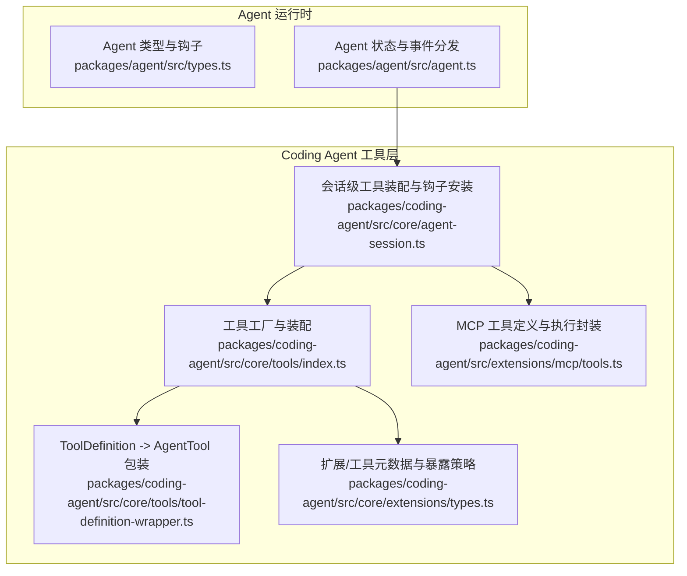
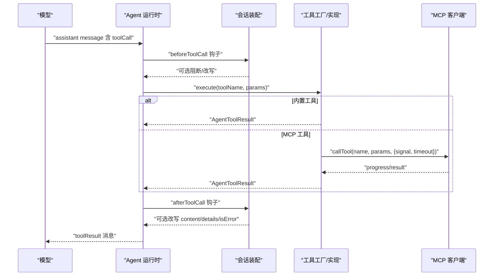
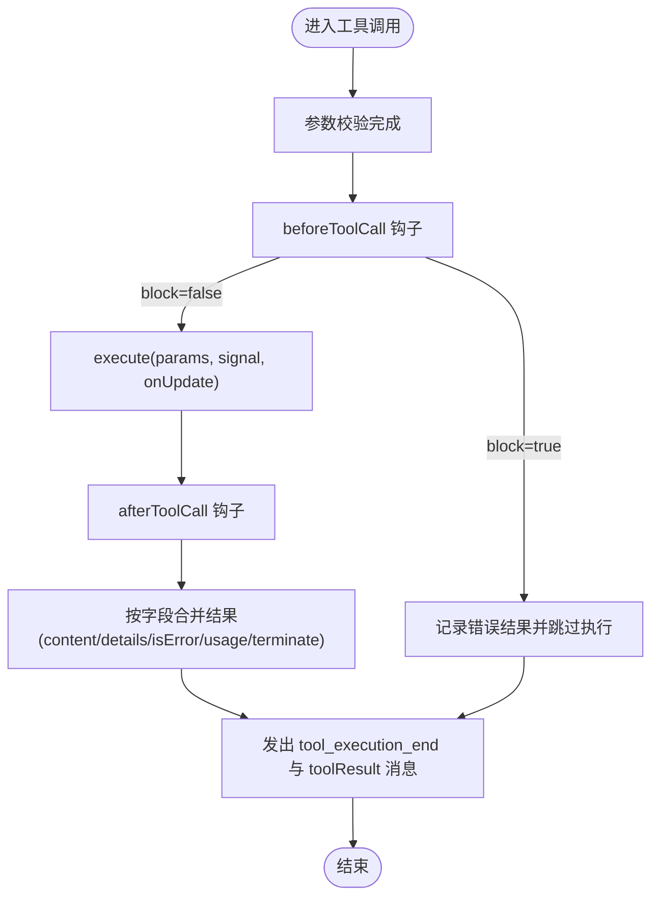
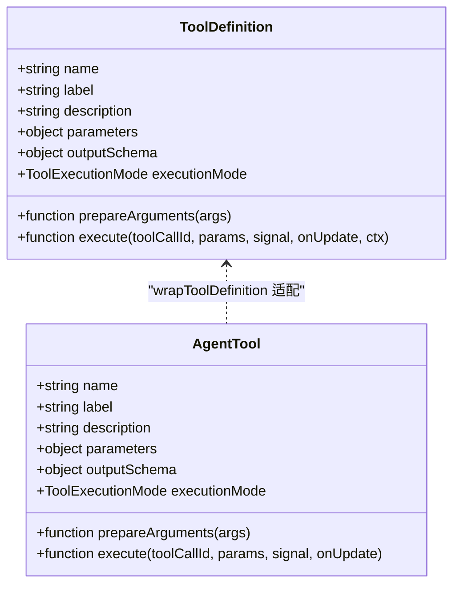
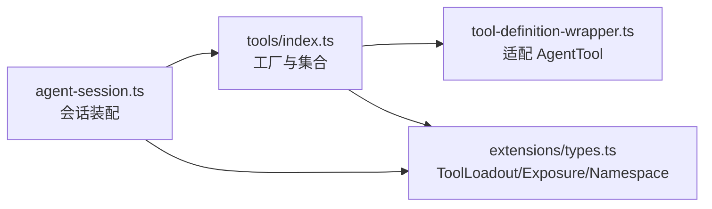
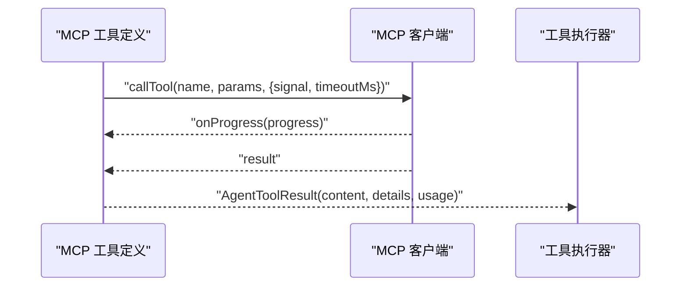
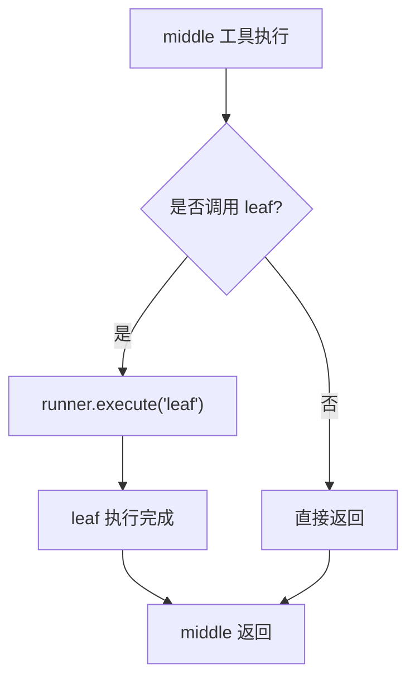
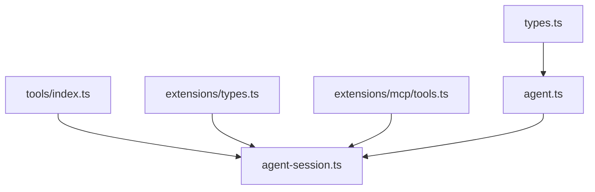

# 工具系统

<cite>
**本文引用的文件**   
- [packages/agent/src/types.ts](file://packages/agent/src/types.ts)
- [packages/agent/src/agent.ts](file://packages/agent/src/agent.ts)
- [packages/coding-agent/src/core/tools/index.ts](file://packages/coding-agent/src/core/tools/index.ts)
- [packages/coding-agent/src/core/extensions/types.ts](file://packages/coding-agent/src/core/extensions/types.ts)
- [packages/coding-agent/src/core/tools/tool-definition-wrapper.ts](file://packages/coding-agent/src/core/tools/tool-definition-wrapper.ts)
- [packages/coding-agent/src/core/agent-session.ts](file://packages/coding-agent/src/core/agent-session.ts)
- [packages/coding-agent/src/extensions/mcp/tools.ts](file://packages/coding-agent/src/extensions/mcp/tools.ts)
- [packages/coding-agent/test/nested-tool-calls.test.ts](file://packages/coding-agent/test/nested-tool-calls.test.ts)
</cite>

## 目录
1. [简介](#简介)
2. [项目结构](#项目结构)
3. [核心组件](#核心组件)
4. [架构总览](#架构总览)
5. [详细组件分析](#详细组件分析)
6. [依赖关系分析](#依赖关系分析)
7. [性能与并发特性](#性能与并发特性)
8. [故障排查指南](#故障排查指南)
9. [结论](#结论)
10. [附录：内置工具清单与用法](#附录内置工具清单与用法)

## 简介
本文件系统性梳理 Pi 代码库中的“工具系统”，覆盖以下主题：
- 内置工具族（文件操作、Bash/PowerShell 执行、代码搜索、MCP 集成等）的注册、参数、渲染与执行流程。
- 工具生命周期、上下文管理、权限控制与错误处理机制。
- 自定义工具开发指南，包括工具定义、包装为 AgentTool、暴露策略、命名空间与可达性控制。
- 结果处理与结构化输出、流式更新、以及并行/串行执行模式对调度的影响。

## 项目结构
工具系统横跨两个主要包：
- agent 包：提供 Agent 运行时、工具调用钩子、事件与类型契约。
- coding-agent 包：提供内置工具实现、工具注册与装配、扩展与 MCP 集成、会话级工具加载与提示词注入。

**图表来源**
- [packages/agent/src/types.ts:193-342](file://packages/agent/src/types.ts#L193-L342)
- [packages/agent/src/agent.ts:194-263](file://packages/agent/src/agent.ts#L194-L263)
- [packages/coding-agent/src/core/tools/index.ts:93-116](file://packages/coding-agent/src/core/tools/index.ts#L93-L116)
- [packages/coding-agent/src/core/tools/tool-definition-wrapper.ts:26-57](file://packages/coding-agent/src/core/tools/tool-definition-wrapper.ts#L26-L57)
- [packages/coding-agent/src/core/extensions/types.ts:571-594](file://packages/coding-agent/src/core/extensions/types.ts#L571-L594)
- [packages/coding-agent/src/core/agent-session.ts:680-691](file://packages/coding-agent/src/core/agent-session.ts#L680-L691)
- [packages/coding-agent/src/extensions/mcp/tools.ts:249-281](file://packages/coding-agent/src/extensions/mcp/tools.ts#L249-L281)

**章节来源**
- [packages/agent/src/types.ts:193-342](file://packages/agent/src/types.ts#L193-L342)
- [packages/agent/src/agent.ts:194-263](file://packages/agent/src/agent.ts#L194-L263)
- [packages/coding-agent/src/core/tools/index.ts:93-116](file://packages/coding-agent/src/core/tools/index.ts#L93-L116)

## 核心组件
- Agent 运行时与工具钩子
  - 通过 beforeToolCall / afterToolCall 在工具执行前后进行拦截、审计、权限校验与结果改写。
  - 支持 toolExecution 全局策略（sequential / parallel），并允许单工具覆盖 executionMode。
- 工具定义与包装
  - ToolDefinition 是扩展侧的工具描述；wrapToolDefinition 将其适配为 AgentTool 供 Agent 运行。
- 工具装配与暴露
  - tools/index.ts 提供 createTool / createToolDefinition 等工厂，统一构建内置工具族。
  - extensions/types.ts 定义 ToolLoadout、ToolExposure、namespace、reachesTools 等元数据，决定模型可见性与调用路径。
- 会话级装配
  - agent-session.ts 安装 Agent 钩子，将扩展工具与内置工具合并，并在请求前注入系统提示词片段。
- MCP 集成
  - extensions/mcp/tools.ts 将远端 MCP 工具转换为 ToolDefinition，并封装调用、超时与进度上报。

**章节来源**
- [packages/agent/src/types.ts:308-342](file://packages/agent/src/types.ts#L308-L342)
- [packages/coding-agent/src/core/tools/tool-definition-wrapper.ts:26-57](file://packages/coding-agent/src/core/tools/tool-definition-wrapper.ts#L26-L57)
- [packages/coding-agent/src/core/tools/index.ts:118-162](file://packages/coding-agent/src/core/tools/index.ts#L118-L162)
- [packages/coding-agent/src/core/extensions/types.ts:571-594](file://packages/coding-agent/src/core/extensions/types.ts#L571-L594)
- [packages/coding-agent/src/core/agent-session.ts:680-691](file://packages/coding-agent/src/core/agent-session.ts#L680-L691)
- [packages/coding-agent/src/extensions/mcp/tools.ts:249-281](file://packages/coding-agent/src/extensions/mcp/tools.ts#L249-L281)

## 架构总览
下图展示从“模型发起工具调用”到“工具执行与结果回传”的关键路径，以及扩展钩子与 MCP 工具的接入点。

**图表来源**
- [packages/agent/src/types.ts:308-342](file://packages/agent/src/types.ts#L308-L342)
- [packages/coding-agent/src/core/agent-session.ts:680-691](file://packages/coding-agent/src/core/agent-session.ts#L680-L691)
- [packages/coding-agent/src/extensions/mcp/tools.ts:275-281](file://packages/coding-agent/src/extensions/mcp/tools.ts#L275-L281)

## 详细组件分析

### Agent 工具生命周期与钩子
- 生命周期阶段
  - 准备阶段：参数校验后触发 beforeToolCall。
  - 执行阶段：调用工具 execute，支持 onUpdate 流式更新。
  - 收尾阶段：afterToolCall 可改写 content、details、isError、usage、terminate 等。
- 关键类型
  - BeforeToolCallContext / AfterToolCallContext：携带 assistantMessage、toolCall、args、result、context 等。
  - BeforeToolCallResult：支持 block/terminate 控制是否执行与提前终止。
  - AfterToolCallResult：字段级替换语义，避免深合并导致的不一致。
- 执行模式
  - 全局 toolExecution：sequential 或 parallel。
  - 单工具 executionMode：可覆盖默认行为。

**图表来源**
- [packages/agent/src/types.ts:60-104](file://packages/agent/src/types.ts#L60-L104)
- [packages/agent/src/types.ts:308-342](file://packages/agent/src/types.ts#L308-L342)

**章节来源**
- [packages/agent/src/types.ts:60-104](file://packages/agent/src/types.ts#L60-L104)
- [packages/agent/src/types.ts:308-342](file://packages/agent/src/types.ts#L308-L342)

### 工具定义与包装（ToolDefinition → AgentTool）
- ToolDefinition 由扩展或内置模块提供，包含 name、label、description、parameters、outputSchema、prepareArguments、executionMode、execute 等。
- wrapToolDefinition 将 ToolDefinition 适配为 AgentTool，透传 execute 签名与 ExtensionToolContext。
- wrapToolDefinitions 批量转换，便于装配。

**图表来源**
- [packages/coding-agent/src/core/tools/tool-definition-wrapper.ts:26-57](file://packages/coding-agent/src/core/tools/tool-definition-wrapper.ts#L26-L57)

**章节来源**
- [packages/coding-agent/src/core/tools/tool-definition-wrapper.ts:26-57](file://packages/coding-agent/src/core/tools/tool-definition-wrapper.ts#L26-L57)

### 工具装配与暴露策略
- 工具名与工厂
  - ToolName 枚举包含 read、bash、powershell、edit、write、grep、find、ls。
  - createTool / createToolDefinition 根据名称返回对应实现；createAllTools / createAllToolDefinitions 提供全量集合。
- 暴露与可见性
  - ToolLoadout 区分 declared（模型可见）、callable（ctx.execute 可调）、registered（全部注册）。
  - exposure 控制模型如何到达工具；defaultActive 控制注册时是否激活。
  - namespace 用于分组（如 MCP server），reachesTools 限制输入中可能命中的工具/命名空间。
- 会话装配
  - agent-session.ts 安装 beforeToolCall / afterToolCall 钩子，转发到扩展 runner，实现拦截与审计。
  - _preparePromptAndToolLoadout 将 selectedTools 与 hiddenDeclarations 同步到系统提示词片段，确保声明与可用集一致。

**图表来源**
- [packages/coding-agent/src/core/tools/index.ts:93-116](file://packages/coding-agent/src/core/tools/index.ts#L93-L116)
- [packages/coding-agent/src/core/extensions/types.ts:571-594](file://packages/coding-agent/src/core/extensions/types.ts#L571-L594)
- [packages/coding-agent/src/core/agent-session.ts:680-691](file://packages/coding-agent/src/core/agent-session.ts#L680-L691)

**章节来源**
- [packages/coding-agent/src/core/tools/index.ts:93-116](file://packages/coding-agent/src/core/tools/index.ts#L93-L116)
- [packages/coding-agent/src/core/extensions/types.ts:571-594](file://packages/coding-agent/src/core/extensions/types.ts#L571-L594)
- [packages/coding-agent/src/core/agent-session.ts:680-691](file://packages/coding-agent/src/core/agent-session.ts#L680-L691)

### MCP 工具集成
- MCP 工具被转换为 ToolDefinition，包含：
  - 名称与标签（server/tool.name）。
  - 输入 schema 规范化与输出 schema 生成。
  - exposure、namespace、annotations 等元数据。
- 执行封装：
  - 通过 McpToolCaller.callTool 调用远端工具，支持 AbortSignal 与超时。
  - onProgress 回调用于进度上报，最终产出 AgentToolResult。

**图表来源**
- [packages/coding-agent/src/extensions/mcp/tools.ts:249-281](file://packages/coding-agent/src/extensions/mcp/tools.ts#L249-L281)

**章节来源**
- [packages/coding-agent/src/extensions/mcp/tools.ts:249-281](file://packages/coding-agent/src/extensions/mcp/tools.ts#L249-L281)

### 嵌套工具调用与并发控制
- 嵌套调用：工具内部可通过 runner.execute 调用其他工具，形成调用链，测试用例验证了嵌套 ID 的序列化。
- 并发控制：
  - 全局 toolExecution 与单工具 executionMode 共同决定调度。
  - 测试用例验证 sequential 工具严格串行，parallel 工具可并发。

**图表来源**
- [packages/coding-agent/test/nested-tool-calls.test.ts:100-125](file://packages/coding-agent/test/nested-tool-calls.test.ts#L100-L125)
- [packages/coding-agent/test/nested-tool-calls.test.ts:164-187](file://packages/coding-agent/test/nested-tool-calls.test.ts#L164-L187)

**章节来源**
- [packages/coding-agent/test/nested-tool-calls.test.ts:100-125](file://packages/coding-agent/test/nested-tool-calls.test.ts#L100-L125)
- [packages/coding-agent/test/nested-tool-calls.test.ts:164-187](file://packages/coding-agent/test/nested-tool-calls.test.ts#L164-L187)

## 依赖关系分析
- Agent 运行时依赖 types.ts 定义的钩子与事件类型，并通过 agent.ts 维护状态与事件分发。
- coding-agent 工具层通过 tools/index.ts 聚合所有内置工具，并以 ToolDefinition 形式对外暴露。
- extensions/types.ts 提供工具元数据与暴露策略，指导会话装配与提示词生成。
- agent-session.ts 作为装配中心，将扩展与内置工具合并，并安装 Agent 钩子。
- MCP 工具通过 extensions/mcp/tools.ts 桥接外部服务，纳入统一工具体系。

**图表来源**
- [packages/agent/src/types.ts:193-342](file://packages/agent/src/types.ts#L193-L342)
- [packages/agent/src/agent.ts:194-263](file://packages/agent/src/agent.ts#L194-L263)
- [packages/coding-agent/src/core/tools/index.ts:93-116](file://packages/coding-agent/src/core/tools/index.ts#L93-L116)
- [packages/coding-agent/src/core/extensions/types.ts:571-594](file://packages/coding-agent/src/core/extensions/types.ts#L571-L594)
- [packages/coding-agent/src/core/agent-session.ts:680-691](file://packages/coding-agent/src/core/agent-session.ts#L680-L691)
- [packages/coding-agent/src/extensions/mcp/tools.ts:249-281](file://packages/coding-agent/src/extensions/mcp/tools.ts#L249-L281)

**章节来源**
- [packages/agent/src/types.ts:193-342](file://packages/agent/src/types.ts#L193-L342)
- [packages/agent/src/agent.ts:194-263](file://packages/agent/src/agent.ts#L194-L263)
- [packages/coding-agent/src/core/tools/index.ts:93-116](file://packages/coding-agent/src/core/tools/index.ts#L93-L116)
- [packages/coding-agent/src/core/extensions/types.ts:571-594](file://packages/coding-agent/src/core/extensions/types.ts#L571-L594)
- [packages/coding-agent/src/core/agent-session.ts:680-691](file://packages/coding-agent/src/core/agent-session.ts#L680-L691)
- [packages/coding-agent/src/extensions/mcp/tools.ts:249-281](file://packages/coding-agent/src/extensions/mcp/tools.ts#L249-L281)

## 性能与并发特性
- 工具执行模式
  - 全局 toolExecution 支持 sequential 与 parallel。
  - 单工具 executionMode 可覆盖默认策略，保证敏感工具串行执行。
- 流式更新
  - execute 接收 onUpdate 回调，可在长时间任务中逐步推送 partialResult，提升交互体验。
- 资源与开销
  - afterToolCall 可设置 usage，但不会计入主 LLM 上下文计费；主要用于工具自身统计。
- 建议
  - 对 I/O 密集且无副作用的工具启用 parallel。
  - 对写操作或共享状态访问使用 sequential，避免竞态。
  - 合理使用 truncate 与 truncation 选项控制输出体积，降低传输与渲染成本。

[本节为通用指导，不直接分析具体文件]

## 故障排查指南
- 工具被阻止执行
  - 检查 beforeToolCall 是否返回 block: true，并查看 reason。
  - 确认扩展 runner 的 tool_call 处理器未抛出异常。
- 工具结果异常
  - 检查 afterToolCall 是否改写 isError/content/details。
  - 核对 outputSchema 与实际 structuredContent 一致性。
- 并发问题
  - 若出现竞态，检查工具 executionMode 是否为 sequential。
  - 参考测试用例验证最大并发度是否符合预期。
- MCP 工具超时或中断
  - 检查 timeoutMs 配置与 AbortSignal 传递是否正确。
  - 关注 onProgress 回调是否及时刷新 UI。

**章节来源**
- [packages/agent/src/types.ts:60-104](file://packages/agent/src/types.ts#L60-L104)
- [packages/coding-agent/src/core/agent-session.ts:680-691](file://packages/coding-agent/src/core/agent-session.ts#L680-L691)
- [packages/coding-agent/test/nested-tool-calls.test.ts:164-187](file://packages/coding-agent/test/nested-tool-calls.test.ts#L164-L187)
- [packages/coding-agent/src/extensions/mcp/tools.ts:275-281](file://packages/coding-agent/src/extensions/mcp/tools.ts#L275-L281)

## 结论
该工具系统以 Agent 运行时为核心，结合扩展与 MCP 集成，提供了统一的工具注册、装配、执行与结果处理机制。通过暴露策略、命名空间与可达性控制，既能满足安全边界，又能灵活扩展。配合流式更新与并发控制，可在复杂工作流中保持高吞吐与良好交互体验。

[本节为总结性内容，不直接分析具体文件]

## 附录：内置工具清单与用法
- 文件读取
  - 工具名：read
  - 用途：读取文件内容，支持偏移与行数限制。
  - 典型选项：offset、limit、maxBytes、maxLines。
- Bash 执行
  - 工具名：bash
  - 用途：在沙箱环境中执行命令，支持 Hook 与 Spawn 上下文。
  - 典型选项：cwd、timeoutMs、env、spawnHook。
- PowerShell 执行
  - 工具名：powershell
  - 用途：Windows 平台脚本执行，接口与 bash 类似。
- 编辑与写入
  - 工具名：edit / write
  - 用途：基于 diff 的安全编辑与原子写入。
  - 典型选项：path、content、diff、applyPatch。
- 代码搜索
  - 工具名：grep / find
  - 用途：正则匹配与文件查找，支持过滤条件与结果截断。
- 目录列表
  - 工具名：ls
  - 用途：列出目录内容，支持递归与格式控制。

以上工具均可通过 tools/index.ts 的工厂函数创建，并可按需组合为只读工具集或完整工具集。

**章节来源**
- [packages/coding-agent/src/core/tools/index.ts:118-162](file://packages/coding-agent/src/core/tools/index.ts#L118-L162)
- [packages/coding-agent/src/core/tools/index.ts:195-224](file://packages/coding-agent/src/core/tools/index.ts#L195-L224)