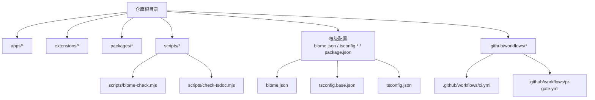
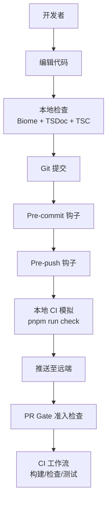
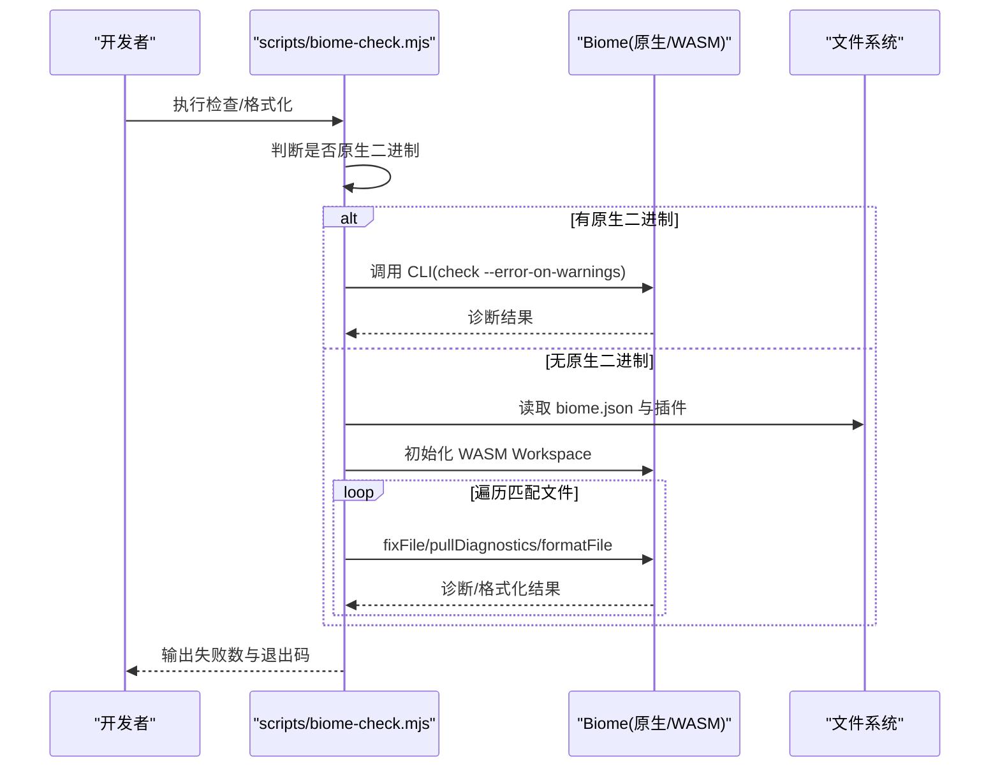
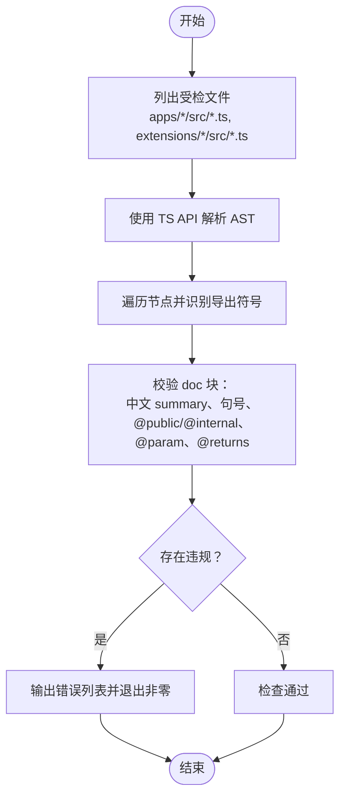
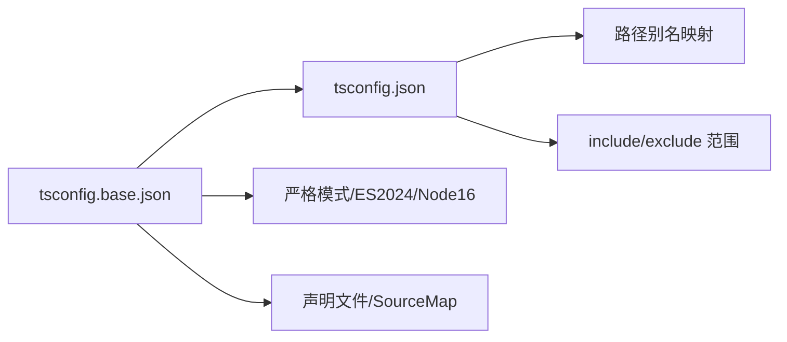
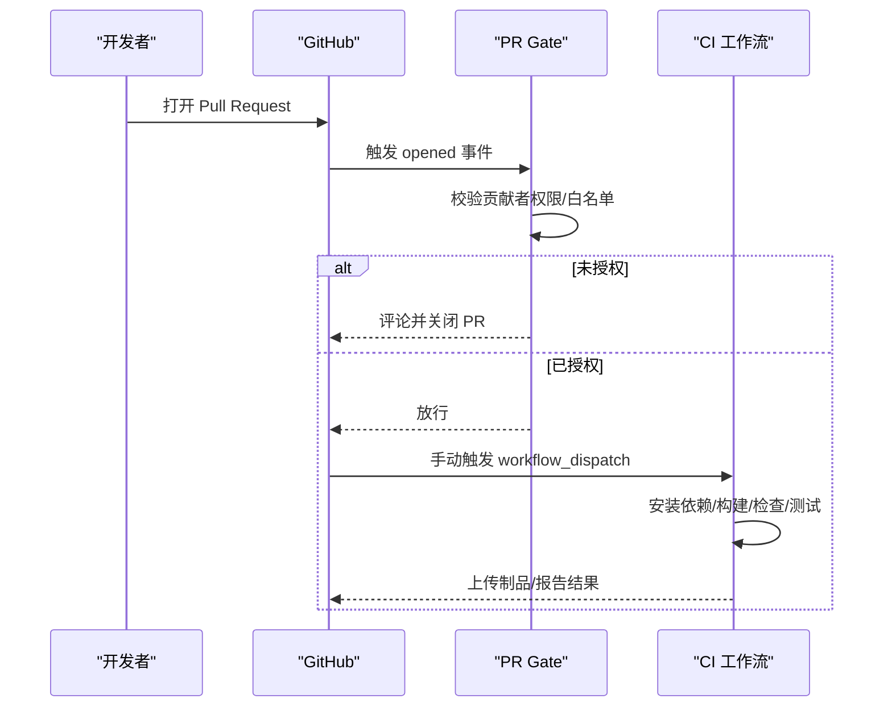
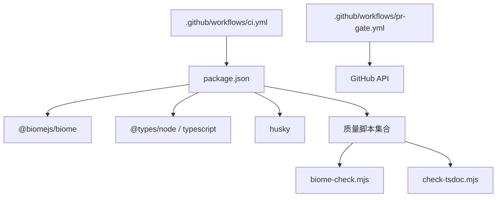

# 代码规范

<cite>
**本文引用的文件**
- [biome.json](file://biome.json)
- [scripts/biome-check.mjs](file://scripts/biome-check.mjs)
- [docs/specs/tsdoc-comment-standards.md](file://docs/specs/tsdoc-comment-standards.md)
- [scripts/check-tsdoc.mjs](file://scripts/check-tsdoc.mjs)
- [CONTRIBUTING.md](file://CONTRIBUTING.md)
- [package.json](file://package.json)
- [tsconfig.base.json](file://tsconfig.base.json)
- [tsconfig.json](file://tsconfig.json)
- [.github/workflows/ci.yml](file://.github/workflows/ci.yml)
- [.github/workflows/pr-gate.yml](file://.github/workflows/pr-gate.yml)
</cite>

## 目录
1. [引言](#引言)
2. [项目结构](#项目结构)
3. [核心规范](#核心规范)
4. [架构总览](#架构总览)
5. [详细组件分析](#详细组件分析)
6. [依赖关系分析](#依赖关系分析)
7. [性能与可维护性](#性能与可维护性)
8. [故障排查指南](#故障排查指南)
9. [结论](#结论)
10. [附录](#附录)

## 引言
本规范面向 omfde 平台 TypeScript 代码，统一编码风格、命名约定、文件组织、注释标准与质量门禁。规范覆盖：
- TypeScript 编译与模块策略
- Biome 格式化与静态检查
- TSDoc 文档注释标准
- Git 提交信息与分支/合并流程
- 本地与 CI 自动化质量门禁

目标是在不引入上游包变更的前提下，对平台代码（apps、extensions、部分 packages）建立稳定、可演进的质量基线。

## 项目结构
仓库采用 pnpm workspace 多包结构，根目录集中配置质量工具与脚本；业务代码分布在 apps、extensions、packages 三个区域。质量相关的关键位置如下：
- 根级 Biome 配置：[biome.json](file://biome.json)
- 根级 TypeScript 配置：[tsconfig.json](file://tsconfig.json)、[tsconfig.base.json](file://tsconfig.base.json)
- 质量脚本：[scripts/biome-check.mjs](file://scripts/biome-check.mjs)、[scripts/check-tsdoc.mjs](file://scripts/check-tsdoc.mjs)
- 工作流：[.github/workflows/ci.yml](file://.github/workflows/ci.yml)、[.github/workflows/pr-gate.yml](file://.github/workflows/pr-gate.yml)
- 贡献与流程说明：[CONTRIBUTING.md](file://CONTRIBUTING.md)
- 脚本入口与命令聚合：[package.json](file://package.json)

**图示来源**
- [biome.json:1-51](file://biome.json#L1-L51)
- [tsconfig.base.json:1-24](file://tsconfig.base.json#L1-L24)
- [tsconfig.json:1-76](file://tsconfig.json#L1-L76)
- [scripts/biome-check.mjs:1-141](file://scripts/biome-check.mjs#L1-L141)
- [scripts/check-tsdoc.mjs:1-168](file://scripts/check-tsdoc.mjs#L1-L168)
- [.github/workflows/ci.yml:1-126](file://.github/workflows/ci.yml#L1-L126)
- [.github/workflows/pr-gate.yml:1-129](file://.github/workflows/pr-gate.yml#L1-L129)

**章节来源**
- [biome.json:1-51](file://biome.json#L1-L51)
- [tsconfig.base.json:1-24](file://tsconfig.base.json#L1-L24)
- [tsconfig.json:1-76](file://tsconfig.json#L1-L76)
- [package.json:1-68](file://package.json#L1-L68)

## 核心规范
本节汇总 TypeScript 编码、命名、文件组织、注释与提交流程的强制要求。

### TypeScript 编译与模块策略
- 使用 ES2024 目标与 Node16/NodeNext 模块解析。
- 启用严格模式、类型擦除语法、verbatimModuleSyntax、声明文件与 SourceMap。
- 根 tsconfig 定义路径别名，统一包内导入方式。
- 各子包通过 extends 继承基础配置，保持构建一致性。

建议实践
- 优先使用顶层 `import type` 与具名导入。
- 避免在运行时依赖未声明的类型。
- 新增包时补充 tsconfig.build.json 并继承基础配置。

**章节来源**
- [tsconfig.base.json:1-24](file://tsconfig.base.json#L1-L24)
- [tsconfig.json:1-76](file://tsconfig.json#L1-L76)

### Biome 格式化与静态检查
- 启用 linter 与 formatter，默认推荐规则集。
- 缩进为 tab，宽度 3，行宽 120。
- 针对平台代码范围进行 include/exclude 控制。
- 提供原生二进制与 WASM 双回退执行器。

强制规则要点
- 必须使用 const 声明常量。
- 关闭非空断言、any、空接口等特定规则（按团队现状）。
- 插件支持自定义 GritQL 规则。

**章节来源**
- [biome.json:1-51](file://biome.json#L1-L51)
- [scripts/biome-check.mjs:1-141](file://scripts/biome-check.mjs#L1-L141)

### TSDoc 注释规范
- 中文优先，summary 首行以句号结尾。
- 公开 API 必须标注 `@public` 或 `@internal`。
- 函数参数需 `@param`，非 void/never/undefined 返回需 `@returns`。
- 仅覆盖平台导出符号，不改动 Pi 上游包。
- 通过脚本校验并在 pre-commit/pre-push 中集成。

**章节来源**
- [docs/specs/tsdoc-comment-standards.md:1-140](file://docs/specs/tsdoc-comment-standards.md#L1-L140)
- [scripts/check-tsdoc.mjs:1-168](file://scripts/check-tsdoc.mjs#L1-L168)

### Git 提交信息与分支管理
- 提交信息格式：`{feat,fix,docs}[(repo|ai|tui|agent|coding-agent)]: 
`。
- 正文使用 `refs #N`，完成时使用 `fixes #N` 或 `closes #N`。
- 仅在 main 分支工作，不创建特性分支；合并使用 squash。
- 禁止提交敏感文件与锁文件意外变更。

**章节来源**
- [CONTRIBUTING.md:48-59](file://CONTRIBUTING.md#L48-L59)

### 质量门禁与自动化
- 本地：`pnpm run check` 为只读检查；`pnpm run check:fix` 用于安全修复。
- Pre-commit 仅检查暂存文件；pre-push 运行完整检查。
- CI 为手动触发的工作流，包含构建、预览打包、check 与测试矩阵。
- PR Gate 负责外部贡献者准入控制。

**章节来源**
- [package.json:6-51](file://package.json#L6-L51)
- [CONTRIBUTING.md:79-88](file://CONTRIBUTING.md#L79-L88)
- [.github/workflows/ci.yml:1-126](file://.github/workflows/ci.yml#L1-L126)
- [.github/workflows/pr-gate.yml:1-129](file://.github/workflows/pr-gate.yml#L1-L129)

## 架构总览
下图展示从开发者到自动化门禁的端到端流程：编辑器/终端 → Biome/TSC/TSDoc 脚本 → Husky 钩子 → CI/PR Gate。

**图示来源**
- [scripts/biome-check.mjs:1-141](file://scripts/biome-check.mjs#L1-L141)
- [scripts/check-tsdoc.mjs:1-168](file://scripts/check-tsdoc.mjs#L1-L168)
- [package.json:6-51](file://package.json#L6-L51)
- [.github/workflows/ci.yml:1-126](file://.github/workflows/ci.yml#L1-L126)
- [.github/workflows/pr-gate.yml:1-129](file://.github/workflows/pr-gate.yml#L1-L129)

## 详细组件分析

### Biome 检查器与格式化器
- 原生二进制优先；在无原生二进制时回退到 WASM 实现。
- 支持 `--write` 与 `--staged` 两种模式。
- 通过 biome.json 的 files.includes 精确控制扫描范围。
- 在 WASM 模式下预加载 GritQL 插件到内存文件系统。

**图示来源**
- [scripts/biome-check.mjs:1-141](file://scripts/biome-check.mjs#L1-L141)
- [biome.json:1-51](file://biome.json#L1-L51)

**章节来源**
- [scripts/biome-check.mjs:1-141](file://scripts/biome-check.mjs#L1-L141)
- [biome.json:1-51](file://biome.json#L1-L51)

### TSDoc 注释检查器
- 基于 TypeScript AST 扫描导出的函数、类、接口、类型别名与变量。
- 校验 summary 中文与句号、发布修饰符、参数与返回值标签。
- 支持 staged-only 模式，便于 pre-commit 快速检查。

**图示来源**
- [scripts/check-tsdoc.mjs:1-168](file://scripts/check-tsdoc.mjs#L1-L168)
- [docs/specs/tsdoc-comment-standards.md:1-140](file://docs/specs/tsdoc-comment-standards.md#L1-L140)

**章节来源**
- [scripts/check-tsdoc.mjs:1-168](file://scripts/check-tsdoc.mjs#L1-L168)
- [docs/specs/tsdoc-comment-standards.md:1-140](file://docs/specs/tsdoc-comment-standards.md#L1-L140)

### TypeScript 编译与路径映射
- 根 tsconfig 定义大量包路径别名，统一跨包引用。
- 子包通过独立的 build tsconfig 指定 outDir/rootDir/include/exclude。
- 开启 declaration 与 source map，便于调试与二次分发。

**图示来源**
- [tsconfig.base.json:1-24](file://tsconfig.base.json#L1-L24)
- [tsconfig.json:1-76](file://tsconfig.json#L1-L76)

**章节来源**
- [tsconfig.base.json:1-24](file://tsconfig.base.json#L1-L24)
- [tsconfig.json:1-76](file://tsconfig.json#L1-L76)

### 工作流与门禁
- CI 为手动触发，包含构建、预览包打包、check 与测试矩阵。
- PR Gate 根据贡献者权限与白名单自动关闭未经授权的 PR。
- 本地质量门禁由 scripts 与 husky 共同驱动。

**图示来源**
- [.github/workflows/pr-gate.yml:1-129](file://.github/workflows/pr-gate.yml#L1-L129)
- [.github/workflows/ci.yml:1-126](file://.github/workflows/ci.yml#L1-L126)

**章节来源**
- [.github/workflows/pr-gate.yml:1-129](file://.github/workflows/pr-gate.yml#L1-L129)
- [.github/workflows/ci.yml:1-126](file://.github/workflows/ci.yml#L1-L126)

## 依赖关系分析
- 根 package.json 聚合所有质量脚本与命令，作为统一入口。
- Biome 与 TypeScript 作为开发依赖被脚本直接调用。
- Husky 在 prepare 阶段安装钩子，配合 pre-commit/pre-push 执行本地检查。
- CI 与 PR Gate 分别承担“人工触发的验证”和“外部贡献者准入”。

**图示来源**
- [package.json:53-61](file://package.json#L53-L61)
- [scripts/biome-check.mjs:1-141](file://scripts/biome-check.mjs#L1-L141)
- [scripts/check-tsdoc.mjs:1-168](file://scripts/check-tsdoc.mjs#L1-L168)
- [.github/workflows/ci.yml:1-126](file://.github/workflows/ci.yml#L1-L126)
- [.github/workflows/pr-gate.yml:1-129](file://.github/workflows/pr-gate.yml#L1-L129)

**章节来源**
- [package.json:1-68](file://package.json#L1-L68)
- [.github/workflows/ci.yml:1-126](file://.github/workflows/ci.yml#L1-L126)
- [.github/workflows/pr-gate.yml:1-129](file://.github/workflows/pr-gate.yml#L1-L129)

## 性能与可维护性
- 使用 Biome 原生二进制以获得最佳性能；WASM 模式作为兼容回退。
- 通过 biome.json 的 includes/excludes 缩小扫描范围，减少无效检查。
- TSDoc 检查仅作用于平台代码，避免对上游包造成额外负担。
- 将 check 设为只读，check:fix 用于明确的安全修复，降低误改风险。
- 在 CI 中拆分测试矩阵，避免最慢用例串行阻塞。

[本节为通用指导，无需具体文件引用]

## 故障排查指南
常见问题与定位方法：
- Biome 报 schema 版本不匹配（WASM 模式）：属于已知提示，脚本已忽略该诊断。
- 格式化不一致：使用 `pnpm run check:fix` 后再次运行 `pnpm run check` 确认。
- TSDoc 缺失或不符合规范：运行 `pnpm run check:tsdoc`，根据错误行号补齐 summary、@public/@internal、@param、@returns。
- 提交被拒绝：检查提交信息是否符合约定；确保未提交敏感文件或锁文件意外变更。
- CI 失败：先在本地运行 `pnpm run check` 与相关测试，记录环境与输出。

**章节来源**
- [scripts/biome-check.mjs:117-133](file://scripts/biome-check.mjs#L117-L133)
- [scripts/check-tsdoc.mjs:162-167](file://scripts/check-tsdoc.mjs#L162-L167)
- [CONTRIBUTING.md:79-88](file://CONTRIBUTING.md#L79-L88)

## 结论
本规范以 Biome 与 TypeScript 为基础，结合 TSDoc 文档标准与 Git 提交流程，形成从编辑器到 CI 的全链路质量门禁。建议在新增导出时同步补全文档，在修改平台代码时遵循命名与文件组织约定，并通过本地检查与 CI 双重保障提升代码质量与可维护性。

[本节为总结性内容，无需具体文件引用]

## 附录

### 常用命令速查
- 只读检查：`pnpm run check`
- 安全修复：`pnpm run check:fix`
- TSDoc 检查：`pnpm run check:tsdoc`
- 运行测试：`pnpm test` 或 `./test.sh`
- 启动应用：`pnpm omfde`

**章节来源**
- [package.json:6-51](file://package.json#L6-L51)
- [CONTRIBUTING.md:79-88](file://CONTRIBUTING.md#L79-L88)