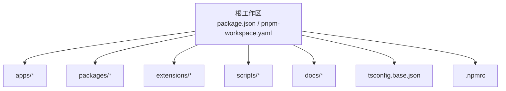
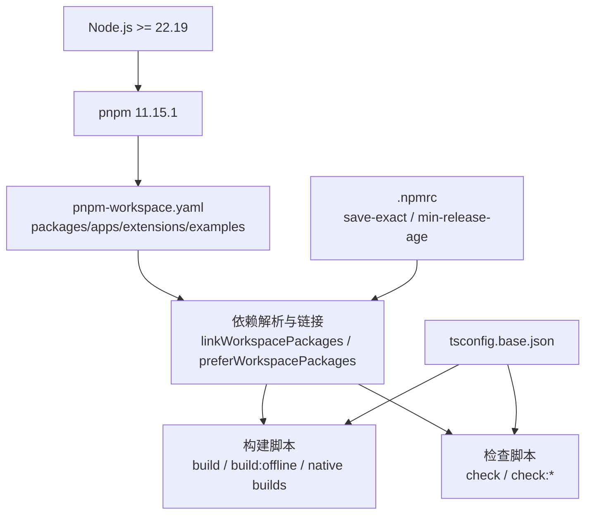
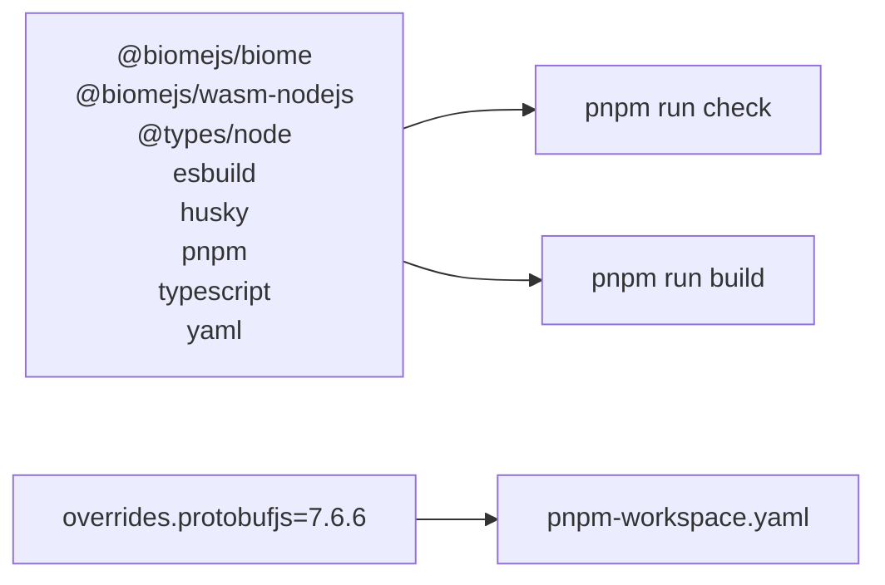

# 开发环境搭建

<cite>
**本文引用的文件**
- [package.json](file://package.json)
- [pnpm-workspace.yaml](file://pnpm-workspace.yaml)
- [tsconfig.base.json](file://tsconfig.base.json)
- [.npmrc](file://.npmrc)
- [README.md](file://README.md)
- [pi-test.sh](file://pi-test.sh)
</cite>

## 目录
1. [简介](#简介)
2. [项目结构](#项目结构)
3. [核心组件](#核心组件)
4. [架构总览](#架构总览)
5. [详细组件分析](#详细组件分析)
6. [依赖分析](#依赖分析)
7. [性能考虑](#性能考虑)
8. [故障排查指南](#故障排查指南)
9. [结论](#结论)
10. [附录](#附录)

## 简介
本指南面向首次参与该仓库的开发者，目标是帮助你快速、稳定地搭建本地开发环境。内容覆盖：
- Node.js 版本要求与包管理器选择
- pnpm 工作区配置与依赖安装
- TypeScript 编译设置与类型检查
- 环境变量与密钥管理
- IDE 推荐设置
- 常见环境问题与解决方案

## 项目结构
该项目是一个基于 pnpm 的 Monorepo，包含多个内部包、应用和扩展。根目录提供统一的构建、检查、测试脚本；各子包通过 pnpm workspace 共享依赖并统一类型与工具链。

**图表来源**
- [package.json:1-68](file://package.json#L1-L68)
- [pnpm-workspace.yaml:1-15](file://pnpm-workspace.yaml#L1-L15)
- [tsconfig.base.json:1-24](file://tsconfig.base.json#L1-L24)
- [.npmrc:1-3](file://.npmrc#L1-L3)

**章节来源**
- [package.json:1-68](file://package.json#L1-L68)
- [pnpm-workspace.yaml:1-15](file://pnpm-workspace.yaml#L1-L15)

## 核心组件
本节聚焦开发环境所需的基础设施：Node.js 版本、pnpm 工作区、TypeScript 编译、脚本命令与环境变量。

- Node.js 版本要求
  - 根 package.json 声明 engines.node >= 22.19.0，表示需要 Node.js 22.19 或更高版本。
  - README 也明确说明 Pi 需要 Node.js 22.19 或更新版本。

- pnpm 工作区
  - 根 package.json 指定 packageManager 为 pnpm@11.15.1，确保团队使用一致的 pnpm 版本。
  - pnpm-workspace.yaml 定义工作区范围：packages/*、apps/*、extensions/* 以及若干示例扩展路径，并启用 linkWorkspacePackages 与 preferWorkspacePackages。
  - overrides 固定 protobufjs 版本，避免下游依赖冲突。

- TypeScript 编译设置
  - tsconfig.base.json 提供基础编译器选项：target ES2024、module Node16、lib ES2024、strict true、declaration/sourceMap/inlineSources 开启等。
  - 启用 verbatimModuleSyntax、erasableSyntaxOnly、allowImportingTsExtensions、rewriteRelativeImportExtensions 等现代 TS 特性。
  - types 仅包含 node，避免污染全局类型。

- 脚本命令
  - build：按依赖顺序构建 telemetry、schema、tui、codemode、mcp、ai、agent-core、coding-agent。
  - check：运行代码质量检查（Biome）、依赖锁定检查、运行时依赖检查、TS 导入检查、入口图检查、密钥扫描、TSDoc 检查、tsc --noEmit、浏览器冒烟检查。
  - test：并行执行脚本测试与各包的测试。
  - omfde：启动 apps/omfde/bin/omfde.mjs。
  - prepare：安装 husky 钩子。

- .npmrc
  - save-exact=true：保存精确版本依赖。
  - min-release-age=2：避免同日发布依赖带来的不稳定。

**章节来源**
- [package.json:1-68](file://package.json#L1-L68)
- [pnpm-workspace.yaml:1-15](file://pnpm-workspace.yaml#L1-L15)
- [tsconfig.base.json:1-24](file://tsconfig.base.json#L1-L24)
- [.npmrc:1-3](file://.npmrc#L1-L3)
- [README.md:86-95](file://README.md#L86-L95)

## 架构总览
下图展示开发环境的“基础层”关系：Node.js 与 pnpm 驱动工作区，pnpm 解析 workspace 与 overrides，TypeScript 编译由 tsconfig.base.json 统一约束，脚本命令串联构建与检查流程。

**图表来源**
- [package.json:1-68](file://package.json#L1-L68)
- [pnpm-workspace.yaml:1-15](file://pnpm-workspace.yaml#L1-L15)
- [tsconfig.base.json:1-24](file://tsconfig.base.json#L1-L24)
- [.npmrc:1-3](file://.npmrc#L1-L3)

## 详细组件分析

### Node.js 与 pnpm 环境准备
- 安装 Node.js 22.19+（建议使用 nvm 或 fnm）。
- 使用仓库指定的 pnpm 版本：pnpm@11.15.1。
- 在仓库根目录执行 pnpm install 以安装所有工作区依赖。

建议步骤：
1. 确认 Node.js 版本满足 engines.node 要求。
2. 安装 pnpm 11.15.1（可通过 corepack 或 npm 安装）。
3. 在仓库根目录执行 pnpm install。
4. 如需离线构建模型数据，参考 README 中的 offline 相关说明。

**章节来源**
- [package.json:63-65](file://package.json#L63-L65)
- [package.json:5-5](file://package.json#L5-L5)
- [README.md:86-95](file://README.md#L86-L95)

### pnpm 工作区配置要点
- 工作区范围：
  - packages/*
  - apps/*
  - extensions/*
  - packages/coding-agent/examples/extensions/with-deps
  - packages/coding-agent/examples/extensions/custom-provider-anthropic
  - packages/coding-agent/examples/extensions/custom-provider-gitlab-duo
  - packages/coding-agent/examples/extensions/gondolin
- 行为开关：
  - linkWorkspacePackages: true
  - preferWorkspacePackages: true
- 依赖覆盖：
  - overrides.protobufjs = 7.6.6

这些配置保证：
- 跨包引用直接链接，提升安装与构建速度。
- 优先解析工作区内包，避免外部同名包干扰。
- 统一第三方依赖版本，降低冲突风险。

**章节来源**
- [pnpm-workspace.yaml:1-15](file://pnpm-workspace.yaml#L1-L15)

### TypeScript 编译与类型检查
- 目标与模块：
  - target: ES2024
  - module: Node16
  - lib: ES2024
  - moduleResolution: Node16
- 严格性与可维护性：
  - strict: true
  - erasableSyntaxOnly: true
  - verbatimModuleSyntax: true
  - forceConsistentCasingInFileNames: true
- 输出与调试：
  - declaration: true
  - declarationMap: true
  - sourceMap: true
  - inlineSources: true
  - inlineSourceMap: false
- 其他：
  - esModuleInterop: true
  - skipLibCheck: true
  - resolveJsonModule: true
  - allowImportingTsExtensions: true
  - rewriteRelativeImportExtensions: true
  - types: ["node"]

开发时常用命令：
- pnpm run check：执行 tsc --noEmit 进行类型检查。
- pnpm run build：构建全部包。

**章节来源**
- [tsconfig.base.json:1-24](file://tsconfig.base.json#L1-L24)
- [package.json:13-14](file://package.json#L13-L14)

### 环境变量与密钥管理
- 测试与运行脚本会清理敏感环境变量，避免意外泄露。
- pi-test.sh 在 --no-env 模式下会 unset 大量 API Key 与云厂商凭据，包括：
  - ANTHROPIC_API_KEY、OPENAI_API_KEY、GEMINI_API_KEY、GROQ_API_KEY、XAI_API_KEY、OPENROUTER_API_KEY、MISTRAL_API_KEY、MINIMAX_API_KEY、ANT_LING_API_KEY、BASETEN_API_KEY、CLOUDFLARE_API_KEY、DEEPSEEK_API_KEY、FIREWORKS_API_KEY 等。
  - Azure OpenAI 相关：AZURE_OPENAI_API_KEY、AZURE_OPENAI_BASE_URL、AZURE_OPENAI_RESOURCE_NAME。
  - Google Cloud：GOOGLE_APPLICATION_CREDENTIALS、GOOGLE_CLOUD_PROJECT、GCLOUD_PROJECT、GOOGLE_CLOUD_LOCATION。
  - AWS：AWS_PROFILE、AWS_ACCESS_KEY_ID、AWS_SECRET_ACCESS_KEY、AWS_SESSION_TOKEN、AWS_REGION、AWS_DEFAULT_REGION、AWS_BEARER_TOKEN_BEDROCK、AWS_CONTAINER_CREDENTIALS_RELATIVE_URI、AWS_CONTAINER_CREDENTIALS_FULL_URI、AWS_WEB_IDENTITY_TOKEN_FILE。
  - GitHub/GitLab/OAuth：COPILOT_GITHUB_TOKEN、GH_TOKEN、GITHUB_TOKEN、HF_TOKEN、ANTHROPIC_AUTH_TOKEN、ANTHROPIC_FEDERATION_RULE_ID、ANTHROPIC_IDENTITY_TOKEN_FILE、ANTHROPIC_ORGANIZATION_ID、ANTHROPIC_SERVICE_ACCOUNT_ID、ANTHROPIC_WORKSPACE_ID。

实践建议：
- 不要在仓库中提交任何真实密钥。
- 将密钥放入系统级环境变量或使用安全的环境注入方式。
- 本地调试时可使用 pi-test.sh --no-env 验证无密钥场景下的行为。

**章节来源**
- [pi-test.sh:1-69](file://pi-test.sh#L1-L69)

### IDE 推荐设置
- VS Code 推荐插件：
  - TypeScript + JavaScript Language Features（内置）
  - ESLint/Prettier（若团队启用）
  - Biome（本项目使用 @biomejs/biome）
- 编辑器设置建议：
  - 启用保存时格式化（如使用 Biome）。
  - 使用 Node16 模块解析（与 tsconfig.base.json 一致）。
  - 开启 TypeScript 诊断与错误提示。
  - 配置工作区根目录为仓库根，以便正确解析 workspace 包。

注意：
- 本项目使用 Biome 作为格式化工具与检查器之一，可在根目录运行 pnpm run check 触发检查。

**章节来源**
- [package.json:53-61](file://package.json#L53-L61)
- [package.json:13-14](file://package.json#L13-L14)

## 依赖分析
- 根 devDependencies 包含：
  - @biomejs/biome、@biomejs/wasm-nodejs
  - @types/node
  - esbuild
  - husky
  - pnpm
  - typescript
  - yaml
- 构建与检查流程依赖上述工具链。
- pnpm-workspace.yaml 通过 overrides 固定 protobufjs 版本，减少下游依赖差异。

**图表来源**
- [package.json:53-61](file://package.json#L53-L61)
- [pnpm-workspace.yaml:13-15](file://pnpm-workspace.yaml#L13-L15)

**章节来源**
- [package.json:53-61](file://package.json#L53-L61)
- [pnpm-workspace.yaml:13-15](file://pnpm-workspace.yaml#L13-L15)

## 性能考虑
- 使用 pnpm 的工作区链接可减少重复安装与磁盘占用。
- 保持 Node.js 版本与 engines 要求一致，避免兼容性问题导致的额外开销。
- 在 CI 或预提交阶段运行 pnpm run check，尽早发现类型与格式问题。
- 构建时使用 pnpm run build 或 pnpm run build:offline，根据网络情况选择是否刷新模型数据。

[本节为通用指导，不直接分析具体文件]

## 故障排查指南
常见问题与解决思路：

- Node.js 版本不匹配
  - 现象：构建或类型检查报错，提示引擎版本不满足要求。
  - 处理：安装 Node.js 22.19+，并通过 nvm/fnm 切换至指定版本。

- pnpm 版本不一致
  - 现象：安装失败或依赖解析异常。
  - 处理：使用 pnpm@11.15.1，或在项目根目录通过 corepack 启用指定版本。

- 工作区包无法解析
  - 现象：import 工作区内包时报找不到模块。
  - 处理：确认 pnpm-workspace.yaml 已包含对应路径；执行 pnpm install 重新链接。

- TypeScript 类型检查失败
  - 现象：tsc --noEmit 报错。
  - 处理：检查 tsconfig.base.json 配置；确保模块解析策略与 Node16 一致；修复类型错误后重试 pnpm run check。

- 环境变量缺失导致功能不可用
  - 现象：运行测试或调用 AI 提供商时报鉴权失败。
  - 处理：设置必要的环境变量（如 OPENAI_API_KEY、ANTHROPIC_API_KEY 等），或通过 pi-test.sh --no-env 验证无密钥行为。

- 依赖冲突或版本不一致
  - 现象：构建时报 protobufjs 或其他依赖版本冲突。
  - 处理：检查 pnpm-workspace.yaml 的 overrides；必要时升级或降级依赖并重新安装。

**章节来源**
- [package.json:63-65](file://package.json#L63-L65)
- [package.json:5-5](file://package.json#L5-L5)
- [pnpm-workspace.yaml:1-15](file://pnpm-workspace.yaml#L1-L15)
- [tsconfig.base.json:1-24](file://tsconfig.base.json#L1-L24)
- [pi-test.sh:1-69](file://pi-test.sh#L1-L69)

## 结论
通过遵循本指南，你可以：
- 使用正确的 Node.js 与 pnpm 版本
- 正确配置 pnpm 工作区与依赖
- 理解 TypeScript 编译与类型检查设置
- 安全地管理环境变量与密钥
- 在 IDE 中获得良好的开发与调试体验
- 快速定位并解决常见环境问题

[本节为总结性内容，不直接分析具体文件]

## 附录
- 常用命令速查：
  - pnpm install：安装依赖
  - pnpm run build：构建全部包
  - pnpm run build:offline：离线构建模型数据
  - pnpm run check：执行检查与类型检查
  - pnpm run test：运行测试
  - ./pi-test.sh：从源码运行 pi
  - ./pi-test.sh --no-env：在无密钥环境下运行

**章节来源**
- [README.md:86-95](file://README.md#L86-L95)