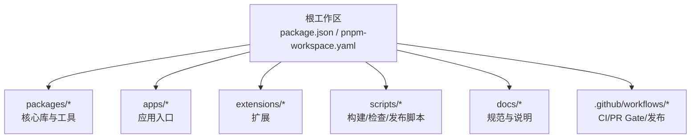
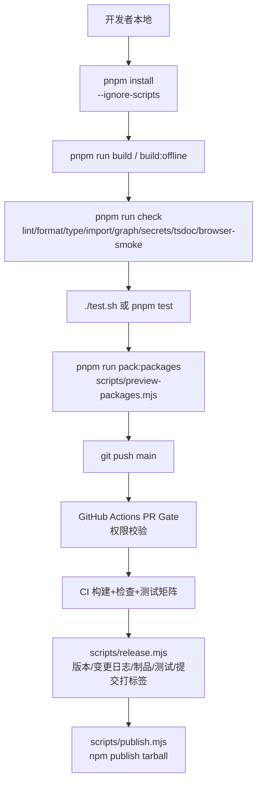
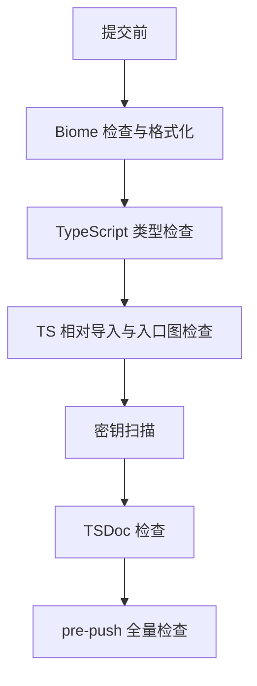
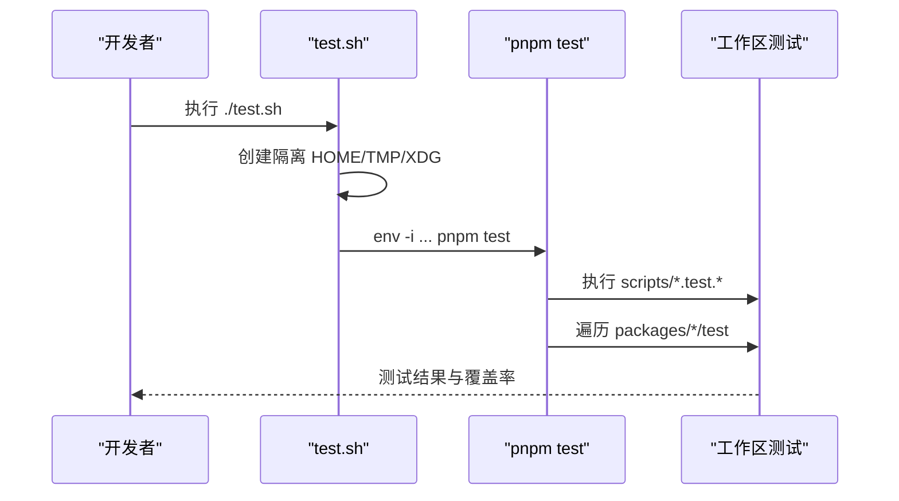
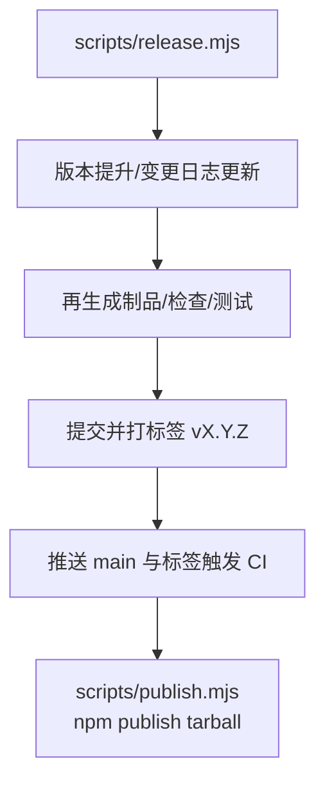
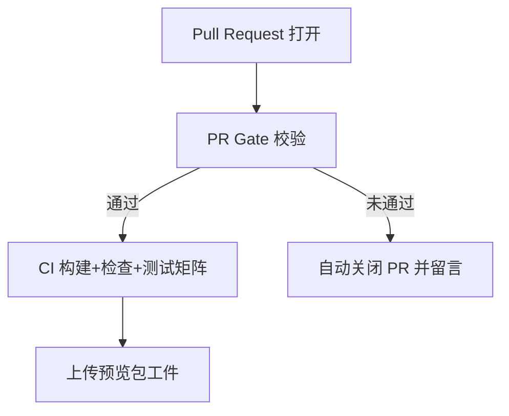
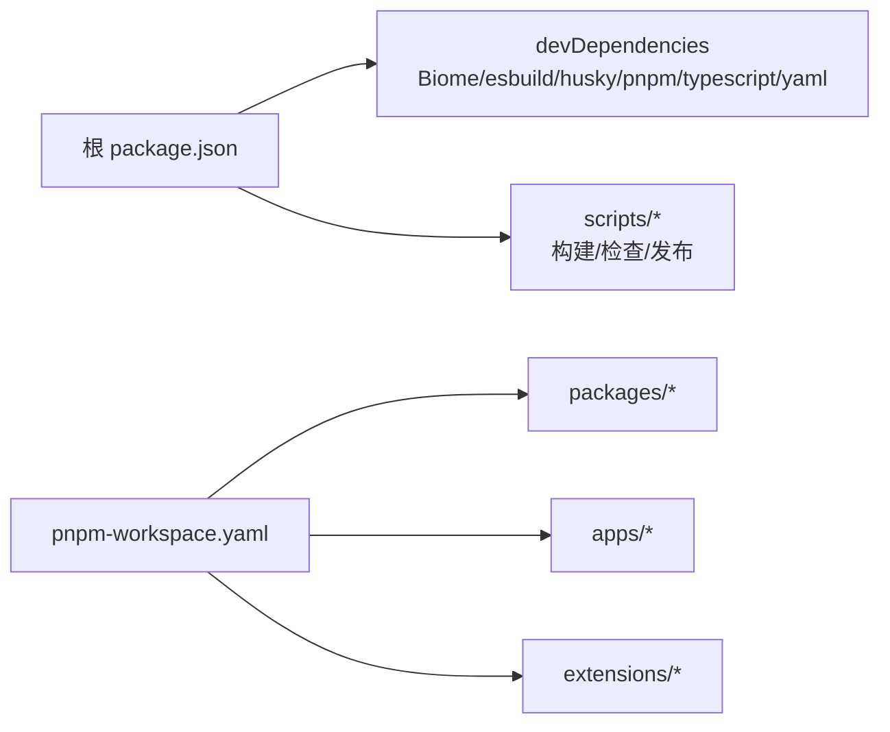

# 开发者指南

<cite>
**本文引用的文件**
- [README.md](file://README.md)
- [CONTRIBUTING.md](file://CONTRIBUTING.md)
- [package.json](file://package.json)
- [pnpm-workspace.yaml](file://pnpm-workspace.yaml)
- [.github/workflows/ci.yml](file://.github/workflows/ci.yml)
- [.github/workflows/pr-gate.yml](file://.github/workflows/pr-gate.yml)
- [scripts/publish.mjs](file://scripts/publish.mjs)
- [scripts/release.mjs](file://scripts/release.mjs)
- [test.sh](file://test.sh)
- [pi-test.sh](file://pi-test.sh)
- [biome.json](file://biome.json)
- [tsconfig.base.json](file://tsconfig.base.json)
- [vitest.base.ts](file://vitest.base.ts)
</cite>

## 目录
1. [简介](#简介)
2. [项目结构](#项目结构)
3. [核心组件](#核心组件)
4. [架构总览](#架构总览)
5. [详细组件分析](#详细组件分析)
6. [依赖分析](#依赖分析)
7. [性能与内存优化](#性能与内存优化)
8. [故障排查指南](#故障排查指南)
9. [结论](#结论)
10. [附录](#附录)

## 简介
本指南面向贡献者，覆盖开发环境搭建、代码规范、测试策略、调试技巧、monorepo 管理、包发布、CI/CD 流水线、协作流程（问题报告、功能请求、代码审查），以及性能分析与内存泄漏检测等高级开发工具使用方法。仓库采用 pnpm monorepo，包含 CLI、Agent 运行时、AI 统一接口、TUI、MCP、Schema、Telemetry 等多个包，并通过脚本与 GitHub Actions 实现构建、检查、测试、预览包、发布与模型目录发布等工程化能力。

## 项目结构
仓库根目录为 monorepo 工作区，使用 pnpm workspace 管理 packages、apps、extensions 及示例扩展。根 package.json 提供统一的构建、检查、测试、版本与发布脚本；pnpm-workspace.yaml 声明工作区范围与包解析策略；GitHub Actions 定义 CI、PR Gate、预览包、审计等流水线。

**图表来源**
- [package.json:1-68](file://package.json#L1-L68)
- [pnpm-workspace.yaml:1-15](file://pnpm-workspace.yaml#L1-L15)

**章节来源**
- [README.md:56-69](file://README.md#L56-L69)
- [package.json:1-68](file://package.json#L1-L68)
- [pnpm-workspace.yaml:1-15](file://pnpm-workspace.yaml#L1-L15)

## 核心组件
- 工作区与包：通过 pnpm workspace 统一管理多个包，支持 linkWorkspacePackages 与 preferWorkspacePackages，确保本地开发与跨包引用一致。
- 构建与检查：根脚本聚合各包的 build、check、test 流程，并提供 offline 构建、模型数据生成与校验、浏览器冒烟检查等。
- 测试：统一入口 test.sh 隔离用户环境与凭据，运行 pnpm test；pi-test.sh 用于从源码启动 TUI 或 CLI，支持 --no-env 清理敏感环境变量。
- 发布与版本：release.mjs 负责版本提升、CHANGELOG 更新、制品再生成、检查与测试、提交打标签并推送；publish.mjs 基于已打包的 tarball 进行 npm 发布，支持 dry-run 与 provenance。
- CI/CD：ci.yml 提供手动触发的构建、预览包打包、检查与测试矩阵；pr-gate.yml 在 PR 打开时校验贡献者权限，未授权自动关闭。

**章节来源**
- [pnpm-workspace.yaml:1-15](file://pnpm-workspace.yaml#L1-L15)
- [package.json:6-51](file://package.json#L6-L51)
- [test.sh:1-84](file://test.sh#L1-L84)
- [pi-test.sh:1-91](file://pi-test.sh#L1-L91)
- [scripts/release.mjs:1-290](file://scripts/release.mjs#L1-L290)
- [scripts/publish.mjs:1-65](file://scripts/publish.mjs#L1-L65)
- [.github/workflows/ci.yml:1-126](file://.github/workflows/ci.yml#L1-L126)
- [.github/workflows/pr-gate.yml:1-129](file://.github/workflows/pr-gate.yml#L1-L129)

## 架构总览
下图展示贡献者在本地到 CI 的端到端流程：从安装依赖、构建、检查、测试，到预览包与发布，再到 GitHub Actions 的自动化门禁与发布。

**图表来源**
- [package.json:6-51](file://package.json#L6-L51)
- [test.sh:1-84](file://test.sh#L1-L84)
- [scripts/release.mjs:1-290](file://scripts/release.mjs#L1-L290)
- [scripts/publish.mjs:1-65](file://scripts/publish.mjs#L1-L65)
- [.github/workflows/pr-gate.yml:1-129](file://.github/workflows/pr-gate.yml#L1-L129)
- [.github/workflows/ci.yml:1-126](file://.github/workflows/ci.yml#L1-L126)

## 详细组件分析

### 开发环境搭建
- Node.js 版本要求：>=22.19.0。
- 包管理器：pnpm@11.15.1（由根 package.json 指定）。
- 依赖安装：npm install --ignore-scripts 或 pnpm install（忽略生命周期脚本，避免不必要的原生构建）。
- 构建：pnpm run build（刷新模型数据后构建所有包）；pnpm run build:offline（离线模式复用已有模型数据）。
- 检查：pnpm run check（Biome 检查、依赖锁定、运行时依赖、TS 导入、入口图、密钥扫描、TSDoc、类型检查、浏览器冒烟）。
- 测试：./test.sh（隔离环境运行测试，跳过 LLM 相关测试）；pnpm test（按工作区执行）。
- 从源码运行 TUI/CLI：./pi-test.sh [--no-env] 或 pnpm run omfde。

**章节来源**
- [README.md:86-95](file://README.md#L86-L95)
- [package.json:63-66](file://package.json#L63-L66)
- [package.json:6-51](file://package.json#L6-L51)
- [test.sh:1-84](file://test.sh#L1-L84)
- [pi-test.sh:1-91](file://pi-test.sh#L1-L91)

### 代码规范
- 格式化与 Lint：Biome 配置位于 biome.json，启用推荐规则，Tab 缩进、行宽 120，部分规则关闭以适配现有代码风格。
- TypeScript：tsconfig.base.json 启用严格模式、ES2024 目标、Node16 模块解析、声明与 SourceMap 输出。
- 命名与导入：scripts/check-ts-relative-imports.mjs 与 scripts/check-entry-graphs.mjs 约束相对导入与入口图一致性。
- TSDoc：新增平台导出需满足 TSDoc 要求，check:tsdoc 作为 check 的一部分。
- 密钥扫描：scripts/check-secrets.mjs 阻止误提交敏感信息。

**图表来源**
- [biome.json:1-51](file://biome.json#L1-L51)
- [tsconfig.base.json:1-24](file://tsconfig.base.json#L1-L24)
- [package.json:13-22](file://package.json#L13-L22)

**章节来源**
- [biome.json:1-51](file://biome.json#L1-L51)
- [tsconfig.base.json:1-24](file://tsconfig.base.json#L1-L24)
- [package.json:13-22](file://package.json#L13-L22)

### 测试策略
- 隔离环境：test.sh 创建临时 HOME/TMP/XDG 目录，屏蔽系统 Git 配置与凭据，设置 PI_NO_LOCAL_LLM=1，仅允许必要环境变量，确保测试可重复且安全。
- 测试入口：pnpm test 会先运行脚本测试（scripts/*.test.*），再在工作区中并行执行各包的测试。
- 套件分类：CI 将测试拆分为 coding-agent、durable、other 三类，避免慢用例串行阻塞。
- MCP 合规：pnpm run test:mcp-conformance 使用官方基准对 MCP 客户端进行回归测试。
- 冒烟测试：scripts/check-browser-smoke.mjs 与 scripts/coding-agent-smoke.mjs 验证关键入口与产物可用性。

**图表来源**
- [test.sh:1-84](file://test.sh#L1-L84)
- [package.json:35-37](file://package.json#L35-L37)
- [.github/workflows/ci.yml:51-105](file://.github/workflows/ci.yml#L51-L105)

**章节来源**
- [test.sh:1-84](file://test.sh#L1-L84)
- [package.json:35-37](file://package.json#L35-L37)
- [.github/workflows/ci.yml:51-105](file://.github/workflows/ci.yml#L51-L105)

### 调试技巧
- 从源码运行 TUI/CLI：./pi-test.sh [--no-env] 或 pnpm run omfde。--no-env 会清空大量 API 密钥与环境变量，便于在无凭据环境下复现问题。
- 断点与诊断：使用 Node.js Inspector（node --inspect）附加调试器；结合 vitest.base.ts 中的别名，确保测试中对工作区源码的直接引用。
- 环境变量隔离：PI_NO_LOCAL_LLM=1 禁用本地 LLM；AWS_EC2_METADATA_DISABLED=true 防止云元数据探测；GIT_* 相关变量被重置以避免交互式提示。
- 浏览器冒烟：scripts/check-browser-smoke.mjs 验证前端入口是否可加载。

**章节来源**
- [pi-test.sh:1-91](file://pi-test.sh#L1-L91)
- [test.sh:1-84](file://test.sh#L1-L84)
- [vitest.base.ts:1-97](file://vitest.base.ts#L1-L97)

### Monorepo 管理与包发布
- 工作区：pnpm-workspace.yaml 声明 packages/*、apps/*、extensions/* 及若干示例扩展；linkWorkspacePackages 与 preferWorkspacePackages 保证本地开发直接链接源码。
- 构建顺序：根 build 脚本依次构建 telemetry、schema、tui、codemode、mcp、ai、agent-core、coding-agent。
- 预览包：scripts/preview-packages.mjs 根据 SHA 打包预览制品，供 PR 或分支预览。
- 发布流程：
  - release.mjs：检查未提交变更、验证 npm 注册、提升版本、更新 CHANGELOG、再生成制品、运行 check/build/test、提交打标签并推送。
  - publish.mjs：读取公共工作区包列表，校验 dist 存在，生成 artifact set，查询 npm 是否已发布，按 tarball 发布并启用 provenance。
- 外部消费：scripts/use-local-packages.mjs 可将本地制品集注入外部项目的 package.json 或 pnpm-workspace.yaml，便于集成测试与演示。

**图表来源**
- [scripts/release.mjs:1-290](file://scripts/release.mjs#L1-L290)
- [scripts/publish.mjs:1-65](file://scripts/publish.mjs#L1-L65)

**章节来源**
- [pnpm-workspace.yaml:1-15](file://pnpm-workspace.yaml#L1-L15)
- [package.json:6-51](file://package.json#L6-L51)
- [scripts/release.mjs:1-290](file://scripts/release.mjs#L1-L290)
- [scripts/publish.mjs:1-65](file://scripts/publish.mjs#L1-L65)

### CI/CD 流水线
- PR Gate：.github/workflows/pr-gate.yml 在 PR 打开时校验作者是否为受信任机器人或已批准贡献者；否则自动关闭 PR 并留言说明。
- CI：.github/workflows/ci.yml 提供手动触发的构建、预览包打包、检查与测试矩阵；同时运行 MCP 合规测试。
- 依赖审计：npm-audit.yml 定期运行 npm audit 与签名审计。
- 预览包：preview-packages.yml 在 PR/分支上生成预览制品并上传为工件。

**图表来源**
- [.github/workflows/pr-gate.yml:1-129](file://.github/workflows/pr-gate.yml#L1-L129)
- [.github/workflows/ci.yml:1-126](file://.github/workflows/ci.yml#L1-L126)

**章节来源**
- [.github/workflows/pr-gate.yml:1-129](file://.github/workflows/pr-gate.yml#L1-L129)
- [.github/workflows/ci.yml:1-126](file://.github/workflows/ci.yml#L1-L126)

### 协作规范
- 问题与讨论：优先在 Issue 中记录需求、缺陷与任务；非平凡工作需 RAD 与计划；Bug 需提供复现步骤、期望与实际行为、环境信息。
- 分支与提交：仅在 main 上工作；提交信息遵循 {feat,fix,docs}[(repo|ai|tui|agent|coding-agent)]: 
；禁止 git add -A，明确路径提交；不提交 .env 与凭据。
- PR 与合并：内部默认不开 PR；外部贡献需先开 Issue 并获得批准；合并采用 squash，保持 main 线性；禁止 force push。
- 质量门禁：本地运行 pnpm run check 与相关测试；平台入口变更需运行 omfde 冒烟；记录命令、输出与环境。

**章节来源**
- [CONTRIBUTING.md:15-89](file://CONTRIBUTING.md#L15-L89)

### 性能分析与内存泄漏检测
- CPU 性能分析：scripts/profile-coding-agent-node.mjs 提供 tui/rpc 两种模式的性能剖析入口，可在 Node.js 下采集火焰图或堆快照。
- 内存泄漏检测：
  - 使用 Node.js 内置堆快照：在关键路径前后调用 process.memoryUsage() 或使用 inspector 抓取 heap snapshot，对比对象增长。
  - 结合 vitest.base.ts 的工作区别名，确保测试直接引用源码，避免构建产物差异导致的定位偏差。
  - 在 CI 中可通过增加 --max-old-space-size 与 OOM 监控脚本辅助发现长尾泄漏。
- 网络与 I/O：test.sh 屏蔽 AWS 元数据与 Git 交互，减少外部干扰；必要时开启 NODE_EXTRA_CA_CERTS 以兼容企业代理。

**章节来源**
- [package.json:33-34](file://package.json#L33-L34)
- [vitest.base.ts:1-97](file://vitest.base.ts#L1-L97)
- [test.sh:1-84](file://test.sh#L1-L84)

## 依赖分析
- 工作区依赖：pnpm-workspace.yaml 将 packages、apps、extensions 纳入同一工作区，linkWorkspacePackages 与 preferWorkspacePackages 确保本地开发直接链接源码。
- 根依赖：devDependencies 包含 Biome、esbuild、husky、pnpm、typescript、yaml 等工程化工具。
- 引擎要求：engines.node >=22.19.0，确保语言特性与工具链兼容性。
- 外部依赖治理：README 强调依赖变更视为代码变更，直接依赖精确锁定，.npmrc 设置 save-exact 与 min-release-age，lockfile 为权威来源，预提交钩子阻止意外锁文件提交。

**图表来源**
- [package.json:53-66](file://package.json#L53-L66)
- [pnpm-workspace.yaml:1-15](file://pnpm-workspace.yaml#L1-L15)

**章节来源**
- [package.json:53-66](file://package.json#L53-L66)
- [pnpm-workspace.yaml:1-15](file://pnpm-workspace.yaml#L1-L15)
- [README.md:152-164](file://README.md#L152-L164)

## 性能与内存优化
- 构建优化：优先使用 build:offline 复用模型数据，减少网络与生成时间；CI 中缓存 npm 依赖加速构建。
- 测试优化：CI 将测试矩阵拆分，避免慢用例连续执行；test.sh 隔离环境减少外部不确定性。
- 内存优化：
  - 避免在热路径分配大对象；使用流式处理与增量计算。
  - 在长时间运行的进程（如 TUI/RPC）中定期释放不再使用的缓存与会话上下文。
  - 使用 Node.js 堆快照对比不同阶段对象保留情况，定位泄漏源。
- 网络优化：在企业代理环境中正确配置 NODE_EXTRA_CA_CERTS，避免证书错误导致重试与超时。

[本节为通用指导，不直接分析具体文件]

## 故障排查指南
- 依赖安装失败：确认 Node.js 版本满足 engines 要求；使用 npm ci --ignore-scripts 或 pnpm install；检查 .npmrc 的 save-exact 与 min-release-age 配置。
- 构建失败：运行 pnpm run check 定位 lint/format/type 问题；若涉及模型数据，运行 generate:models 与 check:model-data。
- 测试失败：使用 ./test.sh 在隔离环境中复现；检查环境变量是否被污染；必要时单独运行对应工作区的测试。
- 发布失败：确保 dist 目录存在；使用 scripts/publish.mjs --dry-run 预检；确认 npm 包已注册；检查 provenance 与访问权限。
- PR 被自动关闭：查看 pr-gate.yml 逻辑，确认贡献者是否在已批准列表中或具备相应权限。

**章节来源**
- [package.json:6-51](file://package.json#L6-L51)
- [scripts/publish.mjs:1-65](file://scripts/publish.mjs#L1-L65)
- [.github/workflows/pr-gate.yml:1-129](file://.github/workflows/pr-gate.yml#L1-L129)

## 结论
本指南总结了 omfde 仓库的开发环境、代码规范、测试策略、调试技巧、monorepo 管理、包发布与 CI/CD 流水线，以及协作规范与性能优化建议。贡献者应遵循本地质量门禁，使用隔离环境进行测试，遵循提交与 PR 规范，并在发布流程中严格执行版本与制品校验。遇到问题时，优先在 Issue 中记录并附上复现步骤与证据，等待决策者评审后再推进。

[本节为总结性内容，不直接分析具体文件]

## 附录
- 常用命令速查：
  - 安装依赖：npm install --ignore-scripts
  - 构建：pnpm run build / pnpm run build:offline
  - 检查：pnpm run check
  - 测试：./test.sh 或 pnpm test
  - 运行 TUI/CLI：./pi-test.sh [--no-env] 或 pnpm run omfde
  - 预览包：pnpm run pack:packages
  - 发布：pnpm run release:* 与 pnpm run publish
- 参考文档：
  - README.md：总体介绍与开发说明
  - CONTRIBUTING.md：贡献流程与协作规范
  - docs/specs/vision.md 与 docs/specs/workflow.md：愿景与工作流

**章节来源**
- [README.md:86-164](file://README.md#L86-L164)
- [CONTRIBUTING.md:1-106](file://CONTRIBUTING.md#L1-L106)