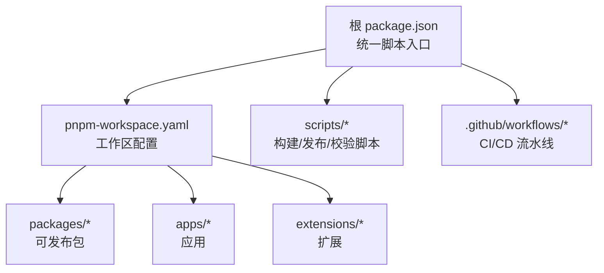
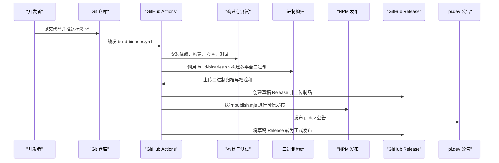
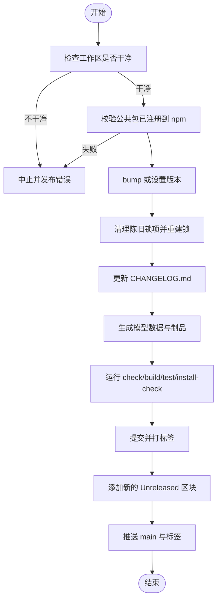
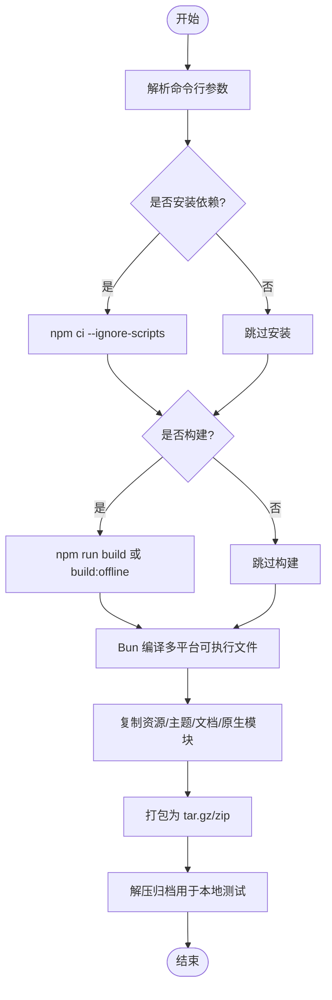
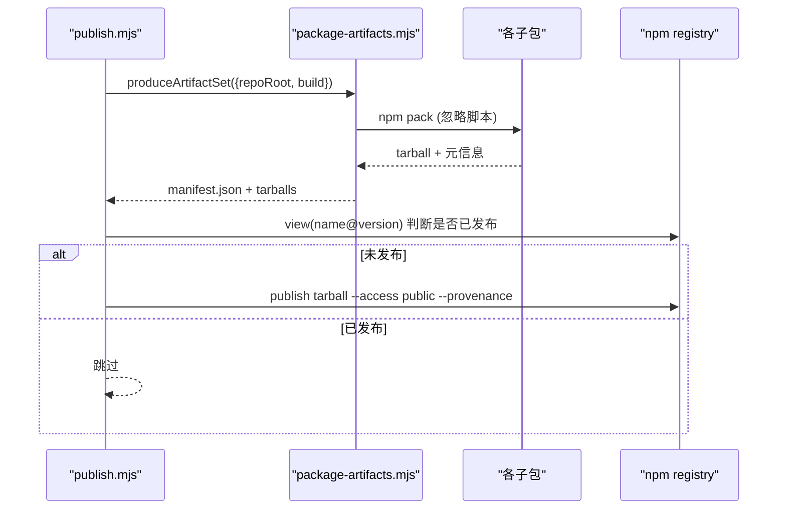
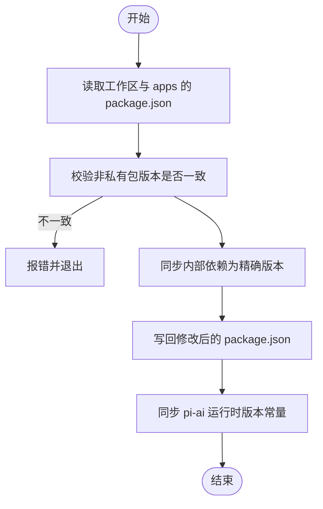
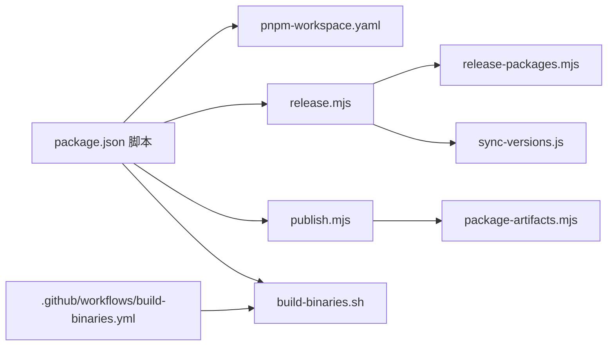

# 构建与发布

<cite>
**本文引用的文件**   
- [package.json](file://package.json)
- [pnpm-workspace.yaml](file://pnpm-workspace.yaml)
- [scripts/release.mjs](file://scripts/release.mjs)
- [scripts/publish.mjs](file://scripts/publish.mjs)
- [scripts/build-binaries.sh](file://scripts/build-binaries.sh)
- [scripts/sync-versions.js](file://scripts/sync-versions.js)
- [scripts/package-artifacts.mjs](file://scripts/package-artifacts.mjs)
- [scripts/release-packages.mjs](file://scripts/release-packages.mjs)
- [.github/workflows/ci.yml](file://.github/workflows/ci.yml)
- [.github/workflows/build-binaries.yml](file://.github/workflows/build-binaries.yml)
- [.github/workflows/publish-model-catalog.yml](file://.github/workflows/publish-model-catalog.yml)
- [test.sh](file://test.sh)
</cite>

## 目录
1. [简介](#简介)
2. [项目结构](#项目结构)
3. [核心组件](#核心组件)
4. [架构总览](#架构总览)
5. [详细组件分析](#详细组件分析)
6. [依赖关系分析](#依赖关系分析)
7. [性能考虑](#性能考虑)
8. [故障排查指南](#故障排查指南)
9. [结论](#结论)
10. [附录](#附录)

## 简介
本文件面向工程化读者，系统性说明该 monorepo 项目的构建流程、版本控制策略、二进制产物构建、NPM 发布以及 CI/CD 流水线。内容覆盖：
- Monorepo 包管理与工作区组织
- 版本同步与锁步发布策略
- 多平台二进制构建与归档
- NPM 可信发布与制品完整性校验
- GitHub Actions 流水线编排与自动化脚本使用
- 发布检查清单与常见问题定位

## 项目结构
仓库采用 pnpm workspace 的 monorepo 结构，顶层 package.json 提供统一脚本入口，CI 通过 GitHub Actions 驱动构建、测试、打包与发布。关键目录与职责：
- packages/*：可发布的库（非 private）
- apps/*：应用入口（如 omfde CLI）
- extensions/*：扩展包
- scripts/*：构建、发布、校验等工程脚本
- .github/workflows/*：CI/CD 流水线定义

图表来源
- [package.json:1-68](file://package.json#L1-L68)
- [pnpm-workspace.yaml:1-15](file://pnpm-workspace.yaml#L1-L15)

章节来源
- [package.json:1-68](file://package.json#L1-L68)
- [pnpm-workspace.yaml:1-15](file://pnpm-workspace.yaml#L1-L15)

## 核心组件
- 构建与检查
  - npm run build / build:offline：按依赖顺序构建各子包；离线模式预置模型数据。
  - npm run check：代码质量、依赖锁定、TS 检查、浏览器冒烟等综合检查。
- 版本管理
  - version:patch/minor/major/set：基于 pnpm 的版本升级，随后执行 sync-versions.js 同步内部依赖为精确版本。
  - release.mjs：端到端发布编排（校验 npm 注册、升版、更新变更日志、生成制品、运行检查与测试、提交打标签并推送）。
- 二进制构建
  - scripts/build-binaries.sh：本地多平台构建（Bun 编译），产出 tar.gz/zip 归档，复制必要资源与原生模块。
- NPM 发布
  - scripts/publish.mjs：对公共包进行 pack + 可信发布（provenance），支持 dry-run。
  - scripts/package-artifacts.mjs：生成带完整性摘要的制品清单，供发布与验证使用。
- CI/CD
  - ci.yml：手动触发的构建、预览包打包、检查与测试矩阵。
  - build-binaries.yml：触发于 v* 标签，构建多平台二进制、冒烟测试、创建草稿 Release、NPM 发布、对外公告、最终发布 Release。
  - publish-model-catalog.yml：定时/手动生成并可选发布模型目录到 R2。

章节来源
- [package.json:6-51](file://package.json#L6-L51)
- [scripts/release.mjs:1-290](file://scripts/release.mjs#L1-L290)
- [scripts/build-binaries.sh:1-201](file://scripts/build-binaries.sh#L1-L201)
- [scripts/publish.mjs:1-65](file://scripts/publish.mjs#L1-L65)
- [scripts/package-artifacts.mjs:1-142](file://scripts/package-artifacts.mjs#L1-L142)
- [.github/workflows/ci.yml:1-126](file://.github/workflows/ci.yml#L1-L126)
- [.github/workflows/build-binaries.yml:1-485](file://.github/workflows/build-binaries.yml#L1-L485)
- [.github/workflows/publish-model-catalog.yml:1-157](file://.github/workflows/publish-model-catalog.yml#L1-L157)

## 架构总览
下图展示从“开发者触发”到“多平台二进制与 NPM 包发布”的端到端流程。

图表来源
- [.github/workflows/build-binaries.yml:24-485](file://.github/workflows/build-binaries.yml#L24-L485)
- [scripts/build-binaries.sh:1-201](file://scripts/build-binaries.sh#L1-L201)
- [scripts/publish.mjs:1-65](file://scripts/publish.mjs#L1-L65)

## 详细组件分析

### 版本控制与发布编排（release.mjs）
- 输入：major|minor|patch 或显式语义化版本号
- 前置校验：
  - 工作区无未提交变更
  - 所有公共包已在 npm 注册
- 版本操作：
  - 自动 bump 或设置目标版本
  - 清理 lockfile 中陈旧的工作区条目，重新生成 lockfile 并安装
- 变更日志：
  - 将 [Unreleased] 替换为具体版本与日期
  - 新增新的 [Unreleased] 区块
- 制品与检查：
  - 生成模型数据、运行 check、build:offline、测试套件、安装包消费检查
- 提交与推送：
  - 提交并打标签，推送 main 与标签以触发 CI 发布

图表来源
- [scripts/release.mjs:1-290](file://scripts/release.mjs#L1-L290)

章节来源
- [scripts/release.mjs:1-290](file://scripts/release.mjs#L1-L290)

### 二进制构建（build-binaries.sh）
- 功能：
  - 解析参数（跳过安装/构建、离线模型数据、指定平台、输出目录）
  - 安装依赖与构建（支持 build:offline）
  - 使用 Bun 编译多平台可执行文件（Windows 使用 zip，Unix 使用 tar.gz）
  - 复制主题、资源、文档、示例与原生模块
  - 解压归档以便本地测试
- 输出：
  - packages/coding-agent/binaries 下各平台归档与解压目录

图表来源
- [scripts/build-binaries.sh:1-201](file://scripts/build-binaries.sh#L1-L201)

章节来源
- [scripts/build-binaries.sh:1-201](file://scripts/build-binaries.sh#L1-L201)

### NPM 发布（publish.mjs 与 package-artifacts.mjs）
- publish.mjs：
  - 校验所有公共包 dist 存在且版本一致
  - 调用 produceArtifactSet 生成制品清单与 tarball
  - 查询 npm 是否已发布同名同版本包，避免重复发布
  - 使用 provenance 与 public access 发布
- package-artifacts.mjs：
  - 对每个包执行 npm pack，计算 sha512 完整性摘要并重命名 tarball
  - 生成 manifest.json，包含 source(commit/dirty)、packages 列表与 integrity
  - 提供 readArtifactSet 校验清单与完整性

图表来源
- [scripts/publish.mjs:1-65](file://scripts/publish.mjs#L1-L65)
- [scripts/package-artifacts.mjs:1-142](file://scripts/package-artifacts.mjs#L1-L142)

章节来源
- [scripts/publish.mjs:1-65](file://scripts/publish.mjs#L1-L65)
- [scripts/package-artifacts.mjs:1-142](file://scripts/package-artifacts.mjs#L1-L142)

### 版本同步（sync-versions.js）
- 作用：
  - 校验所有非私有包版本一致（锁步版本）
  - 将工作区与 apps 中的内部依赖更新为精确版本
  - 同步 @earendil-works/pi-ai 的运行时版本常量
- 约束：
  - 排除 coding-agent/install-lock 等生成目录
  - 遇到版本不一致时中止并提示使用 version:* 命令

图表来源
- [scripts/sync-versions.js:1-99](file://scripts/sync-versions.js#L1-L99)

章节来源
- [scripts/sync-versions.js:1-99](file://scripts/sync-versions.js#L1-L99)

### CI/CD 流水线

#### 通用构建与测试（ci.yml）
- 仅手动触发，用于本地门禁前的质量检查
- 步骤：安装依赖、构建、预览包打包与上传、check、并行测试矩阵、MCP 一致性测试

章节来源
- [.github/workflows/ci.yml:1-126](file://.github/workflows/ci.yml#L1-L126)

#### 二进制构建与发布（build-binaries.yml）
- 触发条件：v* 标签推送或手动触发（可指定 tag/source_ref）
- 主要阶段：
  - build：生成源码归档、从源码构建多平台二进制、准备 Release 资产与 SHA256SUMS
  - smoke-test-binaries：在 Ubuntu/macOS/Windows 上下载对应归档并冒烟测试
  - stage-github-release：校验资产集并创建草稿 Release
  - env-daemons：复用 env-daemons.yml 构建 pi-env 守护进程
  - publish-npm：安装系统依赖、构建、检查、测试、可信发布 NPM 包
  - announce-pi-dev-release：向 pi.dev 发布公告
  - publish-github-release：将草稿 Release 转为正式
  - cleanup-draft-github-release：失败时清理草稿 Release

章节来源
- [.github/workflows/build-binaries.yml:1-485](file://.github/workflows/build-binaries.yml#L1-L485)

#### 模型目录发布（publish-model-catalog.yml）
- 触发：CI 完成、PR 路径变更、定时（工作日特定时段）、手动
- 步骤：生成 model catalog JSON、校验兼容性、上传制品；仅在允许时间窗口内发布到 R2

章节来源
- [.github/workflows/publish-model-catalog.yml:1-157](file://.github/workflows/publish-model-catalog.yml#L1-L157)

## 依赖关系分析
- 顶层脚本与工作区
  - package.json 脚本通过 pnpm --filter 调用各子包的构建与测试
  - pnpm-workspace.yaml 声明工作区范围与 linkWorkspacePackages
- 发布链路
  - release.mjs 依赖 release-packages.mjs 获取公共包列表
  - publish.mjs 依赖 package-artifacts.mjs 生成制品清单与 tarball
  - build-binaries.sh 被 build-binaries.yml 调用，负责多平台构建与归档
- 版本同步
  - sync-versions.js 被 version:* 脚本链调用，确保内部依赖精确版本

图表来源
- [package.json:1-68](file://package.json#L1-L68)
- [pnpm-workspace.yaml:1-15](file://pnpm-workspace.yaml#L1-L15)
- [scripts/release.mjs:1-290](file://scripts/release.mjs#L1-L290)
- [scripts/release-packages.mjs:1-14](file://scripts/release-packages.mjs#L1-L14)
- [scripts/sync-versions.js:1-99](file://scripts/sync-versions.js#L1-L99)
- [scripts/publish.mjs:1-65](file://scripts/publish.mjs#L1-L65)
- [scripts/package-artifacts.mjs:1-142](file://scripts/package-artifacts.mjs#L1-L142)
- [scripts/build-binaries.sh:1-201](file://scripts/build-binaries.sh#L1-L201)
- [.github/workflows/build-binaries.yml:1-485](file://.github/workflows/build-binaries.yml#L1-L485)

章节来源
- [package.json:1-68](file://package.json#L1-L68)
- [pnpm-workspace.yaml:1-15](file://pnpm-workspace.yaml#L1-L15)
- [scripts/release.mjs:1-290](file://scripts/release.mjs#L1-L290)
- [scripts/release-packages.mjs:1-14](file://scripts/release-packages.mjs#L1-L14)
- [scripts/sync-versions.js:1-99](file://scripts/sync-versions.js#L1-L99)
- [scripts/publish.mjs:1-65](file://scripts/publish.mjs#L1-L65)
- [scripts/package-artifacts.mjs:1-142](file://scripts/package-artifacts.mjs#L1-L142)
- [scripts/build-binaries.sh:1-201](file://scripts/build-binaries.sh#L1-L201)
- [.github/workflows/build-binaries.yml:1-485](file://.github/workflows/build-binaries.yml#L1-L485)

## 性能考虑
- 构建优化
  - 使用 build:offline 预置模型数据，减少网络依赖与构建不确定性
  - CI 缓存 Node 依赖，缩短冷启动时间
- 测试隔离
  - test.sh 创建临时 HOME/TMP/PNPM_HOME 等目录，避免污染用户环境，提升稳定性
- 并行化
  - CI 测试矩阵并行执行不同测试套件，降低整体耗时

章节来源
- [package.json:8-10](file://package.json#L8-L10)
- [test.sh:1-84](file://test.sh#L1-L84)
- [.github/workflows/ci.yml:51-105](file://.github/workflows/ci.yml#L51-L105)

## 故障排查指南
- 发布前检查失败
  - 确认工作区干净（无未提交变更）
  - 确认所有公共包已在 npm 注册（release.mjs 会主动校验）
- 版本不一致
  - 使用 version:patch/minor/major 统一升版，再执行 sync-versions.js
- 二进制构建失败
  - 检查平台参数与 Bun 目标是否正确
  - 确认 Windows 下 zip/tar 工具可用
- NPM 发布失败
  - 确认 dist 目录存在且版本一致
  - 使用 publish.mjs --dry-run 预检
- 模型目录发布异常
  - 检查 generate/model-catalog 与 check:model-catalog-compat 是否通过
  - 确认 R2 凭据与时间窗口配置正确

章节来源
- [scripts/release.mjs:1-290](file://scripts/release.mjs#L1-L290)
- [scripts/sync-versions.js:1-99](file://scripts/sync-versions.js#L1-L99)
- [scripts/build-binaries.sh:1-201](file://scripts/build-binaries.sh#L1-L201)
- [scripts/publish.mjs:1-65](file://scripts/publish.mjs#L1-L65)
- [.github/workflows/publish-model-catalog.yml:1-157](file://.github/workflows/publish-model-catalog.yml#L1-L157)

## 结论
本项目通过 pnpm workspace 统一管理多包依赖，配合 release.mjs 与 sync-versions.js 实现严格的锁步版本与内部依赖精确化；通过 build-binaries.sh 与 GitHub Actions 实现跨平台二进制构建与可信 NPM 发布；通过 CI/CD 流水线保障构建质量、制品完整性与发布安全。遵循本文档的流程与检查清单，可有效降低发布风险并提升工程效率。

## 附录

### 常用命令速查
- 构建
  - npm run build
  - npm run build:offline
- 检查
  - npm run check
- 测试
  - npm test
  - ./test.sh
- 版本
  - npm run version:patch|minor|majorset
  - node scripts/sync-versions.js
- 发布
  - node scripts/release.mjs <major|minor|patch|x.y.z>
  - node scripts/publish.mjs [--dry-run]
- 二进制
  - ./scripts/build-binaries.sh [--skip-install] [--skip-build] [--offline-model-data] [--platform <name>] [--out <dir>]

章节来源
- [package.json:6-51](file://package.json#L6-L51)
- [scripts/release.mjs:1-290](file://scripts/release.mjs#L1-L290)
- [scripts/publish.mjs:1-65](file://scripts/publish.mjs#L1-L65)
- [scripts/build-binaries.sh:1-201](file://scripts/build-binaries.sh#L1-L201)
- [test.sh:1-84](file://test.sh#L1-L84)

### 发布检查清单
- 代码与质量
  - 无未提交变更
  - npm run check 全部通过
- 版本与依赖
  - 所有公共包版本一致（lockstep）
  - 内部依赖已同步为精确版本
- 构建与测试
  - npm run build 与 npm run build:offline 成功
  - npm test 与 ./test.sh 通过
  - 二进制冒烟测试通过（CI 自动）
- 制品与发布
  - 公共包 dist 目录存在
  - publish.mjs --dry-run 通过
  - GitHub Release 草稿资产完整且校验和匹配
  - NPM 可信发布成功
  - pi.dev 公告已发布
  - GitHub Release 由草稿转为正式发布

章节来源
- [scripts/release.mjs:1-290](file://scripts/release.mjs#L1-L290)
- [scripts/publish.mjs:1-65](file://scripts/publish.mjs#L1-L65)
- [.github/workflows/build-binaries.yml:24-485](file://.github/workflows/build-binaries.yml#L24-L485)