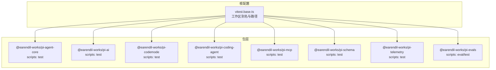
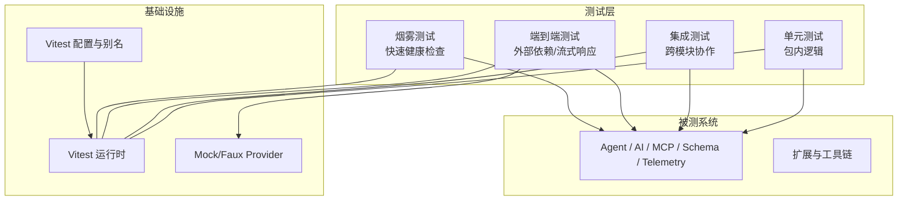
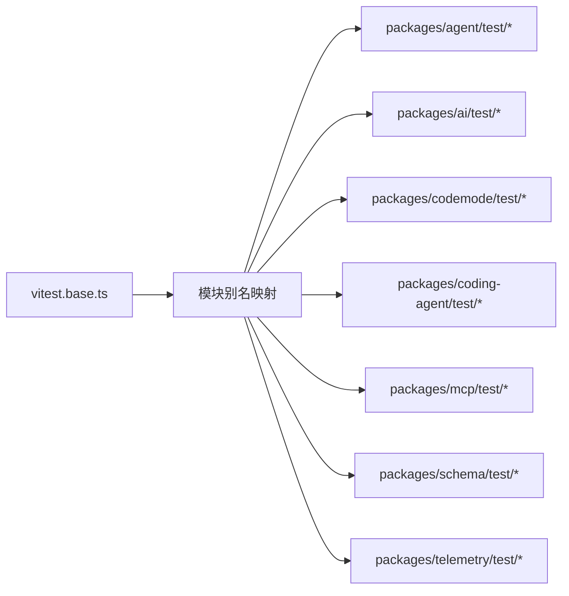

# 测试指南

<cite>
**本文引用的文件**   
- [vitest.base.ts](file://vitest.base.ts)
- [packages/agent/package.json](file://packages/agent/package.json)
- [packages/ai/package.json](file://packages/ai/package.json)
- [packages/codemode/package.json](file://packages/codemode/package.json)
- [packages/coding-agent/package.json](file://packages/coding-agent/package.json)
- [packages/mcp/package.json](file://packages/mcp/package.json)
- [packages/schema/package.json](file://packages/schema/package.json)
- [packages/telemetry/package.json](file://packages/telemetry/package.json)
- [packages/evals/package.json](file://packages/evals/package.json)
- [packages/agent/test/e2e.test.ts](file://packages/agent/test/e2e.test.ts)
- [packages/ai/test/anthropic-eager-tool-input-e2e.test.ts](file://packages/ai/test/anthropic-eager-tool-input-e2e.test.ts)
</cite>

## 目录
1. [简介](#简介)
2. [项目结构](#项目结构)
3. [核心组件](#核心组件)
4. [架构总览](#架构总览)
5. [详细组件分析](#详细组件分析)
6. [依赖分析](#依赖分析)
7. [性能考虑](#性能考虑)
8. [故障排查指南](#故障排查指南)
9. [结论](#结论)
10. [附录](#附录)

## 简介
本指南面向仓库内的多包 TypeScript 工程，提供覆盖单元测试、集成测试与端到端（E2E）测试的完整策略与实践。重点包括：
- Vitest 配置与工作区别名映射
- 测试数据管理与 Mock 策略
- 覆盖率要求与报告
- 性能测试与烟雾测试的高级用法
- 脚本命令与最佳实践

## 项目结构
仓库采用 pnpm workspace 组织多个包，每个包均通过 package.json 暴露统一的 test 脚本，使用 Vitest 运行。根级 vitest.base.ts 集中定义工作区源路径与模块别名，便于在测试中直接引用源码而非构建产物。

图表来源
- [vitest.base.ts:44-96](file://vitest.base.ts#L44-L96)
- [packages/agent/package.json:19-23](file://packages/agent/package.json#L19-L23)
- [packages/ai/package.json:66-75](file://packages/ai/package.json#L66-L75)
- [packages/codemode/package.json:44-48](file://packages/codemode/package.json#L44-L48)
- [packages/coding-agent/package.json:31-41](file://packages/coding-agent/package.json#L31-L41)
- [packages/mcp/package.json:32-36](file://packages/mcp/package.json#L32-L36)
- [packages/schema/package.json:27-32](file://packages/schema/package.json#L27-L32)
- [packages/telemetry/package.json:29-33](file://packages/telemetry/package.json#L29-L33)
- [packages/evals/package.json:6-12](file://packages/evals/package.json#L6-L12)

章节来源
- [vitest.base.ts:1-97](file://vitest.base.ts#L1-L97)
- [packages/agent/package.json:1-51](file://packages/agent/package.json#L1-L51)
- [packages/ai/package.json:1-116](file://packages/ai/package.json#L1-L116)
- [packages/codemode/package.json:1-76](file://packages/codemode/package.json#L1-L76)
- [packages/coding-agent/package.json:1-98](file://packages/coding-agent/package.json#L1-L98)
- [packages/mcp/package.json:1-61](file://packages/mcp/package.json#L1-L61)
- [packages/schema/package.json:1-61](file://packages/schema/package.json#L1-L61)
- [packages/telemetry/package.json:1-55](file://packages/telemetry/package.json#L1-L55)
- [packages/evals/package.json:1-23](file://packages/evals/package.json#L1-L23)

## 核心组件
- Vitest 基础配置与别名
  - 通过 defineConfig 导出默认配置，集中声明工作区源路径与模块别名，确保测试直接解析到源码，避免引入已构建产物导致的不一致。
  - 别名覆盖了 chord、telemetry、mcp、ai、agent、codemode、tui 等包的入口与子路径。

- 各包测试脚本
  - 所有包统一使用 vitest --run 作为测试入口，便于在 CI 中并行执行。
  - evals 包提供独立配置文件与 project 划分，用于评估场景。

章节来源
- [vitest.base.ts:44-96](file://vitest.base.ts#L44-L96)
- [packages/agent/package.json:19-23](file://packages/agent/package.json#L19-L23)
- [packages/ai/package.json:66-75](file://packages/ai/package.json#L66-L75)
- [packages/codemode/package.json:44-48](file://packages/codemode/package.json#L44-L48)
- [packages/coding-agent/package.json:31-41](file://packages/coding-agent/package.json#L31-L41)
- [packages/mcp/package.json:32-36](file://packages/mcp/package.json#L32-L36)
- [packages/schema/package.json:27-32](file://packages/schema/package.json#L27-L32)
- [packages/telemetry/package.json:29-33](file://packages/telemetry/package.json#L29-L33)
- [packages/evals/package.json:6-12](file://packages/evals/package.json#L6-L12)

## 架构总览
下图展示测试在仓库中的分层与交互关系：单元测试聚焦包内逻辑；集成测试验证跨模块协作；E2E 测试驱动真实或模拟的外部服务；脚本层提供烟雾测试与质量门禁。

图表来源
- [vitest.base.ts:44-96](file://vitest.base.ts#L44-L96)
- [packages/agent/test/e2e.test.ts:1-417](file://packages/agent/test/e2e.test.ts#L1-L417)
- [packages/ai/test/anthropic-eager-tool-input-e2e.test.ts:1-156](file://packages/ai/test/anthropic-eager-tool-input-e2e.test.ts#L1-L156)

## 详细组件分析

### 单元测试策略与最佳实践
- 目标
  - 覆盖核心函数、类方法与边界条件
  - 保持测试快速、稳定、可重复
- 建议
  - 将测试文件放在包内 test 目录，命名以 .test.ts 结尾
  - 使用 describe/it/expect 组织用例
  - 对副作用进行隔离（文件系统、网络、时间）
  - 使用共享 fixtures 管理测试数据

章节来源
- [packages/agent/package.json:19-23](file://packages/agent/package.json#L19-L23)
- [packages/ai/package.json:66-75](file://packages/ai/package.json#L66-L75)
- [packages/codemode/package.json:44-48](file://packages/codemode/package.json#L44-L48)
- [packages/mcp/package.json:32-36](file://packages/mcp/package.json#L32-L36)
- [packages/schema/package.json:27-32](file://packages/schema/package.json#L27-L32)
- [packages/telemetry/package.json:29-33](file://packages/telemetry/package.json#L29-L33)

### 集成测试策略与最佳实践
- 目标
  - 验证模块间协作、事件流、状态机流转
- 建议
  - 使用 Faux/Mock Provider 替代真实 LLM 调用
  - 断言消息序列、工具调用生命周期、错误处理
  - 关注流式事件的顺序与完整性

章节来源
- [packages/agent/test/e2e.test.ts:1-417](file://packages/agent/test/e2e.test.ts#L1-L417)

### 端到端测试策略与最佳实践
- 目标
  - 验证与外部模型提供商的兼容性、工具输入流式能力、密钥加载与鉴权流程
- 建议
  - 使用 skipIf 跳过无密钥环境
  - 按 provider/model 矩阵生成用例，控制重试次数
  - 断言 stopReason、errorMessage 等关键指标

章节来源
- [packages/ai/test/anthropic-eager-tool-input-e2e.test.ts:1-156](file://packages/ai/test/anthropic-eager-tool-input-e2e.test.ts#L1-L156)

### Vitest 配置与工作区别名
- 工作区源路径
  - 集中维护各包的源码入口路径，便于别名替换
- 模块别名
  - 将 @earendil-works/* 包名映射到源码路径，确保测试直接加载 TS 源码
- 建议
  - 新增包时同步更新 workspaceSourcePaths 与 alias
  - 保持别名与包 exports 字段一致

章节来源
- [vitest.base.ts:4-43](file://vitest.base.ts#L4-L43)
- [vitest.base.ts:44-96](file://vitest.base.ts#L44-L96)

### 测试数据管理
- 固定夹具
  - 将常用消息、工具参数、模型元数据抽取为 fixtures
- 动态构造
  - 使用工厂函数生成不同场景的数据（如多轮对话、工具调用结果）
- 清理与隔离
  - afterEach 中清理全局注册、临时文件、进程句柄

章节来源
- [packages/agent/test/e2e.test.ts:18-37](file://packages/agent/test/e2e.test.ts#L18-L37)

### Mock 策略
- Faux Provider
  - 使用 registerFauxProvider 创建假模型提供者，注入预设响应
  - 支持流式输出、工具调用、思考块等复杂场景
- 代理与中间件
  - 对 stream 代理进行断言，确保元数据与终止事件正确传递
- 建议
  - 尽量在集成/E2E 层使用 Faux Provider，避免污染单元测试
  - 对第三方 SDK 使用 vi.fn/vi.spyOn 进行最小化 Mock

章节来源
- [packages/agent/test/e2e.test.ts:1-417](file://packages/agent/test/e2e.test.ts#L1-L417)

### 覆盖率要求与报告
- 建议阈值
  - 行覆盖率 ≥ 80%
  - 分支覆盖率 ≥ 70%
  - 函数覆盖率 ≥ 85%
  - 语句覆盖率 ≥ 85%
- 报告输出
  - 启用 HTML 与 JSON 报告，便于归档与可视化
- 持续集成
  - 在 CI 中收集覆盖率并设置失败阈值

[本节为通用指导，不直接分析具体文件]

### 性能测试与基准
- 适用场景
  - 高频路径、序列化/反序列化、流式处理
- 方法
  - 使用 Node --expose-gc 配合自定义基准脚本
  - 对比不同实现的性能差异
- 建议
  - 将基准脚本与测试分离，避免影响常规测试速度

章节来源
- [packages/schema/package.json:27-32](file://packages/schema/package.json#L27-L32)

### 烟雾测试与快速健康检查
- 目标
  - 快速验证关键路径可用，如 CLI 启动、二进制打包、浏览器入口
- 方法
  - 使用最小入口脚本触发主流程，断言返回码或关键输出
  - 结合脚本工具进行自动化校验

章节来源
- [scripts/check-browser-smoke.mjs](file://scripts/check-browser-smoke.mjs)
- [scripts/smoke-test-codemode-binary.mjs](file://scripts/smoke-test-codemode-binary.mjs)

## 依赖分析
下图展示测试与包的依赖关系，以及 Vitest 配置如何影响模块解析。

图表来源
- [vitest.base.ts:44-96](file://vitest.base.ts#L44-L96)

章节来源
- [vitest.base.ts:44-96](file://vitest.base.ts#L44-L96)

## 性能考虑
- 测试隔离
  - 避免共享可变状态，必要时在 beforeEach/afterEach 重置
- I/O 与网络
  - 使用内存存储或本地临时目录，避免磁盘抖动
  - Mock 网络请求，减少外部不确定性
- 并发与资源
  - 合理设置 Vitest 并发数，避免 CPU/内存瓶颈
- 流式处理
  - 在 E2E 中控制 token 速率与大小，缩短测试时长

[本节为通用指导，不直接分析具体文件]

## 故障排查指南
- 常见问题
  - 别名未生效：检查 vitest.base.ts 中是否包含对应包的别名
  - 测试不稳定：确认 Faux Provider 的响应序列与事件顺序
  - 密钥缺失：E2E 中使用 skipIf 跳过，或在本地配置环境变量
- 定位步骤
  - 缩小范围：仅运行单个包或单条用例
  - 增加日志：在关键路径打印上下文与状态快照
  - 复现最小用例：剥离无关逻辑，保留失败路径

章节来源
- [packages/ai/test/anthropic-eager-tool-input-e2e.test.ts:126-155](file://packages/ai/test/anthropic-eager-tool-input-e2e.test.ts#L126-L155)
- [packages/agent/test/e2e.test.ts:33-37](file://packages/agent/test/e2e.test.ts#L33-L37)

## 结论
本指南基于仓库现有结构与测试样例，总结了 Vitest 配置、Mock 策略、数据管理与高级测试场景的实践。建议在新增功能时同步补充相应层次的测试，并在 CI 中强制执行覆盖率与稳定性门槛，持续提升代码质量与交付信心。

[本节为总结性内容，不直接分析具体文件]

## 附录
- 常用命令
  - 运行包测试：pnpm run test（在各包目录下）
  - 运行评估任务：pnpm run eval（在 evals 包下）
- 参考文件
  - 根级 Vitest 配置：vitest.base.ts
  - 包测试脚本：各包 package.json scripts.test
  - E2E 示例：packages/agent/test/e2e.test.ts、packages/ai/test/anthropic-eager-tool-input-e2e.test.ts

章节来源
- [packages/agent/package.json:19-23](file://packages/agent/package.json#L19-L23)
- [packages/ai/package.json:66-75](file://packages/ai/package.json#L66-L75)
- [packages/evals/package.json:6-12](file://packages/evals/package.json#L6-L12)
- [packages/agent/test/e2e.test.ts:1-417](file://packages/agent/test/e2e.test.ts#L1-L417)
- [packages/ai/test/anthropic-eager-tool-input-e2e.test.ts:1-156](file://packages/ai/test/anthropic-eager-tool-input-e2e.test.ts#L1-L156)