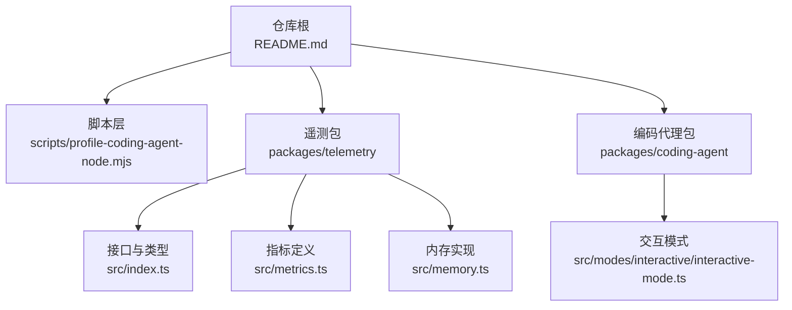
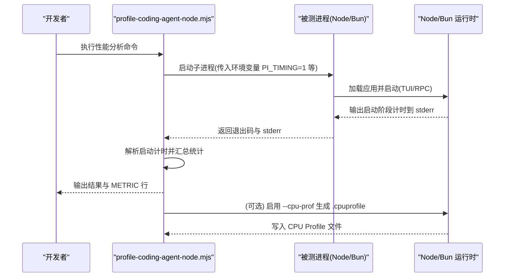
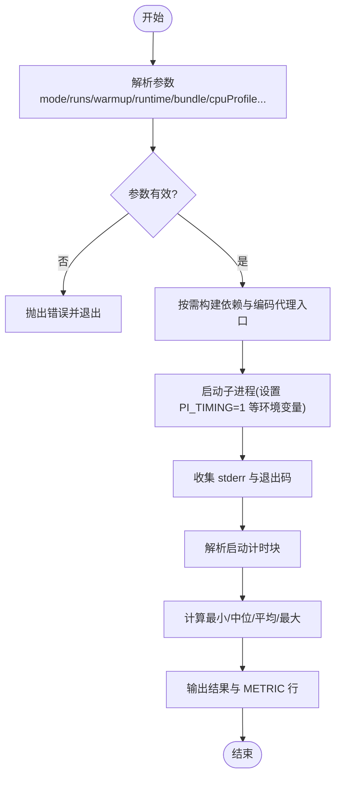
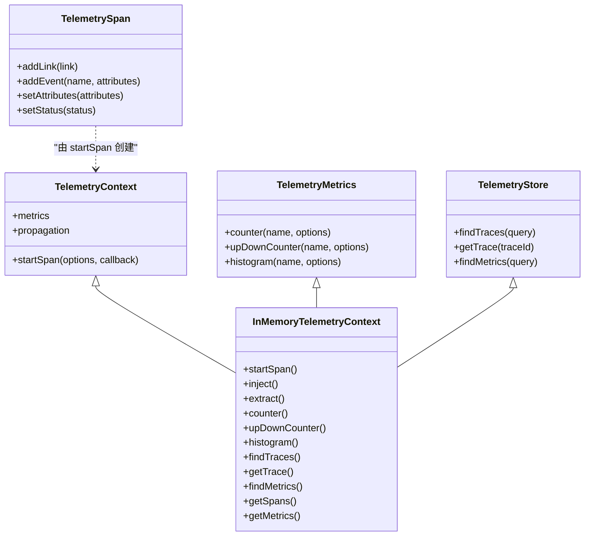
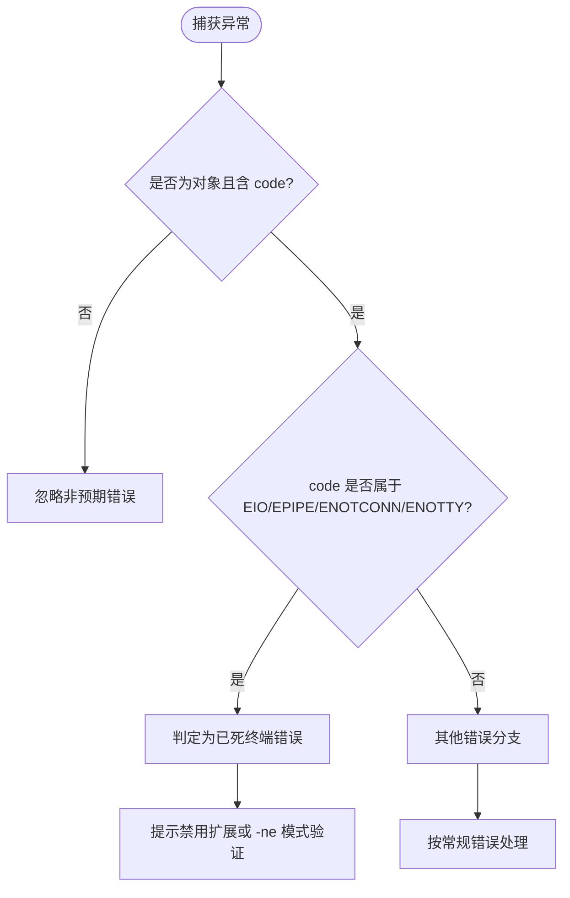
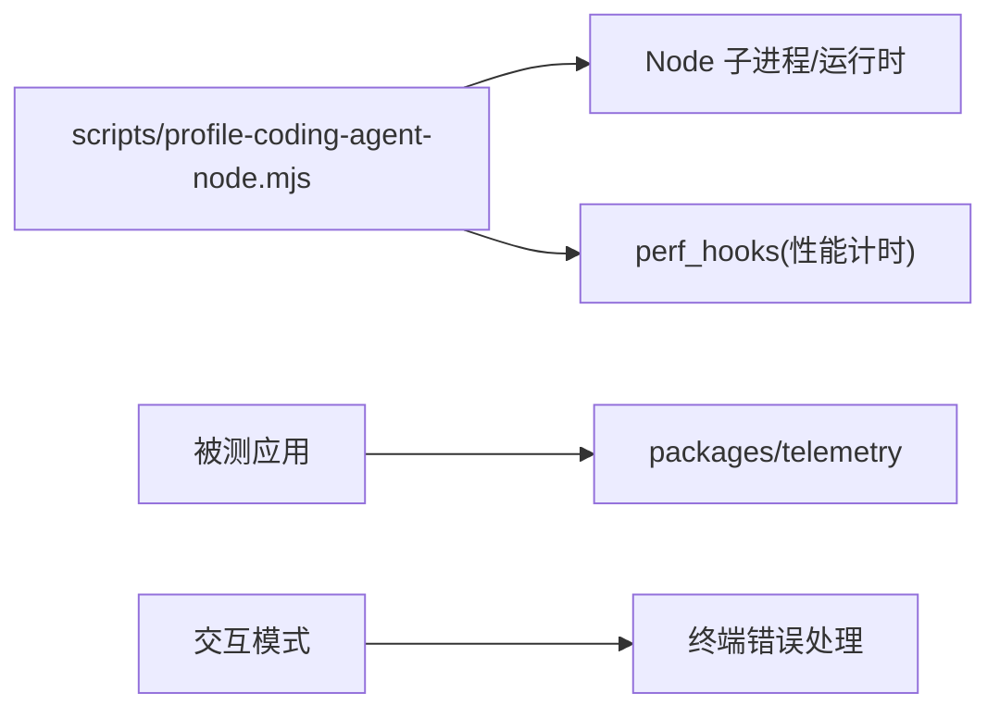

# 调试与性能分析

<cite>
**本文引用的文件**   
- [README.md](file://README.md)
- [profile-coding-agent-node.mjs](file://scripts/profile-coding-agent-node.mjs)
- [index.ts](file://packages/telemetry/src/index.ts)
- [metrics.ts](file://packages/telemetry/src/metrics.ts)
- [memory.ts](file://packages/telemetry/src/memory.ts)
- [interactive-mode.ts](file://packages/coding-agent/src/modes/interactive/interactive-mode.ts)
</cite>

## 目录
1. [简介](#简介)
2. [项目结构](#项目结构)
3. [核心组件](#核心组件)
4. [架构总览](#架构总览)
5. [详细组件分析](#详细组件分析)
6. [依赖关系分析](#依赖关系分析)
7. [性能注意事项](#性能注意事项)
8. [故障排查指南](#故障排查指南)
9. [结论](#结论)
10. [附录](#附录)

## 简介
本指南聚焦于在 Node.js 环境下对 Pi 项目的调试技巧与性能分析方法，覆盖以下主题：
- Node.js 调试器使用要点
- 日志与遥测记录策略（基于 telemetry 包）
- 内存泄漏检测思路
- 启动性能分析与基准测试（含 CPU Profiling）
- 常用调试命令、性能监控指标与问题诊断方法

本项目为多包仓库，包含 CLI、Agent、TUI、AI 等模块。仓库根 README 提供了安装、开发与构建说明；脚本层提供启动性能分析工具；telemetry 包提供可插拔的遥测与度量能力；交互模式包含终端错误处理逻辑，有助于定位 TTY 相关问题。

## 项目结构
从调试与性能视角，重点关注以下位置：
- scripts/profile-coding-agent-node.mjs：启动性能基准与 CPU Profile 生成
- packages/telemetry：遥测上下文、指标定义与内存实现
- packages/coding-agent：CLI 入口与交互模式（TTY 错误处理）
- README.md：开发工作流与运行环境要求

**图示来源**
- [README.md:86-95](file://README.md#L86-L95)
- [profile-coding-agent-node.mjs:1-50](file://scripts/profile-coding-agent-node.mjs#L1-L50)
- [index.ts:1-130](file://packages/telemetry/src/index.ts#L1-L130)
- [metrics.ts:1-50](file://packages/telemetry/src/metrics.ts#L1-L50)
- [memory.ts:309-330](file://packages/telemetry/src/memory.ts#L309-L330)
- [interactive-mode.ts:298-325](file://packages/coding-agent/src/modes/interactive/interactive-mode.ts#L298-L325)

**章节来源**
- [README.md:86-95](file://README.md#L86-L95)

## 核心组件
- 启动性能分析脚本：支持 Node/Bun 双运行时，测量 TUI/RPC 两种模式的启动耗时，输出统计与 METRIC 行，并可生成 CPU Profile 文件用于后续火焰图分析。
- 遥测系统：提供 TelemetryContext、TelemetryMetrics、TelemetryStore 等接口，以及 InMemoryTelemetryContext 内存实现，便于本地调试、测试与可视化。
- 交互模式错误处理：识别并过滤“已死终端”相关错误码，辅助定位 TTY 异常导致的崩溃或中断。

**章节来源**
- [profile-coding-agent-node.mjs:19-50](file://scripts/profile-coding-agent-node.mjs#L19-L50)
- [index.ts:94-130](file://packages/telemetry/src/index.ts#L94-L130)
- [memory.ts:309-330](file://packages/telemetry/src/memory.ts#L309-L330)
- [interactive-mode.ts:298-325](file://packages/coding-agent/src/modes/interactive/interactive-mode.ts#L298-L325)

## 架构总览
下图展示启动性能分析脚本如何驱动被测进程、收集标准错误中的启动计时信息，并在需要时生成 CPU Profile。

**图示来源**
- [profile-coding-agent-node.mjs:379-394](file://scripts/profile-coding-agent-node.mjs#L379-L394)
- [profile-coding-agent-node.mjs:396-441](file://scripts/profile-coding-agent-node.mjs#L396-L441)
- [profile-coding-agent-node.mjs:456-544](file://scripts/profile-coding-agent-node.mjs#L456-L544)
- [profile-coding-agent-node.mjs:626-665](file://scripts/profile-coding-agent-node.mjs#L626-L665)

## 详细组件分析

### 启动性能分析脚本
该脚本提供以下关键能力：
- 模式选择：tui/rpc
- 运行次数与预热：runs/warmup
- 运行时选择：node/bun/auto
- 构建控制：skip-build、bundle
- 隔离 Agent 目录：isolated-agent-dir
- CPU Profile：cpu-profile、profile-dir、label

**图示来源**
- [profile-coding-agent-node.mjs:75-176](file://scripts/profile-coding-agent-node.mjs#L75-L176)
- [profile-coding-agent-node.mjs:289-348](file://scripts/profile-coding-agent-node.mjs#L289-L348)
- [profile-coding-agent-node.mjs:379-394](file://scripts/profile-coding-agent-node.mjs#L379-L394)
- [profile-coding-agent-node.mjs:396-441](file://scripts/profile-coding-agent-node.mjs#L396-L441)
- [profile-coding-agent-node.mjs:456-544](file://scripts/profile-coding-agent-node.mjs#L456-L544)
- [profile-coding-agent-node.mjs:626-665](file://scripts/profile-coding-agent-node.mjs#L626-L665)

实用要点：
- 通过 PI_TIMING=1 触发被测进程输出“启动计时”块，脚本解析这些行以得到各阶段耗时。
- 在 Node 下可通过 --cpu-prof 与 --cpu-prof-dir/--cpu-prof-name 生成 .cpuprofile，供 Chrome DevTools 或 VS Code 打开进行火焰图分析。
- 支持 RPC 模式：向子进程 stdin 发送 get_state 请求，等待响应后关闭 stdin 以优雅退出，从而精确测量“可用状态”时间。

**章节来源**
- [profile-coding-agent-node.mjs:19-50](file://scripts/profile-coding-agent-node.mjs#L19-L50)
- [profile-coding-agent-node.mjs:379-394](file://scripts/profile-coding-agent-node.mjs#L379-L394)
- [profile-coding-agent-node.mjs:456-544](file://scripts/profile-coding-agent-node.mjs#L456-L544)
- [profile-coding-agent-node.mjs:626-665](file://scripts/profile-coding-agent-node.mjs#L626-L665)

### 遥测系统与指标
遥测包提供统一的上下文、传播、指标与存储接口，并提供内存实现用于本地调试与测试。

**图示来源**
- [index.ts:94-130](file://packages/telemetry/src/index.ts#L94-L130)
- [memory.ts:309-330](file://packages/telemetry/src/memory.ts#L309-L330)
- [memory.ts:356-366](file://packages/telemetry/src/memory.ts#L356-L366)
- [memory.ts:394-460](file://packages/telemetry/src/memory.ts#L394-L460)
- [memory.ts:462-493](file://packages/telemetry/src/memory.ts#L462-L493)

实践建议：
- 使用 InMemoryTelemetryContext 在本地捕获 span、事件与指标，结合 getSpans()/getMetrics() 做断言与可视化。
- 通过 defineTelemetrySchema/createTypedSpanStarter/createTypedMetrics 获得强类型的 span 与指标 API，减少拼写错误与属性遗漏。
- 利用 propagation.inject/extract 跨进程/线程传递追踪上下文，便于分布式链路分析。

**章节来源**
- [index.ts:1-130](file://packages/telemetry/src/index.ts#L1-L130)
- [metrics.ts:1-50](file://packages/telemetry/src/metrics.ts#L1-L50)
- [memory.ts:309-330](file://packages/telemetry/src/memory.ts#L309-L330)

### 交互模式与终端错误处理
交互模式中包含针对“已死终端”的错误码集合与判断逻辑，可用于快速定位 TTY 读取失败、挂起或权限变更等问题。

**图示来源**
- [interactive-mode.ts:298-325](file://packages/coding-agent/src/modes/interactive/interactive-mode.ts#L298-L325)

**章节来源**
- [interactive-mode.ts:298-325](file://packages/coding-agent/src/modes/interactive/interactive-mode.ts#L298-L325)

## 依赖关系分析
- 启动性能分析脚本依赖 Node 子进程与 perf_hooks，负责构建、启动被测进程、解析 stderr 中的启动计时，并可选择启用 CPU Profiling。
- 遥测包提供抽象接口与内存实现，被上层业务代码注入以采集 span、事件与指标。
- 交互模式依赖 Node TTY 语义，对特定错误码进行识别与提示。

**图示来源**
- [profile-coding-agent-node.mjs:1-10](file://scripts/profile-coding-agent-node.mjs#L1-L10)
- [index.ts:1-130](file://packages/telemetry/src/index.ts#L1-L130)
- [interactive-mode.ts:298-325](file://packages/coding-agent/src/modes/interactive/interactive-mode.ts#L298-L325)

**章节来源**
- [profile-coding-agent-node.mjs:1-10](file://scripts/profile-coding-agent-node.mjs#L1-L10)
- [index.ts:1-130](file://packages/telemetry/src/index.ts#L1-L130)
- [interactive-mode.ts:298-325](file://packages/coding-agent/src/modes/interactive/interactive-mode.ts#L298-L325)

## 性能注意事项
- 启动性能基线：
  - 使用脚本分别测量 tui 与 rpc 模式，多次运行取中位数，关注 startup_time_ms 与各阶段计时。
  - 对比 unbundled 与 bundled 入口的差异，确认打包对冷启动的影响。
- CPU Profiling：
  - 在 Node 下启用 --cpu-prof，将 .cpuprofile 导入浏览器或 IDE 查看热点函数与调用栈。
  - 注意区分 JIT 预热影响，合理设置 warmup 次数。
- 遥测与指标：
  - 使用 histogram 记录延迟分布，counter/upDownCounter 记录事件计数与资源占用变化。
  - 通过 findMetrics/getMetrics 拉取原始数据，结合外部可视化工具绘制趋势图。
- 内存泄漏检测：
  - 使用 Node 堆快照（heap snapshot）与 --inspect 进行交互式分析。
  - 结合遥测指标（如连接数、缓存大小）定位增长趋势。
  - 在长时间运行的 RPC 模式下观察指标曲线，发现异常增长。

[本节为通用指导，不直接分析具体文件]

## 故障排查指南
- TTY 相关错误：
  - 若出现 EIO/EPIPE/ENOTCONN/ENOTTY，优先检查终端会话、管道与权限变更。
  - 尝试禁用可疑扩展或使用 -ne 模式验证问题范围。
- 启动失败或无响应：
  - 检查脚本构建步骤是否成功，确保 dist/cli.js 未被误用为 bundle facade。
  - 在 RPC 模式下确认 get_state 响应是否到达，必要时抓取 stderr 与 stdout。
- 遥测数据缺失：
  - 确认 InMemoryTelemetryContext 是否正确注入，span 是否被 startSpan 包裹。
  - 检查 propagate.inject/extract 是否正确传递上下文。

**章节来源**
- [interactive-mode.ts:298-325](file://packages/coding-agent/src/modes/interactive/interactive-mode.ts#L298-L325)
- [profile-coding-agent-node.mjs:585-596](file://scripts/profile-coding-agent-node.mjs#L585-L596)
- [profile-coding-agent-node.mjs:456-544](file://scripts/profile-coding-agent-node.mjs#L456-L544)
- [memory.ts:309-330](file://packages/telemetry/src/memory.ts#L309-L330)

## 结论
通过脚本化的启动性能分析与遥测体系，可以在 Node.js 环境中高效定位冷启动瓶颈、运行时热点与潜在内存问题。结合 TTY 错误处理与 RPC/TUI 双模式基准，能够形成完整的调试与性能优化闭环。建议在 CI 中集成启动耗时与关键指标的回归检查，持续保障产品性能。

[本节为总结性内容，不直接分析具体文件]

## 附录
- 常用调试命令（示例）：
  - 启动性能基准（tui 模式，Node）：node scripts/profile-coding-agent-node.mjs --mode tui --runs 5 --warmup 2 --cpu-profile
  - 启动性能基准（rpc 模式，Bun）：bun run scripts/profile-coding-agent-node.mjs --mode rpc --runtime bun --runs 5
  - 仅构建并复用产物（Node）：node scripts/profile-coding-agent-node.mjs --skip-build --mode tui
  - 使用隔离 Agent 目录：node scripts/profile-coding-agent-node.mjs --isolated-agent-dir --mode tui
- 性能监控指标（脚本输出）：
  - startup_time_ms：整体启动耗时
  - 各阶段计时（例如依赖构建、编码代理构建、UI 就绪等），以 METRIC 行输出，便于自动化采集

**章节来源**
- [profile-coding-agent-node.mjs:19-50](file://scripts/profile-coding-agent-node.mjs#L19-L50)
- [profile-coding-agent-node.mjs:626-665](file://scripts/profile-coding-agent-node.mjs#L626-L665)