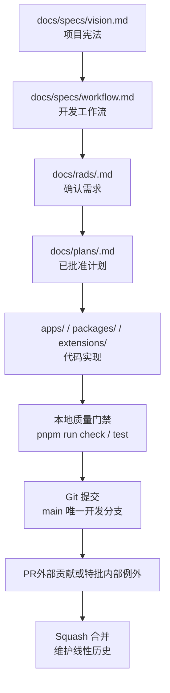
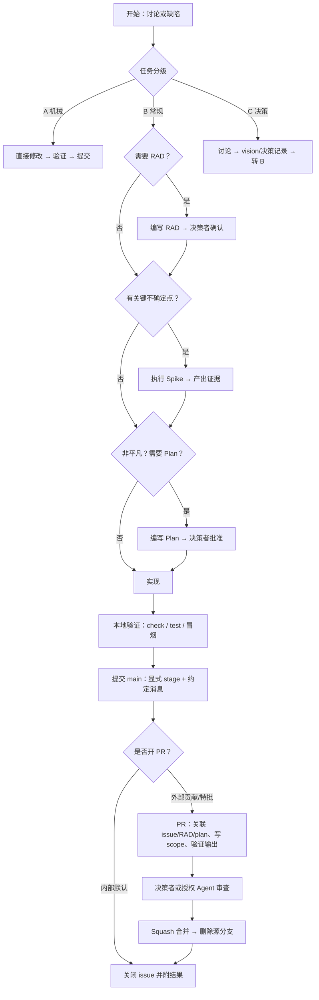
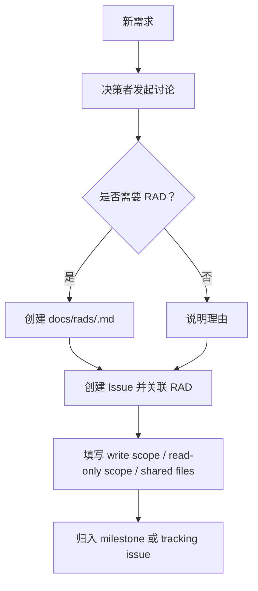
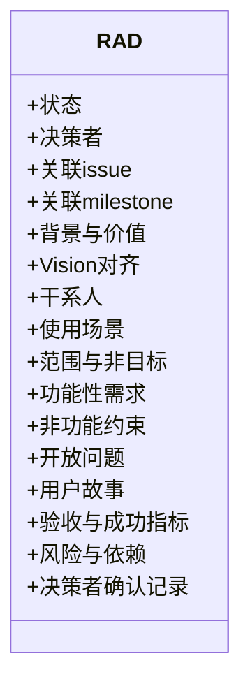
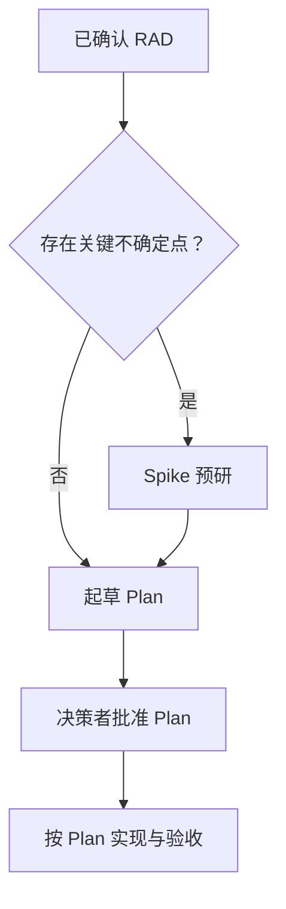
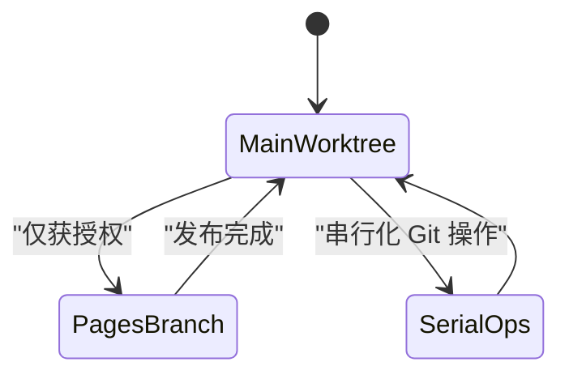
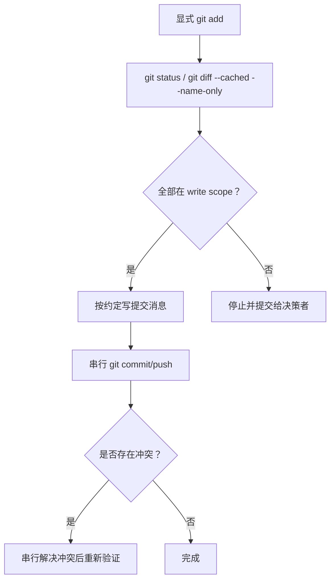
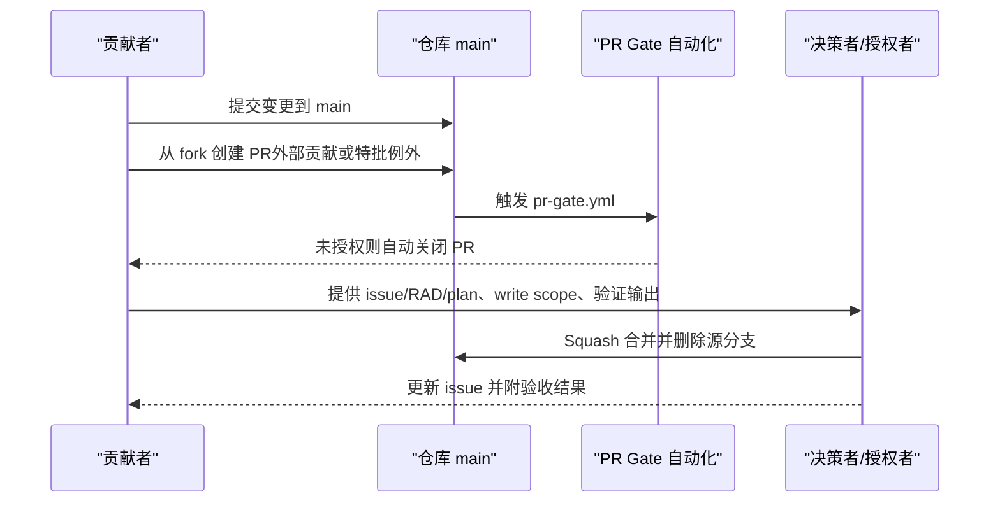
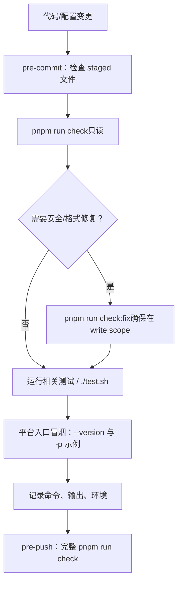

# 贡献流程

<cite>
**本文引用的文件**
- [CONTRIBUTING.md](file://CONTRIBUTING.md)
- [CONTRIBUTING.zh-CN.md](file://CONTRIBUTING.zh-CN.md)
- [docs/specs/workflow.md](file://docs/specs/workflow.md)
- [docs/rads/README.md](file://docs/rads/README.md)
- [docs/rads/TEMPLATE.md](file://docs/rads/TEMPLATE.md)
- [.github/ISSUE_TEMPLATE/omfde-task.yml](file://.github/ISSUE_TEMPLATE/omfde-task.yml)
- [.github/ISSUE_TEMPLATE/bug.yml](file://.github/ISSUE_TEMPLATE/bug.yml)
- [.github/workflows/ci.yml](file://.github/workflows/ci.yml)
- [.github/workflows/pr-gate.yml](file://.github/workflows/pr-gate.yml)
</cite>

## 目录
1. [引言](#引言)
2. [项目结构](#项目结构)
3. [核心组件](#核心组件)
4. [架构总览](#架构总览)
5. [详细组件分析](#详细组件分析)
6. [依赖关系分析](#依赖关系分析)
7. [性能与协作效率](#性能与协作效率)
8. [故障排查指南](#故障排查指南)
9. [结论](#结论)

## 引言
本文件面向 omfde 仓库的贡献者，系统化说明从需求到上线的完整贡献流程与协作规范。内容覆盖 Issue 管理、RAD 设计文档、计划制定、代码审查、Pull Request 流程、分支策略、提交规范、冲突处理与质量门禁等最佳实践。目标是让新成员快速上手，也让多 Agent 并行开发在共享 `main` worktree 中保持有序、可追溯、可回滚。

## 项目结构
仓库围绕“需求—方案—实现—验证”闭环组织：
- 决策与边界：`docs/specs/vision.md`（宪法）、`docs/specs/workflow.md`（工作流）。
- 需求与设计：`docs/rads/<slug>.md`（确认需求），`docs/plans/<slug>.md`（已批准实现计划）。
- 实现与平台：`apps/`、`packages/`、`extensions/`。
- 贡献入口：`.github/ISSUE_TEMPLATE/*`。
- 自动化门禁：`.github/workflows/*`。
- 贡献规范：`CONTRIBUTING.md` / `CONTRIBUTING.zh-CN.md`。

**图示来源**
- [docs/specs/workflow.md:8-16](file://docs/specs/workflow.md#L8-L16)
- [docs/rads/README.md:5-12](file://docs/rads/README.md#L5-L12)
- [CONTRIBUTING.md:48-69](file://CONTRIBUTING.md#L48-L69)

**章节来源**
- [docs/specs/workflow.md:8-16](file://docs/specs/workflow.md#L8-L16)
- [docs/rads/README.md:5-12](file://docs/rads/README.md#L5-L12)
- [CONTRIBUTING.md:40-69](file://CONTRIBUTING.md#L40-L69)

## 核心组件
- Issue 与任务表单：统一记录需求、Bug、Chore、Decision，并强制声明 write scope。
- RAD 模板：将讨论转化为可确认的需求描述，冻结用户故事，作为 spike 和 plan 的依据。
- Plan 文档：非平凡工作的实现依据，明确范围、切片、验收与批准记录。
- 分支与提交：仅在 `main` 工作；显式 stage；提交消息遵循约定；串行化 Git 操作。
- PR 与合并：默认不开 PR；仅外部贡献或特批内部例外；squash merge；禁止 force push。
- 质量门禁：本地先过；pre-commit/pre-push 分层检查；测试与冒烟命令必须记录证据。

**章节来源**
- [CONTRIBUTING.md:15-89](file://CONTRIBUTING.md#L15-L89)
- [CONTRIBUTING.zh-CN.md:17-90](file://CONTRIBUTING.zh-CN.md#L17-L90)
- [docs/specs/workflow.md:35-62](file://docs/specs/workflow.md#L35-L62)

## 架构总览
下图展示从需求到合并的主路径，以及关键闸门：vision 闸、RAD 闸、spike 闸、plan 闸、scope 闸、质量闸。

**图示来源**
- [docs/specs/workflow.md:63-82](file://docs/specs/workflow.md#L63-L82)
- [docs/specs/workflow.md:84-127](file://docs/specs/workflow.md#L84-L127)
- [docs/specs/workflow.md:142-170](file://docs/specs/workflow.md#L142-L170)
- [CONTRIBUTING.md:48-69](file://CONTRIBUTING.md#L48-L69)

## 详细组件分析

### Issue 管理与任务表单
- Issue 是团队记录需求、Bug、任务和阶段目标的统一视图，不是新需求的起点。
- 新需求由决策者发起讨论；有初步结论后再同步补 Issue，必要时关联 RAD。
- Bug 可直接开 Issue，修复用 `fixes #N` 关闭。
- 使用 `.github/ISSUE_TEMPLATE/omfde-task.yml`，write scope 必填；类型建议包括 requirement、bug、chore、decision。
- Bug 表单要求复现步骤、期望/实际行为与环境信息。

**图示来源**
- [docs/specs/workflow.md:35-47](file://docs/specs/workflow.md#L35-L47)
- [.github/ISSUE_TEMPLATE/omfde-task.yml:1-81](file://.github/ISSUE_TEMPLATE/omfde-task.yml#L1-L81)
- [.github/ISSUE_TEMPLATE/bug.yml:1-46](file://.github/ISSUE_TEMPLATE/bug.yml#L1-L46)

**章节来源**
- [docs/specs/workflow.md:35-47](file://docs/specs/workflow.md#L35-L47)
- [.github/ISSUE_TEMPLATE/omfde-task.yml:1-81](file://.github/ISSUE_TEMPLATE/omfde-task.yml#L1-L81)
- [.github/ISSUE_TEMPLATE/bug.yml:1-46](file://.github/ISSUE_TEMPLATE/bug.yml#L1-L46)

### RAD 设计文档
- RAD 是确认需求，不是编码依据；确认后用户故事冻结，后续修订需再次确认并留痕。
- 模板包含背景与价值、Vision 对齐、干系人、场景、范围与非目标、FR-N、非功能约束、开放问题、US-N、验收指标、风险与依赖、决策者确认记录。
- RAD 与 Issue、Milestone、Vision 对齐；若与 Vision 冲突，先修改 Vision。

**图示来源**
- [docs/rads/TEMPLATE.md:1-118](file://docs/rads/TEMPLATE.md#L1-L118)
- [docs/rads/README.md:5-12](file://docs/rads/README.md#L5-L12)

**章节来源**
- [docs/rads/TEMPLATE.md:1-118](file://docs/rads/TEMPLATE.md#L1-L118)
- [docs/rads/README.md:5-12](file://docs/rads/README.md#L5-L12)
- [docs/specs/workflow.md:94-102](file://docs/specs/workflow.md#L94-L102)

### 计划制定（Plan）
- Plan 是已批准方案，是实现和验收的唯一编码依据；RAD/spike 只作溯源。
- Plan 至少包含背景与目标、非目标、关联 issue 和 RAD、设计要点与否决项、实施切片、验收判据、决策者批准记录。
- 实现选择在批准范围内由 AI 决定；出圈即停-问。

**图示来源**
- [docs/specs/workflow.md:103-127](file://docs/specs/workflow.md#L103-L127)

**章节来源**
- [docs/specs/workflow.md:103-127](file://docs/specs/workflow.md#L103-L127)

### 分支管理策略
- 只在 `main` 上工作；不创建功能分支，也不在其他分支的 worktree 中工作。
- `pages` 是发布分支，不是开发分支；未经授权不得切换、checkout、提交、push 或合并。
- 所有 Agent 共享同一个 `main` worktree；切换分支、rebase、reset、stash、清理和删除分支必须串行协调。

**图示来源**
- [CONTRIBUTING.md:48-78](file://CONTRIBUTING.md#L48-L78)
- [docs/specs/workflow.md:172-183](file://docs/specs/workflow.md#L172-L183)

**章节来源**
- [CONTRIBUTING.md:48-78](file://CONTRIBUTING.md#L48-L78)
- [docs/specs/workflow.md:172-183](file://docs/specs/workflow.md#L172-L183)

### 提交规范与冲突解决
- 显式 stage 路径；绝不使用 `git add -A` 或 `git add .`。
- 提交消息格式：`{feat,fix,docs}[(repo|ai|tui|agent|coding-agent)]: 
`；正文引用 issue；完成时用 `fixes #N` 或 `closes #N`。
- 只提交本次会话中自己修改且在 write scope 内的文件；其他 Agent 的改动保持未暂存。
- 共享文件单写者、串行修改；并发 Git 操作会破坏一致性。
- 冲突解决原则：先停止并发 Agent；确认当前 staged 文件属于 write scope；必要时重新划分 scope 或串行处理。

**图示来源**
- [CONTRIBUTING.md:50-59](file://CONTRIBUTING.md#L50-L59)
- [docs/specs/workflow.md:51-62](file://docs/specs/workflow.md#L51-L62)
- [docs/specs/workflow.md:142-151](file://docs/specs/workflow.md#L142-L151)

**章节来源**
- [CONTRIBUTING.md:50-59](file://CONTRIBUTING.md#L50-L59)
- [docs/specs/workflow.md:51-62](file://docs/specs/workflow.md#L51-L62)
- [docs/specs/workflow.md:142-151](file://docs/specs/workflow.md#L142-L151)

### 代码审查与 Pull Request 流程
- 内部默认不开 PR；`main` 是唯一开发分支。
- PR 仅用于外部贡献者从 fork 提交，或决策者批准的内部例外。
- PR 必须关联 issue 和 RAD/plan（如有），写明 write scope、验证命令与输出，且 diff 仅限 scope 内。
- 只有决策者或获得明确授权的 Agent 可以合并；统一 squash merge，保持 `main` 线性；合并后删除源分支；禁止 force push。

**图示来源**
- [CONTRIBUTING.md:61-69](file://CONTRIBUTING.md#L61-L69)
- [docs/specs/workflow.md:153-170](file://docs/specs/workflow.md#L153-L170)
- [.github/workflows/pr-gate.yml:1-129](file://.github/workflows/pr-gate.yml#L1-L129)

**章节来源**
- [CONTRIBUTING.md:61-69](file://CONTRIBUTING.md#L61-L69)
- [docs/specs/workflow.md:153-170](file://docs/specs/workflow.md#L153-L170)
- [.github/workflows/pr-gate.yml:1-129](file://.github/workflows/pr-gate.yml#L1-L129)

### 质量门禁与验证
- 所有质量门禁在本地执行；远程 CI 不是门禁。
- 代码改动运行 `pnpm run check`（只读）；需要格式化或安全 lint 修复时再运行 `pnpm run check:fix`，并确保 diff 在 write scope 内。
- 平台导出需 TSDoc；`pnpm run check:tsdoc` 已包含在 `check` 中。
- pre-commit 检查 staged 文件；pre-push 运行完整 `pnpm run check`。
- 相关测试运行；非 e2e 测试用 `./test.sh`；平台入口改动需版本与冒烟测试。
- 记录命令、输出和环境；失败如实记录，不得用 skip 或放宽断言掩盖。

**图示来源**
- [CONTRIBUTING.md:79-89](file://CONTRIBUTING.md#L79-L89)
- [docs/specs/workflow.md:129-140](file://docs/specs/workflow.md#L129-L140)

**章节来源**
- [CONTRIBUTING.md:79-89](file://CONTRIBUTING.md#L79-L89)
- [docs/specs/workflow.md:129-140](file://docs/specs/workflow.md#L129-L140)

## 依赖关系分析
- 工作流依赖顺序：Vision → RAD → Spike → Plan → 实现 → 验证 → 提交 → PR（可选）→ 合并。
- Issue 表单驱动 write scope 与验收条件，避免多 Agent 并行冲突。
- PR Gate 自动化校验贡献者权限，未授权 PR 自动关闭。
- CI 为手动触发的工作流，不替代本地门禁；测试矩阵拆分以缩短反馈时间。

```mermaid
graph LR
Vision["docs/specs/vision.md"] --> Workflow["docs/specs/workflow.md"]
Workflow --> Issue[".github/ISSUE_TEMPLATE/omfde-task.yml"]
Issue --> Scope["Write scope 与验收条件"]
Scope --> RAD["docs/rads/<slug>.md"]
RAD --> Plan["docs/plans/<slug>.md"]
Plan --> Code["apps/ / packages/ / extensions/"]
Code --> Check["本地质量门禁"]
Check --> PR[".github/workflows/pr-gate.yml"]
PR --> Merge["Squash 合并"]
```

**图示来源**
- [docs/specs/workflow.md:8-16](file://docs/specs/workflow.md#L8-L16)
- [.github/ISSUE_TEMPLATE/omfde-task.yml:1-81](file://.github/ISSUE_TEMPLATE/omfde-task.yml#L1-L81)
- [.github/workflows/pr-gate.yml:1-129](file://.github/workflows/pr-gate.yml#L1-L129)

**章节来源**
- [docs/specs/workflow.md:8-16](file://docs/specs/workflow.md#L8-L16)
- [.github/ISSUE_TEMPLATE/omfde-task.yml:1-81](file://.github/ISSUE_TEMPLATE/omfde-task.yml#L1-L81)
- [.github/workflows/pr-gate.yml:1-129](file://.github/workflows/pr-gate.yml#L1-L129)

## 性能与协作效率
- 通过 write scope 与共享文件清单控制多 Agent 并行冲突，减少分支与 rebase 成本。
- 仅在 `main` 工作并使用 squash merge，保持线性历史，降低回溯与审计复杂度。
- 本地质量门禁前置，避免远程 CI 阻塞；pre-commit/pre-push 分层检查提升反馈速度。
- 测试矩阵拆分与按需运行，缩短整体反馈时间。

[本节为通用指导，不涉及具体文件分析]

## 故障排查指南
- 门禁失败：不得用 skip 或放宽断言掩盖；记录在 `docs/explains/00-baseline.md` 或对应 Issue。
- 权限问题：PR 被自动关闭时，查看 `.github/workflows/pr-gate.yml` 的授权逻辑；维护者可回复 `lgtm` 或 `lgtmi` 授予权限。
- 共享文件冲突：确认 staged 文件是否在 write scope；必要时重新划分 scope 或串行处理。
- 发布分支误操作：未经决策者授权不得切换 `pages`；如已在共享 worktree，先停止所有 Agent 并取得授权。

**章节来源**
- [docs/specs/workflow.md:227-233](file://docs/specs/workflow.md#L227-L233)
- [.github/workflows/pr-gate.yml:101-129](file://.github/workflows/pr-gate.yml#L101-L129)
- [CONTRIBUTING.md:71-78](file://CONTRIBUTING.md#L71-L78)

## 结论
omfde 的贡献流程以 Vision 为宪法、Issue 为统一入口、RAD 确认需求、Plan 作为唯一编码依据，并通过 write scope 与串行化 Git 操作保障多 Agent 协作安全。质量门禁前置、PR 最小化、squash merge 与 pages 分支隔离共同构成稳定、可审计、可回滚的开发体系。贡献者应始终理解自己的代码，并在无法解释改动影响时暂停推进。