基于我对代码的分析，我现在可以更新文档以反映Pi Web UI M2的重大功能扩展。让我创建更新后的文档：

<cite>
**本文引用的文件**   
- [apps/pi-web/package.json](file://apps/pi-web/package.json)
- [apps/pi-web/server.mjs](file://apps/pi-web/server.mjs)
- [apps/pi-web/src/router.tsx](file://apps/pi-web/src/router.tsx)
- [apps/pi-web/src/routes/__root.tsx](file://apps/pi-web/src/routes/__root.tsx)
- [apps/pi-web/src/routes/index.tsx](file://apps/pi-web/src/routes/index.tsx)
- [apps/pi-web/src/routes/session.$sessionId.tsx](file://apps/pi-web/src/routes/session.$sessionId.tsx)
- [apps/pi-web/src/components/layout/AppFrame.tsx](file://apps/pi-web/src/components/layout/AppFrame.tsx)
- [apps/pi-web/src/components/layout/Sidebar.tsx](file://apps/pi-web/src/components/layout/Sidebar.tsx)
- [apps/pi-web/src/components/layout/RightPanel.tsx](file://apps/pi-web/src/components/layout/RightPanel.tsx)
- [apps/pi-web/src/components/layout/ThemeControl.tsx](file://apps/pi-web/src/components/layout/ThemeControl.tsx)
- [apps/pi-web/src/components/conversation/Conversation.tsx](file://apps/pi-web/src/components/conversation/Conversation.tsx)
- [apps/pi-web/src/components/conversation/MessageList.tsx](file://apps/pi-web/src/components/conversation/MessageList.tsx)
- [apps/pi-web/src/components/conversation/SessionBar.tsx](file://apps/pi-web/src/components/conversation/SessionBar.tsx)
- [apps/pi-web/src/components/conversation/Composer.tsx](file://apps/pi-web/src/components/conversation/Composer.tsx)
- [apps/pi-web/src/components/tools/ToolCard.tsx](file://apps/pi-web/src/components/tools/ToolCard.tsx)
- [apps/pi-web/src/lib/api.ts](file://apps/pi-web/src/lib/api.ts)
- [apps/pi-web/src/lib/conversation.ts](file://apps/pi-web/src/lib/conversation.ts)
- [apps/pi-web/src/lib/images.ts](file://apps/pi-web/src/lib/images.ts)
- [apps/pi-web/src/lib/theme.ts](file://apps/pi-web/src/lib/theme.ts)
- [apps/pi-web/src/lib/viewport.ts](file://apps/pi-web/src/lib/viewport.ts)
- [apps/pi-web/src/styles/app.css](file://apps/pi-web/src/styles/app.css)
- [apps/pi-web/src/server/health.ts](file://apps/pi-web/src/server/health.ts)
- [apps/pi-web/src/server/sessions.ts](file://apps/pi-web/src/server/sessions.ts)
- [apps/pi-web/src/server/files.ts](file://apps/pi-web/src/server/files.ts)
- [apps/pi-web/src/routes/api/sessions.ts](file://apps/pi-web/src/routes/api/sessions.ts)
- [apps/pi-web/src/routes/api/sessions.$sessionId.ts](file://apps/pi-web/src/routes/api/sessions.$sessionId.ts)
- [apps/pi-web/src/routes/api/sessions.$sessionId.commands.ts](file://apps/pi-web/src/routes/api/sessions.$sessionId.commands.ts)
- [apps/pi-web/src/routes/api/sessions.$sessionId.events.ts](file://apps/pi-web/src/routes/api/sessions.$sessionId.events.ts)
- [apps/pi-web/src/routes/api/sessions.$sessionId.fork.ts](file://apps/pi-web/src/routes/api/sessions.$sessionId.fork.ts)
- [apps/pi-web/src/routes/api/sessions.$sessionId.clone.ts](file://apps/pi-web/src/routes/api/sessions.$sessionId.clone.ts)
- [apps/pi-web/src/routes/api/files.expand.ts](file://apps/pi-web/src/routes/api/files.expand.ts)
- [apps/pi-web/src/routes/api/files.search.ts](file://apps/pi-web/src/routes/api/files.search.ts)
- [apps/pi-web/src/server/runtime-manager.ts](file://apps/pi-web/src/server/runtime-manager.ts)
- [apps/pi-web/src/server/runtime.ts](file://apps/pi-web/src/server/runtime.ts)
</cite>

## 更新摘要
**变更内容**   
- 新增完整的图像附件系统，支持图片上传、压缩和预览
- 实现文件引用系统(@file)，支持项目文件搜索和内容展开
- 添加斜杠命令界面(/command)，提供可扩展的命令系统
- 增强会话管理功能，支持分叉(fork)和克隆(clone)操作
- 实现并行会话支持，提升多任务处理能力
- 完善Composer组件，集成所有新功能的统一输入界面

## 目录
1. [简介](#简介)
2. [项目结构](#项目结构)
3. [核心组件](#核心组件)
4. [架构总览](#架构总览)
5. [详细组件分析](#详细组件分析)
6. [依赖关系分析](#依赖关系分析)
7. [性能与可维护性](#性能与可维护性)
8. [故障排查指南](#故障排查指南)
9. [结论](#结论)

## 简介
Pi Web 是 Pi 的完整Web前端界面，基于 React、TanStack Router 与 Vite 构建，提供会话式交互的现代化Web UI。当前版本实现了：
- 完整的服务器实现与安全加固
- 会话管理与REST API接口
- 实时事件流通信（SSE）
- 完整的对话界面与工具调用展示
- **新增图像附件系统**，支持图片上传、压缩和预览
- **新增文件引用系统(@file)**，支持项目文件搜索和内容展开
- **新增斜杠命令界面(/command)**，提供可扩展的命令系统
- **增强会话管理**，支持分叉(fork)和克隆(clone)操作
- **并行会话支持**，提升多任务处理能力
- 主题系统与响应式布局
- 健康检查与服务端函数

该文档从代码层面梳理前端界面与后端运行时的协作方式，帮助读者快速理解整体架构、关键数据流与扩展点。

## 项目结构
Pi Web 采用按功能域组织的目录结构：
- routes：页面路由与接口路由
- components：UI组件（布局、对话、原语、工具）
- lib：通用逻辑（API客户端、对话状态、图像附件、主题、视口）
- server：服务端能力（健康检查、JSONL分帧、运行时与运行时管理器、会话管理、文件处理）
- styles：样式入口与Token映射

```mermaid
graph TB
subgraph "应用入口"
Pkg["package.json"]
Server["server.mjs"]
Router["router.tsx"]
Root["routes/__root.tsx"]
end
subgraph "页面与接口"
Index["routes/index.tsx"]
SessionPage["routes/session.$sessionId.tsx"]
ApiSessions["routes/api/sessions.ts"]
ApiSessionId["routes/api/sessions.$sessionId.ts"]
ApiCommands["routes/api/sessions.$sessionId.commands.ts"]
ApiEvents["routes/api/sessions.$sessionId.events.ts"]
ApiFork["routes/api/sessions.$sessionId.fork.ts"]
ApiClone["routes/api/sessions.$sessionId.clone.ts"]
ApiFilesExpand["routes/api/files.expand.ts"]
ApiFilesSearch["routes/api/files.search.ts"]
end
subgraph "UI 组件"
AppFrame["components/layout/AppFrame.tsx"]
Sidebar["components/layout/Sidebar.tsx"]
RightPanel["components/layout/RightPanel.tsx"]
ThemeControl["components/layout/ThemeControl.tsx"]
Conversation["components/conversation/Conversation.tsx"]
MessageList["components/conversation/MessageList.tsx"]
SessionBar["components/conversation/SessionBar.tsx"]
Composer["components/conversation/Composer.tsx"]
ToolCard["components/tools/ToolCard.tsx"]
end
subgraph "服务层"
Health["server/health.ts"]
Sessions["server/sessions.ts"]
Files["server/files.ts"]
RuntimeMgr["server/runtime-manager.ts"]
Runtime["server/runtime.ts"]
end
subgraph "样式与工具"
Theme["lib/theme.ts"]
Viewport["lib/viewport.ts"]
Api["lib/api.ts"]
Images["lib/images.ts"]
ConversationState["lib/conversation.ts"]
Styles["styles/app.css"]
end
Pkg --> Server
Server --> Router
Router --> Root
Root --> Index
Index --> AppFrame
SessionPage --> AppFrame
AppFrame --> Sidebar
AppFrame --> RightPanel
AppFrame --> ThemeControl
AppFrame --> Conversation
Conversation --> MessageList
Conversation --> SessionBar
Conversation --> Composer
MessageList --> ToolCard
Index --> Health
ApiSessions --> RuntimeMgr
ApiSessionId --> RuntimeMgr
ApiCommands --> RuntimeMgr
ApiEvents --> RuntimeMgr
ApiFork --> RuntimeMgr
ApiClone --> RuntimeMgr
ApiFilesExpand --> Files
ApiFilesSearch --> Files
RuntimeMgr --> Runtime
AppFrame --> Viewport
Root --> Theme
Root --> Styles
```

**图示来源**
- [apps/pi-web/package.json:1-41](file://apps/pi-web/package.json#L1-L41)
- [apps/pi-web/server.mjs:1-139](file://apps/pi-web/server.mjs#L1-L139)
- [apps/pi-web/src/router.tsx:1-18](file://apps/pi-web/src/router.tsx#L1-L18)
- [apps/pi-web/src/routes/__root.tsx:1-32](file://apps/pi-web/src/routes/__root.tsx#L1-L32)
- [apps/pi-web/src/routes/index.tsx:1-14](file://apps/pi-web/src/routes/index.tsx#L1-L14)
- [apps/pi-web/src/routes/session.$sessionId.tsx:1-20](file://apps/pi-web/src/routes/session.$sessionId.tsx#L1-L20)
- [apps/pi-web/src/components/layout/AppFrame.tsx:1-62](file://apps/pi-web/src/components/layout/AppFrame.tsx#L1-L62)
- [apps/pi-web/src/components/layout/Sidebar.tsx:1-77](file://apps/pi-web/src/components/layout/Sidebar.tsx#L1-L77)
- [apps/pi-web/src/components/layout/RightPanel.tsx:1-10](file://apps/pi-web/src/components/layout/RightPanel.tsx#L1-L10)
- [apps/pi-web/src/components/layout/ThemeControl.tsx:1-71](file://apps/pi-web/src/components/layout/ThemeControl.tsx#L1-L71)
- [apps/pi-web/src/components/conversation/Conversation.tsx:1-386](file://apps/pi-web/src/components/conversation/Conversation.tsx#L1-L386)
- [apps/pi-web/src/components/conversation/MessageList.tsx:1-232](file://apps/pi-web/src/components/conversation/MessageList.tsx#L1-L232)
- [apps/pi-web/src/components/conversation/SessionBar.tsx:1-68](file://apps/pi-web/src/components/conversation/SessionBar.tsx#L1-L68)
- [apps/pi-web/src/components/conversation/Composer.tsx:1-386](file://apps/pi-web/src/components/conversation/Composer.tsx#L1-L386)
- [apps/pi-web/src/components/tools/ToolCard.tsx:1-124](file://apps/pi-web/src/components/tools/ToolCard.tsx#L1-L124)
- [apps/pi-web/src/server/health.ts:1-46](file://apps/pi-web/src/server/health.ts#L1-L46)
- [apps/pi-web/src/server/sessions.ts:1-70](file://apps/pi-web/src/server/sessions.ts#L1-L70)
- [apps/pi-web/src/server/files.ts:1-187](file://apps/pi-web/src/server/files.ts#L1-L187)
- [apps/pi-web/src/routes/api/sessions.ts:1-59](file://apps/pi-web/src/routes/api/sessions.ts#L1-L59)
- [apps/pi-web/src/routes/api/sessions.$sessionId.ts:1-48](file://apps/pi-web/src/routes/api/sessions.$sessionId.ts#L1-L48)
- [apps/pi-web/src/routes/api/sessions.$sessionId.commands.ts:1-40](file://apps/pi-web/src/routes/api/sessions.$sessionId.commands.ts#L1-L40)
- [apps/pi-web/src/routes/api/sessions.$sessionId.events.ts:1-92](file://apps/pi-web/src/routes/api/sessions.$sessionId.events.ts#L1-L92)
- [apps/pi-web/src/routes/api/sessions.$sessionId.fork.ts:1-38](file://apps/pi-web/src/routes/api/sessions.$sessionId.fork.ts#L1-L38)
- [apps/pi-web/src/routes/api/sessions.$sessionId.clone.ts:1-32](file://apps/pi-web/src/routes/api/sessions.$sessionId.clone.ts#L1-L32)
- [apps/pi-web/src/routes/api/files.expand.ts:1-31](file://apps/pi-web/src/routes/api/files.expand.ts#L1-L31)
- [apps/pi-web/src/routes/api/files.search.ts:1-23](file://apps/pi-web/src/routes/api/files.search.ts#L1-L23)
- [apps/pi-web/src/server/runtime-manager.ts:1-194](file://apps/pi-web/src/server/runtime-manager.ts#L1-L194)
- [apps/pi-web/src/server/runtime.ts:1-337](file://apps/pi-web/src/server/runtime.ts#L1-L337)
- [apps/pi-web/src/lib/theme.ts:1-123](file://apps/pi-web/src/lib/theme.ts#L1-L123)
- [apps/pi-web/src/lib/viewport.ts:1-41](file://apps/pi-web/src/lib/viewport.ts#L1-L41)
- [apps/pi-web/src/lib/api.ts:1-275](file://apps/pi-web/src/lib/api.ts#L1-L275)
- [apps/pi-web/src/lib/images.ts:1-109](file://apps/pi-web/src/lib/images.ts#L1-L109)
- [apps/pi-web/src/lib/conversation.ts:1-226](file://apps/pi-web/src/lib/conversation.ts#L1-L226)
- [apps/pi-web/src/styles/app.css:1-95](file://apps/pi-web/src/styles/app.css#L1-L95)

**章节来源**
- [apps/pi-web/package.json:1-41](file://apps/pi-web/package.json#L1-L41)
- [apps/pi-web/server.mjs:1-139](file://apps/pi-web/server.mjs#L1-L139)
- [apps/pi-web/src/router.tsx:1-18](file://apps/pi-web/src/router.tsx#L1-L18)
- [apps/pi-web/src/routes/__root.tsx:1-32](file://apps/pi-web/src/routes/__root.tsx#L1-L32)
- [apps/pi-web/src/routes/index.tsx:1-14](file://apps/pi-web/src/routes/index.tsx#L1-L14)

## 核心组件
- 服务器实现与安全
  - server.mjs 提供完整的HTTP服务器，包含安全头部、主机验证和内容类型处理。
  - 支持静态文件服务和动态请求转发到TanStack Start应用。
  - 实现CSP、X-Frame-Options等安全头部配置。
- 路由与根文档
  - 通过 TanStack Router 创建路由器并挂载全局路由树，启用滚动恢复与意图预加载。
  - 根路由注入 HTML 元信息、样式与主题初始化脚本，确保首屏无闪烁。
  - 新增会话页面路由 `/session/$sessionId`。
- **新增图像附件系统**
  - images.ts 实现图片预处理、压缩和base64编码。
  - 支持拖拽、粘贴和文件选择三种输入方式。
  - 自动压缩图片到2048px边长，最大5MB大小限制。
- **新增文件引用系统(@file)**
  - files.ts 实现项目文件搜索和安全的内容展开。
  - 支持文本文件和图片文件的智能识别。
  - 内置敏感文件过滤和路径安全检查。
- **新增斜杠命令界面(/command)**
  - Composer.tsx 实现命令自动补全和执行。
  - 支持扩展命令、提示词和技能三类命令源。
  - 提供流畅的用户交互体验。
- **增强会话管理**
  - 支持分叉(fork)操作，从指定消息点创建新会话分支。
  - 支持克隆(clone)操作，复制当前会话状态。
  - 并行会话支持，提升多任务处理能力。
- 对话组件系统
  - Conversation 组件管理会话状态、模型选择和消息流。
  - MessageList 组件渲染消息历史、工具调用和流式输出。
  - SessionBar 组件显示模型选择、使用统计和成本信息。
  - ToolCard 组件展示工具调用的参数、执行状态和结果。
  - **新增 Composer 组件**，集成所有输入功能的统一界面。
- 侧边栏与右侧面板
  - Sidebar 提供品牌标识、新建会话按钮、会话列表与主题切换控件。
  - RightPanel 为预留插槽，默认隐藏，后续可扩展停靠面板。
  - ThemeControl 组件提供主题选择界面。
- 主题与视口
  - theme.ts 实现主题偏好读取、解析与应用，支持系统主题监听与发丝线宽度适配。
  - viewport.ts 订阅浏览器视口宽度，避免 SSR/CSR 不一致。
- 健康检查与会话管理
  - health.ts 暴露服务端函数，返回进程工作目录、Node 版本与 PID。
  - sessions.ts 提供会话列表查询和路径查找功能。
- 会话运行时与 API
  - runtime-manager.ts 管理多个 Pi 子进程运行时，具备并发上限、空闲回收与清理定时器。
  - runtime.ts 封装单个 Pi RPC 子进程的生命周期、命令收发、事件分发与快照获取。
  - REST API路由：创建会话、获取快照、关闭会话、发送命令、事件流、分叉、克隆、文件操作。

**章节来源**
- [apps/pi-web/server.mjs:1-139](file://apps/pi-web/server.mjs#L1-L139)
- [apps/pi-web/src/router.tsx:1-18](file://apps/pi-web/src/router.tsx#L1-L18)
- [apps/pi-web/src/routes/__root.tsx:1-32](file://apps/pi-web/src/routes/__root.tsx#L1-L32)
- [apps/pi-web/src/routes/index.tsx:1-14](file://apps/pi-web/src/routes/index.tsx#L1-L14)
- [apps/pi-web/src/routes/session.$sessionId.tsx:1-20](file://apps/pi-web/src/routes/session.$sessionId.tsx#L1-L20)
- [apps/pi-web/src/components/layout/AppFrame.tsx:1-62](file://apps/pi-web/src/components/layout/AppFrame.tsx#L1-L62)
- [apps/pi-web/src/components/layout/Sidebar.tsx:1-77](file://apps/pi-web/src/components/layout/Sidebar.tsx#L1-L77)
- [apps/pi-web/src/components/layout/RightPanel.tsx:1-10](file://apps/pi-web/src/components/layout/RightPanel.tsx#L1-L10)
- [apps/pi-web/src/components/layout/ThemeControl.tsx:1-71](file://apps/pi-web/src/components/layout/ThemeControl.tsx#L1-L71)
- [apps/pi-web/src/components/conversation/Conversation.tsx:1-386](file://apps/pi-web/src/components/conversation/Conversation.tsx#L1-L386)
- [apps/pi-web/src/components/conversation/MessageList.tsx:1-232](file://apps/pi-web/src/components/conversation/MessageList.tsx#L1-L232)
- [apps/pi-web/src/components/conversation/SessionBar.tsx:1-68](file://apps/pi-web/src/components/conversation/SessionBar.tsx#L1-L68)
- [apps/pi-web/src/components/conversation/Composer.tsx:1-386](file://apps/pi-web/src/components/conversation/Composer.tsx#L1-L386)
- [apps/pi-web/src/components/tools/ToolCard.tsx:1-124](file://apps/pi-web/src/components/tools/ToolCard.tsx#L1-L124)
- [apps/pi-web/src/lib/theme.ts:1-123](file://apps/pi-web/src/lib/theme.ts#L1-L123)
- [apps/pi-web/src/lib/viewport.ts:1-41](file://apps/pi-web/src/lib/viewport.ts#L1-L41)
- [apps/pi-web/src/lib/images.ts:1-109](file://apps/pi-web/src/lib/images.ts#L1-L109)
- [apps/pi-web/src/server/health.ts:1-46](file://apps/pi-web/src/server/health.ts#L1-L46)
- [apps/pi-web/src/server/sessions.ts:1-70](file://apps/pi-web/src/server/sessions.ts#L1-L70)
- [apps/pi-web/src/server/files.ts:1-187](file://apps/pi-web/src/server/files.ts#L1-L187)
- [apps/pi-web/src/server/runtime-manager.ts:1-194](file://apps/pi-web/src/server/runtime-manager.ts#L1-L194)
- [apps/pi-web/src/server/runtime.ts:1-337](file://apps/pi-web/src/server/runtime.ts#L1-L337)
- [apps/pi-web/src/routes/api/sessions.ts:1-59](file://apps/pi-web/src/routes/api/sessions.ts#L1-L59)
- [apps/pi-web/src/routes/api/sessions.$sessionId.ts:1-48](file://apps/pi-web/src/routes/api/sessions.$sessionId.ts#L1-L48)
- [apps/pi-web/src/routes/api/sessions.$sessionId.commands.ts:1-40](file://apps/pi-web/src/routes/api/sessions.$sessionId.commands.ts#L1-L40)
- [apps/pi-web/src/routes/api/sessions.$sessionId.events.ts:1-92](file://apps/pi-web/src/routes/api/sessions.$sessionId.events.ts#L1-L92)
- [apps/pi-web/src/routes/api/sessions.$sessionId.fork.ts:1-38](file://apps/pi-web/src/routes/api/sessions.$sessionId.fork.ts#L1-L38)
- [apps/pi-web/src/routes/api/sessions.$sessionId.clone.ts:1-32](file://apps/pi-web/src/routes/api/sessions.$sessionId.clone.ts#L1-L32)
- [apps/pi-web/src/routes/api/files.expand.ts:1-31](file://apps/pi-web/src/routes/api/files.expand.ts#L1-L31)
- [apps/pi-web/src/routes/api/files.search.ts:1-23](file://apps/pi-web/src/routes/api/files.search.ts#L1-L23)

## 架构总览
Pi Web 在前端使用 React + TanStack Router 组织页面与路由；在服务端通过 TanStack Start 的服务端函数与文件系统路由暴露 API。会话由 Node 子进程承载，Web 层通过 JSONL 协议与其进行 RPC 通信。新增的server.mjs作为独立HTTP服务器，提供安全头部、静态文件服务和请求转发。

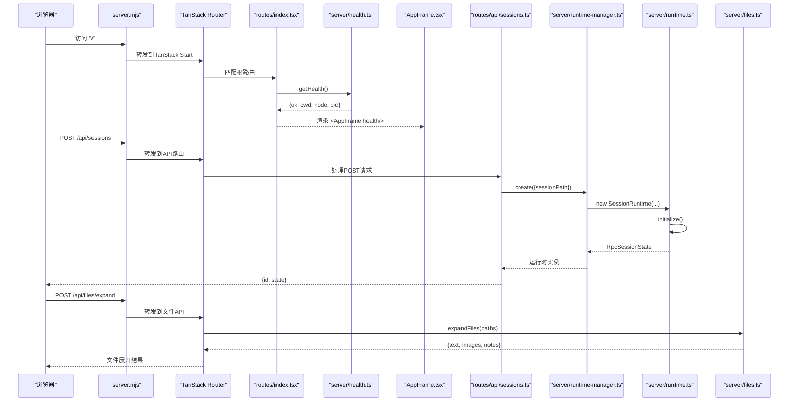

**图示来源**
- [apps/pi-web/server.mjs:1-139](file://apps/pi-web/server.mjs#L1-L139)
- [apps/pi-web/src/routes/index.tsx:1-14](file://apps/pi-web/src/routes/index.tsx#L1-L14)
- [apps/pi-web/src/server/health.ts:1-46](file://apps/pi-web/src/server/health.ts#L1-L46)
- [apps/pi-web/src/components/layout/AppFrame.tsx:1-62](file://apps/pi-web/src/components/layout/AppFrame.tsx#L1-L62)
- [apps/pi-web/src/routes/api/sessions.ts:1-59](file://apps/pi-web/src/routes/api/sessions.ts#L1-L59)
- [apps/pi-web/src/server/runtime-manager.ts:1-194](file://apps/pi-web/src/server/runtime-manager.ts#L1-L194)
- [apps/pi-web/src/server/runtime.ts:1-337](file://apps/pi-web/src/server/runtime.ts#L1-L337)
- [apps/pi-web/src/server/files.ts:1-187](file://apps/pi-web/src/server/files.ts#L1-L187)

## 详细组件分析

### 服务器实现与安全
- HTTP服务器
  - 监听端口默认为3210，支持环境变量配置。
  - 实现安全头部：X-Content-Type-Options、X-Frame-Options、Referrer-Policy、Content-Security-Policy。
  - 主机白名单验证，仅允许localhost和127.0.0.1访问。
  - 跨站请求防护，阻止cross-site请求。
- 静态文件服务
  - 提供client构建产物的静态文件服务。
  - 自动设置正确的Content-Type和缓存策略。
  - 防止路径遍历攻击，限制在client目录内。
- 请求转发
  - 将非静态请求转发到TanStack Start应用。
  - 保持原始请求方法和头部。
  - 错误处理和日志记录。

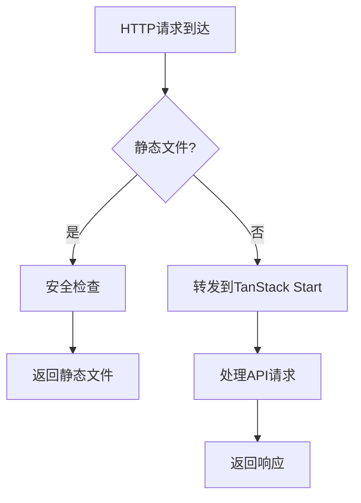

**图示来源**
- [apps/pi-web/server.mjs:1-139](file://apps/pi-web/server.mjs#L1-L139)

**章节来源**
- [apps/pi-web/server.mjs:1-139](file://apps/pi-web/server.mjs#L1-L139)

### 路由与根文档
- 路由器配置
  - 启用滚动恢复与意图预加载，减少不必要的请求与提升交互流畅度。
- 根文档
  - 注入字符集、视口、标题与全局样式。
  - 在 HTML 中内联主题初始化脚本，避免深色主题首次白屏闪烁。
- 会话页面
  - 新增 `/session/$sessionId` 路由，支持直接访问特定会话。

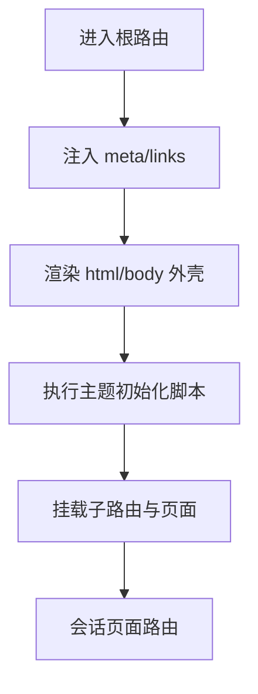

**图示来源**
- [apps/pi-web/src/router.tsx:1-18](file://apps/pi-web/src/router.tsx#L1-L18)
- [apps/pi-web/src/routes/__root.tsx:1-32](file://apps/pi-web/src/routes/__root.tsx#L1-L32)
- [apps/pi-web/src/routes/session.$sessionId.tsx:1-20](file://apps/pi-web/src/routes/session.$sessionId.tsx#L1-L20)

**章节来源**
- [apps/pi-web/src/router.tsx:1-18](file://apps/pi-web/src/router.tsx#L1-L18)
- [apps/pi-web/src/routes/__root.tsx:1-32](file://apps/pi-web/src/routes/__root.tsx#L1-L32)
- [apps/pi-web/src/routes/session.$sessionId.tsx:1-20](file://apps/pi-web/src/routes/session.$sessionId.tsx#L1-L20)

### 图像附件系统
**新增** Pi Web M2引入了完整的图像附件系统，支持多种图片输入方式和智能处理。

- 图像处理流程
  - 支持拖拽、粘贴和文件选择三种输入方式。
  - 自动检测图片格式并进行预处理。
  - 智能压缩：长边限制2048px，质量自适应调整。
  - 大小限制：单张图片不超过5MB。
  - Base64编码传输，支持JPEG格式。
- 用户界面
  - 图片预览缩略图展示。
  - 支持移除已添加的图片。
  - 进度反馈和错误提示。
- 技术实现
  - Canvas API进行图片缩放和压缩。
  - File API处理文件读取。
  - URL.createObjectURL生成预览链接。

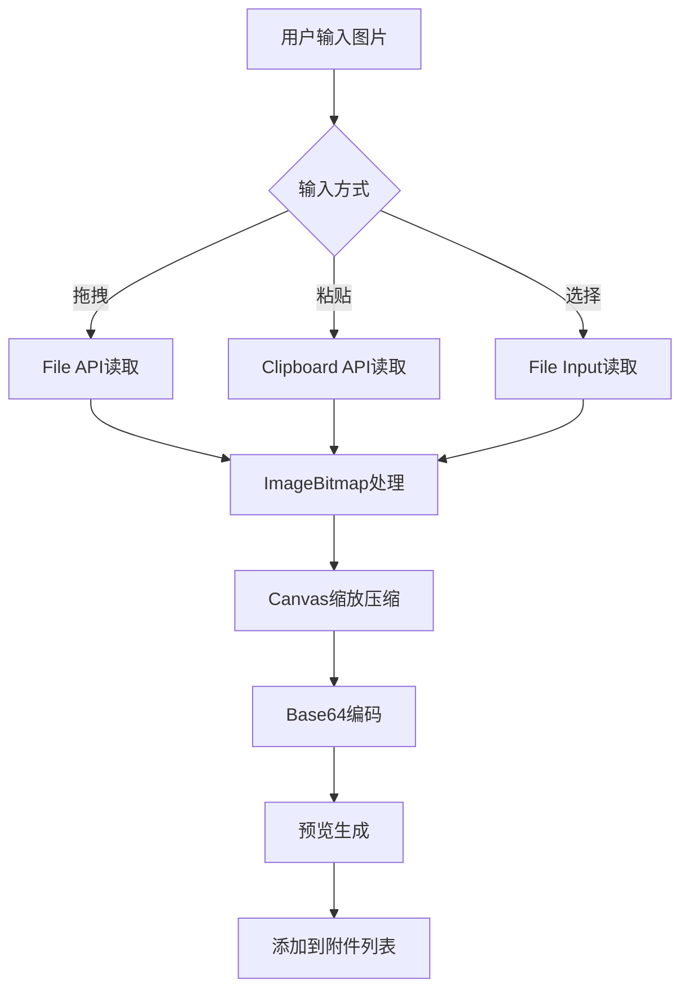

**图示来源**
- [apps/pi-web/src/lib/images.ts:1-109](file://apps/pi-web/src/lib/images.ts#L1-L109)
- [apps/pi-web/src/components/conversation/Composer.tsx:168-186](file://apps/pi-web/src/components/conversation/Composer.tsx#L168-L186)

**章节来源**
- [apps/pi-web/src/lib/images.ts:1-109](file://apps/pi-web/src/lib/images.ts#L1-L109)
- [apps/pi-web/src/components/conversation/Composer.tsx:168-186](file://apps/pi-web/src/components/conversation/Composer.tsx#L168-L186)

### 文件引用系统(@file)
**新增** 实现了强大的文件引用系统，支持项目文件的安全访问和内容展开。

- 文件搜索功能
  - 支持文件名和路径片段搜索。
  - 排除敏感目录(.git, node_modules等)。
  - 限制搜索结果数量(默认100条)。
  - 异步搜索，带防抖处理。
- 文件展开机制
  - 智能识别文本文件和图片文件。
  - 文本文件：最大256KB，UTF-8编码。
  - 图片文件：最大10MB，支持多种格式。
  - 安全验证：路径遍历防护、敏感文件过滤。
- 用户体验
  - @符号触发文件自动补全。
  - 实时搜索建议。
  - 展开后自动插入内容。
  - 错误提示和跳过说明。

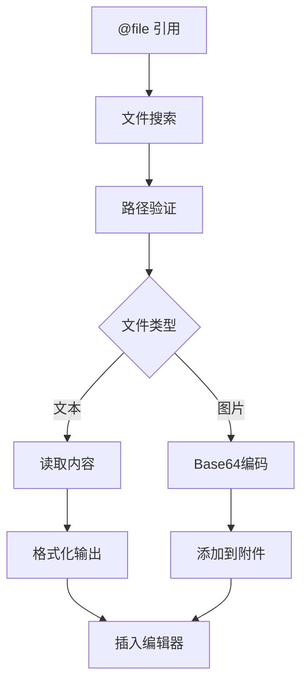

**图示来源**
- [apps/pi-web/src/server/files.ts:128-186](file://apps/pi-web/src/server/files.ts#L128-L186)
- [apps/pi-web/src/routes/api/files.expand.ts:1-31](file://apps/pi-web/src/routes/api/files.expand.ts#L1-L31)
- [apps/pi-web/src/routes/api/files.search.ts:1-23](file://apps/pi-web/src/routes/api/files.search.ts#L1-L23)

**章节来源**
- [apps/pi-web/src/server/files.ts:1-187](file://apps/pi-web/src/server/files.ts#L1-L187)
- [apps/pi-web/src/routes/api/files.expand.ts:1-31](file://apps/pi-web/src/routes/api/files.expand.ts#L1-L31)
- [apps/pi-web/src/routes/api/files.search.ts:1-23](file://apps/pi-web/src/routes/api/files.search.ts#L1-L23)

### 斜杠命令界面(/command)
**新增** 提供了可扩展的命令系统，支持多种命令源和智能补全。

- 命令系统架构
  - 支持三类命令源：extension(扩展)、prompt(提示词)、skill(技能)。
  - 命令自动补全，支持模糊匹配。
  - 命令描述和来源信息显示。
- 用户交互
  - /符号触发命令补全。
  - 键盘导航支持(上下箭头、回车、Tab)。
  - ESC键取消补全。
  - 命令执行后自动插入空格。
- 集成特性
  - 与Composer组件深度集成。
  - 支持命令执行状态反馈。
  - 错误处理和用户提示。

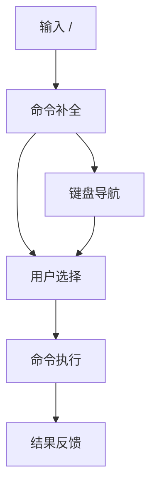

**图示来源**
- [apps/pi-web/src/components/conversation/Composer.tsx:48-61](file://apps/pi-web/src/components/conversation/Composer.tsx#L48-L61)
- [apps/pi-web/src/components/conversation/Composer.tsx:114-132](file://apps/pi-web/src/components/conversation/Composer.tsx#L114-L132)

**章节来源**
- [apps/pi-web/src/components/conversation/Composer.tsx:48-61](file://apps/pi-web/src/components/conversation/Composer.tsx#L48-L61)
- [apps/pi-web/src/components/conversation/Composer.tsx:114-132](file://apps/pi-web/src/components/conversation/Composer.tsx#L114-L132)

### 增强的会话管理
**新增** 会话管理功能得到显著增强，支持更灵活的会话操作。

- 分叉(Fork)功能
  - 从指定user消息点创建新会话分支。
  - 保留原始会话的上下文和历史。
  - 支持并行开发不同思路。
  - 自动更新会话ID映射。
- 克隆(Clone)功能
  - 复制当前会话的完整状态。
  - 包括消息历史、工具状态和配置。
  - 用于实验和对比测试。
  - 错误处理：未保存会话的处理。
- 并行会话支持
  - 同时运行多个会话。
  - 资源管理和内存控制。
  - 会话间隔离和状态同步。

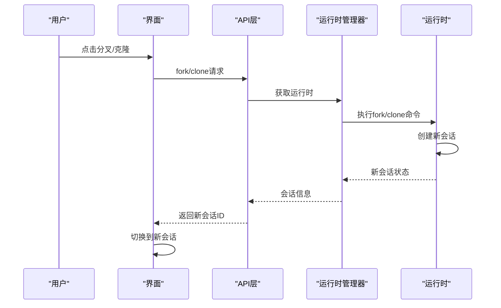

**图示来源**
- [apps/pi-web/src/routes/api/sessions.$sessionId.fork.ts:1-38](file://apps/pi-web/src/routes/api/sessions.$sessionId.fork.ts#L1-L38)
- [apps/pi-web/src/routes/api/sessions.$sessionId.clone.ts:1-32](file://apps/pi-web/src/routes/api/sessions.$sessionId.clone.ts#L1-L32)
- [apps/pi-web/src/components/conversation/Conversation.tsx:273-298](file://apps/pi-web/src/components/conversation/Conversation.tsx#L273-L298)

**章节来源**
- [apps/pi-web/src/routes/api/sessions.$sessionId.fork.ts:1-38](file://apps/pi-web/src/routes/api/sessions.$sessionId.fork.ts#L1-L38)
- [apps/pi-web/src/routes/api/sessions.$sessionId.clone.ts:1-32](file://apps/pi-web/src/routes/api/sessions.$sessionId.clone.ts#L1-L32)
- [apps/pi-web/src/components/conversation/Conversation.tsx:273-298](file://apps/pi-web/src/components/conversation/Conversation.tsx#L273-L298)

### 对话组件系统
- Conversation 组件
  - 管理会话生命周期：创建、恢复、崩溃重启。
  - 处理模型选择、消息发送和流式响应。
  - 集成事件流连接，实时更新会话状态。
  - 错误处理和用户通知。
  - **新增** 支持图像附件和文件引用。
  - **新增** 支持分叉和克隆操作。
- MessageList 组件
  - 渲染用户消息、助手回复和工具调用。
  - 支持流式文本输出和思维过程展示。
  - 工具结果展示，包括diff视图和输出折叠。
  - 自动滚动到底部和回到底部按钮。
- SessionBar 组件
  - 模型选择下拉框，显示可用模型列表。
  - 上下文使用百分比、token计数和成本显示。
  - 实时统计信息更新。
  - **新增** 克隆按钮和权限控制。
- ToolCard 组件
  - 工具调用状态指示器（运行中、完成、失败）。
  - 参数展示和执行结果输出。
  - diff格式检测和语法高亮。
  - 长输出折叠展开功能。
- **新增 Composer 组件**
  - 统一的输入界面，集成所有新功能。
  - 支持文本输入、图像附件、文件引用和命令。
  - 智能补全和自动完成。
  - 队列模式：插话(followUp)和引导(steer)。
  - 图片预览和管理。
  - 键盘快捷键支持。

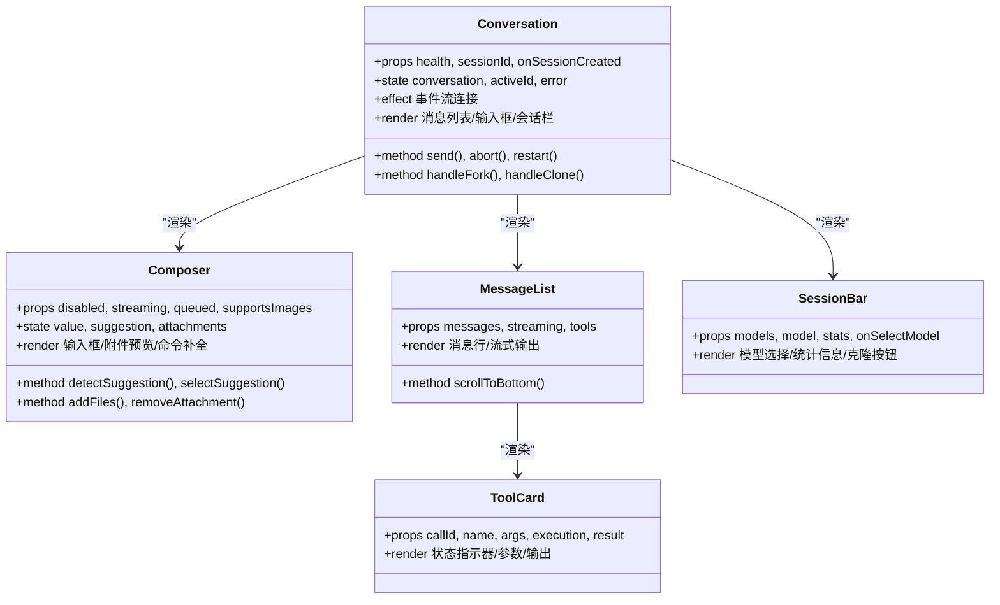

**图示来源**
- [apps/pi-web/src/components/conversation/Conversation.tsx:1-386](file://apps/pi-web/src/components/conversation/Conversation.tsx#L1-L386)
- [apps/pi-web/src/components/conversation/Composer.tsx:1-386](file://apps/pi-web/src/components/conversation/Composer.tsx#L1-L386)
- [apps/pi-web/src/components/conversation/MessageList.tsx:1-232](file://apps/pi-web/src/components/conversation/MessageList.tsx#L1-L232)
- [apps/pi-web/src/components/conversation/SessionBar.tsx:1-68](file://apps/pi-web/src/components/conversation/SessionBar.tsx#L1-L68)
- [apps/pi-web/src/components/tools/ToolCard.tsx:1-124](file://apps/pi-web/src/components/tools/ToolCard.tsx#L1-L124)

**章节来源**
- [apps/pi-web/src/components/conversation/Conversation.tsx:1-386](file://apps/pi-web/src/components/conversation/Conversation.tsx#L1-L386)
- [apps/pi-web/src/components/conversation/Composer.tsx:1-386](file://apps/pi-web/src/components/conversation/Composer.tsx#L1-L386)
- [apps/pi-web/src/components/conversation/MessageList.tsx:1-232](file://apps/pi-web/src/components/conversation/MessageList.tsx#L1-L232)
- [apps/pi-web/src/components/conversation/SessionBar.tsx:1-68](file://apps/pi-web/src/components/conversation/SessionBar.tsx#L1-L68)
- [apps/pi-web/src/components/tools/ToolCard.tsx:1-124](file://apps/pi-web/src/components/tools/ToolCard.tsx#L1-L124)

### 主题与视口
- 主题
  - 支持 light/dark/system 三种偏好，持久化到 localStorage。
  - 通过 data-theme 与 CSS 变量驱动样式，避免组件分支判断。
  - 监听系统主题变化，动态更新实际主题。
  - 安装发丝线宽度，保证高 DPI 下边框视觉一致。
- 视口
  - 默认宽度 1280，避免 SSR/CSR 不一致。
  - 监听 resize 事件同步真实宽度。
- 主题控制组件
  - 提供可视化主题选择界面。
  - 支持紧凑模式和展开模式。
  - 图标化主题选项，提升用户体验。

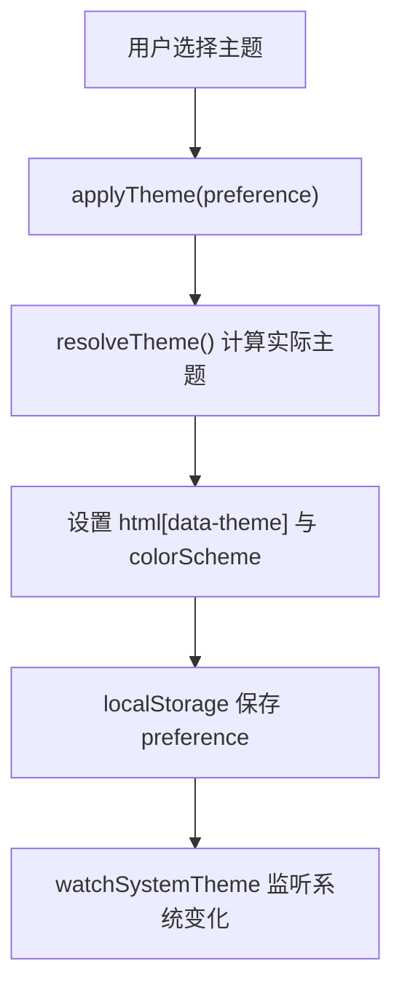

**图示来源**
- [apps/pi-web/src/lib/theme.ts:1-123](file://apps/pi-web/src/lib/theme.ts#L1-L123)
- [apps/pi-web/src/components/layout/ThemeControl.tsx:1-71](file://apps/pi-web/src/components/layout/ThemeControl.tsx#L1-L71)

**章节来源**
- [apps/pi-web/src/lib/theme.ts:1-123](file://apps/pi-web/src/lib/theme.ts#L1-L123)
- [apps/pi-web/src/lib/viewport.ts:1-41](file://apps/pi-web/src/lib/viewport.ts#L1-L41)
- [apps/pi-web/src/components/layout/ThemeControl.tsx:1-71](file://apps/pi-web/src/components/layout/ThemeControl.tsx#L1-L71)

### 健康检查与会话管理
- 健康检查
  - 服务端函数返回进程基本信息，便于验证 SSR、服务端函数与生产入口连通性。
  - 首页通过 loader 调用并透传给 AppFrame。
- 会话管理
  - listSessions() 列出当前项目的会话，按修改时间排序。
  - findSessionPath() 根据会话ID查找文件路径。
  - 会话摘要信息包含ID、路径、名称、工作目录、时间戳、消息数量等。

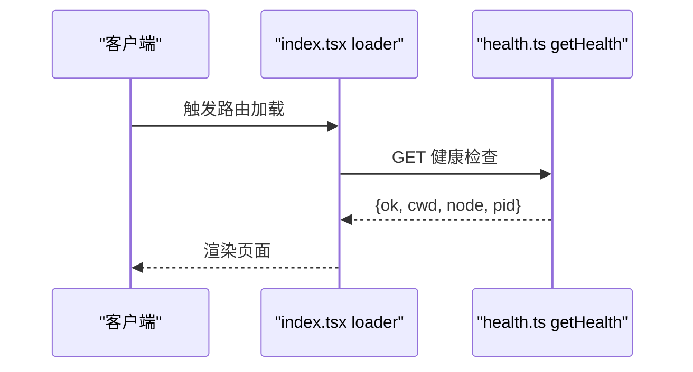

**图示来源**
- [apps/pi-web/src/routes/index.tsx:1-14](file://apps/pi-web/src/routes/index.tsx#L1-L14)
- [apps/pi-web/src/server/health.ts:1-46](file://apps/pi-web/src/server/health.ts#L1-L46)
- [apps/pi-web/src/server/sessions.ts:1-70](file://apps/pi-web/src/server/sessions.ts#L1-L70)

**章节来源**
- [apps/pi-web/src/routes/index.tsx:1-14](file://apps/pi-web/src/routes/index.tsx#L1-L14)
- [apps/pi-web/src/server/health.ts:1-46](file://apps/pi-web/src/server/health.ts#L1-L46)
- [apps/pi-web/src/server/sessions.ts:1-70](file://apps/pi-web/src/server/sessions.ts#L1-L70)

### 会话运行时与 API
- 运行时管理器
  - 单例进程级管理器，维护活跃运行时 Map。
  - 并发上限与空闲回收：超过上限时优先回收最久未活动且不忙的运行时。
  - 定时清理空闲运行时，释放资源。
- 会话运行时
  - 每个会话对应一个 Pi 子进程，使用 JSONL 协议进行 RPC。
  - 命令发送带超时与错误处理，响应按 id 关联。
  - 事件分发：状态变更、记录事件、退出事件。
  - 快照：并行获取状态、消息与用量统计。
- API 路由
  - POST /api/sessions：创建或恢复会话，返回会话 ID 与初始状态。
  - GET /api/sessions/$sessionId：获取会话快照。
  - DELETE /api/sessions/$sessionId：关闭会话。
  - PATCH /api/sessions/$sessionId：重命名会话。
  - POST /api/sessions/$sessionId/commands：发送RPC命令。
  - GET /api/sessions/$sessionId/events：SSE事件流。
  - **新增** POST /api/sessions/$sessionId/fork：从指定消息分叉会话。
  - **新增** POST /api/sessions/$sessionId/clone：克隆当前会话。
  - **新增** POST /api/files/expand：展开文件引用。
  - **新增** GET /api/files/search：搜索项目文件。

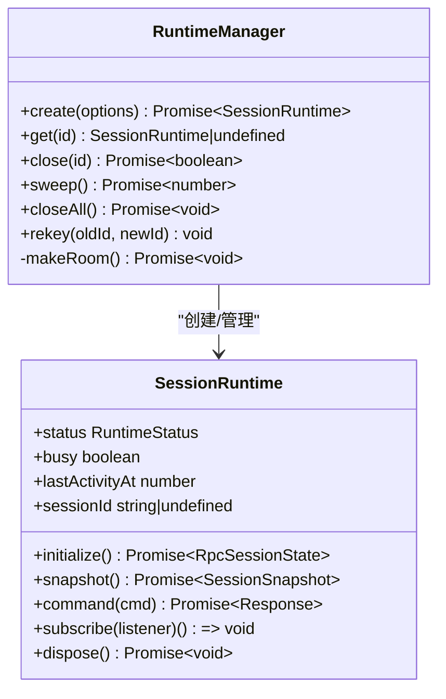

**图示来源**
- [apps/pi-web/src/server/runtime-manager.ts:1-194](file://apps/pi-web/src/server/runtime-manager.ts#L1-L194)
- [apps/pi-web/src/server/runtime.ts:1-337](file://apps/pi-web/src/server/runtime.ts#L1-L337)

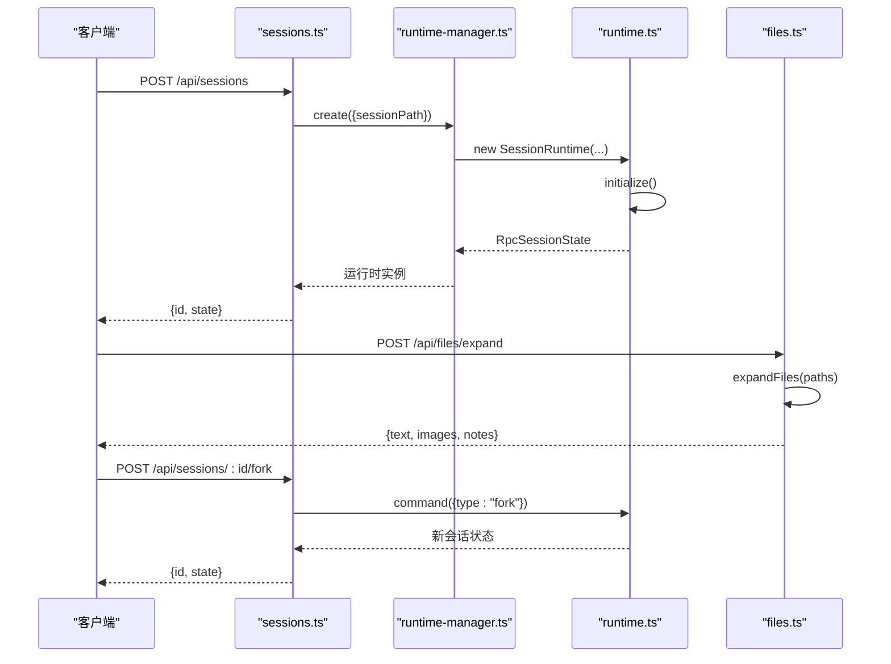

**图示来源**
- [apps/pi-web/src/routes/api/sessions.ts:1-59](file://apps/pi-web/src/routes/api/sessions.ts#L1-L59)
- [apps/pi-web/src/routes/api/sessions.$sessionId.ts:1-48](file://apps/pi-web/src/routes/api/sessions.$sessionId.ts#L1-L48)
- [apps/pi-web/src/routes/api/sessions.$sessionId.commands.ts:1-40](file://apps/pi-web/src/routes/api/sessions.$sessionId.commands.ts#L1-L40)
- [apps/pi-web/src/routes/api/sessions.$sessionId.events.ts:1-92](file://apps/pi-web/src/routes/api/sessions.$sessionId.events.ts#L1-L92)
- [apps/pi-web/src/routes/api/sessions.$sessionId.fork.ts:1-38](file://apps/pi-web/src/routes/api/sessions.$sessionId.fork.ts#L1-L38)
- [apps/pi-web/src/routes/api/sessions.$sessionId.clone.ts:1-32](file://apps/pi-web/src/routes/api/sessions.$sessionId.clone.ts#L1-L32)
- [apps/pi-web/src/routes/api/files.expand.ts:1-31](file://apps/pi-web/src/routes/api/files.expand.ts#L1-L31)
- [apps/pi-web/src/routes/api/files.search.ts:1-23](file://apps/pi-web/src/routes/api/files.search.ts#L1-L23)
- [apps/pi-web/src/server/runtime-manager.ts:1-194](file://apps/pi-web/src/server/runtime-manager.ts#L1-L194)
- [apps/pi-web/src/server/runtime.ts:1-337](file://apps/pi-web/src/server/runtime.ts#L1-L337)

**章节来源**
- [apps/pi-web/src/routes/api/sessions.ts:1-59](file://apps/pi-web/src/routes/api/sessions.ts#L1-L59)
- [apps/pi-web/src/routes/api/sessions.$sessionId.ts:1-48](file://apps/pi-web/src/routes/api/sessions.$sessionId.ts#L1-L48)
- [apps/pi-web/src/routes/api/sessions.$sessionId.commands.ts:1-40](file://apps/pi-web/src/routes/api/sessions.$sessionId.commands.ts#L1-L40)
- [apps/pi-web/src/routes/api/sessions.$sessionId.events.ts:1-92](file://apps/pi-web/src/routes/api/sessions.$sessionId.events.ts#L1-L92)
- [apps/pi-web/src/routes/api/sessions.$sessionId.fork.ts:1-38](file://apps/pi-web/src/routes/api/sessions.$sessionId.fork.ts#L1-L38)
- [apps/pi-web/src/routes/api/sessions.$sessionId.clone.ts:1-32](file://apps/pi-web/src/routes/api/sessions.$sessionId.clone.ts#L1-L32)
- [apps/pi-web/src/routes/api/files.expand.ts:1-31](file://apps/pi-web/src/routes/api/files.expand.ts#L1-L31)
- [apps/pi-web/src/routes/api/files.search.ts:1-23](file://apps/pi-web/src/routes/api/files.search.ts#L1-L23)
- [apps/pi-web/src/server/runtime-manager.ts:1-194](file://apps/pi-web/src/server/runtime-manager.ts#L1-L194)
- [apps/pi-web/src/server/runtime.ts:1-337](file://apps/pi-web/src/server/runtime.ts#L1-L337)

## 依赖关系分析
- 前端依赖
  - React 与 ReactDOM 作为 UI 框架。
  - TanStack Router/Start 提供路由与服务端函数能力。
  - TailwindCSS 与自定义 Token 映射构成设计系统。
- 运行时依赖
  - Node child_process 启动 Pi 子进程。
  - @earendil-works/pi-coding-agent 提供 RPC 类型定义和会话管理。
  - JSONL 分帧器用于可靠的消息边界解析。
- 安全依赖
  - 内置安全头部和请求验证。
  - CSP策略限制脚本和样式来源。
  - 主机白名单和跨站请求防护。

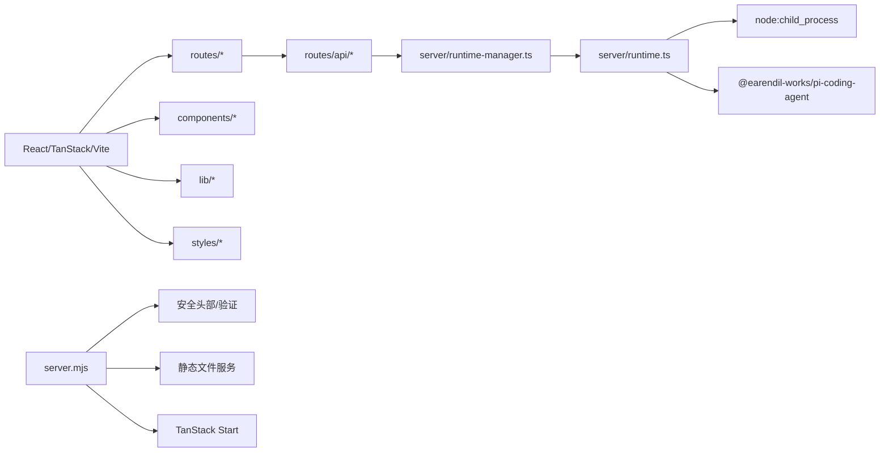

**图示来源**
- [apps/pi-web/package.json:1-41](file://apps/pi-web/package.json#L1-L41)
- [apps/pi-web/server.mjs:1-139](file://apps/pi-web/server.mjs#L1-L139)
- [apps/pi-web/src/server/runtime.ts:1-337](file://apps/pi-web/src/server/runtime.ts#L1-L337)

**章节来源**
- [apps/pi-web/package.json:1-41](file://apps/pi-web/package.json#L1-L41)
- [apps/pi-web/server.mjs:1-139](file://apps/pi-web/server.mjs#L1-L139)
- [apps/pi-web/src/server/runtime.ts:1-337](file://apps/pi-web/src/server/runtime.ts#L1-L337)

## 性能与可维护性
- 首屏体验
  - 内联主题初始化脚本避免深色主题闪烁。
  - 默认视口宽度避免 SSR/CSR 不一致导致的重排。
  - 静态文件缓存优化，assets目录使用长期缓存。
- 资源与并发
  - 运行时管理器限制最大活跃会话数，防止内存与进程膨胀。
  - 空闲回收与定时清理降低长期驻留成本。
  - SSE事件流心跳机制保持连接活跃。
  - **新增** 图像附件的懒加载和内存管理。
  - **新增** 文件搜索的异步处理和结果限制。
- 可观测性与健壮性
  - 子进程 stderr 保留最近日志，便于诊断。
  - 命令超时与退出事件统一处理，避免悬挂请求。
  - 错误处理和用户友好的错误提示。
  - **新增** 文件操作的安全验证和错误处理。
  - **新增** 图像处理的异常捕获和资源清理。
- 安全性
  - 全面的安全头部配置，防止常见Web攻击。
  - 主机白名单和跨站请求防护。
  - 静态文件路径验证，防止路径遍历攻击。
  - **新增** 文件访问的安全检查和敏感文件过滤。
  - **新增** 图像上传的大小和格式验证。
- 样式与设计系统
  - 通过 CSS 变量与 Tailwind 映射设计令牌，主题切换无需组件分支。
  - 发丝线宽度随设备像素比自适应，保证精细边框一致性。

[本节为通用指导，不直接分析具体文件]

## 故障排查指南
- 服务器启动失败
  - 检查端口是否被占用，确认PI_WEB_PORT或PORT环境变量。
  - 查看控制台输出，确认服务器监听地址。
  - 参考服务器实现：[apps/pi-web/server.mjs:130-132](file://apps/pi-web/server.mjs#L130-L132)。
- 健康检查失败
  - 检查 SSR 与服务端函数是否可用，确认 Node 版本与工作目录。
  - 参考健康检查实现路径：[apps/pi-web/src/server/health.ts:1-46](file://apps/pi-web/src/server/health.ts#L1-L46)。
- 会话创建失败
  - 若返回 429，表示达到活跃会话上限且无可回收空闲会话。
  - 调整环境变量 PI_WEB_MAX_RUNTIMES 或等待空闲回收。
  - 参考会话创建路由与运行时管理器：[apps/pi-web/src/routes/api/sessions.ts:1-59](file://apps/pi-web/src/routes/api/sessions.ts#L1-L59)、[apps/pi-web/src/server/runtime-manager.ts:1-194](file://apps/pi-web/src/server/runtime-manager.ts#L1-L194)。
- 子进程异常退出
  - 查看 stderr 最后若干行，定位 Pi 子进程错误。
  - 关注退出事件与 pending 命令拒绝逻辑。
  - 参考运行时实现：[apps/pi-web/src/server/runtime.ts:1-337](file://apps/pi-web/src/server/runtime.ts#L1-L337)。
- 主题闪烁或颜色异常
  - 确认主题初始化脚本已执行，html[data-theme] 是否正确设置。
  - 检查 CSS 变量与 Tailwind 映射是否正常加载。
  - 参考主题与样式：[apps/pi-web/src/lib/theme.ts:1-123](file://apps/pi-web/src/lib/theme.ts#L1-L123)、[apps/pi-web/src/styles/app.css:1-95](file://apps/pi-web/src/styles/app.css#L1-L95)。
- 安全相关错误
  - 检查Host头是否在白名单中，确认访问地址。
  - 查看CSP策略是否阻止了必要的资源加载。
  - 参考安全配置：[apps/pi-web/server.mjs:11-17](file://apps/pi-web/server.mjs#L11-L17)。
- **新增** 图像附件问题
  - 检查浏览器是否支持Canvas API和File API。
  - 确认图片格式和大小是否符合要求。
  - 查看控制台中的图片处理错误信息。
  - 参考图像处理实现：[apps/pi-web/src/lib/images.ts:65-98](file://apps/pi-web/src/lib/images.ts#L65-L98)。
- **新增** 文件引用问题
  - 检查文件路径是否正确，确认文件在项目目录内。
  - 查看敏感文件过滤规则，确认文件未被拦截。
  - 检查文件大小限制，文本文件不超过256KB，图片不超过10MB。
  - 参考文件处理实现：[apps/pi-web/src/server/files.ts:128-186](file://apps/pi-web/src/server/files.ts#L128-L186)。
- **新增** 命令补全问题
  - 检查命令源是否正确加载，确认扩展和提示词可用。
  - 查看命令补全的触发条件，确认@和/符号正确输入。
  - 检查键盘事件处理，确认导航键正常工作。
  - 参考命令处理实现：[apps/pi-web/src/components/conversation/Composer.tsx:48-61](file://apps/pi-web/src/components/conversation/Composer.tsx#L48-L61)。

**章节来源**
- [apps/pi-web/server.mjs:11-17](file://apps/pi-web/server.mjs#L11-L17)
- [apps/pi-web/server.mjs:130-132](file://apps/pi-web/server.mjs#L130-L132)
- [apps/pi-web/src/server/health.ts:1-46](file://apps/pi-web/src/server/health.ts#L1-L46)
- [apps/pi-web/src/routes/api/sessions.ts:1-59](file://apps/pi-web/src/routes/api/sessions.ts#L1-L59)
- [apps/pi-web/src/server/runtime-manager.ts:1-194](file://apps/pi-web/src/server/runtime-manager.ts#L1-L194)
- [apps/pi-web/src/server/runtime.ts:1-337](file://apps/pi-web/src/server/runtime.ts#L1-L337)
- [apps/pi-web/src/lib/theme.ts:1-123](file://apps/pi-web/src/lib/theme.ts#L1-L123)
- [apps/pi-web/src/styles/app.css:1-95](file://apps/pi-web/src/styles/app.css#L1-L95)
- [apps/pi-web/src/lib/images.ts:65-98](file://apps/pi-web/src/lib/images.ts#L65-L98)
- [apps/pi-web/src/server/files.ts:128-186](file://apps/pi-web/src/server/files.ts#L128-L186)
- [apps/pi-web/src/components/conversation/Composer.tsx:48-61](file://apps/pi-web/src/components/conversation/Composer.tsx#L48-L61)

## 结论
Pi Web 在当前阶段提供了完整的Web前端界面与安全的服务器实现。通过独立的server.mjs服务器、TanStack Router与文件系统路由，前后端职责清晰；运行时管理器与子进程 RPC 机制为后续对话与工具调用打下基础。**Pi Web UI M2的重大更新显著增强了界面功能**，新增了图像附件系统、文件引用系统(@file)、斜杠命令界面(/command)、增强的会话管理(分叉/克隆)和并行会话支持。这些新功能为用户提供了更加丰富和高效的交互体验。下一步可在 S2 接入新建会话、S5 接入会话列表，并逐步完善右侧停靠面板与更丰富的交互流程。