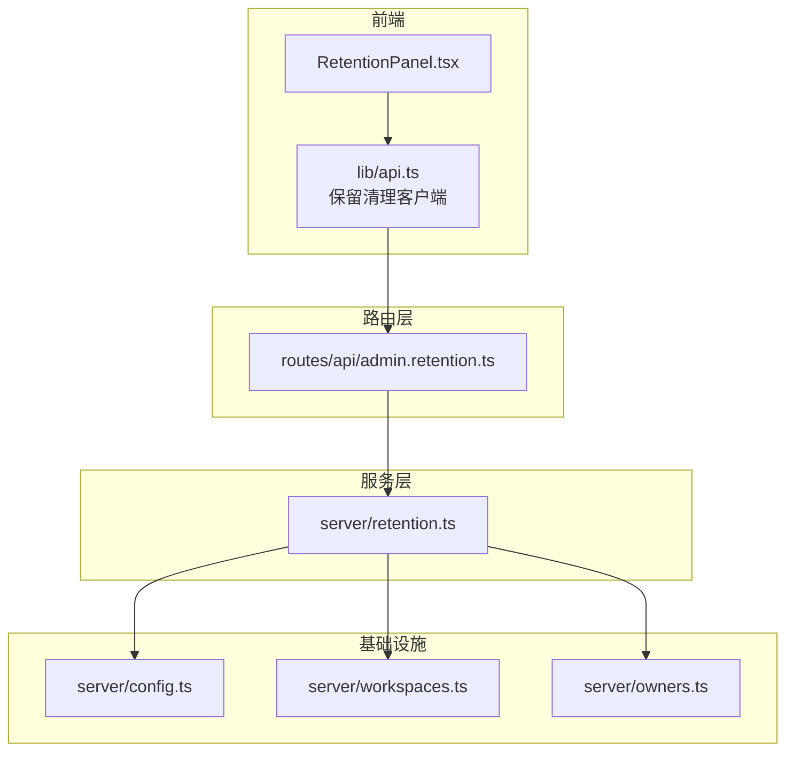
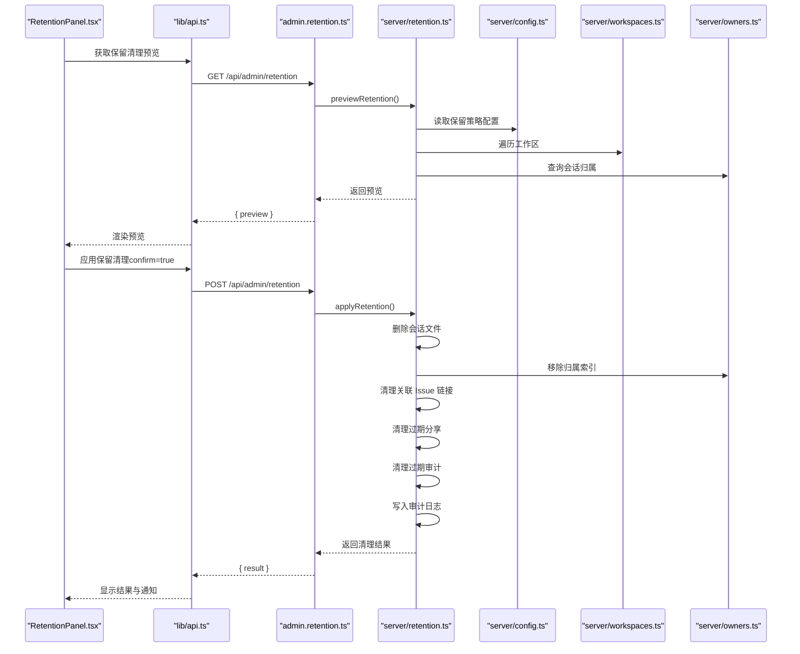
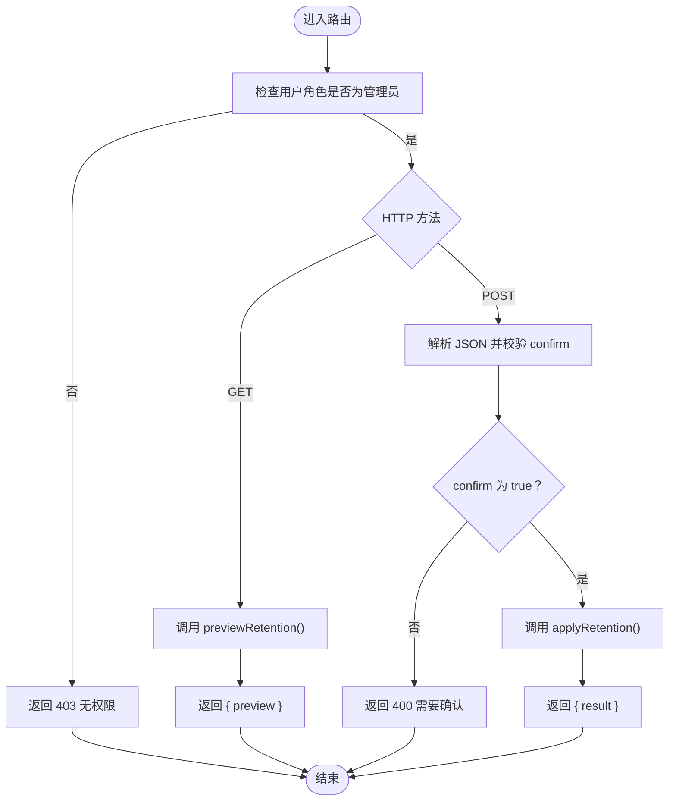
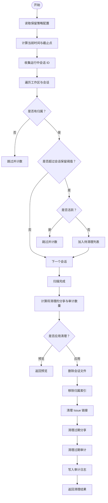
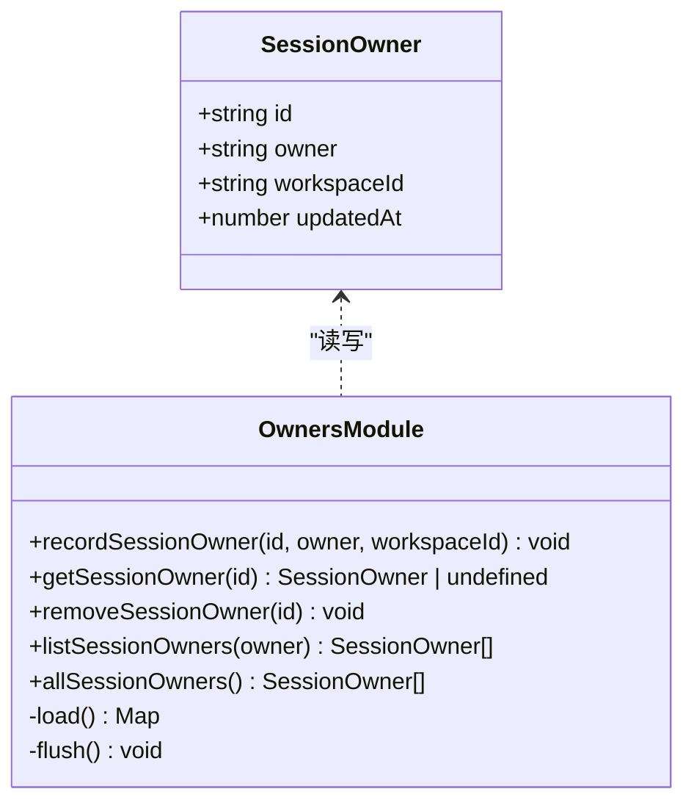
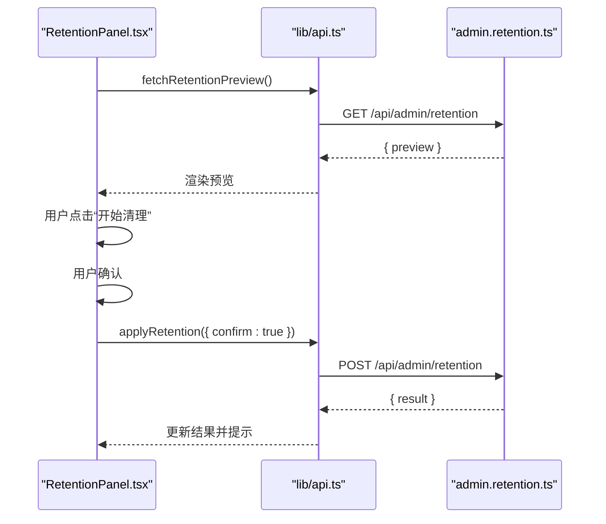
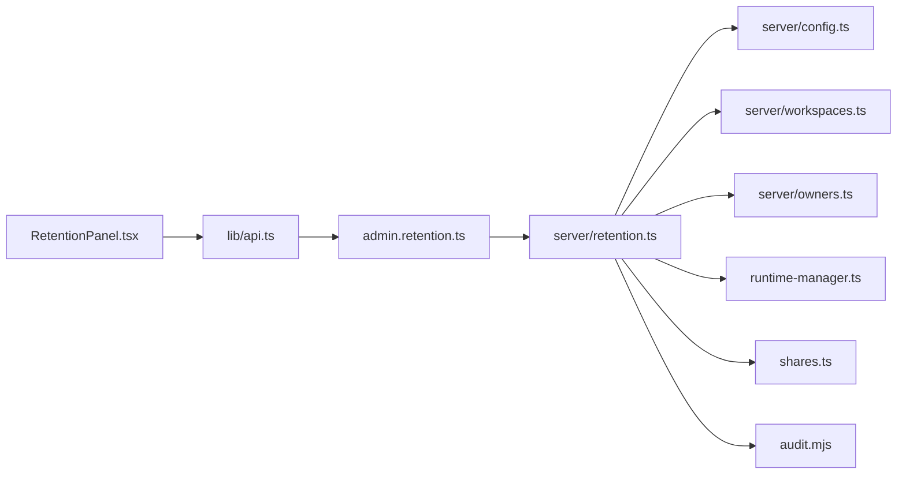

# 会话保留管理

<cite>
**本文引用的文件**   
- [retention.ts](file://apps/pi-web/src/server/retention.ts)
- [admin.retention.ts](file://apps/pi-web/src/routes/api/admin.retention.ts)
- [api.ts](file://apps/pi-web/src/lib/api.ts)
- [RetentionPanel.tsx](file://apps/pi-web/src/components/layout/RetentionPanel.tsx)
- [config.ts](file://apps/pi-web/src/server/config.ts)
- [workspaces.ts](file://apps/pi-web/src/server/workspaces.ts)
- [owners.ts](file://apps/pi-web/src/server/owners.ts)
</cite>

## 目录
1. [引言](#引言)
2. [项目结构定位](#项目结构定位)
3. [核心组件](#核心组件)
4. [架构总览](#架构总览)
5. [详细组件分析](#详细组件分析)
6. [依赖关系分析](#依赖关系分析)
7. [性能与一致性](#性能与一致性)
8. [故障排查](#故障排查)
9. [结论](#结论)

## 引言
本文件面向“会话保留管理”能力，说明如何在 pi-web 应用中预览并执行会话、分享与审计日志的保留清理。该功能通过管理员接口暴露，前端提供可视化面板，后端根据配置阈值计算将被删除的对象，并在确认执行时按安全顺序清理数据，同时记录审计日志。

## 项目结构定位
会话保留管理涉及以下层次：
- 路由层：管理员 API `/api/admin/retention`，负责权限校验与请求转发。
- 服务层：保留策略计算与清理执行。
- 存储与索引层：工作区列表、会话归属索引、运行时活跃会话集合。
- 前端层：保留清理面板，展示预览结果并触发清理。

**图表来源**
- [RetentionPanel.tsx:1-128](file://apps/pi-web/src/components/layout/RetentionPanel.tsx#L1-L128)
- [api.ts:570-623](file://apps/pi-web/src/lib/api.ts#L570-L623)
- [admin.retention.ts:1-42](file://apps/pi-web/src/routes/api/admin.retention.ts#L1-L42)
- [retention.ts:1-173](file://apps/pi-web/src/server/retention.ts#L1-L173)
- [config.ts:1-34](file://apps/pi-web/src/server/config.ts#L1-L34)
- [workspaces.ts:1-51](file://apps/pi-web/src/server/workspaces.ts#L1-L51)
- [owners.ts:1-128](file://apps/pi-web/src/server/owners.ts#L1-L128)

**章节来源**
- [admin.retention.ts:1-42](file://apps/pi-web/src/routes/api/admin.retention.ts#L1-L42)
- [retention.ts:1-173](file://apps/pi-web/src/server/retention.ts#L1-L173)

## 核心组件
- 管理员路由处理器：校验用户角色为管理员，支持 GET 预览与 POST 应用清理。
- 保留策略引擎：读取配置阈值，扫描工作区会话，结合运行中会话与归属索引，计算待清理对象。
- 会话归属索引：维护 session id → owner/workspace 的旁路索引，用于判断是否可清理。
- 前端面板：加载预览、二次确认、调用清理接口并展示结果与通知。

**章节来源**
- [admin.retention.ts:10-41](file://apps/pi-web/src/routes/api/admin.retention.ts#L10-L41)
- [retention.ts:20-57](file://apps/pi-web/src/server/retention.ts#L20-L57)
- [owners.ts:14-28](file://apps/pi-web/src/server/owners.ts#L14-L28)
- [RetentionPanel.tsx:10-39](file://apps/pi-web/src/components/layout/RetentionPanel.tsx#L10-L39)

## 架构总览
下图展示了从前端到后端的完整调用链，以及清理过程中的关键步骤。

**图表来源**
- [RetentionPanel.tsx:17-39](file://apps/pi-web/src/components/layout/RetentionPanel.tsx#L17-L39)
- [api.ts:596-622](file://apps/pi-web/src/lib/api.ts#L596-L622)
- [admin.retention.ts:13-38](file://apps/pi-web/src/routes/api/admin.retention.ts#L13-L38)
- [retention.ts:64-172](file://apps/pi-web/src/server/retention.ts#L64-L172)
- [config.ts:26-32](file://apps/pi-web/src/server/config.ts#L26-L32)
- [workspaces.ts:25-27](file://apps/pi-web/src/server/workspaces.ts#L25-L27)
- [owners.ts:83-96](file://apps/pi-web/src/server/owners.ts#L83-L96)

## 详细组件分析

### 管理员路由：/api/admin/retention
- 职责：鉴权、参数校验、调用保留引擎、统一错误响应。
- GET：返回保留清理预览。
- POST：要求请求体包含 `confirm: true`，否则拒绝；成功后返回实际删除数量。

**图表来源**
- [admin.retention.ts:13-38](file://apps/pi-web/src/routes/api/admin.retention.ts#L13-L38)

**章节来源**
- [admin.retention.ts:10-41](file://apps/pi-web/src/routes/api/admin.retention.ts#L10-L41)

### 保留策略引擎：previewRetention / applyRetention
- 配置阈值：分别控制会话、分享、审计的保留天数；未设置则不自动清理对应项。
- 活跃会话保护：基于运行时管理器列出的活动会话 ID，跳过清理。
- 归属索引过滤：仅清理有归属记录的会话；未知归属会被跳过并统计。
- 清理顺序：会话文件 → 归属索引 → Issue 链接 → 分享 → 审计 → 审计日志。
- 失败语义：任一阶段抛出异常即停止，保证操作原子性感知。

**图表来源**
- [retention.ts:64-172](file://apps/pi-web/src/server/retention.ts#L64-L172)

**章节来源**
- [retention.ts:20-57](file://apps/pi-web/src/server/retention.ts#L20-L57)
- [retention.ts:64-172](file://apps/pi-web/src/server/retention.ts#L64-L172)

### 会话归属索引：owners
- 作用：维护 session id → owner/workspace 的旁路索引，持久化到 sessions.json。
- 特性：内存缓存 + 磁盘落盘；写入使用临时文件 + rename，权限设置为 0600。
- 在保留流程中：用于判断会话是否具备归属，以及在清理后移除对应索引。

**图表来源**
- [owners.ts:14-28](file://apps/pi-web/src/server/owners.ts#L14-L28)
- [owners.ts:71-96](file://apps/pi-web/src/server/owners.ts#L71-L96)

**章节来源**
- [owners.ts:1-128](file://apps/pi-web/src/server/owners.ts#L1-L128)

### 前端面板：RetentionPanel
- 行为：页面加载时拉取预览；点击“开始清理”后二次确认；确认后调用清理接口；完成后更新预览并弹出通知。
- 状态：预览数据、错误信息、确认态、忙碌态、结果文案。
- 交互：当无可清理对象时禁用“开始清理”。

**图表来源**
- [RetentionPanel.tsx:17-39](file://apps/pi-web/src/components/layout/RetentionPanel.tsx#L17-L39)
- [api.ts:596-622](file://apps/pi-web/src/lib/api.ts#L596-L622)
- [admin.retention.ts:23-38](file://apps/pi-web/src/routes/api/admin.retention.ts#L23-L38)

**章节来源**
- [RetentionPanel.tsx:1-128](file://apps/pi-web/src/components/layout/RetentionPanel.tsx#L1-L128)
- [api.ts:570-623](file://apps/pi-web/src/lib/api.ts#L570-L623)

## 依赖关系分析
- 路由层依赖用户身份模块进行鉴权。
- 保留引擎依赖：
  - 配置模块：读取保留策略与工作区列表。
  - 工作区模块：枚举工作区路径。
  - 会话归属模块：判断归属与清理索引。
  - 运行时管理器：识别活跃会话。
  - 分享与审计模块：清理过期分享与审计。
- 前端依赖 API 客户端封装，避免直接处理 HTTP 细节。

**图表来源**
- [admin.retention.ts:1-42](file://apps/pi-web/src/routes/api/admin.retention.ts#L1-L42)
- [retention.ts:10-18](file://apps/pi-web/src/server/retention.ts#L10-L18)
- [config.ts:10-32](file://apps/pi-web/src/server/config.ts#L10-L32)
- [workspaces.ts:25-27](file://apps/pi-web/src/server/workspaces.ts#L25-L27)
- [owners.ts:71-96](file://apps/pi-web/src/server/owners.ts#L71-L96)
- [api.ts:596-622](file://apps/pi-web/src/lib/api.ts#L596-L622)
- [RetentionPanel.tsx:1-39](file://apps/pi-web/src/components/layout/RetentionPanel.tsx#L1-L39)

**章节来源**
- [retention.ts:10-18](file://apps/pi-web/src/server/retention.ts#L10-L18)

## 性能与一致性
- 配置缓存：应用配置在进程内缓存一次，避免重复解析与校验。
- 索引缓存：会话归属索引使用内存 Map 缓存，减少频繁 IO。
- 原子写入：归属索引写入采用临时文件 + rename，确保一致性。
- 清理顺序：先删会话文件，再清理关联索引与外部资源，最后写审计，降低中间态风险。
- 活跃保护：基于运行时管理器排除正在运行的会话，避免误删。

**章节来源**
- [config.ts:18-32](file://apps/pi-web/src/server/config.ts#L18-L32)
- [owners.ts:30-61](file://apps/pi-web/src/server/owners.ts#L30-L61)
- [retention.ts:64-172](file://apps/pi-web/src/server/retention.ts#L64-L172)

## 故障排查
- 无权限访问：非管理员调用会返回 403。
- 未确认清理：POST 缺少 `confirm: true` 会返回 400。
- 预览或清理异常：服务端捕获异常并返回 500，错误消息透传至前端。
- 无法读取会话索引：当 sessions.json 损坏时会警告并忽略，不影响其他流程。
- 无工作区或默认回退：工作区为空时使用默认目录。

建议排查步骤：
1. 确认当前用户角色为管理员。
2. 检查保留策略配置是否启用相应阈值。
3. 查看 sessions.json 是否存在且可读。
4. 观察运行时管理器是否列出预期活跃会话。
5. 检查分享与审计模块是否正常可用。

**章节来源**
- [admin.retention.ts:13-38](file://apps/pi-web/src/routes/api/admin.retention.ts#L13-L38)
- [owners.ts:43-51](file://apps/pi-web/src/server/owners.ts#L43-L51)
- [workspaces.ts:46-50](file://apps/pi-web/src/server/workspaces.ts#L46-L50)

## 结论
会话保留管理以管理员接口为核心入口，通过可配置的保留策略对会话、分享与审计进行可控清理。系统在设计上强调安全性与一致性：仅清理有归属且过期的会话，保护活跃会话，按严格顺序清理关联数据，并记录审计日志。前端提供直观的预览与二次确认机制，便于管理员安全地执行清理任务。