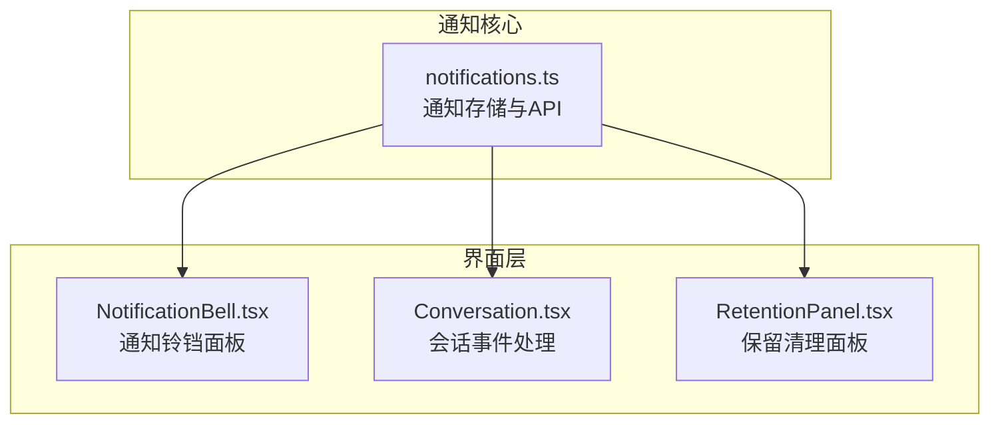
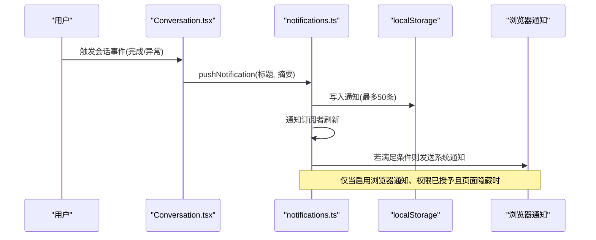
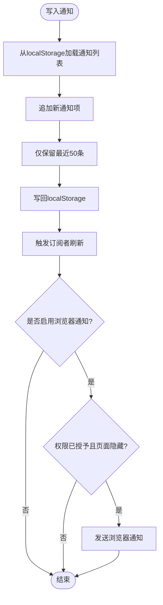
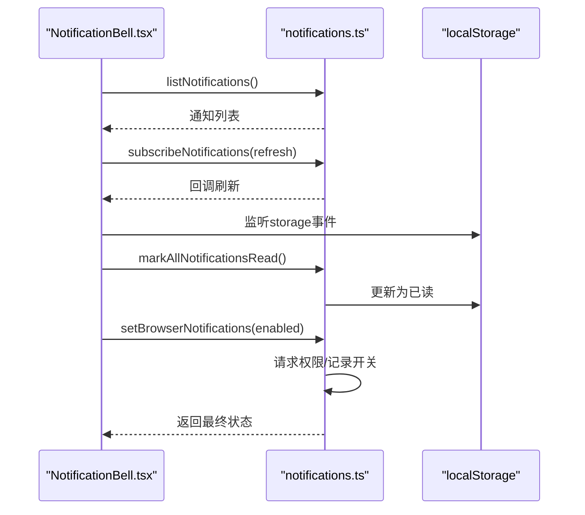
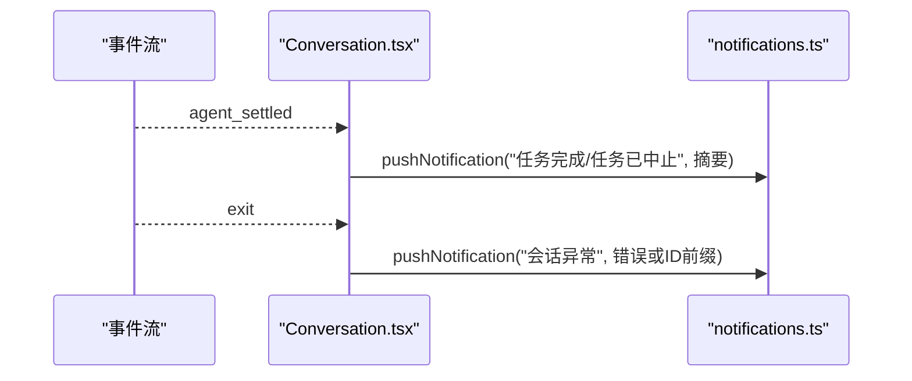
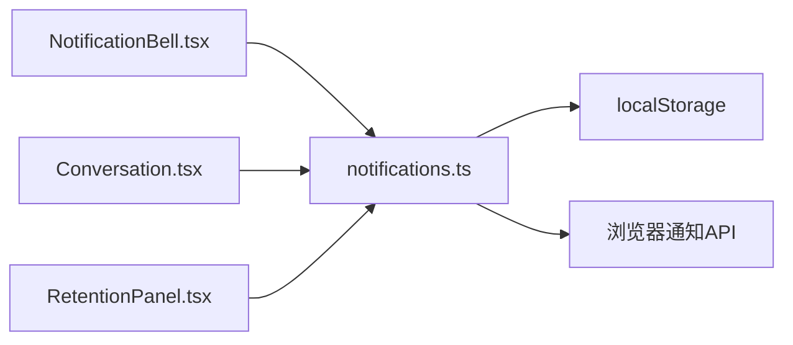

# 通知系统

<cite>
**本文引用的文件**   
- [apps/pi-web/src/lib/notifications.ts](file://apps/pi-web/src/lib/notifications.ts)
- [apps/pi-web/src/components/layout/NotificationBell.tsx](file://apps/pi-web/src/components/layout/NotificationBell.tsx)
- [apps/pi-web/src/components/conversation/Conversation.tsx](file://apps/pi-web/src/components/conversation/Conversation.tsx)
- [apps/pi-web/src/components/layout/RetentionPanel.tsx](file://apps/pi-web/src/components/layout/RetentionPanel.tsx)
</cite>

## 目录
1. [简介](#简介)
2. [项目结构中的通知相关位置](#项目结构中的通知相关位置)
3. [核心组件](#核心组件)
4. [架构总览](#架构总览)
5. [详细组件分析](#详细组件分析)
6. [依赖关系分析](#依赖关系分析)
7. [性能与容量特性](#性能与容量特性)
8. [故障排查指南](#故障排查指南)
9. [结论](#结论)

## 简介
本文件面向 pi-web 前端的通知子系统，说明其设计目标、数据模型、持久化策略、浏览器通知行为、UI 展示方式以及与会话事件、后台清理流程的集成点。该通知系统同时提供：
- 页面内通知列表（带未读计数、时间戳、已读状态）
- 可选的浏览器系统通知（需用户授权且仅在页面隐藏时触发）
- 基于 localStorage 的轻量持久化
- 通过订阅机制驱动 UI 刷新

## 项目结构中的通知相关位置
- 通知核心逻辑与 API：`apps/pi-web/src/lib/notifications.ts`
- 通知铃铛 UI：`apps/pi-web/src/components/layout/NotificationBell.tsx`
- 会话事件触发通知：`apps/pi-web/src/components/conversation/Conversation.tsx`
- 保留清理完成后通知：`apps/pi-web/src/components/layout/RetentionPanel.tsx`

**图表来源**
- [apps/pi-web/src/lib/notifications.ts:1-142](file://apps/pi-web/src/lib/notifications.ts#L1-L142)
- [apps/pi-web/src/components/layout/NotificationBell.tsx:1-113](file://apps/pi-web/src/components/layout/NotificationBell.tsx#L1-L113)
- [apps/pi-web/src/components/conversation/Conversation.tsx:17-239](file://apps/pi-web/src/components/conversation/Conversation.tsx#L17-L239)
- [apps/pi-web/src/components/layout/RetentionPanel.tsx:1-33](file://apps/pi-web/src/components/layout/RetentionPanel.tsx#L1-L33)

**章节来源**
- [apps/pi-web/src/lib/notifications.ts:1-142](file://apps/pi-web/src/lib/notifications.ts#L1-L142)
- [apps/pi-web/src/components/layout/NotificationBell.tsx:1-113](file://apps/pi-web/src/components/layout/NotificationBell.tsx#L1-L113)
- [apps/pi-web/src/components/conversation/Conversation.tsx:17-239](file://apps/pi-web/src/components/conversation/Conversation.tsx#L17-L239)
- [apps/pi-web/src/components/layout/RetentionPanel.tsx:1-33](file://apps/pi-web/src/components/layout/RetentionPanel.tsx#L1-L33)

## 核心组件
- 通知数据模型
  - `AppNotification`：包含 id、ts、title、body、read 字段，表示一条通知。
- 通知存储与 API
  - `listNotifications()`：读取并按时间倒序返回通知列表。
  - `pushNotification(title, body)`：写入新通知，必要时尝试发送浏览器通知。
  - `markAllNotificationsRead()`：全部标记为已读。
  - `unreadNotificationCount()`：统计未读数量。
  - `subscribeNotifications(listener)`：订阅通知变化，返回取消订阅函数。
  - `browserNotificationsEnabled()` / `setBrowserNotifications(enabled)`：查询或设置浏览器通知开关。
- 通知铃铛 UI
  - 显示未读数徽标、通知列表、时间格式化、一键“全部已读”、浏览器通知开关。
- 通知触发点
  - 会话完成或异常：在会话事件流中触发。
  - 保留清理完成：在清理操作成功后触发。

**章节来源**
- [apps/pi-web/src/lib/notifications.ts:16-141](file://apps/pi-web/src/lib/notifications.ts#L16-L141)
- [apps/pi-web/src/components/layout/NotificationBell.tsx:22-112](file://apps/pi-web/src/components/layout/NotificationBell.tsx#L22-L112)
- [apps/pi-web/src/components/conversation/Conversation.tsx:203-239](file://apps/pi-web/src/components/conversation/Conversation.tsx#L203-L239)
- [apps/pi-web/src/components/layout/RetentionPanel.tsx:23-33](file://apps/pi-web/src/components/layout/RetentionPanel.tsx#L23-L33)

## 架构总览
通知系统采用“核心库 + UI 组件 + 业务触发点”的分层结构：
- 核心库负责数据模型、持久化、变更订阅和浏览器通知能力。
- UI 组件负责渲染通知列表、未读数、时间格式化和用户交互。
- 业务组件在关键事件发生时调用核心库推送通知。

**图表来源**
- [apps/pi-web/src/components/conversation/Conversation.tsx:217-239](file://apps/pi-web/src/components/conversation/Conversation.tsx#L217-L239)
- [apps/pi-web/src/lib/notifications.ts:74-92](file://apps/pi-web/src/lib/notifications.ts#L74-L92)

## 详细组件分析

### 通知核心库：notifications.ts
- 数据模型
  - `AppNotification`：id、ts、title、body、read。
- 存储策略
  - 使用 `localStorage` 保存通知数组，键名为固定常量。
  - 每次写入只保留最近 50 条，避免无限增长。
  - 读写均做容错处理，解析失败时回退为空数组。
- 变更订阅
  - 内部维护监听器集合；写入后同步触发所有监听器，供 UI 刷新。
- 浏览器通知
  - 默认关闭，需要用户显式开启并授予权限。
  - 仅在页面隐藏时发送，不包含 prompt 或工具输出正文。
  - 请求权限失败或未被授予时，静默降级。
- 主要 API
  - `listNotifications()`：按时间倒序返回。
  - `pushNotification(title, body)`：追加通知并尝试浏览器通知。
  - `markAllNotificationsRead()`：批量标记已读。
  - `unreadNotificationCount()`：计算未读数。
  - `subscribeNotifications(listener)`：订阅变化。
  - `browserNotificationsEnabled()` / `setBrowserNotifications(enabled)`：控制开关。

**图表来源**
- [apps/pi-web/src/lib/notifications.ts:29-43](file://apps/pi-web/src/lib/notifications.ts#L29-L43)
- [apps/pi-web/src/lib/notifications.ts:74-92](file://apps/pi-web/src/lib/notifications.ts#L74-L92)

**章节来源**
- [apps/pi-web/src/lib/notifications.ts:1-142](file://apps/pi-web/src/lib/notifications.ts#L1-L142)

### 通知铃铛 UI：NotificationBell.tsx
- 功能要点
  - 初始加载通知列表与浏览器通知开关状态。
  - 订阅通知变化与 storage 事件，保持 UI 与存储一致。
  - 显示未读数徽标，支持“全部已读”。
  - 提供“页面隐藏时发送浏览器通知”的开关，调用核心库切换权限。
- 交互流程
  - 点击铃铛图标打开/关闭面板。
  - 点击“全部已读”调用核心库更新状态并刷新本地列表。
  - 切换浏览器通知开关时异步请求权限并更新 UI。

**图表来源**
- [apps/pi-web/src/components/layout/NotificationBell.tsx:27-38](file://apps/pi-web/src/components/layout/NotificationBell.tsx#L27-L38)
- [apps/pi-web/src/components/layout/NotificationBell.tsx:62-83](file://apps/pi-web/src/components/layout/NotificationBell.tsx#L62-L83)
- [apps/pi-web/src/lib/notifications.ts:52-55](file://apps/pi-web/src/lib/notifications.ts#L52-L55)
- [apps/pi-web/src/lib/notifications.ts:99-141](file://apps/pi-web/src/lib/notifications.ts#L99-L141)

**章节来源**
- [apps/pi-web/src/components/layout/NotificationBell.tsx:1-113](file://apps/pi-web/src/components/layout/NotificationBell.tsx#L1-L113)
- [apps/pi-web/src/lib/notifications.ts:52-141](file://apps/pi-web/src/lib/notifications.ts#L52-L141)

### 会话事件触发通知：Conversation.tsx
- 触发时机
  - 会话完成（`agent_settled`）：根据是否中止生成不同标题，并在摘要中包含 Issue 信息或会话 ID 前缀。
  - 会话异常（事件流退出）：统一提示“会话异常”，附带错误信息或会话 ID 前缀。
- 副作用
  - 在完成时拉取会话统计与分叉消息，用于后续 UI 展示。
  - 在异常时设置崩溃状态与错误文本，便于用户重启。

**图表来源**
- [apps/pi-web/src/components/conversation/Conversation.tsx:217-239](file://apps/pi-web/src/components/conversation/Conversation.tsx#L217-L239)
- [apps/pi-web/src/lib/notifications.ts:74-92](file://apps/pi-web/src/lib/notifications.ts#L74-L92)

**章节来源**
- [apps/pi-web/src/components/conversation/Conversation.tsx:203-239](file://apps/pi-web/src/components/conversation/Conversation.tsx#L203-L239)
- [apps/pi-web/src/lib/notifications.ts:74-92](file://apps/pi-web/src/lib/notifications.ts#L74-L92)

### 保留清理完成后通知：RetentionPanel.tsx
- 触发时机
  - 清理操作成功执行后，调用核心库推送“保留清理完成”通知，摘要包含删除的会话与分享数量。
- 用户体验
  - 在弹窗内显示清理结果与预览列表，同时在顶部通知栏与通知铃铛中可见。

**章节来源**
- [apps/pi-web/src/components/layout/RetentionPanel.tsx:23-33](file://apps/pi-web/src/components/layout/RetentionPanel.tsx#L23-L33)
- [apps/pi-web/src/lib/notifications.ts:74-92](file://apps/pi-web/src/lib/notifications.ts#L74-L92)

## 依赖关系分析
- 模块耦合
  - `NotificationBell.tsx` 依赖 `notifications.ts` 提供的读取、订阅、标记已读与浏览器通知开关 API。
  - `Conversation.tsx` 依赖 `notifications.ts` 的 `pushNotification` 在关键事件处触发通知。
  - `RetentionPanel.tsx` 依赖 `notifications.ts` 的 `pushNotification` 在清理成功后反馈结果。
- 外部依赖
  - `localStorage`：用于持久化通知与浏览器通知开关。
  - `Notification` API：用于浏览器系统通知，需权限与页面隐藏条件。
- 潜在风险
  - 多标签页场景下，依赖 `storage` 事件同步状态；当前实现已在 UI 层监听该事件以保持一致性。
  - 浏览器通知权限可能随时被拒绝，代码已做降级处理。

**图表来源**
- [apps/pi-web/src/components/layout/NotificationBell.tsx:1-113](file://apps/pi-web/src/components/layout/NotificationBell.tsx#L1-L113)
- [apps/pi-web/src/components/conversation/Conversation.tsx:17-239](file://apps/pi-web/src/components/conversation/Conversation.tsx#L17-L239)
- [apps/pi-web/src/components/layout/RetentionPanel.tsx:1-33](file://apps/pi-web/src/components/layout/RetentionPanel.tsx#L1-L33)
- [apps/pi-web/src/lib/notifications.ts:1-142](file://apps/pi-web/src/lib/notifications.ts#L1-L142)

**章节来源**
- [apps/pi-web/src/components/layout/NotificationBell.tsx:1-113](file://apps/pi-web/src/components/layout/NotificationBell.tsx#L1-L113)
- [apps/pi-web/src/components/conversation/Conversation.tsx:17-239](file://apps/pi-web/src/components/conversation/Conversation.tsx#L17-L239)
- [apps/pi-web/src/components/layout/RetentionPanel.tsx:1-33](file://apps/pi-web/src/components/layout/RetentionPanel.tsx#L1-L33)
- [apps/pi-web/src/lib/notifications.ts:1-142](file://apps/pi-web/src/lib/notifications.ts#L1-L142)

## 性能与容量特性
- 存储容量
  - 通知列表最多保留最近 50 条，避免 localStorage 膨胀。
- 渲染效率
  - 通过订阅机制集中刷新，避免频繁轮询。
  - 通知列表按时间倒序排序，UI 直接遍历渲染。
- 浏览器通知
  - 仅在满足条件时创建系统通知对象，属于尽力而为，捕获异常不中断主流程。

[本节为通用指导，不直接分析具体文件]

## 故障排查指南
- 通知不显示
  - 检查是否调用了 `pushNotification`，确认传入标题与摘要非空。
  - 检查 `localStorage` 是否可写，以及是否被第三方插件限制。
- 未读数不更新
  - 确认 `NotificationBell.tsx` 是否正确订阅了通知变化与 storage 事件。
  - 检查 `markAllNotificationsRead()` 是否被调用，以及 UI 是否重新读取列表。
- 浏览器通知不出现
  - 确认用户已开启“页面隐藏时发送浏览器通知”并授予权限。
  - 检查页面是否为隐藏状态；仅在隐藏时才会触发系统通知。
- 多标签页不一致
  - 确保各标签页都监听了 storage 事件，或在写入后主动刷新 UI。

**章节来源**
- [apps/pi-web/src/lib/notifications.ts:29-43](file://apps/pi-web/src/lib/notifications.ts#L29-L43)
- [apps/pi-web/src/lib/notifications.ts:74-92](file://apps/pi-web/src/lib/notifications.ts#L74-L92)
- [apps/pi-web/src/components/layout/NotificationBell.tsx:27-38](file://apps/pi-web/src/components/layout/NotificationBell.tsx#L27-L38)
- [apps/pi-web/src/components/layout/NotificationBell.tsx:62-83](file://apps/pi-web/src/components/layout/NotificationBell.tsx#L62-L83)

## 结论
pi-web 的通知系统以简洁的核心库为中心，结合 UI 组件与业务触发点，实现了页面内通知与可选的浏览器系统通知。其设计强调：
- 最小化的持久化与容量控制
- 明确的权限与条件控制
- 清晰的订阅与刷新机制
- 对异常与权限失败的健壮降级

该方案适合中小型前端应用的通知需求，易于扩展与维护。