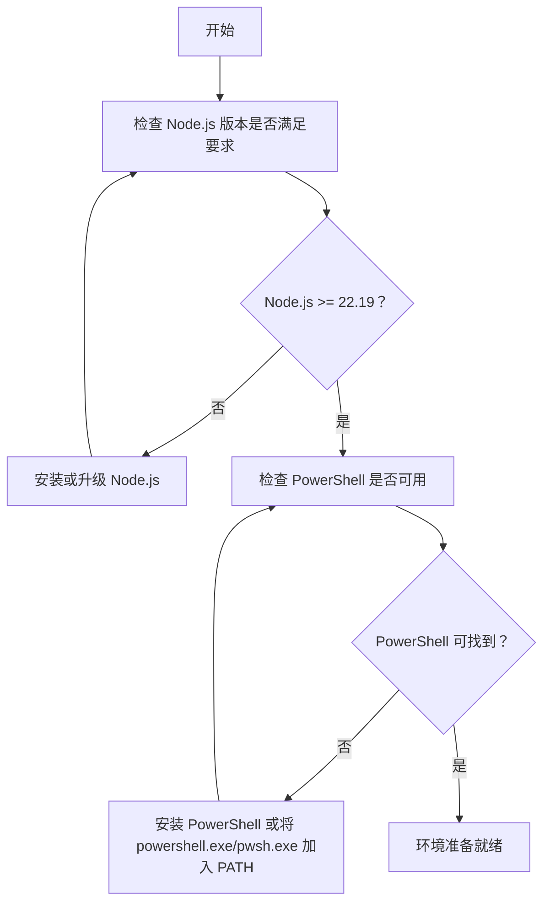
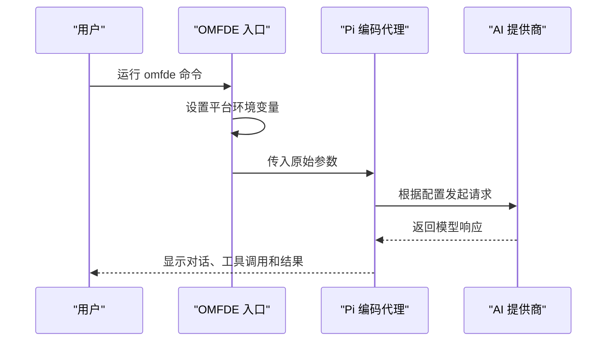
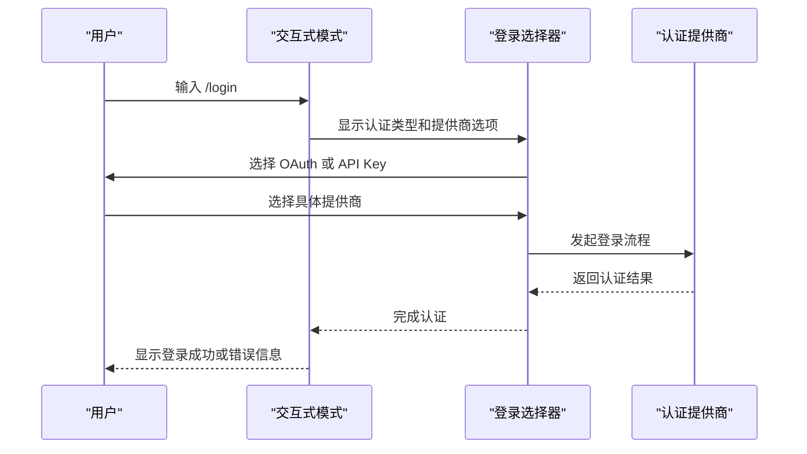
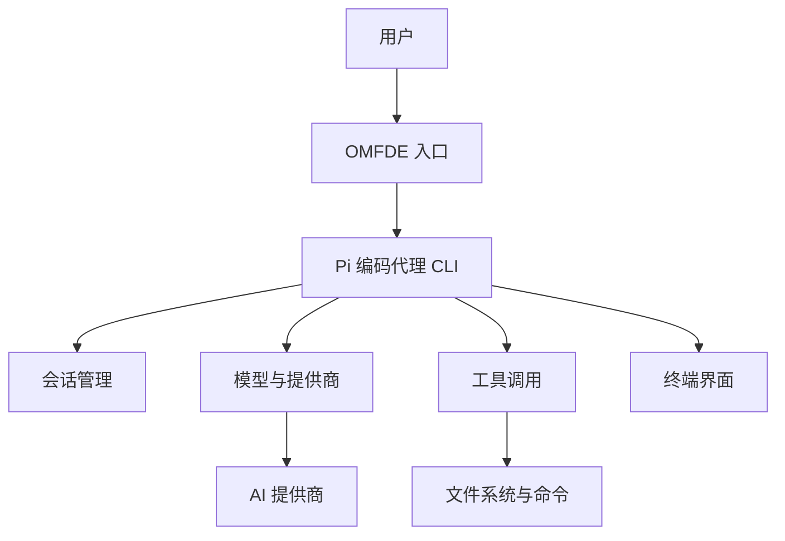
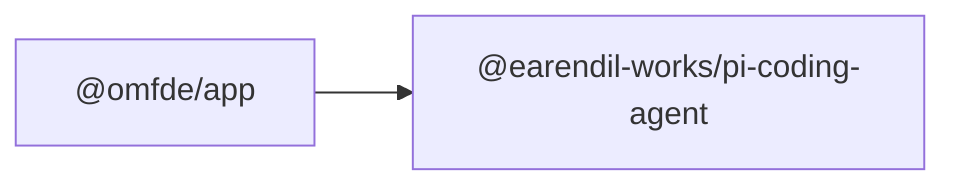
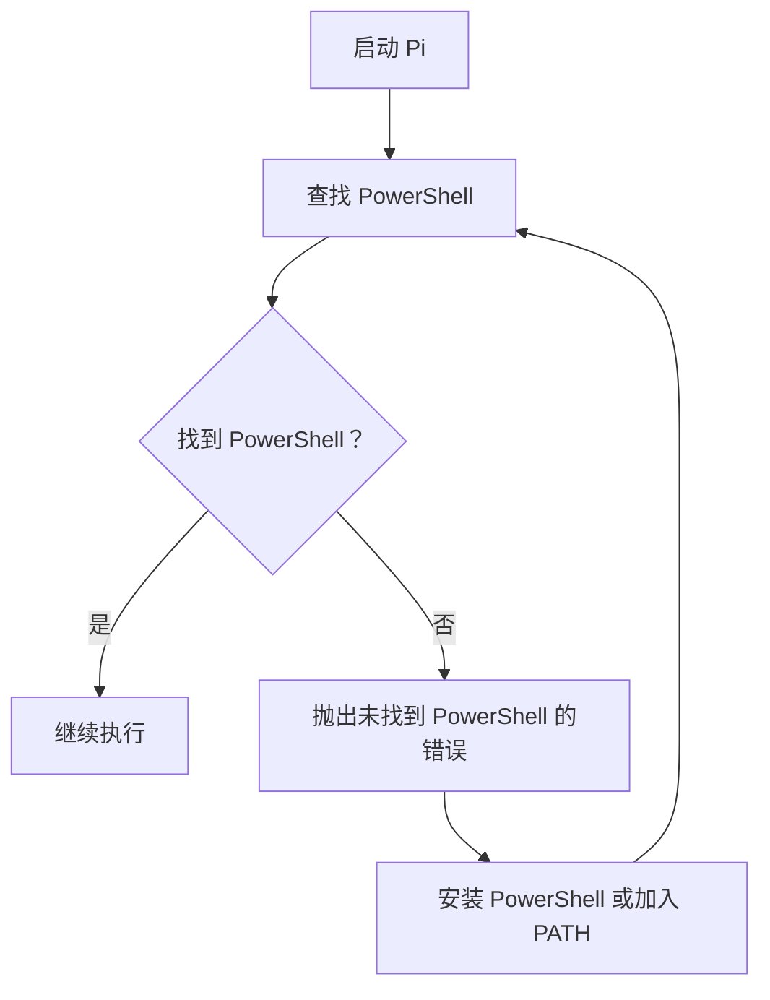

# 快速开始

<cite>
**本文引用的文件**   
- [README.md](file://README.md)
- [quickstart.md](file://packages/coding-agent/docs/quickstart.md)
- [usage.md](file://packages/coding-agent/docs/usage.md)
- [interactive-mode.ts](file://packages/coding-agent/src/modes/interactive/interactive-mode.ts)
- [shell.ts](file://packages/coding-agent/src/utils/shell.ts)
- [package.json](file://apps/omfde/package.json)
- [README.md](file://apps/omfde/README.md)
</cite>

## 目录
1. [简介](#简介)
2. [环境要求](#环境要求)
3. [安装方式](#安装方式)
4. [首次运行与基本配置](#首次运行与基本配置)
5. [交互式模式入门](#交互式模式入门)
6. [架构总览](#架构总览)
7. [依赖关系说明](#依赖关系说明)
8. [性能与安全注意事项](#性能与安全注意事项)
9. [故障排除指南](#故障排除指南)
10. [常见问题解答](#常见问题解答)
11. [结论](#结论)

## 简介
本快速开始指南面向第一次接触 OMFDE 的用户，目标是让你在最短时间内完成安装、配置并成功运行第一个 Pi 会话。OMFDE 在本仓库中是一个薄启动器：它负责设置平台标识，并把参数交给底层 Pi 编码代理执行。你实际使用的交互体验来自 Pi 的终端界面。

- OMFDE 入口会调用 `@earendil-works/pi-coding-agent`，并在运行时注入平台相关的环境变量。
- 如果你只想使用 Pi，可以直接安装 Pi；如果你希望以 OMFDE 的方式运行，则可以使用 OMFDE 提供的命令。

**章节来源**
- [README.md:13-21](file://README.md#L13-L21)
- [README.md:23-54](file://README.md#L23-L54)
- [apps/omfde/README.md:1-14](file://apps/omfde/README.md#L1-L14)

## 环境要求
- Node.js 版本要求：**Node.js 22.19 或更高版本**。
- 推荐在你要工作的项目目录下运行 Pi，这样 Pi 能发现当前项目的文件、指令和配置，并把会话保存在对应目录中。
- Windows 用户需要可用的 PowerShell 环境，以便 Pi 在需要时调用系统命令。



**图表来源**
- [README.md:43-43](file://README.md#L43-L43)
- [shell.ts:155-166](file://packages/coding-agent/src/utils/shell.ts#L155-L166)

**章节来源**
- [README.md:43-43](file://README.md#L43-L43)
- [quickstart.md:19-25](file://packages/coding-agent/docs/quickstart.md#L19-L25)
- [shell.ts:155-166](file://packages/coding-agent/src/utils/shell.ts#L155-L166)

## 安装方式
你可以选择以下三种方式安装：

### 使用 curl 安装（macOS、Linux）
这是官方安装脚本方式，会自动固定依赖，并提供 `pi update` 更新能力。

```bash
curl -fsSL https://pi.dev/install.sh | sh
```

### 使用 npm 安装
这种方式直接通过 npm 全局安装 Pi，不会固定传递依赖。它要求 Node.js 22.19+。

```bash
npm install -g --ignore-scripts @earendil-works/pi-coding-agent
```

### 使用 Windows PowerShell 安装
Windows 用户可以通过 PowerShell 执行官方安装脚本。

```powershell
powershell -c "irm https://pi.dev/install.ps1 | iex"
```

安装完成后，可以运行版本命令验证安装是否成功：

```bash
pi --version
```

**章节来源**
- [README.md:27-43](file://README.md#L27-L43)
- [quickstart.md:7-39](file://packages/coding-agent/docs/quickstart.md#L7-L39)

## 首次运行与基本配置
### 进入工作目录并启动 Pi
Pi 会在当前目录加载项目资源、指令和配置，并把会话保存在该目录中。

```bash
cd /path/to/project
pi
```

### 登录认证
如果使用的是内置 AI 提供商，请在 Pi 内部运行 `/login`，然后按提示连接订阅账户或输入 API Key。

```text
/login
```

登录后，你可以选择模型、调整思考深度、查看设置，并开始让 Pi 处理任务。

### 使用 OMFDE 启动
如果你希望以 OMFDE 平台方式运行，可以在安装了依赖后使用 OMFDE 命令。OMFDE 会设置平台标识，并把参数传给 Pi。

```bash
npm run omfde
npm run omfde -- --continue
npm run omfde -- -p "只回复 OK"
```

注意：OMFDE 本身依赖 `@earendil-works/pi-coding-agent`，因此你需要先确保 Pi 已正确安装。



**图表来源**
- [apps/omfde/README.md:3-11](file://apps/omfde/README.md#L3-L11)
- [apps/omfde/package.json:6-14](file://apps/omfde/package.json#L6-L14)

**章节来源**
- [README.md:45-54](file://README.md#L45-L54)
- [quickstart.md:41-68](file://packages/coding-agent/docs/quickstart.md#L41-L68)
- [apps/omfde/README.md:3-11](file://apps/omfde/README.md#L3-L11)
- [apps/omfde/package.json:6-14](file://apps/omfde/package.json#L6-L14)

## 交互式模式入门
进入 Pi 后，你会看到对话区、编辑器区和底部状态栏。你可以直接在编辑器中输入自然语言任务，Pi 会读取文件、执行命令、编辑代码，并把过程展示给你。

### 常见操作
- 发送消息：输入内容后按回车。
- 多行输入：按住 Shift 再按回车。
- 外部编辑器：按 Ctrl+G 打开配置的编辑器编写较长提示。
- 添加文件或图片：输入 `@` 搜索文件，或使用 Tab 补全路径；也可以粘贴或拖入图片。
- 查看工具调用：Pi 会逐步展示工具调用和结果；按 Ctrl+O 展开或折叠输出。
- 控制任务：
  - 继续当前任务：按回车发送补充信息。
  - 追加后续任务：按 Alt+Enter。
  - 中止当前任务：按 Escape。
- 常用命令：
  - `/model`：切换模型。
  - `/thinking`：切换思考深度。
  - `/login`、`/logout`：管理提供商认证。
  - `/settings`：修改常用偏好。
  - `/new`：新建会话。
  - `/resume`：恢复已有会话。
  - `/session`：查看会话信息。
  - `/export`：导出会话。
  - `/debug`：收集诊断信息。

### 登录认证流程
Pi 支持多种认证方式，包括 OAuth 账户登录和 API Key 登录。当你运行 `/login` 时，Pi 会根据可用提供商展示选项，引导你完成认证。



**图表来源**
- [interactive-mode.ts:6018-6052](file://packages/coding-agent/src/modes/interactive/interactive-mode.ts#L6018-L6052)
- [interactive-mode.ts:6094-6137](file://packages/coding-agent/src/modes/interactive/interactive-mode.ts#L6094-L6137)
- [interactive-mode.ts:6486-6504](file://packages/coding-agent/src/modes/interactive/interactive-mode.ts#L6486-L6504)

**章节来源**
- [usage.md:1-95](file://packages/coding-agent/docs/usage.md#L1-L95)
- [interactive-mode.ts:6018-6052](file://packages/coding-agent/src/modes/interactive/interactive-mode.ts#L6018-L6052)
- [interactive-mode.ts:6094-6137](file://packages/coding-agent/src/modes/interactive/interactive-mode.ts#L6094-L6137)
- [interactive-mode.ts:6486-6504](file://packages/coding-agent/src/modes/interactive/interactive-mode.ts#L6486-L6504)

## 架构总览
从用户视角看，OMFDE 是一个轻量入口，真正的工作由 Pi 编码代理完成。Pi 负责：
- 解析命令行参数和环境变量。
- 加载项目资源和配置。
- 管理会话、模型和提供商认证。
- 驱动 TUI 终端界面。
- 调用工具执行文件读写、命令执行等任务。



**图表来源**
- [apps/omfde/README.md:3-11](file://apps/omfde/README.md#L3-L11)
- [apps/omfde/package.json:12-14](file://apps/omfde/package.json#L12-L14)
- [usage.md:1-10](file://packages/coding-agent/docs/usage.md#L1-L10)

## 依赖关系说明
OMFDE 包本身非常薄，主要职责是：
- 暴露 `omfde` 可执行入口。
- 依赖 `@earendil-works/pi-coding-agent`。
- 提供 `npm run omfde` 等脚本。



**图表来源**
- [apps/omfde/package.json:6-14](file://apps/omfde/package.json#L6-L14)

**章节来源**
- [apps/omfde/package.json:1-16](file://apps/omfde/package.json#L1-L16)
- [apps/omfde/README.md:1-14](file://apps/omfde/README.md#L1-L14)

## 性能与安全注意事项
- Pi 默认不会在每个工具调用前都询问确认。它会展示正在进行的文件读取、搜索、命令和编辑操作。
- 对于不受信任或无人值守的任务，建议使用容器或沙箱运行 Pi。
- Pi 没有内置权限系统来限制文件系统、进程、网络或凭据访问；它默认以启动它的用户和进程权限运行。
- 如果需要更强隔离，可以参考仓库中的容器化方案，例如 Docker、本地微虚拟机或策略沙箱。

**章节来源**
- [usage.md:21-28](file://packages/coding-agent/docs/usage.md#L21-L28)
- [README.md:72-80](file://README.md#L72-L80)

## 故障排除指南
### 无法找到 PowerShell
如果你在 Windows 上遇到 PowerShell 不可用的错误，请检查是否安装了 PowerShell，或者将 `powershell.exe` 或 `pwsh.exe` 添加到 PATH。



**图表来源**
- [shell.ts:155-166](file://packages/coding-agent/src/utils/shell.ts#L155-L166)

### 登录失败
登录过程中如果出现错误，Pi 会显示具体的失败原因。常见情况包括：
- 没有可用的登录提供商。
- OAuth 流程被取消。
- 本地模型状态同步失败。
- 提供商认证接口返回错误。

建议：
- 确认已运行 `/login`。
- 检查网络连接。
- 确认订阅或 API Key 有效。
- 如果是 Radius 提供商，Pi 可能尝试配置 MCP 服务器；如不需要，可忽略相关提示。

**章节来源**
- [interactive-mode.ts:6018-6052](file://packages/coding-agent/src/modes/interactive/interactive-mode.ts#L6018-L6052)
- [interactive-mode.ts:6094-6137](file://packages/coding-agent/src/modes/interactive/interactive-mode.ts#L6094-L6137)
- [interactive-mode.ts:6486-6504](file://packages/coding-agent/src/modes/interactive/interactive-mode.ts#L6486-L6504)

### 会话中断或想继续上次工作
Pi 会自动保存会话。退出后，可以在同一目录重新进入最近会话：

```bash
pi --continue
```

也可以在 Pi 内部使用 `/resume` 选择其他已保存会话。

**章节来源**
- [quickstart.md:90-98](file://packages/coding-agent/docs/quickstart.md#L90-L98)
- [usage.md:55-66](file://packages/coding-agent/docs/usage.md#L55-L66)

### 需要调试终端渲染或会话状态
在 Pi 内部运行 `/debug`，Pi 会把终端渲染内容和当前会话消息写入 `pi-debug.log`。分享日志前请注意，其中可能包含提示、模型响应、工具输出、文件内容和终端数据。

**章节来源**
- [usage.md:90-95](file://packages/coding-agent/docs/usage.md#L90-L95)

## 常见问题解答
### 我应该用 curl 安装还是 npm 安装？
- 如果你希望安装脚本固定所有依赖，并使用 `pi update` 更新，优先使用 curl 安装。
- 如果你更熟悉 npm，并且不关心传递依赖是否固定，可以使用 npm 安装。

**章节来源**
- [README.md:27-43](file://README.md#L27-L43)
- [quickstart.md:7-25](file://packages/coding-agent/docs/quickstart.md#L7-L25)

### 为什么必须使用 Node.js 22.19 或更高版本？
因为 Pi 的安装和使用依赖较新的 Node.js 特性。npm 安装方式明确要求 Node.js 22.19+。

**章节来源**
- [README.md:43-43](file://README.md#L43-L43)
- [quickstart.md:19-25](file://packages/coding-agent/docs/quickstart.md#L19-L25)

### OMFDE 和 Pi 有什么区别？
- Pi 是实际的编码代理和交互界面。
- OMFDE 是仓库中的一个薄启动器，用于设置平台标识并把参数传给 Pi。
- 普通用户可以直接使用 Pi；如果你需要在 OMFDE 平台上下文中运行，则使用 OMFDE 命令。

**章节来源**
- [apps/omfde/README.md:1-14](file://apps/omfde/README.md#L1-L14)
- [apps/omfde/package.json:1-16](file://apps/omfde/package.json#L1-L16)

### 如何在 Windows 上使用 Pi？
- 使用 PowerShell 安装脚本安装。
- 确保 PowerShell 可被找到。
- 如果遇到快捷键冲突，参考终端设置文档调整 Windows Terminal 的行为。

**章节来源**
- [README.md:31-35](file://README.md#L31-L35)
- [quickstart.md:15-17](file://packages/coding-agent/docs/quickstart.md#L15-L17)
- [usage.md:42-42](file://packages/coding-agent/docs/usage.md#L42-L42)

## 结论
通过以上步骤，你应该已经完成了 OMFDE 和 Pi 的安装、基础配置，并了解了交互式模式的基本用法。接下来你可以：
- 在 Pi 中继续探索模型选择、工具调用、会话管理和导出分享。
- 根据项目需求添加指令、技能、扩展或主题。
- 在需要时使用容器或沙箱提升安全性。
- 遇到问题时优先检查 Node.js 版本、PowerShell 可用性、登录状态和会话日志。