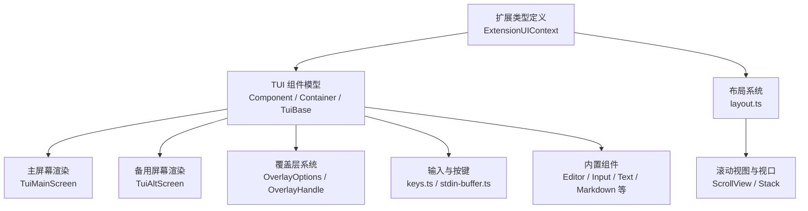
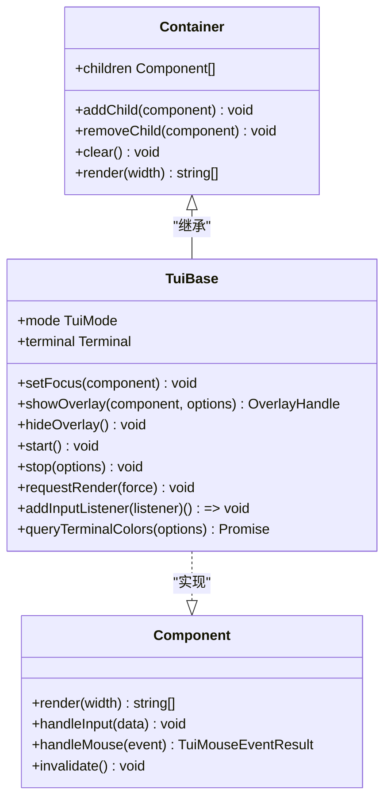
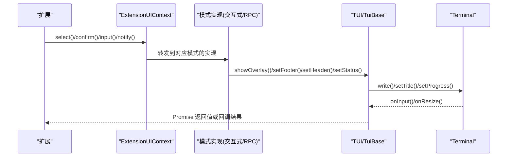
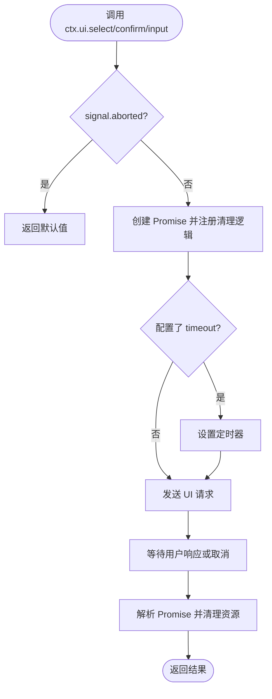
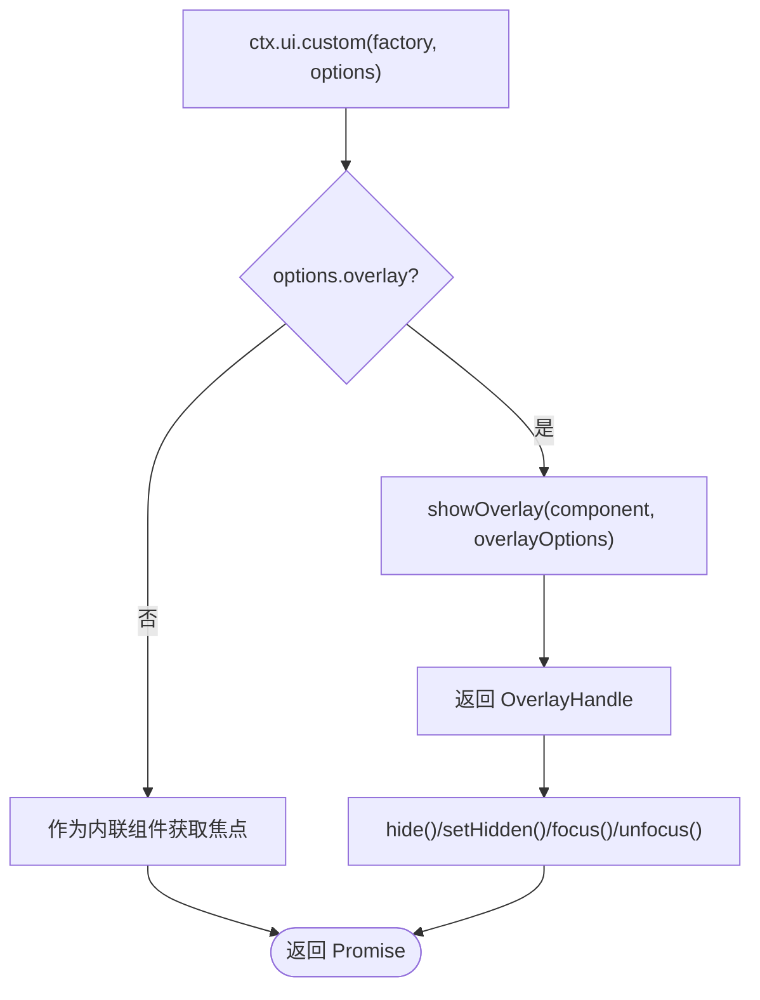
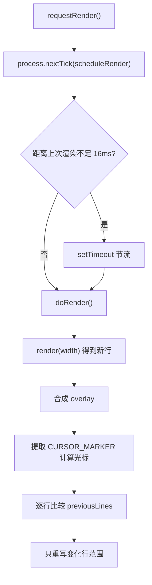
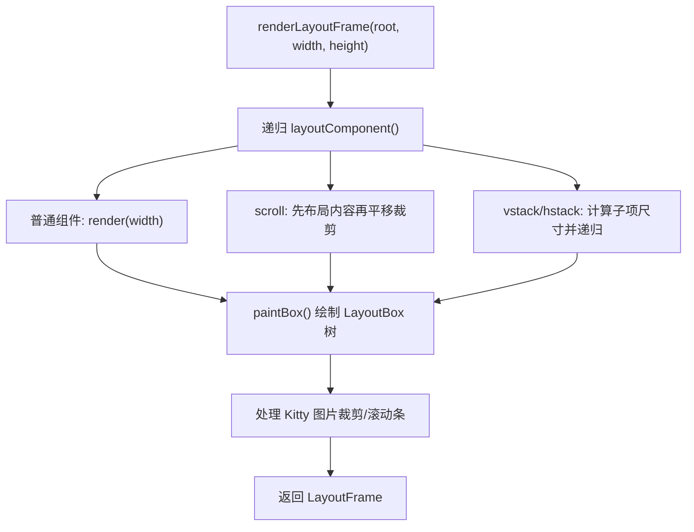
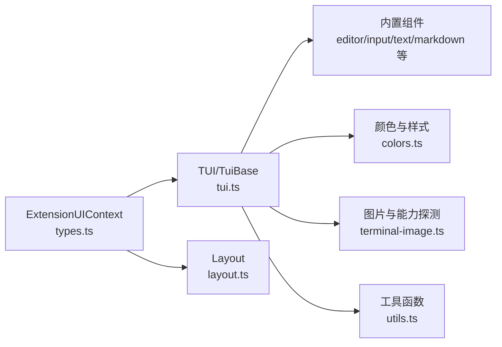

# UI 扩展

<cite>
**本文引用的文件**   
- [packages/coding-agent/src/core/extensions/types.ts](file://packages/coding-agent/src/core/extensions/types.ts)
- [packages/tui/src/index.ts](file://packages/tui/src/index.ts)
- [packages/tui/src/tui.ts](file://packages/tui/src/tui.ts)
- [packages/tui/src/layout.ts](file://packages/tui/src/layout.ts)
- [packages/tui/src/components/editor.ts](file://packages/tui/src/components/editor.ts)
- [docs/explains/15-tui.md](file://docs/explains/15-tui.md)
</cite>

## 目录
1. [引言](#引言)
2. [项目结构](#项目结构)
3. [核心组件](#核心组件)
4. [架构总览](#架构总览)
5. [详细组件分析](#详细组件分析)
6. [依赖关系分析](#依赖关系分析)
7. [性能与可访问性](#性能与可访问性)
8. [故障排查指南](#故障排查指南)
9. [结论](#结论)
10. [附录：UI 扩展示例清单](#附录ui-扩展示例清单)

## 引言
本指南面向希望为终端应用开发 UI 扩展的开发者，聚焦以下目标：
- 理解并正确使用扩展 UI 上下文中的对话框、通知、状态栏、工作指示器、面板、覆盖层等交互能力。
- 掌握 TUI 组件系统的工作原理：渲染契约、布局算法、焦点与输入分发、覆盖层合成、光标定位。
- 学会开发自定义编辑器、覆盖层和面板，并遵循响应式设计与可访问性最佳实践。
- 掌握性能优化策略，避免不必要的重绘、内存泄漏和输入延迟。

## 项目结构
仓库中与 UI 扩展直接相关的代码主要分布在两个位置：
- `packages/coding-agent/src/core/extensions/types.ts`：定义扩展 UI 上下文接口，包括对话框、通知、状态栏、工作指示器、面板、覆盖层、主题、编辑器替换等能力。
- `packages/tui`：终端 UI 库，提供组件模型、布局系统、主屏幕与备用屏幕渲染、覆盖层、输入与按键处理、颜色与图片支持等。

**图表来源**
- [packages/coding-agent/src/core/extensions/types.ts:164-320](file://packages/coding-agent/src/core/extensions/types.ts#L164-L320)
- [packages/tui/src/tui.ts:117-148](file://packages/tui/src/tui.ts#L117-L148)
- [packages/tui/src/layout.ts:16-58](file://packages/tui/src/layout.ts#L16-L58)

**章节来源**
- [packages/coding-agent/src/core/extensions/types.ts:164-320](file://packages/coding-agent/src/core/extensions/types.ts#L164-L320)
- [packages/tui/src/index.ts:1-198](file://packages/tui/src/index.ts#L1-L198)

## 核心组件
### 扩展 UI 上下文
扩展通过 `ExtensionUIContext` 与宿主 UI 交互。它暴露的能力包括：
- 对话框：选择、确认、文本输入。
- 通知：信息、警告、错误。
- 状态栏与工作指示器：设置状态、切换可见性、自定义动画帧。
- 面板与覆盖层：在编辑器上方或下方放置 widget，或使用 overlay 显示自定义组件。
- 编辑器扩展：替换默认编辑器、追加自动补全、读写编辑器内容。
- 主题与标题：读取/切换主题、设置终端标题。
- 工具输出展开状态：控制工具结果是否展开。

这些方法由不同模式（交互式、RPC、打印）提供具体实现；扩展只需调用接口，无需关心底层渲染细节。

**章节来源**
- [packages/coding-agent/src/core/extensions/types.ts:164-320](file://packages/coding-agent/src/core/extensions/types.ts#L164-L320)

### TUI 组件模型
TUI 的核心是“组件只返回行”的设计：
- `Component.render(width)` 返回若干带 ANSI 样式的字符串行。
- 布局、合成、差分、光标定位由 TUI 统一处理。
- `Container` 是最简单的组合容器，按顺序拼接子组件的行。
- `TuiBase` 提供焦点管理、overlay 栈、输入监听链、渲染调度、终端启动/停止、颜色查询等通用能力。

**图表来源**
- [packages/tui/src/tui.ts:117-148](file://packages/tui/src/tui.ts#L117-L148)
- [packages/tui/src/tui.ts:364-424](file://packages/tui/src/tui.ts#L364-L424)
- [packages/tui/src/tui.ts:512-599](file://packages/tui/src/tui.ts#L512-L599)

**章节来源**
- [docs/explains/15-tui.md:6-44](file://docs/explains/15-tui.md#L6-L44)
- [packages/tui/src/tui.ts:117-148](file://packages/tui/src/tui.ts#L117-L148)
- [packages/tui/src/tui.ts:364-424](file://packages/tui/src/tui.ts#L364-L424)
- [packages/tui/src/tui.ts:512-599](file://packages/tui/src/tui.ts#L512-L599)

## 架构总览
扩展 UI 上下文并不直接操作终端，而是委托给 TUI 子系统。典型流程如下：

**图表来源**
- [packages/coding-agent/src/core/extensions/types.ts:164-320](file://packages/coding-agent/src/core/extensions/types.ts#L164-L320)
- [packages/tui/src/tui.ts:470-499](file://packages/tui/src/tui.ts#L470-L499)

## 详细组件分析

### 对话框与通知
- `select(title, options, opts)`：弹出选择框，返回用户选择的值或取消时的 undefined。
- `confirm(title, message, opts)`：弹出确认框，返回布尔值。
- `input(title, placeholder, opts)`：弹出文本输入框，返回输入值或取消时的 undefined。
- `notify(message, type)`：显示通知，type 可为 info、warning、error。

所有对话框都支持 `signal` 与 `timeout`，便于程序化关闭与超时处理。

**图表来源**
- [packages/coding-agent/src/core/extensions/types.ts:116-121](file://packages/coding-agent/src/core/extensions/types.ts#L116-L121)
- [packages/coding-agent/src/core/extensions/types.ts:164-175](file://packages/coding-agent/src/core/extensions/types.ts#L164-L175)

**章节来源**
- [packages/coding-agent/src/core/extensions/types.ts:116-121](file://packages/coding-agent/src/core/extensions/types.ts#L116-L121)
- [packages/coding-agent/src/core/extensions/types.ts:164-175](file://packages/coding-agent/src/core/extensions/types.ts#L164-L175)

### 状态栏与工作指示器
- `setStatus(key, text)`：设置状态栏文本，传入 undefined 清除。
- `setWorkingMessage(message?)`：设置流式加载时的工作消息。
- `setWorkingVisible(visible)`：显示或隐藏内置工作加载行。
- `setWorkingIndicator(options?)`：自定义工作指示器动画帧与间隔。

这些方法用于向用户反馈当前任务状态，尤其在长耗时操作中提升体验。

**章节来源**
- [packages/coding-agent/src/core/extensions/types.ts:180-197](file://packages/coding-agent/src/core/extensions/types.ts#L180-L197)

### 面板与覆盖层
- `setWidget(key, content, options)`：在编辑器上方或下方放置 widget，支持字符串数组或组件工厂。
- `setFooter(factory)`：替换底部状态栏组件。
- `setHeader(factory)`：替换顶部启动头组件。
- `custom(factory, options)`：显示带键盘焦点的自定义组件，可选择以 overlay 形式呈现，并可配置 overlay 的定位、尺寸、可见性与句柄回调。

overlay 支持绝对或百分比宽高、锚点、偏移、边距、按终端尺寸决定是否显示、非捕获焦点等特性。

**图表来源**
- [packages/coding-agent/src/core/extensions/types.ts:228-248](file://packages/coding-agent/src/core/extensions/types.ts#L228-L248)
- [packages/tui/src/tui.ts:260-330](file://packages/tui/src/tui.ts#L260-L330)

**章节来源**
- [packages/coding-agent/src/core/extensions/types.ts:202-248](file://packages/coding-agent/src/core/extensions/types.ts#L202-L248)
- [packages/tui/src/tui.ts:260-330](file://packages/tui/src/tui.ts#L260-L330)

### 编辑器与自动补全
- `pasteToEditor(text)`：将文本粘贴到编辑器，触发粘贴处理。
- `setEditorText(text)` / `getEditorText()`：设置或获取核心输入编辑器的文本。
- `editor(title, prefill)`：打开多行编辑器进行文本编辑。
- `addAutocompleteProvider(factory)`：在内置自动补全之上追加行为。
- `setEditorComponent(factory)` / `getEditorComponent()`：替换默认编辑器组件或获取当前工厂。

编辑器组件需要实现 `EditorComponent` 接口，通常结合 TUI 的 `Component` 模型与 `Focusable` 光标标记机制。

**章节来源**
- [packages/coding-agent/src/core/extensions/types.ts:250-301](file://packages/coding-agent/src/core/extensions/types.ts#L250-L301)
- [packages/tui/src/index.ts:42-42](file://packages/tui/src/index.ts#L42-L42)
- [packages/tui/src/components/editor.ts:1-25](file://packages/tui/src/components/editor.ts#L1-L25)

### 主题与终端标题
- `theme`：当前主题对象。
- `getAllThemes()` / `getTheme(name)` / `setTheme(theme)`：列出、加载与切换主题。
- `setTitle(title)`：设置终端窗口/标签标题。

主题可用于样式化组件边框、自动补全、Markdown 等。

**章节来源**
- [packages/coding-agent/src/core/extensions/types.ts:303-319](file://packages/coding-agent/src/core/extensions/types.ts#L303-L319)

### 组件系统与渲染机制
TUI 的渲染机制强调“稳定输出”和“行级差分”：
- 组件必须对同一状态产生相同的行输出，以便差分正确工作。
- 渲染缓存按宽度保存，避免同帧重复 render。
- 主屏幕使用同步输出包裹整帧，减少闪烁。
- 光标通过零宽 APC 序列标记，TUI 负责定位硬件光标。

**图表来源**
- [docs/explains/15-tui.md:46-87](file://docs/explains/15-tui.md#L46-L87)
- [packages/tui/src/tui.ts:512-599](file://packages/tui/src/tui.ts#L512-L599)

**章节来源**
- [docs/explains/15-tui.md:46-87](file://docs/explains/15-tui.md#L46-L87)
- [packages/tui/src/tui.ts:512-599](file://packages/tui/src/tui.ts#L512-L599)

### 布局系统
布局独立于组件的 `render()`，通过 `LAYOUT_NODE` 符号暴露布局节点：
- 支持 vstack/hstack/scroll 三种布局类型。
- `allocateStackSizes()` 根据 basis/grow/shrink/minSize/maxSize/gap 分配尺寸。
- `paintBox()` 把布局树画到屏幕行数组，处理图片裁剪与滚动条。
- 命中测试用于鼠标事件路由。

**图表来源**
- [docs/explains/15-tui.md:102-139](file://docs/explains/15-tui.md#L102-L139)
- [packages/tui/src/layout.ts:16-58](file://packages/tui/src/layout.ts#L16-L58)

**章节来源**
- [docs/explains/15-tui.md:102-139](file://docs/explains/15-tui.md#L102-L139)
- [packages/tui/src/layout.ts:16-58](file://packages/tui/src/layout.ts#L16-L58)

### 输入与按键
- `keys.ts`：解析按键、匹配快捷键、Kitty 协议、release/repeat 事件。
- `stdin-buffer.ts`：将 stdin 字节流拆成事件，处理转义序列。
- `keybindings.ts`：默认键位、配置覆盖、冲突检测。
- 输入监听器可以消费或改写输入，再交给焦点组件。

扩展可通过 `onTerminalInput(handler)` 监听原始终端输入，并在交互式模式下拦截或改写输入。

**章节来源**
- [docs/explains/15-tui.md:205-210](file://docs/explains/15-tui.md#L205-L210)
- [packages/coding-agent/src/core/extensions/types.ts:177-178](file://packages/coding-agent/src/core/extensions/types.ts#L177-L178)

## 依赖关系分析
扩展 UI 上下文依赖 TUI 提供的组件、布局、覆盖层与终端抽象。TUI 内部又依赖颜色、图片、工具函数与原生平台能力。

**图表来源**
- [packages/coding-agent/src/core/extensions/types.ts:164-320](file://packages/coding-agent/src/core/extensions/types.ts#L164-L320)
- [packages/tui/src/index.ts:1-198](file://packages/tui/src/index.ts#L1-L198)

**章节来源**
- [packages/coding-agent/src/core/extensions/types.ts:164-320](file://packages/coding-agent/src/core/extensions/types.ts#L164-L320)
- [packages/tui/src/index.ts:1-198](file://packages/tui/src/index.ts#L1-L198)

## 性能与可访问性

### 性能优化
- 保持组件渲染稳定：同一状态应产出相同行，避免抖动导致全量重绘。
- 合理使用 invalidate：仅在主题变化或必要状态变更时调用。
- 利用 overlay 的非捕获模式：不需要焦点的覆盖层设置 `nonCapturing`，减少焦点切换开销。
- 控制工作指示器动画帧数量与间隔，避免频繁重绘。
- 使用 `setClearOnShrink(false)` 在慢速终端上减少空行重绘。
- 避免在高频回调中创建大量临时对象，复用组件实例。

**章节来源**
- [docs/explains/15-tui.md:231-242](file://docs/explains/15-tui.md#L231-L242)
- [packages/tui/src/tui.ts:610-621](file://packages/tui/src/tui.ts#L610-L621)

### 可访问性
- 使用 Focusable 与 CURSOR_MARKER：确保 IME 候选窗口出现在正确位置。
- 提供清晰的标题与状态文本：`setTitle`、`setStatus`、`setWorkingMessage`。
- 使用语义化的通知类型：info/warning/error，帮助用户快速识别风险。
- 为复杂交互提供键盘导航：合理设置 keybindings，避免独占全局快捷键。
- 在 overlay 中保留焦点恢复策略：隐藏或移除 overlay 后恢复到上一个可见 overlay 或 preFocus。

**章节来源**
- [packages/tui/src/tui.ts:180-213](file://packages/tui/src/tui.ts#L180-L213)
- [packages/coding-agent/src/core/extensions/types.ts:174-197](file://packages/coding-agent/src/core/extensions/types.ts#L174-L197)

## 故障排查指南
常见问题与排查建议：
- 对话框不关闭：检查 `signal` 是否被 abort，或 `timeout` 是否过期。
- 覆盖层不显示：确认 `visible(termWidth, termHeight)` 返回 true，且未设置 `nonCapturing` 导致焦点问题。
- 状态栏无更新：确保 `setStatus` 的 key 唯一，必要时传入 undefined 清除旧状态。
- 编辑器无法输入：检查是否替换了编辑器组件但未正确处理 `handleInput`，或未调用父类默认处理。
- 渲染卡顿：检查是否存在不稳定输出、频繁 create component、未复用组件实例。
- 光标错位：确认组件在焦点状态下输出 CURSOR_MARKER，并使用 `renderFakeCursor` 在无硬件光标时模拟光标。

**章节来源**
- [packages/coding-agent/src/core/extensions/types.ts:116-121](file://packages/coding-agent/src/core/extensions/types.ts#L116-L121)
- [packages/tui/src/tui.ts:180-213](file://packages/tui/src/tui.ts#L180-L213)
- [packages/tui/src/components/editor.ts:1-25](file://packages/tui/src/components/editor.ts#L1-L25)

## 结论
UI 扩展通过 `ExtensionUIContext` 提供统一的交互入口，而 TUI 则负责组件渲染、布局、覆盖层与输入处理。扩展开发者应专注于业务交互逻辑，遵循组件渲染稳定、布局合理、焦点清晰、可访问性友好的原则，并利用 overlay、widget、footer/header 等能力构建丰富的终端界面。同时，注意性能优化与错误处理，确保用户体验流畅可靠。

## 附录：UI 扩展示例清单
以下为仓库中可用的 UI 扩展示例路径，涵盖从简单信息展示到复杂交互式界面的多种场景：
- 自动提交退出钩子：[auto-commit-on-exit.ts](file://packages/coding-agent/examples/extensions/auto-commit-on-exit.ts)
- Bash 生成钩子：[bash-spawn-hook.ts](file://packages/coding-agent/examples/extensions/bash-spawn-hook.ts)
- 书签功能：[bookmark.ts](file://packages/coding-agent/examples/extensions/bookmark.ts)
- 边框状态编辑器：[border-status-editor.ts](file://packages/coding-agent/examples/extensions/border-status-editor.ts)
- 内置工具渲染器：[built-in-tool-renderer.ts](file://packages/coding-agent/examples/extensions/built-in-tool-renderer.ts)
- Claude 规则：[claude-rules.ts](file://packages/coding-agent/examples/extensions/claude-rules.ts)
- 命令示例：[commands.ts](file://packages/coding-agent/examples/extensions/commands.ts)
- 危险操作确认：[confirm-destructive.ts](file://packages/coding-agent/examples/extensions/confirm-destructive.ts)
- 自定义压缩：[custom-compaction.ts](file://packages/coding-agent/examples/extensions/custom-compaction.ts)
- 自定义底部栏：[custom-footer.ts](file://packages/coding-agent/examples/extensions/custom-footer.ts)
- 自定义头部：[custom-header.ts](file://packages/coding-agent/examples/extensions/custom-header.ts)
- 调试提供者：[debug-provider.ts](file://packages/coding-agent/examples/extensions/debug-provider.ts)
- 脏仓库守卫：[dirty-repo-guard.ts](file://packages/coding-agent/examples/extensions/dirty-repo-guard.ts)
- 动态工具：[dynamic-tools.ts](file://packages/coding-agent/examples/extensions/dynamic-tools.ts)
- 条目渲染器：[entry-renderer.ts](file://packages/coding-agent/examples/extensions/entry-renderer.ts)
- 事件总线：[event-bus.ts](file://packages/coding-agent/examples/extensions/event-bus.ts)
- 文件触发器：[file-trigger.ts](file://packages/coding-agent/examples/extensions/file-trigger.ts)
- Git 检查点：[git-checkpoint.ts](file://packages/coding-agent/examples/extensions/git-checkpoint.ts)
- Git 合并与解决：[git-merge-and-resolve.ts](file://packages/coding-agent/examples/extensions/git-merge-and-resolve.ts)
- GitHub Issue 自动补全：[github-issue-autocomplete.ts](file://packages/coding-agent/examples/extensions/github-issue-autocomplete.ts)