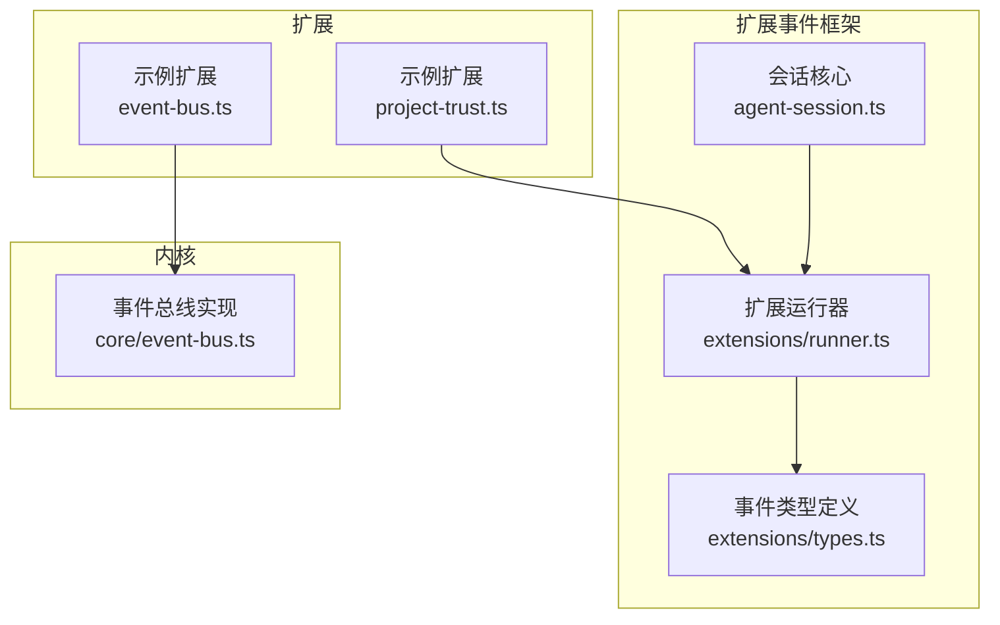
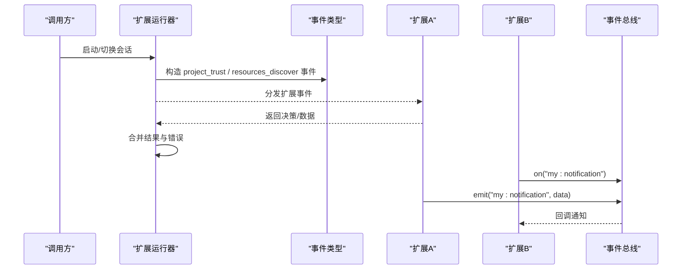
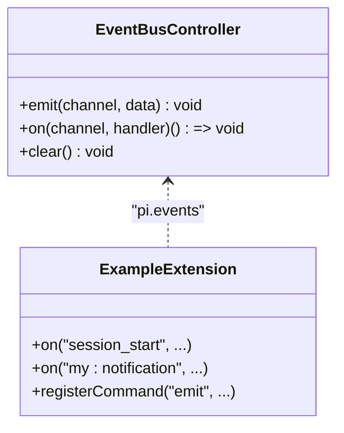
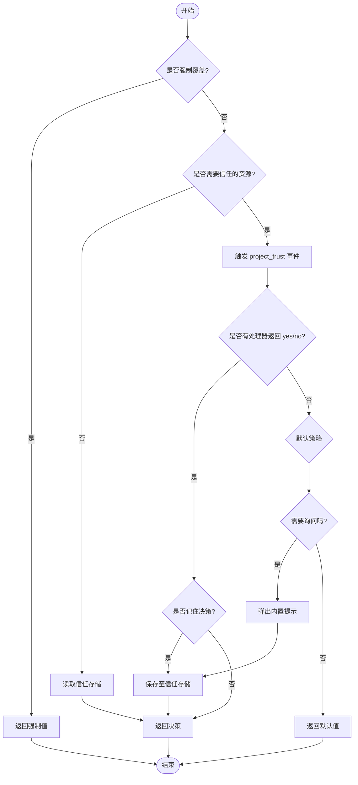
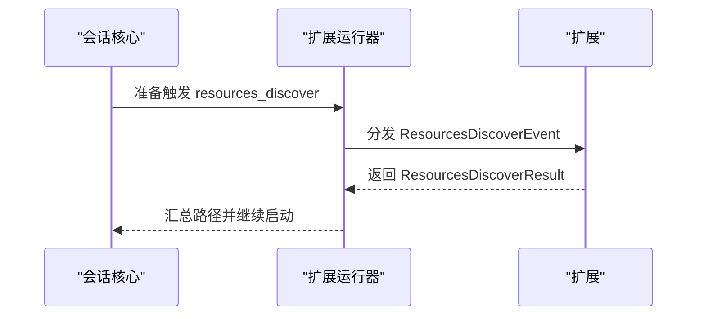
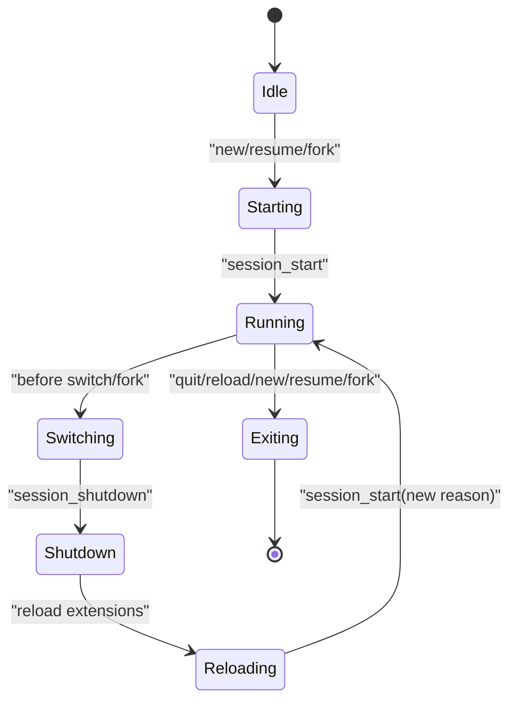
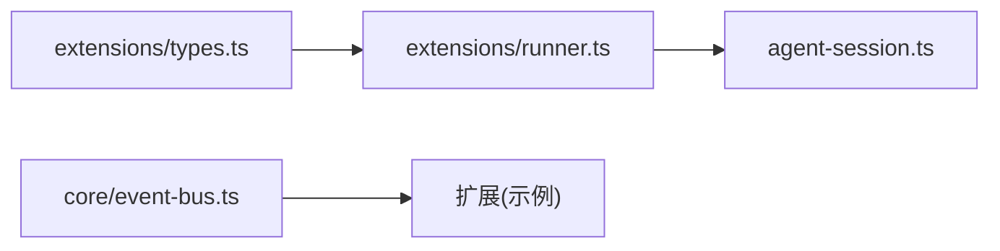

# 事件系统

<cite>
**本文引用的文件**   
- [packages/coding-agent/src/core/event-bus.ts](file://packages/coding-agent/src/core/event-bus.ts)
- [packages/coding-agent/examples/extensions/event-bus.ts](file://packages/coding-agent/examples/extensions/event-bus.ts)
- [packages/coding-agent/examples/extensions/project-trust.ts](file://packages/coding-agent/examples/extensions/project-trust.ts)
- [packages/coding-agent/src/core/project-trust.ts](file://packages/coding-agent/src/core/project-trust.ts)
- [packages/coding-agent/src/core/extensions/types.ts](file://packages/coding-agent/src/core/extensions/types.ts)
- [packages/coding-agent/docs/extensions.md](file://packages/coding-agent/docs/extensions.md)
- [packages/coding-agent/src/core/agent-session.ts](file://packages/coding-agent/src/core/agent-session.ts)
- [packages/coding-agent/src/core/extensions/runner.ts](file://packages/coding-agent/src/core/extensions/runner.ts)
</cite>

## 目录
1. [引言](#引言)
2. [项目结构](#项目结构)
3. [核心组件](#核心组件)
4. [架构总览](#架构总览)
5. [详细组件分析](#详细组件分析)
6. [依赖关系分析](#依赖关系分析)
7. [性能与并发特性](#性能与并发特性)
8. [调试与监控](#调试与监控)
9. [故障排查指南](#故障排查指南)
10. [结论](#结论)
11. [附录：事件类型速查](#附录事件类型速查)

## 引言
本文件系统化梳理本项目的事件系统，覆盖事件类型、生命周期、传播机制、监听器注册与注销、错误处理、扩展生命周期集成、以及调试与性能监控实践。重点围绕会话事件、项目信任事件和资源发现事件等核心事件类型展开，并提供面向扩展开发者的最佳实践与模式。

## 项目结构
事件系统由“内核事件总线”和“扩展事件框架”两部分组成：
- 内核事件总线：提供进程内轻量级发布订阅能力，用于扩展间通信。
- 扩展事件框架：定义扩展可订阅的领域事件（如 session_start、project_trust、resources_discover），并在扩展加载与运行时调度。

图表来源
- [packages/coding-agent/examples/extensions/event-bus.ts:1-44](file://packages/coding-agent/examples/extensions/event-bus.ts#L1-L44)
- [packages/coding-agent/examples/extensions/project-trust.ts:1-65](file://packages/coding-agent/examples/extensions/project-trust.ts#L1-L65)
- [packages/coding-agent/src/core/extensions/types.ts:740-939](file://packages/coding-agent/src/core/extensions/types.ts#L740-L939)
- [packages/coding-agent/src/core/extensions/runner.ts:1499-1520](file://packages/coding-agent/src/core/extensions/runner.ts#L1499-L1520)
- [packages/coding-agent/src/core/agent-session.ts:3415-3415](file://packages/coding-agent/src/core/agent-session.ts#L3415-L3415)
- [packages/coding-agent/src/core/event-bus.ts:1-34](file://packages/coding-agent/src/core/event-bus.ts#L1-L34)

章节来源
- [packages/coding-agent/examples/extensions/event-bus.ts:1-44](file://packages/coding-agent/examples/extensions/event-bus.ts#L1-L44)
- [packages/coding-agent/examples/extensions/project-trust.ts:1-65](file://packages/coding-agent/examples/extensions/project-trust.ts#L1-L65)
- [packages/coding-agent/src/core/extensions/types.ts:740-939](file://packages/coding-agent/src/core/extensions/types.ts#L740-L939)
- [packages/coding-agent/src/core/extensions/runner.ts:1499-1520](file://packages/coding-agent/src/core/extensions/runner.ts#L1499-L1520)
- [packages/coding-agent/src/core/agent-session.ts:3415-3415](file://packages/coding-agent/src/core/agent-session.ts#L3415-L3415)
- [packages/coding-agent/src/core/event-bus.ts:1-34](file://packages/coding-agent/src/core/event-bus.ts#L1-L34)

## 核心组件
- 事件总线 EventBus：封装 Node.js EventEmitter，提供 emit/on/clear，并对处理器进行异步包装与错误捕获，返回取消函数以支持注销。
- 扩展事件类型：集中定义 Session、Agent、Project Trust、Resources 等事件的数据结构与语义。
- 扩展运行器 Runner：在启动、重载、资源发现等阶段触发扩展事件，并收集结果与错误。
- 会话核心 AgentSession：在关键路径中触发资源发现等事件，并与 Runner 协作。

章节来源
- [packages/coding-agent/src/core/event-bus.ts:1-34](file://packages/coding-agent/src/core/event-bus.ts#L1-L34)
- [packages/coding-agent/src/core/extensions/types.ts:740-939](file://packages/coding-agent/src/core/extensions/types.ts#L740-L939)
- [packages/coding-agent/src/core/extensions/runner.ts:1499-1520](file://packages/coding-agent/src/core/extensions/runner.ts#L1499-L1520)
- [packages/coding-agent/src/core/agent-session.ts:3415-3415](file://packages/coding-agent/src/core/agent-session.ts#L3415-L3415)

## 架构总览
事件系统分为两条主线：
- 扩展事件流：Runner 在特定生命周期点触发扩展事件（如 project_trust、session_start、resources_discover），扩展通过 pi.on 订阅并返回结果或副作用。
- 扩展间通信：通过 EventBus 在扩展之间广播消息，适合跨扩展通知与协作。

图表来源
- [packages/coding-agent/src/core/extensions/runner.ts:1499-1520](file://packages/coding-agent/src/core/extensions/runner.ts#L1499-L1520)
- [packages/coding-agent/src/core/extensions/types.ts:740-939](file://packages/coding-agent/src/core/extensions/types.ts#L740-L939)
- [packages/coding-agent/examples/extensions/event-bus.ts:16-42](file://packages/coding-agent/examples/extensions/event-bus.ts#L16-L42)
- [packages/coding-agent/src/core/event-bus.ts:12-32](file://packages/coding-agent/src/core/event-bus.ts#L12-L32)

## 详细组件分析

### 事件总线（进程内扩展间通信）
- 职责：提供 channel 级别的发布订阅；对处理器进行 try/catch 包裹，避免单个处理器异常影响其他处理器；返回取消函数以注销监听器；提供 clear 清空所有监听器。
- 使用方式：扩展通过 pi.events 访问，emit 发送消息，on 订阅消息，返回取消函数用于注销。
- 典型场景：跨扩展通知、命令触发通知、会话状态变更广播。

图表来源
- [packages/coding-agent/src/core/event-bus.ts:3-32](file://packages/coding-agent/src/core/event-bus.ts#L3-L32)
- [packages/coding-agent/examples/extensions/event-bus.ts:16-42](file://packages/coding-agent/examples/extensions/event-bus.ts#L16-L42)

章节来源
- [packages/coding-agent/src/core/event-bus.ts:1-34](file://packages/coding-agent/src/core/event-bus.ts#L1-L34)
- [packages/coding-agent/examples/extensions/event-bus.ts:1-44](file://packages/coding-agent/examples/extensions/event-bus.ts#L1-L44)

### 项目信任事件（project_trust）
- 触发时机：在决定是否信任当前工作目录的动态配置与资源之前执行；当会话替换进入新的 cwd 时可能再次触发。
- 参与者：仅用户/全局扩展与 CLI -e 扩展参与；项目本地扩展在信任决议之后才加载。
- 返回值：{ trusted: "yes" | "no" | "undecided" }，可选 remember: true 持久化决策；首个返回 yes/no 的处理器拥有决定权。
- 默认流程：若无处理器返回 yes/no，则回退到 trustStore 与 defaultProjectTrust 策略，必要时弹出内置交互。

图表来源
- [packages/coding-agent/src/core/project-trust.ts:47-97](file://packages/coding-agent/src/core/project-trust.ts#L47-L97)
- [packages/coding-agent/examples/extensions/project-trust.ts:18-63](file://packages/coding-agent/examples/extensions/project-trust.ts#L18-L63)
- [packages/coding-agent/docs/extensions.md:427-444](file://packages/coding-agent/docs/extensions.md#L427-L444)

章节来源
- [packages/coding-agent/src/core/project-trust.ts:1-98](file://packages/coding-agent/src/core/project-trust.ts#L1-L98)
- [packages/coding-agent/examples/extensions/project-trust.ts:1-65](file://packages/coding-agent/examples/extensions/project-trust.ts#L1-L65)
- [packages/coding-agent/docs/extensions.md:427-444](file://packages/coding-agent/docs/extensions.md#L427-L444)

### 资源发现事件（resources_discover）
- 触发时机：在 session_start 之后，允许扩展贡献额外的 skill/prompt/theme 路径；启动时为 reason:"startup"，重载时为 reason:"reload"。
- 返回值：包含 skillPaths、promptPaths、themePaths 的路径数组。
- 触发位置：Runner 在扩展绑定后遍历 handlers 并分发该事件；AgentSession 在关键路径检查是否存在 handlers 以决定是否触发。

图表来源
- [packages/coding-agent/src/core/extensions/runner.ts:1499-1520](file://packages/coding-agent/src/core/extensions/runner.ts#L1499-L1520)
- [packages/coding-agent/src/core/extensions/types.ts:744-756](file://packages/coding-agent/src/core/extensions/types.ts#L744-L756)
- [packages/coding-agent/src/core/agent-session.ts:3415-3415](file://packages/coding-agent/src/core/agent-session.ts#L3415-L3415)
- [packages/coding-agent/docs/extensions.md:446-463](file://packages/coding-agent/docs/extensions.md#L446-L463)

章节来源
- [packages/coding-agent/src/core/extensions/runner.ts:1499-1520](file://packages/coding-agent/src/core/extensions/runner.ts#L1499-L1520)
- [packages/coding-agent/src/core/extensions/types.ts:744-756](file://packages/coding-agent/src/core/extensions/types.ts#L744-L756)
- [packages/coding-agent/src/core/agent-session.ts:3415-3415](file://packages/coding-agent/src/core/agent-session.ts#L3415-L3415)
- [packages/coding-agent/docs/extensions.md:446-463](file://packages/coding-agent/docs/extensions.md#L446-L463)

### 会话事件（session_start 及关联事件）
- session_start：会话启动、加载或重载时触发，reason 区分 startup/reload/new/resume/fork。
- session_before_switch/session_before_fork：可在切换或分叉前拦截或自定义行为。
- session_shutdown：会话实例销毁前触发，用于清理内存状态。
- 生命周期顺序：shutdown -> 重新加载/绑定扩展 -> 新 session_start。

图表来源
- [packages/coding-agent/docs/extensions.md:380-393](file://packages/coding-agent/docs/extensions.md#L380-L393)
- [packages/coding-agent/docs/extensions.md:469-530](file://packages/coding-agent/docs/extensions.md#L469-L530)
- [packages/coding-agent/src/core/extensions/types.ts:774-849](file://packages/coding-agent/src/core/extensions/types.ts#L774-L849)

章节来源
- [packages/coding-agent/docs/extensions.md:380-393](file://packages/coding-agent/docs/extensions.md#L380-L393)
- [packages/coding-agent/docs/extensions.md:469-530](file://packages/coding-agent/docs/extensions.md#L469-L530)
- [packages/coding-agent/src/core/extensions/types.ts:774-849](file://packages/coding-agent/src/core/extensions/types.ts#L774-L849)

## 依赖关系分析
- 扩展事件类型集中在 types.ts，作为扩展与内核之间的契约。
- Runner 负责在正确时机触发事件，并将扩展返回的结果聚合。
- AgentSession 在关键路径中触发资源发现等事件，确保扩展能够注入资源。
- EventBus 独立于扩展事件框架，为扩展间通信提供低耦合通道。

图表来源
- [packages/coding-agent/src/core/extensions/types.ts:740-939](file://packages/coding-agent/src/core/extensions/types.ts#L740-L939)
- [packages/coding-agent/src/core/extensions/runner.ts:1499-1520](file://packages/coding-agent/src/core/extensions/runner.ts#L1499-L1520)
- [packages/coding-agent/src/core/agent-session.ts:3415-3415](file://packages/coding-agent/src/core/agent-session.ts#L3415-L3415)
- [packages/coding-agent/src/core/event-bus.ts:1-34](file://packages/coding-agent/src/core/event-bus.ts#L1-L34)

章节来源
- [packages/coding-agent/src/core/extensions/types.ts:740-939](file://packages/coding-agent/src/core/extensions/types.ts#L740-L939)
- [packages/coding-agent/src/core/extensions/runner.ts:1499-1520](file://packages/coding-agent/src/core/extensions/runner.ts#L1499-L1520)
- [packages/coding-agent/src/core/agent-session.ts:3415-3415](file://packages/coding-agent/src/core/agent-session.ts#L3415-L3415)
- [packages/coding-agent/src/core/event-bus.ts:1-34](file://packages/coding-agent/src/core/event-bus.ts#L1-L34)

## 性能与并发特性
- 处理器执行顺序：按扩展加载顺序与注册顺序依次执行；对于通知型事件，应避免在流式事件中做慢操作。
- 错误隔离：EventBus 对每个处理器进行 try/catch，单个处理器异常不会中断其他处理器。
- 异步安全：EventBus 将处理器包装为 async，避免阻塞事件循环；扩展应谨慎使用长时间运行的任务。
- 资源发现：仅在存在 handlers 时触发，减少不必要的开销。

章节来源
- [packages/coding-agent/src/core/event-bus.ts:18-27](file://packages/coding-agent/src/core/event-bus.ts#L18-L27)
- [packages/coding-agent/docs/extensions.md:412-425](file://packages/coding-agent/docs/extensions.md#L412-L425)
- [packages/coding-agent/src/core/agent-session.ts:3415-3415](file://packages/coding-agent/src/core/agent-session.ts#L3415-L3415)

## 调试与监控
- 扩展事件错误：Runner 在分发扩展事件时会收集 errors，供上层记录或上报。
- 项目信任错误：resolveProjectTrusted 会调用 onExtensionError 回调输出扩展错误信息。
- 事件总线错误：EventBus 在处理器抛出异常时打印错误日志，便于定位问题。
- 建议：
  - 在扩展中记录事件名称、上下文与耗时。
  - 对长耗时操作使用队列或后台任务，避免阻塞主流程。
  - 对网络或 I/O 操作增加超时与重试策略。

章节来源
- [packages/coding-agent/src/core/project-trust.ts:55-63](file://packages/coding-agent/src/core/project-trust.ts#L55-L63)
- [packages/coding-agent/src/core/event-bus.ts:19-24](file://packages/coding-agent/src/core/event-bus.ts#L19-L24)
- [packages/coding-agent/src/core/extensions/runner.ts:1499-1520](file://packages/coding-agent/src/core/extensions/runner.ts#L1499-L1520)

## 故障排查指南
- 项目信任未生效：
  - 确认扩展为用户/全局扩展或通过 -e 传入；项目本地扩展在信任决议后才加载。
  - 检查处理器是否正确返回 { trusted: "yes"|"no"|"undecided" }，且首个 yes/no 决定会被采纳。
- 资源未被发现：
  - 确认扩展在 session_start 之后订阅 resources_discover，并返回正确的路径数组。
  - 检查 Runner 是否检测到 handlers，从而触发事件。
- 扩展间通知未收到：
  - 确认 on 与 emit 的 channel 名称一致。
  - 检查是否在合适的时机注册监听器（例如在 session_start 中获取 ctx）。
- 处理器异常导致功能异常：
  - 查看控制台错误日志；EventBus 会打印处理器异常信息。
  - 对异步处理器添加 try/catch 与日志。

章节来源
- [packages/coding-agent/examples/extensions/project-trust.ts:18-63](file://packages/coding-agent/examples/extensions/project-trust.ts#L18-L63)
- [packages/coding-agent/docs/extensions.md:427-444](file://packages/coding-agent/docs/extensions.md#L427-L444)
- [packages/coding-agent/examples/extensions/event-bus.ts:16-42](file://packages/coding-agent/examples/extensions/event-bus.ts#L16-L42)
- [packages/coding-agent/src/core/event-bus.ts:18-27](file://packages/coding-agent/src/core/event-bus.ts#L18-L27)

## 结论
事件系统通过“扩展事件框架”与“进程内事件总线”双轨设计，既保证了扩展生命周期的可控性与可扩展性，又提供了灵活的扩展间通信机制。遵循文档中的最佳实践与调试方法，可以在保证性能与安全的前提下，构建健壮的事件驱动扩展生态。

## 附录：事件类型速查
- 项目信任
  - project_trust：决定是否信任项目动态配置与资源；返回 trusted 决策。
- 资源发现
  - resources_discover：在 session_start 后触发，返回 skill/prompt/theme 路径。
- 会话相关
  - session_start：会话启动/加载/重载。
  - session_info_changed：会话名称变化。
  - session_before_switch/session_before_fork：切换/分叉前拦截。
  - session_before_compact/session_compact/session_compact_failed：压缩前后事件。
  - session_shutdown：会话实例销毁前。
  - session_before_tree/session_tree：树导航前后。

章节来源
- [packages/coding-agent/src/core/extensions/types.ts:740-939](file://packages/coding-agent/src/core/extensions/types.ts#L740-L939)
- [packages/coding-agent/docs/extensions.md:427-579](file://packages/coding-agent/docs/extensions.md#L427-L579)