# 工具开发

<cite>
**本文引用的文件**   
- [packages/coding-agent/src/core/tools/index.ts](file://packages/coding-agent/src/core/tools/index.ts)
- [packages/coding-agent/src/core/extensions/types.ts](file://packages/coding-agent/src/core/extensions/types.ts)
- [packages/agent/src/types.ts](file://packages/agent/src/types.ts)
- [packages/coding-agent/src/core/tools/read.ts](file://packages/coding-agent/src/core/tools/read.ts)
- [packages/coding-agent/src/core/tools/bash.ts](file://packages/coding-agent/src/core/tools/bash.ts)
- [packages/coding-agent/src/core/tools/edit.ts](file://packages/coding-agent/src/core/tools/edit.ts)
- [packages/coding-agent/src/core/tools/write.ts](file://packages/coding-agent/src/core/tools/write.ts)
- [docs/explains/12-tools.md](file://docs/explains/12-tools.md)
- [docs/explains/19-schema.md](file://docs/explains/19-schema.md)
- [README.md](file://README.md)
</cite>

## 目录
1. [简介](#简介)
2. [项目结构](#项目结构)
3. [核心组件](#核心组件)
4. [架构总览](#架构总览)
5. [详细组件分析](#详细组件分析)
6. [依赖关系分析](#依赖关系分析)
7. [性能与容量控制](#性能与容量控制)
8. [权限与安全](#权限与安全)
9. [错误处理与异步支持](#错误处理与异步支持)
10. [类型系统与 Schema 设计](#类型系统与-schema-设计)
11. [工具生命周期与执行流程](#工具生命周期与执行流程)
12. [开发示例：从文件操作到 API 集成](#开发示例从文件操作到-api-集成)
13. [测试、调试与发布](#测试调试与发布)
14. [故障排查](#故障排查)
15. [结论](#结论)

## 简介
本文件面向“设备工具”（即系统内置与扩展工具）的开发者，系统性说明工具的定义格式、参数验证、执行流程、类型安全保证、生命周期、错误处理、异步支持、权限与安全、性能优化，以及测试、调试和发布的全流程。文档同时覆盖内置工具 read、bash、edit、write 等典型实现，并给出可扩展的远程操作模式与 MCP 集成思路。

## 项目结构
仓库采用多包 monorepo 组织，工具相关代码集中在 coding-agent 包的 core/tools 目录，并通过 extensions/types 暴露统一的 ToolDefinition 接口；Agent 运行时通过 AgentTool 接口消费工具。Schema 能力由 packages/schema 提供，用于构建 JSON Schema 与 TypeScript 类型。

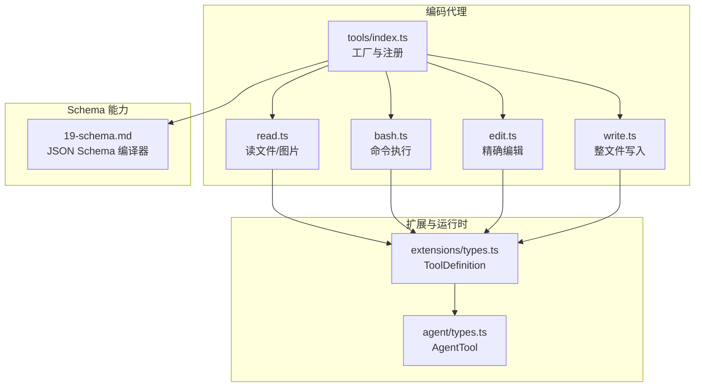

**图表来源**
- [packages/coding-agent/src/core/tools/index.ts:93-224](file://packages/coding-agent/src/core/tools/index.ts#L93-L224)
- [packages/coding-agent/src/core/extensions/types.ts:599-688](file://packages/coding-agent/src/core/extensions/types.ts#L599-L688)
- [packages/agent/src/types.ts:478-511](file://packages/agent/src/types.ts#L478-L511)
- [docs/explains/19-schema.md:1-218](file://docs/explains/19-schema.md#L1-L218)

**章节来源**
- [packages/coding-agent/src/core/tools/index.ts:1-225](file://packages/coding-agent/src/core/tools/index.ts#L1-L225)
- [packages/coding-agent/src/core/extensions/types.ts:599-688](file://packages/coding-agent/src/core/extensions/types.ts#L599-L688)
- [packages/agent/src/types.ts:478-511](file://packages/agent/src/types.ts#L478-L511)
- [docs/explains/19-schema.md:1-218](file://docs/explains/19-schema.md#L1-L218)

## 核心组件
- 工具定义与运行契约
  - ToolDefinition：扩展侧的工具声明，包含名称、描述、参数 Schema、输出 Schema、执行函数、渲染钩子、暴露策略、命名空间、可达工具范围、默认激活状态、负载准备、执行模式等。
  - AgentTool：运行时侧工具契约，强调 execute、outputSchema、executionMode、replay 等。
- 工具工厂与集合
  - createToolDefinition / createTool：按工具名创建定义或实例。
  - createCodingTools / createReadOnlyTools / createAllTools：预置工具集。
- 内置工具
  - read：读取文本或图片，支持流式读取、偏移/限制、截断提示。
  - bash/powershell：命令执行，支持超时、进程树清理、结构化输出。
  - edit：精确替换，模糊匹配、BOM/换行保留、diff/patch 输出。
  - write：整文件写入，自动创建父目录，串行写队列。

**章节来源**
- [packages/coding-agent/src/core/extensions/types.ts:599-688](file://packages/coding-agent/src/core/extensions/types.ts#L599-L688)
- [packages/agent/src/types.ts:478-511](file://packages/agent/src/types.ts#L478-L511)
- [packages/coding-agent/src/core/tools/index.ts:93-224](file://packages/coding-agent/src/core/tools/index.ts#L93-L224)
- [docs/explains/12-tools.md:1-297](file://docs/explains/12-tools.md#L1-L297)

## 架构总览
工具在系统中的交互路径如下：
- 扩展通过 registerTool 注册 ToolDefinition。
- 运行时将 ToolDefinition 适配为 AgentTool。
- 模型调用时，先进行参数校验（Schema），再进入 execute。
- 工具内部可访问 ExtensionContext（cwd、model、session 等），并可回调 onUpdate 推送增量结果。
- 结构化输出 structuredContent 供程序化调用（如 codemode）。

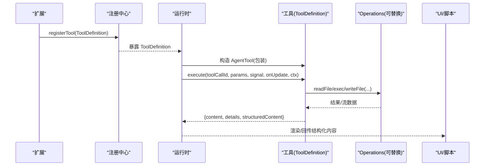

**图表来源**
- [packages/coding-agent/src/core/extensions/types.ts:1716-1718](file://packages/coding-agent/src/core/extensions/types.ts#L1716-L1718)
- [packages/coding-agent/src/core/extensions/types.ts:669-676](file://packages/coding-agent/src/core/extensions/types.ts#L669-L676)
- [packages/coding-agent/src/core/tools/read.ts:228-357](file://packages/coding-agent/src/core/tools/read.ts#L228-L357)
- [packages/coding-agent/src/core/tools/bash.ts:271-448](file://packages/coding-agent/src/core/tools/bash.ts#L271-L448)

## 详细组件分析

### 工具定义与类型系统
- ToolDefinition 是扩展侧的核心契约，包含：
  - name、label、description、parameters、outputSchema
  - prepareArguments（兼容畸形输入）
  - exposure、namespace、annotations、defaultActive
  - reachesTools（动态可达工具）
  - executionMode（sequential/parallel）
  - execute（主执行逻辑）
  - renderCall/renderResult（自定义渲染）
- AgentTool 是运行时侧契约，强调 execute、outputSchema、executionMode、replay。

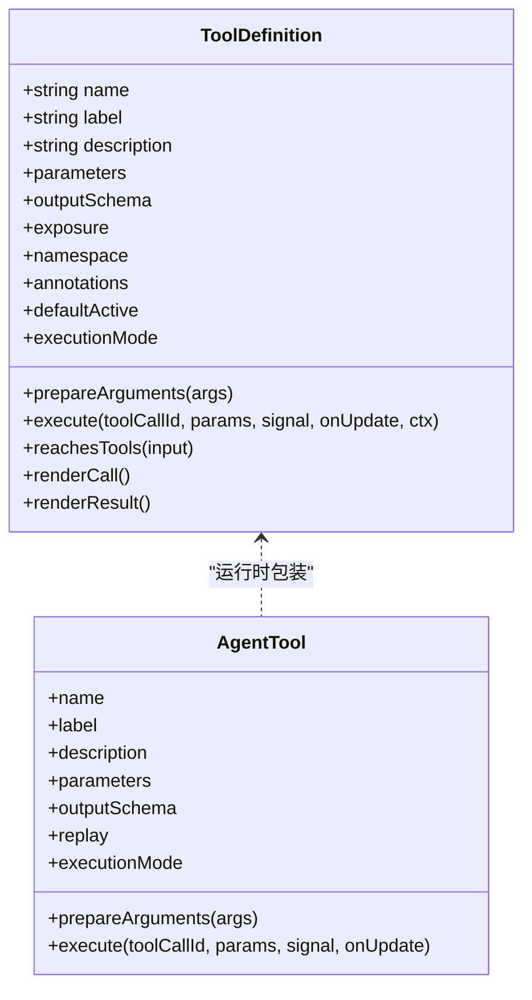

**图表来源**
- [packages/coding-agent/src/core/extensions/types.ts:599-688](file://packages/coding-agent/src/core/extensions/types.ts#L599-L688)
- [packages/agent/src/types.ts:478-511](file://packages/agent/src/types.ts#L478-L511)

**章节来源**
- [packages/coding-agent/src/core/extensions/types.ts:599-688](file://packages/coding-agent/src/core/extensions/types.ts#L599-L688)
- [packages/agent/src/types.ts:478-511](file://packages/agent/src/types.ts#L478-L511)

### 工具工厂与集合
- createToolDefinition / createTool：根据工具名分发到具体实现。
- createCodingTools / createReadOnlyTools / createAllTools：提供不同能力的工具集。
- allToolNames：枚举所有内置工具名。

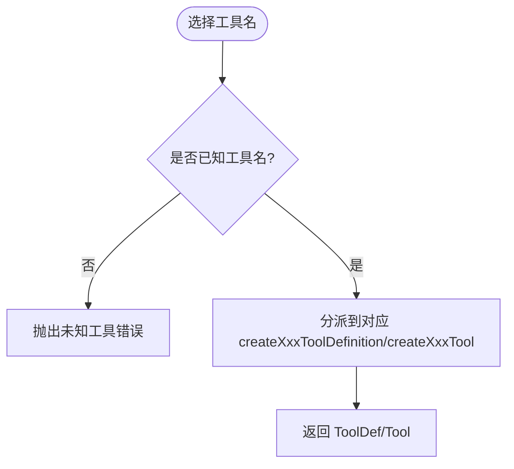

**图表来源**
- [packages/coding-agent/src/core/tools/index.ts:118-162](file://packages/coding-agent/src/core/tools/index.ts#L118-L162)
- [packages/coding-agent/src/core/tools/index.ts:164-224](file://packages/coding-agent/src/core/tools/index.ts#L164-L224)

**章节来源**
- [packages/coding-agent/src/core/tools/index.ts:93-224](file://packages/coding-agent/src/core/tools/index.ts#L93-L224)

### read 工具
- 功能：读取文本或图片；支持 offset/limit；流式读取大文件；图片自动缩放；非视觉模型附加提示；截断后给出下一步建议。
- 关键特性：
  - ReadOperations 可替换（readFile、access、detectImageMimeType、createReadStream）。
  - OutputSchema 支持字符串或图像块。
  - 使用 truncateHead 控制显示大小，避免半个行。
  - 结构化输出 structuredContent 供 codemode 使用。

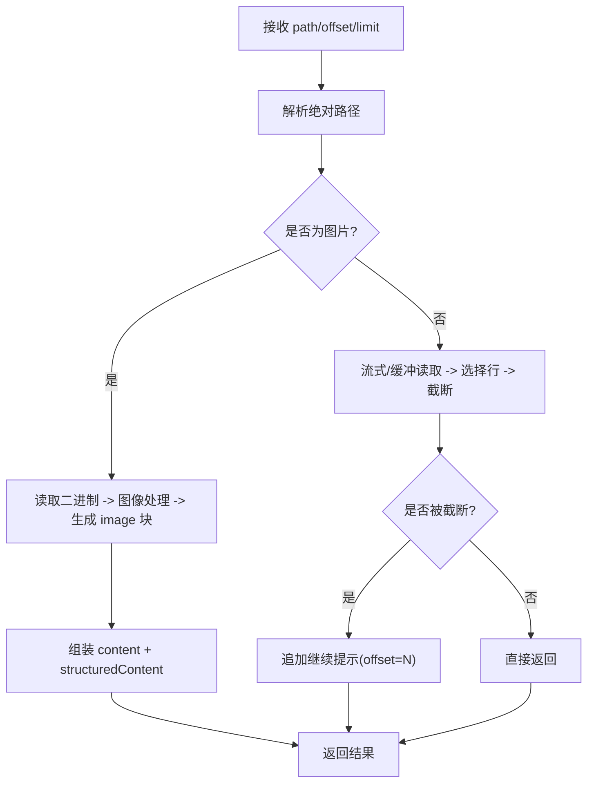

**图表来源**
- [packages/coding-agent/src/core/tools/read.ts:14-38](file://packages/coding-agent/src/core/tools/read.ts#L14-L38)
- [packages/coding-agent/src/core/tools/read.ts:228-357](file://packages/coding-agent/src/core/tools/read.ts#L228-L357)

**章节来源**
- [packages/coding-agent/src/core/tools/read.ts:1-363](file://packages/coding-agent/src/core/tools/read.ts#L1-L363)
- [docs/explains/12-tools.md:91-106](file://docs/explains/12-tools.md#L91-L106)

### bash/powershell 工具
- 功能：执行 shell 命令，支持超时、环境变量注入、进程树清理、结构化输出。
- 关键特性：
  - BashOperations 可替换（exec）。
  - OutputAccumulator 流式累积输出，超过阈值写临时文件。
  - 超时区分“shell 已退出但后台进程仍在写”的情况。
  - 非零退出码标记 isError，并提供结构化 exit_code/wall_time_seconds。

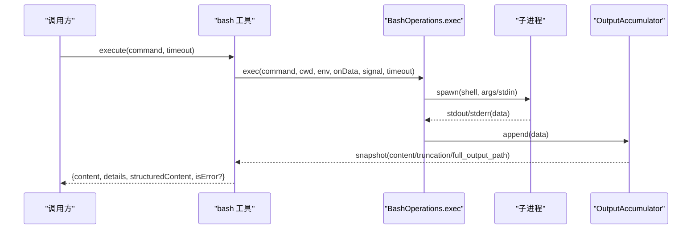

**图表来源**
- [packages/coding-agent/src/core/tools/bash.ts:70-93](file://packages/coding-agent/src/core/tools/bash.ts#L70-L93)
- [packages/coding-agent/src/core/tools/bash.ts:271-448](file://packages/coding-agent/src/core/tools/bash.ts#L271-L448)

**章节来源**
- [packages/coding-agent/src/core/tools/bash.ts:1-477](file://packages/coding-agent/src/core/tools/bash.ts#L1-L477)
- [docs/explains/12-tools.md:165-213](file://docs/explains/12-tools.md#L165-L213)

### edit 工具
- 功能：对单个文件进行精确文本替换，支持多条不重叠编辑；模糊匹配；保留原始换行/BOM；输出 diff/unified patch。
- 关键特性：
  - EditOperations 可替换（readFile、writeFile、access）。
  - withFileMutationQueue 保证同一文件串行写。
  - prepareArguments 兼容模型常见畸形输出（edits 为字符串/单对象/顶层 oldText/newText）。
  - 应用替换时保持未变更行的原始字节。

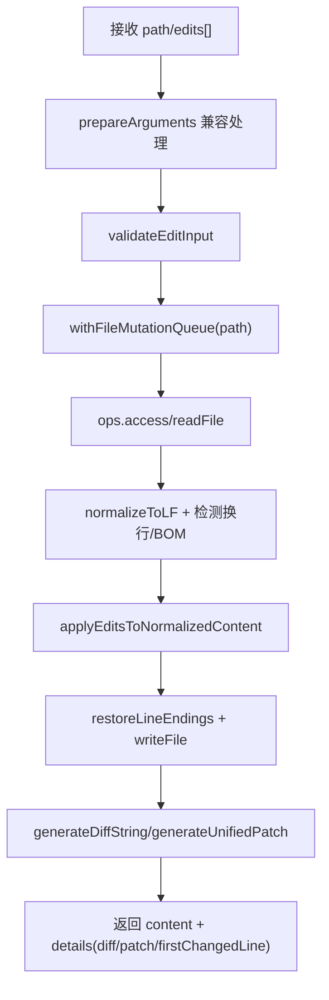

**图表来源**
- [packages/coding-agent/src/core/tools/edit.ts:100-138](file://packages/coding-agent/src/core/tools/edit.ts#L100-L138)
- [packages/coding-agent/src/core/tools/edit.ts:140-217](file://packages/coding-agent/src/core/tools/edit.ts#L140-L217)

**章节来源**
- [packages/coding-agent/src/core/tools/edit.ts:1-218](file://packages/coding-agent/src/core/tools/edit.ts#L1-L218)
- [docs/explains/12-tools.md:116-164](file://docs/explains/12-tools.md#L116-L164)

### write 工具
- 功能：整文件写入，自动创建父目录，串行写队列。
- 关键特性：
  - WriteOperations 可替换（writeFile、mkdir）。
  - withFileMutationQueue 保证同一文件串行写。
  - 简单可靠，适合新文件或全量重写。

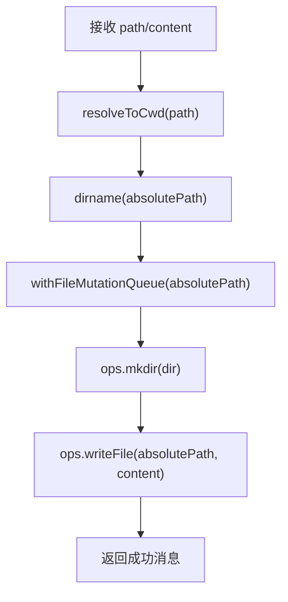

**图表来源**
- [packages/coding-agent/src/core/tools/write.ts:43-91](file://packages/coding-agent/src/core/tools/write.ts#L43-L91)

**章节来源**
- [packages/coding-agent/src/core/tools/write.ts:1-97](file://packages/coding-agent/src/core/tools/write.ts#L1-L97)
- [docs/explains/12-tools.md:107-115](file://docs/explains/12-tools.md#L107-L115)

## 依赖关系分析
- 工具模块依赖：
  - tools/index.ts 聚合各工具实现，提供统一入口。
  - 各工具依赖 extensions/types.ts 中的 ToolDefinition 与 ExtensionContext。
  - 运行时通过 agent/types.ts 的 AgentTool 消费工具。
- 外部依赖：
  - fs/promises、child_process、util.TextDecoder 等 Node 标准库。
  - TypeBox 用于构建 JSON Schema 与 TS 类型。
  - 可选地对接 MCP 协议（Tool 定义含 inputSchema/outputSchema）。

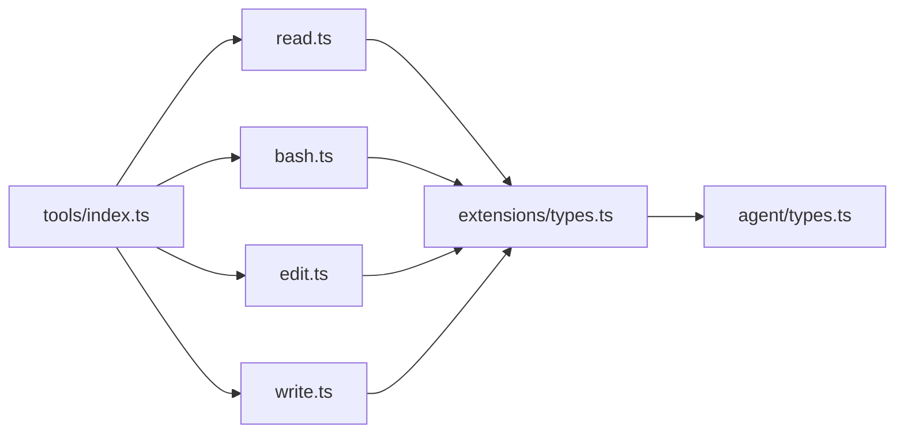

**图表来源**
- [packages/coding-agent/src/core/tools/index.ts:1-92](file://packages/coding-agent/src/core/tools/index.ts#L1-L92)
- [packages/coding-agent/src/core/extensions/types.ts:599-688](file://packages/coding-agent/src/core/extensions/types.ts#L599-L688)
- [packages/agent/src/types.ts:478-511](file://packages/agent/src/types.ts#L478-L511)

**章节来源**
- [packages/coding-agent/src/core/tools/index.ts:1-225](file://packages/coding-agent/src/core/tools/index.ts#L1-L225)
- [packages/coding-agent/src/core/extensions/types.ts:599-688](file://packages/coding-agent/src/core/extensions/types.ts#L599-L688)
- [packages/agent/src/types.ts:478-511](file://packages/agent/src/types.ts#L478-L511)

## 性能与容量控制
- 输出截断
  - DEFAULT_MAX_LINES 与 DEFAULT_MAX_BYTES 双上限，先到先止。
  - read：truncateHead 保留开头，避免半行；第一行超限给出 sed 建议。
  - bash：truncateTail 保留结尾，必要时写临时文件保存完整输出。
  - grep：每行截断至 500 字符，命中上限与字节上限分别控制。
- 流式处理
  - read：优先 createReadStream，仅缓存需显示的行；无法流式则回退整文件读取。
  - bash：OutputAccumulator 边收边维护 tailText，超限时写临时文件，节流推送 onUpdate。
- 并发与串行
  - 文件写操作通过 withFileMutationQueue 串行，不同文件并行。
  - 工具 executionMode 支持 sequential/parallel，影响与其他工具的并发策略。

**章节来源**
- [docs/explains/12-tools.md:56-90](file://docs/explains/12-tools.md#L56-L90)
- [docs/explains/12-tools.md:214-277](file://docs/explains/12-tools.md#L214-L277)
- [packages/coding-agent/src/core/tools/read.ts:128-226](file://packages/coding-agent/src/core/tools/read.ts#L128-L226)
- [packages/coding-agent/src/core/tools/bash.ts:304-364](file://packages/coding-agent/src/core/tools/bash.ts#L304-L364)

## 权限与安全
- 路径解析
  - resolveToCwd 展开 ~、规范化 Unicode 空格、去除 @、相对路径按 cwd 解析。
  - 注意：不强制限制路径必须在 cwd 内，存在权限层缺失风险。
- 沙箱与容器化
  - 项目 README 明确 Pi 默认以启动用户权限运行，无内置权限系统。
  - 推荐容器化或沙箱隔离（Gondolin extension、Plain Docker、OpenShell）。
- 环境变量
  - bash 工具可选择暴露 PI_SESSION_ID/PI_SESSION_FILE/PI_PROVIDER/PI_MODEL/PI_REASONING_LEVEL。
  - 可通过 spawnHook 改写 command/cwd/env，增强控制面。

**章节来源**
- [docs/explains/12-tools.md:34-44](file://docs/explains/12-tools.md#L34-L44)
- [README.md:72-80](file://README.md#L72-L80)
- [packages/coding-agent/src/core/tools/bash.ts:214-239](file://packages/coding-agent/src/core/tools/bash.ts#L214-L239)

## 错误处理与异步支持
- 中止信号
  - 工具内部检查 signal.aborted，避免提前释放资源（如文件队列）。
  - bash：abort 时 killProcessTree 整个进程树；超时区分 shell 退出与后台进程仍写输出。
- 错误语义
  - bash：非零退出码返回 isError，附带结构化 exit_code 与 wall_time_seconds。
  - read：offset 越界抛错；图片处理失败返回文本说明。
  - edit：access/read/write 失败抛错；BOM/换行处理异常不影响整体流程。
- 异步更新
  - onUpdate 回调支持流式推送（bash 输出节流快照）。
  - structuredContent 提供程序化调用结果（如 bash 的输出、read 的图片块）。

**章节来源**
- [packages/coding-agent/src/core/tools/bash.ts:145-191](file://packages/coding-agent/src/core/tools/bash.ts#L145-L191)
- [packages/coding-agent/src/core/tools/bash.ts:389-443](file://packages/coding-agent/src/core/tools/bash.ts#L389-L443)
- [packages/coding-agent/src/core/tools/read.ts:251-354](file://packages/coding-agent/src/core/tools/read.ts#L251-L354)
- [packages/coding-agent/src/core/tools/edit.ts:160-196](file://packages/coding-agent/src/core/tools/edit.ts#L160-L196)

## 类型系统与 Schema 设计
- Schema 构建器
  - 使用 TypeBox 构建 JSON Schema，同时推导 TypeScript 类型。
  - compile(schema, { coerce: true }) 支持宽松输入转换（coerce/parse）。
- 支持的 Draft
  - 2020-12（默认）、7（可选），引用机制完善（$id/$anchor/$dynamicRef/$defs）。
- 编译器优化
  - 编译一次，check 为闭包；按 schema 对象缓存；递归引用 indirection；bare type 共享；常见形状特化（闭合对象、listCheck、taggedCheck、enumCheck、anyOf 位掩码）。
- 强制转换（coerce）
  - 三遍：可选 null、TypeBox Value.Convert、Ajv 风格基础类型转换；copy-on-write，不修改输入。
- 错误解释
  - errors() 懒构建，遍历 schema 产生 {path, keyword, message}。

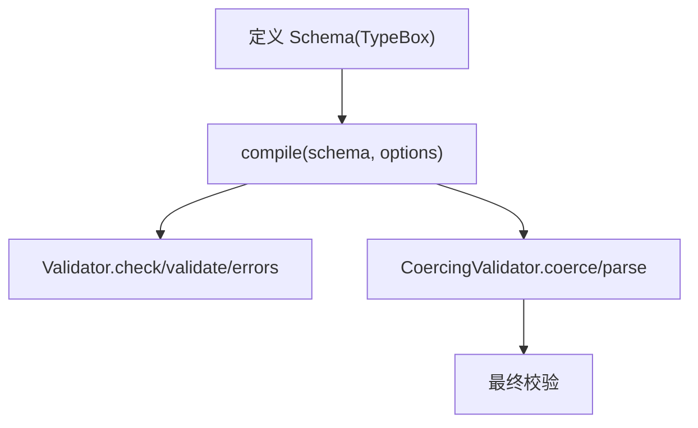

**图表来源**
- [docs/explains/19-schema.md:1-218](file://docs/explains/19-schema.md#L1-L218)

**章节来源**
- [docs/explains/19-schema.md:1-218](file://docs/explains/19-schema.md#L1-L218)

## 工具生命周期与执行流程
- 注册阶段
  - 扩展通过 registerTool 注册 ToolDefinition，可设置 defaultActive、exposure、namespace、annotations 等。
- 加载阶段
  - 运行时根据 exposure 决定是否激活；prepareLoadout 可调整展示给模型的可用工具列表。
- 调用阶段
  - 参数预处理：prepareArguments 兼容畸形输入。
  - 参数校验：基于 parameters Schema 校验（可开启 coerce）。
  - 执行阶段：execute(params, signal, onUpdate, ctx)，可返回结构化输出。
  - 渲染阶段：renderCall/renderResult 自定义 UI 展示。
- 回收阶段
  - 工具卸载或会话结束，清理资源（如临时文件、进程树）。

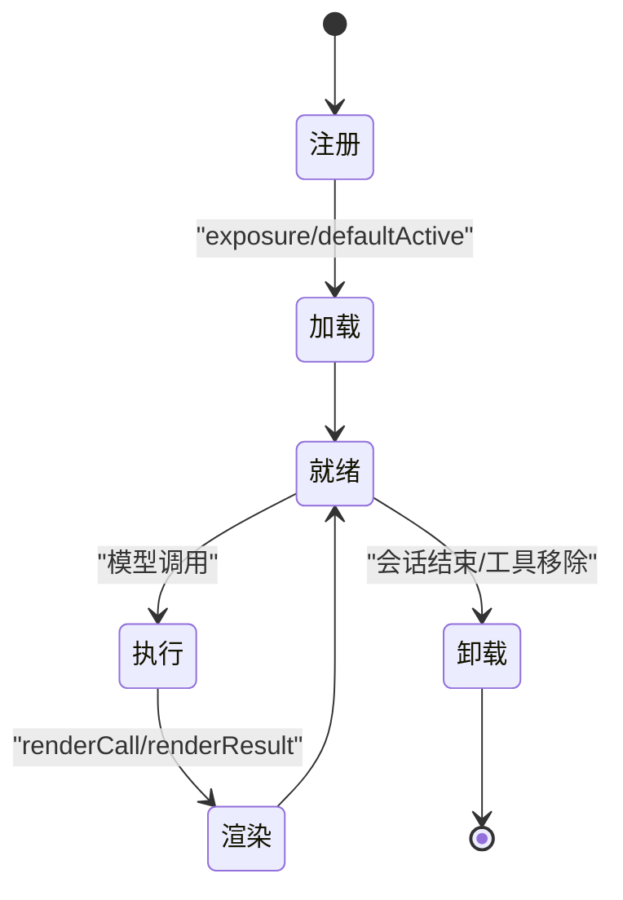

**图表来源**
- [packages/coding-agent/src/core/extensions/types.ts:599-688](file://packages/coding-agent/src/core/extensions/types.ts#L599-L688)
- [packages/coding-agent/src/core/extensions/types.ts:1716-1718](file://packages/coding-agent/src/core/extensions/types.ts#L1716-L1718)

**章节来源**
- [packages/coding-agent/src/core/extensions/types.ts:599-688](file://packages/coding-agent/src/core/extensions/types.ts#L599-L688)
- [packages/coding-agent/src/core/extensions/types.ts:1716-1718](file://packages/coding-agent/src/core/extensions/types.ts#L1716-L1718)

## 开发示例：从文件操作到 API 集成
- 简单文件操作
  - 使用 write 创建新文件或全量重写；使用 read 查看文本或图片；使用 edit 做精确替换。
  - 参考：[packages/coding-agent/src/core/tools/write.ts:43-91](file://packages/coding-agent/src/core/tools/write.ts#L43-L91)、[packages/coding-agent/src/core/tools/read.ts:228-357](file://packages/coding-agent/src/core/tools/read.ts#L228-L357)、[packages/coding-agent/src/core/tools/edit.ts:140-217](file://packages/coding-agent/src/core/tools/edit.ts#L140-L217)。
- 复杂 API 集成
  - 通过 BashOperations.exec 封装 HTTP 调用（curl/fetch 在 shell 中执行），或使用自定义 operations 直接调用 SDK。
  - 利用 structuredContent 返回结构化结果，便于上层脚本处理。
  - 参考：[packages/coding-agent/src/core/tools/bash.ts:70-93](file://packages/coding-agent/src/core/tools/bash.ts#L70-L93)、[packages/coding-agent/src/core/tools/bash.ts:271-448](file://packages/coding-agent/src/core/tools/bash.ts#L271-L448)。
- MCP 集成
  - MCP Tool 定义包含 inputSchema/outputSchema，可与现有 ToolDefinition 对齐。
  - 参考：[packages/mcp/src/protocol/types.ts:76-85](file://packages/mcp/src/protocol/types.ts#L76-L85)。

**章节来源**
- [packages/coding-agent/src/core/tools/write.ts:43-91](file://packages/coding-agent/src/core/tools/write.ts#L43-L91)
- [packages/coding-agent/src/core/tools/read.ts:228-357](file://packages/coding-agent/src/core/tools/read.ts#L228-L357)
- [packages/coding-agent/src/core/tools/edit.ts:140-217](file://packages/coding-agent/src/core/tools/edit.ts#L140-L217)
- [packages/coding-agent/src/core/tools/bash.ts:70-93](file://packages/coding-agent/src/core/tools/bash.ts#L70-L93)
- [packages/coding-agent/src/core/tools/bash.ts:271-448](file://packages/coding-agent/src/core/tools/bash.ts#L271-L448)

## 测试、调试与发布
- 测试
  - 使用 vitest 框架（见根配置 vitest.base.ts）。
  - 针对工具单元测试：参数校验、截断行为、异步中止、结构化输出。
  - 端到端测试：结合 agent-loop.test.ts/e2e.test.ts 模拟模型调用。
- 调试
  - 启用 onUpdate 观察流式输出；检查 truncated/full_output_path。
  - 使用 spawnHook 打印 command/cwd/env，定位环境问题。
- 发布
  - 遵循仓库供应链加固策略：依赖锁定、npm audit、CI 安装与审计。
  - 本地打包与发布脚本见 scripts/local-release.mjs、scripts/publish.mjs。
  - 参考：[README.md:152-164](file://README.md#L152-L164)。

**章节来源**
- [README.md:152-164](file://README.md#L152-L164)

## 故障排查
- 路径问题
  - resolveToCwd 不限制 cwd 边界，若出现越权访问，需在扩展层增加权限校验。
- 输出过大
  - 检查 truncateHead/truncateTail 配置；bash 输出可能写入临时文件，确认 full_output_path。
- 超时与中止
  - bash 超时区分 shell 退出与后台进程；确保 killProcessTree 生效。
- 编辑冲突
  - edit 要求 edits[].oldText 唯一且不重叠；合并邻近变更，避免重叠。
- 类型错误
  - 使用 compile(schema, { coerce: true }) 处理松散输入；errors() 获取详细错误路径。

**章节来源**
- [docs/explains/12-tools.md:34-44](file://docs/explains/12-tools.md#L34-L44)
- [docs/explains/12-tools.md:68-90](file://docs/explains/12-tools.md#L68-L90)
- [packages/coding-agent/src/core/tools/bash.ts:145-191](file://packages/coding-agent/src/core/tools/bash.ts#L145-L191)
- [packages/coding-agent/src/core/tools/edit.ts:100-138](file://packages/coding-agent/src/core/tools/edit.ts#L100-L138)
- [docs/explains/19-schema.md:144-152](file://docs/explains/19-schema.md#L144-L152)

## 结论
本指南系统化阐述了工具的定义格式、类型系统、执行流程、生命周期、错误处理、异步支持与性能优化，并提供了从简单文件操作到复杂 API 集成的开发示例。建议在扩展层补充权限控制与沙箱隔离，结合 Schema 的 coerce 能力与结构化输出，构建健壮、可观测、可测试的工具生态。