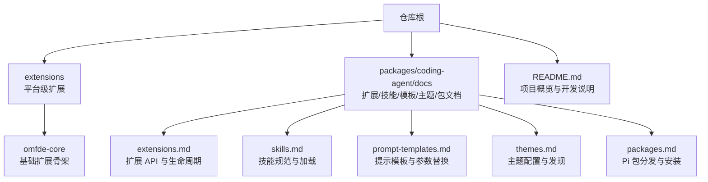
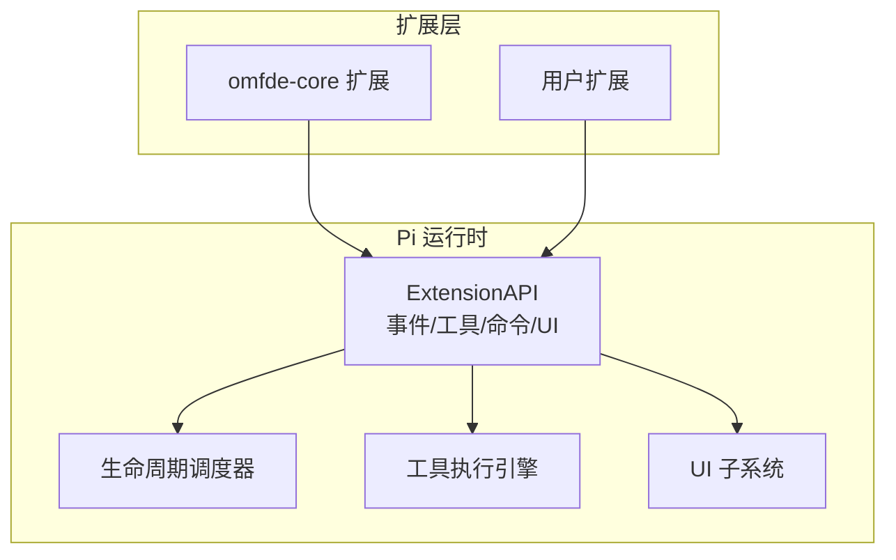
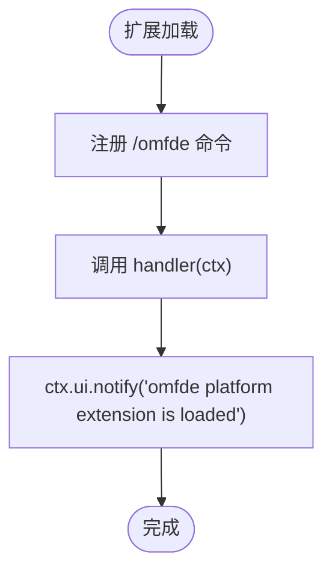
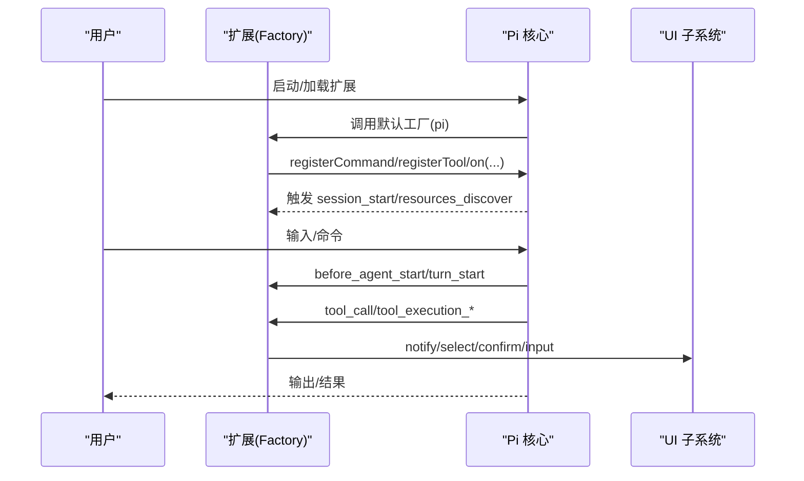
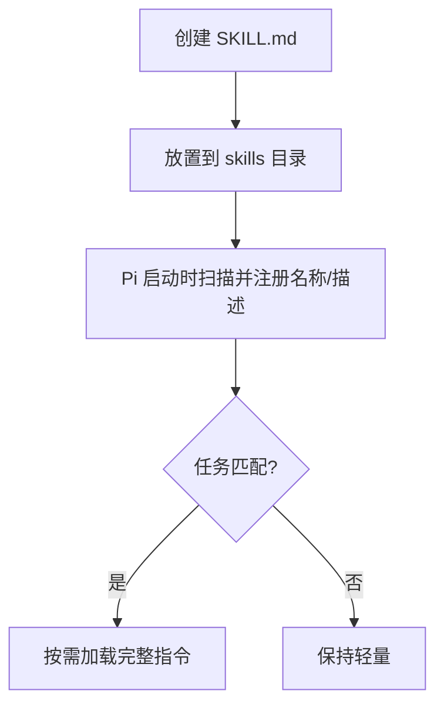
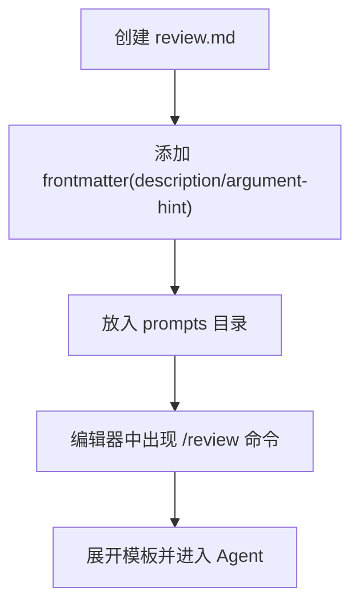
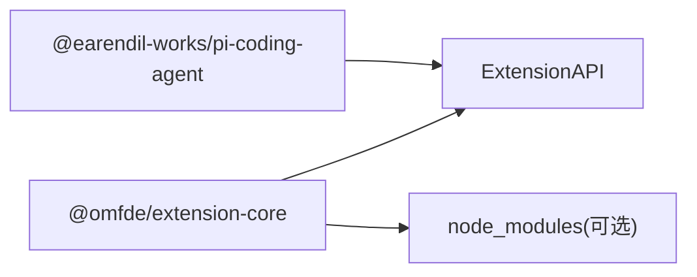

# 扩展开发

<cite>
**本文引用的文件**   
- [README.md](file://README.md)
- [extensions/README.md](file://extensions/README.md)
- [extensions/omfde-core/package.json](file://extensions/omfde-core/package.json)
- [extensions/omfde-core/src/index.ts](file://extensions/omfde-core/src/index.ts)
- [packages/coding-agent/docs/extensions.md](file://packages/coding-agent/docs/extensions.md)
- [packages/coding-agent/docs/skills.md](file://packages/coding-agent/docs/skills.md)
- [packages/coding-agent/docs/prompt-templates.md](file://packages/coding-agent/docs/prompt-templates.md)
- [packages/coding-agent/docs/themes.md](file://packages/coding-agent/docs/themes.md)
- [packages/coding-agent/docs/packages.md](file://packages/coding-agent/docs/packages.md)
</cite>

## 目录
1. [简介](#简介)
2. [项目结构](#项目结构)
3. [核心组件](#核心组件)
4. [架构总览](#架构总览)
5. [详细组件分析](#详细组件分析)
6. [依赖分析](#依赖分析)
7. [性能考虑](#性能考虑)
8. [故障排查指南](#故障排查指南)
9. [结论](#结论)
10. [附录](#附录)

## 简介
本指南面向希望为 Pi 平台编写高质量扩展的开发者，覆盖扩展架构、API 接口与开发流程，并给出技能（Skills）、提示模板（Prompt Templates）、主题（Themes）等扩展类型的完整实践。文档同时提供扩展包结构、配置文件、发布流程与最佳实践，帮助你在不修改内核的前提下，通过 ExtensionAPI 接入事件、工具、命令和 UI 能力，快速构建可复用、可发布的扩展包。

## 项目结构
仓库采用多包工作区组织，扩展相关能力集中在以下位置：
- extensions：平台级扩展示例与骨架
- packages/coding-agent/docs：扩展、技能、提示模板、主题、包的官方文档
- README：顶层说明与开发指引

图表来源
- [extensions/README.md:1-8](file://extensions/README.md#L1-L8)
- [packages/coding-agent/docs/extensions.md:1-33](file://packages/coding-agent/docs/extensions.md#L1-L33)
- [packages/coding-agent/docs/skills.md:1-22](file://packages/coding-agent/docs/skills.md#L1-L22)
- [packages/coding-agent/docs/prompt-templates.md:1-23](file://packages/coding-agent/docs/prompt-templates.md#L1-L23)
- [packages/coding-agent/docs/themes.md:1-60](file://packages/coding-agent/docs/themes.md#L1-L60)
- [packages/coding-agent/docs/packages.md:1-60](file://packages/coding-agent/docs/packages.md#L1-L60)

章节来源
- [README.md:56-69](file://README.md#L56-L69)
- [extensions/README.md:1-8](file://extensions/README.md#L1-L8)

## 核心组件
- 扩展入口与 API
  - 扩展以默认导出的工厂函数形式注册，接收 ExtensionAPI，用于订阅事件、注册工具、命令、快捷键、标志位等。
  - 扩展运行在 Pi 进程内，具备系统权限，应仅从可信来源加载。
- 事件与生命周期
  - 启动阶段：project_trust、session_start、resources_discover、mcp_servers_change。
  - 会话阶段：session_before_switch、session_before_fork、session_before_compact/session_compact/session_compact_failed、session_before_tree/session_tree、session_shutdown。
  - Agent 阶段：before_agent_start、agent_start、agent_end、agent_before_settle、agent_settled。
  - 消息与工具：turn_start/turn_end、message_start/update/end、tool_execution_start/update/end、tool_call。
- 自定义能力
  - 自定义工具：pi.registerTool()
  - 自定义命令：pi.registerCommand()
  - 自定义 UI：ctx.ui.notify/select/confirm/input/editor/custom()
  - 状态持久化：pi.appendEntry()
  - 模型与 MCP：pi.registerProvider()/registerMcpServer()
- 扩展样式与发现
  - 单文件、目录 index.ts、带 package.json 的包式扩展。
  - 自动发现路径：~/.pi/agent/extensions、.pi/extensions，以及 settings.json 中 extensions 字段。

章节来源
- [packages/coding-agent/docs/extensions.md:1-33](file://packages/coding-agent/docs/extensions.md#L1-L33)
- [packages/coding-agent/docs/extensions.md:68-170](file://packages/coding-agent/docs/extensions.md#L68-L170)
- [packages/coding-agent/docs/extensions.md:186-257](file://packages/coding-agent/docs/extensions.md#L186-L257)
- [packages/coding-agent/docs/extensions.md:307-425](file://packages/coding-agent/docs/extensions.md#L307-L425)
- [packages/coding-agent/docs/extensions.md:427-611](file://packages/coding-agent/docs/extensions.md#L427-L611)
- [packages/coding-agent/docs/extensions.md:613-800](file://packages/coding-agent/docs/extensions.md#L613-L800)

## 架构总览
下图展示扩展如何在不修改内核的情况下，通过 ExtensionAPI 接入 Pi 的事件流、工具执行、命令系统与 UI 能力。

图表来源
- [extensions/omfde-core/src/index.ts:1-20](file://extensions/omfde-core/src/index.ts#L1-L20)
- [packages/coding-agent/docs/extensions.md:1-33](file://packages/coding-agent/docs/extensions.md#L1-L33)

## 详细组件分析

### omfde-core 基础扩展
- 职责
  - 作为平台级扩展骨架，注册 /omfde 命令，作为加载探针。
  - 通过 ExtensionAPI 接入，不修改内核。
- 关键实现要点
  - 使用 pi.registerCommand 注册命令。
  - 在 handler 中使用 ctx.ui.notify 进行交互反馈。

图表来源
- [extensions/omfde-core/src/index.ts:1-20](file://extensions/omfde-core/src/index.ts#L1-L20)

章节来源
- [extensions/README.md:1-8](file://extensions/README.md#L1-L8)
- [extensions/omfde-core/src/index.ts:1-20](file://extensions/omfde-core/src/index.ts#L1-L20)
- [extensions/omfde-core/package.json:1-16](file://extensions/omfde-core/package.json#L1-L16)

### 扩展 API 与生命周期
- 工厂函数
  - 同步或异步返回；异步初始化会在 session_start 之前完成。
- 事件组合
  - 通知型、就地变更、链式转换、门控、可操作边界、最后覆盖等模式。
- 启动与资源
  - project_trust：决定项目信任。
  - resources_discover：贡献 skill/prompts/themes 路径。
- 会话与 Agent
  - session_*：切换、分叉、压缩、树导航、关闭。
  - before_agent_start：注入消息/修改系统提示。
  - agent_*：run 开始/结束/结算。
- 消息与工具
  - turn/message/tool 全生命周期钩子，支持拦截、替换、追加条目与请求继续。

图表来源
- [packages/coding-agent/docs/extensions.md:186-257](file://packages/coding-agent/docs/extensions.md#L186-L257)
- [packages/coding-agent/docs/extensions.md:307-425](file://packages/coding-agent/docs/extensions.md#L307-L425)
- [packages/coding-agent/docs/extensions.md:427-800](file://packages/coding-agent/docs/extensions.md#L427-L800)

章节来源
- [packages/coding-agent/docs/extensions.md:186-257](file://packages/coding-agent/docs/extensions.md#L186-L257)
- [packages/coding-agent/docs/extensions.md:307-425](file://packages/coding-agent/docs/extensions.md#L307-L425)
- [packages/coding-agent/docs/extensions.md:427-800](file://packages/coding-agent/docs/extensions.md#L427-L800)

### 技能（Skills）
- 用途
  - 为特定任务提供专用指令与辅助文件，按需加载，避免污染上下文。
- 结构与发现
  - 目录含 SKILL.md，支持 scripts/references/assets 等附属资源。
  - 自动扫描 ~/.agents/skills、.agents/skills、~/.pi/agent/skills、.pi/skills 等位置。
- 前元数据
  - name/description/license/compatibility/metadata/allowed-tools/disable-model-invocation。
- 使用方式
  - 模型根据 description 路由加载；必要时用 /skill:name 强制加载。

图表来源
- [packages/coding-agent/docs/skills.md:1-22](file://packages/coding-agent/docs/skills.md#L1-L22)
- [packages/coding-agent/docs/skills.md:41-63](file://packages/coding-agent/docs/skills.md#L41-L63)
- [packages/coding-agent/docs/skills.md:67-94](file://packages/coding-agent/docs/skills.md#L67-L94)

章节来源
- [packages/coding-agent/docs/skills.md:1-94](file://packages/coding-agent/docs/skills.md#L1-L94)

### 提示模板（Prompt Templates）
- 用途
  - 将 Markdown 转为可复用的 / 命令，适合纯文本模板场景。
- 语法
  - 支持 $1/$@/${1:-default} 等 shell 风格占位符。
- 发现与使用
  - 放置在 ~/.pi/agent/prompts 或 .pi/prompts，文件名即命令名。
  - 支持 argument-hint 与 description，便于补全与展示。

图表来源
- [packages/coding-agent/docs/prompt-templates.md:1-23](file://packages/coding-agent/docs/prompt-templates.md#L1-L23)
- [packages/coding-agent/docs/prompt-templates.md:25-49](file://packages/coding-agent/docs/prompt-templates.md#L25-L49)
- [packages/coding-agent/docs/prompt-templates.md:51-60](file://packages/coding-agent/docs/prompt-templates.md#L51-L60)

章节来源
- [packages/coding-agent/docs/prompt-templates.md:1-60](file://packages/coding-agent/docs/prompt-templates.md#L1-L60)

### 主题（Themes）
- 作用
  - 定义 TUI 外观与行为，配合扩展与设置生效。
- 发现
  - 通过 resources_discover 贡献 themePaths，或在 settings.json 中配置。

章节来源
- [packages/coding-agent/docs/extensions.md:446-467](file://packages/coding-agent/docs/extensions.md#L446-L467)
- [packages/coding-agent/docs/themes.md:1-60](file://packages/coding-agent/docs/themes.md#L1-L60)

### 扩展包（Pi Packages）
- 目的
  - 将扩展、技能、模板、主题打包并通过 npm/git 分发。
- 关键点
  - 声明 dependencies/devDependencies；runtime 依赖需放在 dependencies。
  - 通过 settings.json 的 packages 字段安装；或通过 pi install。
  - 发布与安装遵循 Pi 包规范。

章节来源
- [packages/coding-agent/docs/extensions.md:155-170](file://packages/coding-agent/docs/extensions.md#L155-L170)
- [packages/coding-agent/docs/packages.md:1-60](file://packages/coding-agent/docs/packages.md#L1-L60)

## 依赖分析
- 扩展与宿主
  - 扩展通过 @earendil-works/pi-coding-agent 提供的 ExtensionAPI 与类型进行交互。
  - omfde-core 将 pi-coding-agent 声明为 peerDependency，确保与宿主版本对齐。
- 扩展内部依赖
  - 可在扩展目录维护 package.json 与 node_modules，自动解析第三方依赖。
- 风险与约束
  - 扩展拥有系统权限，应从可信来源加载。
  - 避免在工厂中启动长驻资源，应在 session_start 或具体钩子中按需启动，并在 session_shutdown 中清理。

图表来源
- [extensions/omfde-core/package.json:1-16](file://extensions/omfde-core/package.json#L1-L16)
- [packages/coding-agent/docs/extensions.md:155-170](file://packages/coding-agent/docs/extensions.md#L155-L170)

章节来源
- [extensions/omfde-core/package.json:1-16](file://extensions/omfde-core/package.json#L1-L16)
- [packages/coding-agent/docs/extensions.md:155-170](file://packages/coding-agent/docs/extensions.md#L155-L170)

## 性能考虑
- 事件处理
  - 通知型事件避免阻塞；链式变换注意保留未拥有的字段。
  - 门控类事件失败时应保守拒绝（fail closed）。
- 资源管理
  - 避免在工厂中启动后台任务；在 session_start 中按需启动，在 session_shutdown 中幂等清理。
- 工具与流式响应
  - 并行工具模式下，tool_execution_update 可能交错，注意顺序与最终一致性。
- 缓存与热重载
  - 扩展模块会被缓存，但工厂会重新执行；合理使用 clearExtensionCache 与 /reload。

章节来源
- [packages/coding-agent/docs/extensions.md:412-425](file://packages/coding-agent/docs/extensions.md#L412-L425)
- [packages/coding-agent/docs/extensions.md:252-257](file://packages/coding-agent/docs/extensions.md#L252-L257)
- [packages/coding-agent/docs/extensions.md:788-800](file://packages/coding-agent/docs/extensions.md#L788-L800)

## 故障排查指南
- 常见问题
  - 扩展未被加载：检查是否在自动发现路径或 settings.json 中正确声明。
  - 命令未出现：确认是否使用了正确的命令名与扩展已加载。
  - 权限与安全：仅在可信来源加载扩展；谨慎授予项目信任。
  - 资源泄漏：未在 session_shutdown 清理导致的状态残留。
- 调试建议
  - 使用 ctx.ui.notify 输出中间状态。
  - 使用 /reload 热重载扩展。
  - 通过 events.md 中的事件顺序定位问题阶段。

章节来源
- [packages/coding-agent/docs/extensions.md:1-33](file://packages/coding-agent/docs/extensions.md#L1-L33)
- [packages/coding-agent/docs/extensions.md:121-153](file://packages/coding-agent/docs/extensions.md#L121-L153)
- [packages/coding-agent/docs/extensions.md:427-611](file://packages/coding-agent/docs/extensions.md#L427-L611)

## 结论
通过 ExtensionAPI，你可以在不修改内核的前提下，为 Pi 注入强大的扩展能力。结合技能、提示模板与主题，你可以构建从轻量提示到复杂交互的完整解决方案。遵循本文的结构、API 与最佳实践，你将能快速开发出高质量、可维护、可发布的扩展包。

## 附录
- 快速上手
  - 在 ~/.pi/agent/extensions 下创建 my-extension.ts，导出默认工厂函数，注册命令与工具。
  - 使用 pi -e ./my-extension.ts 测试，或使用 /reload 热重载。
- 参考路径
  - 扩展文档：packages/coding-agent/docs/extensions.md
  - 技能文档：packages/coding-agent/docs/skills.md
  - 提示模板文档：packages/coding-agent/docs/prompt-templates.md
  - 主题文档：packages/coding-agent/docs/themes.md
  - 包文档：packages/coding-agent/docs/packages.md