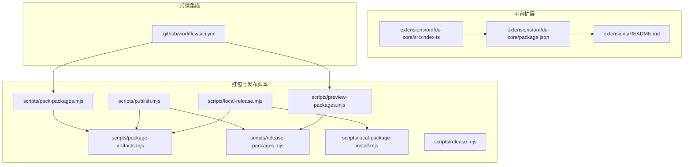
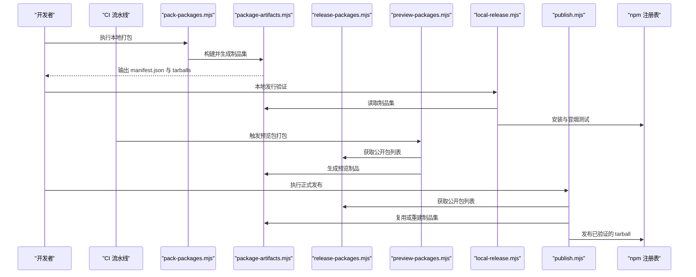
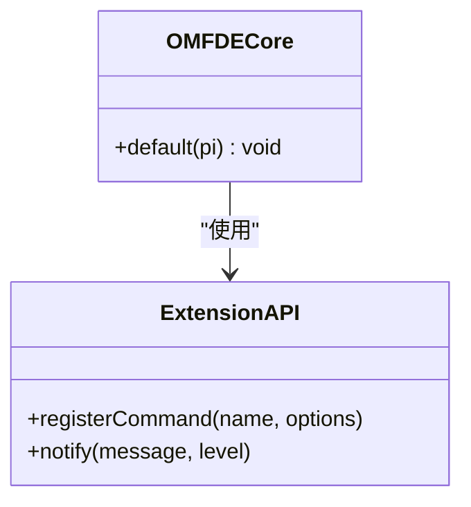
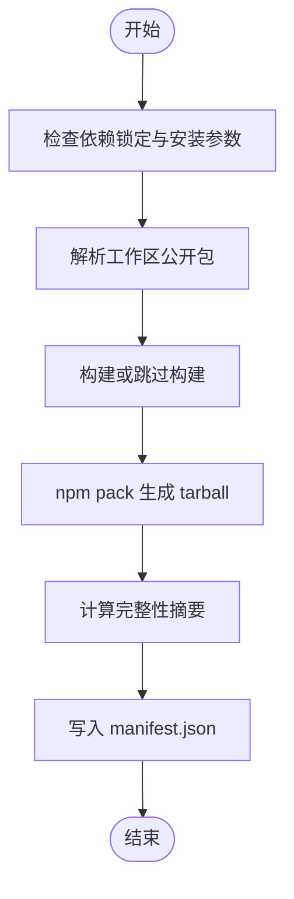
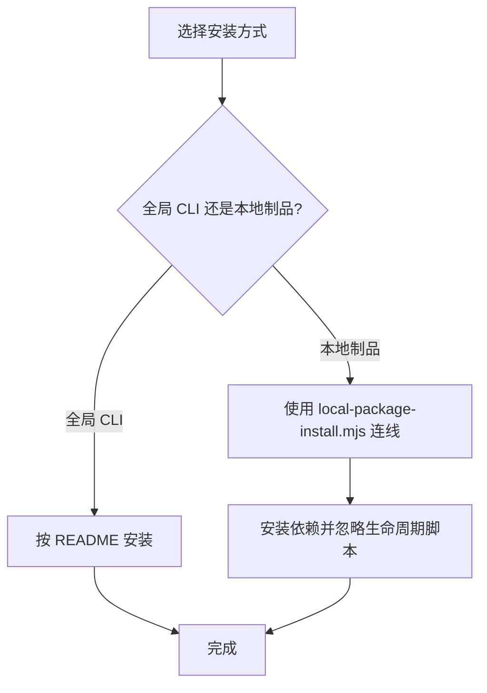
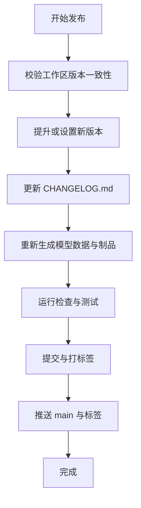
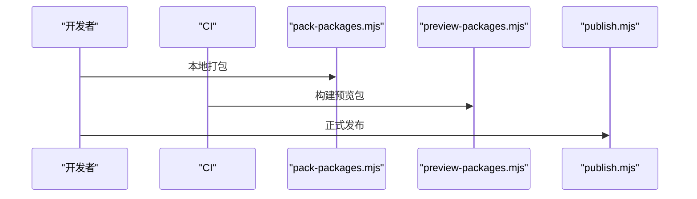
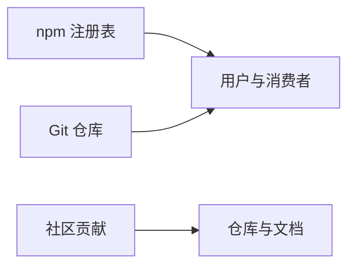
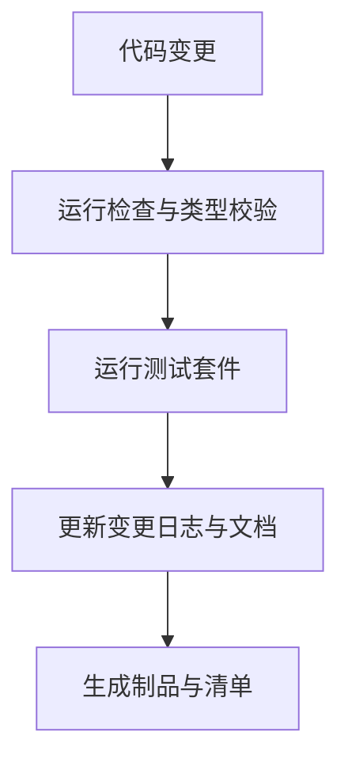
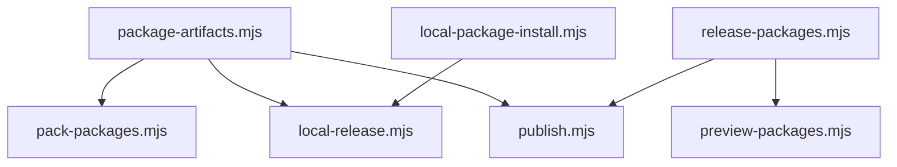

# 扩展打包与发布

<cite>
**本文引用的文件**
- [README.md](file://README.md)
- [extensions/README.md](file://extensions/README.md)
- [extensions/omfde-core/package.json](file://extensions/omfde-core/package.json)
- [extensions/omfde-core/src/index.ts](file://extensions/omfde-core/src/index.ts)
- [scripts/pack-packages.mjs](file://scripts/pack-packages.mjs)
- [scripts/package-artifacts.mjs](file://scripts/package-artifacts.mjs)
- [scripts/release-packages.mjs](file://scripts/release-packages.mjs)
- [scripts/local-package-install.mjs](file://scripts/local-package-install.mjs)
- [scripts/local-release.mjs](file://scripts/local-release.mjs)
- [scripts/release.mjs](file://scripts/release.mjs)
- [scripts/publish.mjs](file://scripts/publish.mjs)
- [scripts/preview-packages.mjs](file://scripts/preview-packages.mjs)
- [.github/workflows/ci.yml](file://.github/workflows/ci.yml)
</cite>

## 目录
1. [引言](#引言)
2. [项目结构](#项目结构)
3. [核心组件](#核心组件)
4. [架构总览](#架构总览)
5. [详细组件分析](#详细组件分析)
6. [依赖关系分析](#依赖关系分析)
7. [性能与可维护性考虑](#性能与可维护性考虑)
8. [故障排查指南](#故障排查指南)
9. [结论](#结论)
10. [附录](#附录)

## 引言
本指南面向在 Pi 生态中开发、打包、发布和分发扩展的工程师与维护者。文档基于仓库现有实现，系统性说明：
- 扩展包的结构规范与配置文件要求
- 依赖管理与版本管理策略
- 安装、更新与卸载流程
- 自动化打包脚本与 CI/CD 集成方案
- 分发渠道、市场发布和社区贡献流程
- 质量检查、测试与文档生成的最佳实践

## 项目结构
仓库采用多工作区（monorepo）组织方式，扩展位于 `extensions/`，平台级扩展与上游 Pi 包隔离；公共库位于 `packages/`；构建与发布脚本集中在 `scripts/`；CI 配置位于 `.github/workflows/`。

**图示来源**
- [extensions/README.md:1-8](file://extensions/README.md#L1-L8)
- [extensions/omfde-core/package.json:1-16](file://extensions/omfde-core/package.json#L1-L16)
- [extensions/omfde-core/src/index.ts:1-20](file://extensions/omfde-core/src/index.ts#L1-L20)
- [scripts/pack-packages.mjs:1-49](file://scripts/pack-packages.mjs#L1-L49)
- [scripts/package-artifacts.mjs:1-142](file://scripts/package-artifacts.mjs#L1-L142)
- [scripts/release-packages.mjs:1-14](file://scripts/release-packages.mjs#L1-L14)
- [scripts/local-package-install.mjs:115-160](file://scripts/local-package-install.mjs#L115-L160)
- [scripts/local-release.mjs:1-163](file://scripts/local-release.mjs#L1-L163)
- [scripts/release.mjs:1-290](file://scripts/release.mjs#L1-L290)
- [scripts/publish.mjs:1-64](file://scripts/publish.mjs#L1-L64)
- [scripts/preview-packages.mjs:24-42](file://scripts/preview-packages.mjs#L24-L42)
- [.github/workflows/ci.yml:1-126](file://.github/workflows/ci.yml#L1-L126)

**章节来源**
- [README.md:56-69](file://README.md#L56-L69)
- [extensions/README.md:1-8](file://extensions/README.md#L1-L8)

## 核心组件
本节聚焦扩展生命周期中的关键脚本与工件：
- 本地打包产物集生成：`scripts/package-artifacts.mjs`
- 统一打包入口：`scripts/pack-packages.mjs`
- 公开包清单过滤：`scripts/release-packages.mjs`
- 本地发行验证：`scripts/local-release.mjs`
- 消费者安装与连线：`scripts/local-package-install.mjs`
- 版本发布与变更日志：`scripts/release.mjs`
- npm 发布：`scripts/publish.mjs`
- 预览包打包：`scripts/preview-packages.mjs`
- CI 流水线：`.github/workflows/ci.yml`

这些组件共同构成“构建 → 打包 → 校验 → 发布”的完整链路，并支持预览与本地离线验证。

**章节来源**
- [scripts/package-artifacts.mjs:76-100](file://scripts/package-artifacts.mjs#L76-L100)
- [scripts/pack-packages.mjs:1-49](file://scripts/pack-packages.mjs#L1-L49)
- [scripts/release-packages.mjs:5-13](file://scripts/release-packages.mjs#L5-L13)
- [scripts/local-release.mjs:100-163](file://scripts/local-release.mjs#L100-L163)
- [scripts/local-package-install.mjs:115-160](file://scripts/local-package-install.mjs#L115-L160)
- [scripts/release.mjs:211-290](file://scripts/release.mjs#L211-L290)
- [scripts/publish.mjs:30-64](file://scripts/publish.mjs#L30-L64)
- [scripts/preview-packages.mjs:24-42](file://scripts/preview-packages.mjs#L24-L42)
- [.github/workflows/ci.yml:31-46](file://.github/workflows/ci.yml#L31-L46)

## 架构总览
下图展示从代码到发布的端到端流程，包括扩展加载、包发现、打包、校验、预览与正式发布。

**图示来源**
- [scripts/pack-packages.mjs:1-49](file://scripts/pack-packages.mjs#L1-L49)
- [scripts/package-artifacts.mjs:76-100](file://scripts/package-artifacts.mjs#L76-L100)
- [scripts/release-packages.mjs:5-13](file://scripts/release-packages.mjs#L5-L13)
- [scripts/preview-packages.mjs:24-42](file://scripts/preview-packages.mjs#L24-L42)
- [scripts/local-release.mjs:100-163](file://scripts/local-release.mjs#L100-L163)
- [scripts/publish.mjs:30-64](file://scripts/publish.mjs#L30-L64)

## 详细组件分析

### 扩展包结构与配置规范
- 扩展放置位置：平台级扩展放在 `extensions/`，避免与上游 Pi 包混用。
- 最小骨架示例：`extensions/omfde-core` 通过 `ExtensionAPI` 注册命令，不修改内核。
- package.json 关键字段：
  - `name`：包名
  - `version`：语义化版本
  - `private`：是否私有（非公开包不参与发布）
  - `type`：模块类型
  - `exports`：导出入口
  - `peerDependencies`：声明运行时依赖（如 `@earendil-works/pi-coding-agent`）
  - `devDependencies`：开发期依赖
- 扩展入口约定：
  - 默认导出函数接收 `ExtensionAPI`，用于注册命令、工具、事件等能力。

**图示来源**
- [extensions/omfde-core/src/index.ts:1-20](file://extensions/omfde-core/src/index.ts#L1-L20)
- [extensions/omfde-core/package.json:1-16](file://extensions/omfde-core/package.json#L1-L16)

**章节来源**
- [extensions/README.md:1-8](file://extensions/README.md#L1-L8)
- [extensions/omfde-core/package.json:1-16](file://extensions/omfde-core/package.json#L1-L16)
- [extensions/omfde-core/src/index.ts:1-20](file://extensions/omfde-core/src/index.ts#L1-L20)

### 依赖管理与兼容性声明
- 外部依赖锁定：直接外部依赖精确锁定，内部工作区包保留范围约束。
- 安装安全：安装时启用 `--ignore-scripts`，降低供应链风险。
- 锁文件权威：以 `package-lock.json` 为准，预提交钩子阻止意外提交。
- 运行时依赖检查：脚本提供运行时依赖与 TypeScript 导入兼容性检查。
- 消费者本地连线：`scripts/local-package-install.mjs` 将制品集映射为 `file:` 引用，并写入覆盖规则。

**图示来源**
- [scripts/package-artifacts.mjs:22-56](file://scripts/package-artifacts.mjs#L22-L56)
- [scripts/package-artifacts.mjs:76-100](file://scripts/package-artifacts.mjs#L76-L100)
- [scripts/local-package-install.mjs:115-160](file://scripts/local-package-install.mjs#L115-L160)

**章节来源**
- [README.md:152-164](file://README.md#L152-L164)
- [scripts/package-artifacts.mjs:22-56](file://scripts/package-artifacts.mjs#L22-L56)
- [scripts/local-package-install.mjs:115-160](file://scripts/local-package-install.mjs#L115-L160)

### 安装、更新与卸载流程
- 安装：
  - 全局 CLI 安装：遵循 README 的安装指引。
  - 本地制品安装：使用 `scripts/local-package-install.mjs` 将制品集映射到消费者项目。
- 更新：
  - 通过 `pi update --self` 或 npm 更新机制进行升级。
  - 本地制品可通过重新运行 `local-release.mjs` 或 `use-local-packages.mjs` 更新。
- 卸载：
  - 移除消费者项目中对制品集的引用，删除对应 node_modules 条目。
  - 若使用二进制发行版，删除对应安装目录即可。

**图示来源**
- [README.md:23-54](file://README.md#L23-L54)
- [scripts/local-package-install.mjs:115-160](file://scripts/local-package-install.mjs#L115-L160)

**章节来源**
- [README.md:23-54](file://README.md#L23-L54)
- [scripts/local-package-install.mjs:115-160](file://scripts/local-package-install.mjs#L115-L160)

### 版本管理、兼容性声明与更新策略
- 版本策略：
  - 使用语义化版本；发布脚本支持 `major/minor/patch` 或显式版本号。
  - 所有公开包保持同步版本（lockstep）。
- 变更日志：
  - 发布脚本自动将 `[Unreleased]` 替换为具体版本与日期，并在下一周期新增 `[Unreleased]` 区块。
- 兼容性：
  - 扩展通过 `peerDependencies` 声明与 Pi 运行时版本的兼容范围。
  - 发布前会检查 npm 包注册状态与制品完整性。

**图示来源**
- [scripts/release.mjs:142-165](file://scripts/release.mjs#L142-L165)
- [scripts/release.mjs:173-209](file://scripts/release.mjs#L173-L209)
- [scripts/release.mjs:211-290](file://scripts/release.mjs#L211-L290)

**章节来源**
- [scripts/release.mjs:142-165](file://scripts/release.mjs#L142-L165)
- [scripts/release.mjs:173-209](file://scripts/release.mjs#L173-L209)
- [scripts/release.mjs:211-290](file://scripts/release.mjs#L211-L290)

### 自动化打包脚本与 CI/CD 集成
- 本地打包：
  - `scripts/pack-packages.mjs`：构建并输出统一的制品集与清单。
  - `scripts/local-release.mjs`：构建、打包、本地安装与冒烟测试。
- CI 集成：
  - `.github/workflows/ci.yml`：构建、预览包打包与上传、检查与测试。
  - 预览包通过 `scripts/preview-packages.mjs` 基于 commit SHA 生成。
- 发布：
  - `scripts/publish.mjs`：校验已发布状态，发布经过验证的 tarball。

**图示来源**
- [scripts/pack-packages.mjs:1-49](file://scripts/pack-packages.mjs#L1-L49)
- [scripts/preview-packages.mjs:24-42](file://scripts/preview-packages.mjs#L24-L42)
- [scripts/publish.mjs:30-64](file://scripts/publish.mjs#L30-L64)
- [.github/workflows/ci.yml:31-46](file://.github/workflows/ci.yml#L31-L46)

**章节来源**
- [scripts/pack-packages.mjs:1-49](file://scripts/pack-packages.mjs#L1-L49)
- [scripts/preview-packages.mjs:24-42](file://scripts/preview-packages.mjs#L24-L42)
- [scripts/publish.mjs:30-64](file://scripts/publish.mjs#L30-L64)
- [.github/workflows/ci.yml:1-126](file://.github/workflows/ci.yml#L1-L126)

### 分发渠道、市场发布与社区贡献
- 分发渠道：
  - npm 官方注册表：通过 `scripts/publish.mjs` 发布公开包。
  - Git 源：README 提及可通过 git 分享包。
- 市场发布：
  - 当前仓库未包含第三方市场发布流程；建议通过 npm 与 Git 作为主要分发渠道。
- 社区贡献：
  - 参考 CONTRIBUTING 与 AGENTS 文档；平台代码按职责落在 `apps/`、`packages/`、`extensions/`。

**图示来源**
- [README.md:17-21](file://README.md#L17-L21)
- [CONTRIBUTING.md:46-48](file://CONTRIBUTING.md#L46-L48)

**章节来源**
- [README.md:17-21](file://README.md#L17-L21)
- [CONTRIBUTING.md:46-48](file://CONTRIBUTING.md#L46-L48)

### 质量检查、测试与文档生成最佳实践
- 质量检查：
  - `pnpm run check`：Lint、格式化与类型检查。
  - 依赖锁定与运行时依赖检查脚本。
- 测试：
  - `./test.sh`：运行测试套件；CI 中按工作区拆分并行测试。
  - MCP 合规性测试：`pnpm run test:mcp-conformance`。
- 文档生成：
  - 扩展可通过 `pi.extensions` 与 `changelogPath` 暴露资源路径，便于 UI 展示变更日志。

**图示来源**
- [README.md:86-95](file://README.md#L86-L95)
- [.github/workflows/ci.yml:48-126](file://.github/workflows/ci.yml#L48-L126)
- [packages/coding-agent/test/package-manager.test.ts:674-757](file://packages/coding-agent/test/package-manager.test.ts#L674-L757)

**章节来源**
- [README.md:86-95](file://README.md#L86-L95)
- [.github/workflows/ci.yml:48-126](file://.github/workflows/ci.yml#L48-L126)
- [packages/coding-agent/test/package-manager.test.ts:674-757](file://packages/coding-agent/test/package-manager.test.ts#L674-L757)

## 依赖关系分析
- 组件耦合：
  - `package-artifacts.mjs` 是核心，被 `pack-packages.mjs`、`local-release.mjs`、`publish.mjs` 复用。
  - `release-packages.mjs` 提供公开包清单，供预览与发布脚本使用。
  - `local-package-install.mjs` 负责消费者项目的依赖连线与安装。
- 外部依赖：
  - npm CLI：用于 pack、install、publish 等操作。
  - Node.js 标准库：文件系统、哈希、临时目录等。
- 循环依赖：
  - 脚本之间无循环依赖，均为单向调用。

**图示来源**
- [scripts/package-artifacts.mjs:1-142](file://scripts/package-artifacts.mjs#L1-L142)
- [scripts/release-packages.mjs:1-14](file://scripts/release-packages.mjs#L1-L14)
- [scripts/local-package-install.mjs:115-160](file://scripts/local-package-install.mjs#L115-L160)

**章节来源**
- [scripts/package-artifacts.mjs:1-142](file://scripts/package-artifacts.mjs#L1-L142)
- [scripts/release-packages.mjs:1-14](file://scripts/release-packages.mjs#L1-L14)
- [scripts/local-package-install.mjs:115-160](file://scripts/local-package-install.mjs#L115-L160)

## 性能与可维护性考虑
- 构建优化：
  - 支持 `--skip-build` 与 `--offline-model-data`，减少网络与重复构建开销。
- 安装安全：
  - 广泛使用 `--ignore-scripts`，避免不可信生命周期脚本执行。
- 可观测性：
  - 制品清单包含完整性摘要，便于校验与审计。
- 可维护性：
  - 脚本职责单一、组合清晰；CI 将测试拆分为并行任务，缩短反馈时间。

[本节为通用指导，无需特定文件引用]

## 故障排查指南
- 常见问题与定位：
  - 输出目录非法：确保输出目录不在仓库根或其祖先目录，且本地输出需在 `.artifacts` 下。
  - 制品完整性不匹配：核对 manifest 中的 integrity 字段与实际 tarball。
  - 未发布包检测：发布脚本会查询 npm 并跳过已发布包。
  - 预览包 SHA 校验：预览脚本要求完整的 commit SHA。
- 建议步骤：
  - 先运行 `pnpm run check` 与 `./test.sh`。
  - 使用 `scripts/local-release.mjs` 进行本地离线验证。
  - 使用 `scripts/publish.mjs --dry-run` 进行发布预检。

**章节来源**
- [scripts/package-artifacts.mjs:58-74](file://scripts/package-artifacts.mjs#L58-L74)
- [scripts/package-artifacts.mjs:103-141](file://scripts/package-artifacts.mjs#L103-L141)
- [scripts/publish.mjs:13-28](file://scripts/publish.mjs#L13-L28)
- [scripts/preview-packages.mjs:24-42](file://scripts/preview-packages.mjs#L24-L42)

## 结论
本指南基于仓库现有实现，总结了扩展的结构规范、依赖与版本管理、安装与卸载流程、自动化打包与 CI/CD 集成、分发与贡献流程，以及质量与测试最佳实践。建议在团队内统一遵循上述规范，利用现有脚本与流水线保障扩展的质量与可维护性。

[本节为总结性内容，无需特定文件引用]

## 附录
- 常用命令速查：
  - 本地打包：`node scripts/pack-packages.mjs --out .artifacts/pi-packages`
  - 本地发行验证：`node scripts/local-release.mjs`
  - 预览包打包：`node scripts/preview-packages.mjs pack --sha <SHA>`
  - 正式发布：`node scripts/publish.mjs [--dry-run]`
  - 运行检查与测试：`pnpm run check && ./test.sh`

**章节来源**
- [README.md:97-137](file://README.md#L97-L137)
- [scripts/pack-packages.mjs:1-49](file://scripts/pack-packages.mjs#L1-L49)
- [scripts/local-release.mjs:1-163](file://scripts/local-release.mjs#L1-L163)
- [scripts/preview-packages.mjs:24-42](file://scripts/preview-packages.mjs#L24-L42)
- [scripts/publish.mjs:1-64](file://scripts/publish.mjs#L1-L64)