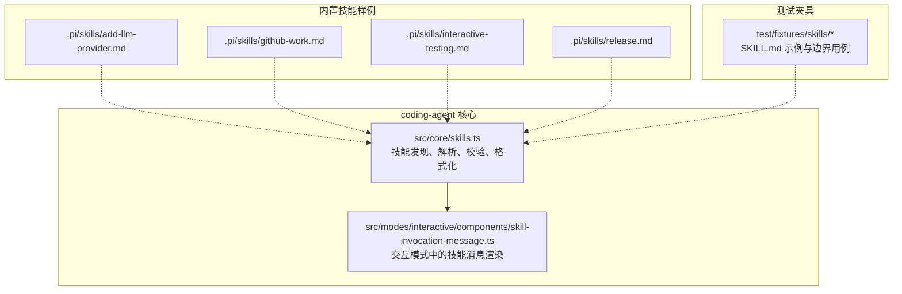
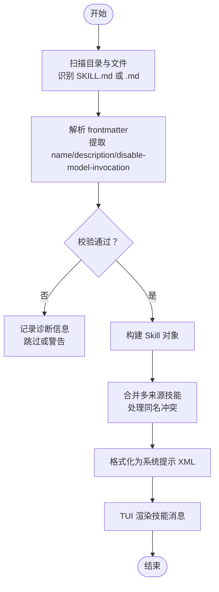
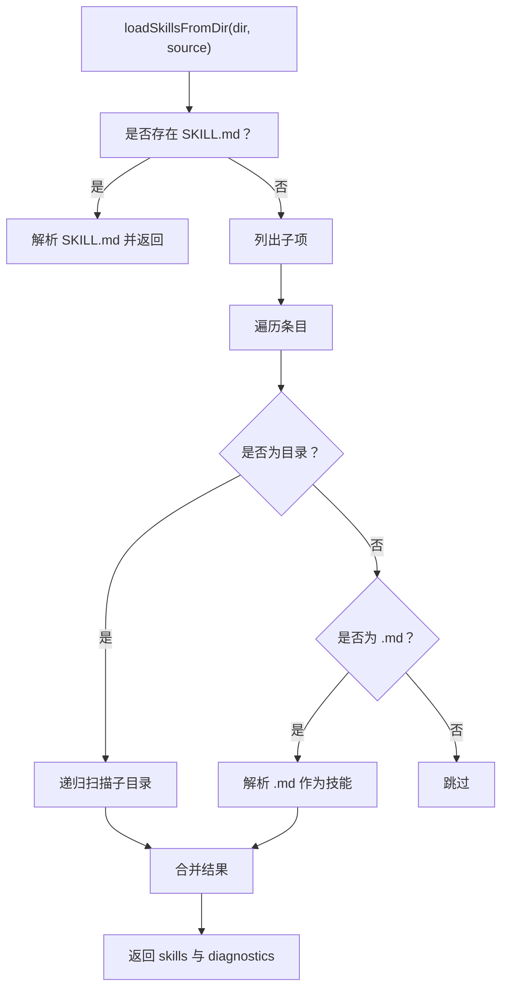
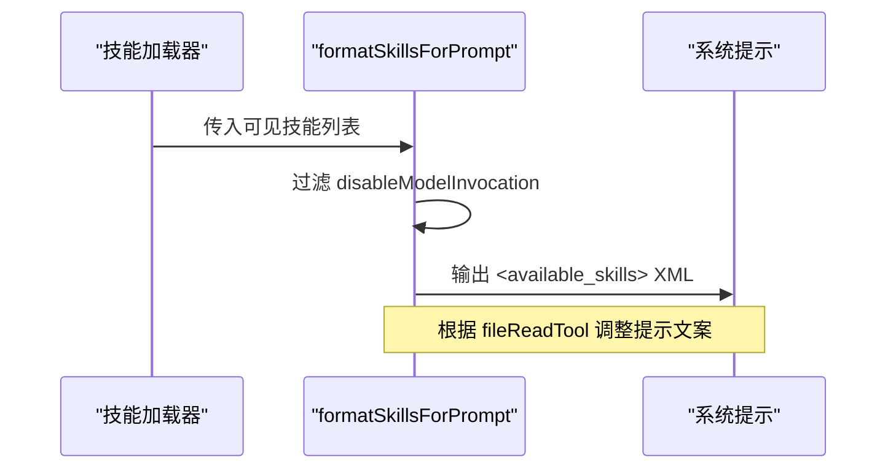
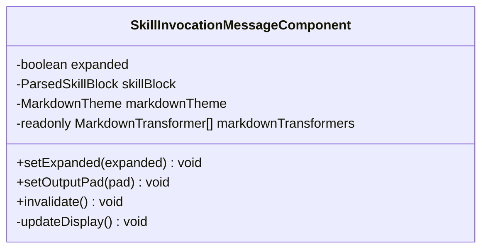
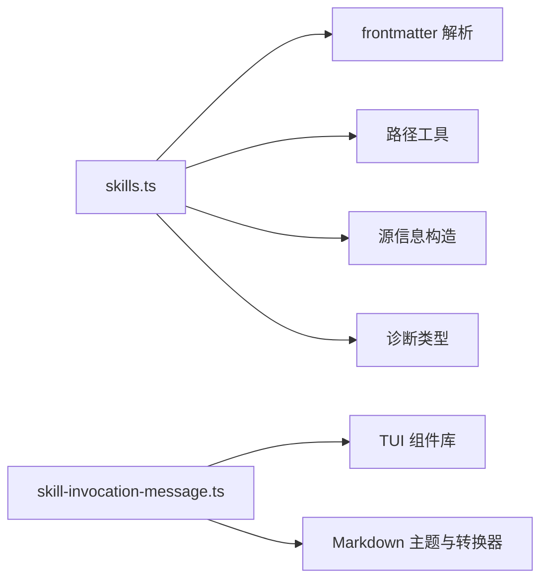

# 技能开发

<cite>
**本文引用的文件**   
- [skills.ts](file://packages/coding-agent/src/core/skills.ts)
- [skill-invocation-message.ts](file://packages/coding-agent/src/modes/interactive/components/skill-invocation-message.ts)
- [add-llm-provider.md](file://.pi/skills/add-llm-provider.md)
- [github-work.md](file://.pi/skills/github-work.md)
- [interactive-testing.md](file://.pi/skills/interactive-testing.md)
- [release.md](file://.pi/skills/release.md)
- [valid-skill/SKILL.md](file://packages/coding-agent/test/fixtures/skills/valid-skill/SKILL.md)
- [invalid-name-chars/SKILL.md](file://packages/coding-agent/test/fixtures/skills/invalid-name-chars/SKILL.md)
- [missing-description/SKILL.md](file://packages/coding-agent/test/fixtures/skills/missing-description/SKILL.md)
- [long-name/SKILL.md](file://packages/coding-agent/test/fixtures/skills/long-name/SKILL.md)
- [name-mismatch/SKILL.md](file://packages/coding-agent/test/fixtures/skills/name-mismatch/SKILL.md)
- [nested/child-skill/SKILL.md](file://packages/coding-agent/test/fixtures/skills/nested/child-skill/SKILL.md)
- [root-skill-preferred/SKILL.md](file://packages/coding-agent/test/fixtures/skills/root-skill-preferred/SKILL.md)
- [root-skill-preferred/nested-child/SKILL.md](file://packages/coding-agent/test/fixtures/skills/root-skill-preferred/nested-child/SKILL.md)
- [skills.test.ts](file://packages/coding-agent/test/skills.test.ts)
- [2781-skill-collision-precedence.test.ts](file://packages/coding-agent/test/suite/regressions/2781-skill-collision-precedence.test.ts)
- [export-html-skill-block.test.ts](file://packages/coding-agent/test/export-html-skill-block.test.ts)
</cite>

## 目录
1. [引言](#引言)
2. [项目结构](#项目结构)
3. [核心组件](#核心组件)
4. [架构总览](#架构总览)
5. [详细组件分析](#详细组件分析)
6. [依赖关系分析](#依赖关系分析)
7. [性能与优化](#性能与优化)
8. [故障排查指南](#故障排查指南)
9. [结论](#结论)
10. [附录：技能示例与最佳实践](#附录技能示例与最佳实践)

## 引言
本指南面向希望在本仓库中编写“技能（Skills）”的开发者。技能是面向模型的系统提示片段，用于为特定任务提供结构化、可复用的指导；它们不是工具，而是告诉模型“如何完成任务”的规则和流程。本仓库提供了技能的加载、校验、冲突处理、系统提示格式化以及交互式界面渲染等完整实现，并附带多个真实技能样例，覆盖从简单命令执行到复杂业务流程编排的场景。

## 项目结构
技能相关代码主要位于 coding-agent 包中，同时仓库根目录下的 .pi/skills 提供了可直接使用的技能样例。测试用例集中在 packages/coding-agent/test 下，包含大量 SKILL.md 夹具，便于理解规范与边界行为。

图表来源
- [skills.ts:160-345](file://packages/coding-agent/src/core/skills.ts#L160-L345)
- [skill-invocation-message.ts:1-97](file://packages/coding-agent/src/modes/interactive/components/skill-invocation-message.ts#L1-L97)

章节来源
- [skills.ts:1-506](file://packages/coding-agent/src/core/skills.ts#L1-L506)
- [skill-invocation-message.ts:1-97](file://packages/coding-agent/src/modes/interactive/components/skill-invocation-message.ts#L1-L97)

## 核心组件
- 技能数据模型与元数据
  - SkillFrontmatter：定义 name、description、disable-model-invocation 等字段。
  - Skill：对外暴露的技能对象，包括名称、描述、文件路径、基础目录、来源信息与是否禁用模型自动调用。
- 技能发现与加载
  - loadSkillsFromDir：按规则扫描目录，识别 SKILL.md 或顶层 .md 文件作为技能。
  - loadSkillFromFile：读取 frontmatter，校验名称与描述，构建 Skill 对象。
  - loadSkills：聚合用户、项目、显式路径等多来源技能，处理冲突与诊断信息。
- 系统提示格式化
  - formatSkillsForPrompt：将可用技能序列化为 XML 片段，注入系统提示，控制可见性与读取方式。
- 交互渲染
  - SkillInvocationMessageComponent：在 TUI 中以折叠/展开形式展示技能块内容。

章节来源
- [skills.ts:67-86](file://packages/coding-agent/src/core/skills.ts#L67-L86)
- [skills.ts:160-345](file://packages/coding-agent/src/core/skills.ts#L160-L345)
- [skills.ts:347-397](file://packages/coding-agent/src/core/skills.ts#L347-L397)
- [skills.ts:399-505](file://packages/coding-agent/src/core/skills.ts#L399-L505)
- [skill-invocation-message.ts:1-97](file://packages/coding-agent/src/modes/interactive/components/skill-invocation-message.ts#L1-L97)

## 架构总览
技能的生命周期大致如下：
- 发现：从用户目录、项目目录、显式路径扫描 SKILL.md 或 .md 文件。
- 解析：解析 YAML frontmatter，提取 name、description、disable-model-invocation。
- 校验：检查名称长度、字符集、连字符规则；检查描述必填与长度限制。
- 合并：按来源优先级合并同名技能，记录冲突诊断。
- 格式化：生成系统提示中的可用技能列表，供模型选择。
- 渲染：在交互模式中显示技能调用消息，支持折叠/展开。

图表来源
- [skills.ts:160-345](file://packages/coding-agent/src/core/skills.ts#L160-L345)
- [skills.ts:347-397](file://packages/coding-agent/src/core/skills.ts#L347-L397)
- [skills.ts:399-505](file://packages/coding-agent/src/core/skills.ts#L399-L505)

## 详细组件分析

### 技能定义与参数配置
- 必需字段
  - name：技能标识符，遵循 Agent Skills 规范，仅允许小写字母、数字与连字符，不能以连字符开头或结尾，不允许连续连字符，最大长度 64。
  - description：技能用途说明，必填且非空，最大长度 1024。
- 可选字段
  - disable-model-invocation：若为 true，该技能不会出现在系统提示的可用技能列表中，只能通过显式命令调用。
- 文件组织
  - 推荐将每个技能放在独立目录，并在目录内放置 SKILL.md。
  - 若目录存在 SKILL.md，则视为技能根目录，不再递归其子目录。
  - 否则，会加载根目录下直接子级的 .md 文件作为技能。

参考夹具
- [valid-skill/SKILL.md:1-9](file://packages/coding-agent/test/fixtures/skills/valid-skill/SKILL.md#L1-L9)
- [invalid-name-chars/SKILL.md:1-9](file://packages/coding-agent/test/fixtures/skills/invalid-name-chars/SKILL.md#L1-L9)
- [missing-description/SKILL.md:1-8](file://packages/coding-agent/test/fixtures/skills/missing-description/SKILL.md#L1-L8)
- [long-name/SKILL.md:1-9](file://packages/coding-agent/test/fixtures/skills/long-name/SKILL.md#L1-L9)
- [name-mismatch/SKILL.md:1-9](file://packages/coding-agent/test/fixtures/skills/name-mismatch/SKILL.md#L1-L9)
- [nested/child-skill/SKILL.md:1-9](file://packages/coding-agent/test/fixtures/skills/nested/child-skill/SKILL.md#L1-L9)
- [root-skill-preferred/SKILL.md:1-4](file://packages/coding-agent/test/fixtures/skills/root-skill-preferred/SKILL.md#L1-L4)
- [root-skill-preferred/nested-child/SKILL.md:1-4](file://packages/coding-agent/test/fixtures/skills/root-skill-preferred/nested-child/SKILL.md#L1-L4)

章节来源
- [skills.ts:67-86](file://packages/coding-agent/src/core/skills.ts#L67-L86)
- [skills.ts:92-127](file://packages/coding-agent/src/core/skills.ts#L92-L127)
- [skills.ts:160-345](file://packages/coding-agent/src/core/skills.ts#L160-L345)

### 技能发现与加载流程
- 忽略规则
  - 支持 .gitignore、.ignore、.fdignore，按相对路径前缀匹配，支持否定规则。
- 扫描策略
  - 优先查找 SKILL.md；若找到，将其作为技能根，不继续递归。
  - 否则，加载根目录的直接子级 .md 文件。
  - 递归进入子目录继续查找 SKILL.md。
- 来源与优先级
  - 用户目录（agentDir/skills）、项目目录（cwd/.pi/skills）、显式 skillPaths。
  - 同名冲突时，保留先出现的技能，并记录 collision 诊断。

图表来源
- [skills.ts:160-275](file://packages/coding-agent/src/core/skills.ts#L160-L275)
- [skills.ts:277-345](file://packages/coding-agent/src/core/skills.ts#L277-L345)

章节来源
- [skills.ts:160-275](file://packages/coding-agent/src/core/skills.ts#L160-L275)
- [skills.ts:277-345](file://packages/coding-agent/src/core/skills.ts#L277-L345)

### 系统提示格式化与可见性控制
- formatSkillsForPrompt 将可见技能序列化为 XML，包含 name、description、location。
- 当 disable-model-invocation=true 时，技能不会出现在可用技能列表中，只能由 /skill:name 显式调用。
- fileReadTool 参数决定提示中建议的读取方式（read、bash 或 indirect）。

图表来源
- [skills.ts:347-397](file://packages/coding-agent/src/core/skills.ts#L347-L397)

章节来源
- [skills.ts:347-397](file://packages/coding-agent/src/core/skills.ts#L347-L397)

### 交互模式中的技能消息渲染
- SkillInvocationMessageComponent 负责在 TUI 中渲染技能调用消息。
- 支持折叠/展开状态，点击切换显示完整技能内容。
- 使用 Markdown 主题与转换器，确保技能内容安全渲染。

图表来源
- [skill-invocation-message.ts:1-97](file://packages/coding-agent/src/modes/interactive/components/skill-invocation-message.ts#L1-L97)

章节来源
- [skill-invocation-message.ts:1-97](file://packages/coding-agent/src/modes/interactive/components/skill-invocation-message.ts#L1-L97)

### 技能与工具的区别
- 技能（Skills）
  - 作用：为模型提供任务导向的结构化指导，帮助模型理解“如何做”。
  - 形态：YAML frontmatter + Markdown 正文，通常以 SKILL.md 存放。
  - 触发：可通过系统提示自动发现，或通过显式命令调用。
- 工具（Tools）
  - 作用：提供可执行的函数或命令接口，让模型“做某事”。
  - 形态：函数签名、参数 schema、执行逻辑。
  - 触发：由模型根据上下文选择调用。
- 何时使用技能而不是工具
  - 需要复杂流程编排、步骤顺序、规则约束时，优先用技能。
  - 需要直接执行外部操作、访问文件系统、网络请求时，使用工具。
  - 两者常配合：技能指导模型如何组合工具完成目标。

[本节为概念性说明，不直接分析具体文件]

## 依赖关系分析
- 模块耦合
  - skills.ts 依赖 frontmatter 解析、路径工具、源信息构造与诊断类型。
  - skill-invocation-message.ts 依赖 TUI 组件库与 Markdown 主题。
- 外部依赖
  - ignore 库用于 .gitignore 等忽略规则。
  - fs/path 标准库用于文件与路径操作。
- 冲突与优先级
  - 同名技能冲突通过 collision 诊断记录，winnerPath 与 loserPath 明确指示。
  - 用户与项目默认目录优先于显式路径（取决于 includeDefaults 与 getSource 逻辑）。

图表来源
- [skills.ts:1-9](file://packages/coding-agent/src/core/skills.ts#L1-L9)
- [skill-invocation-message.ts:1-6](file://packages/coding-agent/src/modes/interactive/components/skill-invocation-message.ts#L1-L6)

章节来源
- [skills.ts:1-9](file://packages/coding-agent/src/core/skills.ts#L1-L9)
- [skill-invocation-message.ts:1-6](file://packages/coding-agent/src/modes/interactive/components/skill-invocation-message.ts#L1-L6)

## 性能与优化
- 扫描优化
  - 遇到 SKILL.md 即停止递归，减少不必要的目录遍历。
  - 跳过 node_modules 与隐藏目录，降低 IO 开销。
- 缓存与去重
  - 使用 Map 与 Set 对技能名与真实路径去重，避免重复加载。
- 延迟加载
  - 交互渲染仅在需要时展开技能内容，减少初始渲染成本。
- 建议
  - 合理组织技能目录，避免过深的嵌套。
  - 使用 disable-model-invocation 控制大型或不常用技能的可见性。
  - 在批量加载场景下，优先使用 loadSkills 而非多次 loadSkillsFromDir。

[本节为通用性能建议，不直接分析具体文件]

## 故障排查指南
- 常见错误与诊断
  - 名称无效：包含非法字符、超过长度、以连字符开头/结尾、连续连字符。
  - 描述缺失或为空：非字符串或空字符串将被拒绝。
  - YAML frontmatter 解析失败：记录警告并跳过该技能。
  - 路径不存在或非 .md：记录警告。
  - 同名冲突：记录 collision 诊断，包含 winnerPath 与 loserPath。
- 调试技巧
  - 查看 diagnostics 数组，定位问题技能文件。
  - 使用测试夹具对比正确与错误示例，快速定位差异。
  - 在交互模式中观察技能消息是否正确渲染与展开。

章节来源
- [skills.ts:92-127](file://packages/coding-agent/src/core/skills.ts#L92-L127)
- [skills.ts:277-345](file://packages/coding-agent/src/core/skills.ts#L277-L345)
- [skills.ts:399-505](file://packages/coding-agent/src/core/skills.ts#L399-L505)
- [skills.test.ts:131-167](file://packages/coding-agent/test/skills.test.ts#L131-L167)
- [skills.test.ts:250-346](file://packages/coding-agent/test/skills.test.ts#L250-L346)
- [skills.test.ts:348-373](file://packages/coding-agent/test/skills.test.ts#L348-L373)
- [2781-skill-collision-precedence.test.ts:1-37](file://packages/coding-agent/test/suite/regressions/2781-skill-collision-precedence.test.ts#L1-L37)

## 结论
技能是本仓库中为模型提供任务指导的核心机制。通过标准化的 SKILL.md 格式、严格的校验规则、灵活的加载策略与清晰的冲突处理，开发者可以构建高质量、可维护的技能集合。结合工具与交互渲染，技能能够胜任从简单命令执行到复杂业务流程编排的多类场景。建议在开发过程中充分利用测试夹具与诊断信息，确保技能的稳定性与可观测性。

[本节为总结性内容，不直接分析具体文件]

## 附录：技能示例与最佳实践

### 示例一：简单的命令执行
- 适用场景：引导模型执行固定命令序列，如初始化环境、运行脚本。
- 建议结构
  - name 简短明确，description 清晰表达目的。
  - 正文分步骤列出命令与预期输出。
  - 如需隐藏自动发现，设置 disable-model-invocation=true。
- 参考样例
  - [.pi/skills/interactive-testing.md:1-20](file://.pi/skills/interactive-testing.md#L1-L20)

章节来源
- [interactive-testing.md:1-20](file://.pi/skills/interactive-testing.md#L1-L20)

### 示例二：复杂的业务流程编排
- 适用场景：跨多个模块或包的变更流程，如添加 LLM provider、发布版本。
- 建议结构
  - 分阶段列出步骤，明确涉及的文件与命令。
  - 强调依赖关系与先后顺序。
  - 提供测试矩阵与文档更新要求。
- 参考样例
  - [.pi/skills/add-llm-provider.md:1-57](file://.pi/skills/add-llm-provider.md#L1-L57)
  - [.pi/skills/release.md:1-53](file://.pi/skills/release.md#L1-L53)

章节来源
- [add-llm-provider.md:1-57](file://.pi/skills/add-llm-provider.md#L1-L57)
- [release.md:1-53](file://.pi/skills/release.md#L1-L53)

### 示例三：GitHub 工作流协作
- 适用场景：围绕 issue 与 PR 的分析、审查与收尾工作。
- 建议结构
  - 明确不同请求对应的模板文件。
  - 规定分支操作与评论发布的约束。
- 参考样例
  - [.pi/skills/github-work.md:1-22](file://.pi/skills/github-work.md#L1-L22)

章节来源
- [github-work.md:1-22](file://.pi/skills/github-work.md#L1-L22)

### 测试与调试最佳实践
- 使用 fixtures 验证边界情况
  - 名称非法、描述缺失、名称过长、名称与目录不一致、嵌套技能、根技能优先等。
- 关注诊断信息
  - 名称与描述校验、YAML 解析失败、路径不存在、同名冲突。
- 交互模式验证
  - 技能消息渲染、折叠/展开、HTML 导出时的 Markdown 安全解析。

章节来源
- [valid-skill/SKILL.md:1-9](file://packages/coding-agent/test/fixtures/skills/valid-skill/SKILL.md#L1-L9)
- [invalid-name-chars/SKILL.md:1-9](file://packages/coding-agent/test/fixtures/skills/invalid-name-chars/SKILL.md#L1-L9)
- [missing-description/SKILL.md:1-8](file://packages/coding-agent/test/fixtures/skills/missing-description/SKILL.md#L1-L8)
- [long-name/SKILL.md:1-9](file://packages/coding-agent/test/fixtures/skills/long-name/SKILL.md#L1-L9)
- [name-mismatch/SKILL.md:1-9](file://packages/coding-agent/test/fixtures/skills/name-mismatch/SKILL.md#L1-L9)
- [nested/child-skill/SKILL.md:1-9](file://packages/coding-agent/test/fixtures/skills/nested/child-skill/SKILL.md#L1-L9)
- [root-skill-preferred/SKILL.md:1-4](file://packages/coding-agent/test/fixtures/skills/root-skill-preferred/SKILL.md#L1-L4)
- [root-skill-preferred/nested-child/SKILL.md:1-4](file://packages/coding-agent/test/fixtures/skills/root-skill-preferred/nested-child/SKILL.md#L1-L4)
- [export-html-skill-block.test.ts:29-40](file://packages/coding-agent/test/export-html-skill-block.test.ts#L29-L40)