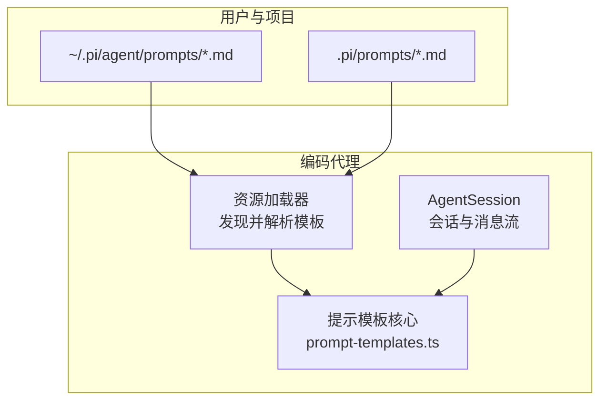
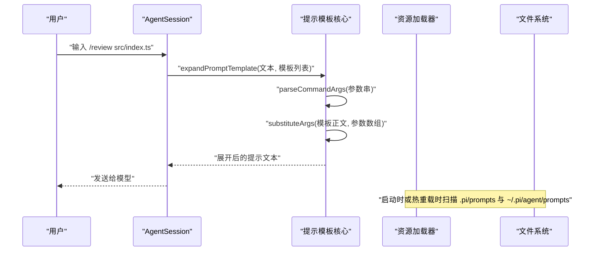
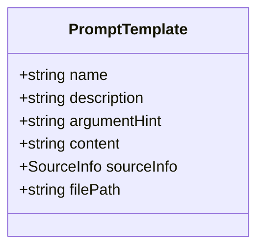
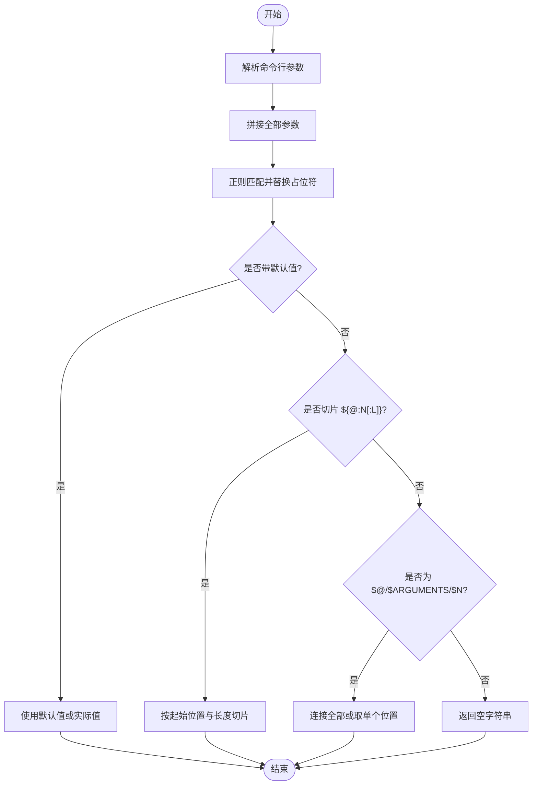
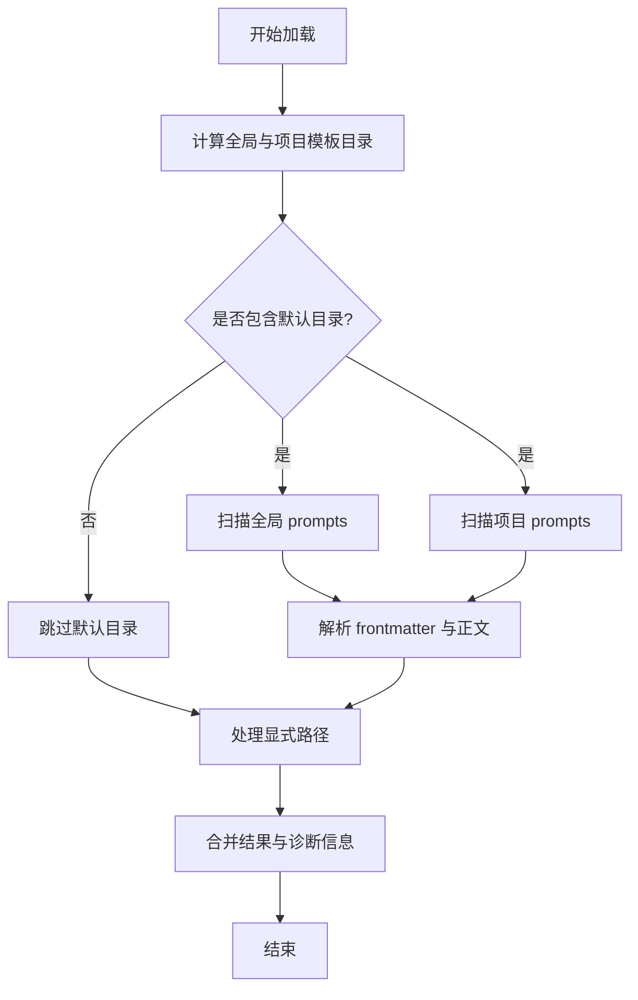
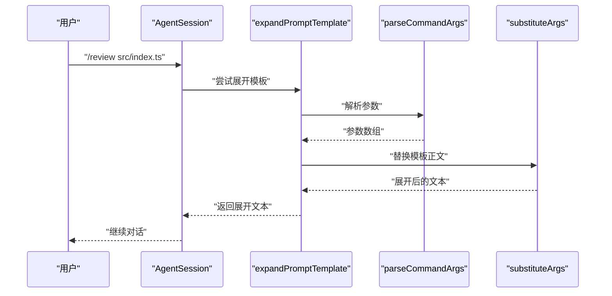
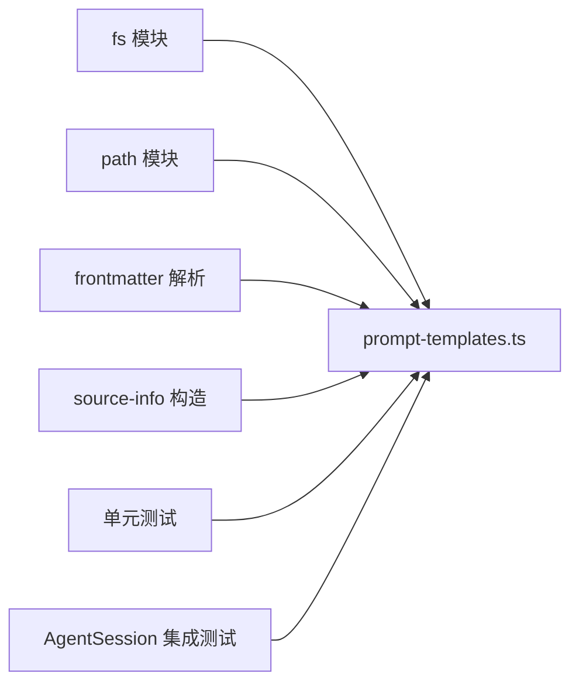

# 提示模板开发

<cite>
**本文引用的文件**
- [packages/coding-agent/docs/prompt-templates.md](file://packages/coding-agent/docs/prompt-templates.md)
- [packages/coding-agent/src/core/prompt-templates.ts](file://packages/coding-agent/src/core/prompt-templates.ts)
- [packages/coding-agent/test/prompt-templates.test.ts](file://packages/coding-agent/test/prompt-templates.test.ts)
- [packages/coding-agent/test/suite/agent-session-prompt.test.ts](file://packages/coding-agent/test/suite/agent-session-prompt.test.ts)
- [packages/coding-agent/test/resource-loader.test.ts](file://packages/coding-agent/test/resource-loader.test.ts)
- [.pi/prompts/cl.md](file://.pi/prompts/cl.md)
- [.pi/prompts/pr.md](file://.pi/prompts/pr.md)
- [.pi/prompts/wr.md](file://.pi/prompts/wr.md)
- [.pi/prompts/deslop.md](file://.pi/prompts/deslop.md)
</cite>

## 目录
1. [简介](#简介)
2. [项目结构](#项目结构)
3. [核心组件](#核心组件)
4. [架构总览](#架构总览)
5. [详细组件分析](#详细组件分析)
6. [依赖关系分析](#依赖关系分析)
7. [性能与优化](#性能与优化)
8. [故障排查](#故障排查)
9. [结论](#结论)
10. [附录：模板示例与最佳实践](#附录模板示例与最佳实践)

## 简介
本文件面向“提示模板”的开发者与维护者，系统性说明提示模板在系统中的角色、语法、变量替换机制、加载层次、继承与动态加载方式、内置模板使用方法、自定义模板开发流程、版本管理与兼容性策略，以及性能考虑和优化技巧。文档同时提供覆盖多场景的模板示例和工程化最佳实践，帮助你在不引入可执行行为的前提下，将 Markdown 文件转化为可复用的 `/` 命令。

## 项目结构
提示模板相关能力集中在编码代理模块中，并以 Markdown 文件形式暴露为命令；系统通过资源加载器发现用户级和项目级模板，并在会话前对输入进行模板展开。

图表来源
- [packages/coding-agent/src/core/prompt-templates.ts:227-303](file://packages/coding-agent/src/core/prompt-templates.ts#L227-L303)
- [packages/coding-agent/test/resource-loader.test.ts:642-673](file://packages/coding-agent/test/resource-loader.test.ts#L642-L673)

章节来源
- [packages/coding-agent/docs/prompt-templates.md:1-60](file://packages/coding-agent/docs/prompt-templates.md#L1-L60)
- [packages/coding-agent/src/core/prompt-templates.ts:227-303](file://packages/coding-agent/src/core/prompt-templates.ts#L227-L303)

## 核心组件
- 提示模板数据结构：包含名称、描述、参数提示、正文内容、来源信息与绝对路径。
- 命令行参数解析：支持双引号、单引号等类 Shell 风格的分词。
- 变量替换引擎：支持位置参数、全部参数、默认值、切片与长度截取。
- 模板加载器：从全局、项目与显式路径扫描并解析 Markdown 模板。
- 模板展开入口：匹配以 `/` 开头的命令文本，查找同名模板并替换变量后返回。

章节来源
- [packages/coding-agent/src/core/prompt-templates.ts:9-19](file://packages/coding-agent/src/core/prompt-templates.ts#L9-L19)
- [packages/coding-agent/src/core/prompt-templates.ts:25-61](file://packages/coding-agent/src/core/prompt-templates.ts#L25-L61)
- [packages/coding-agent/src/core/prompt-templates.ts:76-108](file://packages/coding-agent/src/core/prompt-templates.ts#L76-L108)
- [packages/coding-agent/src/core/prompt-templates.ts:110-159](file://packages/coding-agent/src/core/prompt-templates.ts#L110-L159)
- [packages/coding-agent/src/core/prompt-templates.ts:164-203](file://packages/coding-agent/src/core/prompt-templates.ts#L164-L203)
- [packages/coding-agent/src/core/prompt-templates.ts:227-303](file://packages/coding-agent/src/core/prompt-templates.ts#L227-L303)
- [packages/coding-agent/src/core/prompt-templates.ts:309-325](file://packages/coding-agent/src/core/prompt-templates.ts#L309-L325)

## 架构总览
提示模板的生命周期包括：发现、解析、注册、调用、展开与注入到会话。

图表来源
- [packages/coding-agent/src/core/prompt-templates.ts:309-325](file://packages/coding-agent/src/core/prompt-templates.ts#L309-L325)
- [packages/coding-agent/src/core/prompt-templates.ts:25-61](file://packages/coding-agent/src/core/prompt-templates.ts#L25-L61)
- [packages/coding-agent/src/core/prompt-templates.ts:76-108](file://packages/coding-agent/src/core/prompt-templates.ts#L76-L108)
- [packages/coding-agent/test/suite/agent-session-prompt.test.ts:253-284](file://packages/coding-agent/test/suite/agent-session-prompt.test.ts#L253-L284)

## 详细组件分析

### 模板数据模型与元信息
- 名称：由文件名（去掉 `.md`）决定，作为命令名。
- 描述：优先取自 frontmatter 的 `description`，否则取正文第一行（截断）。
- 参数提示：可选的 `argument-hint`，用于命令补全展示。
- 正文：Markdown 正文，作为最终提示文本的骨架。
- 来源信息：标记模板来自用户、项目或临时包，便于诊断与审计。

图表来源
- [packages/coding-agent/src/core/prompt-templates.ts:9-19](file://packages/coding-agent/src/core/prompt-templates.ts#L9-L19)

章节来源
- [packages/coding-agent/src/core/prompt-templates.ts:110-159](file://packages/coding-agent/src/core/prompt-templates.ts#L110-L159)

### 参数解析与变量替换
- 参数解析：支持双引号、单引号包裹的参数，空格分隔，空字符串保留语义。
- 变量替换：
  - `$1`, `$2`, …：位置参数。
  - `$@` 或 `$ARGUMENTS`：所有参数以空格连接。
  - `${N:-default}`：第 N 个参数为空时使用默认值。
  - `${@:-default}` 或 `${ARGUMENTS:-default}`：全部参数为空时使用默认值。
  - `${@:N}`：从第 N 个参数开始的所有参数。
  - `${@:N:L}`：从第 N 个参数开始的 L 个参数。
- 注意：替换仅发生在模板正文上，参数与默认值中的占位符不会被递归替换。

图表来源
- [packages/coding-agent/src/core/prompt-templates.ts:25-61](file://packages/coding-agent/src/core/prompt-templates.ts#L25-L61)
- [packages/coding-agent/src/core/prompt-templates.ts:76-108](file://packages/coding-agent/src/core/prompt-templates.ts#L76-L108)

章节来源
- [packages/coding-agent/test/prompt-templates.test.ts:27-496](file://packages/coding-agent/test/prompt-templates.test.ts#L27-L496)

### 模板加载与层次结构
- 加载顺序：
  1. 全局模板目录：`~/.pi/agent/prompts/*.md`
  2. 项目模板目录：`.pi/prompts/*.md`
  3. 显式路径：通过 CLI 或配置传入的文件或目录
- 非递归扫描：默认只加载直接子级的 `.md` 文件。
- 来源标注：根据路径归属自动标记为用户级或项目级，便于诊断与安全审计。
- 信任机制：项目模板仅在项目获得信任后生效。

图表来源
- [packages/coding-agent/src/core/prompt-templates.ts:227-303](file://packages/coding-agent/src/core/prompt-templates.ts#L227-L303)

章节来源
- [packages/coding-agent/docs/prompt-templates.md:53-60](file://packages/coding-agent/docs/prompt-templates.md#L53-L60)
- [packages/coding-agent/src/core/prompt-templates.ts:227-303](file://packages/coding-agent/src/core/prompt-templates.ts#L227-L303)

### 模板展开与会话集成
- 触发条件：当用户输入以 `/` 开头且匹配已加载模板名称时，进入模板展开流程。
- 展开过程：先解析参数，再替换模板正文中的变量，最后将结果作为普通用户消息发送。
- 扩展点：扩展可在普通用户消息之前接收原始输入，但模板展开发生在扩展命令之后。

图表来源
- [packages/coding-agent/src/core/prompt-templates.ts:309-325](file://packages/coding-agent/src/core/prompt-templates.ts#L309-L325)
- [packages/coding-agent/test/suite/agent-session-prompt.test.ts:253-284](file://packages/coding-agent/test/suite/agent-session-prompt.test.ts#L253-L284)

章节来源
- [packages/coding-agent/test/suite/agent-session-prompt.test.ts:253-284](file://packages/coding-agent/test/suite/agent-session-prompt.test.ts#L253-L284)

### 内置模板与示例
仓库提供了若干可直接使用的模板，覆盖发布审计、PR 审查、收尾提交与代码简化等常见工作流。

- 变更日志审计模板：用于检查自上次发布以来的提交是否补齐了变更日志条目，并遵循跨包复制规则。
- PR 审查模板：基于 GitHub URL 拉取 PR 差异与上下文，输出结构化评审意见。
- 收尾模板：根据会话上下文自动更新变更日志、提交、推送与关闭 Issue，附带约束与边界条件。
- 简化模板：在不改变预期行为的前提下，移除冗余抽象、重复逻辑与过度防御性代码，并提供审批门控。

章节来源
- [.pi/prompts/cl.md:1-55](file://.pi/prompts/cl.md#L1-L55)
- [.pi/prompts/pr.md:1-38](file://.pi/prompts/pr.md#L1-L38)
- [.pi/prompts/wr.md:1-42](file://.pi/prompts/wr.md#L1-L42)
- [.pi/prompts/deslop.md:1-68](file://.pi/prompts/deslop.md#L1-L68)

## 依赖关系分析
- 模板核心模块依赖：
  - 文件系统 API：读取目录与文件。
  - 路径工具：规范化路径、判断归属目录。
  - Frontmatter 解析：提取元信息。
  - 来源信息构造：统一标记模板来源与作用域。
- 测试依赖：
  - 单元测试覆盖参数解析、变量替换、模板展开与边缘情况。
  - 集成测试验证 AgentSession 在真实会话中展开模板的行为。

图表来源
- [packages/coding-agent/src/core/prompt-templates.ts:1-7](file://packages/coding-agent/src/core/prompt-templates.ts#L1-L7)
- [packages/coding-agent/test/prompt-templates.test.ts:1-21](file://packages/coding-agent/test/prompt-templates.test.ts#L1-L21)
- [packages/coding-agent/test/suite/agent-session-prompt.test.ts:253-284](file://packages/coding-agent/test/suite/agent-session-prompt.test.ts#L253-L284)

章节来源
- [packages/coding-agent/src/core/prompt-templates.ts:1-7](file://packages/coding-agent/src/core/prompt-templates.ts#L1-L7)
- [packages/coding-agent/test/prompt-templates.test.ts:1-21](file://packages/coding-agent/test/prompt-templates.test.ts#L1-L21)

## 性能与优化
- 避免递归替换：参数与默认值中的占位符不会再次替换，防止指数级匹配与潜在循环。
- 单次正则替换：变量替换采用一次正则遍历完成多种模式匹配，减少多次扫描开销。
- 非递归目录扫描：默认只扫描直接子级 Markdown，降低 IO 压力。
- 显式路径控制：通过显式路径精确加载所需模板，减少无关文件扫描。
- 建议：
  - 将常用模板放在全局目录，减少项目级扫描范围。
  - 使用 `argument-hint` 明确必填与可选参数，提升补全效率。
  - 避免在模板正文中嵌入超大文本块，必要时拆分为多个小模板并通过组合调用实现复用。

[本节为通用指导，不直接分析具体文件]

## 故障排查
- 模板未生效：
  - 确认模板位于正确的目录（用户级或项目级），且文件名不含 `.md` 后缀以外的扩展名。
  - 若在项目目录，确保项目已获得信任。
- 参数解析异常：
  - 检查是否正确使用引号包裹含空格的参数。
  - 注意 `$@` 与 `$ARGUMENTS` 等价，均表示全部参数。
- 默认值未生效：
  - 确认 `${N:-default}` 中第 N 个参数确实为空或未提供。
  - 空字符串与未提供被视为“空”，会触发默认值。
- 切片行为不符合预期：
  - 切片索引从 1 开始，0 会被视为 1。
  - 指定长度时，超出部分将被截断。
- 诊断信息：
  - 加载失败会生成警告型诊断，包含路径与错误原因，便于定位问题。

章节来源
- [packages/coding-agent/src/core/prompt-templates.ts:110-159](file://packages/coding-agent/src/core/prompt-templates.ts#L110-L159)
- [packages/coding-agent/src/core/prompt-templates.ts:164-203](file://packages/coding-agent/src/core/prompt-templates.ts#L164-L203)
- [packages/coding-agent/test/prompt-templates.test.ts:27-496](file://packages/coding-agent/test/prompt-templates.test.ts#L27-L496)

## 结论
提示模板将 Markdown 文件转化为可复用的 `/` 命令，通过清晰的参数解析与变量替换机制，支撑丰富的提示工程场景。其加载层次清晰、可扩展性强，适合在个人与工作区层面共享与复用。结合内置模板与最佳实践，可以在不引入额外可执行行为的情况下，显著提升提示的一致性与可维护性。

[本节为总结性内容，不直接分析具体文件]

## 附录：模板示例与最佳实践

### 模板元信息规范
- 使用 frontmatter 声明 `description` 与 `argument-hint`。
- 若无 `description`，系统将使用正文第一行作为命令描述。
- 参数提示建议使用尖括号表示必填、方括号表示可选。

章节来源
- [packages/coding-agent/docs/prompt-templates.md:7-23](file://packages/coding-agent/docs/prompt-templates.md#L7-L23)

### 变量替换速查
- `$1`, `$2`, …：位置参数。
- `$@` 或 `$ARGUMENTS`：全部参数。
- `${N:-default}`：位置参数默认值。
- `${@:-default}`：全部参数默认值。
- `${@:N}`：从第 N 个参数开始的所有参数。
- `${@:N:L}`：从第 N 个参数开始的 L 个参数。

章节来源
- [packages/coding-agent/docs/prompt-templates.md:38-49](file://packages/coding-agent/docs/prompt-templates.md#L38-L49)
- [packages/coding-agent/src/core/prompt-templates.ts:76-108](file://packages/coding-agent/src/core/prompt-templates.ts#L76-L108)

### 模板组织与命名
- 文件名即命令名，保持简短、语义明确。
- 将通用模板放入用户级目录，将项目特定模板放入项目级目录。
- 通过显式路径或配置选择嵌套 Markdown 文件，避免无意加载。

章节来源
- [packages/coding-agent/docs/prompt-templates.md:53-60](file://packages/coding-agent/docs/prompt-templates.md#L53-L60)

### 安全与信任
- 项目模板仅在项目信任后生效，使用前应审阅内容。
- 模板本身不进行可执行操作，但可能驱动后续工具调用，需谨慎设计指令。

章节来源
- [packages/coding-agent/docs/prompt-templates.md:57-60](file://packages/coding-agent/docs/prompt-templates.md#L57-L60)

### 典型工作流模板参考
- 变更日志审计：检查提交与变更日志一致性，遵循跨包复制规则。
- PR 审查：基于 GitHub URL 拉取差异与上下文，输出结构化评审。
- 收尾任务：自动更新变更日志、提交、推送与关闭 Issue，附带约束。
- 代码简化：在不改变行为前提下移除冗余与过度防御性代码，并提供审批门控。

章节来源
- [.pi/prompts/cl.md:1-55](file://.pi/prompts/cl.md#L1-L55)
- [.pi/prompts/pr.md:1-38](file://.pi/prompts/pr.md#L1-L38)
- [.pi/prompts/wr.md:1-42](file://.pi/prompts/wr.md#L1-L42)
- [.pi/prompts/deslop.md:1-68](file://.pi/prompts/deslop.md#L1-L68)