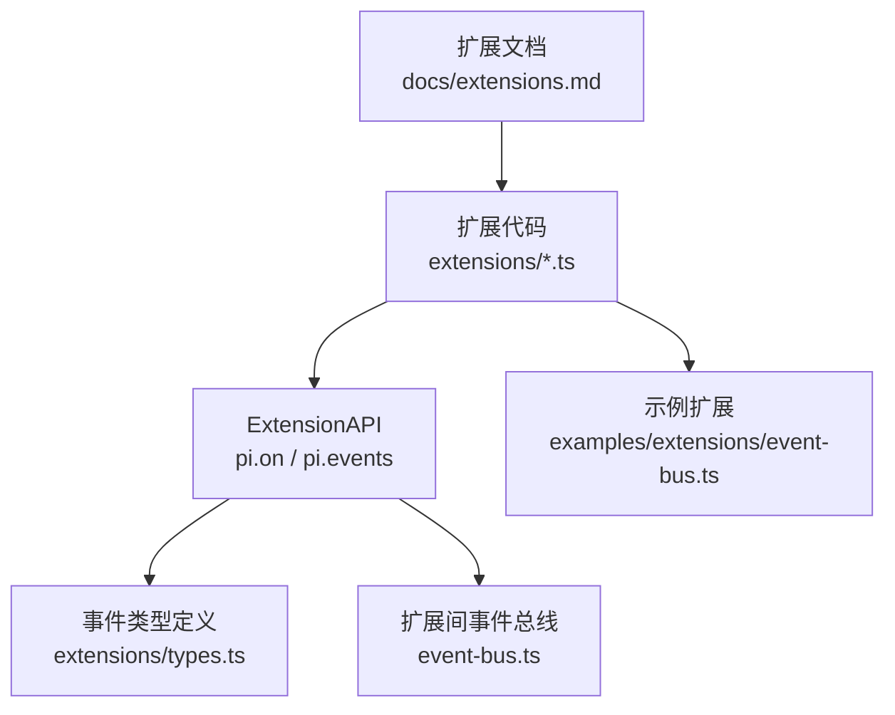
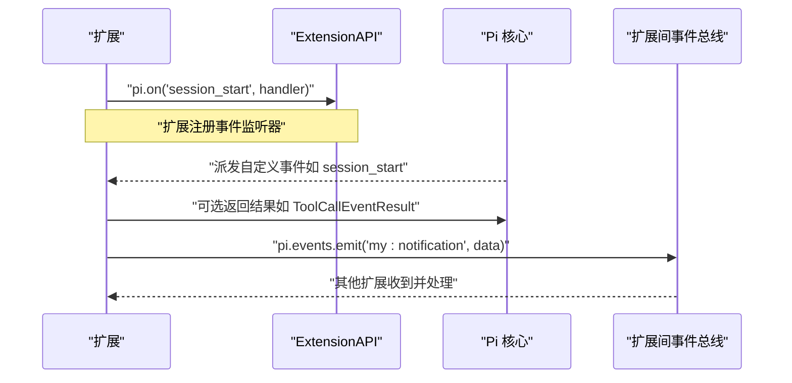
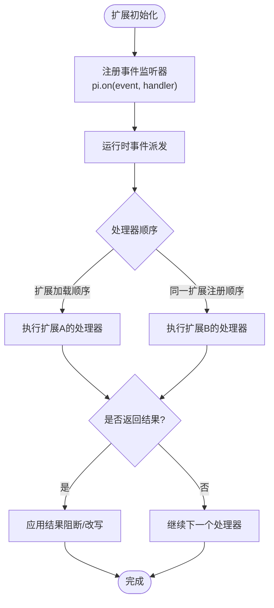
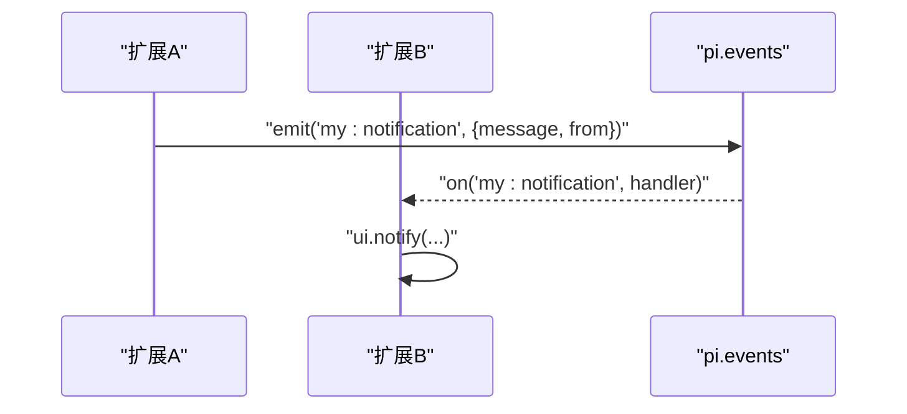
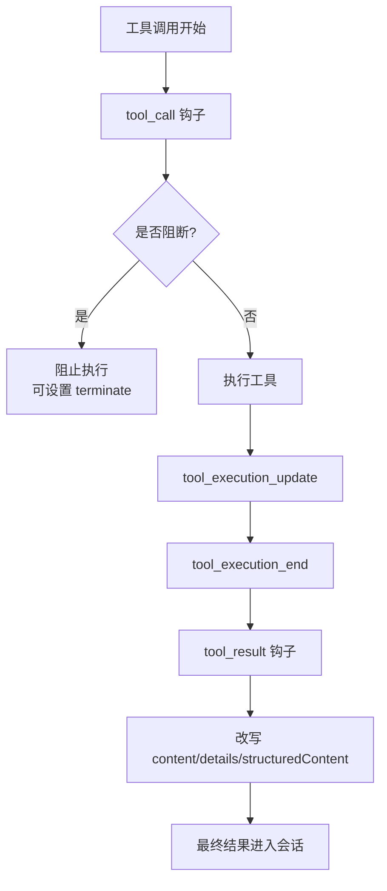
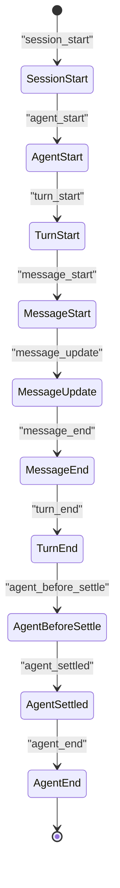
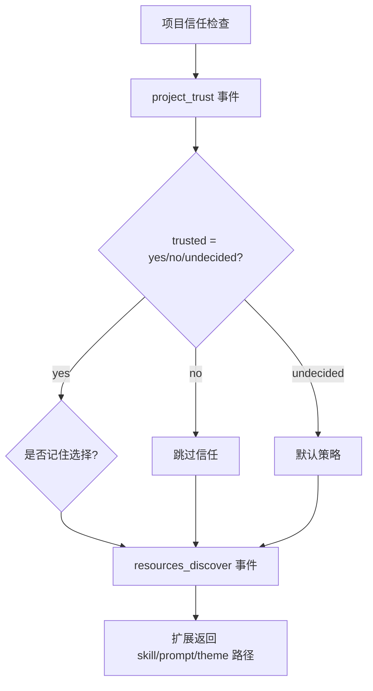
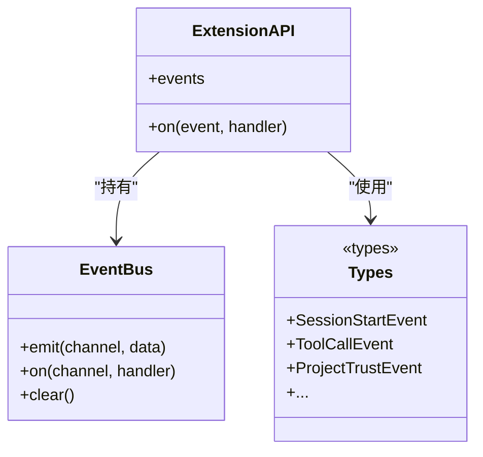
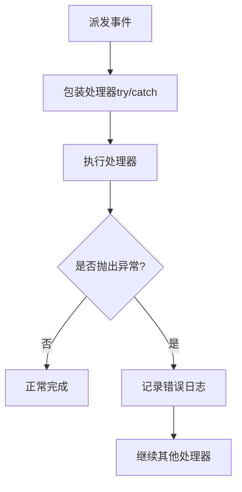

# 事件系统

<cite>
**本文引用的文件**
- [packages/coding-agent/src/core/event-bus.ts](file://packages/coding-agent/src/core/event-bus.ts)
- [packages/coding-agent/examples/extensions/event-bus.ts](file://packages/coding-agent/examples/extensions/event-bus.ts)
- [packages/coding-agent/src/core/extensions/types.ts](file://packages/coding-agent/src/core/extensions/types.ts)
- [packages/coding-agent/docs/extensions.md](file://packages/coding-agent/docs/extensions.md)
- [packages/coding-agent/examples/extensions/README.md](file://packages/coding-agent/examples/extensions/README.md)
</cite>

## 目录
1. [简介](#简介)
2. [项目结构](#项目结构)
3. [核心组件](#核心组件)
4. [架构总览](#架构总览)
5. [详细组件分析](#详细组件分析)
6. [依赖关系分析](#依赖关系分析)
7. [性能与异步处理](#性能与异步处理)
8. [错误处理与调试](#错误处理与调试)
9. [结论](#结论)
10. [附录：预定义事件参考](#附录预定义事件参考)

## 简介
本文件面向扩展开发者，系统性说明 Pi 扩展系统中的事件机制。内容涵盖：
- 事件类型与触发时机
- 监听器注册、分发顺序与返回值语义
- 工具调用相关事件（如 `tool_call`）的拦截、修改与结果改写
- 会话生命周期事件（如 `session_start`）与信任决策事件（如 `project_trust`）
- 扩展间通信总线（`pi.events`）的使用方式
- 最佳实践：异步处理、错误隔离、性能考虑
- 调试与监控方法

## 项目结构
事件系统主要分布在以下位置：
- 扩展 API 与事件类型定义：`packages/coding-agent/src/core/extensions/types.ts`
- 扩展间通信的事件总线实现：`packages/coding-agent/src/core/event-bus.ts`
- 扩展间通信示例：`packages/coding-agent/examples/extensions/event-bus.ts`
- 扩展文档与使用示例：`packages/coding-agent/docs/extensions.md`、`packages/coding-agent/examples/extensions/README.md`

**图表来源**
- [packages/coding-agent/src/core/extensions/types.ts:1637-1966](file://packages/coding-agent/src/core/extensions/types.ts#L1637-L1966)
- [packages/coding-agent/src/core/event-bus.ts:1-34](file://packages/coding-agent/src/core/event-bus.ts#L1-L34)
- [packages/coding-agent/examples/extensions/event-bus.ts:1-44](file://packages/coding-agent/examples/extensions/event-bus.ts#L1-L44)
- [packages/coding-agent/docs/extensions.md:186-211](file://packages/coding-agent/docs/extensions.md#L186-L211)

**章节来源**
- [packages/coding-agent/src/core/extensions/types.ts:1637-1966](file://packages/coding-agent/src/core/extensions/types.ts#L1637-L1966)
- [packages/coding-agent/src/core/event-bus.ts:1-34](file://packages/coding-agent/src/core/event-bus.ts#L1-L34)
- [packages/coding-agent/examples/extensions/event-bus.ts:1-44](file://packages/coding-agent/examples/extensions/event-bus.ts#L1-L44)
- [packages/coding-agent/docs/extensions.md:186-211](file://packages/coding-agent/docs/extensions.md#L186-L211)

## 核心组件
- ExtensionAPI：扩展通过 `pi.on(event, handler)` 订阅事件，并通过 `pi.events` 访问扩展间事件总线。
- EventBus：基于 Node.js `EventEmitter` 的轻量通道，提供 `emit`、`on`、`clear`。
- 事件类型：在 `extensions/types.ts` 中集中定义，包括会话、代理、模型、工具、输入等类别。
- 扩展间通信：通过 `pi.events.emit(channel, data)` 和 `pi.events.on(channel, handler)` 实现跨扩展消息传递。

**章节来源**
- [packages/coding-agent/src/core/extensions/types.ts:1637-1966](file://packages/coding-agent/src/core/extensions/types.ts#L1637-L1966)
- [packages/coding-agent/src/core/event-bus.ts:1-34](file://packages/coding-agent/src/core/event-bus.ts#L1-L34)

## 架构总览
扩展事件系统的整体流程如下：
- 扩展加载时，工厂函数接收 `ExtensionAPI`，可立即注册事件监听器和工具。
- 运行时，Pi 在关键阶段派发事件；所有已注册的处理器按“扩展加载顺序 + 同一扩展内注册顺序”执行。
- 某些事件允许返回结果以改变行为（例如阻止工具调用、替换消息、追加条目）。
- 扩展之间可通过 `pi.events` 进行解耦通信。

**图表来源**
- [packages/coding-agent/src/core/extensions/types.ts:1637-1966](file://packages/coding-agent/src/core/extensions/types.ts#L1637-L1966)
- [packages/coding-agent/examples/extensions/event-bus.ts:16-42](file://packages/coding-agent/examples/extensions/event-bus.ts#L16-L42)

**章节来源**
- [packages/coding-agent/docs/extensions.md:1567-1580](file://packages/coding-agent/docs/extensions.md#L1567-L1580)
- [packages/coding-agent/examples/extensions/event-bus.ts:1-44](file://packages/coding-agent/examples/extensions/event-bus.ts#L1-L44)

## 详细组件分析

### 扩展 API 与事件订阅
- `pi.on(event, handler)`：订阅事件，返回取消订阅函数。
- 处理器签名：`(event, ctx) => Promise<R | void> | R | void`。
- 处理器执行顺序：先按扩展加载顺序，再按同一扩展内的注册顺序。
- 部分事件支持返回结果，用于阻断或改写后续行为。

**图表来源**
- [packages/coding-agent/src/core/extensions/types.ts:1637-1709](file://packages/coding-agent/src/core/extensions/types.ts#L1637-L1709)
- [packages/coding-agent/docs/extensions.md:1567-1580](file://packages/coding-agent/docs/extensions.md#L1567-L1580)

**章节来源**
- [packages/coding-agent/src/core/extensions/types.ts:1637-1709](file://packages/coding-agent/src/core/extensions/types.ts#L1637-L1709)
- [packages/coding-agent/docs/extensions.md:1567-1580](file://packages/coding-agent/docs/extensions.md#L1567-L1580)

### 扩展间事件总线
- `pi.events` 是一个 `EventBus` 实例，提供 `emit`、`on`、`clear`。
- 典型用法：一个扩展在 `session_start` 中发送通知，另一个扩展监听并显示 UI 提示。
- 该总线用于扩展间的解耦通信，不直接参与 Pi 核心事件流。

**图表来源**
- [packages/coding-agent/examples/extensions/event-bus.ts:16-42](file://packages/coding-agent/examples/extensions/event-bus.ts#L16-L42)
- [packages/coding-agent/src/core/event-bus.ts:12-32](file://packages/coding-agent/src/core/event-bus.ts#L12-L32)

**章节来源**
- [packages/coding-agent/examples/extensions/event-bus.ts:1-44](file://packages/coding-agent/examples/extensions/event-bus.ts#L1-L44)
- [packages/coding-agent/src/core/event-bus.ts:1-34](file://packages/coding-agent/src/core/event-bus.ts#L1-L34)

### 工具调用事件与结果改写
- `tool_call`：在工具执行前触发，可阻断或终止当前批次。
- `tool_result`：在工具执行后触发，可改写可见内容与结构化结果。
- 工具执行生命周期事件：`tool_execution_start`、`tool_execution_update`、`tool_execution_end`。
- 类型守卫：`isToolCallEventType` 帮助按工具名窄化事件类型。

**图表来源**
- [packages/coding-agent/src/core/extensions/types.ts:1213-1285](file://packages/coding-agent/src/core/extensions/types.ts#L1213-L1285)
- [packages/coding-agent/src/core/extensions/types.ts:1287-1360](file://packages/coding-agent/src/core/extensions/types.ts#L1287-L1360)
- [packages/coding-agent/src/core/extensions/types.ts:1474-1509](file://packages/coding-agent/src/core/extensions/types.ts#L1474-L1509)

**章节来源**
- [packages/coding-agent/src/core/extensions/types.ts:1213-1285](file://packages/coding-agent/src/core/extensions/types.ts#L1213-L1285)
- [packages/coding-agent/src/core/extensions/types.ts:1287-1360](file://packages/coding-agent/src/core/extensions/types.ts#L1287-L1360)
- [packages/coding-agent/src/core/extensions/types.ts:1474-1509](file://packages/coding-agent/src/core/extensions/types.ts#L1474-L1509)

### 会话与代理生命周期事件
- `session_start`：会话启动、加载或重载时触发，包含原因字段。
- `agent_start` / `agent_end`：代理循环开始与结束。
- `turn_start` / `turn_end`：每轮对话的开始与结束。
- `message_start` / `message_update` / `message_end`：消息流式更新的生命周期。
- `agent_before_settle` / `agent_settled`：最终结算前后，可用于追加条目或触发命令。

**图表来源**
- [packages/coding-agent/src/core/extensions/types.ts:774-892](file://packages/coding-agent/src/core/extensions/types.ts#L774-L892)
- [packages/coding-agent/src/core/extensions/types.ts:952-1092](file://packages/coding-agent/src/core/extensions/types.ts#L952-L1092)
- [packages/coding-agent/src/core/extensions/types.ts:1094-1145](file://packages/coding-agent/src/core/extensions/types.ts#L1094-L1145)

**章节来源**
- [packages/coding-agent/src/core/extensions/types.ts:774-892](file://packages/coding-agent/src/core/extensions/types.ts#L774-L892)
- [packages/coding-agent/src/core/extensions/types.ts:952-1092](file://packages/coding-agent/src/core/extensions/types.ts#L952-L1092)
- [packages/coding-agent/src/core/extensions/types.ts:1094-1145](file://packages/coding-agent/src/core/extensions/types.ts#L1094-L1145)

### 信任与资源发现事件
- `project_trust`：在项目信任决策阶段触发，扩展可决定信任状态并可记忆选择。
- `resources_discover`：在会话启动后允许扩展提供额外资源路径（技能、提示、主题）。

**图表来源**
- [packages/coding-agent/src/core/extensions/types.ts:720-742](file://packages/coding-agent/src/core/extensions/types.ts#L720-L742)
- [packages/coding-agent/src/core/extensions/types.ts:744-756](file://packages/coding-agent/src/core/extensions/types.ts#L744-L756)

**章节来源**
- [packages/coding-agent/src/core/extensions/types.ts:720-756](file://packages/coding-agent/src/core/extensions/types.ts#L720-L756)

## 依赖关系分析
- `ExtensionAPI` 暴露事件订阅与扩展间事件总线。
- `EventBus` 封装 Node.js `EventEmitter`，为扩展间通信提供安全异步调用与清理能力。
- 事件类型集中在 `extensions/types.ts`，被扩展与核心逻辑共同引用。
- 示例扩展演示了 `session_start` 与 `pi.events` 的组合用法。

**图表来源**
- [packages/coding-agent/src/core/extensions/types.ts:1637-1966](file://packages/coding-agent/src/core/extensions/types.ts#L1637-L1966)
- [packages/coding-agent/src/core/event-bus.ts:1-34](file://packages/coding-agent/src/core/event-bus.ts#L1-L34)

**章节来源**
- [packages/coding-agent/src/core/extensions/types.ts:1637-1966](file://packages/coding-agent/src/core/extensions/types.ts#L1637-L1966)
- [packages/coding-agent/src/core/event-bus.ts:1-34](file://packages/coding-agent/src/core/event-bus.ts#L1-L34)

## 性能与异步处理
- 处理器可以是同步或异步；异步处理器会被等待，但不会阻塞同一次派发中的其他处理器。
- 避免在高频事件（如 `message_update`、`provider_stream_event`）中进行昂贵操作。
- 对 I/O 密集任务使用微任务或队列，避免阻塞主事件循环。
- 使用 `pi.events` 进行扩展间通信时，注意消息体积与频率，避免广播风暴。
- 在 `tool_call` 钩子中做快速校验，复杂逻辑应下沉到工具实现或后台任务。

[本节为通用指导，不直接分析具体文件]

## 错误处理与调试
- 事件总线对处理器异常进行捕获并打印错误日志，防止单个处理器崩溃影响其他处理器。
- 建议在处理器中使用 try/catch 包裹外部调用，记录上下文信息以便定位问题。
- 对于需要长期运行的监听器，确保在扩展卸载或会话切换时正确取消订阅。
- 使用 `agent_settled` 统一收尾工作，例如发送命令触发运行时重载。

**图表来源**
- [packages/coding-agent/src/core/event-bus.ts:18-27](file://packages/coding-agent/src/core/event-bus.ts#L18-L27)

**章节来源**
- [packages/coding-agent/src/core/event-bus.ts:1-34](file://packages/coding-agent/src/core/event-bus.ts#L1-L34)
- [packages/coding-agent/docs/extensions.md:1538-1565](file://packages/coding-agent/docs/extensions.md#L1538-L1565)

## 结论
Pi 扩展系统的事件机制提供了强大的扩展点，覆盖从会话生命周期、代理运行、模型交互到工具调用的全链路。通过 `pi.on` 订阅事件、通过 `pi.events` 进行扩展间通信，开发者可以构建灵活、解耦且可观测的扩展生态。遵循异步处理、错误隔离与性能优化的最佳实践，能够显著提升扩展的稳定性和用户体验。

[本节为总结性内容，不直接分析具体文件]

## 附录：预定义事件参考

### 会话与信任类事件
- `project_trust`：项目信任决策，返回 `trusted` 与可选 `remember`。
- `resources_discover`：资源发现，返回技能、提示、主题路径。
- `session_start`：会话启动/加载/重载，包含 `reason` 与 `previousSessionFile`。
- `session_info_changed`：会话元数据变化。
- `session_before_switch` / `session_before_fork`：可取消的会话切换/分叉前事件。
- `session_before_compact` / `session_compact` / `session_compact_failed`：上下文压缩前后及失败事件。
- `session_shutdown`：会话关闭前事件。
- `session_before_tree` / `session_tree`：会话树导航前后事件。

**章节来源**
- [packages/coding-agent/src/core/extensions/types.ts:720-892](file://packages/coding-agent/src/core/extensions/types.ts#L720-L892)

### 代理与消息类事件
- `before_agent_start`：每次 LLM 调用前，可替换自定义消息或系统提示。
- `agent_start` / `agent_end`：代理循环开始与结束。
- `agent_before_settle` / `agent_settled`：最终结算前后，可追加条目或控制继续。
- `ui_prompt_start` / `ui_prompt_end`：UI 阻塞提示开始与结束。
- `turn_start` / `turn_end`：每轮对话开始与结束。
- `message_start` / `message_update` / `message_end`：消息流式生命周期。

**章节来源**
- [packages/coding-agent/src/core/extensions/types.ts:952-1145](file://packages/coding-agent/src/core/extensions/types.ts#L952-L1145)

### 模型与用户输入类事件
- `model_select`：模型选择变更。
- `thinking_level_select`：思考级别选择变更。
- `user_bash`：用户执行 bash 命令。
- `input`：用户输入接收，可转换或接管处理。

**章节来源**
- [packages/coding-agent/src/core/extensions/types.ts:1147-1207](file://packages/coding-agent/src/core/extensions/types.ts#L1147-L1207)

### 工具调用与结果类事件
- `tool_call`：工具执行前，可阻断或建议终止。
- `tool_result`：工具执行后，可改写内容、详情与结构化结果。
- `tool_execution_start` / `tool_execution_update` / `tool_execution_end`：工具执行生命周期。

**章节来源**
- [packages/coding-agent/src/core/extensions/types.ts:1213-1360](file://packages/coding-agent/src/core/extensions/types.ts#L1213-L1360)
- [packages/coding-agent/src/core/extensions/types.ts:1474-1509](file://packages/coding-agent/src/core/extensions/types.ts#L1474-L1509)

### 扩展间通信示例
- 示例扩展展示了在 `session_start` 中发送通知，并在另一处监听通知并显示 UI。
- 该模式适用于跨扩展的状态同步与用户反馈。

**章节来源**
- [packages/coding-agent/examples/extensions/event-bus.ts:1-44](file://packages/coding-agent/examples/extensions/event-bus.ts#L1-L44)
- [packages/coding-agent/examples/extensions/README.md:198-216](file://packages/coding-agent/examples/extensions/README.md#L198-L216)