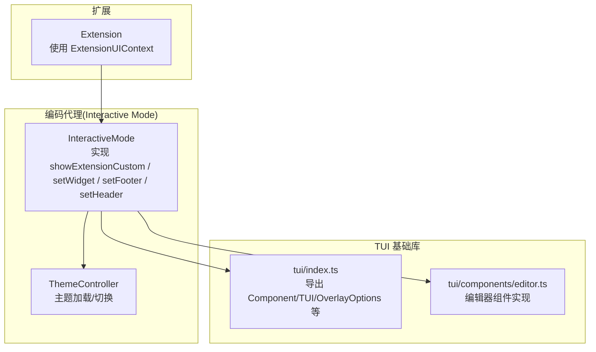
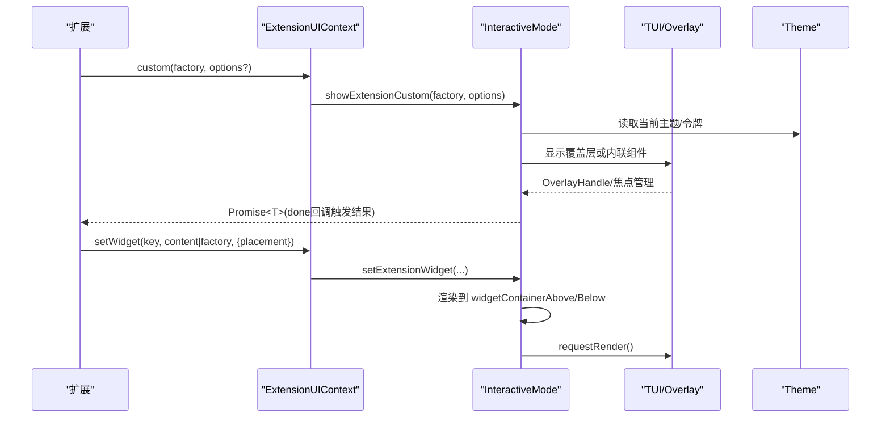
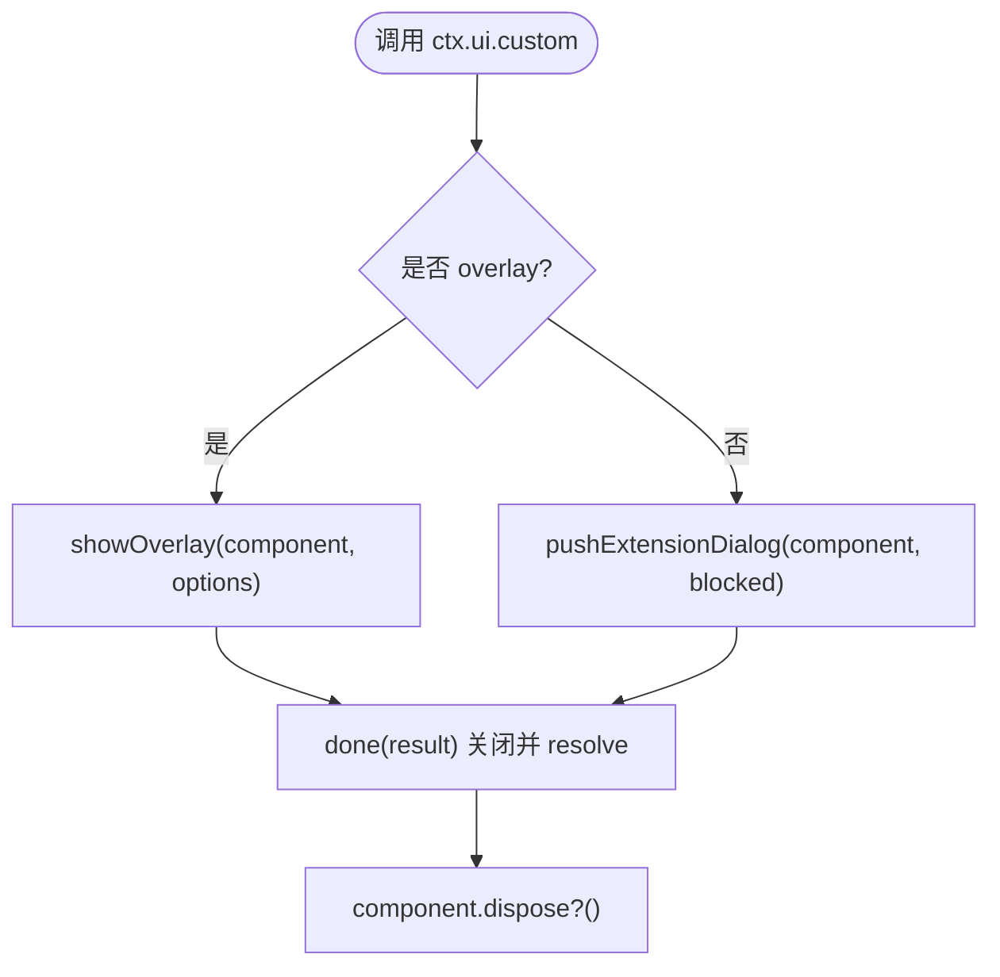
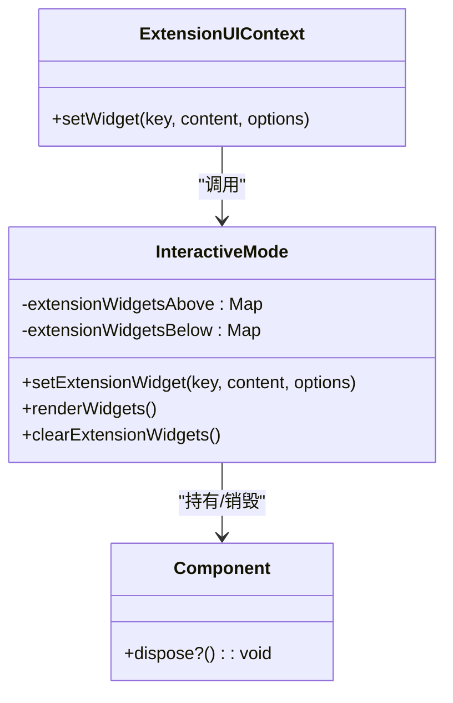
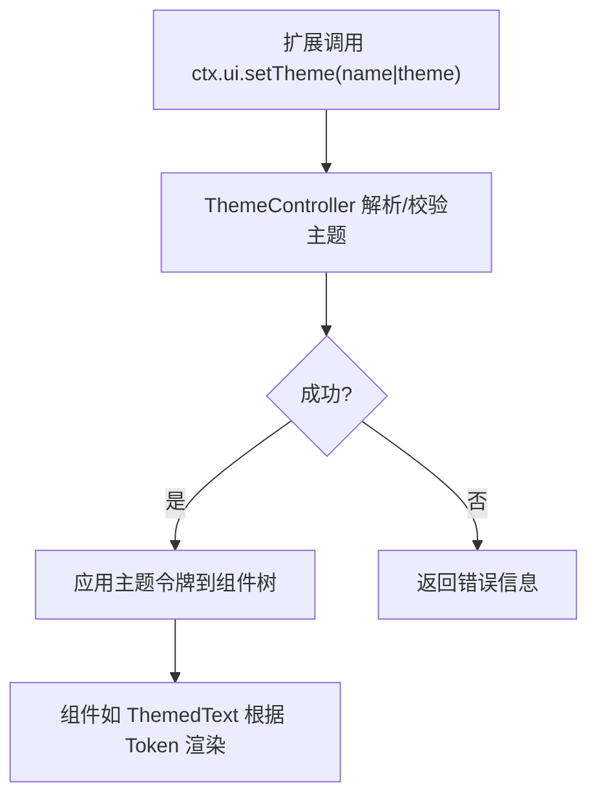
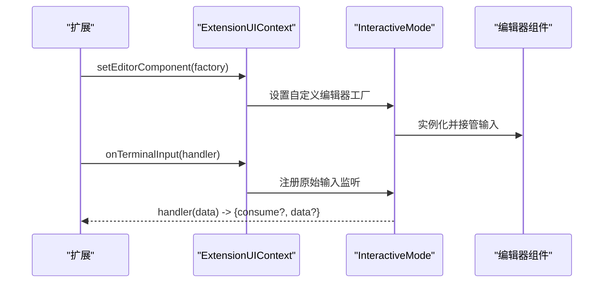
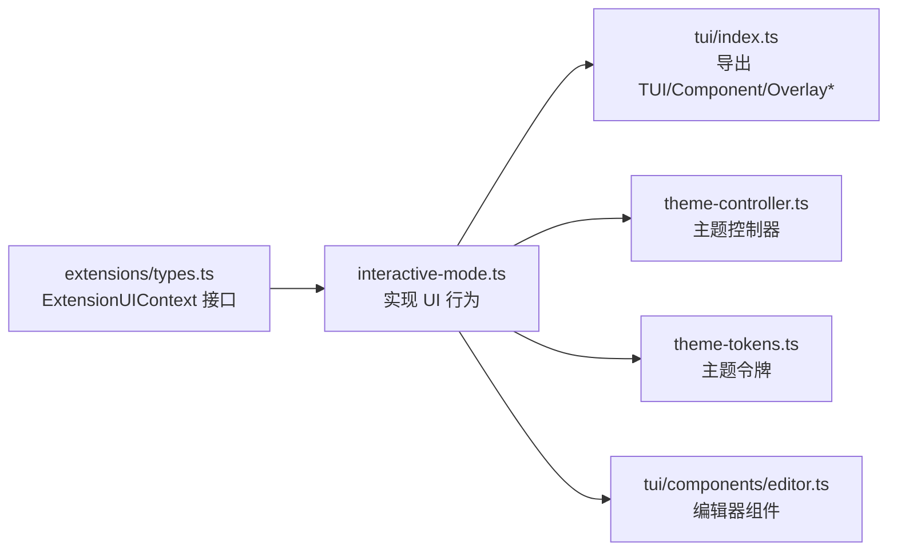

# UI集成与定制

<cite>
**本文引用的文件**   
- [packages/coding-agent/src/core/extensions/types.ts](file://packages/coding-agent/src/core/extensions/types.ts)
- [packages/coding-agent/src/modes/interactive/interactive-mode.ts](file://packages/coding-agent/src/modes/interactive/interactive-mode.ts)
- [packages/tui/src/index.ts](file://packages/tui/src/index.ts)
- [packages/tui/src/components/editor.ts](file://packages/tui/src/components/editor.ts)
- [packages/coding-agent/src/modes/interactive/theme/theme-controller.ts](file://packages/coding-agent/src/modes/interactive/theme/theme-controller.ts)
- [packages/coding-agent/src/modes/interactive/theme/theme-tokens.ts](file://packages/coding-agent/src/modes/interactive/theme/theme-tokens.ts)
- [packages/coding-agent/src/modes/interactive/components/themed-text.ts](file://packages/coding-agent/src/modes/interactive/components/themed-text.ts)
- [packages/coding-agent/examples/rpc-extension-ui.ts](file://packages/coding-agent/examples/rpc-extension-ui.ts)
</cite>

## 目录
1. [简介](#简介)
2. [项目结构](#项目结构)
3. [核心组件](#核心组件)
4. [架构总览](#架构总览)
5. [详细组件分析](#详细组件分析)
6. [依赖关系分析](#依赖关系分析)
7. [性能考虑](#性能考虑)
8. [故障排查指南](#故障排查指南)
9. [结论](#结论)
10. [附录](#附录)

## 简介
本指南面向扩展开发者，系统讲解如何通过 ExtensionUIContext 创建自定义用户界面组件（对话框、通知、状态栏等），并深入说明 Widget 的创建与配置（位置 placement、工厂函数、生命周期）、主题系统集成（获取、切换、样式定制）、以及完整的 UI 定制示例（自定义编辑器、终端输入处理、交互式组件）。同时提供响应式设计与可访问性建议，帮助你在 TUI 环境中构建高质量、可维护且易用的交互体验。

## 项目结构
本项目在 packages/tui 中提供基础 TUI 能力（组件、布局、键盘、颜色、图像等），在 packages/coding-agent 中通过 ExtensionUIContext 暴露扩展可用的 UI 能力，并在 interactive mode 中实现具体行为（对话框、覆盖层、工作指示器、Widget 渲染、主题管理等）。

**图表来源**
- [packages/coding-agent/src/modes/interactive/interactive-mode.ts:2521-2656](file://packages/coding-agent/src/modes/interactive/interactive-mode.ts#L2521-L2656)
- [packages/tui/src/index.ts:158-186](file://packages/tui/src/index.ts#L158-L186)
- [packages/coding-agent/src/modes/interactive/theme/theme-controller.ts:58-120](file://packages/coding-agent/src/modes/interactive/theme/theme-controller.ts#L58-L120)

**章节来源**
- [packages/tui/src/index.ts:1-198](file://packages/tui/src/index.ts#L1-L198)
- [packages/coding-agent/src/modes/interactive/interactive-mode.ts:2521-2656](file://packages/coding-agent/src/modes/interactive/interactive-mode.ts#L2521-L2656)

## 核心组件
- ExtensionUIContext：扩展与宿主 UI 的契约，提供 select/confirm/input/notify/custom/setWidget/setFooter/setHeader/editor 等方法，以及主题与编辑器替换能力。
- InteractiveMode：ExtensionUIContext 的具体实现之一，负责对话框、覆盖层、工作指示器、Widget 容器、状态栏等。
- TUI 基础类型：Component、TUI、OverlayOptions、OverlayHandle、EditorComponent 等，由 tui 包统一导出。
- Theme 系统：ThemeController、ThemeTokens、ThemedText 等，用于主题解析、令牌映射与组件级主题化渲染。

**章节来源**
- [packages/coding-agent/src/core/extensions/types.ts:115-320](file://packages/coding-agent/src/core/extensions/types.ts#L115-L320)
- [packages/tui/src/index.ts:158-186](file://packages/tui/src/index.ts#L158-L186)
- [packages/coding-agent/src/modes/interactive/theme/theme-controller.ts:58-120](file://packages/coding-agent/src/modes/interactive/theme/theme-controller.ts#L58-L120)
- [packages/coding-agent/src/modes/interactive/theme/theme-tokens.ts:24-121](file://packages/coding-agent/src/modes/interactive/theme/theme-tokens.ts#L24-L121)

## 架构总览
下图展示扩展通过 ExtensionUIContext 调用 UI 能力的典型流程，包括对话框、覆盖层、Widget 与主题系统。

**图表来源**
- [packages/coding-agent/src/core/extensions/types.ts:228-248](file://packages/coding-agent/src/core/extensions/types.ts#L228-L248)
- [packages/coding-agent/src/modes/interactive/interactive-mode.ts:3054-3129](file://packages/coding-agent/src/modes/interactive/interactive-mode.ts#L3054-L3129)
- [packages/coding-agent/src/modes/interactive/interactive-mode.ts:2521-2656](file://packages/coding-agent/src/modes/interactive/interactive-mode.ts#L2521-L2656)

## 详细组件分析

### 通过 ExtensionUIContext 创建对话框与通知
- 选择/确认/输入：select/confirm/input 返回 Promise，支持超时与取消信号。
- 通知：notify(message, type) 将信息以 info/warning/error 形式呈现。
- 自定义组件：custom(factory, options) 支持覆盖层 overlay 与内联模式，支持动态 overlayOptions、onHandle 控制可见性，以及 blocked 状态上报。

**图表来源**
- [packages/coding-agent/src/modes/interactive/interactive-mode.ts:3054-3129](file://packages/coding-agent/src/modes/interactive/interactive-mode.ts#L3054-L3129)

**章节来源**
- [packages/coding-agent/src/core/extensions/types.ts:164-248](file://packages/coding-agent/src/core/extensions/types.ts#L164-L248)
- [packages/coding-agent/src/modes/interactive/interactive-mode.ts:3054-3129](file://packages/coding-agent/src/modes/interactive/interactive-mode.ts#L3054-L3129)

### Widget 创建与配置（placement、工厂函数、生命周期）
- 位置 placement：aboveEditor/belowEditor，通过 ExtensionWidgetOptions.placement 指定。
- 内容 content：可以是字符串数组（自动包装为 Text 列表）或工厂函数 (tui, theme) => Component & { dispose? }。
- 生命周期：当更新或清除时，会调用已有组件的 dispose()；清空时会遍历清理所有已注册 Widget。

**图表来源**
- [packages/coding-agent/src/core/extensions/types.ts:123-130](file://packages/coding-agent/src/core/extensions/types.ts#L123-L130)
- [packages/coding-agent/src/core/extensions/types.ts:202-208](file://packages/coding-agent/src/core/extensions/types.ts#L202-L208)
- [packages/coding-agent/src/modes/interactive/interactive-mode.ts:2521-2656](file://packages/coding-agent/src/modes/interactive/interactive-mode.ts#L2521-L2656)

**章节来源**
- [packages/coding-agent/src/core/extensions/types.ts:123-130](file://packages/coding-agent/src/core/extensions/types.ts#L123-L130)
- [packages/coding-agent/src/core/extensions/types.ts:202-208](file://packages/coding-agent/src/core/extensions/types.ts#L202-L208)
- [packages/coding-agent/src/modes/interactive/interactive-mode.ts:2521-2656](file://packages/coding-agent/src/modes/interactive/interactive-mode.ts#L2521-L2656)

### 主题系统集成（获取、切换、自定义样式）
- 获取主题：ctx.ui.theme 直接读取当前主题；getAllThemes() 列出可用主题；getTheme(name) 按名称加载。
- 切换主题：setTheme(themeNameOrObject) 返回 success/error。
- 组件级主题化：使用 ThemedText 等组件基于 ThemeToken 进行着色；ThemeTokens 定义令牌集合，ThemeController 负责加载与切换。

**图表来源**
- [packages/coding-agent/src/core/extensions/types.ts:303-313](file://packages/coding-agent/src/core/extensions/types.ts#L303-L313)
- [packages/coding-agent/src/modes/interactive/theme/theme-controller.ts:58-120](file://packages/coding-agent/src/modes/interactive/theme/theme-controller.ts#L58-L120)
- [packages/coding-agent/src/modes/interactive/theme/theme-tokens.ts:24-121](file://packages/coding-agent/src/modes/interactive/theme/theme-tokens.ts#L24-L121)
- [packages/coding-agent/src/modes/interactive/components/themed-text.ts:11-40](file://packages/coding-agent/src/modes/interactive/components/themed-text.ts#L11-L40)

**章节来源**
- [packages/coding-agent/src/core/extensions/types.ts:303-313](file://packages/coding-agent/src/core/extensions/types.ts#L303-L313)
- [packages/coding-agent/src/modes/interactive/theme/theme-controller.ts:58-120](file://packages/coding-agent/src/modes/interactive/theme/theme-controller.ts#L58-L120)
- [packages/coding-agent/src/modes/interactive/theme/theme-tokens.ts:24-121](file://packages/coding-agent/src/modes/interactive/theme/theme-tokens.ts#L24-L121)
- [packages/coding-agent/src/modes/interactive/components/themed-text.ts:11-40](file://packages/coding-agent/src/modes/interactive/components/themed-text.ts#L11-L40)

### 自定义编辑器与终端输入处理
- 自定义编辑器：通过 ctx.ui.setEditorComponent(factory) 替换默认编辑器，factory 接收 TUI、EditorTheme、KeybindingsManager。推荐继承 CustomEditor 以复用应用级快捷键。
- 终端输入监听：ctx.ui.onTerminalInput(handler) 可在交互模式下监听原始终端输入，返回取消订阅函数。
- 编辑器文本操作：pasteToEditor/setEditorText/getEditorText 提供对核心输入编辑器的读写。

**图表来源**
- [packages/coding-agent/src/core/extensions/types.ts:265-301](file://packages/coding-agent/src/core/extensions/types.ts#L265-L301)
- [packages/coding-agent/src/core/extensions/types.ts:177-178](file://packages/coding-agent/src/core/extensions/types.ts#L177-L178)
- [packages/tui/src/components/editor.ts:1-200](file://packages/tui/src/components/editor.ts#L1-L200)

**章节来源**
- [packages/coding-agent/src/core/extensions/types.ts:265-301](file://packages/coding-agent/src/core/extensions/types.ts#L265-L301)
- [packages/coding-agent/src/core/extensions/types.ts:177-178](file://packages/coding-agent/src/core/extensions/types.ts#L177-L178)
- [packages/tui/src/components/editor.ts:1-200](file://packages/tui/src/components/editor.ts#L1-L200)

### 交互式组件开发示例（RPC 场景）
- RPC 扩展 UI 示例展示了如何在工作流中显示通知、更新 Widget 行、处理斜杠命令（选择/确认）并刷新渲染。
- 该示例体现了在异步事件驱动场景中，结合 TUI.requestRender() 与 UI 上下文进行状态同步的最佳实践。

**章节来源**
- [packages/coding-agent/examples/rpc-extension-ui.ts:450-490](file://packages/coding-agent/examples/rpc-extension-ui.ts#L450-L490)

## 依赖关系分析
- ExtensionUIContext 作为抽象契约，被 InteractiveMode 实现，向上暴露给扩展。
- InteractiveMode 依赖 TUI 基础类型（Component、OverlayOptions、OverlayHandle、TUI）与主题系统（Theme、ThemeController、ThemeTokens）。
- 编辑器相关逻辑依赖 tui/components/editor.ts 提供的编辑器能力。

**图表来源**
- [packages/coding-agent/src/core/extensions/types.ts:164-320](file://packages/coding-agent/src/core/extensions/types.ts#L164-L320)
- [packages/coding-agent/src/modes/interactive/interactive-mode.ts:2521-2656](file://packages/coding-agent/src/modes/interactive/interactive-mode.ts#L2521-L2656)
- [packages/tui/src/index.ts:158-186](file://packages/tui/src/index.ts#L158-L186)
- [packages/coding-agent/src/modes/interactive/theme/theme-controller.ts:58-120](file://packages/coding-agent/src/modes/interactive/theme/theme-controller.ts#L58-L120)
- [packages/coding-agent/src/modes/interactive/theme/theme-tokens.ts:24-121](file://packages/coding-agent/src/modes/interactive/theme/theme-tokens.ts#L24-L121)
- [packages/tui/src/components/editor.ts:1-200](file://packages/tui/src/components/editor.ts#L1-L200)

**章节来源**
- [packages/coding-agent/src/core/extensions/types.ts:164-320](file://packages/coding-agent/src/core/extensions/types.ts#L164-L320)
- [packages/coding-agent/src/modes/interactive/interactive-mode.ts:2521-2656](file://packages/coding-agent/src/modes/interactive/interactive-mode.ts#L2521-L2656)
- [packages/tui/src/index.ts:158-186](file://packages/tui/src/index.ts#L158-L186)

## 性能考虑
- Widget 行数限制：InteractiveMode 对 Widget 总行数做了上限控制，避免视口溢出。
- 渲染频率：在频繁更新的 UI（如倒计时、进度条）中，应仅在必要时调用 requestRender，避免过度重绘。
- 组件销毁：确保在 dispose 中清理定时器、事件监听与子节点，防止内存泄漏。
- 主题切换：批量更新主题后一次性请求渲染，减少多次重绘开销。

[本节为通用指导，不直接分析具体文件]

## 故障排查指南
- 自定义组件未释放：检查组件是否实现了 dispose 并在 close/overlay.hide 路径中被调用。
- 覆盖层不可见：确认 overlayOptions 是否正确传入，必要时通过 onHandle 控制可见性。
- 主题未生效：确认 setTheme 返回值 success 为 true，并使用 ThemedText 等组件消费主题令牌。
- 编辑器输入异常：若替换了编辑器，请确保正确处理应用级快捷键（如 escape、ctrl+d），必要时继承 CustomEditor 并调用 super.handleInput。

**章节来源**
- [packages/coding-agent/src/modes/interactive/interactive-mode.ts:3054-3129](file://packages/coding-agent/src/modes/interactive/interactive-mode.ts#L3054-L3129)
- [packages/coding-agent/src/core/extensions/types.ts:265-301](file://packages/coding-agent/src/core/extensions/types.ts#L265-L301)

## 结论
通过 ExtensionUIContext，扩展可以安全地创建对话框、通知、状态栏与自定义 Widget，并与 TUI 基础能力与主题系统无缝集成。遵循工厂函数与生命周期约定、合理使用 overlay 与 placement、以及采用主题令牌进行样式定制，能够构建出高性能、可维护且用户体验良好的 TUI 界面。

[本节为总结性内容，不直接分析具体文件]

## 附录
- 最佳实践清单
  - 始终在组件 dispose 中清理资源。
  - 使用 ThemedText 等组件消费主题令牌，避免硬编码颜色。
  - 在高频更新场景中节流 requestRender。
  - 使用 overlayOptions 动态计算尺寸，适配不同终端宽度。
  - 替换编辑器时继承 CustomEditor 以复用应用级快捷键。

[本节为补充建议，不直接分析具体文件]