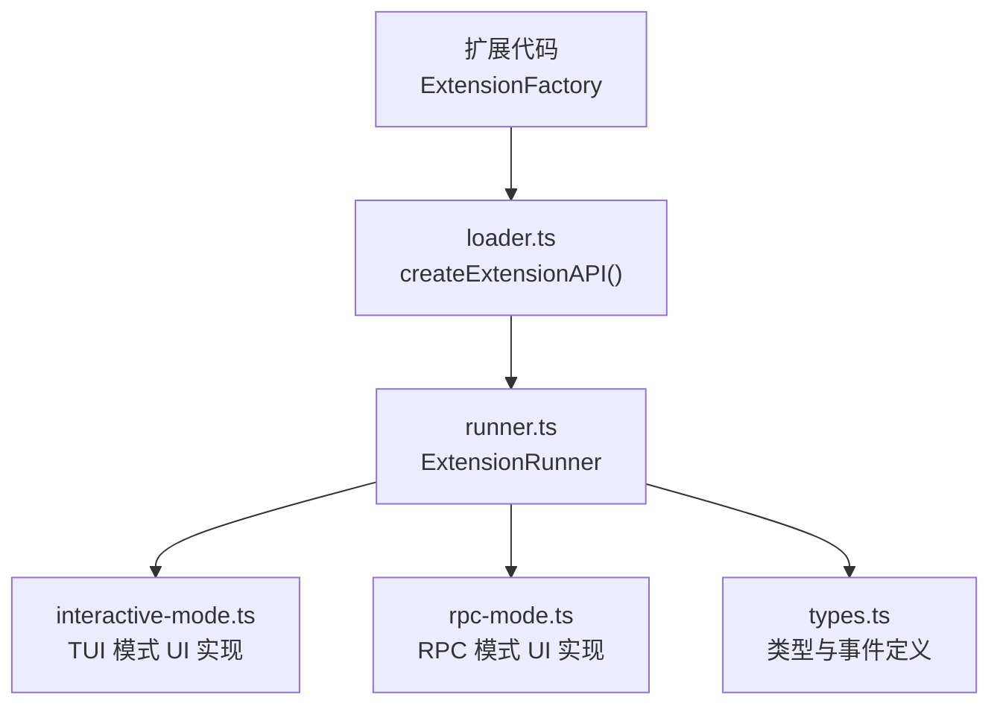
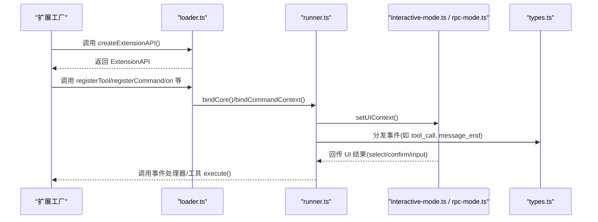

# 扩展API参考

<cite>
**本文引用的文件**
- [types.ts](file://packages/coding-agent/src/core/extensions/types.ts)
- [loader.ts](file://packages/coding-agent/src/core/extensions/loader.ts)
- [runner.ts](file://packages/coding-agent/src/core/extensions/runner.ts)
- [rpc-mode.ts](file://packages/coding-agent/src/modes/rpc/rpc-mode.ts)
- [interactive-mode.ts](file://packages/coding-agent/src/modes/interactive/interactive-mode.ts)
</cite>

## 目录
1. [简介](#简介)
2. [项目结构](#项目结构)
3. [核心组件](#核心组件)
4. [架构总览](#架构总览)
5. [详细组件分析](#详细组件分析)
6. [依赖关系分析](#依赖关系分析)
7. [性能与行为特性](#性能与行为特性)
8. [故障排查指南](#故障排查指南)
9. [结论](#结论)
10. [附录：API速查表](#附录api速查表)

## 简介
本参考文档面向扩展开发者，系统化说明扩展系统对外暴露的 API，包括：
- ExtensionAPI：扩展注册与运行时能力（工具、命令、事件、MCP、虚拟模型等）
- ExtensionContext：扩展上下文（会话、模型、UI、执行状态等）
- ExtensionUIContext：扩展 UI 交互能力（对话框、通知、工作区状态、主题、编辑器等）
- ExtensionToolContext / ExtensionCommandContext：工具与命令扩展上下文

文档同时给出关键实现位置、调用时序、错误处理与最佳实践建议。

## 项目结构
扩展系统主要位于 coding-agent 包中，核心由以下模块组成：
- types.ts：定义所有扩展相关类型、接口与事件
- loader.ts：加载扩展模块并创建 ExtensionAPI
- runner.ts：运行扩展、绑定上下文、分发事件、管理生命周期
- rpc-mode.ts：RPC 模式下的 ExtensionUIContext 实现
- interactive-mode.ts：交互式 TUI 模式下的 ExtensionUIContext 实现

图表来源
- [loader.ts:253-540](file://packages/coding-agent/src/core/extensions/loader.ts#L253-L540)
- [runner.ts:364-575](file://packages/coding-agent/src/core/extensions/runner.ts#L364-L575)
- [rpc-mode.ts:140-299](file://packages/coding-agent/src/modes/rpc/rpc-mode.ts#L140-L299)
- [interactive-mode.ts:2757-2809](file://packages/coding-agent/src/modes/interactive/interactive-mode.ts#L2757-L2809)
- [types.ts:160-320](file://packages/coding-agent/src/core/extensions/types.ts#L160-L320)

章节来源
- [loader.ts:1-800](file://packages/coding-agent/src/core/extensions/loader.ts#L1-L800)
- [runner.ts:1-800](file://packages/coding-agent/src/core/extensions/runner.ts#L1-L800)
- [types.ts:1-800](file://packages/coding-agent/src/core/extensions/types.ts#L1-L800)

## 核心组件
本节聚焦三类核心对象：
- ExtensionAPI：扩展在初始化阶段调用的注册与运行时访问 API
- ExtensionContext：扩展在执行期获取的运行上下文
- ExtensionUIContext：扩展用于与用户交互的 UI 能力

### ExtensionAPI
ExtensionAPI 是扩展工厂函数接收的参数，提供：
- 事件订阅：on(event, handler)
- 工具注册：registerTool(toolDefinition)
- 命令注册：registerCommand(name, options)
- 快捷键注册：registerShortcut(shortcut, options)
- 标志位注册与读取：registerFlag/getFlag
- 消息渲染器与 Markdown 转换器：registerMessageRenderer/registerMarkdownTransformer
- 条目渲染器与工具渲染器：registerEntryRenderer/registerToolRenderer
- 运行时动作：sendMessage/sendUserMessage/appendEntry/setSessionName/getSessionName/setLabel/exec/getActiveTools/getAllTools/getSettings/setActiveTools/getCommands/setModel/getThinkingLevel/setThinkingLevel
- 提供者与虚拟模型：registerProvider/unregisterProvider/registerVirtualModel/unregisterVirtualModel
- MCP 服务器：registerMcpServer/unregisterMcpServer/getMcpServers
- 内部事件总线：events.emit/events.on

参数与返回值要点：
- on(event, handler)：返回取消订阅函数；handler 可异步
- registerTool(toolDefinition)：toolDefinition.parameters 必须为对象 schema；注册后刷新工具集
- registerCommand(name, options)：name 非空字符串；options.handler 必须为函数
- registerFlag(name, options)：default 类型需匹配 type；支持 loading 阶段延迟提交
- exec(command, args, options)：基于当前 cwd 执行命令
- registerProvider/registerNativeProvider：支持在加载阶段排队，bindCore 时统一生效
- registerMcpServer：校验配置、冲突检测、克隆配置、记录 owner
- events.emit/events.on：通过 EventBus 广播，on 返回取消订阅

错误处理：
- 未激活或已失效扩展调用会抛出“扩展已失败”或“运行时未初始化”错误
- 工具 parameters 非对象会抛错
- 命令 name/handler 不合法会抛错
- Flag default 类型不匹配会抛错
- MCP server 重复注册或命名冲突会抛错

章节来源
- [loader.ts:253-540](file://packages/coding-agent/src/core/extensions/loader.ts#L253-L540)
- [loader.ts:160-244](file://packages/coding-agent/src/core/extensions/loader.ts#L160-L244)

### ExtensionContext
ExtensionContext 提供给扩展的事件处理器和工具执行环境，包含：
- ui：ExtensionUIContext
- mode：扩展运行模式（tui/rpc/json/print）
- hasUI：是否具备对话框能力
- cwd：当前工作目录
- sessionManager：只读会话管理器
- modelRegistry：模型注册表
- model：当前模型（可能为空）
- scopedModels：会话级可用模型快照
- thinkingLevel：思考级别（可选）
- isIdle/isProjectTrusted/signal/abort：执行状态控制
- hasPendingMessages/shutdown：队列与退出
- getContextUsage/compact：上下文使用与压缩
- getSystemPrompt：获取系统提示词

注意：
- 在会话替换或重载后，旧 ctx 会被标记为过期，继续使用会抛错
- 新会话回调应使用 ReplacedSessionContext 提供的 withSession(ctx) 中的 ctx

章节来源
- [types.ts:322-385](file://packages/coding-agent/src/core/extensions/types.ts#L322-L385)
- [runner.ts:887-943](file://packages/coding-agent/src/core/extensions/runner.ts#L887-L943)
- [loader.ts:160-244](file://packages/coding-agent/src/core/extensions/loader.ts#L160-L244)

### ExtensionUIContext
ExtensionUIContext 提供扩展与用户的交互能力，按模式有不同实现：
- 通用方法：select/confirm/input/notify/onTerminalInput
- 状态与工作区：setStatus/setWorkingMessage/setWorkingVisible/setWorkingIndicator/setHiddenThinkingLabel
- 布局与组件：setWidget/setFooter/setHeader/setTitle/custom/pasteToEditor
- 编辑器：setEditorText/getEditorText/editor/addAutocompleteProvider/setEditorComponent/getEditorComponent
- 主题：theme/getAllThemes/getTheme/setTheme
- 工具输出：getToolsExpanded/setToolsExpanded

不同模式差异：
- RPC 模式：部分 UI 能力不可用（如自定义组件、编辑器组件、工作指示器等），仅保留 select/confirm/input/notify/setTitle 等基础能力
- TUI 模式：完整实现，支持对话框栈、终端输入监听、主题切换、编辑器扩展等

章节来源
- [types.ts:160-320](file://packages/coding-agent/src/core/extensions/types.ts#L160-L320)
- [rpc-mode.ts:140-299](file://packages/coding-agent/src/modes/rpc/rpc-mode.ts#L140-L299)
- [interactive-mode.ts:2757-2809](file://packages/coding-agent/src/modes/interactive/interactive-mode.ts#L2757-L2809)

## 架构总览
扩展从加载到执行的典型流程如下：

图表来源
- [loader.ts:253-540](file://packages/coding-agent/src/core/extensions/loader.ts#L253-L540)
- [runner.ts:417-575](file://packages/coding-agent/src/core/extensions/runner.ts#L417-L575)
- [rpc-mode.ts:140-299](file://packages/coding-agent/src/modes/rpc/rpc-mode.ts#L140-L299)
- [interactive-mode.ts:2757-2809](file://packages/coding-agent/src/modes/interactive/interactive-mode.ts#L2757-L2809)
- [types.ts:1424-1457](file://packages/coding-agent/src/core/extensions/types.ts#L1424-L1457)

## 详细组件分析

### ExtensionAPI 方法与属性详解
- on(event, handler)
  - 作用：订阅扩展事件
  - 参数：event 字符串；handler 异步函数
  - 返回：取消订阅函数
  - 行为：将 handler 加入 extension.handlers[event]；返回函数可从 Map 中移除
  - 错误：扩展失败或运行时未初始化会抛错

- registerTool(toolDefinition)
  - 作用：注册 LLM 可调用的工具
  - 参数：ToolDefinition，parameters 必须为对象 schema
  - 返回：无
  - 行为：写入 extension.tools，调用 runtime.refreshTools()
  - 错误：parameters 非对象抛错

- registerCommand(name, options)
  - 作用：注册命令
  - 参数：name 非空字符串；options.handler 必须为函数
  - 返回：无
  - 行为：写入 extension.commands
  - 错误：name/handler 非法抛错

- registerShortcut(shortcut, options)
  - 作用：注册快捷键
  - 参数：shortcut 键 ID；options.handler 为扩展上下文回调
  - 返回：无
  - 行为：写入 extension.shortcuts

- registerFlag(name, options)
  - 作用：注册布尔或字符串标志位
  - 参数：name；options.type/default
  - 返回：无
  - 行为：loading 阶段暂存默认值，commit 时提交
  - 错误：default 类型不匹配抛错

- registerMessageRenderer/registerMarkdownTransformer/registerEntryRenderer/registerToolRenderer
  - 作用：注册消息、Markdown、条目、工具渲染器
  - 行为：写入 extension.messageRenderers/markdownTransformer/entryRenderers/toolRenderers

- sendMessage/sendUserMessage/appendEntry/setSessionName/getSessionName/setLabel
  - 作用：向会话注入消息、设置会话名、标注条目
  - 行为：委托给 runtime

- exec(command, args, options)
  - 作用：执行外部命令
  - 行为：基于 cwd 调用 execCommand

- getActiveTools/getAllTools/getSettings/setActiveTools/getCommands
  - 作用：查询与设置工具集、设置、命令列表
  - 行为：委托给 runtime

- setModel/getThinkingLevel/setThinkingLevel
  - 作用：设置模型与思考级别
  - 行为：委托给 runtime

- registerProvider/unregisterProvider/registerVirtualModel/unregisterVirtualModel
  - 作用：注册/注销模型提供者与虚拟模型
  - 行为：加载阶段排队，bindCore 时统一生效或直接生效

- registerMcpServer/unregisterMcpServer/getMcpServers
  - 作用：管理 MCP 服务器
  - 行为：校验配置、冲突检测、克隆配置、记录 owner
  - 错误：重复注册或命名冲突抛错

- events.emit/events.on
  - 作用：扩展内部事件总线
  - 行为：通过 EventBus 广播；on 返回取消订阅

章节来源
- [loader.ts:253-540](file://packages/coding-agent/src/core/extensions/loader.ts#L253-L540)
- [loader.ts:160-244](file://packages/coding-agent/src/core/extensions/loader.ts#L160-L244)

### ExtensionContext 属性与方法详解
- ui：ExtensionUIContext
- mode：扩展运行模式
- hasUI：是否有 UI
- cwd：工作目录
- sessionManager：只读会话管理器
- modelRegistry：模型注册表
- model：当前模型
- scopedModels：会话级模型快照
- thinkingLevel：思考级别
- isIdle/isProjectTrusted/signal/abort：执行状态
- hasPendingMessages/shutdown：队列与退出
- getContextUsage/compact：上下文使用与压缩
- getSystemPrompt：获取系统提示词

注意：
- 在会话替换或重载后，ctx 会被标记为 stale，继续使用抛错
- 新会话回调请使用 ReplacedSessionContext.withSession(ctx)

章节来源
- [types.ts:322-385](file://packages/coding-agent/src/core/extensions/types.ts#L322-L385)
- [runner.ts:887-943](file://packages/coding-agent/src/core/extensions/runner.ts#L887-L943)
- [loader.ts:160-244](file://packages/coding-agent/src/core/extensions/loader.ts#L160-L244)

### ExtensionUIContext 方法详解
- select(title, options, opts)
  - 作用：显示选择框，返回用户选择
  - 参数：title 标题；options 选项数组；opts 含 signal/timeout
  - 返回：Promise<string | undefined>
  - 行为：TUI 模式使用对话框栈；RPC 模式通过协议请求宿主

- confirm(title, message, opts)
  - 作用：确认对话框
  - 返回：Promise<boolean>

- input(title, placeholder?, opts)
  - 作用：文本输入对话框
  - 返回：Promise<string | undefined>

- notify(message, type?)
  - 作用：通知用户
  - 参数：type 可为 info/warning/error

- onTerminalInput(handler)
  - 作用：监听原始终端输入（仅 TUI 模式）
  - 返回：取消订阅函数

- setStatus(key, text?)
  - 作用：设置底部状态栏文本

- setWorkingMessage/message/visible/indicator
  - 作用：设置流式过程中的工作状态与指示器
  - 行为：RPC 模式下不支持

- setHiddenThinkingLabel(label?)
  - 作用：设置隐藏思考块标签
  - 行为：RPC 模式下不支持

- setWidget(key, content, options?)
  - 作用：在编辑器上方或下方显示 widget
  - 参数：content 可为字符串数组或组件工厂
  - 行为：RPC 模式仅支持字符串数组

- setFooter/setHeader(factory?)
  - 作用：设置自定义页脚/页眉组件
  - 行为：RPC 模式下不支持

- setTitle(title)
  - 作用：设置终端标题

- custom(factory, options?)
  - 作用：显示自定义组件（可带 overlay）
  - 返回：Promise<T>
  - 行为：RPC 模式下不支持

- pasteToEditor(text)
  - 作用：粘贴文本到编辑器（触发折叠）
  - 行为：RPC 模式退化为 setEditorText

- setEditorText/getEditorText/editor
  - 作用：设置/获取编辑器文本，打开多行编辑器
  - 行为：RPC 模式 getEditorText 同步无法等待响应，返回空串

- addAutocompleteProvider(factory)
  - 作用：叠加自动补全行为
  - 行为：RPC 模式下不支持

- setEditorComponent/getEditorComponent
  - 作用：设置/获取自定义编辑器工厂
  - 行为：RPC 模式下不支持

- theme/getAllThemes/getTheme/setTheme
  - 作用：主题读写
  - 行为：RPC 模式 getAllThemes 返回空数组，getTheme 返回 undefined

- getToolsExpanded/setToolsExpanded
  - 作用：工具输出展开状态

章节来源
- [types.ts:160-320](file://packages/coding-agent/src/core/extensions/types.ts#L160-L320)
- [rpc-mode.ts:140-299](file://packages/coding-agent/src/modes/rpc/rpc-mode.ts#L140-L299)
- [interactive-mode.ts:2757-2809](file://packages/coding-agent/src/modes/interactive/interactive-mode.ts#L2757-L2809)

### 工具定义 ToolDefinition 关键点
- name/label/description：工具标识与描述
- parameters：TypeBox schema，必须为对象
- promptSnippet/promptGuidelines：系统提示词片段与指南
- constrainedSampling：受限采样配置
- renderShell：是否使用默认 shell 渲染
- prepareArguments：参数预处理
- outputSchema：结构化输出 schema
- exposure：direct/model-only/codemode/deferred/hidden
- namespace：工具分组
- reachesTools：动态可达工具集合
- annotations：工具行为提示
- defaultActive：注册时是否激活
- prepareLoadout：调整模型可见的工具清单
- executionMode：顺序/并行执行
- execute：工具执行逻辑
- renderCall/renderResult：自定义渲染

章节来源
- [types.ts:599-688](file://packages/coding-agent/src/core/extensions/types.ts#L599-L688)

### 事件系统概览
扩展可订阅多种事件，涵盖：
- 项目信任：project_trust
- 资源发现：resources_discover
- MCP 变更：mcp_servers_change
- 会话事件：session_start/session_info_changed/session_before_switch/session_before_fork/session_before_compact/session_compact/session_compact_failed/session_shutdown/session_before_tree/session_tree
- Agent 活动：context/context_with_system/before_provider_request/before_provider_headers/after_provider_response/provider_stream_event/before_agent_start/agent_start/agent_end/agent_before_settle/agent_settled
- UI 提示：ui_prompt_start/ui_prompt_end
- 回合与消息：turn_start/turn_end/message_start/message_update/message_end
- 工具执行：tool_execution_start/tool_execution_update/tool_execution_end
- 模型与思维：model_select/thinking_level_select
- 用户 Bash：user_bash
- 输入：input
- 工具调用与结果：tool_call/tool_result

章节来源
- [types.ts:720-1457](file://packages/coding-agent/src/core/extensions/types.ts#L720-L1457)

## 依赖关系分析
扩展系统的依赖关系如下：
- loader.ts 负责加载扩展模块并创建 ExtensionAPI
- runner.ts 负责绑定核心能力、上下文、UI 上下文，并分发事件
- interactive-mode.ts 与 rpc-mode.ts 分别实现 ExtensionUIContext
- types.ts 提供所有类型与事件定义

```mermaid
classDiagram
class ExtensionAPI {
+on(event, handler)
+registerTool(toolDefinition)
+registerCommand(name, options)
+registerShortcut(shortcut, options)
+registerFlag(name, options)
+registerMessageRenderer(...)
+registerMarkdownTransformer(...)
+registerEntryRenderer(...)
+registerToolRenderer(...)
+sendMessage(...)
+sendUserMessage(...)
+appendEntry(...)
+setSessionName(...)
+getSessionName()
+setLabel(...)
+exec(...)
+getActiveTools()
+getAllTools()
+getSettings()
+setActiveTools(...)
+getCommands()
+setModel(...)
+getThinkingLevel()
+setThinkingLevel(...)
+registerProvider(...)
+unregisterProvider(...)
+registerVirtualModel(...)
+unregisterVirtualModel(...)
+registerMcpServer(...)
+unregisterMcpServer(...)
+getMcpServers()
+events.emit(...)
+events.on(...)
}
class ExtensionContext {
+ui
+mode
+hasUI
+cwd
+sessionManager
+modelRegistry
+model
+scopedModels
+thinkingLevel
+isIdle()
+isProjectTrusted()
+signal
+abort()
+hasPendingMessages()
+shutdown()
+getContextUsage()
+compact(options)
+getSystemPrompt()
}
class ExtensionUIContext {
+select(...)
+confirm(...)
+input(...)
+notify(...)
+onTerminalInput(...)
+setStatus(...)
+setWorkingMessage(...)
+setWorkingVisible(...)
+setWorkingIndicator(...)
+setHiddenThinkingLabel(...)
+setWidget(...)
+setFooter(...)
+setHeader(...)
+setTitle(...)
+custom(...)
+pasteToEditor(...)
+setEditorText(...)
+getEditorText()
+editor(...)
+addAutocompleteProvider(...)
+setEditorComponent(...)
+getEditorComponent()
+theme
+getAllThemes()
+getTheme(...)
+setTheme(...)
+getToolsExpanded()
+setToolsExpanded(...)
}
ExtensionAPI --> ExtensionContext : "创建并注入"
ExtensionContext --> ExtensionUIContext : "提供"
```

图表来源
- [loader.ts:253-540](file://packages/coding-agent/src/core/extensions/loader.ts#L253-L540)
- [types.ts:322-385](file://packages/coding-agent/src/core/extensions/types.ts#L322-L385)
- [types.ts:160-320](file://packages/coding-agent/src/core/extensions/types.ts#L160-L320)

章节来源
- [loader.ts:1-800](file://packages/coding-agent/src/core/extensions/loader.ts#L1-L800)
- [runner.ts:1-800](file://packages/coding-agent/src/core/extensions/runner.ts#L1-L800)
- [types.ts:1-800](file://packages/coding-agent/src/core/extensions/types.ts#L1-L800)

## 性能与行为特性
- 工具注册后立即刷新工具集，避免后续 LLM 调用遗漏
- 标志位在 loading 阶段延迟提交，减少重复计算
- Provider/VirtualModel 注册在加载阶段排队，bindCore 时统一生效，降低启动抖动
- UI 提示通过 withUIPrompt 包装，发出 ui_prompt_start/end 事件，便于宿主追踪阻塞点
- RPC 模式下部分 UI 能力不可用，避免跨进程复杂交互

[本节为一般性指导，无需具体文件引用]

## 故障排查指南
常见问题与定位建议：
- “扩展已失败”或“运行时未初始化”
  - 原因：在扩展加载失败或会话替换/重载后继续使用旧 ctx
  - 解决：捕获错误，避免使用过期的 pi/command ctx；新会话回调中使用 withSession(ctx)

- 工具 parameters 非对象
  - 原因：ToolDefinition.parameters 不是对象 schema
  - 解决：确保 parameters 为 TypeBox 对象 schema

- 命令 name/handler 非法
  - 原因：name 为空或非字符串；handler 非函数
  - 解决：传入合法 name 与函数 handler

- Flag default 类型不匹配
  - 原因：default 类型与 type 不一致
  - 解决：确保 default 类型与 type 一致

- MCP server 重复注册或命名冲突
  - 原因：同名或命名空间冲突
  - 解决：更换名称或先 unregister

- RPC 模式下 UI 能力缺失
  - 原因：RPC 模式不支持自定义组件、编辑器组件、工作指示器等
  - 解决：在 RPC 模式下降级处理或使用支持的 API

章节来源
- [loader.ts:160-244](file://packages/coding-agent/src/core/extensions/loader.ts#L160-L244)
- [loader.ts:253-540](file://packages/coding-agent/src/core/extensions/loader.ts#L253-L540)
- [runner.ts:577-622](file://packages/coding-agent/src/core/extensions/runner.ts#L577-L622)
- [rpc-mode.ts:140-299](file://packages/coding-agent/src/modes/rpc/rpc-mode.ts#L140-L299)

## 结论
扩展 API 围绕 ExtensionAPI、ExtensionContext 与 ExtensionUIContext 构建，提供工具注册、命令钩子、事件订阅、会话与模型管理、以及丰富的 UI 交互能力。理解 loader/runner 的职责边界与不同模式的 UI 实现差异，有助于编写稳定、可移植且高性能的扩展。

[本节为总结性内容，无需具体文件引用]

## 附录：API速查表
- ExtensionAPI
  - on(event, handler) → () => void
  - registerTool(toolDefinition) → void
  - registerCommand(name, options) → void
  - registerShortcut(shortcut, options) → void
  - registerFlag(name, options) → void
  - registerMessageRenderer(customType, renderer) → void
  - registerMarkdownTransformer(transformer, options?) → void
  - registerEntryRenderer(customType, renderer) → void
  - registerToolRenderer(resolver) → void
  - getFlag(name) → boolean|string|undefined
  - sendMessage(message, options?) → void
  - sendUserMessage(content, options?) → void
  - appendEntry(customType, data?) → void
  - setSessionName(name) → void
  - getSessionName() → string|undefined
  - setLabel(entryId, label?) → void
  - exec(command, args, options?) → ExecResult
  - getActiveTools() → string[]
  - getAllTools() → AgentTool[]
  - getSettings() → Settings
  - setActiveTools(toolNames) → void
  - getCommands() → RegisteredCommand[]
  - setModel(model) → Promise<void>
  - getThinkingLevel() → ThinkingLevel|undefined
  - setThinkingLevel(level) → void
  - registerProvider(providerOrName, config?) → void
  - unregisterProvider(name) → void
  - registerVirtualModel(model) → void
  - unregisterVirtualModel(provider, id) → void
  - registerMcpServer(name, config) → void
  - unregisterMcpServer(name) → void
  - getMcpServers() → RegisteredMcpServer[]
  - events.emit(channel, data) → void
  - events.on(channel, handler) → () => void

- ExtensionContext
  - ui: ExtensionUIContext
  - mode: ExtensionMode
  - hasUI: boolean
  - cwd: string
  - sessionManager: ReadonlySessionManager
  - modelRegistry: ModelRegistry
  - model: Model|undefined
  - scopedModels: ScopedModel[]
  - thinkingLevel?: ThinkingLevel
  - isIdle(): boolean
  - isProjectTrusted(): boolean
  - signal: AbortSignal|undefined
  - abort(): void
  - hasPendingMessages(): boolean
  - shutdown(): void
  - getContextUsage(): ContextUsage|undefined
  - compact(options?): void
  - getSystemPrompt(): string

- ExtensionUIContext
  - select(title, options, opts?) → Promise<string|undefined>
  - confirm(title, message, opts?) → Promise<boolean>
  - input(title, placeholder?, opts?) → Promise<string|undefined>
  - notify(message, type?) → void
  - onTerminalInput(handler) → () => void
  - setStatus(key, text?) → void
  - setWorkingMessage(message?) → void
  - setWorkingVisible(visible) → void
  - setWorkingIndicator(options?) → void
  - setHiddenThinkingLabel(label?) → void
  - setWidget(key, content, options?) → void
  - setFooter(factory?) → void
  - setHeader(factory?) → void
  - setTitle(title) → void
  - custom(factory, options?) → Promise<T>
  - pasteToEditor(text) → void
  - setEditorText(text) → void
  - getEditorText() → string
  - editor(title, prefill?) → Promise<string|undefined>
  - addAutocompleteProvider(factory) → void
  - setEditorComponent(factory?) → void
  - getEditorComponent() → EditorFactory|undefined
  - theme: Theme
  - getAllThemes() → {name:string; path:string|undefined}[]
  - getTheme(name) → Theme|undefined
  - setTheme(theme) → {success:boolean; error?:string}
  - getToolsExpanded() → boolean
  - setToolsExpanded(expanded) → void

章节来源
- [loader.ts:253-540](file://packages/coding-agent/src/core/extensions/loader.ts#L253-L540)
- [types.ts:322-385](file://packages/coding-agent/src/core/extensions/types.ts#L322-L385)
- [types.ts:160-320](file://packages/coding-agent/src/core/extensions/types.ts#L160-L320)