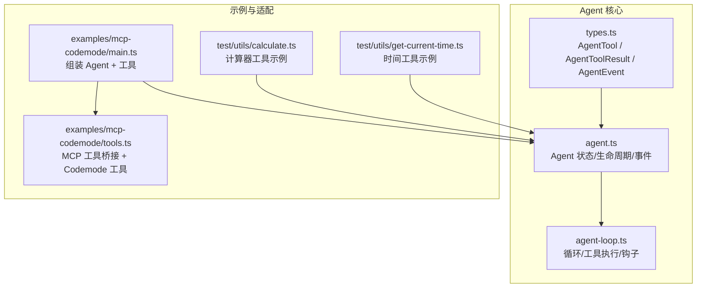
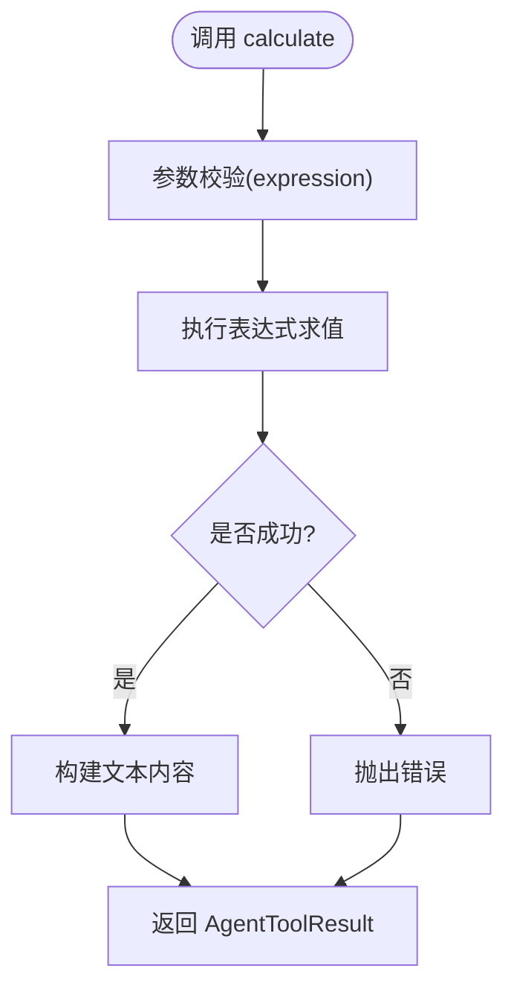
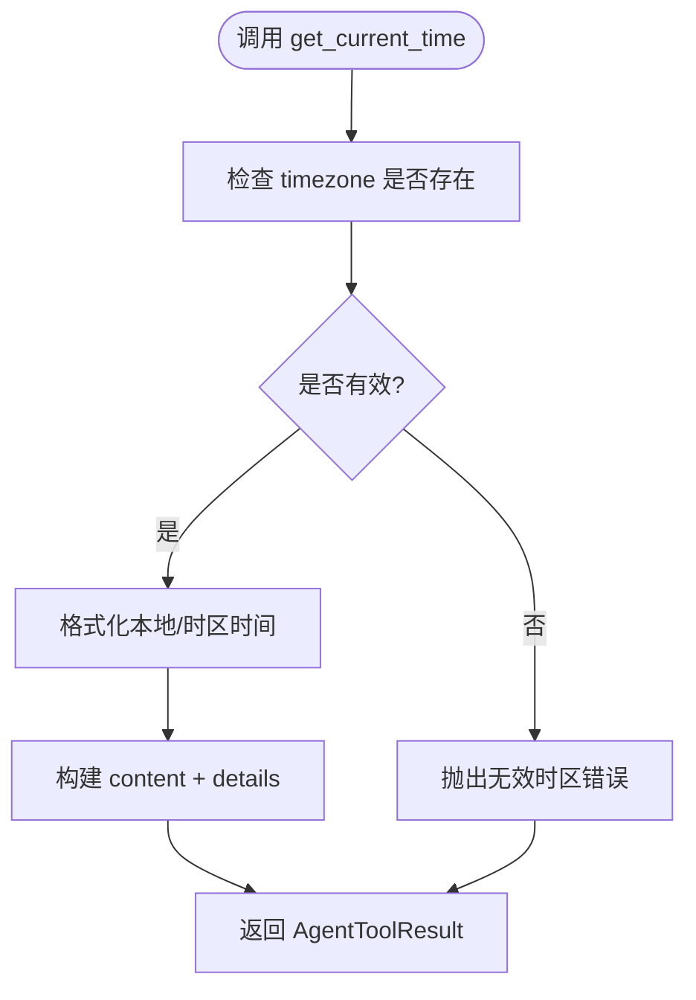
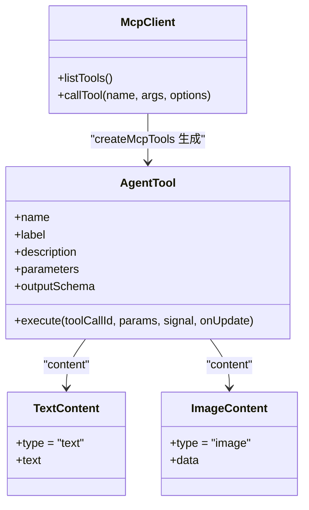
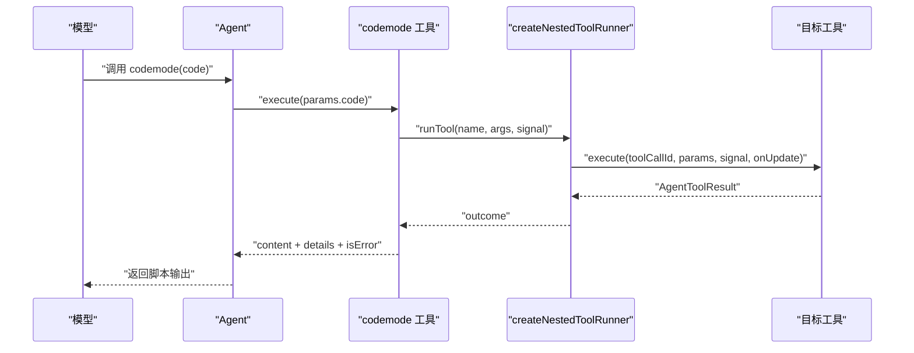
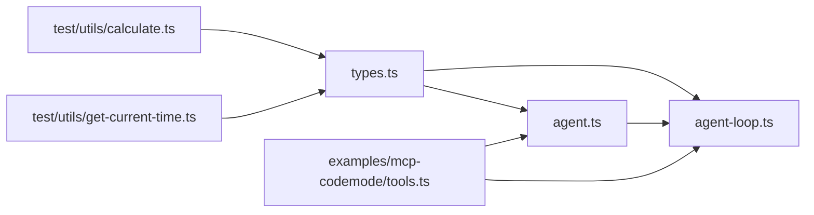
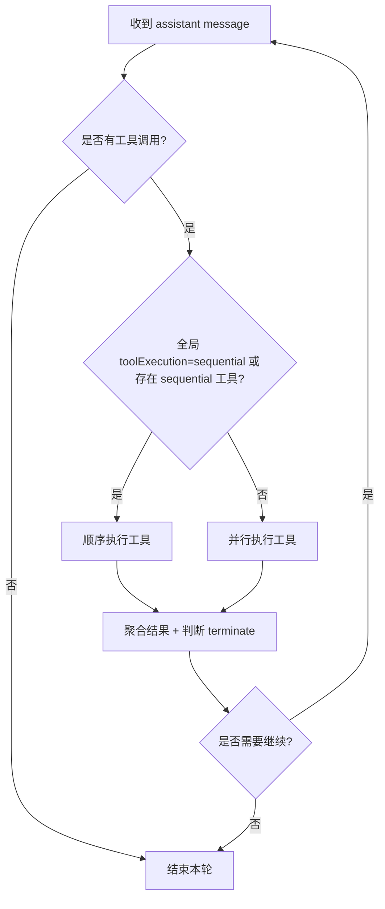

# 工具开发示例

<cite>
**本文引用的文件**
- [README.md](file://README.md)
- [packages/agent/src/types.ts](file://packages/agent/src/types.ts)
- [packages/agent/src/agent.ts](file://packages/agent/src/agent.ts)
- [packages/agent/src/agent-loop.ts](file://packages/agent/src/agent-loop.ts)
- [packages/agent/examples/mcp-codemode/main.ts](file://packages/agent/examples/mcp-codemode/main.ts)
- [packages/agent/examples/mcp-codemode/tools.ts](file://packages/agent/examples/mcp-codemode/tools.ts)
- [packages/agent/test/utils/calculate.ts](file://packages/agent/test/utils/calculate.ts)
- [packages/agent/test/utils/get-current-time.ts](file://packages/agent/test/utils/get-current-time.ts)
</cite>

## 目录
1. [简介](#简介)
2. [项目结构](#项目结构)
3. [核心组件](#核心组件)
4. [架构总览](#架构总览)
5. [详细组件分析](#详细组件分析)
6. [依赖关系分析](#依赖关系分析)
7. [性能与执行模式](#性能与执行模式)
8. [测试、调试与部署最佳实践](#测试调试与部署最佳实践)
9. [结论](#结论)
10. [附录：从简单到复杂的工具示例清单](#附录从简单到复杂的工具示例清单)

## 简介
本文件面向“工具开发”的完整学习路径，提供从简单到复杂的 TypeScript 工具实现示例集合。内容覆盖：
- 参数 Schema 定义（基于 pi-schema）
- 工具类型 AgentTool 的结构与约束
- 执行逻辑实现（execute、onUpdate、结构化输出等）
- 可选自定义渲染（text/image 内容、details、structuredContent）
- 工具编排（MCP 工具桥接、Codemode 沙箱脚本）
- 测试、调试与部署建议

本仓库是一个可扩展的智能体框架，Agent 负责对话循环、工具声明与执行、事件流与状态管理；工具通过 AgentTool 接口暴露给模型调用。

**章节来源**
- [README.md:13-84](file://README.md#L13-L84)

## 项目结构
围绕“工具开发”，关键代码集中在 packages/agent 子包中：
- src/types.ts：AgentTool、AgentToolResult、AgentEvent 等核心类型
- src/agent.ts：Agent 类，封装状态、生命周期、队列与事件分发
- src/agent-loop.ts：低层循环，负责消息流、工具准备与执行（顺序/并行）、钩子与结果聚合
- examples/mcp-codemode：将 MCP 工具适配为 AgentTool，并提供 Codemode 工具以在沙箱中运行 JS 脚本编排多个工具
- test/utils：最小可复用的工具示例（计算器、获取当前时间），用于单元测试与演示



**图表来源**
- [packages/agent/src/types.ts:474-511](file://packages/agent/src/types.ts#L474-L511)
- [packages/agent/src/agent.ts:194-263](file://packages/agent/src/agent.ts#L194-L263)
- [packages/agent/src/agent-loop.ts:111-160](file://packages/agent/src/agent-loop.ts#L111-L160)
- [packages/agent/examples/mcp-codemode/main.ts:1-46](file://packages/agent/examples/mcp-codemode/main.ts#L1-L46)
- [packages/agent/examples/mcp-codemode/tools.ts:40-76](file://packages/agent/examples/mcp-codemode/tools.ts#L40-L76)
- [packages/agent/test/utils/calculate.ts:27-35](file://packages/agent/test/utils/calculate.ts#L27-L35)
- [packages/agent/test/utils/get-current-time.ts:38-46](file://packages/agent/test/utils/get-current-time.ts#L38-L46)

**章节来源**
- [packages/agent/src/types.ts:474-511](file://packages/agent/src/types.ts#L474-L511)
- [packages/agent/src/agent.ts:194-263](file://packages/agent/src/agent.ts#L194-L263)
- [packages/agent/src/agent-loop.ts:111-160](file://packages/agent/src/agent-loop.ts#L111-L160)
- [packages/agent/examples/mcp-codemode/main.ts:1-46](file://packages/agent/examples/mcp-codemode/main.ts#L1-L46)
- [packages/agent/examples/mcp-codemode/tools.ts:40-76](file://packages/agent/examples/mcp-codemode/tools.ts#L40-L76)
- [packages/agent/test/utils/calculate.ts:27-35](file://packages/agent/test/utils/calculate.ts#L27-L35)
- [packages/agent/test/utils/get-current-time.ts:38-46](file://packages/agent/test/utils/get-current-time.ts#L38-L46)

## 核心组件
- AgentTool：工具契约，包含 name、label、description、parameters、outputSchema、execute、replay、executionMode 等字段。execute 返回 AgentToolResult，支持 content（文本/图片）、details（任意结构化细节）、structuredContent（程序化消费）、isError、usage、terminate。
- AgentToolResult：工具最终或中间结果，content 是模型可见的内容，structuredContent 是给调用方使用的结构化数据。
- AgentEvent：工具执行生命周期事件，包括 tool_execution_start/update/end，便于 UI 与日志记录。
- Agent：封装 AgentMessage 上下文、工具集、模型、会话、队列（steering/follow-up）、事件订阅与生命周期控制。
- agent-loop：低层循环，负责：
  - 声明工具变更（toolsAdded/toolsRemoved）
  - 流式生成助手响应
  - 解析并执行工具调用（顺序/并行）
  - beforeToolCall/afterToolCall 钩子
  - finishTurn/prepareNextTurn 等扩展点

**章节来源**
- [packages/agent/src/types.ts:474-511](file://packages/agent/src/types.ts#L474-L511)
- [packages/agent/src/types.ts:423-455](file://packages/agent/src/types.ts#L423-L455)
- [packages/agent/src/types.ts:521-552](file://packages/agent/src/types.ts#L521-L552)
- [packages/agent/src/agent.ts:194-263](file://packages/agent/src/agent.ts#L194-L263)
- [packages/agent/src/agent-loop.ts:332-384](file://packages/agent/src/agent-loop.ts#L332-L384)
- [packages/agent/src/agent-loop.ts:515-533](file://packages/agent/src/agent-loop.ts#L515-L533)

## 架构总览
下图展示“模型 → Agent → 工具”的调用链，以及 MCP/Codemode 如何接入：

```mermaid
sequenceDiagram
participant Model as "模型"
participant Agent as "Agent"
participant Loop as "agent-loop"
participant Tool as "AgentTool.execute"
participant MCP as "MCP 客户端"
participant Sandbox as "Codemode 沙箱"
Model->>Agent : "prompt()/continue()"
Agent->>Loop : "runAgentLoop(...)"
Loop->>Model : "streamAssistantResponse(...)"
Model-->>Loop : "assistant message with toolCalls"
Loop->>Loop : "executeToolCalls(sequential|parallel)"
Loop->>Tool : "execute(toolCallId, params, signal, onUpdate)"
alt MCP 工具
Tool->>MCP : "callTool(name, args)"
MCP-->>Tool : "result (content/structuredContent/isError)"
else Codemode 脚本
Tool->>Sandbox : "execute(code)"
Sandbox-->>Tool : "output + value"
end
Tool-->>Loop : "AgentToolResult"
Loop-->>Agent : "tool_execution_end + tool result messages"
Agent-->>Model : "继续下一轮或结束"
```

**图表来源**
- [packages/agent/src/agent.ts:379-420](file://packages/agent/src/agent.ts#L379-L420)
- [packages/agent/src/agent-loop.ts:390-479](file://packages/agent/src/agent-loop.ts#L390-L479)
- [packages/agent/src/agent-loop.ts:515-533](file://packages/agent/src/agent-loop.ts#L515-L533)
- [packages/agent/examples/mcp-codemode/tools.ts:54-73](file://packages/agent/examples/mcp-codemode/tools.ts#L54-L73)
- [packages/agent/examples/mcp-codemode/tools.ts:154-171](file://packages/agent/examples/mcp-codemode/tools.ts#L154-L171)

## 详细组件分析

### 示例一：简单计算工具（纯函数 + 参数校验）
设计思路
- 使用 pi-schema 定义参数 schema，确保类型安全与 LLM 侧参数提示。
- 工具 execute 内部调用纯函数计算，返回文本内容。
- 适合初学者理解 AgentTool 的最小闭环。

关键点
- parameters：obj({ expression: str({...}) })，open: true 兼容旧行为
- execute：接收已校验的参数，返回 { content: [{ type: "text", text }] }
- 错误处理：表达式求值失败时抛出 Error，由上层统一转为 isError 结果

扩展方式
- 增加 outputSchema 描述 structuredContent
- 添加 usage 统计
- 支持多返回值或更丰富的 content（如图片）



**图表来源**
- [packages/agent/test/utils/calculate.ts:10-17](file://packages/agent/test/utils/calculate.ts#L10-L17)
- [packages/agent/test/utils/calculate.ts:19-35](file://packages/agent/test/utils/calculate.ts#L19-L35)

**章节来源**
- [packages/agent/test/utils/calculate.ts:1-43](file://packages/agent/test/utils/calculate.ts#L1-L43)

### 示例二：获取当前时间工具（可选参数 + 结构化 details）
设计思路
- 支持可选 timezone 参数，若无效则抛出明确错误信息。
- 返回结构化 details（utcTimestamp），便于外部系统消费。
- 展示如何在工具中同时维护用户可读内容与机器可读数据。

关键点
- parameters：obj({ timezone: opt(str({...})) }), open: true
- execute：根据 timezone 格式化时间，构造 content 与 details
- 错误处理：无效时抛出带 UTC 时间的错误信息

扩展方式
- 增加 outputSchema 描述 details 结构
- 支持批量时区查询
- 结合缓存减少重复计算



**图表来源**
- [packages/agent/test/utils/get-current-time.ts:6-28](file://packages/agent/test/utils/get-current-time.ts#L6-L28)
- [packages/agent/test/utils/get-current-time.ts:30-46](file://packages/agent/test/utils/get-current-time.ts#L30-L46)

**章节来源**
- [packages/agent/test/utils/get-current-time.ts:1-47](file://packages/agent/test/utils/get-current-time.ts#L1-L47)

### 示例三：Bash 命令执行工具（概念性说明）
说明
- 该仓库未直接提供 Bash 命令执行工具的实现。
- 可按以下模式自行实现：
  - parameters：定义 command、args、cwd、timeoutMs 等字段
  - execute：调用进程 API 执行命令，捕获 stdout/stderr，设置 content 与 isError
  - 安全建议：限制可执行命令白名单、工作目录、超时、资源限额
  - 可复用 AgentTool 的 executionMode 与 hook 机制进行权限控制与审计

注意
- 请避免在生产环境无限制地执行任意命令；建议使用容器或沙箱隔离。

[本节为概念性说明，不直接分析具体文件]

### 示例四：代码编辑工具（概念性说明）
说明
- 该仓库未直接提供代码编辑工具的实现。
- 可按以下模式自行实现：
  - parameters：定义 file_path、operation（read/write/diff）、content、encoding 等
  - execute：对文件系统执行读取/写入/差异对比，返回 content（文本/图片）与 details（元数据）
  - 安全建议：路径白名单、只读模式、备份策略、变更审计
  - 可结合 structuredContent 返回 diff 摘要、变更行数、影响范围等

注意
- 同样建议在受限环境中运行，避免越权访问。

[本节为概念性说明，不直接分析具体文件]

### 示例五：MCP 工具桥接（远程工具适配）
设计思路
- 将 MCP 服务端暴露的工具动态转换为 AgentTool，使模型可直接调用。
- 自动映射 inputSchema/outputSchema，并将 MCP 结果转换为 pi-ai 的 content 形状。
- 支持进度回调 onUpdate，实时反馈执行进展。

关键点
- createMcpTools：遍历 MCP 工具列表，生成 AgentTool
- 名称规范化：toToolName(prefix, name)，保证 provider 命名约束
- 结果转换：toLlmContent(result)，结构化内容保留在 structuredContent
- 错误处理：当 MCP 报告 isError 且内容为空时，补充默认错误文本



**图表来源**
- [packages/agent/examples/mcp-codemode/tools.ts:23-33](file://packages/agent/examples/mcp-codemode/tools.ts#L23-L33)
- [packages/agent/examples/mcp-codemode/tools.ts:40-76](file://packages/agent/examples/mcp-codemode/tools.ts#L40-L76)

**章节来源**
- [packages/agent/examples/mcp-codemode/tools.ts:23-76](file://packages/agent/examples/mcp-codemode/tools.ts#L23-L76)

### 示例六：Codemode 工具（JS 沙箱编排多个工具）
设计思路
- 提供一个 codemode 工具，允许模型编写 JS 脚本，在受控沙箱内调用其他工具。
- 脚本中 tools.<name>(args) 会走 Agent 的执行管线（before/after 钩子、参数校验等）。
- 脚本输出通过 text()/console.log() 收集，返回值也会追加到内容中。
- 适合复杂编排：串行/并行调用、过滤大结果、聚合多工具输出。

关键点
- createNestedToolRunner：通过 runToolCall 复用 Agent 的执行流程
- sandboxTools：将现有工具包装为 CodemodeTool，结构化输出优先
- CODEMODE_TOOL_NAME：固定工具名
- execute：创建 CodemodeSandbox，执行脚本，收集 output 与返回值，标记 isError



**图表来源**
- [packages/agent/examples/mcp-codemode/tools.ts:83-103](file://packages/agent/examples/mcp-codemode/tools.ts#L83-L103)
- [packages/agent/examples/mcp-codemode/tools.ts:118-173](file://packages/agent/examples/mcp-codemode/tools.ts#L118-L173)

**章节来源**
- [packages/agent/examples/mcp-codemode/tools.ts:83-173](file://packages/agent/examples/mcp-codemode/tools.ts#L83-L173)

### 示例七：主入口装配（Agent + MCP + Codemode）
说明
- main.ts 展示了如何将 MCP 工具与 Codemode 工具组合进 Agent.state.tools，并监听 tool_execution_start 事件打印工具名。
- 典型用法：先让模型用 codemode 列举 MCP 工具能力，再总结。

关键点
- createMcpTools(client, prefix)：生成 MCP 工具数组
- createCodemodeTool(mcpTools, runner)：生成 Codemode 工具
- agent.state.tools = [...mcpTools, codemodeTool]

**章节来源**
- [packages/agent/examples/mcp-codemode/main.ts:1-46](file://packages/agent/examples/mcp-codemode/main.ts#L1-L46)
- [packages/agent/examples/mcp-codemode/tools.ts:40-76](file://packages/agent/examples/mcp-codemode/tools.ts#L40-L76)
- [packages/agent/examples/mcp-codemode/tools.ts:118-173](file://packages/agent/examples/mcp-codemode/tools.ts#L118-L173)

## 依赖关系分析
- types.ts 定义了 AgentTool、AgentToolResult、AgentEvent 等基础类型，被 agent.ts 与 agent-loop.ts 引用。
- agent.ts 提供 Agent 类，封装状态、事件、队列与生命周期，委托 agent-loop.ts 完成核心循环。
- agent-loop.ts 依赖 pi-ai 的消息与工具声明能力，负责工具准备、执行与结果聚合。
- examples/mcp-codemode/tools.ts 依赖 @earendil-works/pi-mcp 与 @earendil-works/pi-codemode，将外部工具与脚本能力桥接到 AgentTool。
- test/utils 中的工具示例仅依赖 pi-schema 与 types.ts，便于独立测试。



**图表来源**
- [packages/agent/src/types.ts:474-511](file://packages/agent/src/types.ts#L474-L511)
- [packages/agent/src/agent.ts:194-263](file://packages/agent/src/agent.ts#L194-L263)
- [packages/agent/src/agent-loop.ts:111-160](file://packages/agent/src/agent-loop.ts#L111-L160)
- [packages/agent/examples/mcp-codemode/tools.ts:40-76](file://packages/agent/examples/mcp-codemode/tools.ts#L40-L76)
- [packages/agent/test/utils/calculate.ts:27-35](file://packages/agent/test/utils/calculate.ts#L27-L35)
- [packages/agent/test/utils/get-current-time.ts:38-46](file://packages/agent/test/utils/get-current-time.ts#L38-L46)

**章节来源**
- [packages/agent/src/types.ts:474-511](file://packages/agent/src/types.ts#L474-L511)
- [packages/agent/src/agent.ts:194-263](file://packages/agent/src/agent.ts#L194-L263)
- [packages/agent/src/agent-loop.ts:111-160](file://packages/agent/src/agent-loop.ts#L111-L160)
- [packages/agent/examples/mcp-codemode/tools.ts:40-76](file://packages/agent/examples/mcp-codemode/tools.ts#L40-L76)
- [packages/agent/test/utils/calculate.ts:27-35](file://packages/agent/test/utils/calculate.ts#L27-L35)
- [packages/agent/test/utils/get-current-time.ts:38-46](file://packages/agent/test/utils/get-current-time.ts#L38-L46)

## 性能与执行模式
- 工具执行模式：
  - sequential：逐个执行工具调用，适合有副作用或需要严格顺序的场景
  - parallel：预检后并发执行允许的工具，提升吞吐；tool_execution_end 按完成顺序发出
- 单工具执行模式：
  - AgentTool.executionMode 可覆盖全局配置，强制某工具串行执行
- 截断保护：
  - 当助手响应因 token 限制被截断时，所有工具调用会被标记为失败，避免执行不完整参数
- 终止信号：
  - beforeToolCall/afterToolCall 与 execute 均接收 AbortSignal，应尊重中断



**图表来源**
- [packages/agent/src/agent-loop.ts:515-533](file://packages/agent/src/agent-loop.ts#L515-L533)
- [packages/agent/src/agent-loop.ts:540-594](file://packages/agent/src/agent-loop.ts#L540-L594)
- [packages/agent/src/agent-loop.ts:596-670](file://packages/agent/src/agent-loop.ts#L596-L670)
- [packages/agent/src/agent-loop.ts:481-513](file://packages/agent/src/agent-loop.ts#L481-L513)

**章节来源**
- [packages/agent/src/agent-loop.ts:515-533](file://packages/agent/src/agent-loop.ts#L515-L533)
- [packages/agent/src/agent-loop.ts:540-670](file://packages/agent/src/agent-loop.ts#L540-L670)
- [packages/agent/src/agent-loop.ts:481-513](file://packages/agent/src/agent-loop.ts#L481-L513)

## 测试、调试与部署最佳实践
- 测试
  - 使用最小工具示例（calculate、get-current-time）验证参数校验、错误分支与结构化输出
  - 借助 Agent.subscribe 监听 tool_execution_start/update/end，验证执行顺序与更新流
  - 针对 MCP/Codemode 场景，模拟 client.listTools/callTool 与 CodemodeSandbox.execute
- 调试
  - 启用 tool_execution_update 观察部分结果
  - 使用 beforeToolCall/afterToolCall 注入审计日志与指标
  - 关注 finishTurn/prepareNextTurn 对后续请求的影响
- 部署
  - 对敏感操作（文件系统、网络、进程）使用容器或沙箱隔离
  - 限制工具能力（白名单、只读模式、超时、资源配额）
  - 使用 structuredContent 对外暴露稳定接口，便于下游系统集成

[本节为通用指导，不直接分析具体文件]

## 结论
本指南从最简工具示例出发，逐步过渡到 MCP 工具桥接与 Codemode 脚本编排，覆盖了工具开发的完整链路：参数 Schema、执行逻辑、结果结构、事件流、执行模式与扩展点。通过 Agent 提供的钩子与队列机制，你可以灵活实现权限控制、审计、重试与编排，并在安全边界内扩展更多领域工具。

[本节为总结性内容，不直接分析具体文件]

## 附录：从简单到复杂的工具示例清单
- 简单工具
  - 计算器工具：参数校验 + 纯函数计算 + 文本内容
  - 获取当前时间工具：可选参数 + 结构化 details
- 中级工具
  - Bash 命令执行工具（概念）：进程执行、安全限制、超时与审计
  - 代码编辑工具（概念）：文件读写、差异对比、变更审计
- 高级工具
  - MCP 工具桥接：动态发现、参数/结果映射、进度回调
  - Codemode 工具：JS 沙箱、工具编排、结构化输出聚合

[本节为概览性内容，不直接分析具体文件]