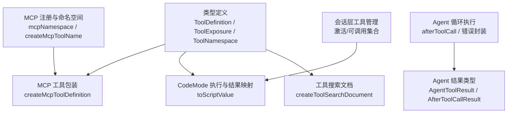
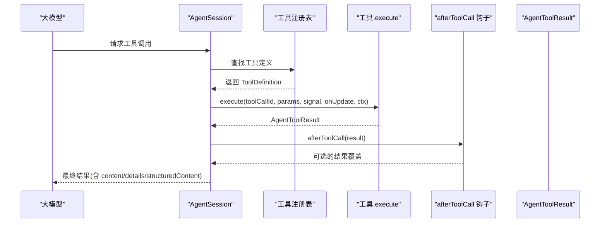
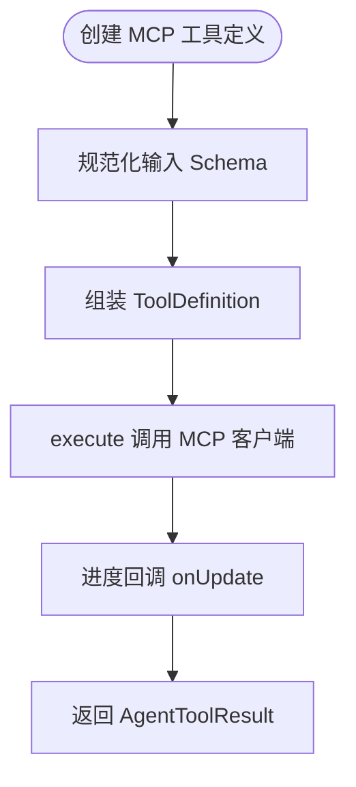
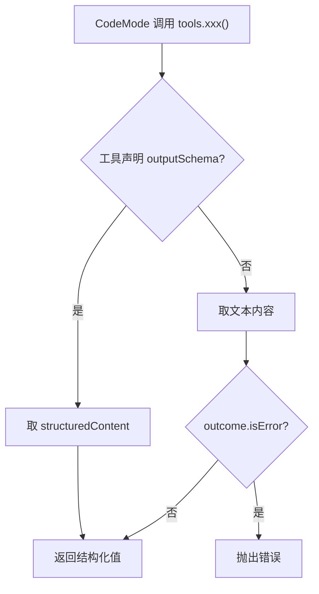
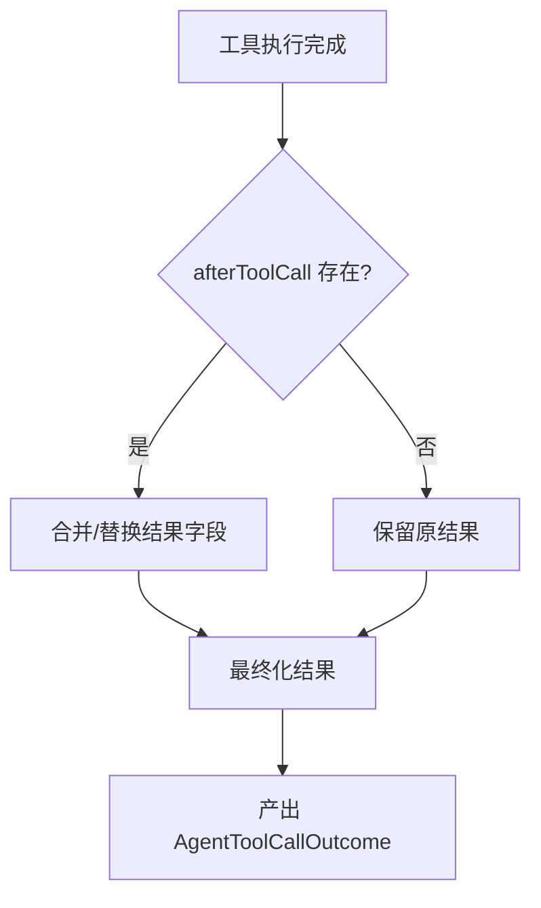
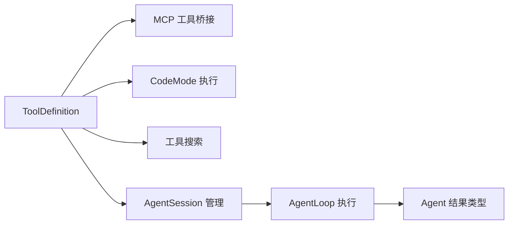

# 自定义工具开发

<cite>
**本文引用的文件**
- [types.ts](file://packages/coding-agent/src/core/extensions/types.ts)
- [tools.ts](file://packages/coding-agent/src/extensions/mcp/tools.ts)
- [index.ts](file://packages/coding-agent/src/extensions/mcp/index.ts)
- [execute.ts](file://packages/coding-agent/src/extensions/codemode/execute.ts)
- [tool-search-tool.ts](file://packages/coding-agent/src/extensions/tool-search/tool.ts)
- [agent-session.ts](file://packages/coding-agent/src/core/agent-session.ts)
- [agent-loop.ts](file://packages/agent/src/agent-loop.ts)
- [agent-types.ts](file://packages/agent/src/types.ts)
- [orchestration.test.ts](file://packages/coding-agent/test/suite/agent-session-tool-orchestration.test.ts)
- [sequential-test.ts](file://packages/agent/test/agent-loop.test.ts)
</cite>

## 目录
1. [引言](#引言)
2. [项目结构](#项目结构)
3. [核心组件](#核心组件)
4. [架构总览](#架构总览)
5. [详细组件分析](#详细组件分析)
6. [依赖关系分析](#依赖关系分析)
7. [性能与执行模式](#性能与执行模式)
8. [工具测试与调试](#工具测试与调试)
9. [结论](#结论)
10. [附录：完整开发示例清单](#附录完整开发示例清单)

## 引言
本指南面向希望在本仓库中开发“自定义工具”的工程师。你将系统了解 ToolDefinition 接口的全部属性，掌握参数 Schema、执行逻辑、结果处理、暴露模式、命名空间和执行模式的用法，并基于仓库中的真实实现和测试用例，从简单文件操作工具到复杂业务编排工具逐步构建可落地的实践方案。

## 项目结构
围绕“工具”的核心代码主要分布在以下位置：
- 类型定义与扩展接口：packages/coding-agent/src/core/extensions/types.ts
- MCP 工具桥接与包装：packages/coding-agent/src/extensions/mcp/tools.ts、packages/coding-agent/src/extensions/mcp/index.ts
- CodeMode 工具调用与结构化结果解析：packages/coding-agent/src/extensions/codemode/execute.ts
- 工具搜索文档生成：packages/coding-agent/src/extensions/tool-search/tool.ts
- 会话层工具激活与可调用集合：packages/coding-agent/src/core/agent-session.ts
- Agent 循环执行、afterToolCall 钩子与错误封装：packages/agent/src/agent-loop.ts、packages/agent/src/types.ts
- 工具编排与执行模式测试：packages/coding-agent/test/suite/agent-session-tool-orchestration.test.ts、packages/agent/test/agent-loop.test.ts

图表来源
- [types.ts:521-688](file://packages/coding-agent/src/core/extensions/types.ts#L521-L688)
- [tools.ts:249-281](file://packages/coding-agent/src/extensions/mcp/tools.ts#L249-L281)
- [index.ts:388-420](file://packages/coding-agent/src/extensions/mcp/index.ts#L388-L420)
- [execute.ts:474-486](file://packages/coding-agent/src/extensions/codemode/execute.ts#L474-L486)
- [tool-search-tool.ts:94-129](file://packages/coding-agent/src/extensions/tool-search/tool.ts#L94-L129)
- [agent-session.ts:1603-1627](file://packages/coding-agent/src/core/agent-session.ts#L1603-L1627)
- [agent-loop.ts:880-927](file://packages/agent/src/agent-loop.ts#L880-L927)
- [agent-types.ts:76-104](file://packages/agent/src/types.ts#L76-L104)
- [agent-types.ts:423-455](file://packages/agent/src/types.ts#L423-L455)

章节来源
- [types.ts:521-688](file://packages/coding-agent/src/core/extensions/types.ts#L521-L688)
- [tools.ts:249-281](file://packages/coding-agent/src/extensions/mcp/tools.ts#L249-L281)
- [index.ts:388-420](file://packages/coding-agent/src/extensions/mcp/index.ts#L388-L420)
- [execute.ts:474-486](file://packages/coding-agent/src/extensions/codemode/execute.ts#L474-L486)
- [tool-search-tool.ts:94-129](file://packages/coding-agent/src/extensions/tool-search/tool.ts#L94-L129)
- [agent-session.ts:1603-1627](file://packages/coding-agent/src/core/agent-session.ts#L1603-L1627)
- [agent-loop.ts:880-927](file://packages/agent/src/agent-loop.ts#L880-L927)
- [agent-types.ts:76-104](file://packages/agent/src/types.ts#L76-L104)
- [agent-types.ts:423-455](file://packages/agent/src/types.ts#L423-L455)

## 核心组件
本节聚焦 ToolDefinition 及其相关类型，解释每个属性的职责与使用方式。

- name：工具名称，用于 LLM 工具调用与内部注册。
- label：人类可读标签，常用于 UI 展示。
- description：给 LLM 的工具描述，影响模型是否选择该工具。
- promptSnippet：可选，出现在默认系统提示的“可用工具”区域；未提供时自定义工具不会出现在该区域。
- promptGuidelines：可选，当工具处于活动状态时追加到系统提示“指南”部分的要点列表。
- parameters：TypeBox JSON Schema，描述工具的输入参数。
- constrainedSampling：可选，针对特定模型的严格采样配置；设为 false 显式禁用。
- renderShell：控制渲染外壳，“default”使用标准着色外壳，“self”由工具自行渲染。
- prepareArguments：可选，在参数校验前对原始参数做兼容转换，返回符合 TParams 的对象。
- outputSchema：可选，声明成功结果中 structuredContent 的 JSON Schema；若声明则应始终设置 structuredContent，以便 CodeMode 脚本直接接收结构化内容而非文本。
- exposure：工具暴露模式，见下节详解。
- namespace：工具所属命名空间，便于分组、搜索与描述。
- reachesTools：可选，供“能调用其他工具”的工具（如 codemode、tool_search）声明其可能触达的目标工具名或命名空间词。
- annotations：工具注解，例如来自 MCP 服务器的元信息。
- defaultActive：注册时是否自动激活；direct/model-only 默认激活，其他暴露模式默认不激活。
- prepareLoadout：当工具激活时动态调整 loadout 展示，例如列出可调用工具或隐藏某些声明。
- executionMode：逐工具的执行模式，“sequential”串行、“parallel”并行。
- execute：执行函数，返回 AgentToolResult。
- renderCall/renderResult：可选，自定义工具调用与结果的渲染组件。

章节来源
- [types.ts:596-688](file://packages/coding-agent/src/core/extensions/types.ts#L596-L688)

## 架构总览
下图展示了从“工具定义”到“模型调用”再到“结果处理”的整体流程，以及 MCP 工具桥接、CodeMode 脚本调用、工具搜索等关键路径。

图表来源
- [agent-session.ts:1603-1627](file://packages/coding-agent/src/core/agent-session.ts#L1603-L1627)
- [agent-loop.ts:880-927](file://packages/agent/src/agent-loop.ts#L880-L927)
- [agent-types.ts:423-455](file://packages/agent/src/types.ts#L423-L455)

## 详细组件分析

### ToolDefinition 属性详解

#### 基础属性：name、label、description
- name 是工具的唯一标识，参与注册、激活、调用与追踪。
- label 用于 UI 显示，通常比 name 更友好。
- description 直接影响模型对工具用途的理解与选择概率。

章节来源
- [types.ts:600-605](file://packages/coding-agent/src/core/extensions/types.ts#L600-L605)

#### 参数 Schema：parameters 与 prepareArguments
- parameters 使用 TypeBox 定义 JSON Schema，用于参数校验与提示。
- prepareArguments 可在进入 schema 校验前对原始参数进行兼容转换，确保传入 execute 的参数类型安全。

章节来源
- [types.ts:610-618](file://packages/coding-agent/src/core/extensions/types.ts#L610-L618)

#### 输出 Schema：outputSchema 与 structuredContent
- 若声明 outputSchema，工具应在成功结果中设置 structuredContent，使 CodeMode 脚本可直接拿到结构化数据。
- 未声明 outputSchema 时，CodeMode 脚本将使用文本内容作为返回值。

章节来源
- [types.ts:620-624](file://packages/coding-agent/src/core/extensions/types.ts#L620-L624)
- [execute.ts:474-486](file://packages/coding-agent/src/extensions/codemode/execute.ts#L474-L486)

#### 暴露模式：exposure
- direct：向模型声明并可被模型直接调用；注册即默认激活。
- model-only：向模型声明但不可被其他工具通过 ctx.executeTool 调用；适合编排型或交互型工具。
- codemode：仅可在其他工具内通过 ctx.executeTool 调用；不在模型侧声明，除非显式激活。
- deferred：类似 codemode，但不列入 codemode 的描述；可由 tool_search 发现。
- hidden：已注册但不可达；激活无效果。

章节来源
- [types.ts:521-536](file://packages/coding-agent/src/core/extensions/types.ts#L521-L536)
- [types.ts:626-632](file://packages/coding-agent/src/core/extensions/types.ts#L626-L632)
- [agent-session.ts:1603-1627](file://packages/coding-agent/src/core/agent-session.ts#L1603-L1627)

#### 命名空间：namespace
- 用于将工具按来源或功能分组，例如 MCP 服务器。
- 支持别名与说明，便于 describeNamespace 与工具搜索。

章节来源
- [types.ts:631-632](file://packages/coding-agent/src/core/extensions/types.ts#L631-L632)
- [index.ts:388-420](file://packages/coding-agent/src/extensions/mcp/index.ts#L388-L420)

#### 执行模式：executionMode
- sequential：与其他工具调用串行执行，避免并发冲突。
- parallel：允许与其他工具调用并发执行。
- 未设置时使用默认行为；当存在任意 sequential 工具时，整体批次会退化为串行。

章节来源
- [types.ts:660-667](file://packages/coding-agent/src/core/extensions/types.ts#L660-L667)
- [sequential-test.ts:949-1033](file://packages/agent/test/agent-loop.test.ts#L949-L1033)

#### 渲染与提示增强：renderShell、promptSnippet、promptGuidelines、annotations
- renderShell：决定使用标准外壳还是工具自渲染。
- promptSnippet/promptGuidelines：增强系统提示，帮助模型理解工具可用性。
- annotations：附加元信息，例如 MCP 工具标题与说明。

章节来源
- [types.ts:606-615](file://packages/coding-agent/src/core/extensions/types.ts#L606-L615)
- [tools.ts:249-281](file://packages/coding-agent/src/extensions/mcp/tools.ts#L249-L281)

#### 生命周期与加载：prepareLoadout、reachesTools、defaultActive
- prepareLoadout：在工具激活时动态修改 loadout，例如列出可调用工具或隐藏某些声明。
- reachesTools：声明工具可能触达的其他工具名或命名空间词，辅助延迟注册场景。
- defaultActive：控制注册时是否激活。

章节来源
- [types.ts:634-658](file://packages/coding-agent/src/core/extensions/types.ts#L634-L658)
- [orchestration.test.ts:30-52](file://packages/coding-agent/test/suite/agent-session-tool-orchestration.test.ts#L30-L52)

#### 执行入口：execute
- 签名包含 toolCallId、params、signal、onUpdate、ctx。
- 返回 AgentToolResult，包含 content、details、structuredContent、usage、isError、terminate。

章节来源
- [types.ts:669-676](file://packages/coding-agent/src/core/extensions/types.ts#L669-L676)
- [agent-types.ts:423-455](file://packages/agent/src/types.ts#L423-L455)

### MCP 工具桥接：createMcpToolDefinition
- 将 MCP 工具转换为 ToolDefinition，包括名称、标签、描述、参数 Schema、输出 Schema、暴露模式、命名空间与执行函数。
- 执行函数通过 MCP 客户端调用远端工具，支持超时、进度回调与信号取消。

图表来源
- [tools.ts:249-281](file://packages/coding-agent/src/extensions/mcp/tools.ts#L249-L281)

章节来源
- [tools.ts:249-281](file://packages/coding-agent/src/extensions/mcp/tools.ts#L249-L281)

### CodeMode 工具调用与结构化结果
- CodeMode 脚本调用工具时，若工具声明了 outputSchema 且结果包含 structuredContent，则脚本收到结构化值；否则收到文本内容。
- 失败时抛出错误，错误消息来源于工具返回的文本内容。

图表来源
- [execute.ts:474-486](file://packages/coding-agent/src/extensions/codemode/execute.ts#L474-L486)

章节来源
- [execute.ts:474-486](file://packages/coding-agent/src/extensions/codemode/execute.ts#L474-L486)

### 工具搜索与命名空间
- 工具搜索文档会聚合工具描述、参数 Schema 的属性名与描述，以及命名空间的名称、描述与指令。
- describeNamespace 可列出某命名空间下的工具名。

章节来源
- [tool-search-tool.ts:94-129](file://packages/coding-agent/src/extensions/tool-search/tool.ts#L94-L129)
- [execute.ts:700-735](file://packages/coding-agent/src/extensions/codemode/execute.ts#L700-L735)

### 会话层工具激活与可调用集合
- _isActivatable：判断工具是否可被激活（受 allowlist 与 exposure 影响）。
- _getCallableTools：获取可通过 ctx.executeTool 调用的工具集合（codemode/deferred 始终可调用，direct 需激活）。

章节来源
- [agent-session.ts:1603-1627](file://packages/coding-agent/src/core/agent-session.ts#L1603-L1627)

### Agent 循环与 afterToolCall 钩子
- afterToolCall 可对工具结果进行覆盖，包括 content、details、structuredContent、usage、isError、terminate。
- 若替换 content 但未同时替换 structuredContent，structuredContent 会被丢弃以避免不一致。
- 异常将被封装为错误结果。

图表来源
- [agent-loop.ts:880-927](file://packages/agent/src/agent-loop.ts#L880-L927)
- [agent-types.ts:76-104](file://packages/agent/src/types.ts#L76-L104)

章节来源
- [agent-loop.ts:880-927](file://packages/agent/src/agent-loop.ts#L880-L927)
- [agent-types.ts:76-104](file://packages/agent/src/types.ts#L76-L104)

## 依赖关系分析
- ToolDefinition 是所有工具的统一契约，贯穿 MCP 桥接、CodeMode 调用、工具搜索与会话管理。
- MCP 工具通过 createMcpToolDefinition 适配为 ToolDefinition，注入 namespace、exposure、timeout 与渲染器。
- CodeMode 在执行工具调用时依据 outputSchema 决定结构化或文本结果。
- AgentSession 根据 exposure 决定工具是否可被模型声明与是否可被其他工具调用。
- AgentLoop 在工具执行后运行 afterToolCall 钩子，统一封装错误与结果。

图表来源
- [types.ts:596-688](file://packages/coding-agent/src/core/extensions/types.ts#L596-L688)
- [tools.ts:249-281](file://packages/coding-agent/src/extensions/mcp/tools.ts#L249-L281)
- [execute.ts:474-486](file://packages/coding-agent/src/extensions/codemode/execute.ts#L474-L486)
- [agent-session.ts:1603-1627](file://packages/coding-agent/src/core/agent-session.ts#L1603-L1627)
- [agent-loop.ts:880-927](file://packages/agent/src/agent-loop.ts#L880-L927)
- [agent-types.ts:423-455](file://packages/agent/src/types.ts#L423-L455)

章节来源
- [types.ts:596-688](file://packages/coding-agent/src/core/extensions/types.ts#L596-L688)
- [tools.ts:249-281](file://packages/coding-agent/src/extensions/mcp/tools.ts#L249-L281)
- [execute.ts:474-486](file://packages/coding-agent/src/extensions/codemode/execute.ts#L474-L486)
- [agent-session.ts:1603-1627](file://packages/coding-agent/src/core/agent-session.ts#L1603-L1627)
- [agent-loop.ts:880-927](file://packages/agent/src/agent-loop.ts#L880-L927)
- [agent-types.ts:423-455](file://packages/agent/src/types.ts#L423-L455)

## 性能与执行模式
- 当批量工具调用中存在任一 executionMode=sequential 的工具时，整个批次会强制串行执行，避免资源竞争与顺序依赖问题。
- 所有工具均为 executionMode=parallel 时，允许并发执行以提升吞吐。
- 建议在 I/O 密集或共享资源的工具上谨慎使用并行，必要时显式设置为 sequential。

章节来源
- [sequential-test.ts:949-1033](file://packages/agent/test/agent-loop.test.ts#L949-L1033)
- [sequential-test.ts:1035-1074](file://packages/agent/test/agent-loop.test.ts#L1035-L1074)

## 工具测试与调试
- 工具编排测试展示了如何通过 extension API 注册 echo、helper、run_tools，并使用 exposure 控制可见性与可调用性，同时验证嵌套调用与结果持久化。
- 建议：
  - 使用 TypeBox 定义 parameters，并在 prepareArguments 中做兼容性处理。
  - 在 outputSchema 声明时始终设置 structuredContent，保证 CodeMode 脚本稳定消费。
  - 使用 afterToolCall 钩子进行结果脱敏、审计与统计。
  - 通过 namespace 与 promptGuidelines 提升模型理解与可搜索性。
  - 对耗时工具添加 progress 上报与超时控制，结合 executionMode 控制并发。

章节来源
- [orchestration.test.ts:10-53](file://packages/coding-agent/test/suite/agent-session-tool-orchestration.test.ts#L10-L53)
- [orchestration.test.ts:55-146](file://packages/coding-agent/test/suite/agent-session-tool-orchestration.test.ts#L55-L146)
- [agent-loop.ts:880-927](file://packages/agent/src/agent-loop.ts#L880-L927)

## 结论
ToolDefinition 提供了统一的工具契约，涵盖参数 Schema、执行逻辑、结果结构与渲染能力。通过 exposure、namespace、executionMode 等属性，你可以灵活控制工具的可见性、分组与并发策略。结合 MCP 桥接与 CodeMode 调用机制，既能快速集成外部工具，也能构建复杂的业务编排流程。建议在开发过程中充分利用 outputSchema、prepareLoadout、afterToolCall 等能力，提升工具的可观测性、可维护性与用户体验。

## 附录：完整开发示例清单
以下为基于仓库实现的“从零到一”的开发步骤与参考路径（不直接粘贴代码，仅提供文件与行号定位）：

- 简单文件操作工具
  - 定义 ToolDefinition：name、label、description、parameters、execute。
  - 参考：[types.ts:596-688](file://packages/coding-agent/src/core/extensions/types.ts#L596-L688)
  - 在 execute 中返回 AgentToolResult，包含 content 与 details。
  - 参考：[agent-types.ts:423-455](file://packages/agent/src/types.ts#L423-L455)

- 带参数校验与兼容处理的工具
  - 使用 TypeBox 定义 parameters，并在 prepareArguments 中做兼容转换。
  - 参考：[types.ts:610-618](file://packages/coding-agent/src/core/extensions/types.ts#L610-L618)

- 输出结构化数据的工具
  - 声明 outputSchema，并在 execute 中设置 structuredContent。
  - 参考：[types.ts:620-624](file://packages/coding-agent/src/core/extensions/types.ts#L620-L624)
  - CodeMode 脚本将直接消费 structuredContent。
  - 参考：[execute.ts:474-486](file://packages/coding-agent/src/extensions/codemode/execute.ts#L474-L486)

- 暴露模式与命名空间
  - 使用 exposure 控制工具是否对模型可见或可被其他工具调用。
  - 使用 namespace 分组工具，便于搜索与描述。
  - 参考：[types.ts:521-536](file://packages/coding-agent/src/core/extensions/types.ts#L521-L536)
  - 参考：[index.ts:388-420](file://packages/coding-agent/src/extensions/mcp/index.ts#L388-L420)

- 复杂业务编排工具
  - 使用 prepareLoadout 动态调整 loadout，列出可调用工具。
  - 使用 ctx.executeTool 调用其他工具，组合结果。
  - 参考：[orchestration.test.ts:30-52](file://packages/coding-agent/test/suite/agent-session-tool-orchestration.test.ts#L30-L52)

- 集成 MCP 工具
  - 使用 createMcpToolDefinition 将 MCP 工具转为 ToolDefinition。
  - 参考：[tools.ts:249-281](file://packages/coding-agent/src/extensions/mcp/tools.ts#L249-L281)

- 工具测试与调试
  - 使用编排测试验证工具可见性、可调用性与嵌套调用。
  - 参考：[orchestration.test.ts:55-146](file://packages/coding-agent/test/suite/agent-session-tool-orchestration.test.ts#L55-L146)
  - 使用 afterToolCall 钩子进行结果覆盖与错误封装。
  - 参考：[agent-loop.ts:880-927](file://packages/agent/src/agent-loop.ts#L880-L927)