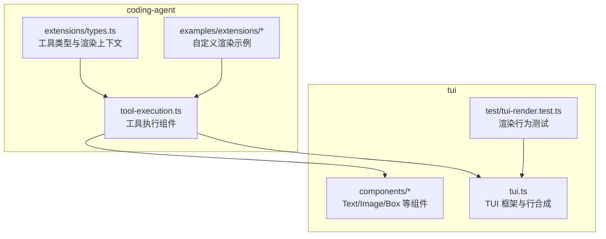
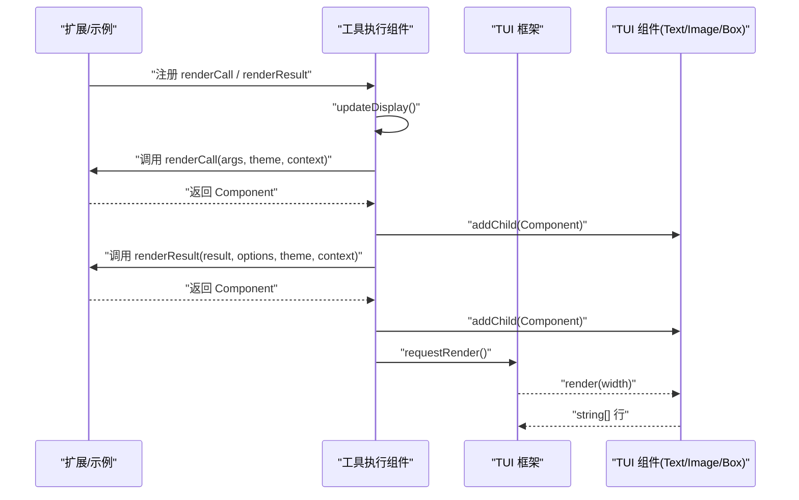
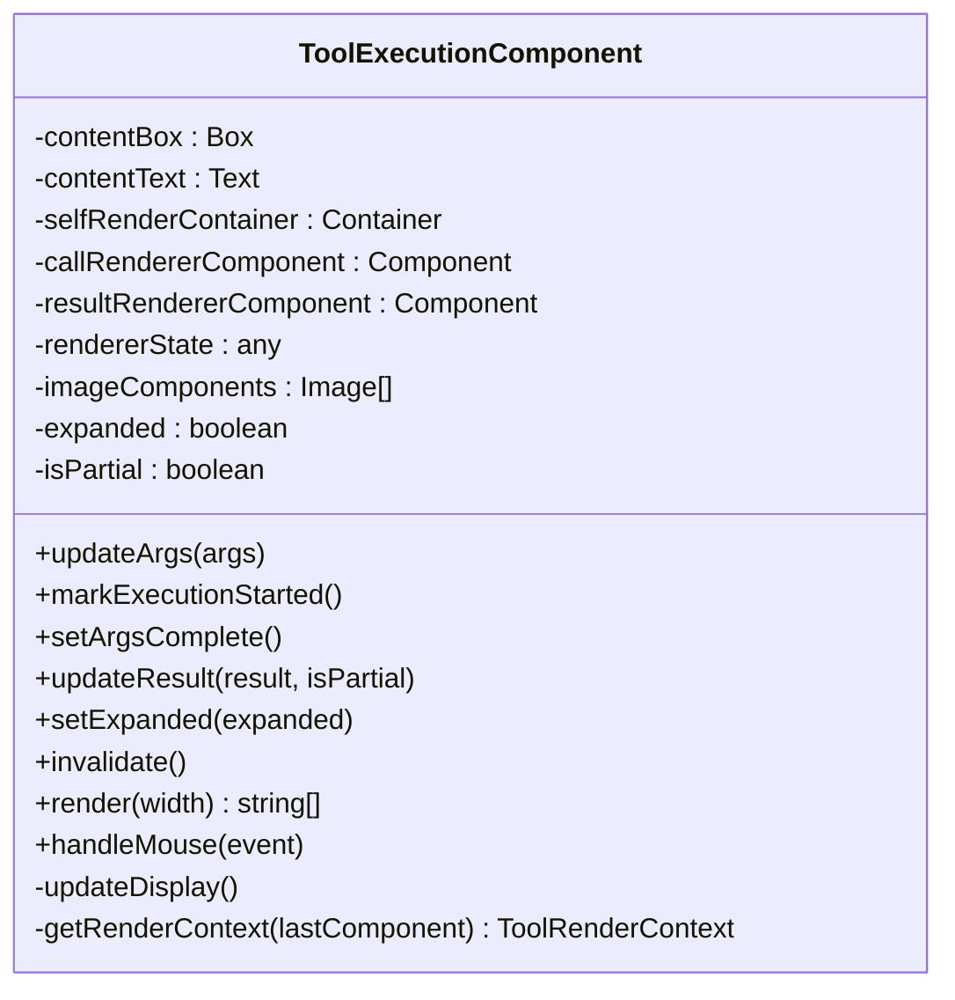
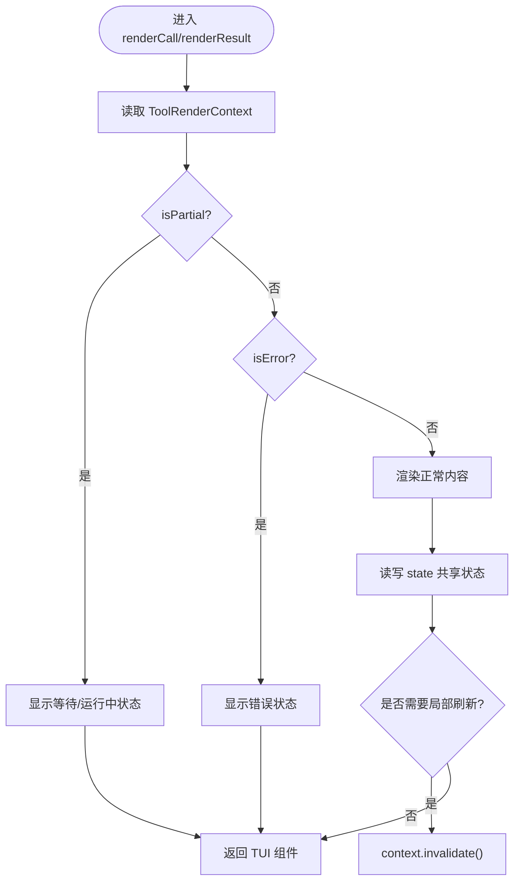
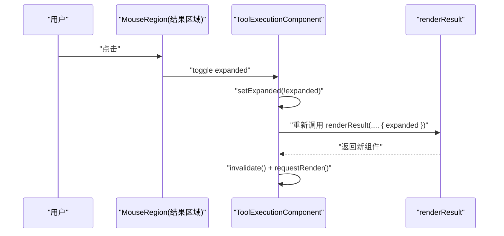
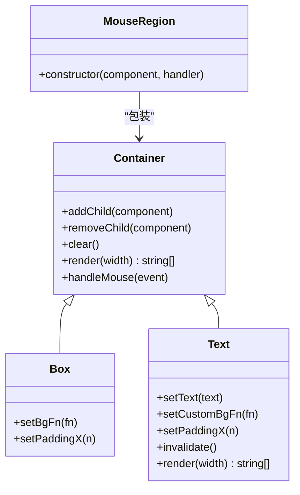
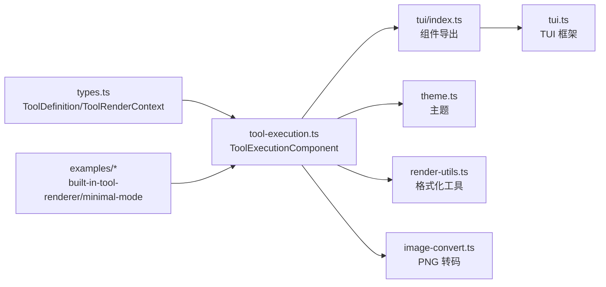

# 自定义渲染

<cite>
**本文引用的文件**
- [packages/coding-agent/src/modes/interactive/components/tool-execution.ts](file://packages/coding-agent/src/modes/interactive/components/tool-execution.ts)
- [packages/coding-agent/src/core/extensions/types.ts](file://packages/coding-agent/src/core/extensions/types.ts)
- [packages/coding-agent/examples/extensions/built-in-tool-renderer.ts](file://packages/coding-agent/examples/extensions/built-in-tool-renderer.ts)
- [packages/coding-agent/examples/extensions/minimal-mode.ts](file://packages/coding-agent/examples/extensions/minimal-mode.ts)
- [packages/tui/src/index.ts](file://packages/tui/src/index.ts)
- [packages/tui/src/components/text.ts](file://packages/tui/src/components/text.ts)
- [packages/tui/src/components/image.ts](file://packages/tui/src/components/image.ts)
- [packages/tui/src/tui.ts](file://packages/tui/src/tui.ts)
- [packages/tui/test/tui-render.test.ts](file://packages/tui/test/tui-render.test.ts)
</cite>

## 目录
1. [引言](#引言)
2. [项目结构](#项目结构)
3. [核心组件](#核心组件)
4. [架构总览](#架构总览)
5. [详细组件分析](#详细组件分析)
6. [依赖关系分析](#依赖关系分析)
7. [性能与可维护性](#性能与可维护性)
8. [故障排查指南](#故障排查指南)
9. [结论](#结论)
10. [附录：从简单到复杂的渲染示例](#附录从简单到复杂的渲染示例)

## 引言
本指南面向需要为工具调用提供自定义渲染的开发者，目标是帮助你理解并实现 `renderCall` 与 `renderResult`，掌握 `ToolRenderContext` 上下文提供的属性与方法，熟练使用 TUI 组件系统完成布局、样式与交互，并覆盖主题定制、响应式设计与可访问性考虑。文档以仓库中的交互式模式工具执行组件和扩展示例为依据，逐步从基础文本输出演进到复杂交互式界面。

## 项目结构
与“自定义渲染”直接相关的代码主要分布在两个包中：
- `packages/coding-agent`：定义工具类型、渲染上下文、交互式模式的工具执行组件以及示例扩展。
- `packages/tui`：提供终端 UI 的基础设施，包括组件、主题、键盘鼠标事件、图像渲染等。

**图表来源**
- [packages/coding-agent/src/modes/interactive/components/tool-execution.ts:31-144](file://packages/coding-agent/src/modes/interactive/components/tool-execution.ts#L31-L144)
- [packages/coding-agent/src/core/extensions/types.ts:478-519](file://packages/coding-agent/src/core/extensions/types.ts#L478-L519)
- [packages/tui/src/index.ts:39-78](file://packages/tui/src/index.ts#L39-L78)
- [packages/tui/src/tui.ts:426-468](file://packages/tui/src/tui.ts#L426-L468)

**章节来源**
- [packages/coding-agent/src/modes/interactive/components/tool-execution.ts:1-104](file://packages/coding-agent/src/modes/interactive/components/tool-execution.ts#L1-L104)
- [packages/coding-agent/src/core/extensions/types.ts:478-519](file://packages/coding-agent/src/core/extensions/types.ts#L478-L519)
- [packages/tui/src/index.ts:39-78](file://packages/tui/src/index.ts#L39-L78)

## 核心组件
- `ToolExecutionComponent`：负责将工具的“调用阶段”和“结果阶段”渲染成 TUI 组件树，处理展开/折叠、图片显示、背景色状态、鼠标点击交互、自渲染外壳等。
- `ToolDefinition` 与 `ToolRenderContext`：定义工具如何被渲染，并提供给 `renderCall`/`renderResult` 的参数、状态、刷新能力与运行时信息。
- TUI 组件（如 `Text`、`Image`、`Box`、`Container`）：用于构建最终输出的行内容，支持样式、布局、事件与缓存。

**章节来源**
- [packages/coding-agent/src/modes/interactive/components/tool-execution.ts:31-144](file://packages/coding-agent/src/modes/interactive/components/tool-execution.ts#L31-L144)
- [packages/coding-agent/src/core/extensions/types.ts:599-688](file://packages/coding-agent/src/core/extensions/types.ts#L599-L688)
- [packages/tui/src/components/text.ts:1-50](file://packages/tui/src/components/text.ts#L1-L50)

## 架构总览
下图展示了从工具注册到渲染的关键流程：扩展通过 `registerTool` 提供 `renderCall`/`renderResult`；交互式模式在工具执行时创建 `ToolExecutionComponent`；组件根据当前状态选择默认外壳或自渲染外壳，调用用户提供的渲染函数，并将返回的 TUI 组件加入容器；TUI 框架负责差分渲染、图像放置与事件分发。

**图表来源**
- [packages/coding-agent/src/modes/interactive/components/tool-execution.ts:280-343](file://packages/coding-agent/src/modes/interactive/components/tool-execution.ts#L280-L343)
- [packages/tui/src/tui.ts:426-468](file://packages/tui/src/tui.ts#L426-L468)

## 详细组件分析

### ToolExecutionComponent：渲染生命周期与状态管理
`ToolExecutionComponent` 是工具行的容器，负责：
- 维护调用参数、结果、是否部分流式结果、是否错误、是否展开等状态。
- 根据 `renderShell` 决定使用默认外壳（带背景色的 Box）还是让工具自己绘制外壳。
- 调用 `renderCall` 与 `renderResult`，捕获异常并回退到默认文本渲染。
- 将结果区域包裹为可点击区域，支持展开/折叠切换。
- 解析结果中的图片块，复用已转换的图片对象，避免重复转码。
- 暴露 `invalidate()` 与 `requestRender()` 触发增量重绘。

**图表来源**
- [packages/coding-agent/src/modes/interactive/components/tool-execution.ts:31-144](file://packages/coding-agent/src/modes/interactive/components/tool-execution.ts#L31-L144)
- [packages/coding-agent/src/modes/interactive/components/tool-execution.ts:236-278](file://packages/coding-agent/src/modes/interactive/components/tool-execution.ts#L236-L278)

**章节来源**
- [packages/coding-agent/src/modes/interactive/components/tool-execution.ts:31-104](file://packages/coding-agent/src/modes/interactive/components/tool-execution.ts#L31-L104)
- [packages/coding-agent/src/modes/interactive/components/tool-execution.ts:236-278](file://packages/coding-agent/src/modes/interactive/components/tool-execution.ts#L236-L278)
- [packages/coding-agent/src/modes/interactive/components/tool-execution.ts:280-401](file://packages/coding-agent/src/modes/interactive/components/tool-execution.ts#L280-L401)

### ToolRenderContext：上下文属性与方法
`ToolRenderContext` 提供给 `renderCall` 与 `renderResult`，包含以下关键成员：
- `args`：当前工具调用的参数，跨调用与结果渲染共享。
- `toolCallId`：稳定标识同一工具执行的唯一 ID。
- `invalidate()`：仅使当前工具行失效并重绘。
- `lastComponent`：上一次该槽位返回的组件，可用于复用。
- `state`：渲染器共享状态对象，可在 `renderCall` 与 `renderResult` 之间共享数据。
- `cwd`：工作目录。
- `executionStarted`、`argsComplete`、`isPartial`、`expanded`、`showImages`、`isError`、`durationMs`、`outputPad`：描述执行阶段与展示状态的布尔值与数值。
- `keyText`、`keyHint`：格式化按键提示，便于可访问性与帮助文案。

**图表来源**
- [packages/coding-agent/src/core/extensions/types.ts:486-519](file://packages/coding-agent/src/core/extensions/types.ts#L486-L519)
- [packages/coding-agent/src/modes/interactive/components/tool-execution.ts:122-144](file://packages/coding-agent/src/modes/interactive/components/tool-execution.ts#L122-L144)

**章节来源**
- [packages/coding-agent/src/core/extensions/types.ts:478-519](file://packages/coding-agent/src/core/extensions/types.ts#L478-L519)
- [packages/coding-agent/src/modes/interactive/components/tool-execution.ts:122-144](file://packages/coding-agent/src/modes/interactive/components/tool-execution.ts#L122-L144)

### 组件创建与状态管理
- 组件创建：`renderCall`/`renderResult` 应返回 TUI 组件（如 `Text`、`Image`、`Box`），由 `ToolExecutionComponent` 加入容器。
- 状态管理：
  - 使用 `context.state` 保存跨渲染的生命周期数据（例如 token、缓存键）。
  - 使用 `context.lastComponent` 复用上一帧组件，减少重建开销。
  - 使用 `context.invalidate()` 触发局部重绘，配合 `ui.requestRender()` 由框架调度。
- 用户交互：
  - 结果区域默认可点击以切换展开/折叠。
  - 可通过 `MouseRegion` 包装组件实现更复杂的交互。

**章节来源**
- [packages/coding-agent/src/modes/interactive/components/tool-execution.ts:166-172](file://packages/coding-agent/src/modes/interactive/components/tool-execution.ts#L166-L172)
- [packages/coding-agent/src/modes/interactive/components/tool-execution.ts:280-343](file://packages/coding-agent/src/modes/interactive/components/tool-execution.ts#L280-L343)

### 用户交互与事件处理
- 点击结果区域：切换 `expanded` 状态，影响渲染是否展示完整内容。
- 自渲染外壳：当 `renderShell: "self"` 时，工具自行绘制外壳，组件会转发鼠标事件到自渲染容器。
- 键盘提示：使用 `keyText`/`keyHint` 生成符合配置的按键提示，提升可访问性。

**图表来源**
- [packages/coding-agent/src/modes/interactive/components/tool-execution.ts:166-172](file://packages/coding-agent/src/modes/interactive/components/tool-execution.ts#L166-L172)
- [packages/coding-agent/src/modes/interactive/components/tool-execution.ts:211-214](file://packages/coding-agent/src/modes/interactive/components/tool-execution.ts#L211-L214)
- [packages/coding-agent/src/modes/interactive/components/tool-execution.ts:231-234](file://packages/coding-agent/src/modes/interactive/components/tool-execution.ts#L231-L234)

**章节来源**
- [packages/coding-agent/src/modes/interactive/components/tool-execution.ts:166-172](file://packages/coding-agent/src/modes/interactive/components/tool-execution.ts#L166-L172)
- [packages/coding-agent/src/modes/interactive/components/tool-execution.ts:270-278](file://packages/coding-agent/src/modes/interactive/components/tool-execution.ts#L270-L278)

### TUI 组件系统：布局、样式与事件
- 布局：
  - `Container` 作为通用容器，`Box` 提供边框与背景色回调，`Spacer` 提供间距。
  - `VStack`/`HStack` 用于垂直/水平排列（在 TUI 导出中可见）。
- 样式：
  - 通过 `theme.fg`/`theme.bg` 设置前景/背景色。
  - `Text` 支持内边距与自定义背景回调。
- 事件：
  - `MouseRegion` 包装组件以处理鼠标事件。
  - `TUI` 提供输入监听、模式切换与渲染调度。

**图表来源**
- [packages/tui/src/index.ts:39-78](file://packages/tui/src/index.ts#L39-L78)
- [packages/tui/src/components/text.ts:1-50](file://packages/tui/src/components/text.ts#L1-L50)

**章节来源**
- [packages/tui/src/index.ts:39-78](file://packages/tui/src/index.ts#L39-L78)
- [packages/tui/src/components/text.ts:1-50](file://packages/tui/src/components/text.ts#L1-L50)

## 依赖关系分析
- `ToolExecutionComponent` 依赖：
  - TUI 组件：`Box`、`Container`、`Image`、`MouseRegion`、`Spacer`、`Text`。
  - 主题：`theme`（来自交互式模式主题模块）。
  - 工具类型：`ToolDefinition`、`ToolRenderContext`、`ToolRenderers`。
  - 工具渲染辅助：`formatToolCallWithArgs`、`getTextOutput`。
  - 图像转码：`ensurePngTranscoder`。
- TUI 层依赖：
  - 终端能力检测与图像渲染：`getCapabilities`、`renderImage`。
  - 行合成与差分渲染：`compositeTuiLine`、`TuiMainScreen`。

**图表来源**
- [packages/coding-agent/src/modes/interactive/components/tool-execution.ts:1-22](file://packages/coding-agent/src/modes/interactive/components/tool-execution.ts#L1-L22)
- [packages/coding-agent/src/core/extensions/types.ts:599-688](file://packages/coding-agent/src/core/extensions/types.ts#L599-L688)
- [packages/tui/src/index.ts:39-78](file://packages/tui/src/index.ts#L39-L78)

**章节来源**
- [packages/coding-agent/src/modes/interactive/components/tool-execution.ts:1-22](file://packages/coding-agent/src/modes/interactive/components/tool-execution.ts#L1-L22)
- [packages/coding-agent/src/core/extensions/types.ts:599-688](file://packages/coding-agent/src/core/extensions/types.ts#L599-L688)
- [packages/tui/src/index.ts:39-78](file://packages/tui/src/index.ts#L39-L78)

## 性能与可维护性
- 组件缓存：
  - `Text` 内部缓存 wrapped lines 与 width，避免重复计算。
  - `ToolExecutionComponent` 复用已转换的 `Image` 对象，避免重复 PNG 转码。
- 增量重绘：
  - 通过 `invalidate()` 与 `requestRender()` 触发差分渲染，减少终端写入量。
- 宽度溢出保护：
  - TUI 对超宽行进行检测并记录崩溃日志，防止渲染异常扩散。
- 可维护性建议：
  - 在 `renderCall`/`renderResult` 中使用 `context.lastComponent` 复用组件。
  - 使用 `context.state` 存储跨渲染的临时状态，避免全局变量。
  - 对长输出进行截断与展开控制，结合 `expanded` 标志优化首屏性能。

**章节来源**
- [packages/tui/src/components/text.ts:13-50](file://packages/tui/src/components/text.ts#L13-L50)
- [packages/coding-agent/src/modes/interactive/components/tool-execution.ts:351-395](file://packages/coding-agent/src/modes/interactive/components/tool-execution.ts#L351-L395)
- [packages/tui/test/tui-render.test.ts:296-311](file://packages/tui/test/tui-render.test.ts#L296-L311)

## 故障排查指南
- 渲染未更新：
  - 检查是否调用 `context.invalidate()` 与 `ui.requestRender()`。
  - 确认组件实现了必要的 `invalidate()` 方法（如 `Text`）。
- 图片不显示或闪烁：
  - 确保终端支持图像协议（Kitty/iTerm2），并正确配置 `maxWidthCells`。
  - 检查 PNG 转码是否异步完成，并在完成后触发重绘。
- 宽度溢出导致崩溃：
  - 查看崩溃日志路径与终端宽度信息，调整组件宽度或启用截断。
- 交互无响应：
  - 确认结果区域被 `MouseRegion` 包裹且事件处理器返回 `{ handled: true }`。
  - 若使用 `renderShell: "self"`，需手动转发鼠标事件到自渲染容器。

**章节来源**
- [packages/tui/test/tui-render.test.ts:296-311](file://packages/tui/test/tui-render.test.ts#L296-L311)
- [packages/coding-agent/src/modes/interactive/components/tool-execution.ts:385-390](file://packages/coding-agent/src/modes/interactive/components/tool-execution.ts#L385-L390)
- [packages/coding-agent/src/modes/interactive/components/tool-execution.ts:270-278](file://packages/coding-agent/src/modes/interactive/components/tool-execution.ts#L270-L278)

## 结论
通过 `renderCall` 与 `renderResult`，你可以完全控制工具调用与结果的呈现方式。借助 `ToolRenderContext`，你可以在渲染过程中访问参数、状态、刷新能力与运行时信息；结合 TUI 组件系统，可以构建从简单文本到复杂交互界面的各种视图。遵循缓存、增量重绘与可访问性最佳实践，可以获得高性能且易维护的自定义渲染体验。

## 附录：从简单到复杂的渲染示例

### 简单文本输出
- 目标：在调用与结果阶段分别显示简洁文本。
- 要点：
  - `renderCall` 返回 `Text`，展示命令或路径。
  - `renderResult` 根据 `isPartial` 与 `expanded` 决定是否显示更多内容。
- 参考示例：
  - [built-in-tool-renderer.ts:45-89](file://packages/coding-agent/examples/extensions/built-in-tool-renderer.ts#L45-L89)
  - [minimal-mode.ts:65-92](file://packages/coding-agent/examples/extensions/minimal-mode.ts#L65-L92)

**章节来源**
- [packages/coding-agent/examples/extensions/built-in-tool-renderer.ts:45-89](file://packages/coding-agent/examples/extensions/built-in-tool-renderer.ts#L45-L89)
- [packages/coding-agent/examples/extensions/minimal-mode.ts:65-92](file://packages/coding-agent/examples/extensions/minimal-mode.ts#L65-L92)

### 带状态共享的渲染
- 目标：在 `renderCall` 与 `renderResult` 之间共享状态（如 token、缓存键）。
- 要点：
  - 使用 `context.state` 保存状态。
  - 使用 `context.lastComponent` 复用组件以减少重建。
- 参考示例：
  - [tool-execution.ts:122-144](file://packages/coding-agent/src/modes/interactive/components/tool-execution.ts#L122-L144)
  - [tool-execution.ts:303-331](file://packages/coding-agent/src/modes/interactive/components/tool-execution.ts#L303-L331)

**章节来源**
- [packages/coding-agent/src/modes/interactive/components/tool-execution.ts:122-144](file://packages/coding-agent/src/modes/interactive/components/tool-execution.ts#L122-L144)
- [packages/coding-agent/src/modes/interactive/components/tool-execution.ts:303-331](file://packages/coding-agent/src/modes/interactive/components/tool-execution.ts#L303-L331)

### 复杂交互式界面
- 目标：使用 `Box`、`MouseRegion`、`Image` 构建带背景、交互与图片的界面。
- 要点：
  - 使用 `Box` 设置背景色与内边距。
  - 使用 `MouseRegion` 处理点击事件，切换展开状态。
  - 使用 `Image` 显示结果中的图片块，并复用已转换对象。
- 参考示例：
  - [tool-execution.ts:280-343](file://packages/coding-agent/src/modes/interactive/components/tool-execution.ts#L280-L343)
  - [tool-execution.ts:351-395](file://packages/coding-agent/src/modes/interactive/components/tool-execution.ts#L351-L395)
  - [tui.ts:426-468](file://packages/tui/src/tui.ts#L426-L468)

**章节来源**
- [packages/coding-agent/src/modes/interactive/components/tool-execution.ts:280-343](file://packages/coding-agent/src/modes/interactive/components/tool-execution.ts#L280-L343)
- [packages/coding-agent/src/modes/interactive/components/tool-execution.ts:351-395](file://packages/coding-agent/src/modes/interactive/components/tool-execution.ts#L351-L395)
- [packages/tui/src/tui.ts:426-468](file://packages/tui/src/tui.ts#L426-L468)

### 主题定制、响应式设计与可访问性
- 主题定制：
  - 使用 `theme.fg`/`theme.bg` 设置颜色，区分成功、警告、错误状态。
  - 通过 `ToolExecutionComponent` 的背景回调应用不同状态背景。
- 响应式设计：
  - 根据 `expanded` 控制内容展开与折叠。
  - 根据 `showImages` 与终端能力决定是否渲染图片。
- 可访问性：
  - 使用 `keyText`/`keyHint` 生成按键提示。
  - 为交互区域提供清晰的视觉反馈与键盘操作说明。

**章节来源**
- [packages/coding-agent/examples/extensions/built-in-tool-renderer.ts:45-89](file://packages/coding-agent/examples/extensions/built-in-tool-renderer.ts#L45-L89)
- [packages/coding-agent/src/modes/interactive/components/tool-execution.ts:280-286](file://packages/coding-agent/src/modes/interactive/components/tool-execution.ts#L280-L286)
- [packages/coding-agent/src/core/extensions/types.ts:486-519](file://packages/coding-agent/src/core/extensions/types.ts#L486-L519)