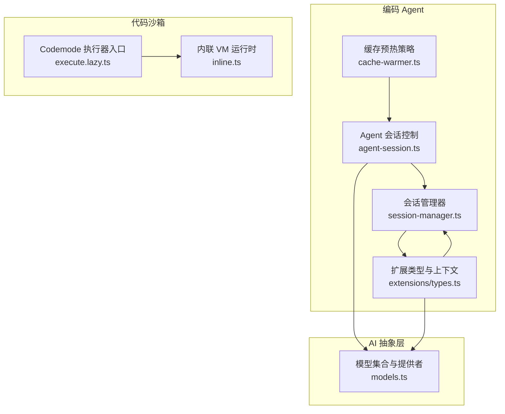
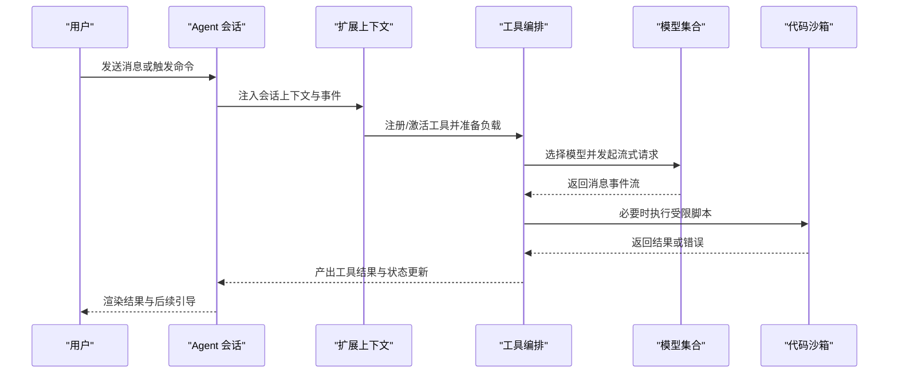
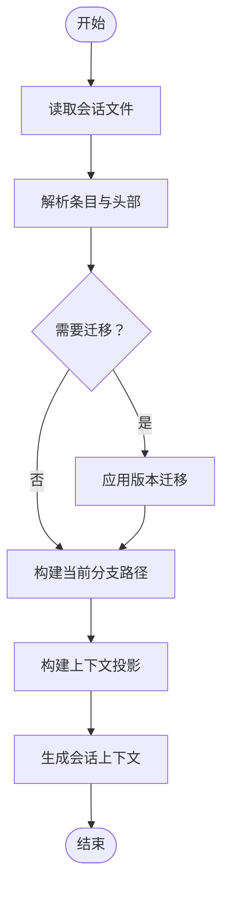
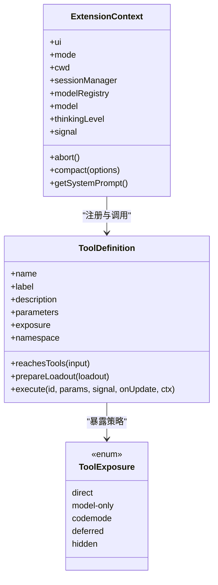
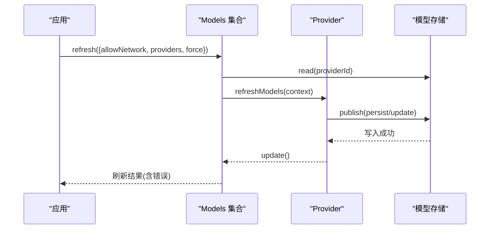
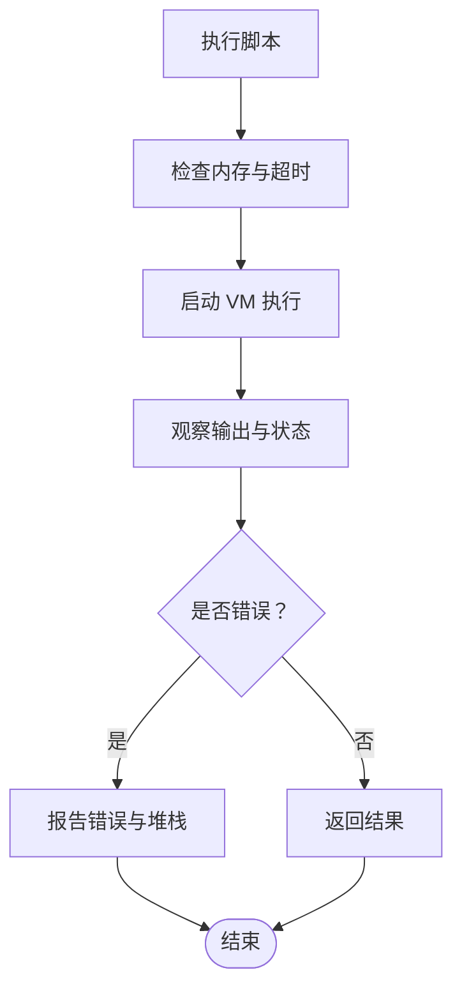
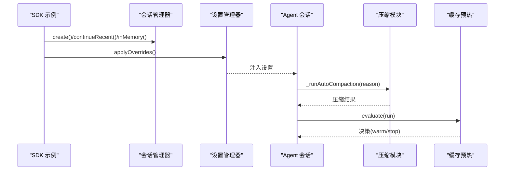
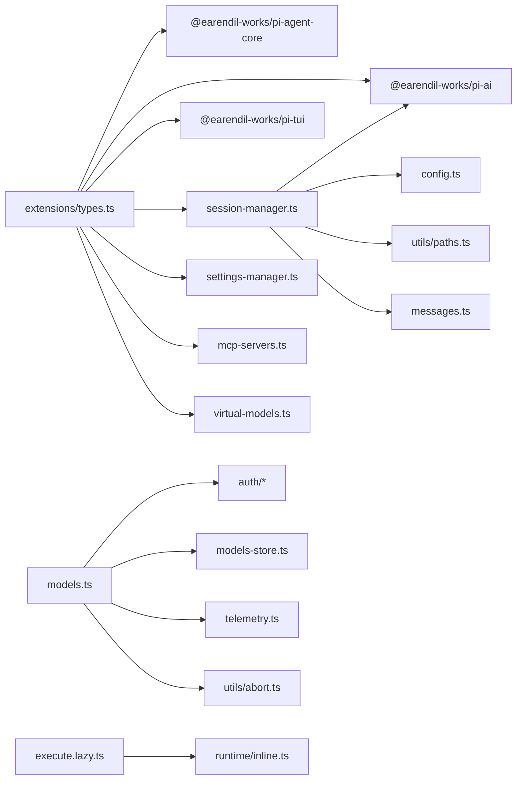

# 高级开发模式

<cite>
**本文引用的文件**
- [README.md](file://README.md)
- [session-manager.ts](file://packages/coding-agent/src/core/session-manager.ts)
- [extensions/types.ts](file://packages/coding-agent/src/core/extensions/types.ts)
- [models.ts](file://packages/ai/src/models.ts)
- [agent-session-tool-orchestration.test.ts](file://packages/coding-agent/test/suite/agent-session-tool-orchestration.test.ts)
- [11-sessions.ts](file://packages/coding-agent/examples/sdk/11-sessions.ts)
- [custom-session-id.test.ts](file://packages/coding-agent/test/session-manager/custom-session-id.test.ts)
- [load-entries.test.ts](file://packages/coding-agent/test/session-manager/load-entries.test.ts)
- [execute.lazy.ts](file://packages/coding-agent/src/extensions/codemode/execute.lazy.ts)
- [codemode README.md](file://packages/codemode/README.md)
- [inline.ts](file://packages/codemode/src/runtime/inline.ts)
- [sandbox.test.ts](file://packages/codemode/test/sandbox.test.ts)
- [10-settings.ts](file://packages/coding-agent/examples/sdk/10-settings.ts)
- [agent-session-compaction.test.ts](file://packages/coding-agent/test/suite/agent-session-compaction.test.ts)
- [compaction/index.ts](file://packages/coding-agent/src/core/compaction/index.ts)
- [cache-warmer.ts](file://packages/coding-agent/src/core/cache-warmer.ts)
</cite>

## 目录
1. [引言](#引言)
2. [项目结构](#项目结构)
3. [核心组件](#核心组件)
4. [架构总览](#架构总览)
5. [详细组件分析](#详细组件分析)
6. [依赖关系分析](#依赖关系分析)
7. [性能与资源管理](#性能与资源管理)
8. [故障排查指南](#故障排查指南)
9. [结论](#结论)

## 引言
本指南面向高级开发者，聚焦 Pi 的高级扩展架构与运行时模式。内容覆盖会话管理、模型路由、工具编排、扩展协作、异步编程、错误边界、资源管理，以及工作流自动化和多步骤任务处理等复杂业务场景。文档以仓库中的实际实现为依据，通过架构图、流程图和时序图帮助读者建立从高层设计到代码级实现的完整认知。

## 项目结构
Pi 是一个多包仓库，包含 CLI、AI 抽象层、Agent 运行时、编码 Agent、TUI、MCP、Schema、Telemetry 等模块。针对高级开发模式，最关键的目录是：
- `packages/coding-agent`：交互型编码 Agent、会话管理、扩展系统、工具编排、压缩与缓存预热。
- `packages/ai`：统一的多提供商 LLM API、模型注册、认证、刷新与发布。
- `packages/codemode`：沙箱执行环境，用于安全运行脚本和工具链。

**图示来源**
- [session-manager.ts:43-227](file://packages/coding-agent/src/core/session-manager.ts#L43-L227)
- [extensions/types.ts:345-415](file://packages/coding-agent/src/core/extensions/types.ts#L345-L415)
- [models.ts:147-247](file://packages/ai/src/models.ts#L147-L247)
- [execute.lazy.ts:1-2](file://packages/coding-agent/src/extensions/codemode/execute.lazy.ts#L1-L2)
- [inline.ts:20-37](file://packages/codemode/src/runtime/inline.ts#L20-L37)

**章节来源**
- [README.md:72-84](file://README.md#L72-L84)

## 核心组件
- 会话管理器：负责会话持久化、树形分支、标签、压缩摘要、上下文投影与构建。
- 扩展系统与工具编排：定义扩展上下文、工具暴露策略、工具调用上下文、命名空间与负载准备。
- 模型路由与提供者：统一抽象 Provider/Models，支持动态刷新、认证、图像与分类能力。
- 代码沙箱：提供受限的脚本执行环境，支持内存限制、超时、终止与 Worker 生命周期跟踪。
- 压缩与缓存预热：自动或手动触发上下文压缩，结合成本模型决定是否预热缓存。

**章节来源**
- [session-manager.ts:43-227](file://packages/coding-agent/src/core/session-manager.ts#L43-L227)
- [extensions/types.ts:521-536](file://packages/coding-agent/src/core/extensions/types.ts#L521-L536)
- [models.ts:147-247](file://packages/ai/src/models.ts#L147-L247)
- [codemode README.md:58-76](file://packages/codemode/README.md#L58-L76)
- [cache-warmer.ts:373-432](file://packages/coding-agent/src/core/cache-warmer.ts#L373-L432)

## 架构总览
Pi 的高级开发模式围绕“会话—扩展—工具—模型—沙箱”五层展开：
- 会话层维护消息树、分支、标签、压缩与上下文投影。
- 扩展层提供 UI、命令、工具、事件钩子与状态共享接口。
- 工具层通过暴露策略与负载准备控制模型可见性与可调用性。
- 模型层统一认证、刷新、流式请求与图像/分类能力。
- 沙箱层隔离外部脚本执行，保障资源与稳定性。

**图示来源**
- [extensions/types.ts:345-415](file://packages/coding-agent/src/core/extensions/types.ts#L345-L415)
- [extensions/types.ts:521-536](file://packages/coding-agent/src/core/extensions/types.ts#L521-L536)
- [models.ts:324-367](file://packages/ai/src/models.ts#L324-L367)
- [codemode README.md:58-76](file://packages/codemode/README.md#L58-L76)

## 详细组件分析

### 会话管理与上下文投影
会话管理器提供：
- 会话头与会话条目类型（消息、思考级别变化、模型变更、用量、压缩、分支摘要、自定义条目、标签、会话信息等）。
- 树遍历、路径构建、上下文编辑与投影。
- 文件加载、头部扫描、最近会话发现与迁移。
- 在内存与持久化两种模式下创建、继续、列出会话。

**图示来源**
- [session-manager.ts:333-347](file://packages/coding-agent/src/core/session-manager.ts#L333-L347)
- [session-manager.ts:390-416](file://packages/coding-agent/src/core/session-manager.ts#L390-L416)
- [session-manager.ts:543-584](file://packages/coding-agent/src/core/session-manager.ts#L543-L584)

关键要点：
- 会话 ID 校验与生成：支持自定义 ID，拒绝非法字符。
- 上下文投影：将原始条目转换为模型可见的消息，考虑上下文编辑与压缩保留范围。
- 分支与标签：支持书签与分支导航，便于多步任务与回溯。

**章节来源**
- [session-manager.ts:264-284](file://packages/coding-agent/src/core/session-manager.ts#L264-L284)
- [session-manager.ts:439-584](file://packages/coding-agent/src/core/session-manager.ts#L439-L584)
- [custom-session-id.test.ts:9-30](file://packages/coding-agent/test/session-manager/custom-session-id.test.ts#L9-L30)
- [load-entries.test.ts:111-144](file://packages/coding-agent/test/session-manager/load-entries.test.ts#L111-L144)

### 扩展系统与工具编排
扩展系统定义了：
- 扩展上下文：UI、模式、工作目录、会话管理器、模型注册表、思维级别、信号与中止、上下文使用量、压缩、系统提示等。
- 工具定义：名称、标签、描述、参数 Schema、输出 Schema、暴露策略、命名空间、可达性、注解、默认激活、负载准备、执行模式、渲染器、执行函数。
- 工具暴露策略：direct、model-only、codemode、deferred、hidden，控制模型可见性与可调用性。
- 工具负载准备：调整模型看到的工具描述与隐藏声明，支持编排工具动态呈现可用工具集。

**图示来源**
- [extensions/types.ts:345-415](file://packages/coding-agent/src/core/extensions/types.ts#L345-L415)
- [extensions/types.ts:599-688](file://packages/coding-agent/src/core/extensions/types.ts#L599-L688)
- [extensions/types.ts:521-536](file://packages/coding-agent/src/core/extensions/types.ts#L521-L536)

编排示例：
- 测试中展示了“编排工具”通过 `ctx.executeTool()` 调用其他工具，并使用 `prepareLoadout` 与 `reachesTools` 控制模型可见性与可达性。

**章节来源**
- [agent-session-tool-orchestration.test.ts:10-53](file://packages/coding-agent/test/suite/agent-session-tool-orchestration.test.ts#L10-L53)
- [extensions/types.ts:521-536](file://packages/coding-agent/src/core/extensions/types.ts#L521-L536)

### 模型路由与提供者
模型层提供：
- Provider 抽象：id、name、baseUrl、auth、getModels/getAllModels、refreshModels、filterModels/filterAllModels、stream/streamSimple/fetchDeferred/cancelDeferred、generateImages/classify。
- Models 集合：注册/删除提供者、查询模型、刷新模型、认证检查、获取可用模型、流式/完成请求、图像与分类。
- 刷新与发布：并发刷新、AbortSignal 取消、generation 检查、持久化与同步更新的原子性。

**图示来源**
- [models.ts:516-543](file://packages/ai/src/models.ts#L516-L543)
- [models.ts:565-625](file://packages/ai/src/models.ts#L565-L625)

关键点：
- 刷新阶段先恢复缓存状态，再尝试网络访问；OAuth 令牌刷新与 API Key 解析均受 AbortSignal 控制。
- 发布链保证持久化与内存更新的一致性，避免竞态条件。

**章节来源**
- [models.ts:147-247](file://packages/ai/src/models.ts#L147-L247)
- [models.ts:516-543](file://packages/ai/src/models.ts#L516-L543)
- [models.ts:565-625](file://packages/ai/src/models.ts#L565-L625)

### 代码沙箱与资源管理
Codemode 沙箱提供：
- 内存限制、超时、终止、Worker 生命周期跟踪。
- 内联 VM 运行于调用栈，设置 QuickJS 堆栈保护，回调微任务调度避免重入。
- 错误报告包含脚本行号与格式化堆栈，便于调试。

**图示来源**
- [codemode README.md:58-76](file://packages/codemode/README.md#L58-L76)
- [inline.ts:20-37](file://packages/codemode/src/runtime/inline.ts#L20-L37)
- [sandbox.test.ts:218-249](file://packages/codemode/test/sandbox.test.ts#L218-L249)

**章节来源**
- [codemode README.md:58-76](file://packages/codemode/README.md#L58-L76)
- [inline.ts:20-37](file://packages/codemode/src/runtime/inline.ts#L20-L37)
- [sandbox.test.ts:218-249](file://packages/codemode/test/sandbox.test.ts#L218-L249)

### 工作流自动化与多步骤任务
典型工作流包括：
- 会话创建与继续：支持内存会话、新持久会话、继续最近会话、列出与打开特定会话。
- 设置覆盖：通过 SettingsManager 覆盖压缩、重试等配置，并在会话中生效。
- 自动压缩：根据阈值或溢出触发压缩，支持扩展拦截与自定义指令。
- 缓存预热：基于成本模型与延续概率决定预热动作。

**图示来源**
- [11-sessions.ts:1-36](file://packages/coding-agent/examples/sdk/11-sessions.ts#L1-L36)
- [10-settings.ts:1-46](file://packages/coding-agent/examples/sdk/10-settings.ts#L1-L46)
- [agent-session-compaction.test.ts:1-32](file://packages/coding-agent/test/suite/agent-session-compaction.test.ts#L1-L32)
- [compaction/index.ts:1-7](file://packages/coding-agent/src/core/compaction/index.ts#L1-L7)
- [cache-warmer.ts:373-432](file://packages/coding-agent/src/core/cache-warmer.ts#L373-L432)

**章节来源**
- [11-sessions.ts:1-36](file://packages/coding-agent/examples/sdk/11-sessions.ts#L1-L36)
- [10-settings.ts:1-46](file://packages/coding-agent/examples/sdk/10-settings.ts#L1-L46)
- [agent-session-compaction.test.ts:1-32](file://packages/coding-agent/test/suite/agent-session-compaction.test.ts#L1-L32)
- [compaction/index.ts:1-7](file://packages/coding-agent/src/core/compaction/index.ts#L1-L7)
- [cache-warmer.ts:373-432](file://packages/coding-agent/src/core/cache-warmer.ts#L373-L432)

## 依赖关系分析
- 会话管理器依赖 AI 消息类型与 UUID 生成，同时与配置、路径工具、消息构造模块耦合。
- 扩展类型依赖 Agent Core、AI、TUI、Bash、工具定义、会话管理器、设置管理器、MCP 服务器、虚拟模型等。
- 模型集合依赖认证、凭证存储、遥测、工具操作与 AbortSignal 工具。
- Codemode 沙箱依赖 WASM 模块与运行时基类。

**图示来源**
- [session-manager.ts:1-41](file://packages/coding-agent/src/core/session-manager.ts#L1-L41)
- [extensions/types.ts:11-105](file://packages/coding-agent/src/core/extensions/types.ts#L11-L105)
- [models.ts:1-74](file://packages/ai/src/models.ts#L1-L74)
- [execute.lazy.ts:1-2](file://packages/coding-agent/src/extensions/codemode/execute.lazy.ts#L1-L2)
- [inline.ts:20-37](file://packages/codemode/src/runtime/inline.ts#L20-L37)

**章节来源**
- [session-manager.ts:1-41](file://packages/coding-agent/src/core/session-manager.ts#L1-L41)
- [extensions/types.ts:11-105](file://packages/coding-agent/src/core/extensions/types.ts#L11-L105)
- [models.ts:1-74](file://packages/ai/src/models.ts#L1-L74)

## 性能与资源管理
- 会话文件 I/O：使用缓冲读取与行解析，限制头部扫描字节数，避免大文件阻塞。
- 模型刷新：并发刷新提供者，AbortSignal 控制取消，generation 检查避免过时更新。
- 沙箱资源：内存上限、超时、终止与 Worker 生命周期跟踪，防止长时间占用与内存泄漏。
- 缓存预热：基于成本与延续概率的经济模型，仅在预期节省大于阈值时预热。

优化建议：
- 对大型会话启用压缩与分支摘要，减少上下文窗口压力。
- 合理设置工具暴露策略，避免不必要的模型可见性开销。
- 在沙箱中严格限制内存与时间，配合 onWorkerStarted 跟踪 Worker 生命周期。
- 使用 SettingsManager 覆盖压缩与重试策略，平衡延迟与成本。

**章节来源**
- [session-manager.ts:605-728](file://packages/coding-agent/src/core/session-manager.ts#L605-L728)
- [models.ts:565-625](file://packages/ai/src/models.ts#L565-L625)
- [codemode README.md:58-76](file://packages/codemode/README.md#L58-L76)
- [cache-warmer.ts:373-432](file://packages/coding-agent/src/core/cache-warmer.ts#L373-L432)

## 故障排查指南
常见问题与定位方法：
- 会话 ID 非法：检查自定义 ID 是否符合规则，避免空串、前后非字母数字、非法分隔符。
- 会话加载失败：确认文件头部是否为有效 session 类型且包含 id；检查扫描限制与解析异常。
- 模型刷新错误：查看刷新结果中的 errors Map，区分 OAuth 刷新失败与 API Key 解析失败。
- 沙箱脚本错误：检查错误 kind 与 stack，确认行号与预加载帧是否被正确过滤。
- 工具编排不可达：确认 exposure 与 reachesTools 配置，确保目标工具在活跃工具集中可见。

排查步骤：
- 使用 SDK 示例创建内存会话，快速验证逻辑而不依赖文件系统。
- 通过 SettingsManager 关闭压缩或重试，隔离问题来源。
- 在扩展上下文中打印 signal 与 isIdle 状态，判断是否被中止或仍在流式处理。
- 使用工具渲染上下文中的 toolCallId 与 durationMs，定位慢调用与错误路径。

**章节来源**
- [custom-session-id.test.ts:9-30](file://packages/coding-agent/test/session-manager/custom-session-id.test.ts#L9-L30)
- [load-entries.test.ts:111-144](file://packages/coding-agent/test/session-manager/load-entries.test.ts#L111-L144)
- [models.ts:565-625](file://packages/ai/src/models.ts#L565-L625)
- [sandbox.test.ts:218-249](file://packages/codemode/test/sandbox.test.ts#L218-L249)
- [extensions/types.ts:521-536](file://packages/coding-agent/src/core/extensions/types.ts#L521-L536)

## 结论
Pi 的高级开发模式通过会话管理、扩展系统、工具编排、模型路由与代码沙箱形成完整的可扩展运行时。开发者可以：
- 使用会话管理器构建复杂的对话树与分支，结合标签与上下文编辑实现多步任务。
- 通过扩展上下文与工具暴露策略灵活编排工具链，动态调整模型可见性与可达性。
- 利用模型集合的统一抽象与刷新机制，安全地接入多个 LLM 提供商。
- 借助沙箱与资源管理策略，保障脚本执行的稳定性与安全性。
- 结合压缩与缓存预热，优化性能与成本。

这些模式共同支撑了工作流自动化、多步骤任务处理与复杂业务场景的实现，为高级开发者提供了强大而可控的开发平台。