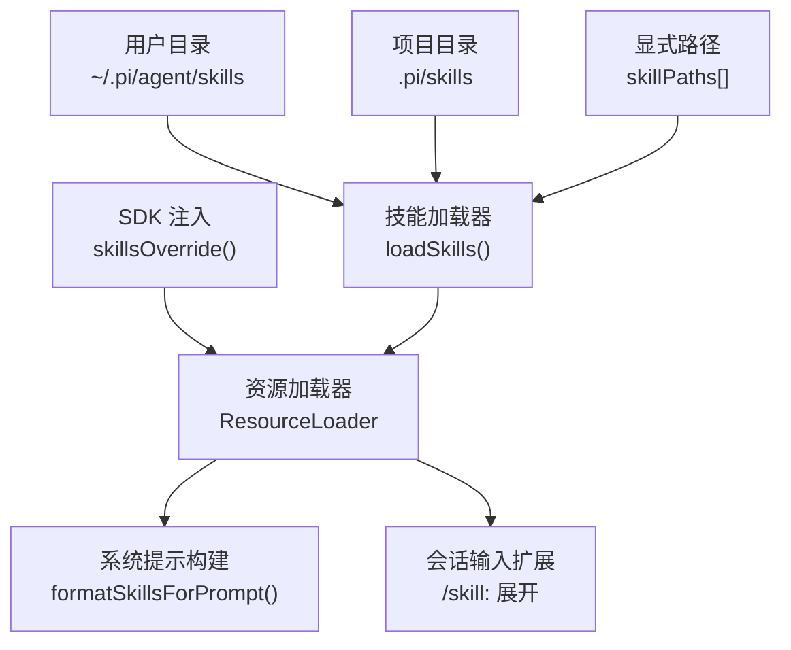
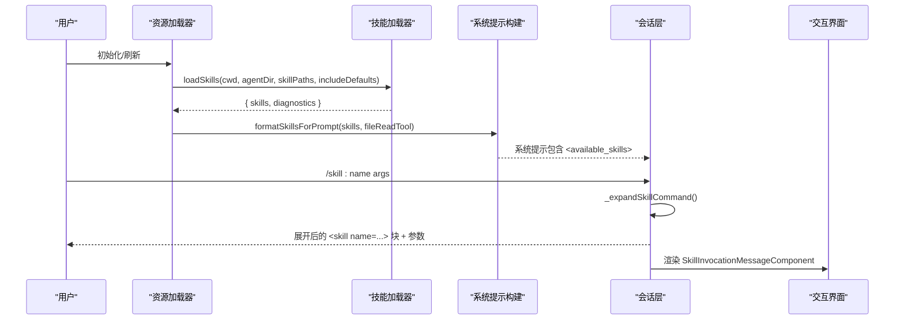
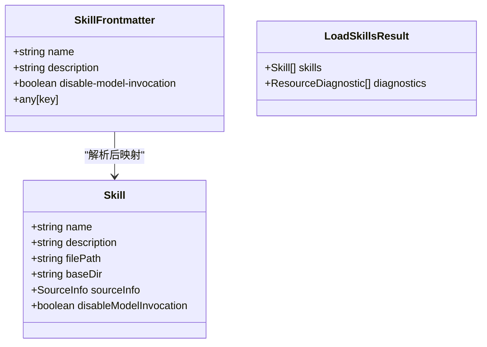
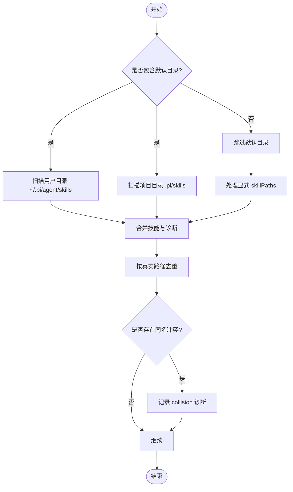
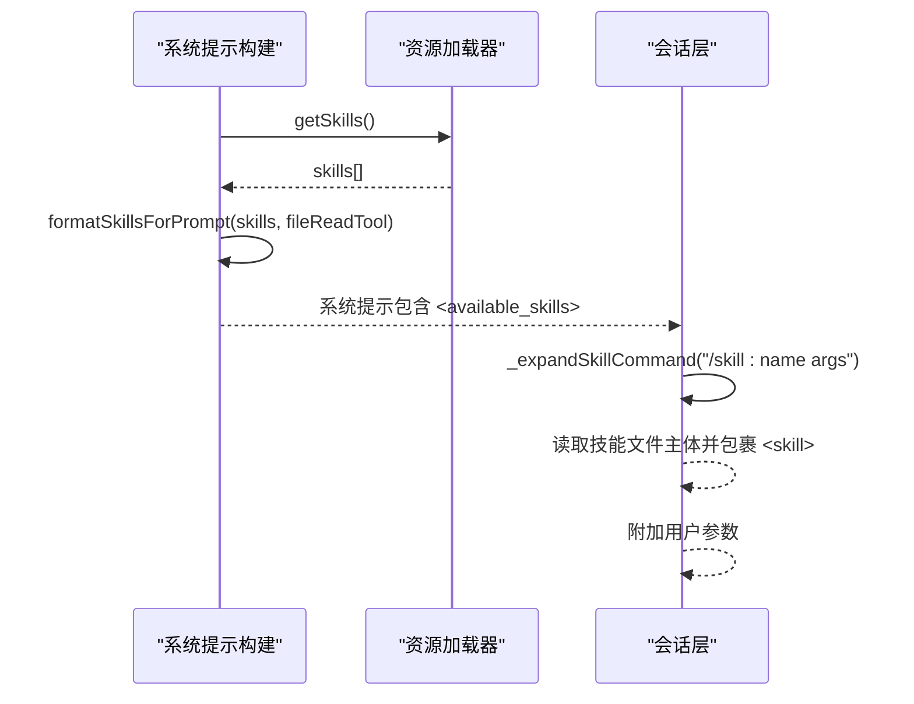
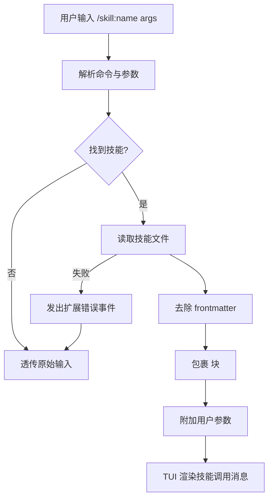
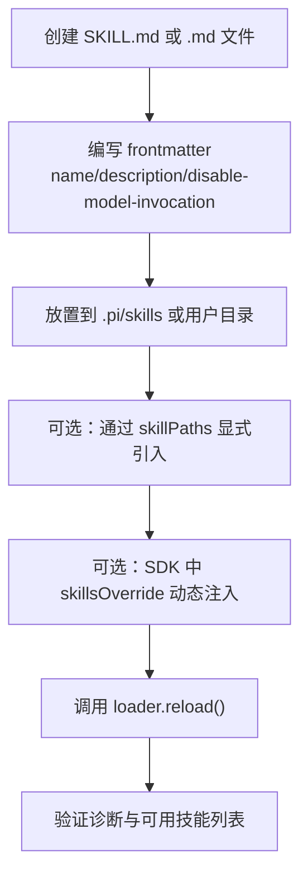
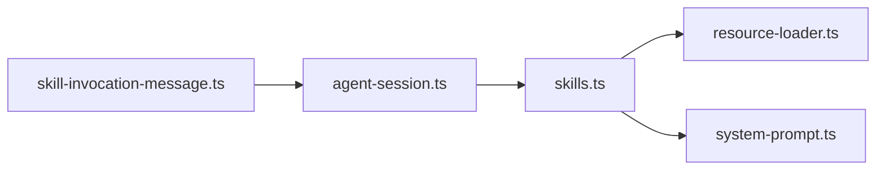

# 技能系统

<cite>
**本文引用的文件**
- [skills.ts](file://packages/coding-agent/src/core/skills.ts)
- [resource-loader.ts](file://packages/coding-agent/src/core/resource-loader.ts)
- [system-prompt.ts](file://packages/coding-agent/src/core/system-prompt.ts)
- [agent-session.ts](file://packages/coding-agent/src/core/agent-session.ts)
- [skill-invocation-message.ts](file://packages/coding-agent/src/modes/interactive/components/skill-invocation-message.ts)
- [04-skills.ts](file://packages/coding-agent/examples/sdk/04-skills.ts)
- [add-llm-provider.md](file://.pi/skills/add-llm-provider.md)
- [github-work.md](file://.pi/skills/github-work.md)
- [skills.test.ts](file://packages/coding-agent/test/skills.test.ts)
- [agent-session-prompt.test.ts](file://packages/coding-agent/test/suite/agent-session-prompt.test.ts)
</cite>

## 目录
1. [简介](#简介)
2. [项目结构中的技能位置](#项目结构中的技能位置)
3. [核心组件](#核心组件)
4. [架构总览](#架构总览)
5. [详细组件分析](#详细组件分析)
6. [依赖关系分析](#依赖关系分析)
7. [性能与可扩展性](#性能与可扩展性)
8. [故障排查](#故障排查)
9. [结论](#结论)
10. [附录：最佳实践、命名规范与版本管理](#附录最佳实践命名规范与版本管理)

## 简介
本文件系统性说明仓库中“技能系统”的定义格式、加载机制、执行流程与结果处理，覆盖技能文件结构、参数配置、上下文传递、内置技能的实现原理、自定义技能开发方法、测试与调试方式，以及最佳实践和版本管理策略。

技能是面向特定任务的指令集合，以 Markdown 文件形式存在，通过前置元数据（frontmatter）声明名称、描述等关键信息；系统在启动或刷新时扫描指定目录，解析并校验技能，将可用技能列表注入系统提示词，并在用户输入中以 `/skill:名称` 命令展开为结构化内容参与对话。

## 项目结构中的技能位置
技能可以来自多个来源：
- 用户级默认目录：Agent 配置目录下的 `skills`
- 项目级默认目录：工作目录的 `.pi/skills`
- 显式路径：通过配置传入的文件或目录
- SDK 动态注入：在运行时构造 Skill 对象并合并到资源加载器

**图表来源**
- [skills.ts:414-505](file://packages/coding-agent/src/core/skills.ts#L414-L505)
- [resource-loader.ts:880-901](file://packages/coding-agent/src/core/resource-loader.ts#L880-L901)
- [system-prompt.ts:171-181](file://packages/coding-agent/src/core/system-prompt.ts#L171-L181)
- [agent-session.ts:2274-2298](file://packages/coding-agent/src/core/agent-session.ts#L2274-L2298)

**章节来源**
- [skills.ts:414-505](file://packages/coding-agent/src/core/skills.ts#L414-L505)
- [resource-loader.ts:880-901](file://packages/coding-agent/src/core/resource-loader.ts#L880-L901)

## 核心组件
- 技能定义与数据结构：Skill、SkillFrontmatter、LoadSkillsResult
- 技能发现与解析：loadSkillsFromDir、loadSkills
- 系统提示注入：formatSkillsForPrompt
- 资源加载与覆盖：ResourceLoader.updateSkillsFromPaths、skillsOverride
- 会话执行与展开：_expandSkillCommand
- TUI 展示：SkillInvocationMessageComponent

**章节来源**
- [skills.ts:67-86](file://packages/coding-agent/src/core/skills.ts#L67-L86)
- [skills.ts:168-275](file://packages/coding-agent/src/core/skills.ts#L168-L275)
- [skills.ts:358-388](file://packages/coding-agent/src/core/skills.ts#L358-L388)
- [resource-loader.ts:880-901](file://packages/coding-agent/src/core/resource-loader.ts#L880-L901)
- [agent-session.ts:2274-2298](file://packages/coding-agent/src/core/agent-session.ts#L2274-L2298)
- [skill-invocation-message.ts:1-36](file://packages/coding-agent/src/modes/interactive/components/skill-invocation-message.ts#L1-L36)

## 架构总览
技能系统贯穿“加载—注入—执行—展示”四个阶段：
1. 加载：从用户目录、项目目录、显式路径扫描 SKILL.md 或顶层 .md 文件，解析 frontmatter，校验名称与描述，生成 Skill 对象。
2. 注入：将可用技能序列化为 XML 片段，写入系统提示，指导模型如何读取技能文件。
3. 执行：用户输入 `/skill:名称 参数`，会话层读取技能文件主体，包裹为 `<skill>` 块并附加参数。
4. 展示：TUI 渲染技能调用消息，支持折叠/展开。

**图表来源**
- [skills.ts:414-505](file://packages/coding-agent/src/core/skills.ts#L414-L505)
- [skills.ts:358-388](file://packages/coding-agent/src/core/skills.ts#L358-L388)
- [system-prompt.ts:171-181](file://packages/coding-agent/src/core/system-prompt.ts#L171-L181)
- [agent-session.ts:2274-2298](file://packages/coding-agent/src/core/agent-session.ts#L2274-L2298)
- [skill-invocation-message.ts:1-36](file://packages/coding-agent/src/modes/interactive/components/skill-invocation-message.ts#L1-L36)

## 详细组件分析

### 技能定义格式与数据结构
- 文件约定：
  - 目录根包含 `SKILL.md` 时，该目录视为一个技能根，不再递归其子目录。
  - 否则，直接加载根目录下 `.md` 文件，但非 `SKILL.md` 的文件必须提供有效的 description。
- Frontmatter 字段：
  - name：技能标识名，遵循命名规范。
  - description：技能用途描述，必填且长度受限。
  - disable-model-invocation：布尔值，若为 true，则不注入系统提示，仅允许通过 `/skill:` 命令显式调用。
  - 其他任意键：作为扩展参数保留。
- 运行时 Skill 对象：
  - name、description、filePath、baseDir、sourceInfo、disableModelInvocation。

**图表来源**
- [skills.ts:67-86](file://packages/coding-agent/src/core/skills.ts#L67-L86)

**章节来源**
- [skills.ts:67-86](file://packages/coding-agent/src/core/skills.ts#L67-L86)
- [skills.ts:277-345](file://packages/coding-agent/src/core/skills.ts#L277-L345)

### 技能发现与加载机制
- 扫描规则：
  - 优先查找 `SKILL.md`，找到即视为技能根，停止继续递归。
  - 未找到 `SKILL.md` 时，加载根目录下的 `.md` 文件（需满足 description 要求）。
  - 递归进入子目录继续查找 `SKILL.md`。
  - 忽略隐藏文件和 `node_modules`，尊重 `.gitignore`、`.ignore`、`.fdignore`。
- 冲突与去重：
  - 使用真实路径去重，避免符号链接重复加载。
  - 同名技能发生碰撞时，记录 collision 诊断，保留先加载的技能。
- 来源标记：
  - user：用户目录
  - project：项目目录
  - path：显式路径
  - 其他扩展来源由 extension runner 注入。

**图表来源**
- [skills.ts:168-275](file://packages/coding-agent/src/core/skills.ts#L168-L275)
- [skills.ts:414-505](file://packages/coding-agent/src/core/skills.ts#L414-L505)

**章节来源**
- [skills.ts:168-275](file://packages/coding-agent/src/core/skills.ts#L168-L275)
- [skills.ts:414-505](file://packages/coding-agent/src/core/skills.ts#L414-L505)

### 系统提示注入与上下文传递
- 注入时机：构建系统提示时，根据当前工具可用性选择文件读取方式（read、bash 或 indirect），将可用技能序列化为 XML 片段。
- 可见性控制：disable-model-invocation=true 的技能不会出现在系统提示中，只能通过 `/skill:` 命令显式调用。
- 上下文传递：
  - 系统提示中包含 `<available_skills>`，列出每个技能的 name、description、location。
  - 会话层在执行 `/skill:` 命令时，读取技能文件主体，去除 frontmatter，并以 `<skill name=... location=...>` 包裹，同时附带用户参数。

**图表来源**
- [system-prompt.ts:171-181](file://packages/coding-agent/src/core/system-prompt.ts#L171-L181)
- [skills.ts:358-388](file://packages/coding-agent/src/core/skills.ts#L358-L388)
- [agent-session.ts:2274-2298](file://packages/coding-agent/src/core/agent-session.ts#L2274-L2298)

**章节来源**
- [system-prompt.ts:171-181](file://packages/coding-agent/src/core/system-prompt.ts#L171-L181)
- [skills.ts:358-388](file://packages/coding-agent/src/core/skills.ts#L358-L388)
- [agent-session.ts:2274-2298](file://packages/coding-agent/src/core/agent-session.ts#L2274-L2298)

### 执行流程与结果处理
- 命令解析：
  - 识别 `/skill:` 前缀，提取技能名与参数。
  - 从资源加载器的技能列表中查找匹配技能。
- 文件读取与展开：
  - 读取技能文件全文，去除 frontmatter，得到正文。
  - 生成 `<skill name="..." location="...">` 块，附加相对路径说明与用户参数。
- 错误处理：
  - 读取失败时，通过扩展运行器发出 error 事件，返回原始输入以避免中断流程。
- TUI 展示：
  - 使用 SkillInvocationMessageComponent 渲染技能调用消息，支持折叠/展开状态。

**图表来源**
- [agent-session.ts:2274-2298](file://packages/coding-agent/src/core/agent-session.ts#L2274-L2298)
- [skill-invocation-message.ts:1-36](file://packages/coding-agent/src/modes/interactive/components/skill-invocation-message.ts#L1-L36)

**章节来源**
- [agent-session.ts:2274-2298](file://packages/coding-agent/src/core/agent-session.ts#L2274-L2298)
- [skill-invocation-message.ts:1-36](file://packages/coding-agent/src/modes/interactive/components/skill-invocation-message.ts#L1-L36)

### 内置技能示例与实现原理
- 内置技能位于 `.pi/skills`，例如：
  - add-llm-provider.md：添加新 LLM provider 的检查清单，涵盖类型、API 实现、注册、测试矩阵、文档等步骤。
  - github-work.md：GitHub issue/PR 工作流程，引用 `.pi/prompts` 模板并按请求类型选择对应模板。
- 这些技能以 Markdown 形式提供任务指引，配合系统提示与命令展开机制，引导模型按既定流程完成任务。

**章节来源**
- [add-llm-provider.md:1-57](file://.pi/skills/add-llm-provider.md#L1-L57)
- [github-work.md:1-22](file://.pi/skills/github-work.md#L1-L22)

### 自定义技能开发方法
- 创建技能文件：
  - 在项目 `.pi/skills` 或用户 `~/.pi/agent/skills` 下新建目录，放置 `SKILL.md`。
  - 或在任意目录放置 `.md` 文件并通过 `skillPaths` 显式引入。
- 编写 frontmatter：
  - name：符合命名规范的小写字母、数字、连字符组合。
  - description：清晰描述技能用途，长度不超过限制。
  - disable-model-invocation：如需仅通过命令调用，设为 true。
- 运行时注入：
  - 使用 SDK 示例中的 `skillsOverride` 过滤或追加自定义 Skill 对象。
  - 通过 `DefaultResourceLoader` 的 `reload()` 触发重新加载。

**图表来源**
- [04-skills.ts:17-38](file://packages/coding-agent/examples/sdk/04-skills.ts#L17-L38)
- [skills.ts:277-345](file://packages/coding-agent/src/core/skills.ts#L277-L345)

**章节来源**
- [04-skills.ts:17-38](file://packages/coding-agent/examples/sdk/04-skills.ts#L17-L38)
- [skills.ts:277-345](file://packages/coding-agent/src/core/skills.ts#L277-L345)

## 依赖关系分析
- 模块耦合：
  - skills.ts 被 resource-loader.ts 调用以加载技能。
  - system-prompt.ts 调用 formatSkillsForPrompt 注入系统提示。
  - agent-session.ts 在用户输入阶段执行 _expandSkillCommand。
  - TUI 组件 skill-invocation-message.ts 负责展示技能调用消息。
- 外部依赖：
  - ignore 库用于解析 .gitignore 等忽略规则。
  - fs/path 用于文件系统操作与路径处理。
  - frontmatter 解析工具用于解析 YAML frontmatter。

**图表来源**
- [resource-loader.ts:880-901](file://packages/coding-agent/src/core/resource-loader.ts#L880-L901)
- [system-prompt.ts:171-181](file://packages/coding-agent/src/core/system-prompt.ts#L171-L181)
- [agent-session.ts:2274-2298](file://packages/coding-agent/src/core/agent-session.ts#L2274-L2298)
- [skill-invocation-message.ts:1-36](file://packages/coding-agent/src/modes/interactive/components/skill-invocation-message.ts#L1-L36)

**章节来源**
- [resource-loader.ts:880-901](file://packages/coding-agent/src/core/resource-loader.ts#L880-L901)
- [system-prompt.ts:171-181](file://packages/coding-agent/src/core/system-prompt.ts#L171-L181)
- [agent-session.ts:2274-2298](file://packages/coding-agent/src/core/agent-session.ts#L2274-L2298)
- [skill-invocation-message.ts:1-36](file://packages/coding-agent/src/modes/interactive/components/skill-invocation-message.ts#L1-L36)

## 性能与可扩展性
- 扫描优化：
  - 遇到 `SKILL.md` 立即返回，避免无谓递归。
  - 忽略隐藏文件与 `node_modules`，减少 IO 开销。
  - 使用 ignore 库统一处理忽略规则，提升可维护性。
- 去重与冲突：
  - 基于真实路径去重，避免符号链接导致的重复加载。
  - 同名冲突记录诊断，便于定位与修复。
- 可扩展点：
  - skillsOverride 允许运行时过滤、合并、替换技能。
  - sourceInfo 支持扩展来源（如 SDK、extension runner）注入。

[本节为通用性能讨论，不直接分析具体文件]

## 故障排查
- 常见问题：
  - 技能未被加载：检查路径是否存在、是否为 .md 文件、是否被忽略规则排除。
  - 名称无效：确保 name 仅包含小写字母、数字、连字符，且不连续出现连字符，不以连字符开头或结尾。
  - 描述缺失：非 `SKILL.md` 文件必须提供有效 description。
  - 冲突警告：同名技能导致 collision 诊断，确认优先级与来源。
- 调试建议：
  - 查看 diagnostics 输出，定位 warning 与 collision。
  - 使用 SDK 示例中的 `getSkills()` 打印已加载技能列表。
  - 在 TUI 中观察技能调用消息是否正确渲染。

**章节来源**
- [skills.ts:92-127](file://packages/coding-agent/src/core/skills.ts#L92-L127)
- [skills.ts:277-345](file://packages/coding-agent/src/core/skills.ts#L277-L345)
- [skills.ts:414-505](file://packages/coding-agent/src/core/skills.ts#L414-L505)

## 结论
技能系统通过标准化的 Markdown 文件与 frontmatter 定义，结合灵活的加载机制与清晰的执行流程，为模型提供了可插拔的任务指令能力。系统在保证安全与一致性的前提下，支持用户与项目级别的技能组织、运行时动态注入、命令展开与 TUI 展示，具备良好的可扩展性与可维护性。

[本节为总结性内容，不直接分析具体文件]

## 附录：最佳实践、命名规范与版本管理

### 最佳实践
- 将复杂任务拆分为多个细粒度技能，每个技能聚焦单一职责。
- 使用 `SKILL.md` 明确技能边界，避免歧义。
- 对需要严格控制的技能设置 `disable-model-invocation=true`，仅通过命令调用。
- 在项目中复用 `.pi/prompts` 模板，保持流程一致性。

### 命名规范
- name 仅允许小写字母 a-z、数字 0-9 与连字符 `-`。
- 不得以连字符开头或结尾，不得出现连续连字符。
- 长度不超过最大限制（由实现定义）。

### 版本管理策略
- 将技能纳入版本控制系统，随代码变更同步更新。
- 在 CHANGELOG 或相关文档中记录技能变更。
- 对于跨包变更（如新增 provider），遵循现有 checklist（参考 add-llm-provider.md）。

### 测试与调试
- 单元测试：
  - 验证 loadSkillsFromDir 的扫描行为与忽略规则。
  - 验证冲突检测与去重逻辑。
  - 验证 ~ 路径展开与斜杠规范化。
- 集成测试：
  - 验证 `/skill:` 命令展开后的提示内容。
  - 验证 TUI 渲染技能调用消息。

**章节来源**
- [skills.test.ts:30-98](file://packages/coding-agent/test/skills.test.ts#L30-L98)
- [skills.test.ts:375-432](file://packages/coding-agent/test/skills.test.ts#L375-L432)
- [agent-session-prompt.test.ts:206-251](file://packages/coding-agent/test/suite/agent-session-prompt.test.ts#L206-L251)