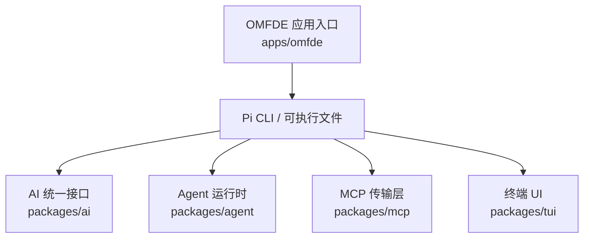
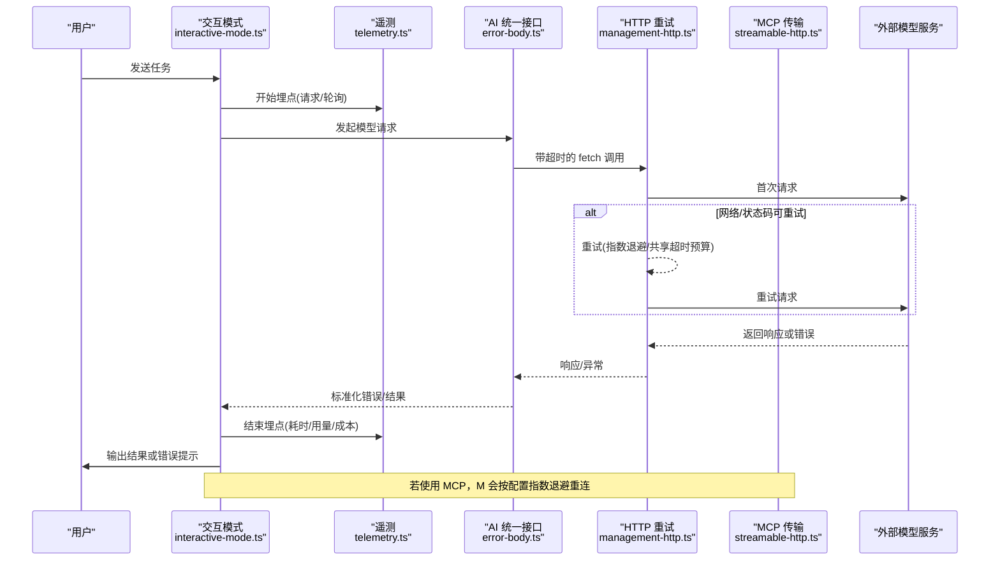
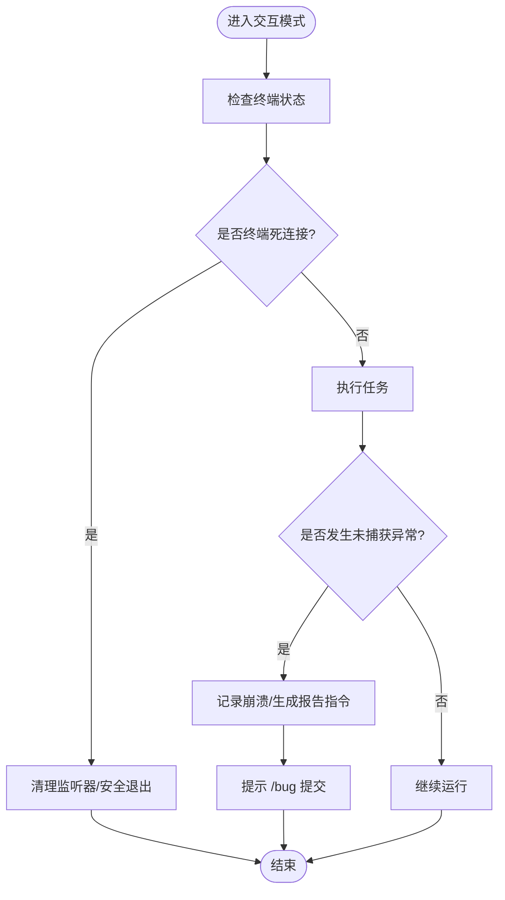
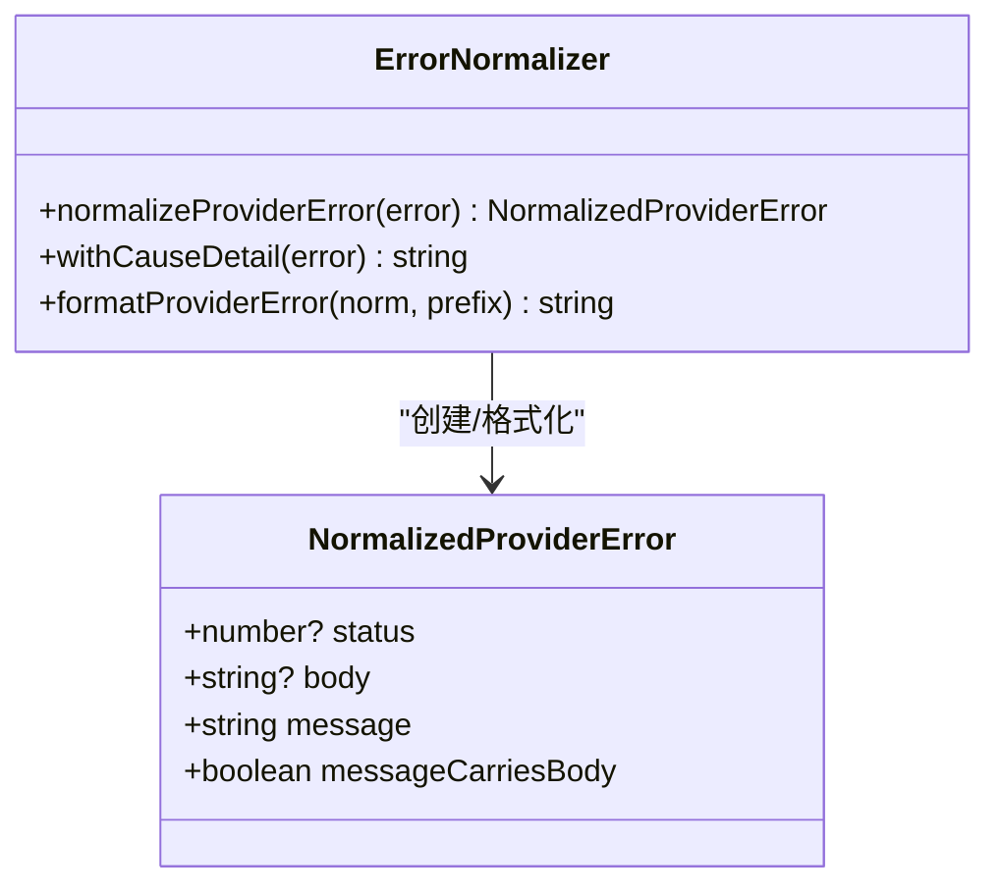
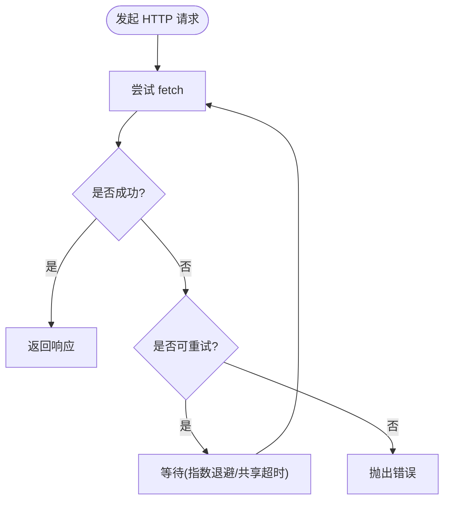
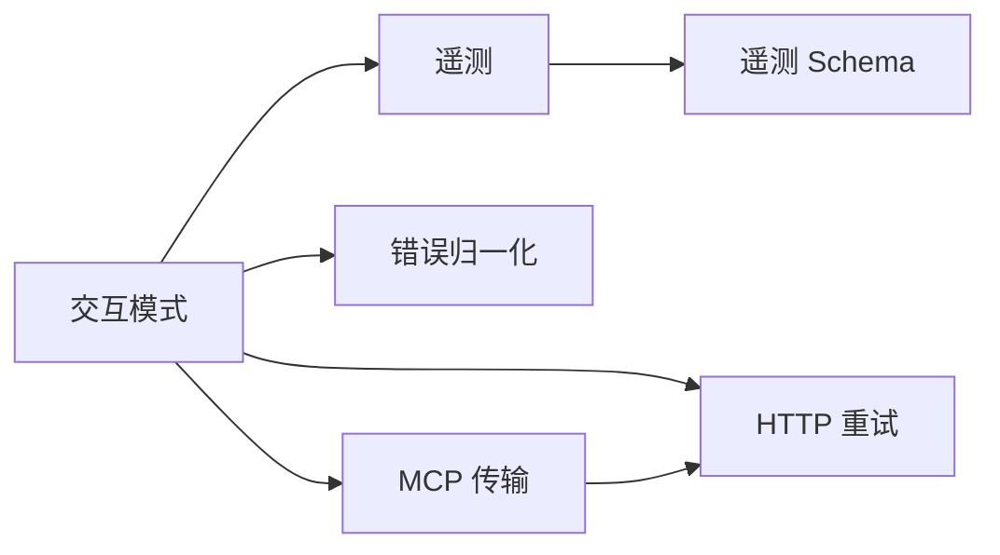

# 故障排除

<cite>
**本文引用的文件**   
- [README.md](file://README.md)
- [apps/omfde/README.md](file://apps/omfde/README.md)
- [packages/coding-agent/src/modes/interactive/interactive-mode.ts](file://packages/coding-agent/src/modes/interactive/interactive-mode.ts)
- [packages/ai/src/utils/error-body.ts](file://packages/ai/src/utils/error-body.ts)
- [packages/mcp/src/oauth/errors.ts](file://packages/mcp/src/oauth/errors.ts)
- [packages/coding-agent/examples/extensions/debug-provider.ts](file://packages/coding-agent/examples/extensions/debug-provider.ts)
- [packages/ai/src/telemetry.ts](file://packages/ai/src/telemetry.ts)
- [packages/coding-agent/src/utils/management-http.ts](file://packages/coding-agent/src/utils/management-http.ts)
- [packages/mcp/src/transports/streamable-http.ts](file://packages/mcp/src/transports/streamable-http.ts)
- [scripts/read-tool-stats.mjs](file://scripts/read-tool-stats.mjs)
- [scripts/edit-tool-stats.mjs](file://scripts/edit-tool-stats.mjs)
- [scripts/stats.ts](file://scripts/stats.ts)
- [scripts/cost.ts](file://scripts/cost.ts)
- [packages/schema/test/bench/memory.ts](file://packages/schema/test/bench/memory.ts)
- [packages/coding-agent/test/suite/regressions/6904-dns-transport-retry.test.ts](file://packages/coding-agent/test/suite/regressions/6904-dns-transport-retry.test.ts)
</cite>

## 目录
1. [简介](#简介)
2. [项目结构](#项目结构)
3. [核心组件](#核心组件)
4. [架构总览](#架构总览)
5. [详细组件分析](#详细组件分析)
6. [依赖关系分析](#依赖关系分析)
7. [性能注意事项](#性能注意事项)
8. [故障排除指南](#故障排除指南)
9. [结论](#结论)
10. [附录](#附录)

## 简介
本指南面向使用 Pi（Pi Coding Agent）与 OMFDE 平台的用户与维护者，聚焦常见问题的诊断方法、错误信息解释、解决方案，以及性能问题排查、内存泄漏检测、网络问题诊断等高级技巧。文档同时提供日志分析方法、调试工具使用建议、社区支持渠道，并包含实际案例与解决过程，帮助你快速定位和解决问题。

## 项目结构
OMFDE 平台在仓库中以 apps/omfde 作为可运行入口，当前是一个薄启动器：解析 monorepo 中的 pi 可执行文件，设置 OMFDE_PLATFORM=1，并将参数原样传给 Pi。Pi 的核心能力由 packages 下的多个子包提供，包括 AI 统一接口、Agent 运行时、MCP 传输、TUI 等。

图表来源
- [apps/omfde/README.md:1-14](file://apps/omfde/README.md#L1-L14)
- [README.md:56-69](file://README.md#L56-L69)

章节来源
- [apps/omfde/README.md:1-14](file://apps/omfde/README.md#L1-L14)
- [README.md:56-69](file://README.md#L56-L69)

## 核心组件
- 交互模式与崩溃处理：负责捕获未捕获异常、记录崩溃、提示用户提交 bug、识别扩展相关堆栈、处理终端死连接等。
- 提供者错误归一化：将不同 SDK 的错误对象标准化为统一结构，提取 HTTP 状态码、响应体、消息文本，避免“无体”或“未知错误”的模糊信息。
- MCP OAuth 错误类型：定义 OAuth 相关的专用错误类，便于区分授权失败、颁发者不匹配、不安全端点、动态注册失败等场景。
- 调试扩展：提供 provider 事件捕获命令，帮助观察原始流式事件，辅助定位模型调用链路问题。
- 遥测与指标：对模型请求进行埋点，统计耗时、首块时间、token 用量、成本等，用于性能分析与成本审计。
- 重试与重连：管理 HTTP 请求的重试策略与超时控制；MCP 传输层实现指数退避重连。

章节来源
- [packages/coding-agent/src/modes/interactive/interactive-mode.ts:298-324](file://packages/coding-agent/src/modes/interactive/interactive-mode.ts#L298-L324)
- [packages/coding-agent/src/modes/interactive/interactive-mode.ts:2248-2293](file://packages/coding-agent/src/modes/interactive/interactive-mode.ts#L2248-L2293)
- [packages/ai/src/utils/error-body.ts:1-179](file://packages/ai/src/utils/error-body.ts#L1-L179)
- [packages/mcp/src/oauth/errors.ts:1-67](file://packages/mcp/src/oauth/errors.ts#L1-L67)
- [packages/coding-agent/examples/extensions/debug-provider.ts:1-91](file://packages/coding-agent/examples/extensions/debug-provider.ts#L1-L91)
- [packages/ai/src/telemetry.ts:1-211](file://packages/ai/src/telemetry.ts#L1-L211)
- [packages/coding-agent/src/utils/management-http.ts:43-78](file://packages/coding-agent/src/utils/management-http.ts#L43-L78)
- [packages/mcp/src/transports/streamable-http.ts:547-579](file://packages/mcp/src/transports/streamable-http.ts#L547-L579)

## 架构总览
下图展示从用户输入到模型调用的关键路径，以及错误处理、重试、遥测与调试扩展的协作关系。

图表来源
- [packages/coding-agent/src/modes/interactive/interactive-mode.ts:298-324](file://packages/coding-agent/src/modes/interactive/interactive-mode.ts#L298-L324)
- [packages/ai/src/telemetry.ts:121-211](file://packages/ai/src/telemetry.ts#L121-L211)
- [packages/ai/src/utils/error-body.ts:40-164](file://packages/ai/src/utils/error-body.ts#L40-L164)
- [packages/coding-agent/src/utils/management-http.ts:43-78](file://packages/coding-agent/src/utils/management-http.ts#L43-L78)
- [packages/mcp/src/transports/streamable-http.ts:547-579](file://packages/mcp/src/transports/streamable-http.ts#L547-L579)

## 详细组件分析

### 交互模式与崩溃处理
- 功能要点
  - 识别“终端已死”错误（EIO/EPIPE/ENOTCONN/ENOTTY），避免在挂起或撤销的 tty 上继续读写。
  - 记录崩溃并生成后续报告指令，必要时提示禁用可疑扩展。
  - 通过扩展堆栈匹配给出“可能涉及的扩展”提示，帮助用户隔离问题。
- 常见问题
  - 终端断开后进程卡住或报错。
  - 扩展导致崩溃，难以定位。
- 诊断步骤
  - 查看崩溃记录与提示，确认是否涉及扩展。
  - 使用 /bug 提交崩溃详情。
  - 临时禁用扩展复现问题。
- 优化建议
  - 在扩展中妥善处理 stdin/stdout 生命周期，避免残留监听器。

图表来源
- [packages/coding-agent/src/modes/interactive/interactive-mode.ts:298-324](file://packages/coding-agent/src/modes/interactive/interactive-mode.ts#L298-L324)
- [packages/coding-agent/src/modes/interactive/interactive-mode.ts:2248-2293](file://packages/coding-agent/src/modes/interactive/interactive-mode.ts#L2248-L2293)

章节来源
- [packages/coding-agent/src/modes/interactive/interactive-mode.ts:298-324](file://packages/coding-agent/src/modes/interactive/interactive-mode.ts#L298-L324)
- [packages/coding-agent/src/modes/interactive/interactive-mode.ts:2248-2293](file://packages/coding-agent/src/modes/interactive/interactive-mode.ts#L2248-L2293)

### 提供者错误归一化
- 功能要点
  - 从多种 SDK 错误对象中提取 HTTP 状态码与响应体，避免“Unknown: UnknownError”。
  - 当 message 已经携带 body 时，避免重复打印。
  - 对连接级失败，沿 cause 链查找最深层原因，附加 code 提升可读性。
- 常见问题
  - 代理网关返回非 2xx 但 SDK 无法折叠 body，导致错误信息不完整。
  - 连接失败只显示通用消息，丢失底层原因。
- 诊断步骤
  - 查看标准化后的 status/body/message。
  - 关注 withCauseDetail 输出的深层原因。
- 优化建议
  - 在 catch 块中使用 normalizeProviderError/formatProviderError 统一错误展示。

图表来源
- [packages/ai/src/utils/error-body.ts:20-57](file://packages/ai/src/utils/error-body.ts#L20-L57)
- [packages/ai/src/utils/error-body.ts:68-83](file://packages/ai/src/utils/error-body.ts#L68-L83)
- [packages/ai/src/utils/error-body.ts:157-164](file://packages/ai/src/utils/error-body.ts#L157-L164)

章节来源
- [packages/ai/src/utils/error-body.ts:1-179](file://packages/ai/src/utils/error-body.ts#L1-L179)

### MCP OAuth 错误类型
- 功能要点
  - OAuthError：通用 OAuth 错误，携带 code 与 errorUri。
  - OAuthIssuerMismatchError：颁发者不匹配，携带 expected/received。
  - OAuthInsecureEndpointError：拒绝向非 HTTPS 端点发送凭证。
  - OAuthRegistrationError：动态客户端注册失败，携带 status/body。
  - McpOAuthAuthorizationRequiredError：需要用户交互。
  - McpRefreshLockBusyError：刷新令牌锁被其他进程占用。
- 常见问题
  - 授权流程失败、颁发者不一致、端点不安全、并发刷新冲突。
- 诊断步骤
  - 根据错误名称与字段判断具体原因。
  - 修正端点协议、颁发者配置或并发访问策略。

章节来源
- [packages/mcp/src/oauth/errors.ts:1-67](file://packages/mcp/src/oauth/errors.ts#L1-L67)

### 调试扩展：provider 事件捕获
- 功能要点
  - 提供 /debug-provider 命令开关捕获原始 provider 流事件。
  - 在 turn_start 至 message_end 期间收集事件，并在 turn_end 追加条目。
  - 在 TUI 中以自定义条目渲染，展开查看 JSON 事件。
- 常见问题
  - 模型调用链路行为异常，需观察原始事件。
- 诊断步骤
  - 启用 debug-provider，复现问题，查看事件序列。
  - 结合遥测指标与错误信息定位瓶颈或异常分支。

章节来源
- [packages/coding-agent/examples/extensions/debug-provider.ts:1-91](file://packages/coding-agent/examples/extensions/debug-provider.ts#L1-L91)

### 遥测与指标
- 功能要点
  - 定义 pi.ai.request/pi.ai.poll 跨度，记录 stopReason、usage、cost、responseId。
  - 统计 first_chunk 时间、请求时长、token 用量、成本。
  - 对 toolcall/text/thinking 内容块计数字符数，便于分析负载。
- 常见问题
  - 请求慢、首块延迟高、token 用量异常、成本飙升。
- 诊断步骤
  - 查看遥测跨度与指标，定位慢环节。
  - 结合 provider 事件与错误信息分析。

章节来源
- [packages/ai/src/telemetry.ts:1-211](file://packages/ai/src/telemetry.ts#L1-L211)

### 重试与重连
- 功能要点
  - management-http.ts：fetchWithRetry 支持共享超时预算、尝试超时、可重试状态码、取消信号。
  - streamable-http.ts：MCP 传输层指数退避重连，支持服务器指定延迟、最大延迟、最大重试次数。
- 常见问题
  - DNS 解析失败、瞬时 5xx、服务端繁忙、连接初始化阻塞。
- 诊断步骤
  - 检查重试次数、退避策略、超时配置。
  - 验证网络连通性与服务端状态。

图表来源
- [packages/coding-agent/src/utils/management-http.ts:43-78](file://packages/coding-agent/src/utils/management-http.ts#L43-L78)
- [packages/mcp/src/transports/streamable-http.ts:547-579](file://packages/mcp/src/transports/streamable-http.ts#L547-L579)

章节来源
- [packages/coding-agent/src/utils/management-http.ts:43-78](file://packages/coding-agent/src/utils/management-http.ts#L43-L78)
- [packages/mcp/src/transports/streamable-http.ts:547-579](file://packages/mcp/src/transports/streamable-http.ts#L547-L579)

## 依赖关系分析
- 低耦合设计
  - AI 统一接口与错误归一化解耦于具体 SDK，便于替换与测试。
  - 重试逻辑独立于业务，适用于管理与 MCP 场景。
- 直接依赖
  - 交互模式依赖遥测、错误归一化、MCP 传输。
  - MCP 传输依赖重试与重连策略。
- 潜在循环依赖
  - 通过模块职责划分避免循环引用；扩展与 TUI 仅消费 API。

图表来源
- [packages/coding-agent/src/modes/interactive/interactive-mode.ts:298-324](file://packages/coding-agent/src/modes/interactive/interactive-mode.ts#L298-L324)
- [packages/ai/src/telemetry.ts:1-211](file://packages/ai/src/telemetry.ts#L1-L211)
- [packages/ai/src/utils/error-body.ts:1-179](file://packages/ai/src/utils/error-body.ts#L1-L179)
- [packages/coding-agent/src/utils/management-http.ts:43-78](file://packages/coding-agent/src/utils/management-http.ts#L43-L78)
- [packages/mcp/src/transports/streamable-http.ts:547-579](file://packages/mcp/src/transports/streamable-http.ts#L547-L579)

## 性能注意事项
- 首块延迟与请求时长
  - 通过遥测指标 pi.ai.first_chunk.duration 与 pi.ai.request.duration 定位慢环节。
- Token 用量与成本
  - 监控 pi.ai.tokens 与 pi.ai.cost，识别异常增长。
- 工具调用与内容块大小
  - 通过遥测事件统计 text/thinking/tool_call 块的字符数，评估负载。
- 会话与工具统计
  - 使用 scripts/read-tool-stats.mjs 与 scripts/edit-tool-stats.mjs 分析工具调用分布、膨胀率、大替换量。
- 成本统计
  - 使用 scripts/cost.ts 与 scripts/stats.ts 汇总历史会话的成本与用量。

章节来源
- [packages/ai/src/telemetry.ts:64-105](file://packages/ai/src/telemetry.ts#L64-L105)
- [scripts/read-tool-stats.mjs:359-385](file://scripts/read-tool-stats.mjs#L359-L385)
- [scripts/edit-tool-stats.mjs:412-442](file://scripts/edit-tool-stats.mjs#L412-L442)
- [scripts/cost.ts:1-45](file://scripts/cost.ts#L1-L45)
- [scripts/stats.ts:120-153](file://scripts/stats.ts#L120-L153)

## 故障排除指南

### 常见问题与解决方案
- 终端死连接导致进程异常
  - 现象：EIO/EPIPE/ENOTCONN/ENOTTY 错误，进程卡住或退出。
  - 处理：清理 stdin/stdout 监听器，安全退出；避免在挂起 tty 上继续 IO。
  - 参考：[packages/coding-agent/src/modes/interactive/interactive-mode.ts:298-324](file://packages/coding-agent/src/modes/interactive/interactive-mode.ts#L298-L324)
- 扩展导致的崩溃
  - 现象：未捕获异常，堆栈中出现扩展路径。
  - 处理：禁用可疑扩展，使用 /bug 提交崩溃详情。
  - 参考：[packages/coding-agent/src/modes/interactive/interactive-mode.ts:2248-2293](file://packages/coding-agent/src/modes/interactive/interactive-mode.ts#L2248-L2293)
- 提供者错误信息不完整
  - 现象：显示“Unknown: UnknownError”或“403 status code (no body)”。
  - 处理：使用 normalizeProviderError 提取 status/body，结合 withCauseDetail 获取深层原因。
  - 参考：[packages/ai/src/utils/error-body.ts:40-164](file://packages/ai/src/utils/error-body.ts#L40-L164)
- OAuth 授权失败
  - 现象：颁发者不匹配、非 HTTPS 端点、动态注册失败、需要用户交互。
  - 处理：修正颁发者配置、改用 HTTPS、检查服务端注册状态、引导用户交互。
  - 参考：[packages/mcp/src/oauth/errors.ts:1-67](file://packages/mcp/src/oauth/errors.ts#L1-L67)
- 网络重试与重连
  - 现象：DNS 解析失败、瞬时 5xx、连接初始化阻塞。
  - 处理：调整重试次数、退避策略、超时；检查网络与服务端状态。
  - 参考：[packages/coding-agent/src/utils/management-http.ts:43-78](file://packages/coding-agent/src/utils/management-http.ts#L43-L78), [packages/mcp/src/transports/streamable-http.ts:547-579](file://packages/mcp/src/transports/streamable-http.ts#L547-L579)

### 性能问题排查
- 首块延迟高
  - 检查 pi.ai.first_chunk.duration 指标，定位慢的提供者或网络。
  - 结合 provider 事件观察流式数据到达情况。
  - 参考：[packages/ai/src/telemetry.ts:121-211](file://packages/ai/src/telemetry.ts#L121-L211)
- 请求时长长
  - 检查 pi.ai.request.duration，分析 stopReason 与 usage。
  - 结合错误信息与重试日志判断是否为网络抖动或服务端限流。
  - 参考：[packages/ai/src/telemetry.ts:121-211](file://packages/ai/src/telemetry.ts#L121-L211)
- Token 用量异常
  - 监控 pi.ai.tokens，按 provider/model 维度分析。
  - 检查是否存在大量 tool_call 或超长上下文。
  - 参考：[packages/ai/src/telemetry.ts:83-104](file://packages/ai/src/telemetry.ts#L83-L104)
- 成本飙升
  - 监控 pi.ai.cost，结合 usage 与 cost.total 分析。
  - 使用 scripts/cost.ts 与 scripts/stats.ts 汇总历史成本。
  - 参考：[packages/ai/src/telemetry.ts:98-104](file://packages/ai/src/telemetry.ts#L98-L104), [scripts/cost.ts:1-45](file://scripts/cost.ts#L1-L45), [scripts/stats.ts:120-153](file://scripts/stats.ts#L120-L153)

### 内存泄漏检测
- 基准测试工具
  - 使用 packages/schema/test/bench/memory.ts 暴露 gc 与 heapUsed，测量 prepare/check 阶段的内存变化。
  - 注意：需要在 Node.js 启动参数中添加 --expose-gc。
- 实践建议
  - 在长时间运行的进程中定期触发 GC，对比 heapUsed 趋势。
  - 避免持有大对象引用，及时释放不再使用的资源。
  - 参考：[packages/schema/test/bench/memory.ts:47-73](file://packages/schema/test/bench/memory.ts#L47-L73)

### 网络问题诊断
- DNS 解析失败
  - 现象：getaddrinfo ENOTFOUND。
  - 处理：检查域名解析、网络连通性；启用重试机制。
  - 参考：[packages/coding-agent/test/suite/regressions/6904-dns-transport-retry.test.ts:1-28](file://packages/coding-agent/test/suite/regressions/6904-dns-transport-retry.test.ts#L1-L28)
- 瞬时 5xx 与限流
  - 现象：503 Service Unavailable。
  - 处理：调整重试次数与退避策略；检查服务端健康状态。
  - 参考：[packages/coding-agent/src/utils/management-http.ts:43-78](file://packages/coding-agent/src/utils/management-http.ts#L43-L78)
- MCP 连接初始化阻塞
  - 现象：initialize 未返回，连接迟迟不建立。
  - 处理：关闭连接以停止重试等待；检查服务端实现。
  - 参考：[packages/coding-agent/test/mcp-extension.test.ts:639-662](file://packages/coding-agent/test/mcp-extension.test.ts#L639-L662)

### 日志分析方法
- 会话与事件日志
  - 使用 docs/explains/validation/validate-events.ts 示例脚本打印事件流、会话消息、投影条目，辅助理解数据流转。
  - 参考：[docs/explains/validation/validate-events.ts:23-75](file://docs/explains/validation/validate-events.ts#L23-L75)
- 工具调用统计
  - 使用 scripts/read-tool-stats.mjs 与 scripts/edit-tool-stats.mjs 分析工具调用分布、膨胀率、大替换量。
  - 参考：[scripts/read-tool-stats.mjs:359-385](file://scripts/read-tool-stats.mjs#L359-L385), [scripts/edit-tool-stats.mjs:412-442](file://scripts/edit-tool-stats.mjs#L412-L442)

### 调试工具使用
- Provider 事件捕获
  - 使用 /debug-provider 命令开启/关闭捕获，查看原始流式事件。
  - 参考：[packages/coding-agent/examples/extensions/debug-provider.ts:1-91](file://packages/coding-agent/examples/extensions/debug-provider.ts#L1-L91)
- 遥测指标
  - 查看 pi.ai.request/pi.ai.poll 跨度与指标，分析耗时、用量、成本。
  - 参考：[packages/ai/src/telemetry.ts:64-105](file://packages/ai/src/telemetry.ts#L64-L105)

### 社区支持渠道
- 社区与文档
  - 通过 Discord 社区与官方文档获取支持与演示。
  - 参考：[README.md:1-21](file://README.md#L1-L21)
- 贡献与问题反馈
  - 遵循 CONTRIBUTING.md 与 AGENTS.md 的规则提交问题与 PR。
  - 参考：[README.md:82-84](file://README.md#L82-L84)

## 结论
本指南围绕交互模式、错误归一化、OAuth 错误、调试扩展、遥测指标、重试与重连等核心组件，提供了系统化的故障排除方法。通过日志分析、调试工具与社区支持，用户可以快速定位并解决常见问题，同时掌握性能与内存问题的排查技巧。建议在复杂场景中结合 provider 事件与遥测指标进行联合分析，以获得更准确的根因定位。

## 附录
- OMFDE 平台入口说明
  - apps/omfde 作为薄启动器，设置 OMFDE_PLATFORM=1 并透传参数给 Pi。
  - 参考：[apps/omfde/README.md:1-14](file://apps/omfde/README.md#L1-L14)