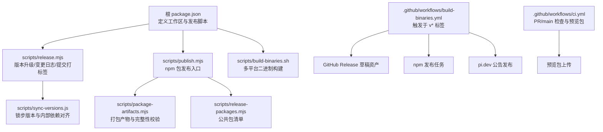
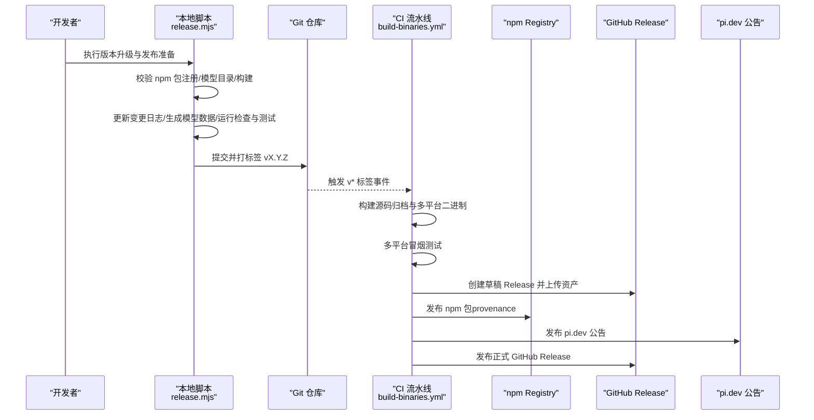
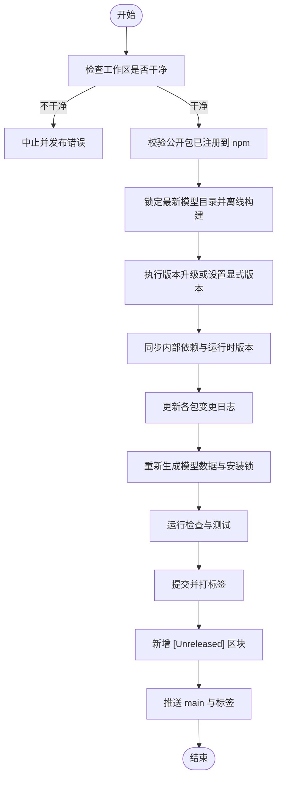
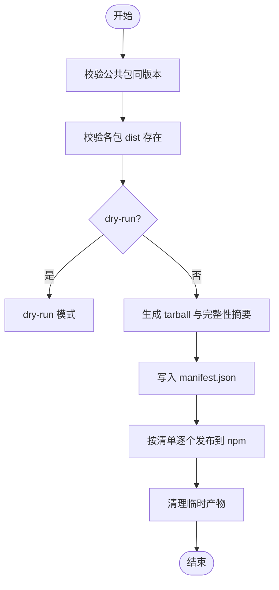
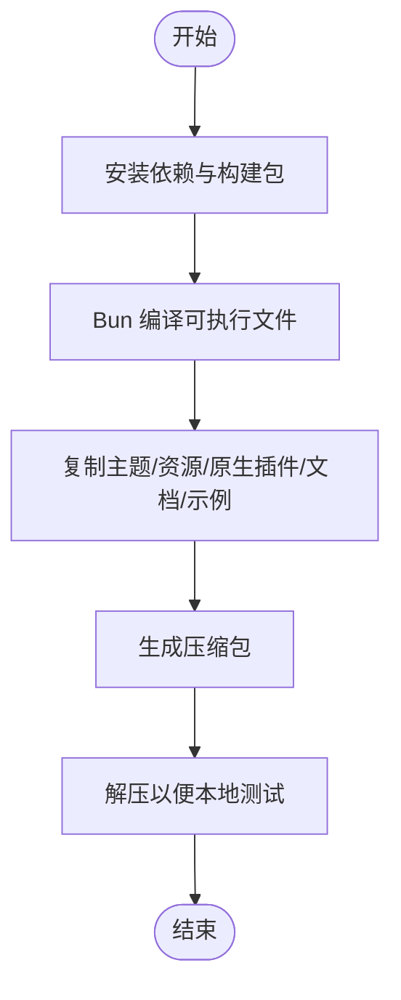
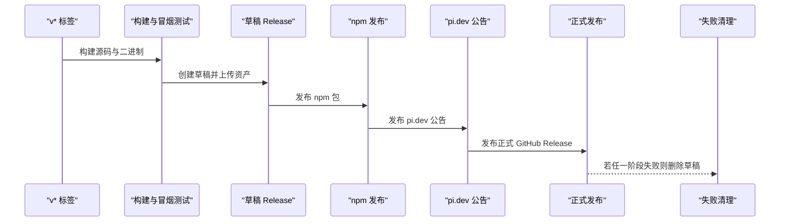
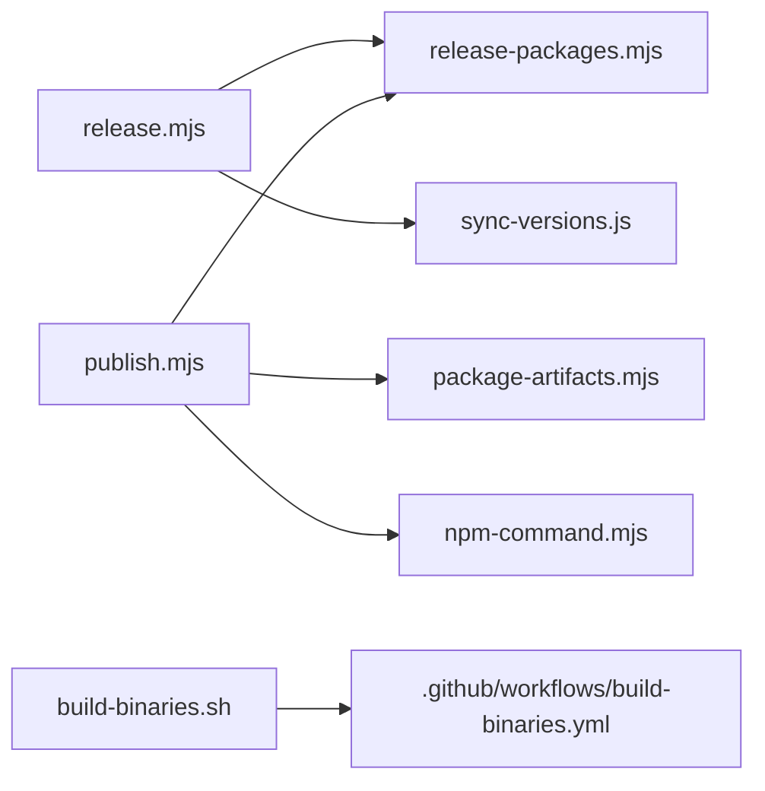

# 发布流程

<cite>
**本文引用的文件**   
- [package.json](file://package.json)
- [scripts/release.mjs](file://scripts/release.mjs)
- [scripts/publish.mjs](file://scripts/publish.mjs)
- [scripts/package-artifacts.mjs](file://scripts/package-artifacts.mjs)
- [scripts/release-packages.mjs](file://scripts/release-packages.mjs)
- [scripts/sync-versions.js](file://scripts/sync-versions.js)
- [scripts/build-binaries.sh](file://scripts/build-binaries.sh)
- [.github/workflows/build-binaries.yml](file://.github/workflows/build-binaries.yml)
- [.github/workflows/ci.yml](file://.github/workflows/ci.yml)
</cite>

## 目录
1. [引言](#引言)
2. [项目结构](#项目结构)
3. [核心组件](#核心组件)
4. [架构总览](#架构总览)
5. [详细组件分析](#详细组件分析)
6. [依赖关系分析](#依赖关系分析)
7. [性能与稳定性考虑](#性能与稳定性考虑)
8. [故障排查指南](#故障排查指南)
9. [结论](#结论)
10. [附录：命令速查](#附录命令速查)

## 引言
本文件面向维护者与发布负责人，系统化说明该仓库的发布流程与最佳实践。内容覆盖版本管理策略、语义化版本控制、变更日志生成、npm 包发布、二进制构建、跨平台打包、发布验证、预发布测试、回滚策略与发布后监控。文档以代码仓库中的脚本与 CI 工作流为依据，确保可操作、可审计、可复现。

## 项目结构
仓库采用 monorepo 结构，根 package.json 通过 workspaces 聚合多个子包；发布相关逻辑集中在 scripts 目录与 .github/workflows 中：
- 版本与发布编排：scripts/release.mjs
- npm 包发布与完整性校验：scripts/publish.mjs、scripts/package-artifacts.mjs
- 公共包发现与同步：scripts/release-packages.mjs、scripts/sync-versions.js
- 二进制构建与跨平台打包：scripts/build-binaries.sh
- CI/CD 流水线：.github/workflows/build-binaries.yml、.github/workflows/ci.yml

图表来源
- [package.json:12-55](file://package.json#L12-L55)
- [scripts/release.mjs:1-341](file://scripts/release.mjs#L1-L341)
- [scripts/publish.mjs:1-65](file://scripts/publish.mjs#L1-L65)
- [scripts/package-artifacts.mjs:1-142](file://scripts/package-artifacts.mjs#L1-L142)
- [scripts/release-packages.mjs:1-14](file://scripts/release-packages.mjs#L1-L14)
- [scripts/sync-versions.js:1-99](file://scripts/sync-versions.js#L1-L99)
- [scripts/build-binaries.sh:1-201](file://scripts/build-binaries.sh#L1-L201)
- [.github/workflows/build-binaries.yml:1-485](file://.github/workflows/build-binaries.yml#L1-L485)
- [.github/workflows/ci.yml:1-130](file://.github/workflows/ci.yml#L1-L130)

章节来源
- [package.json:12-55](file://package.json#L12-L55)

## 核心组件
- 版本管理与发布编排：scripts/release.mjs
  - 支持语义化版本 bump（major/minor/patch）或显式指定 x.y.z
  - 在修改工作区前校验所有公开包已在 npm 注册
  - 锁定最新模型目录并离线构建，保证 Nix 构建可复现
  - 更新各包的 CHANGELOG.md，新增 [Unreleased] 区块
  - 重新生成模型数据、安装锁、运行检查与测试
  - 提交、打标签、推送 main 与标签，触发 CI 发布
- npm 包发布：scripts/publish.mjs
  - 校验所有公共包同版本且 dist 存在
  - 使用 scripts/package-artifacts.mjs 生成 tarball 与完整性摘要
  - 支持 dry-run，避免误发
  - 使用 provenance 发布到 npm registry
- 包清单与完整性：scripts/package-artifacts.mjs、scripts/release-packages.mjs
  - 自动发现非私有工作区包
  - 对每个包执行 npm pack，计算 sha512 完整性值
  - 输出 manifest.json，供后续步骤校验
- 版本同步：scripts/sync-versions.js
  - 强制所有非私有包保持同一版本（锁步版本）
  - 将工作区内依赖精确对齐为当前版本号
  - 同步特定运行时版本常量
- 二进制构建：scripts/build-binaries.sh
  - 支持 darwin-arm64/x64、linux-x64/arm64、windows-x64/arm64
  - 使用 Bun 编译可执行文件，并打包主题、资源、原生插件等
  - 输出压缩包与解压后的测试目录
- CI 流水线：.github/workflows/build-binaries.yml、.github/workflows/ci.yml
  - 基于 v* 标签触发二进制构建、多平台冒烟测试、GitHub Release 草稿创建
  - 通过 npm trusted publishing 发布包
  - 向 pi.dev 发布公告，最终发布 GitHub Release
  - CI 负责 PR/main 的检查、测试与预览包上传

章节来源
- [scripts/release.mjs:1-341](file://scripts/release.mjs#L1-L341)
- [scripts/publish.mjs:1-65](file://scripts/publish.mjs#L1-L65)
- [scripts/package-artifacts.mjs:1-142](file://scripts/package-artifacts.mjs#L1-L142)
- [scripts/release-packages.mjs:1-14](file://scripts/release-packages.mjs#L1-L14)
- [scripts/sync-versions.js:1-99](file://scripts/sync-versions.js#L1-L99)
- [scripts/build-binaries.sh:1-201](file://scripts/build-binaries.sh#L1-L201)
- [.github/workflows/build-binaries.yml:1-485](file://.github/workflows/build-binaries.yml#L1-L485)
- [.github/workflows/ci.yml:1-130](file://.github/workflows/ci.yml#L1-L130)

## 架构总览
发布主流程由本地脚本与 CI 协作完成：
- 本地：开发者运行 release 脚本，完成版本升级、变更日志、构建与测试，提交并打标签
- CI：监听标签，构建多平台二进制，进行冒烟测试，创建 GitHub Release 草稿，发布 npm 包，向 pi.dev 发布公告，最终发布 GitHub Release

图表来源
- [scripts/release.mjs:255-341](file://scripts/release.mjs#L255-L341)
- [.github/workflows/build-binaries.yml:24-485](file://.github/workflows/build-binaries.yml#L24-L485)

## 详细组件分析

### 版本管理与语义化版本控制
- 支持的版本策略
  - 语义化版本 bump：major、minor、patch
  - 显式指定目标版本 x.y.z，需大于当前版本
- 锁步版本机制
  - 所有非私有包必须保持相同版本
  - 内部依赖被精确对齐为当前版本号，避免从 registry 拉取旧版本
  - 特殊运行时版本常量随包版本同步
- 变更日志处理
  - 自动将 [Unreleased] 替换为 [version] - date
  - 发布后为下一周期新增 [Unreleased] 区块

图表来源
- [scripts/release.mjs:39-209](file://scripts/release.mjs#L39-L209)
- [scripts/release.mjs:211-253](file://scripts/release.mjs#L211-L253)
- [scripts/release.mjs:255-341](file://scripts/release.mjs#L255-L341)
- [scripts/sync-versions.js:1-99](file://scripts/sync-versions.js#L1-L99)

章节来源
- [scripts/release.mjs:39-209](file://scripts/release.mjs#L39-L209)
- [scripts/release.mjs:211-253](file://scripts/release.mjs#L211-L253)
- [scripts/release.mjs:255-341](file://scripts/release.mjs#L255-L341)
- [scripts/sync-versions.js:1-99](file://scripts/sync-versions.js#L1-L99)

### npm 包发布与完整性校验
- 发布前置条件
  - 所有公共包同版本
  - 每个包的 dist 目录存在
  - 可选 dry-run 模式用于安全验证
- 打包与完整性
  - 对每个包执行 npm pack，生成带哈希后缀的 tarball
  - 计算 sha512 完整性值，写入 manifest.json
  - 读取 manifest 时再次校验完整性，防止篡改
- 发布行为
  - 跳过已发布的包
  - 使用 provenance 发布到 npm registry
  - 清理临时产物目录

图表来源
- [scripts/publish.mjs:13-65](file://scripts/publish.mjs#L13-L65)
- [scripts/package-artifacts.mjs:22-100](file://scripts/package-artifacts.mjs#L22-L100)
- [scripts/package-artifacts.mjs:103-142](file://scripts/package-artifacts.mjs#L103-L142)

章节来源
- [scripts/publish.mjs:13-65](file://scripts/publish.mjs#L13-L65)
- [scripts/package-artifacts.mjs:22-100](file://scripts/package-artifacts.mjs#L22-L100)
- [scripts/package-artifacts.mjs:103-142](file://scripts/package-artifacts.mjs#L103-L142)

### 二进制构建与跨平台打包
- 支持平台
  - macOS：darwin-arm64、darwin-x64
  - Linux：linux-x64、linux-arm64
  - Windows：windows-x64、windows-arm64
- 构建流程
  - 安装依赖与构建包（可选择离线模型数据）
  - 使用 Bun 编译可执行文件，禁用自动加载 bunfig/.env
  - 复制主题、资源、原生插件、文档与示例
  - 生成压缩包并解压便于本地测试
- CI 集成
  - 从源码归档构建二进制，确保可复现
  - 多平台冒烟测试，验证 --help、--version 与 smoke-test-codemode-binary

图表来源
- [scripts/build-binaries.sh:84-137](file://scripts/build-binaries.sh#L84-L137)
- [scripts/build-binaries.sh:139-201](file://scripts/build-binaries.sh#L139-L201)
- [.github/workflows/build-binaries.yml:66-137](file://.github/workflows/build-binaries.yml#L66-L137)
- [.github/workflows/build-binaries.yml:131-209](file://.github/workflows/build-binaries.yml#L131-L209)

章节来源
- [scripts/build-binaries.sh:84-137](file://scripts/build-binaries.sh#L84-L137)
- [scripts/build-binaries.sh:139-201](file://scripts/build-binaries.sh#L139-L201)
- [.github/workflows/build-binaries.yml:66-137](file://.github/workflows/build-binaries.yml#L66-L137)
- [.github/workflows/build-binaries.yml:131-209](file://.github/workflows/build-binaries.yml#L131-L209)

### CI 发布流水线与发布验证
- 触发条件
  - 推送 v* 标签或手动触发 workflow_dispatch
- 主要阶段
  - 构建源码归档与二进制
  - 多平台冒烟测试
  - 创建 GitHub Release 草稿并校验资产集合与 SHA256SUMS
  - 发布 npm 包（trusted publishing + provenance）
  - 向 pi.dev 发布公告
  - 发布正式 GitHub Release
  - 失败时清理草稿 Release
- 预览与常规 CI
  - CI 对 PR/main 进行检查、测试与预览包上传
  - 预览包通过 preview-packages.mjs 打包并上传至工件

图表来源
- [.github/workflows/build-binaries.yml:24-137](file://.github/workflows/build-binaries.yml#L24-L137)
- [.github/workflows/build-binaries.yml:131-209](file://.github/workflows/build-binaries.yml#L131-L209)
- [.github/workflows/build-binaries.yml:210-303](file://.github/workflows/build-binaries.yml#L210-L303)
- [.github/workflows/build-binaries.yml:312-387](file://.github/workflows/build-binaries.yml#L312-L387)
- [.github/workflows/build-binaries.yml:389-429](file://.github/workflows/build-binaries.yml#L389-L429)
- [.github/workflows/build-binaries.yml:430-485](file://.github/workflows/build-binaries.yml#L430-L485)

章节来源
- [.github/workflows/build-binaries.yml:24-137](file://.github/workflows/build-binaries.yml#L24-L137)
- [.github/workflows/build-binaries.yml:131-209](file://.github/workflows/build-binaries.yml#L131-L209)
- [.github/workflows/build-binaries.yml:210-303](file://.github/workflows/build-binaries.yml#L210-L303)
- [.github/workflows/build-binaries.yml:312-387](file://.github/workflows/build-binaries.yml#L312-L387)
- [.github/workflows/build-binaries.yml:389-429](file://.github/workflows/build-binaries.yml#L389-L429)
- [.github/workflows/build-binaries.yml:430-485](file://.github/workflows/build-binaries.yml#L430-L485)
- [.github/workflows/ci.yml:1-130](file://.github/workflows/ci.yml#L1-L130)

## 依赖关系分析
- 模块耦合
  - release.mjs 依赖 release-packages.mjs（公共包清单）、update-model-catalog-pin.mjs（模型目录锁定）、sync-versions.js（版本同步）
  - publish.mjs 依赖 package-artifacts.mjs（打包与完整性）、release-packages.mjs（公共包清单）、npm-command.mjs（npm 封装）
  - build-binaries.sh 与 CI 工作流解耦，但产出与 CI 期望一致
- 外部依赖
  - npm registry（包发布与查询）
  - GitHub Actions（CI 调度与工件）
  - GitHub Releases（资产托管）
  - pi.dev/R2（公告与安装器元数据）

图表来源
- [scripts/release.mjs:23-28](file://scripts/release.mjs#L23-L28)
- [scripts/publish.mjs:5-7](file://scripts/publish.mjs#L5-L7)
- [scripts/build-binaries.sh:1-201](file://scripts/build-binaries.sh#L1-L201)
- [.github/workflows/build-binaries.yml:1-485](file://.github/workflows/build-binaries.yml#L1-L485)

章节来源
- [scripts/release.mjs:23-28](file://scripts/release.mjs#L23-L28)
- [scripts/publish.mjs:5-7](file://scripts/publish.mjs#L5-L7)
- [scripts/build-binaries.sh:1-201](file://scripts/build-binaries.sh#L1-L201)
- [.github/workflows/build-binaries.yml:1-485](file://.github/workflows/build-binaries.yml#L1-L485)

## 性能与稳定性考虑
- 构建优化
  - 使用 npm ci 与 --ignore-scripts 加速依赖安装
  - 支持 build:offline 与离线模型数据，减少网络与外部依赖
  - 并行测试矩阵拆分慢用例，缩短反馈时间
- 稳定性保障
  - 发布前强制运行 check 与 test
  - 二进制冒烟测试覆盖帮助、版本与关键功能
  - 产物完整性校验（sha512、SHA256SUMS）
- 可复现性
  - 锁定模型目录并离线构建，避免上游变化影响
  - 源码归档参与构建，确保可追溯

[本节为通用指导，不直接分析具体文件]

## 故障排查指南
- 本地发布失败
  - 检查工作区是否干净、npm 包是否已注册、dist 是否存在
  - 若模型目录导致构建失败，参考脚本提示恢复并提交前的状态
  - 使用 scripts/publish.mjs --dry-run 验证发布流程
- CI 失败
  - 查看构建与冒烟测试日志，确认平台与依赖
  - 若 GitHub Release 草稿未创建或资产缺失，核对资产清单与 SHA256SUMS
  - 若 npm 发布失败，检查 trusted publishing 权限与 provenance 配置
- 回滚策略
  - npm 包不可逆：如需修复，应发布新版本并引导用户升级
  - GitHub Release 草稿可在失败时自动清理；已发布 Release 不应直接修改
  - 若需紧急回滚，优先通过 pi.dev 公告与安装器元数据指向稳定版本

章节来源
- [scripts/release.mjs:57-87](file://scripts/release.mjs#L57-L87)
- [scripts/release.mjs:97-129](file://scripts/release.mjs#L97-L129)
- [scripts/publish.mjs:13-28](file://scripts/publish.mjs#L13-L28)
- [.github/workflows/build-binaries.yml:228-303](file://.github/workflows/build-binaries.yml#L228-L303)
- [.github/workflows/build-binaries.yml:460-485](file://.github/workflows/build-binaries.yml#L460-L485)

## 结论
该项目的发布流程以本地脚本驱动版本与变更日志，结合 CI 实现二进制构建、多平台冒烟测试、npm 发布与 GitHub Release 发布。通过锁步版本、完整性校验与离线模型目录锁定，确保了可复现性与安全性。建议遵循本文的最佳实践，严格遵循语义化版本控制，并在发布前后充分验证与监控。

[本节为总结性内容，不直接分析具体文件]

## 附录：命令速查
- 版本升级
  - npm run version:patch / version:minor / version:major
  - npm run version:set（设置显式版本）
- 发布准备与本地发布
  - npm run release:local
  - node scripts/publish.mjs --dry-run
  - node scripts/publish.mjs
- 二进制构建
  - ./scripts/build-binaries.sh [--skip-install] [--skip-build] [--offline-model-data] [--platform <平台>] [--out <目录>]
- CI 与预览
  - npm run check
  - npm run test
  - node scripts/preview-packages.mjs pack --sha <commit> --out <目录>

章节来源
- [package.json:41-55](file://package.json#L41-L55)
- [scripts/build-binaries.sh:1-201](file://scripts/build-binaries.sh#L1-L201)
- [.github/workflows/ci.yml:35-50](file://.github/workflows/ci.yml#L35-L50)