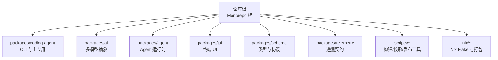
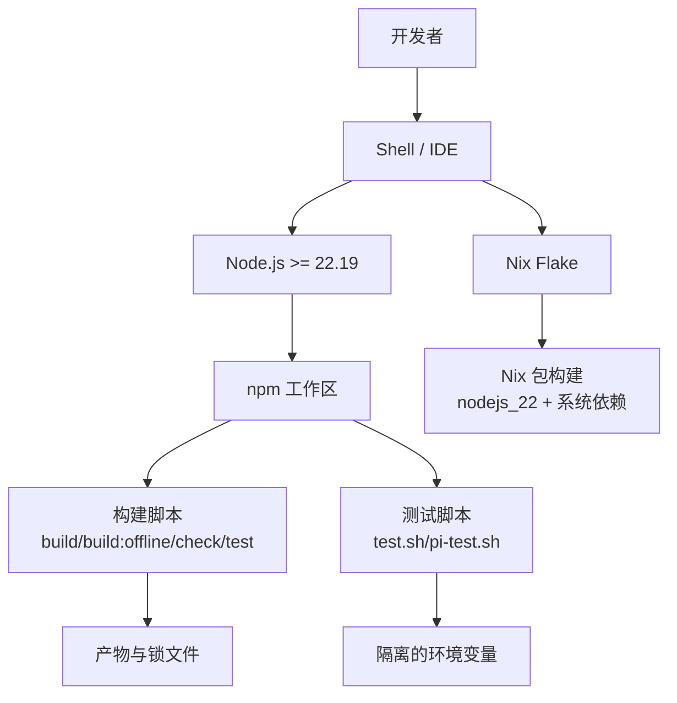
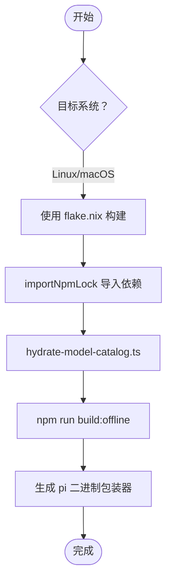
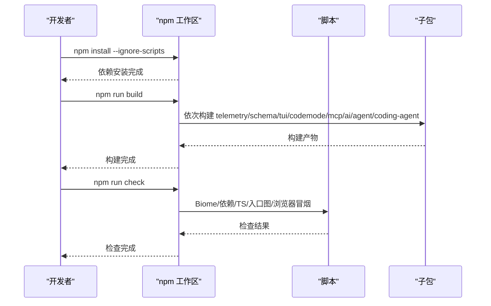
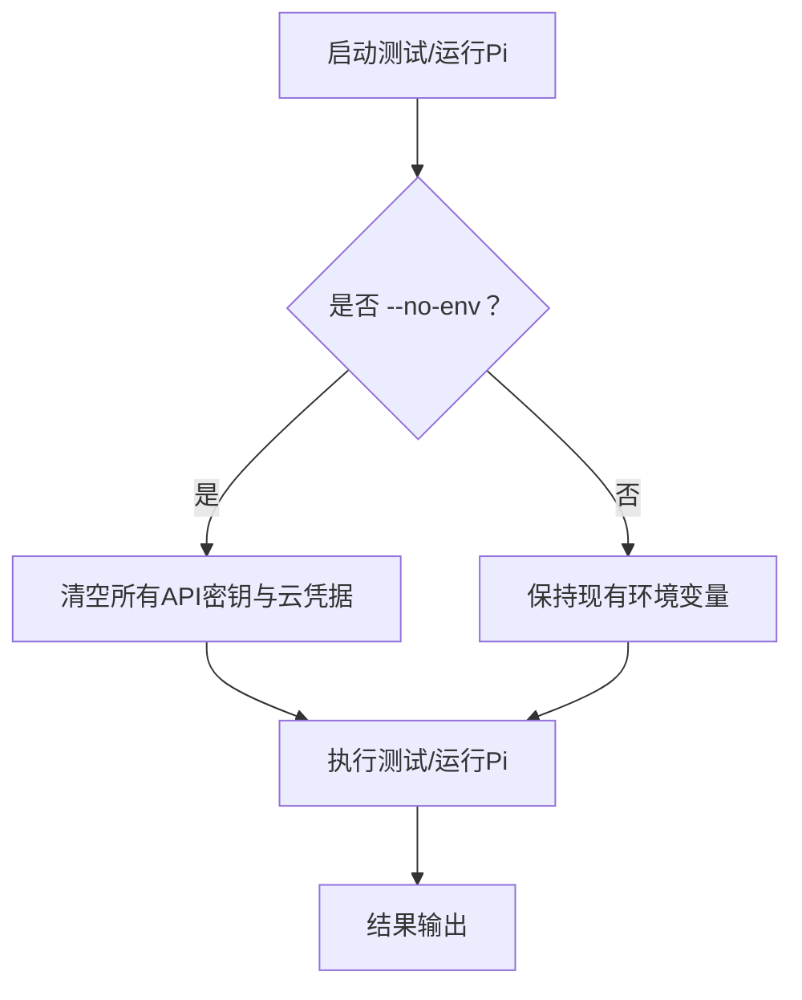
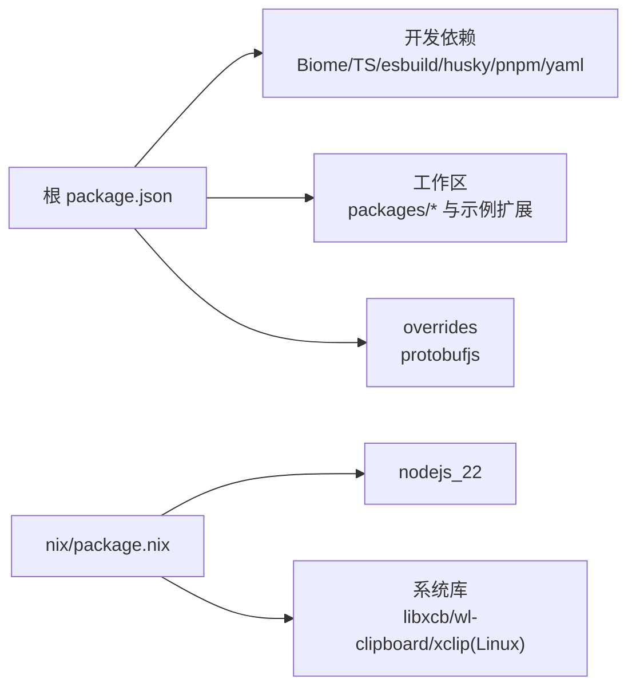

# 开发环境搭建

<cite>
**本文引用的文件**   
- [README.md](file://README.md)
- [package.json](file://package.json)
- [.npmrc](file://.npmrc)
- [flake.nix](file://flake.nix)
- [nix/package.nix](file://nix/package.nix)
- [test.sh](file://test.sh)
- [pi-test.sh](file://pi-test.sh)
- [CONTRIBUTING.md](file://CONTRIBUTING.md)
</cite>

## 目录
1. [简介](#简介)
2. [项目结构](#项目结构)
3. [核心组件](#核心组件)
4. [架构总览](#架构总览)
5. [详细组件分析](#详细组件分析)
6. [依赖关系分析](#依赖关系分析)
7. [性能与构建特性](#性能与构建特性)
8. [故障排查指南](#故障排查指南)
9. [结论](#结论)
10. [附录：操作系统安装步骤与常见问题](#附录操作系统安装步骤与常见问题)

## 简介
本指南面向希望在本地完成 Pi 代码库开发与调试的工程师，覆盖以下内容：
- Node.js 版本要求与验证方式
- Nix 包管理器配置与离线构建
- Monorepo 依赖安装、构建与检查脚本
- 环境变量与敏感信息隔离
- IDE 与调试器推荐设置
- 跨平台（Linux、macOS、Windows）安装步骤与常见问题

本项目是一个基于 npm workspaces 的 Monorepo，包含 CLI、AI 抽象层、TUI、Agent 运行时等子包；同时提供 Nix Flake 以在 Linux/macOS 上实现可复现构建。

**章节来源**
- [README.md:23-70](file://README.md#L23-L70)
- [package.json:1-11](file://package.json#L1-L11)

## 项目结构
仓库根目录为 Monorepo 根，使用 npm workspaces 管理多个子包。关键目录与职责：
- packages/*：各功能子包（如 coding-agent、ai、agent、tui、schema、telemetry、codemode、mcp 等）
- scripts/*：构建、发布、校验、打包等工具脚本
- nix/*：Nix Flake 定义与打包逻辑
- .github/workflows：CI/CD 工作流（Node 版本统一为 22）
- 根 package.json：workspaces、脚本入口、engines 约束

**图表来源**
- [package.json:1-11](file://package.json#L1-L11)
- [README.md:72-84](file://README.md#L72-L84)

**章节来源**
- [package.json:1-11](file://package.json#L1-L11)
- [README.md:72-84](file://README.md#L72-L84)

## 核心组件
本节聚焦开发环境所需的核心要素：Node.js 版本、Nix 配置、Monorepo 脚本与环境变量。

- Node.js 版本要求
  - 根 package.json 声明 engines.node >= 22.19.0
  - README 明确说明需要 Node.js 22.19 或更高版本
  - CI 工作流统一使用 node-version: 22

- Nix 包管理器
  - flake.nix 暴露 packages/apps/overlays，支持 aarch64-darwin、aarch64-linux、x86_64-darwin、x86_64-linux
  - nix/package.nix 使用 nodejs_22，并封装 pi 二进制与依赖

- Monorepo 依赖与脚本
  - root package.json 定义 workspaces、build/check/test/publish 等脚本
  - .npmrc 启用 save-exact=true 与 min-release-age=2，提升依赖稳定性

- 环境变量与敏感信息
  - test.sh 隔离 HOME/TMPDIR/NPM_CONFIG_* 等路径，避免污染用户环境
  - pi-test.sh 支持 --no-env 清理大量 API Key 与云厂商凭据

**章节来源**
- [package.json:67-69](file://package.json#L67-L69)
- [README.md:43-44](file://README.md#L43-L44)
- [flake.nix:20-25](file://flake.nix#L20-L25)
- [nix/package.nix:1-15](file://nix/package.nix#L1-L15)
- [package.json:12-55](file://package.json#L12-L55)
- [.npmrc:1-3](file://.npmrc#L1-L3)
- [test.sh:39-84](file://test.sh#L39-L84)
- [pi-test.sh:6-85](file://pi-test.sh#L6-L85)

## 架构总览
下图展示开发环境的整体交互：开发者通过 Node.js 或 Nix 运行 Pi；Monorepo 脚本负责依赖安装、构建与校验；测试脚本隔离环境与凭据。

**图表来源**
- [package.json:12-55](file://package.json#L12-L55)
- [flake.nix:35-52](file://flake.nix#L35-L52)
- [nix/package.nix:94-144](file://nix/package.nix#L94-L144)
- [test.sh:39-84](file://test.sh#L39-L84)

## 详细组件分析

### Node.js 版本与安装建议
- 最低版本：>= 22.19.0（根 package.json engines.node）
- 官方文档说明：需要 Node.js 22.19 或更高版本
- CI 统一使用 Node 22，建议本地也使用 22.x 系列以获得一致行为

推荐做法：
- 使用 nvm、fnm 或 mise 等版本管理器锁定到 22.x
- 在项目根目录创建 .nvmrc/.tool-versions 等文件（可选），便于团队一致性

**章节来源**
- [package.json:67-69](file://package.json#L67-L69)
- [README.md:43-44](file://README.md#L43-L44)

### Nix 包管理器配置与离线构建
- flake.nix 定义了支持的系统与输入源，并为 x86_64-darwin 使用专用 Darwin 分支
- nix/package.nix 使用 nodejs_22，并通过 importNpmLock 导入依赖；构建阶段执行 hydrate-model-catalog.ts 与 build:offline
- 输出包含 pi 二进制包装器，注入 fd、ripgrep、以及 Linux 下的 wl-clipboard/xclip

典型用法：
- nix run . 或 nix run github:earendil-works/pi/stable
- nix build . 构建当前检出源码
- 更新模型目录锁：npm run update:model-catalog-pin

**图表来源**
- [flake.nix:20-52](file://flake.nix#L20-L52)
- [nix/package.nix:32-50](file://nix/package.nix#L32-L50)
- [nix/package.nix:117-144](file://nix/package.nix#L117-L144)

**章节来源**
- [flake.nix:1-54](file://flake.nix#L1-L54)
- [nix/package.nix:1-183](file://nix/package.nix#L1-L183)
- [README.md:56-70](file://README.md#L56-L70)

### Monorepo 依赖安装与构建
- 根 package.json 定义 workspaces，包含 packages/* 与若干示例扩展
- 常用脚本：
  - npm install --ignore-scripts：安装依赖不执行生命周期脚本
  - npm run build：按顺序构建 telemetry/schema/tui/codemode/mcp/ai/agent/coding-agent
  - npm run build:offline：离线模式构建（复用已有模型数据）
  - npm run check：Biome 格式化、依赖校验、TS 类型检查、入口图检查、浏览器冒烟测试
  - npm run test：运行脚本测试与工作区测试
- .npmrc 启用 save-exact=true 与 min-release-age=2，减少同天发布的依赖差异

**图表来源**
- [package.json:1-55](file://package.json#L1-L55)
- [.npmrc:1-3](file://.npmrc#L1-L3)

**章节来源**
- [package.json:1-55](file://package.json#L1-L55)
- [.npmrc:1-3](file://.npmrc#L1-L3)

### 环境变量与敏感信息隔离
- test.sh 创建临时 HOME/TMPDIR/NPM_CONFIG_* 目录，隔离用户资源与缓存，并设置 LANG/LC_ALL/TZ/GIT_* 等环境变量
- pi-test.sh 支持 --no-env 参数，清空大量 API Key 与云厂商凭据，确保在无凭据环境下运行
- 测试脚本还保留必要的 CI 检测变量与代理证书信任链（NODE_EXTRA_CA_CERTS）

**图表来源**
- [test.sh:39-84](file://test.sh#L39-L84)
- [pi-test.sh:6-85](file://pi-test.sh#L6-L85)

**章节来源**
- [test.sh:39-84](file://test.sh#L39-L84)
- [pi-test.sh:6-85](file://pi-test.sh#L6-L85)

### IDE 与调试器推荐设置
- 语言与工具链：TypeScript、ESM、Biome、esbuild、pnpm（作为 devDependency）
- 推荐 IDE：VS Code
  - 启用 TypeScript 语言服务与 ESM 支持
  - 使用 Biome 插件进行格式化和基础检查
  - 配置 Node.js 调试器，断点调试 packages/coding-agent/src/cli.ts
- 工作区配置：
  - 使用根 tsconfig.json 与 tsconfig.base.json 保证类型检查一致性
  - 在 VS Code 中开启 workspace trust，以便运行脚本和调试

注意：具体插件与任务配置因个人偏好而异，但应遵循仓库现有的脚本约定（check/build/test）。

**章节来源**
- [package.json:57-65](file://package.json#L57-L65)
- [tsconfig.json](file://tsconfig.json)
- [tsconfig.base.json](file://tsconfig.base.json)

### 开发工作流优化
- 提交前检查：npm run check && ./test.sh（参见 CONTRIBUTING.md）
- 快速迭代：
  - 使用 npm run build:offline 加速重复构建
  - 使用 pi-test.sh --no-env 在无凭据环境下快速验证
- 外部消费本地包：
  - 使用 scripts/use-local-packages.mjs 将本地制品链接到外部项目
  - 支持 npm 与 pnpm 两种包管理器

**章节来源**
- [CONTRIBUTING.md:56-67](file://CONTRIBUTING.md#L56-L67)
- [README.md:102-153](file://README.md#L102-L153)

## 依赖关系分析
- 直接依赖与开发依赖：
  - 开发依赖包括 @biomejs/biome、@types/node、esbuild、husky、pnpm、typescript、yaml
  - 根 package.json 对 protobufjs 做了 overrides，统一版本
- 工作区依赖：
  - workspaces 包含 packages/* 与若干示例扩展
- Nix 依赖：
  - 使用 nodejs_22 与系统库（Linux 下 libxcb、wl-clipboard、xclip 等）

**图表来源**
- [package.json:57-73](file://package.json#L57-L73)
- [nix/package.nix:102-112](file://nix/package.nix#L102-L112)

**章节来源**
- [package.json:57-73](file://package.json#L57-L73)
- [nix/package.nix:102-112](file://nix/package.nix#L102-L112)

## 性能与构建特性
- 构建优化：
  - build:offline 复用已有模型数据，避免网络访问
  - npmRebuildFlags 使用 --ignore-scripts，减少不必要的原生构建
- 依赖稳定性：
  - .npmrc 启用 save-exact=true 与 min-release-age=2
  - 根 package-lock.json 作为依赖事实来源
- 安全加固：
  - CI 使用 npm ci --ignore-scripts 与 npm audit
  - 安装锁生成有生命周期脚本白名单

**章节来源**
- [package.json:14-15](file://package.json#L14-L15)
- [.npmrc:1-3](file://.npmrc#L1-L3)
- [README.md:168-180](file://README.md#L168-L180)

## 故障排查指南
- 常见环境问题：
  - Node.js 版本不匹配：确保使用 >= 22.19.0
  - Nix 构建失败：检查系统依赖（Linux 下需 libxcb、wl-clipboard、xclip）
  - 依赖安装失败：确认 .npmrc 配置与网络可达性
  - 测试失败：使用 test.sh 提供的隔离环境，避免凭据污染
- 凭据相关：
  - 使用 pi-test.sh --no-env 清理 API Key 与云凭据
  - 在代理或企业网络中设置 NODE_EXTRA_CA_CERTS

**章节来源**
- [package.json:67-69](file://package.json#L67-L69)
- [nix/package.nix:109-112](file://nix/package.nix#L109-L112)
- [test.sh:39-84](file://test.sh#L39-L84)
- [pi-test.sh:6-85](file://pi-test.sh#L6-L85)

## 结论
通过遵循本指南，你可以在不同操作系统上稳定地搭建 Pi 的开发环境。推荐使用 Node.js 22.x 与 Nix Flake 进行可复现构建；利用 Monorepo 脚本进行依赖管理与构建；通过测试脚本隔离环境变量与凭据，确保本地与 CI 行为一致。

[无需“章节来源”，因为本节为总结性内容]

## 附录：操作系统安装步骤与常见问题

### Linux
- 安装 Node.js 22.x（建议使用版本管理器）
- 安装系统依赖：libcairo2-dev、libpango1.0-dev、libjpeg-dev、libgif-dev、librsvg2-dev、fd-find、ripgrep
- 克隆仓库后执行：
  - npm install --ignore-scripts
  - npm run build
  - npm run check
  - ./test.sh
- 若使用 Nix：
  - nix run . 或 nix build .
  - 如需刷新模型目录锁：npm run update:model-catalog-pin

**章节来源**
- [README.md:102-111](file://README.md#L102-L111)
- [nix/package.nix:109-112](file://nix/package.nix#L109-L112)
- [flake.nix:20-25](file://flake.nix#L20-L25)

### macOS
- 安装 Node.js 22.x
- 克隆仓库后执行：
  - npm install --ignore-scripts
  - npm run build
  - npm run check
  - ./test.sh
- 若使用 Nix：
  - nix run . 或 nix build .
  - 注意 x86_64-darwin 使用专用 Darwin 分支

**章节来源**
- [README.md:102-111](file://README.md#L102-L111)
- [flake.nix:7-10](file://flake.nix#L7-L10)

### Windows
- 安装 Node.js 22.x
- 克隆仓库后执行：
  - npm install --ignore-scripts
  - npm run build
  - npm run check
  - 使用 pi-test.sh 或直接在 Node 中运行 CLI
- 若使用 Nix（WSL）：
  - 在 WSL 环境中执行 nix run . 或 nix build .

**章节来源**
- [README.md:102-111](file://README.md#L102-L111)
- [pi-test.sh:1-86](file://pi-test.sh#L1-L86)