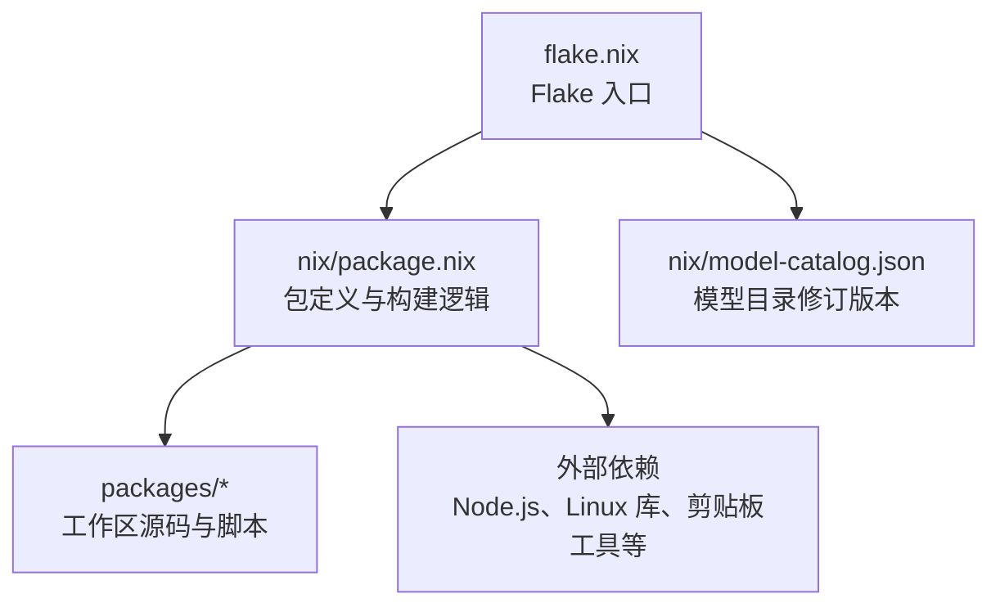
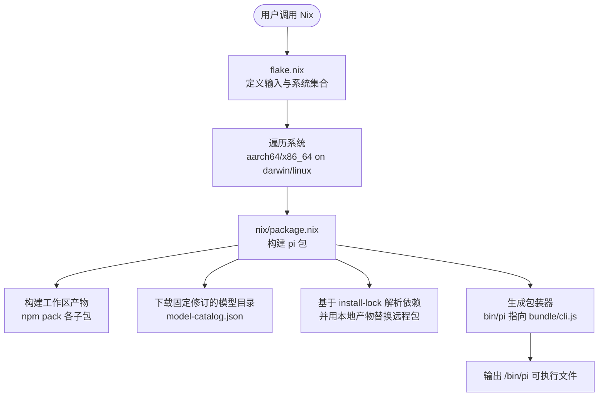
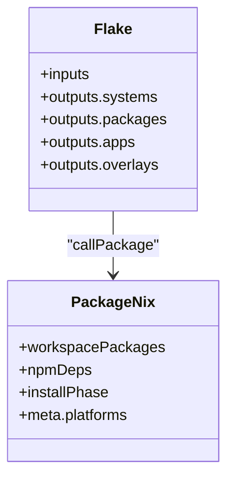
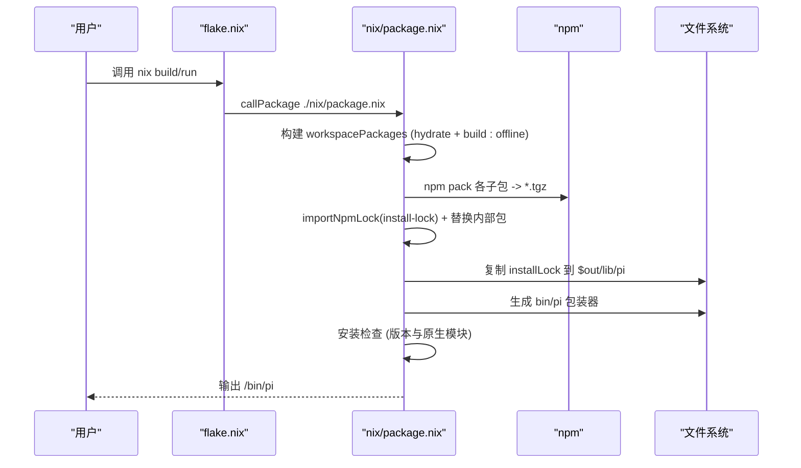
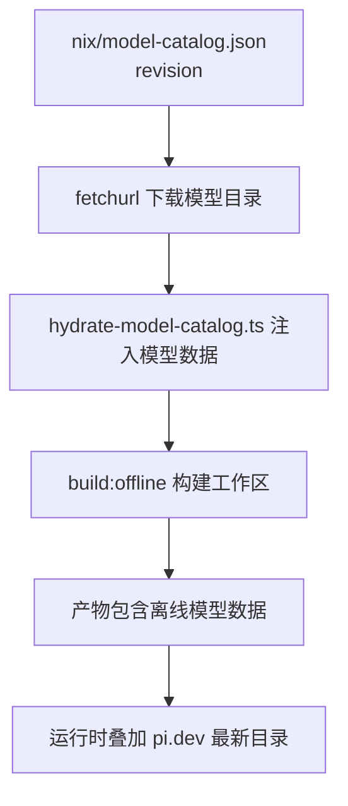
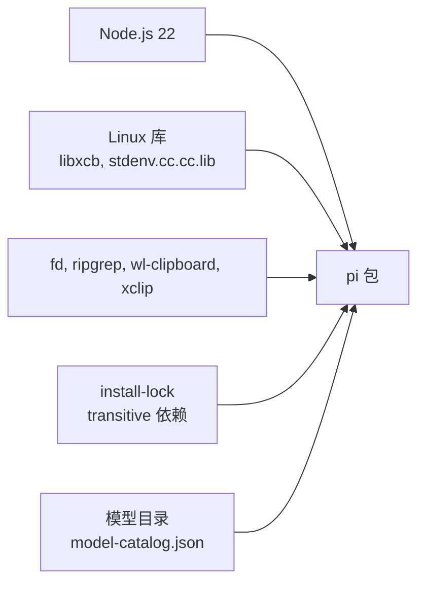

# Nix构建系统

<cite>
**本文引用的文件**
- [flake.nix](file://flake.nix)
- [nix/package.nix](file://nix/package.nix)
- [nix/model-catalog.json](file://nix/model-catalog.json)
- [README.md](file://README.md)
</cite>

## 目录
1. [简介](#简介)
2. [项目结构](#项目结构)
3. [核心组件](#核心组件)
4. [架构总览](#架构总览)
5. [详细组件分析](#详细组件分析)
6. [依赖关系分析](#依赖关系分析)
7. [性能与缓存优化](#性能与缓存优化)
8. [开发环境设置](#开发环境设置)
9. [跨平台兼容性](#跨平台兼容性)
10. [Nix命令使用示例](#nix命令使用示例)
11. [故障排除指南](#故障排除指南)
12. [结论](#结论)

## 简介
本文件系统性说明该仓库的 Nix 构建系统，重点覆盖以下内容：
- flake.nix 的模块定义、多系统输出、应用与 overlay 配置
- nix/package.nix 中的包定义、Node.js 工作区打包、模型目录管理与版本控制
- Nix 开发环境、构建缓存优化策略与跨平台兼容性
- 常用 Nix 命令示例与常见问题排查

该项目通过 Nix Flake 暴露 packages/apps/overlays，并使用 Nix 从源码构建 Pi CLI。构建过程离线化，模型目录数据通过固定修订版本下载并内嵌到产物中，运行时仍可从 pi.dev 获取更新。

## 项目结构
与 Nix 相关的核心文件位于仓库根目录和 nix 子目录：
- flake.nix：Flake 入口，声明输入、系统集合、packages/apps/overlays 输出
- nix/package.nix：具体包的构建逻辑，包括 Node.js 工作区打包、依赖替换、安装阶段包装器生成
- nix/model-catalog.json：模型目录修订版本的固定引用，用于离线构建

**图表来源**
- [flake.nix:1-54](file://flake.nix#L1-L54)
- [nix/package.nix:1-183](file://nix/package.nix#L1-L183)
- [nix/model-catalog.json:1-4](file://nix/model-catalog.json#L1-L4)

**章节来源**
- [flake.nix:1-54](file://flake.nix#L1-L54)
- [nix/package.nix:1-183](file://nix/package.nix#L1-L183)
- [nix/model-catalog.json:1-4](file://nix/model-catalog.json#L1-L4)

## 核心组件
- Flake 输出层（flake.nix）
  - 声明输入：nixpkgs 与针对 Intel macOS 的专用 Darwin 分支
  - 系统集合：aarch64-darwin、aarch64-linux、x86_64-darwin、x86_64-linux
  - 为每个系统导出 packages.default/pi、apps.default/pi、overlay.default
- 包定义层（nix/package.nix）
  - 使用 Node.js 22 与工作区 npm 锁文件进行依赖解析
  - 先构建工作区产物（包含各子包 tarball），再在 install-lock 基础上用本地产物替换远程包
  - 安装阶段生成可执行包装器，注入 PATH 与运行参数
  - 安装检查验证版本与原生模块加载
  - 元数据描述支持的平台与许可证

**章节来源**
- [flake.nix:4-52](file://flake.nix#L4-L52)
- [nix/package.nix:17-183](file://nix/package.nix#L17-L183)

## 架构总览
下图展示 Nix Flake 如何组织输入、系统与包构建，以及最终生成的可执行程序路径。

**图表来源**
- [flake.nix:13-52](file://flake.nix#L13-L52)
- [nix/package.nix:32-144](file://nix/package.nix#L32-L144)
- [nix/model-catalog.json:1-4](file://nix/model-catalog.json#L1-L4)

## 详细组件分析

### Flake 模块定义与系统映射
- 输入管理
  - nixpkgs：使用 nixos-unstable
  - nixpkgs-darwin-x64：为 x86_64-darwin 使用特定 Darwin 分支以兼容旧平台
- 系统集合与派生函数
  - systems 数组定义四个目标平台
  - forAllSystems 将 outputs 映射到所有系统
  - nixpkgsFor 根据系统选择对应 nixpkgs 源
  - packageFor 导入 pkgs 并调用 ./nix/package.nix，传入 source=self
- outputs
  - packages：为每个系统提供 default 与 pi 两个别名
  - apps：为每个系统提供默认 app，program 指向 packages.${system}.default/bin/pi
  - overlays.default：向全局 overlay 注入 pi 包

**图表来源**
- [flake.nix:4-52](file://flake.nix#L4-L52)
- [nix/package.nix:32-183](file://nix/package.nix#L32-L183)

**章节来源**
- [flake.nix:4-52](file://flake.nix#L4-L52)

### 包定义与构建流程（nix/package.nix）
- 依赖与环境
  - nodejs_22 作为 Node.js 运行时
  - Linux 平台额外引入 autoPatchelfHook、stdenv.cc.cc.lib、libxcb
  - 剪贴板工具：fd、ripgrep；Linux 下 wl-clipboard、xclip
- 工作区构建（workspacePackages）
  - 使用 importNpmLock 解析根工作区依赖
  - 构建阶段：
    - 运行脚本 hydrate-model-catalog.ts 将固定修订的模型目录注入到 ai 包
    - 执行 npm run build:offline 完成离线构建
  - 安装阶段：对 telemetry/schema/ai/tui/agent/codemode/mcp/coding-agent 分别 npm pack 生成 tarball
- 依赖替换（npmDeps）
  - 基于 packages/coding-agent/install-lock 解析依赖
  - 将内部包名映射到 workspacePackages 产出的 tarball，确保构建一致性
- 主包安装阶段
  - 复制整个 installLock 内容到 $out/lib/pi
  - 使用 makeWrapper 生成 bin/pi，指向 @earendil-works/pi-coding-agent/dist/bundle/cli.js
  - 注入 PATH：node、fd、ripgrep，Linux 下追加 wl-clipboard、xclip
- 安装检查
  - 校验 pi --version 等于 packageJson.version
  - 尝试加载 TUI 原生模块与 photon-node，确保原生依赖可用
- 元数据
  - description、homepage、license、mainProgram、platforms、sourceProvenance

**图表来源**
- [nix/package.nix:32-164](file://nix/package.nix#L32-L164)

**章节来源**
- [nix/package.nix:17-183](file://nix/package.nix#L17-L183)

### 模型目录管理与版本控制
- 固定修订
  - nix/model-catalog.json 保存模型目录的 revision（sha256 前缀）
  - nix/package.nix 通过 fetchurl 下载对应修订的模型目录，并将 sha256 设置为移除前缀后的值
- 构建期注入
  - 构建 workspacePackages 时运行 hydrate-model-catalog.ts，将模型目录注入到 ai 包
- 运行时行为
  - README 说明：Nix 构建是离线的，但运行时仍可叠加 pi.dev 的最新模型目录

**图表来源**
- [nix/model-catalog.json:1-4](file://nix/model-catalog.json#L1-L4)
- [nix/package.nix:24-30](file://nix/package.nix#L24-L30)
- [nix/package.nix:45-50](file://nix/package.nix#L45-L50)
- [README.md:66-70](file://README.md#L66-L70)

**章节来源**
- [nix/model-catalog.json:1-4](file://nix/model-catalog.json#L1-L4)
- [nix/package.nix:24-50](file://nix/package.nix#L24-L50)
- [README.md:66-70](file://README.md#L66-L70)

## 依赖关系分析
- 直接依赖
  - Node.js 22（nodejs_22）
  - Linux 平台：autoPatchelfHook、stdenv.cc.cc.lib、libxcb
  - 工具：fd、ripgrep；Linux 下 wl-clipboard、xclip
- 间接依赖
  - 工作区 npm 依赖由 importNpmLock 解析
  - install-lock 锁定 transitive 依赖树，并通过 packageSourceOverrides 替换内部包为本地 tarball
- 外部资源
  - 模型目录通过 fetchurl 从 pi.dev 下载，哈希由 model-catalog.json 固定

**图表来源**
- [nix/package.nix:102-112](file://nix/package.nix#L102-L112)
- [nix/package.nix:78-92](file://nix/package.nix#L78-L92)
- [nix/package.nix:24-30](file://nix/package.nix#L24-L30)

**章节来源**
- [nix/package.nix:78-112](file://nix/package.nix#L78-L112)
- [nix/package.nix:24-30](file://nix/package.nix#L24-L30)

## 性能与缓存优化
- 离线构建
  - 使用 build:offline 避免网络访问，提升构建稳定性与速度
- 依赖解析优化
  - importNpmLock 预解析依赖，减少构建期网络请求
  - 使用 install-lock 固定 transitive 依赖，避免重复解析
- 构建阶段跳过生命周期脚本
  - npmRebuildFlags 使用 --ignore-scripts，降低构建开销与安全风险
- 产物复用
  - workspacePackages 产出 tarball，供后续依赖替换使用，避免重复打包

[本节为通用指导，不直接分析具体文件]

## 开发环境设置
- 快速运行
  - 使用 flake 直接运行稳定版或 main 分支
- 安装与升级
  - 通过 nix profile 安装与升级 pi
- 本地构建与运行
  - 在 checkout 中使用 nix build . 或 nix run .

参考命令与说明见“Nix命令使用示例”。

**章节来源**
- [README.md:56-70](file://README.md#L56-L70)

## 跨平台兼容性
- 支持平台
  - aarch64-darwin、aarch64-linux、x86_64-darwin、x86_64-linux
- Darwin 特殊处理
  - x86_64-darwin 使用 nixpkgs-darwin-x64 以兼容 Intel macOS
- Linux 平台特性
  - 启用 autoPatchelfHook 修复 ELF 二进制
  - 链接 libxcb 与标准 C 库
  - 提供 wl-clipboard、xclip 以支持剪贴板功能

**章节来源**
- [flake.nix:20-33](file://flake.nix#L20-L33)
- [nix/package.nix:107-112](file://nix/package.nix#L107-L112)
- [nix/package.nix:166-176](file://nix/package.nix#L166-L176)

## Nix命令使用示例
- 运行稳定版
  - nix run github:earendil-works/pi/stable
- 安装与升级
  - nix profile add github:earendil-works/pi/stable
  - nix profile upgrade pi
- 本地构建与运行
  - nix build .
  - nix run .
- 刷新模型目录修订
  - npm run update:model-catalog-pin

以上命令与说明来自项目文档。

**章节来源**
- [README.md:56-70](file://README.md#L56-L70)

## 故障排除指南
- 构建失败：原生模块未加载
  - 现象：安装检查阶段无法加载 TUI 原生模块或 photon-node
  - 原因：缺少 Linux 平台依赖或原生预编译模块缺失
  - 解决：确认已安装 libxcb、stdenv.cc.cc.lib，并在 Linux 上安装 wl-clipboard/xclip；重新构建
  - 相关实现：安装检查阶段显式加载原生模块
- 构建失败：模型目录不可用
  - 现象：hydrate-model-catalog.ts 失败或模型数据缺失
  - 原因：model-catalog.json 的 revision 与远端不一致
  - 解决：运行 npm run update:model-catalog-pin 刷新修订
- 构建失败：依赖解析异常
  - 现象：importNpmLock 或 npm pack 失败
  - 原因：install-lock 与根 lockfile 不同步或内部包未正确替换
  - 解决：确保 npm run check 通过，保持 install-lock 与 package-lock.json 同步
- 运行时剪贴板不可用
  - 现象：Pi 无法访问系统剪贴板
  - 原因：wl-clipboard 或 xclip 未安装（Linux）
  - 解决：安装相应剪贴板工具；或在非 Linux 平台忽略此依赖

**章节来源**
- [nix/package.nix:147-164](file://nix/package.nix#L147-L164)
- [nix/package.nix:127-141](file://nix/package.nix#L127-L141)
- [README.md:66-70](file://README.md#L66-L70)

## 结论
该项目的 Nix 构建系统通过 Flake 统一暴露多平台包与应用，结合离线模型目录与 install-lock 依赖锁定，实现了稳定、可复现且安全的构建流程。nix/package.nix 将工作区产物与运行时依赖解耦，并通过包装器注入必要工具与 PATH，确保在不同平台上的一致体验。配合 README 提供的命令与最佳实践，开发者可以快速搭建开发环境并进行跨平台构建与分发。

[本节为总结性内容，不直接分析具体文件]