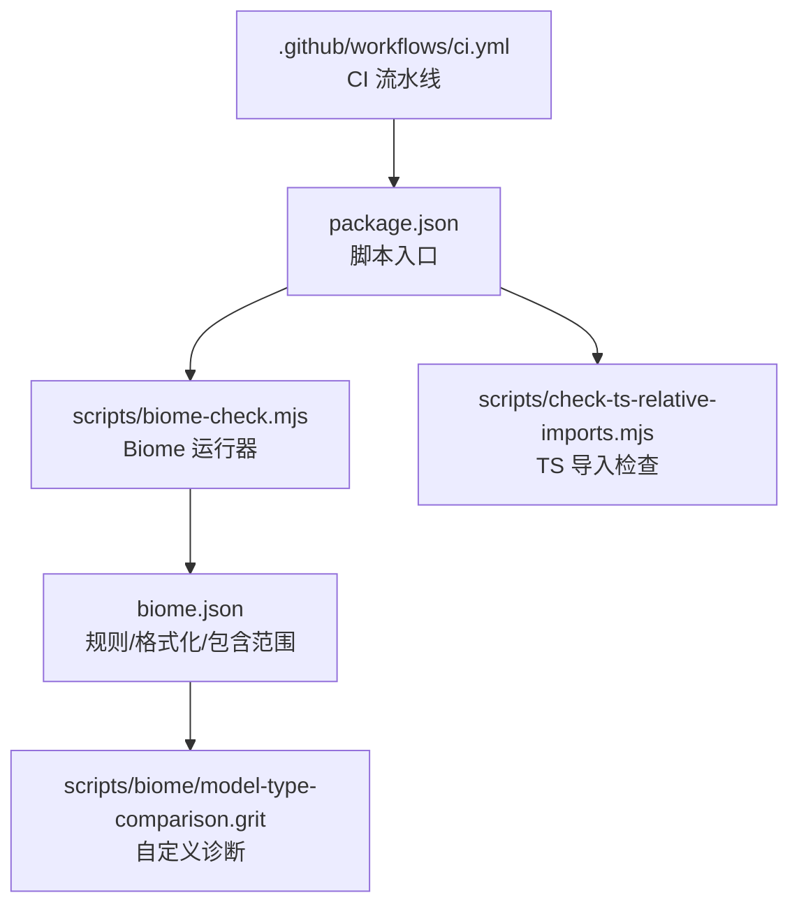
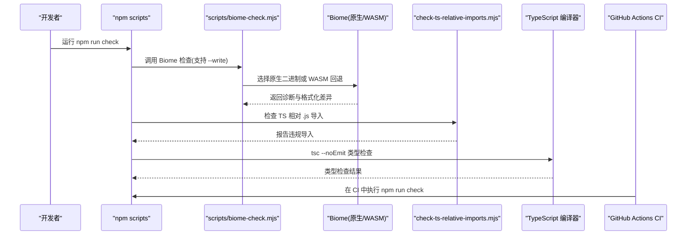
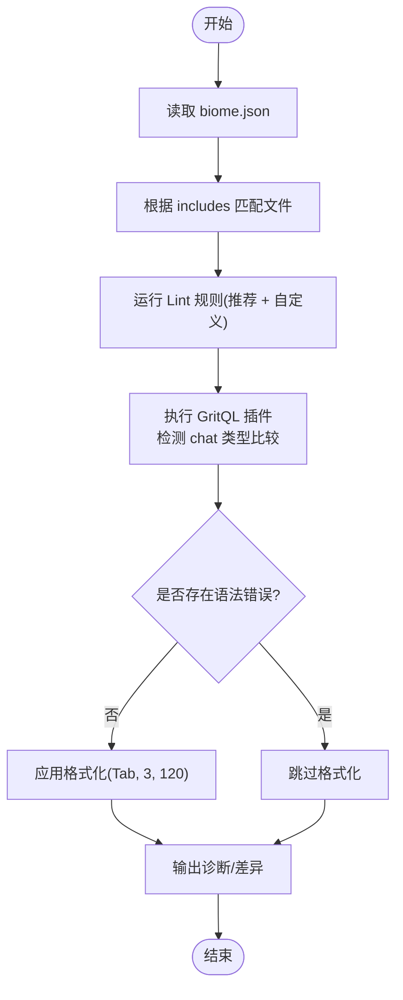
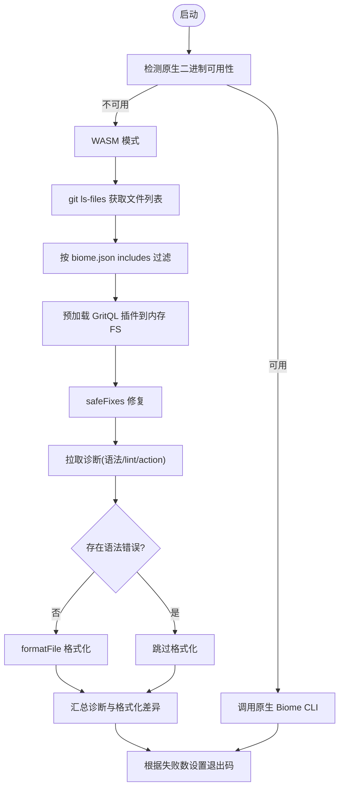
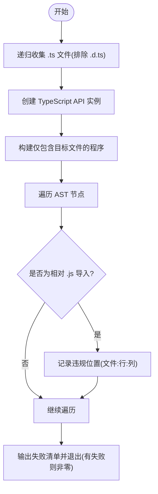
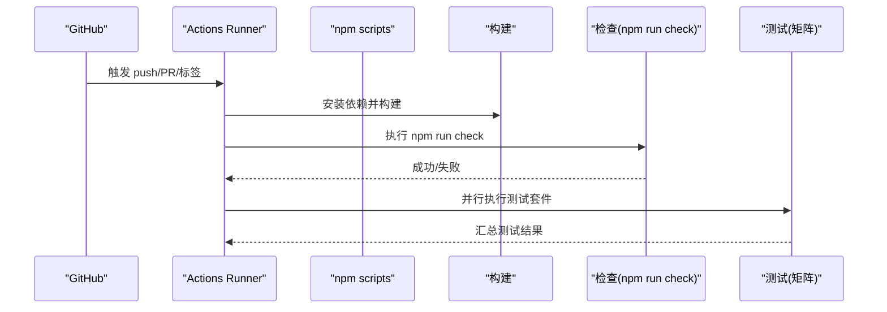
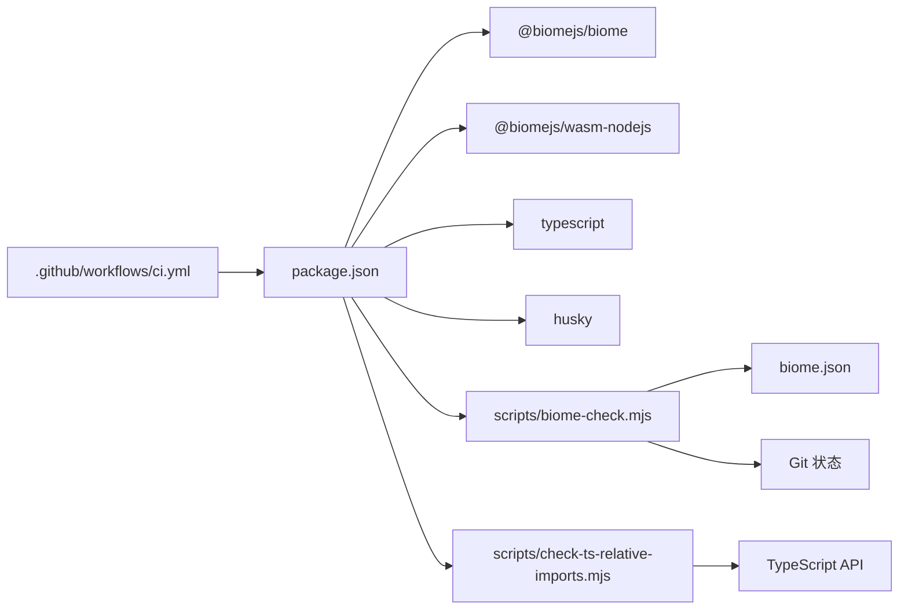

# 代码质量工具

<cite>
**本文引用的文件**
- [biome.json](file://biome.json)
- [package.json](file://package.json)
- [scripts/biome-check.mjs](file://scripts/biome-check.mjs)
- [scripts/biome/model-type-comparison.grit](file://scripts/biome/model-type-comparison.grit)
- [scripts/check-ts-relative-imports.mjs](file://scripts/check-ts-relative-imports.mjs)
- [.github/workflows/ci.yml](file://.github/workflows/ci.yml)
</cite>

## 目录
1. [简介](#简介)
2. [项目结构](#项目结构)
3. [核心组件](#核心组件)
4. [架构总览](#架构总览)
5. [详细组件分析](#详细组件分析)
6. [依赖关系分析](#依赖关系分析)
7. [性能与可维护性考量](#性能与可维护性考量)
8. [故障排查指南](#故障排查指南)
9. [结论](#结论)

## 简介
本文件系统性说明仓库的代码质量检查与格式化配置，重点覆盖：
- Biome 的规则与格式化策略
- TypeScript 导入规范与静态检查
- 自定义 GritQL 规则
- 本地与 CI 的自动化检查流程
- 开发者工作流优化建议与常见问题解决方案

## 项目结构
仓库采用 monorepo 组织方式，根目录集中管理代码质量工具与脚本，CI 通过 GitHub Actions 执行统一检查。关键位置如下：
- 根级 Biome 配置：[biome.json](file://biome.json)
- 根级脚本入口与任务编排：[package.json](file://package.json)
- Biome 运行封装（原生二进制或 WASM 回退）：[scripts/biome-check.mjs](file://scripts/biome-check.mjs)
- 自定义 Biome 插件（GritQL）：[scripts/biome/model-type-comparison.grit](file://scripts/biome/model-type-comparison.grit)
- TypeScript 相对导入检查脚本：[scripts/check-ts-relative-imports.mjs](file://scripts/check-ts-relative-imports.mjs)
- CI 流水线（构建、打包、检查、测试）：[.github/workflows/ci.yml](file://.github/workflows/ci.yml)

**图表来源**
- [package.json:12-26](file://package.json#L12-L26)
- [biome.json:1-45](file://biome.json#L1-L45)
- [scripts/biome-check.mjs:1-124](file://scripts/biome-check.mjs#L1-L124)
- [scripts/biome/model-type-comparison.grit:1-17](file://scripts/biome/model-type-comparison.grit#L1-L17)
- [scripts/check-ts-relative-imports.mjs:1-106](file://scripts/check-ts-relative-imports.mjs#L1-L106)
- [.github/workflows/ci.yml:17-53](file://.github/workflows/ci.yml#L17-L53)

**章节来源**
- [package.json:12-26](file://package.json#L12-L26)
- [biome.json:1-45](file://biome.json#L1-L45)

## 核心组件
- Biome 规则与格式化
  - 启用 linter 与 formatter，使用推荐规则集，并针对 style/suspicious 类别进行细粒度开关。
  - 格式化策略：Tab 缩进、每行宽度 120、遇到语法错误时不自动格式化。
  - 文件包含范围：packages 源码与测试、部分示例与 catalog 数据，排除 node_modules、生成文件等。
  - 自定义插件：加载 GritQL 规则以增强类型比较诊断。
- TypeScript 导入检查
  - 禁止在 .ts 文件中出现相对 .js 后缀的导入路径，避免运行时解析歧义。
  - 基于 TypeScript API 遍历 AST，对 import/export/import type 及动态 import() 进行检查。
- 自动化检查编排
  - npm check 串联 Biome 检查、依赖锁定检查、运行时依赖检查、TS 导入检查、入口图检查、TSC 类型检查与浏览器冒烟检查。
- CI 集成
  - CI 在 push/PR 到 main 分支时执行构建与检查；测试按矩阵并行执行；另含 MCP 兼容性测试。

**章节来源**
- [biome.json:1-45](file://biome.json#L1-L45)
- [scripts/check-ts-relative-imports.mjs:1-106](file://scripts/check-ts-relative-imports.mjs#L1-L106)
- [package.json:12-26](file://package.json#L12-L26)
- [.github/workflows/ci.yml:17-53](file://.github/workflows/ci.yml#L17-L53)

## 架构总览
下图展示从开发者命令到 CI 的整体质量保障链路：

**图表来源**
- [package.json:19-26](file://package.json#L19-L26)
- [scripts/biome-check.mjs:1-124](file://scripts/biome-check.mjs#L1-L124)
- [scripts/check-ts-relative-imports.mjs:1-106](file://scripts/check-ts-relative-imports.mjs#L1-L106)
- [.github/workflows/ci.yml:52-53](file://.github/workflows/ci.yml#L52-L53)

## 详细组件分析

### Biome 规则与格式化
- 规则启用
  - 启用推荐规则集，并对 style 与 suspicious 类别进行细化控制。
  - 关闭非空断言检查、显式 any 检查、控制字符正则检查、空接口检查等，以适应现有代码风格与业务场景。
- 格式化策略
  - 使用 Tab 缩进，缩进宽度为 3，行宽限制为 120。
  - 当存在语法错误时不进行格式化，保证修复过程稳定可控。
- 文件包含范围
  - 包含 packages/*/src/**/*.ts、packages/*/test/**/*.ts、部分 examples 与 catalog 数据。
  - 排除 node_modules、测试会话文件、模型生成文件等。
- 自定义插件
  - 通过 GritQL 插件对“chat”类型比较进行诊断提示，引导使用统一的类型判断函数，避免遗漏可选字段导致的误判。

**图表来源**
- [biome.json:1-45](file://biome.json#L1-L45)
- [scripts/biome/model-type-comparison.grit:1-17](file://scripts/biome/model-type-comparison.grit#L1-L17)

**章节来源**
- [biome.json:1-45](file://biome.json#L1-L45)
- [scripts/biome/model-type-comparison.grit:1-17](file://scripts/biome/model-type-comparison.grit#L1-L17)

### Biome 运行封装（原生二进制与 WASM 回退）
- 平台检测
  - 若当前平台具备原生二进制（win32/darwin/linux + x64/arm64），直接调用 @biomejs/biome/bin/biome。
  - 否则回退至 WASM 模式，使用 @biomejs/wasm-nodejs 逐文件检查。
- 文件扫描
  - 原生模式：由 Biome CLI 处理 include 规则。
  - WASM 模式：通过 git ls-files 获取受 Git 管理的文件，再依据 biome.json 的 includes 过滤。
- 插件预加载
  - 将配置的 GritQL 插件内容注入内存文件系统，使 WASM 工作区能正确加载自定义诊断。
- 诊断与格式化
  - 优先执行 safeFixes 修复，随后拉取诊断；若存在语法错误则跳过格式化。
  - 忽略编辑器 schema 版本不匹配的特定诊断，避免误报。
- 退出码
  - 存在任何非 hint 级别诊断或格式化不一致时，返回失败状态。

**图表来源**
- [scripts/biome-check.mjs:1-124](file://scripts/biome-check.mjs#L1-L124)
- [biome.json:1-45](file://biome.json#L1-L45)

**章节来源**
- [scripts/biome-check.mjs:1-124](file://scripts/biome-check.mjs#L1-L124)

### TypeScript 导入检查
- 目标
  - 禁止在非声明 .ts 文件中使用相对 .js 后缀的导入路径，避免运行时模块解析歧义。
- 实现要点
  - 递归收集仓库内 .ts 文件（排除 .d.ts）。
  - 使用 TypeScript API 创建合成程序，仅打开需要检查的文件，避免全量解析开销。
  - 遍历 AST，识别 import、export、import type 与动态 import() 中的字符串字面量。
  - 对形如 ./xxx.js 或 ../xxx.js 的路径进行告警，输出具体文件与行列信息。
- 集成
  - 作为 npm check 的一部分，在 Biome 之后执行，确保导入规范一致。

**图表来源**
- [scripts/check-ts-relative-imports.mjs:1-106](file://scripts/check-ts-relative-imports.mjs#L1-L106)

**章节来源**
- [scripts/check-ts-relative-imports.mjs:1-106](file://scripts/check-ts-relative-imports.mjs#L1-L106)

### 自动化检查流程与 CI 集成
- 本地开发
  - 运行 npm run check，依次执行：
    - Biome 检查与可选写入
    - 依赖锁定检查
    - 运行时依赖检查
    - TS 相对导入检查
    - 入口图检查
    - 安装锁校验
    - TypeScript 类型检查（主工程与示例 tsconfig）
    - 浏览器冒烟检查
- CI 流水线
  - 触发条件：push 到 main 或标签 v*.*.*，以及 PR 到 main。
  - 构建阶段：安装依赖、构建产物、可选地打包预览包并上传工件。
  - 检查阶段：执行 npm run check。
  - 测试阶段：按矩阵并行执行不同测试套件，必要时安装系统依赖。
  - 兼容性测试：运行 MCP 客户端一致性测试。

**图表来源**
- [.github/workflows/ci.yml:1-53](file://.github/workflows/ci.yml#L1-L53)
- [.github/workflows/ci.yml:56-109](file://.github/workflows/ci.yml#L56-L109)
- [.github/workflows/ci.yml:111-130](file://.github/workflows/ci.yml#L111-L130)
- [package.json:19-26](file://package.json#L19-L26)

**章节来源**
- [.github/workflows/ci.yml:1-53](file://.github/workflows/ci.yml#L1-L53)
- [.github/workflows/ci.yml:56-109](file://.github/workflows/ci.yml#L56-L109)
- [.github/workflows/ci.yml:111-130](file://.github/workflows/ci.yml#L111-L130)
- [package.json:19-26](file://package.json#L19-L26)

## 依赖关系分析
- 工具链依赖
  - @biomejs/biome 与 @biomejs/wasm-nodejs：分别提供原生二进制与 WASM 回退能力。
  - TypeScript：用于 AST 分析与导入检查。
  - husky：作为 prepare 钩子初始化（仓库已配置）。
- 脚本耦合
  - package.json 的 check 脚本串联多个独立检查脚本，形成统一入口。
  - biome-check.mjs 依赖 biome.json 的配置与 Git 状态，决定文件集合与行为。
- 外部集成
  - GitHub Actions 通过 ci.yml 驱动构建与检查，确保代码质量在合并前得到验证。

**图表来源**
- [package.json:57-65](file://package.json#L57-L65)
- [package.json:19-26](file://package.json#L19-L26)
- [scripts/biome-check.mjs:1-124](file://scripts/biome-check.mjs#L1-L124)
- [scripts/check-ts-relative-imports.mjs:1-106](file://scripts/check-ts-relative-imports.mjs#L1-L106)
- [.github/workflows/ci.yml:17-53](file://.github/workflows/ci.yml#L17-L53)

**章节来源**
- [package.json:57-65](file://package.json#L57-L65)
- [package.json:19-26](file://package.json#L19-L26)

## 性能与可维护性考量
- Biome 性能
  - 优先使用原生二进制以获得最佳性能；WASM 模式逐文件处理，适合受限环境。
  - 合理配置 includes 减少无关文件扫描，提升检查速度。
- TypeScript 导入检查
  - 使用 noResolve/noLib 的合成程序，仅打开必要文件，降低解析成本。
  - 通过 AST 遍历而非运行时解析，避免引入额外依赖。
- 可扩展性
  - 新增规则可通过 biome.json 的 plugins 扩展，结合 GritQL 编写领域专用诊断。
  - 新增检查脚本应纳入 npm check 统一入口，保持本地与 CI 行为一致。

[本节为通用指导，不直接分析具体文件]

## 故障排查指南
- Biome 诊断过多或误报
  - 检查 biome.json 的 rules.style 与 rules.suspicious 开关是否过于宽松。
  - 确认 includes 是否正确排除了生成文件与第三方依赖。
  - 若使用 WASM 模式，注意 schema 版本不匹配的特定诊断会被忽略。
- 格式化不一致
  - 确认编辑器与项目的缩进、行宽设置与 biome.json 一致。
  - 使用 scripts/biome-check.mjs --write 自动修复可安全修复的问题。
- TypeScript 相对 .js 导入报错
  - 将相对 .js 导入改为 .ts 或使用绝对路径/包名导入。
  - 检查 export 与 import 语句中的字符串字面量是否带有 .js 后缀。
- CI 检查失败
  - 在本地先运行 npm run check，逐项修复 Biome、TS 导入、类型检查等问题。
  - 若仅在 CI 失败，检查 Node 版本与依赖缓存是否与本地一致。

**章节来源**
- [biome.json:1-45](file://biome.json#L1-L45)
- [scripts/biome-check.mjs:1-124](file://scripts/biome-check.mjs#L1-L124)
- [scripts/check-ts-relative-imports.mjs:1-106](file://scripts/check-ts-relative-imports.mjs#L1-L106)
- [package.json:19-26](file://package.json#L19-L26)

## 结论
本项目通过 Biome 与 TypeScript 导入检查构建了完整的代码质量防线，并以 npm check 统一编排本地与 CI 流程。配合 GritQL 自定义规则，可在不侵入业务逻辑的前提下增强类型安全的约束。建议在持续迭代中：
- 逐步收紧 Biome 规则，减少 off 项，提升类型安全与代码一致性。
- 将更多领域规则沉淀为 GritQL 插件，形成团队共享的质量基线。
- 在 PR 模板与贡献指南中明确检查要求，缩短问题发现与修复周期。

[本节为总结性内容，不直接分析具体文件]