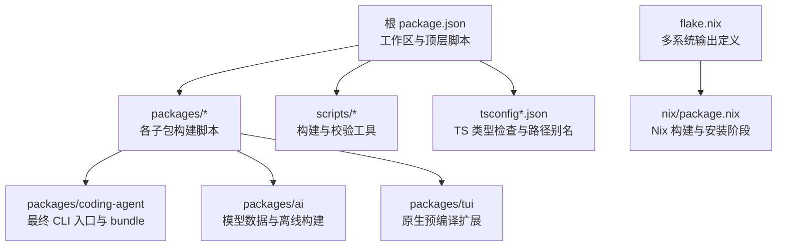
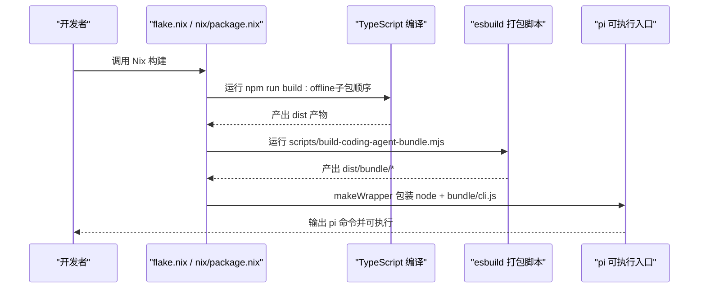
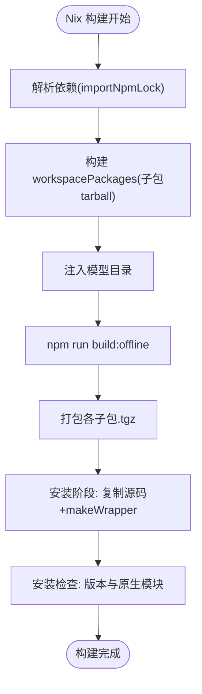
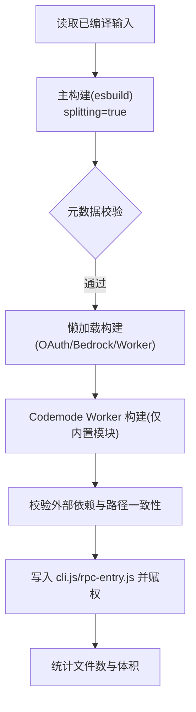
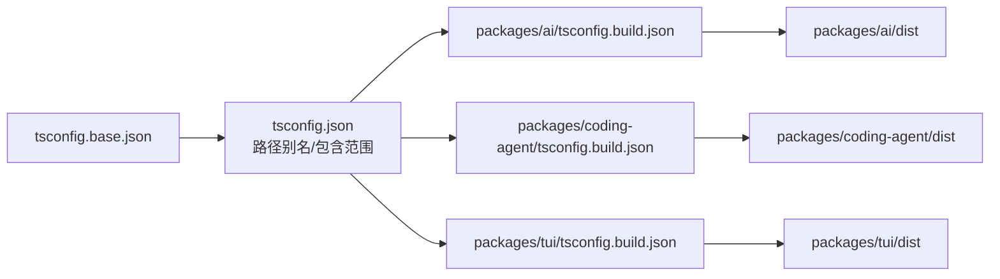
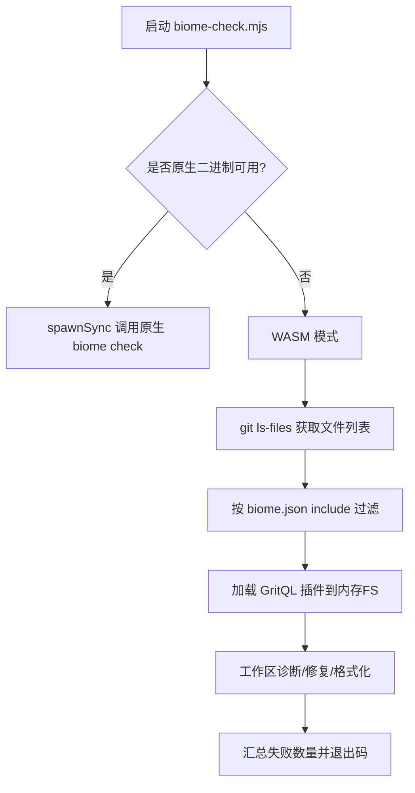
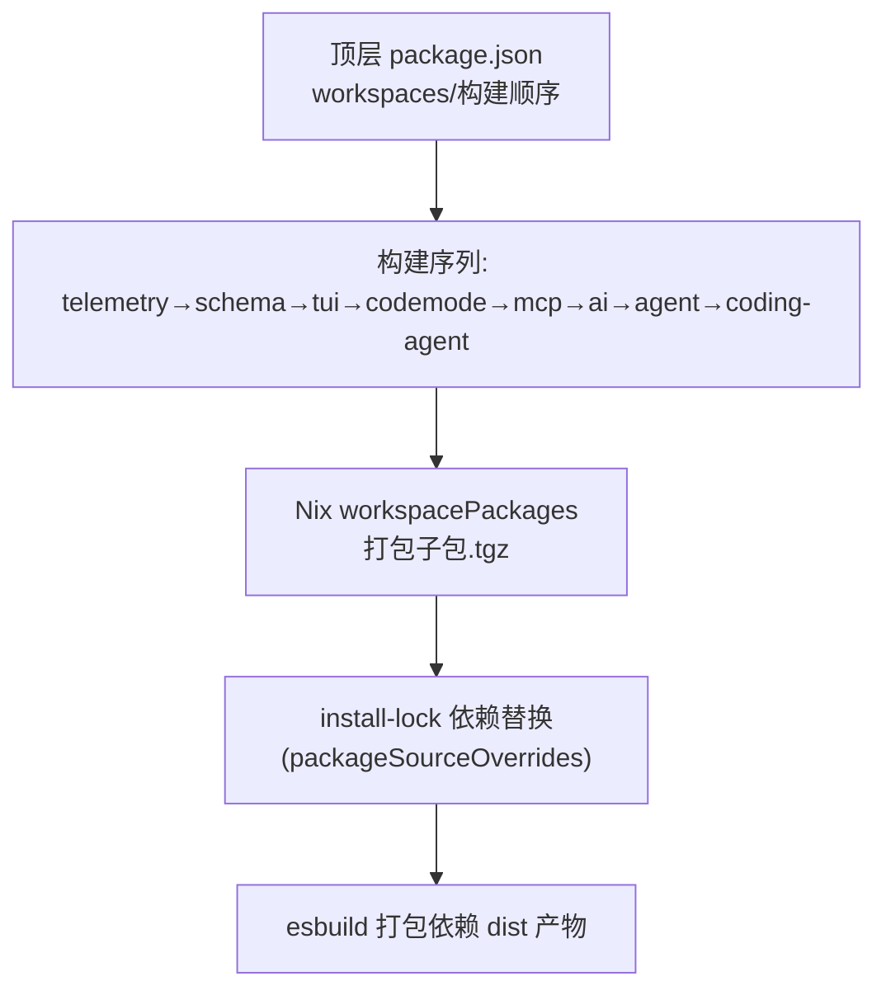

# 构建系统

<cite>
**本文引用的文件**
- [package.json](file://package.json)
- [flake.nix](file://flake.nix)
- [nix/package.nix](file://nix/package.nix)
- [scripts/build-coding-agent-bundle.mjs](file://scripts/build-coding-agent-bundle.mjs)
- [tsconfig.json](file://tsconfig.json)
- [tsconfig.base.json](file://tsconfig.base.json)
- [packages/coding-agent/package.json](file://packages/coding-agent/package.json)
- [packages/ai/package.json](file://packages/ai/package.json)
- [packages/tui/package.json](file://packages/tui/package.json)
- [scripts/biome-check.mjs](file://scripts/biome-check.mjs)
</cite>

## 目录
1. [简介](#简介)
2. [项目结构](#项目结构)
3. [核心组件](#核心组件)
4. [架构总览](#架构总览)
5. [详细组件分析](#详细组件分析)
6. [依赖关系分析](#依赖关系分析)
7. [性能与并行优化](#性能与并行优化)
8. [故障排查指南](#故障排查指南)
9. [结论](#结论)

## 简介
本文件系统性说明该仓库的构建系统与流程，覆盖 Nix 构建配置、esbuild 打包脚本、TypeScript 编译流程与代码质量检查。同时解释 Monorepo 多包构建顺序、依赖树管理、增量构建优化点与并行化策略，并给出自定义构建任务、性能调优与缓存策略建议。

## 项目结构
仓库采用 npm workspaces 组织多个子包，顶层脚本负责编排构建、校验与发布；Nix flake 提供跨平台可复现构建产物；esbuild 脚本负责将已编译的 TypeScript 输出进一步打包为可分发 bundle。

**图表来源**
- [package.json:1-75](file://package.json#L1-L75)
- [flake.nix:1-55](file://flake.nix#L1-L55)
- [nix/package.nix:1-183](file://nix/package.nix#L1-L183)
- [packages/coding-agent/package.json:1-98](file://packages/coding-agent/package.json#L1-L98)
- [packages/ai/package.json:1-116](file://packages/ai/package.json#L1-L116)
- [packages/tui/package.json:1-64](file://packages/tui/package.json#L1-L64)

**章节来源**
- [package.json:1-75](file://package.json#L1-L75)
- [flake.nix:1-55](file://flake.nix#L1-L55)

## 核心组件
- 顶层工作区与脚本：定义 workspaces、统一构建命令、校验任务与发布流程。
- Nix 构建：基于 flake.nix 暴露多系统 packages/apps/overlays，nix/package.nix 完成依赖解析、离线构建、打包与安装验证。
- esbuild 打包：scripts/build-coding-agent-bundle.mjs 对已编译产物进行二次打包、分块、懒加载与外部依赖校验。
- TypeScript 编译：tsconfig.base.json 提供基础编译选项，tsconfig.json 定义路径别名与工作区包含范围；各子包通过 tsconfig.build.json 控制构建产物。
- 代码质量：biome-check.mjs 在原生 Biome 不可用时回退到 WASM 模式，结合 Git 文件列表与 biome.json 规则进行检查与格式化。

**章节来源**
- [package.json:12-55](file://package.json#L12-L55)
- [flake.nix:13-52](file://flake.nix#L13-L52)
- [nix/package.nix:17-183](file://nix/package.nix#L17-L183)
- [scripts/build-coding-agent-bundle.mjs:1-260](file://scripts/build-coding-agent-bundle.mjs#L1-L260)
- [tsconfig.base.json:1-24](file://tsconfig.base.json#L1-L24)
- [tsconfig.json:1-75](file://tsconfig.json#L1-L75)
- [scripts/biome-check.mjs:1-124](file://scripts/biome-check.mjs#L1-L124)

## 架构总览
下图展示从源码到可执行产物的关键步骤：Nix 触发离线构建，子包依次编译，最后由 esbuild 生成 bundle 并通过 makeWrapper 包装成 pi 命令。

**图表来源**
- [flake.nix:36-52](file://flake.nix#L36-L52)
- [nix/package.nix:45-50](file://nix/package.nix#L45-L50)
- [nix/package.nix:117-144](file://nix/package.nix#L117-L144)
- [scripts/build-coding-agent-bundle.mjs:140-260](file://scripts/build-coding-agent-bundle.mjs#L140-L260)

## 详细组件分析

### Nix 构建配置与产物
- flake.nix 定义多系统输出（aarch64-darwin/aarch64-linux/x86_64-darwin/x86_64-linux），并为每个系统暴露 packages.default、apps.default 与 overlays.default。
- nix/package.nix 中：
  - 使用 importNpmLock 解析依赖，workspacePackages 先构建所有子包 tarball，再通过 packageSourceOverrides 替换 install-lock 中的内部包引用。
  - 构建阶段先注入模型目录，再执行 npm run build:offline。
  - 安装阶段复制源码到 $out/lib/pi，并用 makeWrapper 生成 $out/bin/pi，指向 @earendil-works/pi-coding-agent/dist/bundle/cli.js，同时注入 fd、ripgrep、可选 Linux 剪贴板工具等 PATH。
  - 安装检查阶段验证 --version 与原生模块可用性。

**图表来源**
- [nix/package.nix:32-92](file://nix/package.nix#L32-L92)
- [nix/package.nix:117-164](file://nix/package.nix#L117-L164)

**章节来源**
- [flake.nix:1-55](file://flake.nix#L1-L55)
- [nix/package.nix:1-183](file://nix/package.nix#L1-L183)

### esbuild 打包脚本与产物
- 入口与目标：scripts/build-coding-agent-bundle.mjs 读取 packages/coding-agent/dist 与 packages/ai/dist 的已编译 JS，生成 dist/bundle 下的主 bundle、RPC 入口与若干懒加载实现。
- 构建选项：
  - 目标 Node 22.19，ESM 格式，启用语法与空白压缩，禁用 sourcemap，设置 metafile 用于后续分析。
  - 通过插件 lazyJitiPlugin 与 httpsProxyAgentNamedExportPlugin 处理 jiti 延迟加载与代理库命名导出兼容。
  - external 仅允许 photon-node，其余外部导入将被校验器拒绝。
- 分块与懒加载：
  - 主构建开启 splitting，按 entryPoints 拆分 chunks。
  - 针对 OAuth 流、Bedrock 流、图像缩放 worker 等“变量名动态导入”场景，单独构建独立文件，确保运行时可通过相对路径或 data URL 正确定位。
- 安全与约束：
  - validateExternalImports 校验未预期的外部依赖。
  - codemode worker 仅允许 Node 内置模块，且禁止使用 import.meta。
- 输出：
  - 生成 cli.js 启动器（带 shebang 与 enableCompileCache）、rpc-entry.js 等，并打印文件数与体积。

**图表来源**
- [scripts/build-coding-agent-bundle.mjs:78-104](file://scripts/build-coding-agent-bundle.mjs#L78-L104)
- [scripts/build-coding-agent-bundle.mjs:106-138](file://scripts/build-coding-agent-bundle.mjs#L106-L138)
- [scripts/build-coding-agent-bundle.mjs:140-260](file://scripts/build-coding-agent-bundle.mjs#L140-L260)

**章节来源**
- [scripts/build-coding-agent-bundle.mjs:1-260](file://scripts/build-coding-agent-bundle.mjs#L1-L260)

### TypeScript 编译流程与路径别名
- 基础配置：tsconfig.base.json 启用严格模式、ES2024 目标、Node16 模块解析、声明与源映射等。
- 工作区配置：tsconfig.json extends base，关闭 noEmit（仅类型检查），定义大量 @earendil-works/* 路径别名以指向 packages/*/src，include 覆盖 scripts 与各包 src/test。
- 子包构建：各包通过各自的 tsconfig.build.json 与 package.json 的 build 脚本（tsc -p tsconfig.build.json）产出 dist。

**图表来源**
- [tsconfig.base.json:1-24](file://tsconfig.base.json#L1-L24)
- [tsconfig.json:1-75](file://tsconfig.json#L1-L75)
- [packages/ai/package.json:66-75](file://packages/ai/package.json#L66-L75)
- [packages/coding-agent/package.json:31-41](file://packages/coding-agent/package.json#L31-L41)
- [packages/tui/package.json:7-14](file://packages/tui/package.json#L7-L14)

**章节来源**
- [tsconfig.base.json:1-24](file://tsconfig.base.json#L1-L24)
- [tsconfig.json:1-75](file://tsconfig.json#L1-L75)

### 代码质量检查（Biome）
- 优先使用原生 Biome 二进制；若平台不支持则回退到 WASM 模式。
- WASM 模式下：
  - 通过 git ls-files 获取受控文件集合，并按 biome.json 的 include 模式过滤。
  - 将 GritQL 插件内容注入内存文件系统，打开工作区并应用诊断与修复。
  - 支持 --write 自动修复与格式化，忽略特定 schema 版本告警。

**图表来源**
- [scripts/biome-check.mjs:1-124](file://scripts/biome-check.mjs#L1-L124)

**章节来源**
- [scripts/biome-check.mjs:1-124](file://scripts/biome-check.mjs#L1-L124)

## 依赖关系分析
- 顶层 package.json 定义 workspaces 与构建顺序：telemetry → schema → tui → codemode → mcp → ai → agent → coding-agent。
- Nix 构建时，workspacePackages 会构建并打包这些子包，然后通过 packageSourceOverrides 将 install-lock 中的内部包替换为本地构建产物，保证离线构建与可重复性。
- esbuild 打包阶段依赖 packages/coding-agent/dist 与 packages/ai/dist 的存在，并在构建前校验输入文件是否存在。

**图表来源**
- [package.json:5-15](file://package.json#L5-L15)
- [nix/package.nix:32-92](file://nix/package.nix#L32-L92)
- [scripts/build-coding-agent-bundle.mjs:140-152](file://scripts/build-coding-agent-bundle.mjs#L140-L152)

**章节来源**
- [package.json:5-15](file://package.json#L5-L15)
- [nix/package.nix:32-92](file://nix/package.nix#L32-L92)
- [scripts/build-coding-agent-bundle.mjs:140-152](file://scripts/build-coding-agent-bundle.mjs#L140-L152)

## 性能与并行优化
- 增量构建
  - TypeScript：各子包使用独立的 tsconfig.build.json，配合 tsc 的增量能力可减少重编译范围。
  - esbuild：启用 splitting 与 chunkNames 哈希，避免无关模块重新打包；metafile 可用于分析未使用依赖。
- 并行构建
  - 当前顶层 build 脚本为串行顺序，适合保证依赖顺序与减少并发资源竞争。
  - 若需加速，可在 CI 中将无依赖的子包（如 telemetry、schema、tui、codemode、mcp）并行构建，再串行构建 ai、agent、coding-agent。
- 构建缓存
  - Nix：天然具备构建缓存与二进制缓存能力，建议复用远程缓存以提升速度。
  - Node/npm：利用 npm 缓存与 pnpm store（仓库也安装了 pnpm）提升依赖解析速度。
  - esbuild：保持 metafile 与稳定的 entryPoints，有助于增量与缓存命中。
- 体积与启动优化
  - esbuild 已启用 minifySyntax/minifyWhitespace，并限制外部依赖；validateExternalImports 防止意外膨胀。
  - 懒加载 OAuth/Bedrock/Worker 实现，降低主包体积与冷启动时间。
  - 启动器启用 enableCompileCache，提升首次运行性能。

[本节为通用指导，不直接分析具体文件]

## 故障排查指南
- 构建缺失输入
  - 现象：esbuild 报错缺少 bundles 输入文件。
  - 原因：未先执行子包 TypeScript 构建。
  - 解决：先运行子包构建（例如 npm run build:unbundled），再执行打包脚本。
- 意外的外部依赖
  - 现象：validateExternalImports 抛出错误。
  - 原因：打包产物引入了未被允许的外部包。
  - 解决：将其加入 allowedExternalPackages 或改为内联/懒加载。
- Codemode worker 违规
  - 现象：worker 引入非 Node 内置模块或使用 import.meta。
  - 解决：移除非内置依赖，避免使用 import.meta。
- Biome 检查失败
  - 现象：WASM 模式下报告诊断或格式化差异。
  - 解决：运行 --write 自动修复，或手动修正规则冲突。
- Nix 安装检查失败
  - 现象：--version 不一致或原生模块加载失败。
  - 解决：确认 installCheckPhase 逻辑与原生预编译产物存在。

**章节来源**
- [scripts/build-coding-agent-bundle.mjs:106-138](file://scripts/build-coding-agent-bundle.mjs#L106-L138)
- [scripts/build-coding-agent-bundle.mjs:216-234](file://scripts/build-coding-agent-bundle.mjs#L216-L234)
- [scripts/biome-check.mjs:24-124](file://scripts/biome-check.mjs#L24-L124)
- [nix/package.nix:146-164](file://nix/package.nix#L146-L164)

## 结论
该项目的构建系统以 Nix 为核心保障可复现性与跨平台分发，以 TypeScript 作为主要语言与类型系统，以 esbuild 完成高性能打包与懒加载，辅以 Biome 进行代码质量治理。Monorepo 通过顶层脚本明确构建顺序，Nix 通过 install-lock 与 packageSourceOverrides 锁定依赖树，esbuild 通过 metafile 与外部依赖校验保证产物稳定。建议在 CI 中充分利用 Nix 缓存与并行构建，并结合增量编译与懒加载策略进一步优化构建与启动性能。