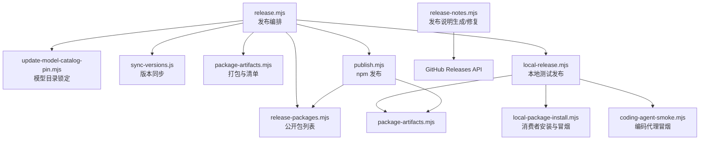
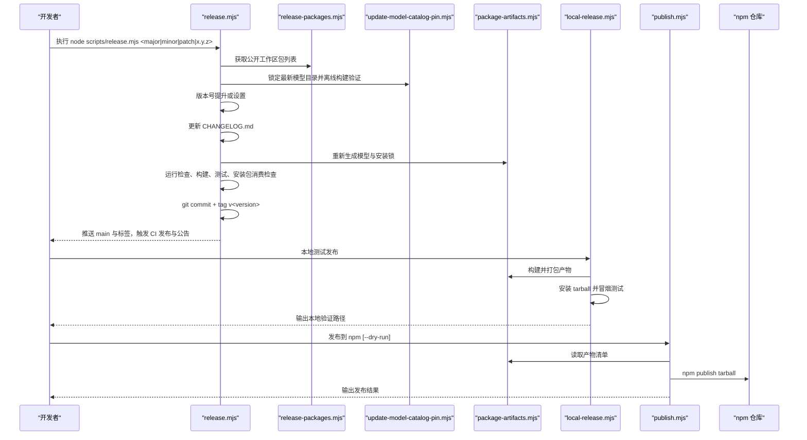
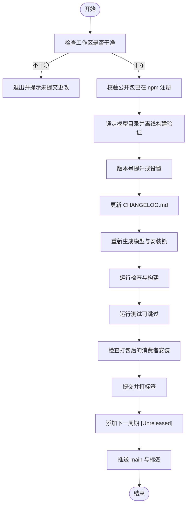
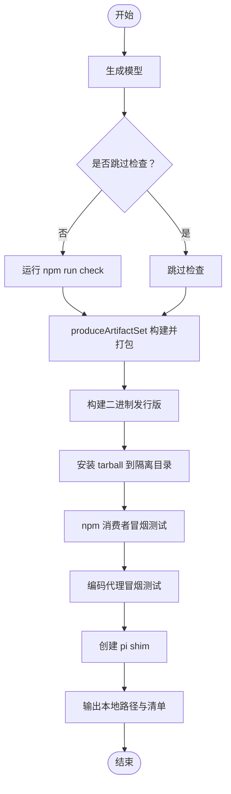
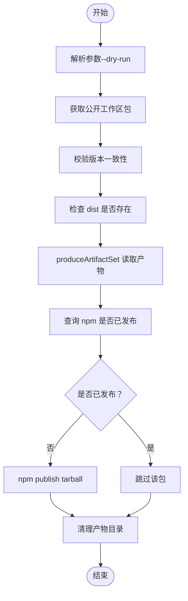
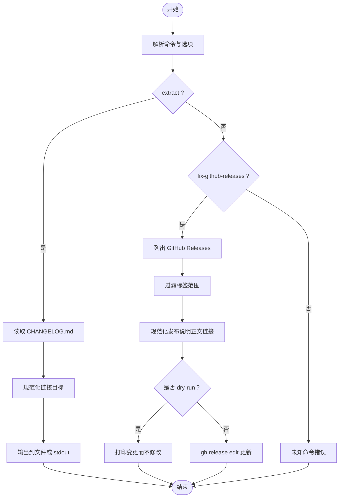
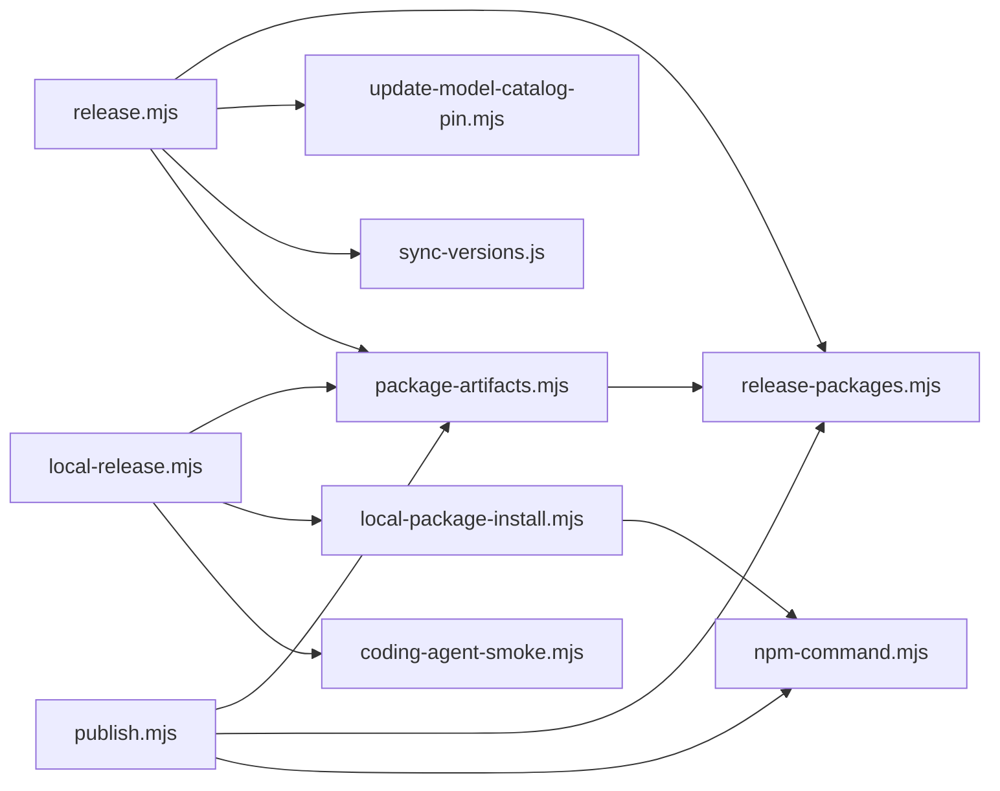
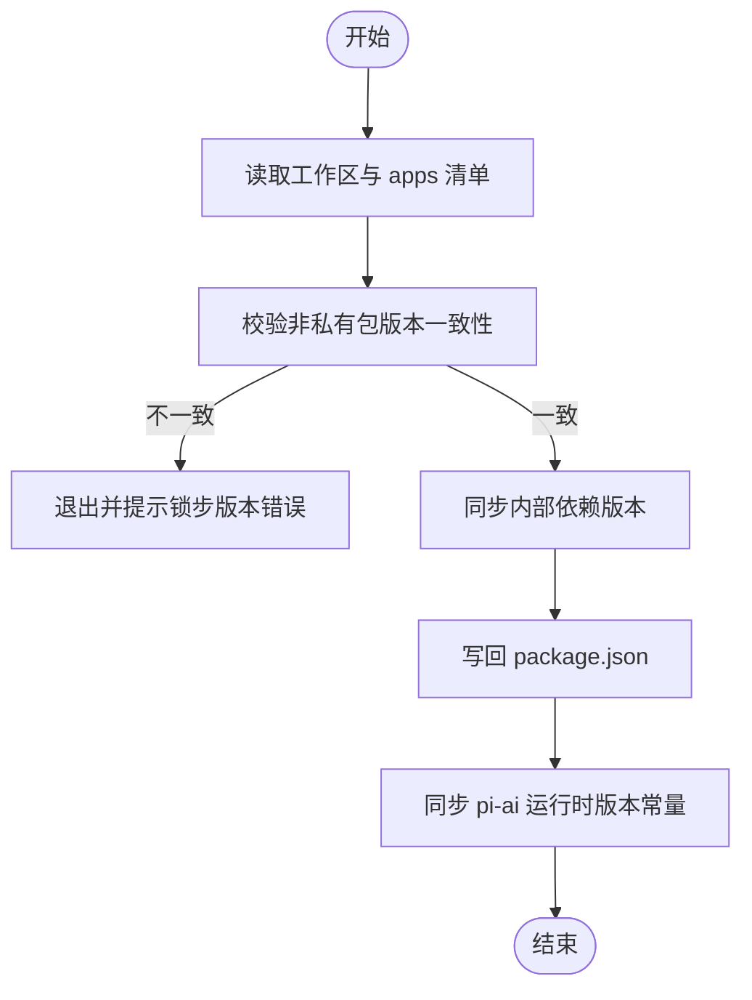
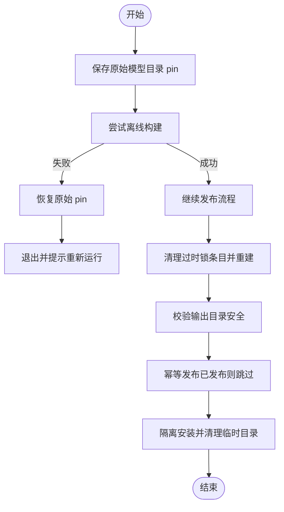

# 发布自动化脚本

<cite>
**本文引用的文件**   
- [scripts/release.mjs](file://scripts/release.mjs)
- [scripts/local-release.mjs](file://scripts/local-release.mjs)
- [scripts/publish.mjs](file://scripts/publish.mjs)
- [scripts/release-notes.mjs](file://scripts/release-notes.mjs)
- [scripts/release-packages.mjs](file://scripts/release-packages.mjs)
- [scripts/sync-versions.js](file://scripts/sync-versions.js)
- [scripts/package-artifacts.mjs](file://scripts/package-artifacts.mjs)
- [scripts/package-workspaces.mjs](file://scripts/package-workspaces.mjs)
- [scripts/update-model-catalog-pin.mjs](file://scripts/update-model-catalog-pin.mjs)
- [scripts/local-package-install.mjs](file://scripts/local-package-install.mjs)
- [scripts/coding-agent-smoke.mjs](file://scripts/coding-agent-smoke.mjs)
- [scripts/npm-command.mjs](file://scripts/npm-command.mjs)
</cite>

## 目录
1. [引言](#引言)
2. [项目结构与脚本总览](#项目结构与脚本总览)
3. [核心组件与职责](#核心组件与职责)
4. [架构总览](#架构总览)
5. [详细组件分析](#详细组件分析)
6. [依赖关系分析](#依赖关系分析)
7. [版本同步、变更日志与发布说明](#版本同步变更日志与发布说明)
8. [发布前检查清单](#发布前检查清单)
9. [错误恢复与回滚机制](#错误恢复与回滚机制)
10. [性能与稳定性建议](#性能与稳定性建议)
11. [故障排查指南](#故障排查指南)
12. [结论](#结论)

## 引言
本仓库的发布体系围绕一组 Node.js 脚本构建，覆盖本地测试发布、正式 npm 发布、版本同步、变更日志更新、模型目录锁定、产物打包与完整性校验、以及 GitHub 发布说明修复等关键环节。其中：
- release.mjs 是“主发布编排器”，负责从工作区状态检查到打标签推送的完整流程。
- local-release.mjs 用于在本地隔离环境中验证包安装、二进制运行和冒烟测试。
- publish.mjs 负责将预打包的 tarball 发布到 npm，并支持 dry-run。
- release-notes.mjs 负责从变更日志提取发布说明，并批量修复 GitHub Release 中的链接。
- release-packages.mjs 提供“公开工作区包”列表，作为其他脚本的数据源。
- sync-versions.js 保证所有非私有包锁步版本一致，并同步内部依赖引用。

## 项目结构与脚本总览
这些脚本集中在 scripts 目录下，按职责划分清晰：
- 编排类：release.mjs、local-release.mjs、publish.mjs
- 数据与工具类：release-packages.mjs、package-workspaces.mjs、npm-command.mjs
- 产物与安装类：package-artifacts.mjs、local-package-install.mjs
- 模型目录与 Nix 构建相关：update-model-catalog-pin.mjs
- 发布说明与文档：release-notes.mjs
- 版本同步：sync-versions.js
- 冒烟测试：coding-agent-smoke.mjs

**图表来源**
- [scripts/release.mjs:23-28](file://scripts/release.mjs#L23-L28)
- [scripts/local-release.mjs:8-11](file://scripts/local-release.mjs#L8-L11)
- [scripts/publish.mjs:5-7](file://scripts/publish.mjs#L5-L7)
- [scripts/release-notes.mjs:3-6](file://scripts/release-notes.mjs#L3-L6)

**章节来源**
- [scripts/release.mjs:1-341](file://scripts/release.mjs#L1-L341)
- [scripts/local-release.mjs:1-163](file://scripts/local-release.mjs#L1-L163)
- [scripts/publish.mjs:1-65](file://scripts/publish.mjs#L1-L65)
- [scripts/release-notes.mjs:1-365](file://scripts/release-notes.mjs#L1-L365)

## 核心组件与职责
- release.mjs：统一入口，执行发布前检查、Nix 模型目录锁定与离线构建验证、版本号提升、变更日志更新、产物再生成、检查与测试、提交打标签、推送触发 CI。
- local-release.mjs：构建可发布包、生成二进制发行版、在隔离目录中安装 tarball 并执行冒烟测试，输出本地验证路径。
- publish.mjs：校验包版本一致性、dist 存在性、已发布状态，使用 npm publish 发布 tarball，支持 --dry-run。
- release-notes.mjs：从 CHANGELOG.md 提取指定版本的发布说明；批量修复 GitHub Release 中的链接（包括相对路径、分支名、历史仓库地址）。
- release-packages.mjs：扫描 packages 下所有 package.json，过滤出非私有包，返回名称、版本、目录。
- package-artifacts.mjs：构建产物、打包为带完整性摘要的 tarball，生成 manifest.json，供后续安装与发布复用。
- update-model-catalog-pin.mjs：发现最新模型目录修订、校验内容哈希、对比模型分组差异、写入 nix/model-catalog.json 并支持临时回滚。
- local-package-install.mjs：在消费者项目中注入本地 tarball 依赖、安装并验证导出、bin、类型入口，确保 lockfile 解析到本地产物。
- coding-agent-smoke.mjs：对 @earendil-works/pi-coding-agent 进行最小化运行时冒烟测试，验证 CLI 版本与模块导入。
- npm-command.mjs：跨平台安全调用 npm CLI，Windows 下通过 npm_execpath 定位。

**章节来源**
- [scripts/release.mjs:23-341](file://scripts/release.mjs#L23-L341)
- [scripts/local-release.mjs:1-163](file://scripts/local-release.mjs#L1-L163)
- [scripts/publish.mjs:1-65](file://scripts/publish.mjs#L1-L65)
- [scripts/release-notes.mjs:1-365](file://scripts/release-notes.mjs#L1-L365)
- [scripts/release-packages.mjs:1-14](file://scripts/release-packages.mjs#L1-L14)
- [scripts/package-artifacts.mjs:1-142](file://scripts/package-artifacts.mjs#L1-L142)
- [scripts/update-model-catalog-pin.mjs:1-138](file://scripts/update-model-catalog-pin.mjs#L1-L138)
- [scripts/local-package-install.mjs:1-206](file://scripts/local-package-install.mjs#L1-L206)
- [scripts/coding-agent-smoke.mjs:1-52](file://scripts/coding-agent-smoke.mjs#L1-L52)
- [scripts/npm-command.mjs:1-11](file://scripts/npm-command.mjs#L1-L11)

## 架构总览
下图展示发布主流程与各脚本之间的协作关系。

**图表来源**
- [scripts/release.mjs:255-341](file://scripts/release.mjs#L255-L341)
- [scripts/local-release.mjs:97-163](file://scripts/local-release.mjs#L97-L163)
- [scripts/publish.mjs:30-65](file://scripts/publish.mjs#L30-L65)
- [scripts/package-artifacts.mjs:76-101](file://scripts/package-artifacts.mjs#L76-L101)

## 详细组件分析

### release.mjs：发布编排器
- 输入参数：支持 major/minor/patch 或显式 x.y.z 版本。
- 关键步骤：
  - 检查工作区是否干净。
  - 校验所有公开工作区包已在 npm 注册。
  - 锁定最新模型目录并执行离线构建，失败时恢复原 pin。
  - 版本号提升或设置，清理旧锁条目并重建依赖图。
  - 更新各包的 CHANGELOG.md，新增 [Unreleased] 区块。
  - 重新生成模型、安装锁，运行 check/build/test/check:package-install。
  - 提交并打标签，再次提交下一周期 [Unreleased] 更新。
  - 推送 main 与标签，触发 CI 发布与 pi.dev 公告。

**图表来源**
- [scripts/release.mjs:255-341](file://scripts/release.mjs#L255-L341)

**章节来源**
- [scripts/release.mjs:34-55](file://scripts/release.mjs#L34-L55)
- [scripts/release.mjs:57-87](file://scripts/release.mjs#L57-L87)
- [scripts/release.mjs:97-129](file://scripts/release.mjs#L97-L129)
- [scripts/release.mjs:186-209](file://scripts/release.mjs#L186-L209)
- [scripts/release.mjs:217-253](file://scripts/release.mjs#L217-L253)
- [scripts/release.mjs:255-341](file://scripts/release.mjs#L255-L341)

### local-release.mjs：本地测试发布
- 功能：构建并发布可安装包，生成二进制发行版，在隔离目录中安装 tarball，执行冒烟测试。
- 选项：
  - --out：输出目录（默认 tmpdir）。
  - --force：覆盖已有输出目录。
  - --skip-check：跳过 npm run check。
  - --skip-test：跳过 ./test.sh。
  - --skip-install：仅生成产物，不创建隔离安装。
  - --skip-bun-install：跳过 Bun 安装。
- 流程要点：
  - 生成模型、可选运行 check。
  - 调用 produceArtifactSet 构建并打包。
  - 构建当前平台的二进制发行版。
  - 在隔离目录安装每个包，执行 npm 消费者冒烟测试；对编码代理执行专用冒烟测试。
  - 创建 pi shim（Windows 与非 Windows 不同处理）。
  - 输出本地二进制与隔离安装路径。

**图表来源**
- [scripts/local-release.mjs:97-163](file://scripts/local-release.mjs#L97-L163)
- [scripts/package-artifacts.mjs:76-101](file://scripts/package-artifacts.mjs#L76-L101)
- [scripts/local-package-install.mjs:148-201](file://scripts/local-package-install.mjs#L148-L201)
- [scripts/coding-agent-smoke.mjs:8-51](file://scripts/coding-agent-smoke.mjs#L8-L51)

**章节来源**
- [scripts/local-release.mjs:13-28](file://scripts/local-release.mjs#L13-L28)
- [scripts/local-release.mjs:30-53](file://scripts/local-release.mjs#L30-L53)
- [scripts/local-release.mjs:55-68](file://scripts/local-release.mjs#L55-L68)
- [scripts/local-release.mjs:70-96](file://scripts/local-release.mjs#L70-L96)
- [scripts/local-release.mjs:97-163](file://scripts/local-release.mjs#L97-L163)

### publish.mjs：npm 发布
- 功能：校验所有公开包版本一致且 dist 存在，读取产物清单，查询 npm 是否已发布，按需发布 tarball。
- 选项：--dry-run 仅打印将要发布的包。
- 关键点：
  - 使用 isPublished 查询 npm，区分 E404 与真实错误。
  - 使用 produceArtifactSet 读取已打包产物。
  - 对未发布的包执行 npm publish --access public --provenance --ignore-scripts。
  - 最终清理临时产物目录。

**图表来源**
- [scripts/publish.mjs:9-11](file://scripts/publish.mjs#L9-L11)
- [scripts/publish.mjs:13-28](file://scripts/publish.mjs#L13-L28)
- [scripts/publish.mjs:30-65](file://scripts/publish.mjs#L30-L65)
- [scripts/package-artifacts.mjs:76-101](file://scripts/package-artifacts.mjs#L76-L101)

**章节来源**
- [scripts/publish.mjs:1-65](file://scripts/publish.mjs#L1-L65)

### release-notes.mjs：发布说明生成与修复
- 命令：
  - extract：从 CHANGELOG.md 提取指定版本的发布说明，规范化链接。
  - fix-github-releases：批量修复 GitHub Release 中的链接（支持 --tag、--since-tag、--dry-run）。
- 能力：
  - 规范化相对路径、分支名（main/master）、历史仓库地址。
  - 计算唯一变更集，避免重复修改。
  - 通过 gh CLI 编辑 GitHub Release。

**图表来源**
- [scripts/release-notes.mjs:16-38](file://scripts/release-notes.mjs#L16-L38)
- [scripts/release-notes.mjs:60-103](file://scripts/release-notes.mjs#L60-L103)
- [scripts/release-notes.mjs:134-147](file://scripts/release-notes.mjs#L134-L147)
- [scripts/release-notes.mjs:197-239](file://scripts/release-notes.mjs#L197-L239)
- [scripts/release-notes.mjs:250-266](file://scripts/release-notes.mjs#L250-L266)
- [scripts/release-notes.mjs:268-344](file://scripts/release-notes.mjs#L268-L344)

**章节来源**
- [scripts/release-notes.mjs:1-365](file://scripts/release-notes.mjs#L1-L365)

### release-packages.mjs：公开工作区包列表
- 功能：递归查找 packages 下的所有 package.json，过滤 private !== true 的包，返回 {directory, name, version}。
- 用途：被 release.mjs、publish.mjs、package-artifacts.mjs 等复用。

**章节来源**
- [scripts/release-packages.mjs:1-14](file://scripts/release-packages.mjs#L1-L14)

### package-artifacts.mjs：产物打包与清单
- 功能：
  - 可选构建 clean/build 或 build:offline。
  - 对每个公开包执行 npm pack，重命名为带 sha512 摘要的 tarball。
  - 生成 manifest.json，包含 source（commit、dirty）、packages（name、version、tarball、integrity）。
  - readArtifactSet 校验清单完整性与 tarball 完整性。
- 安全：
  - 输出目录限制：不能位于仓库根或其祖先，也不能是文件系统根；若位于仓库内必须在 .artifacts 下。
  - 强制覆盖需 --force。

**章节来源**
- [scripts/package-artifacts.mjs:1-142](file://scripts/package-artifacts.mjs#L1-L142)

### update-model-catalog-pin.mjs：模型目录锁定
- 功能：
  - 发现最新模型目录修订（pi.dev API），校验 revision 与 body 一致性。
  - 对比当前 pin 与 live catalog 的模型分组差异，判断是否 stale。
  - 校验当前 checkout 能否用 live catalog 成功 hydrate。
  - 写入 nix/model-catalog.json，返回 revision 与 bytes。
- 用途：release.mjs 在发布前锁定并验证 Nix 构建所需模型数据。

**章节来源**
- [scripts/update-model-catalog-pin.mjs:1-138](file://scripts/update-model-catalog-pin.mjs#L1-L138)

### local-package-install.mjs：消费者安装与冒烟
- 功能：
  - wireConsumer：将 artifactSet 中的 tarball 以 file: 协议注入消费者 package.json（npm/pnpm）。
  - installConsumer：创建最小消费者项目，安装依赖（npm/bun）。
  - smokeTestNpmConsumer：校验 main/types/bin、exports、lockfile 解析到本地 tarball，并运行最小导入冒烟。
- 用途：local-release.mjs 在隔离目录中验证包安装与运行。

**章节来源**
- [scripts/local-package-install.mjs:1-206](file://scripts/local-package-install.mjs#L1-L206)

### coding-agent-smoke.mjs：编码代理冒烟
- 功能：
  - 对 @earendil-works/pi-coding-agent 进行最小导入与 CLI 版本检查。
  - 设置隔离 HOME 与环境变量，确保离线与无遥测。
- 用途：local-release.mjs 在安装编码代理后执行冒烟测试。

**章节来源**
- [scripts/coding-agent-smoke.mjs:1-52](file://scripts/coding-agent-smoke.mjs#L1-L52)

### npm-command.mjs：跨平台 npm 调用
- 功能：在 Windows 上通过 npm_execpath 定位 npm CLI，避免直接调用失败。

**章节来源**
- [scripts/npm-command.mjs:1-11](file://scripts/npm-command.mjs#L1-L11)

## 依赖关系分析

**图表来源**
- [scripts/release.mjs:23-28](file://scripts/release.mjs#L23-L28)
- [scripts/local-release.mjs:8-11](file://scripts/local-release.mjs#L8-L11)
- [scripts/publish.mjs:5-7](file://scripts/publish.mjs#L5-L7)
- [scripts/package-artifacts.mjs:6-7](file://scripts/package-artifacts.mjs#L6-L7)
- [scripts/local-package-install.mjs:6](file://scripts/local-package-install.mjs#L6)

**章节来源**
- [scripts/release.mjs:23-28](file://scripts/release.mjs#L23-L28)
- [scripts/local-release.mjs:8-11](file://scripts/local-release.mjs#L8-L11)
- [scripts/publish.mjs:5-7](file://scripts/publish.mjs#L5-L7)
- [scripts/package-artifacts.mjs:6-7](file://scripts/package-artifacts.mjs#L6-L7)
- [scripts/local-package-install.mjs:6](file://scripts/local-package-install.mjs#L6)

## 版本同步、变更日志与发布说明

### 版本同步（sync-versions.js）
- 校验所有非私有包版本一致（锁步版本）。
- 同步 workspace 包与 apps/* 的内部依赖引用为精确版本。
- 特殊处理：@earendil-works/pi-ai 的运行时版本常量文件保持与 package.json 同步。

**图表来源**
- [scripts/sync-versions.js:15-31](file://scripts/sync-versions.js#L15-L31)
- [scripts/sync-versions.js:34-47](file://scripts/sync-versions.js#L34-L47)
- [scripts/sync-versions.js:51-87](file://scripts/sync-versions.js#L51-L87)
- [scripts/sync-versions.js:89-99](file://scripts/sync-versions.js#L89-L99)

**章节来源**
- [scripts/sync-versions.js:1-99](file://scripts/sync-versions.js#L1-L99)

### 变更日志更新（release.mjs）
- 将 [Unreleased] 替换为 [version] - date。
- 为下一周期在每个 CHANGELOG.md 顶部插入新的 [Unreleased] 区块。

**章节来源**
- [scripts/release.mjs:211-253](file://scripts/release.mjs#L211-L253)

### 发布说明生成（release-notes.mjs）
- extract：根据 --version/--tag 抽取对应版本的变更日志段落，规范化链接后输出。
- fix-github-releases：遍历 GitHub Releases，规范化正文中的链接，支持 --dry-run 预览。

**章节来源**
- [scripts/release-notes.mjs:16-38](file://scripts/release-notes.mjs#L16-L38)
- [scripts/release-notes.mjs:250-266](file://scripts/release-notes.mjs#L250-L266)
- [scripts/release-notes.mjs:268-344](file://scripts/release-notes.mjs#L268-L344)

## 发布前检查清单
- 工作区干净：无未提交、未跟踪或删除的文件。
- 公开包已在 npm 注册：release.mjs 会逐一查询 npm view 并拒绝 404。
- 模型目录 pin 有效：update-model-catalog-pin.mjs 会校验 live catalog 能 hydrate 当前 checkout。
- 版本号正确：release.mjs 支持 bump 或显式设置，并确保显式版本大于当前版本。
- 变更日志已更新：[Unreleased] 已转换为 [version] - date，并为下一周期新增 [Unreleased]。
- 产物已生成：generate:models、check:model-data、install-lock:coding-agent。
- 检查与构建通过：npm run check、build:offline。
- 测试通过：./test.sh（可通过 PI_RELEASE_SKIP_TESTS=1 跳过）。
- 消费者安装检查通过：npm run check:package-install。
- 本地测试发布通过：local-release.mjs 在隔离目录安装并冒烟测试。
- 发布准备就绪：publish.mjs 确认所有包版本一致、dist 存在、tarball 可用。

**章节来源**
- [scripts/release.mjs:255-341](file://scripts/release.mjs#L255-L341)
- [scripts/local-release.mjs:97-163](file://scripts/local-release.mjs#L97-L163)
- [scripts/publish.mjs:30-65](file://scripts/publish.mjs#L30-L65)

## 错误恢复与回滚机制
- 模型目录 pin 回滚：
  - release.mjs 在 pinAndBuildWithNewestModelCatalog 中保存原始 nix/model-catalog.json 内容，若离线构建失败则恢复原 pin，避免污染工作区。
- 锁文件清理与重建：
  - bumpOrSetVersion 会移除过时的工作区依赖锁条目，然后重新生成 package-lock.json 并执行 npm ci。
- 产物输出目录保护：
  - package-artifacts.mjs 禁止输出到仓库根、祖先或文件系统根；若在仓库内必须位于 .artifacts 下；覆盖需 --force。
- 发布幂等性：
  - publish.mjs 查询 npm 是否已发布同名同版本包，已发布则跳过，避免重复发布。
- 本地安装隔离：
  - local-release.mjs 在 tmpdir 下创建隔离目录，并在 finally 中清理临时消费者目录，避免污染工作区。

**图表来源**
- [scripts/release.mjs:97-129](file://scripts/release.mjs#L97-L129)
- [scripts/release.mjs:149-209](file://scripts/release.mjs#L149-L209)
- [scripts/package-artifacts.mjs:58-74](file://scripts/package-artifacts.mjs#L58-L74)
- [scripts/publish.mjs:13-28](file://scripts/publish.mjs#L13-L28)
- [scripts/local-release.mjs:117-136](file://scripts/local-release.mjs#L117-L136)

**章节来源**
- [scripts/release.mjs:97-129](file://scripts/release.mjs#L97-L129)
- [scripts/release.mjs:149-209](file://scripts/release.mjs#L149-L209)
- [scripts/package-artifacts.mjs:58-74](file://scripts/package-artifacts.mjs#L58-L74)
- [scripts/publish.mjs:13-28](file://scripts/publish.mjs#L13-L28)
- [scripts/local-release.mjs:117-136](file://scripts/local-release.mjs#L117-L136)

## 性能与稳定性建议
- 使用 PI_RELEASE_SKIP_TESTS=1 跳过耗时测试，但保留检查与安装检查，适合在已充分测试的环境加速发布。
- 使用 local-release.mjs 的 --skip-check 与 --skip-test 快速验证产物结构。
- 使用 publish.mjs 的 --dry-run 先预览发布行为，再执行实际发布。
- 使用 release-notes.mjs 的 --dry-run 预览 GitHub Release 链接修复效果。

[本节为通用建议，不直接分析具体文件]

## 故障排查指南
- npm 查询失败：
  - release.mjs 与 publish.mjs 均会捕获 npm view 的错误输出，区分 E404 与其他错误。
  - 若网络或权限问题导致查询失败，请检查 npm 登录状态与网络连通性。
- 模型目录构建失败：
  - 若 offline 构建失败，release.mjs 会恢复原始 pin 并提示可能原因（模型 ID、类型或 API 不匹配）。
  - 可能需要先发布最新的 model catalog，或更新 provider 配置。
- 锁文件不一致：
  - bumpOrSetVersion 会清理过时的工作区依赖锁条目并重建；若仍失败，可手动执行 npm ci --ignore-scripts。
- 消费者安装失败：
  - local-package-install.mjs 会校验 main/types/bin 与 exports 的存在性与路径合法性，并验证 lockfile 解析到本地 tarball。
  - 若失败，检查包导出声明与 bin 路径是否正确。
- 编码代理冒烟失败：
  - coding-agent-smoke.mjs 会检查模块导入与 CLI 版本；若失败，检查包版本与环境变量（PI_OFFLINE、PI_TELEMETRY）。

**章节来源**
- [scripts/release.mjs:57-87](file://scripts/release.mjs#L57-L87)
- [scripts/release.mjs:97-129](file://scripts/release.mjs#L97-L129)
- [scripts/release.mjs:149-209](file://scripts/release.mjs#L149-L209)
- [scripts/local-package-install.mjs:162-201](file://scripts/local-package-install.mjs#L162-L201)
- [scripts/coding-agent-smoke.mjs:8-51](file://scripts/coding-agent-smoke.mjs#L8-L51)

## 结论
本发布体系通过多脚本协作实现了从本地测试到正式发布的完整闭环：
- release.mjs 作为编排器，确保发布前的环境、模型目录、版本、变更日志、构建与测试均满足要求。
- local-release.mjs 提供隔离的本地验证，降低误发风险。
- publish.mjs 实现幂等发布，避免重复发布。
- release-notes.mjs 保障发布说明与 GitHub Release 链接的一致性。
- release-packages.mjs、package-artifacts.mjs、update-model-catalog-pin.mjs、local-package-install.mjs、coding-agent-smoke.mjs、sync-versions.js 等脚本提供稳定的数据与工具支撑。

建议在正式发布前严格遵循检查清单，优先使用 local-release.mjs 与 publish.mjs --dry-run 进行预验证，并在出现异常时利用内置的回滚与清理机制恢复工作区状态。